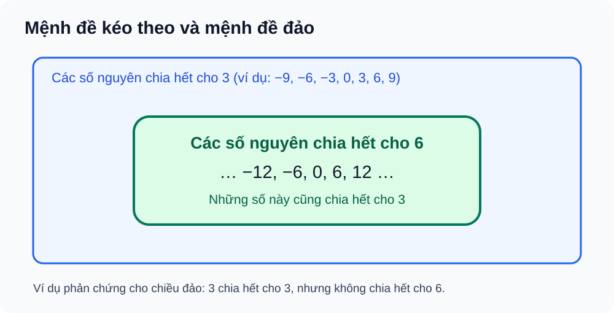
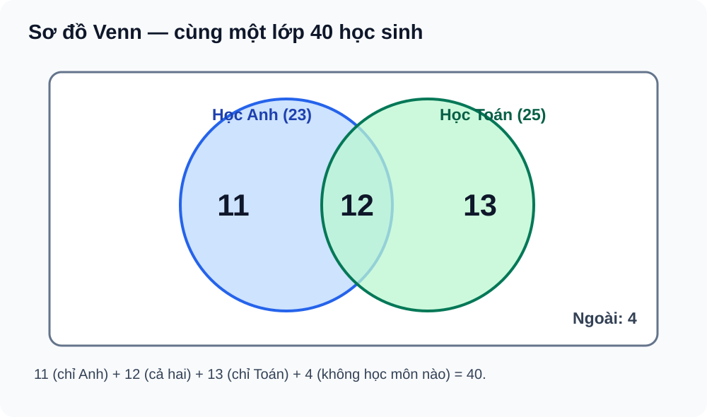

---
hide:
  - toc
---

  
HỌC THEO CHUYÊN ĐỀ · CĐ01 · TOÁN THPT

  <nav class="thpt-r4-topic-steps" aria-label="Ba phần học của Chuyên đề 01">
    <a href="../kien-thuc/" aria-current="page">01 · Kiến thức</a>
    <a href="../luyen-tap/">02 · Luyện tập</a>
    <a href="../tu-kiem-tra/">03 · Tự kiểm tra</a>
  </nav>
  
<a href="../../">← Tổng quan các Chuyên đề</a>

  

<!-- TOPIC01_APPROVED_SOURCE_START -->
# Chuyên đề 01 · Mệnh đề, tập hợp và tư duy logic toán học

Khi học một khái niệm toán, điều quan trọng không chỉ là nhớ ký hiệu mà là biết mình đang khẳng định điều gì, dựa vào đâu để kết luận và có bỏ sót trường hợp nào không. Chuyên đề này đưa em đi từ việc kiểm tra một câu nói đến việc mô tả các nhóm đối tượng bằng tập hợp, rồi dùng chính các tập hợp ấy để giải quyết bài toán đếm.

# Kiến thức

## 1. Từ lời khẳng định đến chứng cứ

**Khám phá kiến thức**

Một bạn nói: “Mọi thành viên câu lạc bộ Toán đều biết lập trình”. Nếu tìm được một thành viên không biết lập trình, ta có thể bác bỏ câu ấy ngay; nhưng vài bạn biết lập trình chưa đủ chứng minh lời khẳng định đúng. Hai cách kiểm chứng ấy dẫn đến những ý tưởng nền tảng của logic toán học: mệnh đề, phủ định, phản ví dụ và lượng từ.

Trước khi tiếp tục, chỉ cần nhớ: các số nguyên \(\mathbb Z\) gồm \(\ldots,-2,-1,0,1,2,\ldots\); các số thực \(\mathbb R\) là những số biểu diễn được trên trục số; \(n\) chia hết cho \(k\ne0\) nghĩa là tồn tại số nguyên \(t\) sao cho \(n=kt\). Ký hiệu \(\le\) bao gồm cả trường hợp bằng. Các kiến thức này sẽ được dùng ngay trong những ví dụ dưới đây.

Để lập luận đúng, ta phải hiểu câu nào có thể xét đúng–sai, câu nào còn phụ thuộc vào biến và cách bác bỏ một nhận định. Những ý tưởng về phủ định, kéo theo, tương đương và lượng từ sẽ lần lượt xuất hiện từ chính câu hỏi ấy.

<!-- LESSON_ID: TOP01-M01; OUTCOME_ID: TOP01-O01 -->

### 1.1. Nhận biết mệnh đề và mệnh đề chứa biến

Vì sao một câu hỏi không phải là mệnh đề, còn một câu khẳng định có biến lại chưa thể xét đúng–sai ngay?

Khi nghe một câu nói, không phải lúc nào ta cũng có thể kết luận ngay câu đó đúng hay sai. “13 là số nguyên tố” là một khẳng định đúng vì 13 chỉ có hai ước dương là 1 và 13; “13 là số chẵn” là khẳng định sai. Cả hai đều là **mệnh đề**, bởi mỗi câu có một giá trị đúng hoặc sai xác định. Câu hỏi “13 có phải số nguyên tố không?” thì khác: nó yêu cầu trả lời, chứ chưa khẳng định điều gì.

> **ĐỊNH NGHĨA**
>
> Mệnh đề là câu khẳng định có giá trị đúng hoặc sai xác định. Mệnh đề chứa biến \(P(x)\) chưa có giá trị đúng-sai cố định nếu chưa gán biến hoặc lượng từ, với miền D nêu rõ.

Bây giờ xét câu \(n+1=4\) với \(n\) là số nguyên. Nếu thay \(n=3\), đẳng thức đúng; thay \(n=4\), đẳng thức sai. Ta không thể gán cho phát biểu ban đầu một giá trị đúng–sai độc lập với \(n\). Đây là **mệnh đề chứa biến**. Để kiểm chứng một phát biểu như vậy, phải biết biến thuộc miền nào và đã được gán giá trị hay lượng từ nào chưa. Chính sự phân biệt này giúp việc chứng minh sau này không bị mơ hồ.

**Ví dụ**

**Đề bài.** Xét “16 là số chính phương”, “\(n+2=7\)” với \(n\in\mathbb Z\), và “Hãy tính \(n+2\)”. Phân loại ba câu.

**Lời giải.** Câu đầu là mệnh đề đúng (\(16=4^2\)). Câu thứ hai chứa biến; nó đúng với \(n=5\) nhưng sai với \(n=0\). Câu cuối là một yêu cầu, không phải khẳng định. Ta chọn cách phân loại dựa trên việc câu đã có giá trị đúng–sai xác định hay chưa.

**Vận dụng**

“\(2k+1\) là số lẻ”, với \(k\in\mathbb Z\), là mệnh đề hay phát biểu chứa biến? Nếu viết “Với mọi \(k\in\mathbb Z\), \(2k+1\) là số lẻ”, em có thể kết luận gì?

Đối chiếu

Câu đầu còn chứa biến \(k\) chưa được lượng hóa. Câu thứ hai là một mệnh đề đúng: mọi số nguyên \(k\) đều cho biểu thức \(2k+1\) có dạng số lẻ. Nếu em vẫn phân vân, thử \(k=0\) và \(k=2\), rồi phân biệt việc kiểm vài giá trị với một lời khẳng định cho **mọi** số nguyên.

**Kiểm lỗi**

Nếu em chỉ thử vài giá trị rồi kết luận cho *mọi* số nguyên, em đã nhầm kiểm tra ví dụ với chứng minh. Hãy đọc lại **Kiến thức 1.1**, rồi làm **Bài 2** trong Luyện tập: phân biệt biến chưa gán, mệnh đề có lượng từ “mọi” và mệnh đề “tồn tại”.

<!-- LESSON_ID: TOP01-M02; OUTCOME_ID: TOP01-O02 -->

### 1.2. Phủ định đúng nghĩa

Nếu điểm ở ngay dấu bằng, phủ định của một bất đẳng thức phải đổi dấu thế nào?

Khi đã phân biệt được khẳng định, ta cần biết thế nào là câu thực sự bác bỏ khẳng định ấy. Một mệnh đề có thể đúng hoặc sai; **phủ định** là phát biểu đổi giá trị đúng–sai ấy. Nếu \(P\) là “7 là số chẵn” thì \(\neg P\) là “7 không phải số chẵn”. Khi \(P\) sai, phủ định đúng, và ngược lại. Với bất đẳng thức, phải đảo đúng cả dấu bằng: phủ định của \(x\ge3\) là \(x<3\), chứ không phải \(x\le3\), bởi tại \(x=3\) hai câu sau không đối lập đúng–sai.

> **ĐỊNH NGHĨA**
>
> Phủ định \(\neg P\) đúng khi P sai và sai khi P đúng. Phủ định \(x\ge a\) là \(x<a\); phủ định \(\forall x\in D, P(x)\) là \(\exists x\in D,\neg P(x)\).

Điều này càng quan trọng khi câu chứa lượng từ. Xét \(P\): “Mọi số thực \(x\) đều thỏa \(x^2\ge0\)”. Để bác bỏ \(P\), ta cần **ít nhất một** số thực làm \(x^2<0\); vì không tồn tại số ấy, phủ định là sai và \(P\) đúng. Như vậy, phủ định của “mọi” không phải “mọi phần tử đều không”, mà là “tồn tại ít nhất một phần tử không”.

**Ví dụ**

**Đề bài.** Với \(x\in\mathbb R\), phủ định câu “\(x>2\) và \(x<5\)” là gì?

**Lời giải.** Muốn bác bỏ việc thỏa đồng thời cả hai, phải có ít nhất một điều kiện sai: \(x\le2\) **hoặc** \(x\ge5\). Chẳng hạn \(x=2\) không thỏa câu gốc nhưng thỏa phủ định; giữ nguyên miền số thực.

**Vận dụng**

Hãy phủ định hai phát biểu “\(t\ge5\)” và “\(t<-1\)”, với \(t\in\mathbb R\).

Đối chiếu

Hai phủ định lần lượt là \(t<5\) và \(t\ge-1\). Nếu em viết \(t\le5\), hãy thử ngay \(t=5\): cả phát biểu gốc và câu mới đều đúng, nên đó không thể là phép phủ định.

**Kiểm lỗi**

Nếu em viết phủ định của “t lớn hơn hoặc bằng 5” thành “t nhỏ hơn hoặc bằng 5”, hai câu cùng đúng tại t = 5, nên chưa thực sự phủ định nhau. Hãy xem lại **Kiến thức 1.2**, rồi làm **Bài 3** và **Bài 4** trong Luyện tập để tập đổi đúng giá trị chân lý và dấu bằng.

<!-- LESSON_ID: TOP01-M03; OUTCOME_ID: TOP01-O03 -->

### 1.3. Điều kiện cần, đủ và kéo theo

Một quan hệ kéo theo đúng có cho phép suy ngược không? Em thử tìm một phản ví dụ.

Phủ định giúp nhận ra phát biểu sai; còn để suy ra kết luận mới, ta phải hiểu chiều của lập luận. Giả sử một số nguyên chia hết cho 6. Vì số ấy viết được \(n=6k=3(2k)\), nó chắc chắn cũng chia hết cho 3. Ta diễn đạt: “Nếu \(n\) chia hết cho 6 thì \(n\) chia hết cho 3”, ký hiệu \(P\Rightarrow Q\). Khi đó \(P\) là **điều kiện đủ** để có \(Q\), còn \(Q\) là **điều kiện cần** để có \(P\).

> **TÍNH CHẤT**
>
> Kéo theo \(P\Rightarrow Q\) chỉ sai khi P đúng mà Q sai. P là **điều kiện đủ** cho Q, Q là **điều kiện cần** cho P. Không mặc nhiên có kéo theo đảo.

Nhưng một kết luận đúng theo chiều thuận chưa cho phép đọc ngược. Số 3 chia hết cho 3 mà không chia hết cho 6, nên câu đảo \(Q\Rightarrow P\) sai. Một phản ví dụ đủ bác bỏ một mệnh đề kéo theo nếu tiền đề đúng mà kết luận sai. Về logic hình thức, \(P\Rightarrow Q\) chỉ sai khi \(P\) đúng và \(Q\) sai; quy tắc này không có nghĩa mọi câu “nếu...thì...” là một quan hệ nguyên nhân trong đời sống.

*Quan sát hình:* Hình giúp đọc chiều suy luận: mọi bội của 6 là bội của 3, nhưng vùng chỉ thuộc bội của 3 không cho phép suy ngược.

**Ví dụ**

**Đề bài.** Với \(n\in\mathbb Z\), chứng minh \(10\mid n\Rightarrow5\mid n\) và kiểm chiều đảo.

**Lời giải.** Viết \(n=10k=5(2k)\) với \(k\in\mathbb Z\), nên chiều thuận đúng. Chiều đảo sai tại \(n=5\). Ta dùng phép phân tích bội để chứng minh và một phản ví dụ đúng miền để bác bỏ chiều đảo.

**Vận dụng**

Với \(n\in\mathbb Z\), “Nếu \(n\) chia hết cho 8 thì \(n\) chia hết cho 4” đúng không? Chiều đảo có đúng không?

Đối chiếu

Chiều thuận đúng vì \(n=8k=4(2k)\). Chiều đảo sai: \(n=4\) chia hết cho 4 nhưng không chia hết cho 8. Muốn chứng minh hai chiều, phải có hai lập luận riêng hoặc phép biến đổi tương đương hợp lệ.

**Kiểm lỗi**

Nếu em kết luận chiều đảo đúng chỉ vì chiều thuận đúng, hãy thử số 4: chia hết cho 4 nhưng không chia hết cho 8. Đọc lại **Kiến thức 1.3**, rồi thử **Bài 5** trong Luyện tập; ở mỗi chiều phải tìm chứng minh hoặc phản ví dụ riêng.

<!-- LESSON_ID: TOP01-M04; OUTCOME_ID: TOP01-O04 -->

### 1.4. Hai chiều của tương đương

Để chứng minh hai điều kiện tương đương, tại sao cần kiểm cả hai chiều?

Không phải suy luận nào cũng đảo được. Để được tương đương, cả hai chiều đều cần chứng minh. Ta vừa thấy một mệnh đề kéo theo đúng chưa chắc có chiều đảo đúng. Vậy khi nào hai phát biểu thực sự tương đương? Khi **cả** \(P\Rightarrow Q\) và \(Q\Rightarrow P\) đều đúng, ta viết \(P\Leftrightarrow Q\), đọc là “\(P\) khi và chỉ khi \(Q\)”. Vì thế chứng minh tương đương đòi hỏi hai chiều, hoặc một chuỗi biến đổi mà từng bước đều có thể làm ngược hợp lệ.

> **ĐỊNH NGHĨA**
>
> Tương đương \(P\Leftrightarrow Q\) khi cả \(P\Rightarrow Q\) và \(Q\Rightarrow P\) đều đúng. Chứng minh phải kiểm hai chiều hoặc chuỗi biến đổi tương đương.

Chẳng hạn, với \(n\in\mathbb Z\), “\(n\) chẵn khi và chỉ khi \(n^2\) chẵn” là đúng. Chiều thuận: nếu \(n=2k\) thì \(n^2=4k^2\) chẵn. Chiều ngược: nếu \(n\) lẻ thì \(n=2k+1\), suy ra \(n^2=4k(k+1)+1\) lẻ; do đó \(n^2\) chẵn buộc \(n\) chẵn. Cả hai chiều đều có lập luận, không dựa vào vài phép thử.

**Ví dụ**

**Đề bài.** Với \(x\in\mathbb R\), hai điều kiện \(|x|=2\) và \(x^2=4\) có tương đương không?

**Lời giải.** Nếu \(|x|=2\) thì \(x=\pm2\), suy ra \(x^2=4\). Nếu \(x^2=4\) thì \(x=\pm2\), suy ra \(|x|=2\). Hai chiều đều đúng trên \(\mathbb R\), nên tương đương.

**Vận dụng**

Với \(x\in\mathbb R\), bạn An viết: “\(x^2=9\) khi và chỉ khi \(x=3\)”. Em có đồng ý không? Nếu chỉ xét \(x\ge0\), kết luận thay đổi thế nào?

Đối chiếu

Trên \(\mathbb R\), phát biểu **sai**. Từ \(x=3\) suy ra \(x^2=9\), nhưng chiều ngược sai vì \(x=-3\) cũng có bình phương bằng 9. Nếu biết thêm \(x\ge0\), phương trình \(x^2=9\) chỉ nhận \(x=3\), nên hai chiều đều đúng. Khi kiểm tra “khi và chỉ khi”, em cần đọc cả **miền xét** và chứng minh hai hướng.

**Kiểm lỗi**

Nếu em bỏ sót nghiệm âm x = −3, em đã chứng minh chiều ngược trên miền hẹp hơn đề bài. Hãy đọc lại **Kiến thức 1.4**, rồi làm **Bài 9** trong Luyện tập: viết hai chiều ra riêng và kiểm tra một phản ví dụ nếu một chiều không đúng.

<!-- LESSON_ID: TOP01-M05; OUTCOME_ID: TOP01-O05 -->

### 1.5. Lượng từ mọi và tồn tại

Một lời khẳng định “mọi” khác “tồn tại” ở lượng bằng chứng cần có như thế nào?

Đọc đúng một mệnh đề còn đòi hỏi biết câu ấy đang nói về một phần tử hay tất cả phần tử. Trong lớp học, câu “Mọi học sinh đều biết bơi” chỉ đúng khi **tất cả** học sinh được xét đều biết bơi. Để bác bỏ, chỉ cần tìm **một** học sinh không biết bơi; còn câu “Có học sinh biết bơi” chỉ cần một trường hợp thỏa. Hai từ “mọi” và “có” vì vậy quy định lượng bằng chứng cần có.

> **ĐỊNH NGHĨA**
>
> \(\forall x\in D, P(x)\) yêu cầu P đúng với **mọi** x trong miền; \(\exists x\in D,P(x)\) yêu cầu **ít nhất một**. Phủ định của mọi ↔ tồn tại phản ví dụ; không được đổi miền D tùy tiện.

Trong ký hiệu toán, \(\forall x\in D,\ P(x)\) yêu cầu \(P\) đúng với từng phần tử của miền \(D\); \(\exists x\in D,\ P(x)\) chỉ cần có một phần tử thỏa. Phủ định của “với mọi” là “tồn tại một trường hợp không”, và ngược lại. Miền xét phải giữ nguyên: “có số nguyên \(n\) sao cho \(n^2=2\)” sai, nhưng thay số nguyên bằng số thực thì câu đúng nhờ \(n=\sqrt2\). Điều kiện về miền không phải chú thích có thể bỏ qua.

**Ví dụ**

**Đề bài.** Xét “Tồn tại số nguyên \(n\) sao cho \(n^2=25\)”. Kiểm tính đúng và viết phủ định.

**Lời giải.** Câu đúng vì \(n=5\) là một chứng cứ tồn tại. Phủ định là “Với mọi \(n\in\mathbb Z\), \(n^2\ne25\)”, sai do \(n=5\). Đổi lượng từ nhưng giữ nguyên miền \(\mathbb Z\).

**Vận dụng**

Với mọi số nguyên \(n\), tích \(n(n+1)\) có luôn là số chẵn không? Hãy viết phủ định của phát biểu rồi chứng minh hoặc bác bỏ phủ định.

Đối chiếu

Phát biểu **đúng**: trong hai số nguyên liên tiếp \(n\) và \(n+1\) luôn có một số chẵn, nên tích chia hết cho 2. Phủ định phải là “**Tồn tại** số nguyên \(n\) sao cho \(n(n+1)\) lẻ”, và phủ định này sai. Chỉ thử vài giá trị \(n\) chưa phải chứng minh cho **mọi** số nguyên; hãy giải thích vì sao hai số liên tiếp không thể cùng lẻ.

**Kiểm lỗi**

Nếu em chỉ kiểm vài số rồi cho rằng đã chứng minh mệnh đề “mọi”, hãy xét vì sao hai số nguyên liên tiếp không thể cùng lẻ. Ôn **Kiến thức 1.5**, rồi làm **Bài 10** và **Bài 11** trong Luyện tập; phân biệt chứng cứ cho “tồn tại” với lập luận cho “mọi”.

## 2. Từ điều kiện đến tập hợp

**Khám phá kiến thức**

Khi xét một điều kiện toán học, trước hết phải xác định **đối tượng đang xét** (chẳng hạn số nguyên) và **điều kiện đối tượng phải thỏa** (chẳng hạn là số chẵn). Tập hợp gom tất cả những đối tượng thỏa điều kiện ấy: nếu cần đồng thời thỏa hai điều kiện, ta xét phép giao; nếu thỏa ít nhất một trong hai, ta xét phép hợp; nếu thỏa điều kiện thứ nhất nhưng không thỏa điều kiện thứ hai, ta xét phép hiệu. Vì thế, ngôn ngữ điều kiện và ngôn ngữ tập hợp cùng giúp mô tả chính xác những đối tượng được chọn.

<!-- LESSON_ID: TOP01-M06; OUTCOME_ID: TOP01-O06 -->

### 2.1. Phần tử, tập con, hai tập bằng nhau

Em đang so một phần tử với tập, hay đang so hai tập hợp với nhau?

Khi nói một học sinh **thuộc** câu lạc bộ, ta đang xét một cá thể có ở trong nhóm hay không. Khi nói câu lạc bộ Toán là **một nhóm con** của câu lạc bộ học thuật, ta so hai tập hợp với nhau. Toán học phân biệt hai quan hệ ấy bằng ký hiệu \(x\in A\) cho phần tử thuộc tập \(A\), và \(A\subseteq B\) khi **mọi phần tử** của \(A\) đều thuộc \(B\).

> **ĐỊNH NGHĨA**
>
> \(x\in A\) nói phần tử x thuộc A; \(A\subseteq B\) khi mọi phần tử A đều thuộc B. Hai tập hợp bằng nhau khi chứa đúng cùng phần tử, có thể chứng minh hai chiều bao hàm. \(\varnothing\subseteq A\) với mọi A.

**Từ tên nhóm đến cách viết tập hợp.** Một tập hợp có thể được mô tả bằng cách **liệt kê** các phần tử (chẳng hạn \(E=\{0;2;4;6\}\)) hoặc **nêu tính chất đặc trưng** (\(E=\{x\in\mathbb N\mid x<8,\ x\text{ chẵn}\}\)); hai cách này cho cùng một tập. Khi liệt kê, mỗi phần tử chỉ tính một lần, không phụ thuộc thứ tự viết; \(\varnothing\) là tập không có phần tử. Trước khi viết tập bằng tính chất, hãy xác định rõ miền của \(x\).

**Các tập hợp số thường dùng.** Trước hết, \(\mathbb N=\{0;1;2;\ldots\}\) là tập số tự nhiên, còn \(\mathbb Z=\{\ldots;-2;-1;0;1;2;\ldots\}\) là tập số nguyên. Mọi số nguyên \(a\) đều viết được thành phân số \(a/1\). Vì vậy các số nguyên thuộc tập **số hữu tỉ** \(\mathbb Q=\{a/b\mid a,b\in\mathbb Z,\ b\ne0\}\); số thập phân hữu hạn và vô hạn tuần hoàn đều là số hữu tỉ. Ngược lại, các số thập phân vô hạn **không tuần hoàn** như \(\sqrt2\) là **số vô tỉ**, không thuộc \(\mathbb Q\). Tập số thực \(\mathbb R\) gồm tất cả số hữu tỉ và vô tỉ, nên có chuỗi bao hàm

\[
\boxed{\mathbb N\subseteq\mathbb Z\subseteq\mathbb Q\subseteq\mathbb R.}
\]

Đọc chuỗi này từ trái sang phải: một số tự nhiên chắc chắn là số nguyên, hữu tỉ và thực, nhưng chiều ngược không đúng. Ví dụ, \(-2\in\mathbb Z\) song \(-2\notin\mathbb N\); \(3/4\in\mathbb Q\) song \(3/4\notin\mathbb Z\); \(\sqrt2\in\mathbb R\) song \(\sqrt2\notin\mathbb Q\). Đây là lý do phải **chọn đúng tập số** trước khi xét một điều kiện. Với \(x^2=2\), tập nghiệm trong \(\mathbb Q\) là \(\varnothing\), còn trong \(\mathbb R\) là \(\{-\sqrt2;\sqrt2\}\).

Xét \(A=\{1,2\}\) và \(B=\{x\in\mathbb N:1\le x\le2\}\). Hai cách mô tả cho đúng cùng các phần tử nên \(A=B\); để chứng minh hai tập bằng nhau, ta có thể chứng minh mỗi tập là tập con của tập kia. Trong \(A\), số 2 là một **phần tử**, ký hiệu \(2\in A\), còn \(\{2\}\) là một **tập con**, ký hiệu \(\{2\}\subseteq A\). Số 2 không đồng nhất với tập chỉ chứa số 2. Tập rỗng \(\varnothing\) không có phần tử nhưng vẫn là tập con của mọi tập.

**Ví dụ**

**Đề bài.** Cho \(A=\{1,3\}\), \(B=\{1,2,3\}\). Xét \(1\in A\), \(\{1\}\subseteq A\), \(A\subseteq B\), \(B\subseteq A\).

**Lời giải.** Ba phát biểu đầu đúng. Phát biểu cuối sai vì \(2\in B\) nhưng \(2\notin A\). Ta phân biệt phần tử và tập con, rồi kiểm từng phần tử của tập đứng trước.

**Vận dụng**

Với \(A=\{2,4\}\), hãy phân biệt đúng sai cho ba phát biểu: \(2\in A\), \(\{2\}\subseteq A\), \(\{2\}\in A\).

Đối chiếu

Hai phát biểu đầu đúng, phát biểu cuối sai: các phần tử của \(A\) là **số** 2 và 4, không phải **tập** \(\{2\}\). Nếu em còn lẫn, xác định đối tượng bên trái ký hiệu là một phần tử hay một tập hợp trước khi so.

**Kiểm lỗi**

Nếu em cho rằng tập {2} là một phần tử của A trong khi A chỉ chứa các số, em đã nhầm **phần tử** với **tập con**. Quay lại **Kiến thức 2.1**, rồi làm **Bài 12** và **Bài 13** trong Luyện tập; luôn xác định loại đối tượng ở hai vế trước khi dùng ký hiệu.

<!-- LESSON_ID: TOP01-M07; OUTCOME_ID: TOP01-O07 -->

### 2.2. Giao và hợp tập hợp

Một phần tử thuộc cả hai tập có thuộc hợp không? Có bị viết hai lần trong hợp không?

Sau khi phân biệt phần tử với tập con, ta mới có thể ghép các nhóm mà không nhầm lẫn. Giả sử một học sinh có thể tham gia cả câu lạc bộ Toán và câu lạc bộ Anh. Khi hỏi ai tham gia **cả hai**, ta đang lấy **giao** hai tập hợp; khi hỏi ai tham gia **ít nhất một** trong hai, ta đang lấy **hợp**. Chữ “hoặc” trong hợp được hiểu theo nghĩa bao hàm: học sinh tham gia cả hai vẫn được tính, nhưng chỉ tính **một lần**.

> **ĐỊNH NGHĨA**
>
> \(A\cap B\) là tập các phần tử thuộc **cả** A và B; \(A\cup B\) là tập thuộc **ít nhất một** trong hai. Hợp không loại bỏ phần giao, chỉ bỏ việc đếm lặp.

Với \(A=\{1,2,3,4\}\) và \(B=\{3,4,5\}\), các phần tử chung là 3,4 nên \(A\cap B=\{3,4\}\). Gom mọi phần tử xuất hiện trong ít nhất một tập và xóa lặp, ta được \(A\cup B=\{1,2,3,4,5\}\). Không có lý do bỏ 3 và 4 khỏi hợp chỉ vì chúng cùng ở hai tập. Trên biểu đồ Ven, vùng chung nằm trong cả hình của giao lẫn hợp.

**Ví dụ**

**Đề bài.** Với \(A=\{1,2,4\}\), \(B=\{2,3,4\}\), tìm giao và hợp.

**Lời giải.** Phần chung là 2 và 4, nên \(A\cap B=\{2,4\}\). Hợp gồm 1,2,3,4, mỗi phần tử một lần: \(A\cup B=\{1,2,3,4\}\). Phần chung vẫn thuộc hợp.

**Vận dụng**

Cho \(A=\{-1,0,1,2\}\) và \(B=\{0,2,4\}\). Tìm \(A\cap B\) và \(A\cup B\).

Đối chiếu

\(A\cap B=\{0,2\}\), còn \(A\cup B=\{-1,0,1,2,4\}\). Nếu em muốn đếm vùng Ven, hãy đưa 0 và 2 vào phần chung nhưng khi tính tổng mỗi phần tử chỉ xuất hiện một lần.

**Kiểm lỗi**

Nếu em bỏ các phần tử chung ra khỏi hợp, em đã hiểu nhầm “hoặc” thành “chỉ thuộc một tập”. Đọc lại **Kiến thức 2.2**, rồi luyện **Bài 14** và **Bài 15**; phần chung thuộc cả giao lẫn hợp nhưng chỉ được viết một lần trong hợp.

<!-- LESSON_ID: TOP01-M08; OUTCOME_ID: TOP01-O08 -->

### 2.3. Hiệu của hai tập hợp

Vì sao thứ tự hai tập trong phép hiệu lại quan trọng?

Đôi khi bài toán không hỏi ai có mặt trong ít nhất một nhóm, mà hỏi ai chỉ ở một nhóm. Một danh sách có thể lọc những người thuộc nhóm A nhưng **không** thuộc nhóm B. Đó là phép **hiệu** \(A\setminus B\). Nếu đổi lại thành “thuộc B nhưng không thuộc A”, kết quả là \(B\setminus A\), thường khác hẳn. Cách viết định nghĩa là \(A\setminus B=\{x\in A:x\notin B\}\): ta **giữ** tập đứng trước dấu trừ và loại những phần tử cũng có trong tập đứng sau.

> **ĐỊNH NGHĨA**
>
> \[A\setminus B=\{x\in A:x\notin B\}.\] Hiệu giữ tập đứng trước và loại phần chung; thông thường \(A\setminus B\ne B\setminus A\).

Với \(A=\{1,2,3,4\}\), \(B=\{3,4,5\}\), giữ A rồi bỏ phần chung 3,4 cho \(A\setminus B=\{1,2\}\); đổi chiều lại cho \(B\setminus A=\{5\}\). Như vậy hiệu không có tính giao hoán. Trên biểu đồ Ven, \(A\setminus B\) chính là miền chỉ thuộc A, còn miền giao không thuộc hiệu của hai tập theo bất cứ chiều nào.

**Ví dụ**

**Đề bài.** Cho \(A=\{1,2,5\}\), \(B=\{2,3\}\). Tìm hai hiệu theo hai chiều.

**Lời giải.** Giữ phần tử chỉ thuộc A cho \(A\setminus B=\{1,5\}\); giữ phần tử chỉ thuộc B cho \(B\setminus A=\{3\}\). Phép hiệu không giao hoán nói chung.

**Vận dụng**

\(A=\{1,3,5\}\), \(B=\{3,4,5\}\). Hãy tính hai hiệu theo hai chiều.

Đối chiếu

\(A\setminus B=\{1\}\), còn \(B\setminus A=\{4\}\). Nếu em đổi nhầm kết quả, hãy đọc lại tên tập **đứng trước dấu \(\setminus\)** và xác định phần tử được giữ.

**Kiểm lỗi**

Nếu em đổi hai hiệu cho nhau, em đã quên rằng phần tử được giữ phải thuộc **tập đứng trước phép hiệu**. Xem lại **Kiến thức 2.3**, rồi làm **Bài 16** và **Bài 17** trong Luyện tập, lần lượt gạch những phần tử có mặt ở cả hai tập.

<!-- LESSON_ID: TOP01-M09; OUTCOME_ID: TOP01-O09 -->

### 2.4. Tập bù theo vũ trụ U

Khi nói một đối tượng không thuộc A, tại sao phải biết tập vũ trụ?

Những đối tượng bị loại khỏi A luôn phải được hiểu trong một phạm vi U cụ thể. Câu hỏi “Ai **không** tham gia câu lạc bộ Toán?” chưa đủ rõ nếu ta chưa biết đang hỏi trong **một lớp** hay **toàn trường**. Toán học gọi tập tất cả đối tượng đang xét là **tập vũ trụ** \(U\). Nếu \(A\subseteq U\), phần bù của \(A\) trong \(U\) là \(U\setminus A\). Vì thế thay \(U\) có thể thay kết quả phần bù, dù \(A\) giữ nguyên.

> **ĐỊNH NGHĨA**
>
> Với vũ trụ \(U\) đã xác định, phần bù của A trong U là \(U\setminus A\). Đổi U có thể làm đổi phần bù dù tập A giữ nguyên. Cần kiểm biên khi mô tả trên trục số.

Chẳng hạn, \(U=\{1,2,3,4,5,6\}\) và \(A=\{2,4,6\}\), phần bù là \(\{1,3,5\}\). Nếu mở rộng \(U\) để thêm 0, phần bù cũng có thêm 0. Với các khoảng số thực, xác định vũ trụ cũng giúp ta quyết định đúng đầu mút nào nằm ở phần bù.

**Ví dụ**

**Đề bài.** Cho \(U=\{0,1,2,3,4\}\), \(A=\{0,2,4\}\). Tìm phần bù trong U.

**Lời giải.** Bỏ 0,2,4 khỏi U, còn \(U\setminus A=\{1,3\}\). Không được thêm số nằm ngoài U; phần bù luôn phụ thuộc vũ trụ đã xác định.

**Vận dụng**

Trong \(U=\{1,2,3,4,5,6,7,8\}\), lấy \(A=\{2,3,5,7\}\). Tìm phần bù của A.

Đối chiếu

\(U\setminus A=\{1,4,6,8\}\). Nếu em chỉ viết “phần bù của A” mà không nêu U, hãy tự hỏi đang loại A khỏi **tập nào**.

**Kiểm lỗi**

Nếu em đưa một số ngoài U vào phần bù, em chưa xác định đúng **vũ trụ**. Ôn **Kiến thức 2.4**, rồi làm **Bài 18** và **Bài 19** trong Luyện tập: liệt kê U trước, sau đó loại các phần tử của A, không thêm phần tử khác.

## 3. Khi điều kiện trở thành hình vẽ

**Khám phá kiến thức**

Một tập số thực có thể được diễn tả bằng bất đẳng thức hoặc tô trên trục số; một tập học sinh có thể biểu diễn bằng vùng của biểu đồ Ven. Hình không thay định nghĩa: nó giúp ta kiểm tra xem một giá trị ở **trong hay ngoài** tập, và phát hiện phần nào đã được tính hai lần. Ta sẽ dùng trục số trước, rồi áp dụng tư duy ấy vào bài đếm học sinh.

<!-- LESSON_ID: TOP01-M10; OUTCOME_ID: TOP01-O10 -->

### 3.1. Khoảng và dấu ngoặc

Một đầu mút có thể thuộc hợp nhưng không thuộc giao của hai khoảng không?

Một điều kiện như “giữa 1 và 3” cần nói rõ **có lấy** 1 hoặc 3 không. Trên trục số, điều này được thể hiện bằng ngoặc: \((a,b)\) nghĩa \(a<x<b\), còn \([a,b]\) nghĩa \(a\le x\le b\). Khoảng \((a,b]\) bỏ \(a\) nhưng nhận \(b\), còn **nửa khoảng** \([a,b)\) nhận \(a\) nhưng bỏ \(b\). Nếu \(a<b\), \([a,+\infty)\) gồm mọi \(x\ge a\) và \((-\infty,b]\) gồm mọi \(x\le b\); ngược lại, \((a,+\infty)\) và \((-\infty,b)\) bỏ đầu mút hữu hạn. Với vô cực, luôn dùng ngoặc tròn vì \(\pm\infty\) không phải một số thực có thể lấy làm đầu mút.

> **ĐỊNH NGHĨA**
>
> \((a,b)\) không chứa hai đầu mút; \([a,b]\) chứa cả hai; \((a,b]\) chỉ chứa b. Vô cực luôn đi với ngoặc tròn và không là số thực có thể lấy làm đầu mút.

Xét \(X=(-\infty,3]\) và \(Y=(1,+\infty)\). Muốn thuộc **giao**, số phải vừa lớn hơn 1 vừa không vượt 3, nên \(X\cap Y=(1,3]\). Muốn thuộc **hợp**, số chỉ cần thỏa ít nhất một điều kiện: mọi số thực đều nằm ở X hoặc Y, vậy \(X\cup Y=\mathbb R\). Thử riêng \(x=1\) và \(x=3\) giúp ta kiểm dấu ngoặc ở biên.

**Ví dụ**

**Đề bài.** Cho \(X=(-2,1]\), \(Y=[1,4)\). Tìm giao và hợp.

**Lời giải.** Số 1 thuộc cả hai, nên \(X\cap Y=\{1\}\). Hai khoảng nối liền, hợp là \((-2,4)\), bỏ hai đầu mút mở -2 và 4. Phải thử các điểm biên trước khi kết luận.

**Vận dụng**

Cho \(X=[-2,2)\), \(Y=(0,4]\). Tìm hợp và giao, giải thích việc lấy hay bỏ hai đầu 0,2.

Đối chiếu

\(X\cap Y=(0,2)\), còn \(X\cup Y=[-2,4]\). Trong giao, 0 bị Y loại và 2 bị X loại; trong hợp, hai điểm ấy vẫn được nhận bởi ít nhất một tập.

**Kiểm lỗi**

Nếu em lấy nhầm 0 hoặc 2 trong giao, hãy kiểm riêng hai câu hỏi “0 có thuộc Y không?” và “2 có thuộc X không?”. Đọc lại **Kiến thức 3.1**, rồi làm **Bài 20** và **Bài 21** trong Luyện tập; thử từng điểm mút trước khi đặt dấu ngoặc.

<!-- LESSON_ID: TOP01-M11; OUTCOME_ID: TOP01-O11 -->

### 3.2. Đếm phần hợp không lặp

Khi cộng hai nhóm có phần chung, em đã đếm thừa bao nhiêu lần?

Khi có số lượng của hai nhóm, phần giao cần được tính đúng một lần để đếm không trùng. Một học sinh tham gia hai câu lạc bộ sẽ được tính **hai lần** nếu ta chỉ cộng số học sinh của từng câu lạc bộ. Vì vậy với hai tập hữu hạn, ta phải trừ một lần phần đã đếm trùng: \(|A\cup B|=|A|+|B|-|A\cap B|\). Hình Ven hai nhóm chia vũ trụ thành bốn vùng: chỉ A, cả hai, chỉ B và ngoài cả hai. Ta điền vùng giao trước rồi mới tính các vùng riêng.

> **CÔNG THỨC**
>
> Với hai tập hữu hạn, \[|A\cup B|=|A|+|B|-|A\cap B|.\] Trừ phần giao đúng một lần để tránh đếm hai lần. Nếu có vũ trụ U hữu hạn, số không thuộc nhóm nào là \(|U|-|A\cup B|\).

Giả sử lớp có 40 bạn: 23 bạn học Anh, 25 bạn học Toán, 12 bạn học cả hai. Vùng chỉ Anh có \(23-12=11\) bạn, chỉ Toán có \(25-12=13\), vùng cả hai 12. Vậy số bạn học ít nhất một môn là \(11+12+13=36\); còn \(40-36=4\) bạn không học môn nào trong hai. Kiểm lại \(11+12+13+4=40\) cho thấy không có vùng nào bị tính thiếu hoặc trùng.

*Quan sát hình:* Đọc lần lượt chỉ Anh 11, cả hai 12, chỉ Toán 13, không tham gia 4; tổng bốn vùng bằng 40 và vùng giao chỉ tính một lần.

**Ví dụ**

**Đề bài.** Lớp 50 bạn: 28 tham gia A, 21 tham gia B, 9 tham gia cả hai. Tính chỉ A, chỉ B và ngoài hai nhóm.

**Lời giải.** Giao là 9; chỉ A \(28-9=19\), chỉ B \(21-9=12\). Hợp \(28+21-9=40\); ngoài \(50-40=10\). Kiểm \(19+9+12+10=50\), không đếm phần giao hai lần.

**Vận dụng**

Lớp có 48 học sinh. Có 26 bạn tham gia CLB Toán, 30 bạn tham gia CLB Tiếng Anh và 40 bạn tham gia **ít nhất một** trong hai CLB. Tìm số bạn tham gia cả hai, chỉ từng CLB và không tham gia CLB nào.

Đối chiếu

Từ \(40=26+30-|A\cap B|\), suy ra **16** bạn tham gia cả hai. Chỉ Toán: \(26-16=10\); chỉ Tiếng Anh: \(30-16=14\); không tham gia: \(48-40=8\). Kiểm lại \(10+16+14+8=48\). Đây là bài **biết hợp, tìm giao**: biến đổi công thức đếm theo chiều ngược với ví dụ, không cộng thẳng 26 và 30.

**Kiểm lỗi**

Nếu em cộng 26 và 30 rồi coi ngay đó là số bạn tham gia ít nhất một câu lạc bộ, phần giao đã bị đếm hai lần. Hãy đọc lại **Kiến thức 3.2**, rồi làm **Bài 22** và **Bài 24** trong Luyện tập; mỗi lần kiểm tổng bốn vùng Ven phải bằng sĩ số lớp.

> **Kiến thức cần ghi nhớ**
>
> - **Mệnh đề** có giá trị đúng hoặc sai; mệnh đề chứa biến cần miền xét và giá trị của biến hoặc lượng từ. Phủ định của “mọi” là “tồn tại ít nhất một phần tử không thỏa”.
> - **Kéo theo:** \(P\Rightarrow Q\) nghĩa là \(P\) là điều kiện đủ cho \(Q\), còn \(Q\) là điều kiện cần cho \(P\). Tương đương \(P\Leftrightarrow Q\) đòi kiểm **cả hai chiều**.
> - **Các tập hợp số:** \(\mathbb N\subseteq\mathbb Z\subseteq\mathbb Q\subseteq\mathbb R\); số hữu tỉ viết được dưới dạng \(a/b\) với \(a,b\in\mathbb Z,\ b\ne0\), còn số vô tỉ không viết được như vậy.
> - **Tập hợp:** \(A\cap B\) chứa các phần tử thuộc cả hai; \(A\cup B\) thuộc ít nhất một; \(A\setminus B\) thuộc A nhưng không thuộc B. Phần bù phải nói rõ tập vũ trụ \(U\).
> - **Khoảng và bài toán đếm:** phân biệt dấu ngoặc nhận/loại điểm mút; với hai tập hữu hạn, \(|A\cup B|=|A|+|B|-|A\cap B|\), tránh đếm trùng vùng giao.
<!-- TOPIC01_APPROVED_SOURCE_END -->

<a href="../../">← Tổng quan các Chuyên đề</a> · <a href="../luyen-tap/">Tiếp tục: Luyện tập →</a>

