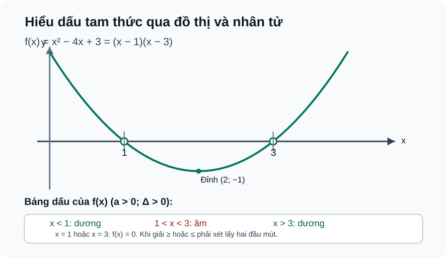

---
hide:
  - toc
---

HỌC THEO CHUYÊN ĐỀ · CĐ02 · TOÁN THPT

<nav class="thpt-sgk-lesson-nav" aria-label="Điều hướng Chuyên đề 02">
<a href="../../cd01/kien-thuc/">← Chuyên đề trước</a>
<a href="../../cd03/kien-thuc/">Chuyên đề sau →</a>
<a href="../luyen-tap/">Luyện tập</a>
<a href="../tu-kiem-tra/">Tự kiểm tra</a>
</nav>

<a href="../../">← Tổng quan các Chuyên đề</a>

Một phương án hợp lệ cần thỏa mọi điều kiện, từ bất phương trình một ẩn tới miền khả thi hai ẩn. Hãy đọc lần lượt bốn mạch: kiểm ràng buộc, xét dấu tam thức, biểu diễn miền nghiệm và chọn phương án tốt nhất.

<link rel="stylesheet" href="../../../../assets/stylesheets/thpt-topic-w1-golden-v1.css">

Đang chuẩn bị nội dung kiến thức…

<!-- TOPIC02_APPROVED_SOURCE_START -->
<!-- Q18 SOURCE_LEARNER_BLOB d2f1ac8d5526e28cb9cf4e4c56b005ebea51dbb5; Q18_RECEIPT_BLOB c1766ba52a80be61b9f8fd2124d0116605f74b92; AUTHORING_PR #818; PUBLIC_PROJECTION_ONLY -->

# Kiến thức

## 1. Từ một ràng buộc đến tập nghiệm

Một xưởng chỉ được sử dụng tối đa một lượng vật liệu nhất định, nhưng vẫn phải làm ra đủ số sản phẩm. Mỗi phương án có thể đạt một mục tiêu mà vi phạm mục tiêu khác. Toán học giúp chúng ta đặt đúng các điều kiện “không quá”, “ít nhất”, “không âm” và tìm **tất cả** phương án hợp lệ, chứ không chỉ thử ngẫu nhiên vài phương án.

Nếu bài toán chỉ có một đại lượng chưa biết, ta giải bất phương trình để tìm một tập số. Khi biểu thức có dạng bậc hai, nghiệm của tam thức chia trục số thành những khoảng cần xét dấu. Khi phải quyết định đồng thời hai đại lượng, một nghiệm là một **điểm** trong mặt phẳng; nhiều ràng buộc tạo nên **miền khả thi**. Sau khi biết miền khả thi, ta mới có căn cứ chọn phương án tối ưu. Đó là một mạch suy luận liên tục từ điều kiện tới quyết định.

Trong chuyên đề này, \(\mathbb R\) chỉ các số thực; \(\mathbb Z_{\ge0}\) chỉ các số nguyên không âm; dấu \(\le\) nhận cả trường hợp bằng. Em sẽ gặp cặp tọa độ \((x,y)\), phép giao của các tập phương án, và biệt thức \(\Delta\) của tam thức bậc hai. Các ký hiệu được giải thích tại chỗ khi cần dùng.

Trước hết, mỗi bước biến đổi bất phương trình phải giữ **đúng tập các giá trị được phép chọn**. Đó là lý do ta cần hiểu bản chất của việc đổi chiều dấu khi chia cho số âm, thay vì chỉ nhớ một mẹo chuyển vế.

<!-- LESSON_ID: TOP02-M01; OUTCOME_ID: TOP02-O01; R04_BASE_BLOB: 907af796ff6f61dee518f7d25e5ff99cb23467f1 -->

### 1.1. Biến đổi bất phương trình

Khi kiểm tra một phương án có hợp lệ hay không, ta thường phải biết một đại lượng **lớn hơn**, **nhỏ hơn** hoặc **ít nhất** một mức nào đó. Khác với phương trình tìm giá trị bằng nhau, bất phương trình chọn ra **tập các giá trị thỏa điều kiện**. Mỗi phép biến đổi vì thế phải giữ đúng tập này. 

> **TÍNH CHẤT — Biến đổi bất phương trình.** Cộng cùng một số vào hai vế không đổi chiều bất đẳng thức; nhân hoặc chia hai vế với cùng một số dương cũng không đổi chiều. Khi nhân hoặc chia với **số âm**, phải đảo chiều. Nếu hệ số chứa biến chưa biết dấu, cần xét dấu hoặc chia trường hợp trước.

Chẳng hạn, từ \(-4x+1>9\) suy ra \(-4x>8\). Chia cho \(-4\) khiến dấu đổi thành \(x<-2\). Ta có thể tự kiểm bằng cách chọn \(x=-3\): vế trái \(13>9\) đúng; còn \(x=-1\) cho \(5>9\) sai. Phép thử không thay thế chứng minh, nhưng giúp phát hiện sai dấu ngay khi tính.

**Ví dụ**

**Đề bài.** Giải \(-5x+2>12\).

**Lời giải.** Trừ 2, được \(-5x>10\). Chia cho \(-5<0\) phải **đổi chiều**, nên \(x<-2\). Thử x=-3 thỏa, x=0 không thỏa.

**Vận dụng**

Giải \(-3(x-2)\ge6\). Hãy giải thích bước nào buộc đổi chiều dấu bất đẳng thức.

Đối chiếu

Khai triển \(-3x+6\ge6\), suy ra \(-3x\ge0\). Chia cho \(-3&lt;0\), ta được \(x\le0\), kể cả \(x=0\) vì dấu ban đầu có bằng. Nếu em viết \(x\ge0\), hãy thử \(x=1\) trong đề gốc để thấy kết luận sai.

**Kiểm lỗi**

Nếu em quên đổi chiều khi chia cho số âm, thử thế một giá trị vào bất phương trình ban đầu để phát hiện sai miền nghiệm. Đọc lại **Kiến thức 1.1** rồi làm **Bài 1** trong Luyện tập; phải nêu rõ hệ số âm ở bước chia.

## 2. Tại sao nghiệm của tam thức chia trục số thành các khoảng?

Sau khi biết cách giữ nguyên tập nghiệm khi biến đổi, ta gặp một khó khăn mới: biểu thức \(ax^2+bx+c\) có thể **đổi dấu** khi \(x\) thay đổi. Để chọn đúng các giá trị làm nó dương hay âm, cần biết những điểm biểu thức bằng 0 và điều gì xảy ra ở hai phía các điểm ấy. Đồ thị parabol và phép phân tích nhân tử cho ta hai cách nhìn nhất quán; biệt thức \(\Delta\) giúp nhận diện liệu có không, một hay hai điểm cắt/chạm trục.

<!-- LESSON_ID: TOP02-M02; OUTCOME_ID: TOP02-O02; R04_BASE_BLOB: 907af796ff6f61dee518f7d25e5ff99cb23467f1 -->

### 2.1. Biệt thức và nghiệm của tam thức

Muốn xét dấu một biểu thức bậc hai, trước tiên ta phải biết nó bằng \(0\) ở đâu. Biểu thức \(f(x)=ax^2+bx+c\), trong đó \(a,b,c\) là các số thực, **\(a\ne0\)**, gọi là **tam thức bậc hai đối với \(x\)**. Dù \(b=0\) hoặc \(c=0\), biểu thức vẫn là tam thức bậc hai vì hệ số \(a\) không bằng \(0\); ngược lại, \(a=0\) thì không còn là bậc hai.

> **ĐỊNH NGHĨA — Tam thức bậc hai.** \(f(x)=ax^2+bx+c\) với \(a,b,c\in\mathbb R,\ a\ne0\). Biệt thức của phương trình \(f(x)=0\) cho biết đồ thị \(y=f(x)\) cắt, chạm hay không cắt trục hoành. Các điểm cắt hoặc chạm ấy sẽ trở thành mốc xét dấu.

> **CÔNG THỨC — Biệt thức của tam thức bậc hai.** Với \(f(x)=ax^2+bx+c\), \(a\ne0\), đặt \(\Delta=b^2-4ac\). Phương trình \(f(x)=0\) không có nghiệm thực khi \(\Delta<0\), có một nghiệm kép khi \(\Delta=0\), và có hai nghiệm thực phân biệt khi \(\Delta>0\). Nếu \(a=0\), phải xét phương trình bậc nhất hoặc trường hợp suy biến, không dùng công thức bậc hai.

Khi hệ số của \(x\) là số chẵn, ta có thể dùng **biệt thức thu gọn** để tính ngắn hơn. Viết \(b=2b'\) (nghĩa là \(b'=b/2\)); khi đó phương trình \(ax^2+bx+c=0\) với \(a\ne0\) chính là \(ax^2+2b'x+c=0\). Không được tính \(\Delta'\) bằng cách thay nhầm \(b\) cho \(b'\), vì \(\Delta=4\Delta'\).

> **CÔNG THỨC — Biệt thức thu gọn và nghiệm tương ứng.** Với \(a\ne0\), \(b=2b'\), đặt \(\Delta'=(b')^2-ac\). Nếu \(\Delta'>0\) thì phương trình có hai nghiệm \(x=\dfrac{-b'\pm\sqrt{\Delta'}}{a}\); nếu \(\Delta'=0\) thì có một nghiệm kép \(x=-\dfrac{b'}{a}\); nếu \(\Delta'<0\) thì không có nghiệm thực. Hai biệt thức \(\Delta=b^2-4ac\) và \(\Delta'=(b')^2-ac\) đưa ra **cùng một tập nghiệm**, chỉ khác cách tính.

Chẳng hạn, \(2x^2-8x+6=0\) có \(a=2,b'=-4,c=6\) nên \(\Delta'=16-12=4\), nghiệm \(x=\dfrac{4\pm2}{2}\), tức \(x=1\) hoặc \(x=3\); thế lại đều cho giá trị 0. Trong xét dấu tam thức, chính những nghiệm này là các mốc chia khoảng, không vì dùng \(\Delta'\) mà đổi quy tắc xét dấu.

Chẳng hạn, x²−5x+6 có Δ=1 và hai nghiệm 2,3; f=(x−2)(x−3), nhân tử cho phép đọc dấu.

**Ví dụ**

**Đề bài.** Tìm nghiệm của \(2x^2-7x+3=0\).

**Lời giải.** \(a=2,b=-7,c=3\) cho \(\Delta=49-24=25\). Nghiệm \((7\pm5)/4\) là \(1/2,3\); do đó \(2x^2-7x+3=(2x-1)(x-3)\).

**Vận dụng**

x²+2x+1 có Δ và nghiệm nào?

Đối chiếu

Δ=0, nghiệm kép −1 vì (x+1)².

Quên 2a hoặc sai dấu b thì thử nhân tích để kiểm nghiệm.

**Kiểm lỗi**

Nếu em nhầm hệ số \(b\) với \(b'=b/2\), nghiệm tính được sẽ sai dù quy trình xét dấu trông đúng. Xem **Kiến thức 2.1**, làm **Bài 3** rồi **Bài 4** để so trường hợp hai nghiệm và nghiệm kép; thế nghiệm ngược vào tam thức để kiểm.

<!-- LESSON_ID: TOP02-M03; OUTCOME_ID: TOP02-O03; R04_BASE_BLOB: 907af796ff6f61dee518f7d25e5ff99cb23467f1 -->

### 2.2. Tam thức luôn cùng dấu

Nhưng biết nghiệm của tam thức vẫn chưa đủ: cần hiểu dấu của nó khi không có nghiệm thực. Có tam thức luôn dương hoặc luôn âm với mọi số thực. Ta bắt đầu từ tính không âm của bình phương và Δ. 

> **TÍNH CHẤT — Dấu tam thức khi \(\Delta<0\).** Với \(a\ne0\) và \(\Delta<0\), tam thức \(f(x)=ax^2+bx+c\) luôn cùng dấu với \(a\) với mọi \(x\in\mathbb R\): dương nếu \(a>0\), âm nếu \(a<0\). Không có nghiệm của **phương trình** \(f(x)=0\) không đồng nghĩa với việc bất phương trình \(f(x)>0\) hoặc \(f(x)<0\) vô nghiệm.

Xét ví dụ: 2x²+2x+3 có Δ=−20<0, a=2>0 ⇒ luôn dương; hoàn phương thành 2(x+1/2)²+5/2>0 xác minh.

**Ví dụ**

**Đề bài.** Chứng minh \(x^2+2x+5>0\) với mọi \(x\in\mathbb R\).

**Lời giải.** Hoàn phương thành \((x+1)^2+4\ge4>0\). Cũng có \(a>0,\Delta=-16<0\), tam thức cùng dấu a.

**Vận dụng**

−x²+2x−3 có dấu gì?

Đối chiếu

−[(x−1)²+2]&lt;0 mọi x.

Nếu kết luận ‘không có nghiệm vì Δ&lt;0’, thử x=0 trước khi quyết định.

**Kiểm lỗi**

Nếu thấy \(\Delta&lt;0\) rồi kết luận biểu thức không dương hay âm ở đâu cả, em đã nhầm **không có nghiệm bằng 0** với **không có dấu**. Đọc **Kiến thức 2.2**, thử **Bài 5** và **Bài 6** bằng cách hoàn phương.

<!-- LESSON_ID: TOP02-M04; OUTCOME_ID: TOP02-O04; R04_BASE_BLOB: 907af796ff6f61dee518f7d25e5ff99cb23467f1 -->

### 2.3. Nghiệm kép và dấu bằng

> **TÍNH CHẤT — Nghiệm kép và dấu bằng.** Khi biệt thức bằng không, đồ thị chạm trục hoành tại nghiệm kép nhưng **không đổi dấu khi đi qua nghiệm kép**. Tại đúng nghiệm kép giá trị bằng 0; ở hai phía, tam thức cùng dấu với hệ số \(a\). Trước hết, hãy nhớ bình phương không âm; phân biệt < với ≤. Nếu Δ=0 thì f=a(x−x₀)², cùng dấu a ngoài x₀ và bằng 0 tại x₀. Dấu không nghiêm có thể nhận nghiệm kép, dấu nghiêm phải bỏ.

Hãy kiểm tra trường hợp sau: −2(x−3)²≤0 mọi x; bằng 0 khi x=3, âm khi x≠3. Muốn giải f≥0 chỉ nhận {3}.

**Ví dụ**

**Đề bài.** Giải \(-3(x-2)^2\ge0\).

**Lời giải.** Bình phương không âm, nên biểu thức \(\le0\). Để \(\ge0\) chỉ có thể bằng 0: \(x=2\).

**Vận dụng**

Giải (x+4)²≤0.

Đối chiếu

Chỉ x=−4 vì bình phương ≥0.

Nếu viết một khoảng, thử x=−3 để bác bỏ.

**Kiểm lỗi**

Nếu em vẽ bảng dấu đổi từ dương sang âm khi gặp nghiệm kép, hãy thử ở hai phía: \(3(1-2)^2=3\) và \(3(3-2)^2=3\). Đọc lại **Kiến thức 2.3**, rồi làm **Bài 7** và **Bài 8** để phân biệt nghiệm kép, dấu bằng và dấu của hệ số \(a\).

<!-- LESSON_ID: TOP02-M05; OUTCOME_ID: TOP02-O05; R04_BASE_BLOB: 907af796ff6f61dee518f7d25e5ff99cb23467f1 -->

### 2.4. Ba khoảng của bảng dấu

> **TÍNH CHẤT — Ba khoảng của bảng dấu.** Nếu biệt thức dương, hai nghiệm thực chia trục số thành ba miền xét dấu. Hai nghiệm chia trục số thành ba vùng, mỗi vùng giữ dấu ổn định. Ta có thể sử dụng dấu tích hai nhân tử. Với x₁<x₂, f=a(x−x₁)(x−x₂) cùng dấu a bên ngoài, trái dấu a ở giữa; bằng 0 ở x₁,x₂. Đây là lý do của bảng dấu chứ không phải quy tắc học thuộc.

Chẳng hạn, với \(f(x)=x^2-4x+3=(x-1)(x-3)\) như trên hình bên dưới, parabol cắt trục hoành tại \(1\) và \(3\). Do hệ số \(a=1>0\), \(f(x)>0\) khi \(x<1\) hoặc \(x>3\), còn \(f(x)<0\) khi \(1<x<3\). Đổi dấu toàn bộ tam thức sẽ đổi dấu hai miền này. Hình giúp quan sát, còn phép phân tích nhân tử giải thích vì sao dấu thay đổi.

*Quan sát hình:* So vị trí nghiệm trên trục hoành với các khoảng đồ thị nằm trên và dưới trục; dấu nghiệm và dấu hệ số a phải được xét trước khi kết luận.

**Ví dụ**

**Đề bài.** Xét dấu \(x^2-5x+4\).

**Lời giải.** \(f=(x-1)(x-4)\), a>0; f dương ngoài đoạn [1,4], âm trong (1,4), bằng 0 tại 1,4. Hình trong bài dùng tam thức tương tự có nghiệm 1,3.

**Vận dụng**

Giải −(x+1)(x−4)>0.

Đối chiếu

−1&lt;x&lt;4, không lấy −1,4.

Nếu sai, thử một x nằm giữa nghiệm để đối chiếu dấu của hai thừa số.

**Kiểm lỗi**

Nếu chọn khoảng sai dấu, hãy thử mỗi miền bằng một giá trị cụ thể rồi nhìn dấu của từng thừa số, không chỉ nhìn sơ đồ. Ôn **Kiến thức 2.4**, làm **Bài 9** và **Bài 10** trong Luyện tập, nhớ tách hẳn hai nghiệm với các khoảng.

<!-- LESSON_ID: TOP02-M06; OUTCOME_ID: TOP02-O06; R04_BASE_BLOB: 907af796ff6f61dee518f7d25e5ff99cb23467f1 -->

### 2.5. Giải bất phương trình bậc hai

Bất phương trình bậc hai một ẩn có thể đưa về một trong bốn dạng \(ax^2+bx+c>0\), \(ax^2+bx+c\ge0\), \(ax^2+bx+c<0\) hoặc \(ax^2+bx+c\le0\), với \(a\ne0\). **Giải bất phương trình** nghĩa là tìm tất cả số thực \(x\) khiến bất đẳng thức đúng, tức là tìm tập nghiệm; chẳng hạn \(x^2-1<0\) chọn các số \(x\) nằm giữa hai nghiệm \(-1\) và \(1\).

> **ĐỊNH NGHĨA — Bất phương trình bậc hai một ẩn.** Bất phương trình có vế chứa tam thức \(ax^2+bx+c\), \(a\ne0\), so sánh với \(0\) bằng một trong bốn dấu \(>,\ge,<,\le\). Nếu \(a=0\), phải xét lại như bất phương trình bậc nhất hoặc suy biến.

> **PHƯƠNG PHÁP — Giải bất phương trình bậc hai.** Từ ba trường hợp của biệt thức, ta có thể giải bất phương trình bậc hai một cách có căn cứ. Một điều kiện ≥ khác > chính ở các nghiệm biên. Để xác định điều đó, cần xét ba trường hợp Δ và khoảng, đoạn trên ℝ. Đưa về f(x)⋄0, kiểm a≠0, tìm nghiệm, chọn khoảng theo dấu, rồi xét dấu nghiêm/non-nghiêm để lấy/loại đầu mút. Với Δ<0 có thể được ℝ hoặc ∅.

Chẳng hạn, x²−5x+6≤0 ⇔ (x−2)(x−3)≤0 ⇒ x∈[2,3]. Chọn nhân tử vì nghiệm là số nguyên.

**Ví dụ**

**Đề bài.** Giải \(x^2-6x+8\ge0\).

**Lời giải.** Từ \((x-2)(x-4)\ge0\), hai thừa số cùng dấu khi \(x\le2\) hoặc \(x\ge4\). Nhận đầu mút vì \(\ge\).

**Vận dụng**

Giải −x²+4x−3>0.

Đối chiếu

1&lt;x&lt;3 vì −(x−1)(x−3)>0.

Nếu em lấy nhầm hai đầu mút \(x=1\) hoặc \(x=3\) cho bất phương trình \(-x^2+4x-3>0\), hãy thế lại: ở cả hai điểm, vế trái bằng \(0\), nên **không thỏa dấu \(>0\)**. Dấu \(\ge0\) mới cho phép lấy hai đầu mút.

**Kiểm lỗi**

Nếu em lấy \(x=1\) hoặc \(x=3\) cho dấu \(>0\), hãy thế vào đề gốc để thấy cả hai cho giá trị 0. Đọc **Kiến thức 2.5**, rồi so **Bài 11** (dấu nghiêm) với **Bài 12** (dấu có bằng).

<!-- LESSON_ID: TOP02-M07; OUTCOME_ID: TOP02-O07; R04_BASE_BLOB: 907af796ff6f61dee518f7d25e5ff99cb23467f1 -->

### 2.6. Bất phương trình đúng với mọi x

> **TÍNH CHẤT — Bất phương trình đúng với mọi x.** Nếu hệ số chứa tham số, kết luận 'đúng với mọi x' phải kiểm tra mọi trường hợp hợp lệ. Một vài phép thử x không chứng minh ‘đúng với mọi x’. Điểm xuất phát là biệt thức và nghiệm kép. Với a>0 **cố định**, f>0 mọi ℝ iff Δ<0; f≥0 mọi ℝ iff Δ≤0. Với a<0 cố định dùng điều kiện âm tương ứng. Không âm thầm áp dụng cho a(m) có thể bằng 0.

Chẳng hạn, x²+2(m−1)x+(m+1)>0 mọi x: Δ=4m(m−3)<0 ⇒ 0<m<3; hai biên làm tam thức chạm 0 nên bị loại.

**Ví dụ**

**Đề bài.** Tìm \(m\) để \(x^2+2(m-1)x+(m+1)>0\) với mọi x thực.

**Lời giải.** Vì a=1 cố định dương, điều kiện dương nghiêm trên \(\mathbb R\) là \(\Delta=4m(m-3)<0\), suy ra \(0<m<3\); hai biên có nghiệm kép nên loại.

**Vận dụng**

Tìm m để x²−2mx+1≥0 mọi x.

Đối chiếu

Δ=4(m²−1)≤0 ⇒ m∈[−1,1].

Nếu đang xét dấu nghiêm \(>0\) mà vẫn nhận biên \(\Delta=0\), hãy thử ngay tại nghiệm kép: giá trị tam thức bằng 0 nên phải loại. Ôn lại bằng Bài 17, phần (b)–(c), trong Luyện tập — bài này yêu cầu giải thích rõ vì sao \(m=2\) không được nhận.

**Kiểm lỗi**

Nếu em nhận cả \(m=\pm3\) khi yêu cầu tam thức **dương nghiêm ngặt với mọi x**, em đã nhầm \(\Delta&lt;0\) với \(\Delta\le0\). Xem lại **Kiến thức 2.6**, giải **Bài 13** và **Bài 14**, rồi tự luận **Bài 17** để kiểm trực tiếp giá trị tại nghiệm kép.

<!-- LESSON_ID: TOP02-M08; OUTCOME_ID: TOP02-O08; R04_BASE_BLOB: 907af796ff6f61dee518f7d25e5ff99cb23467f1 -->

### 2.7. Miền nghiệm có điều kiện vật lý

> **PHƯƠNG PHÁP — Miền nghiệm có điều kiện vật lý.** Một miền nghiệm đại số còn có thể bị thu hẹp bởi đơn vị và điều kiện vật lý của mô hình. Nghiệm đại số có thể không dùng được nếu độ dài âm, thời gian âm. Ta bắt đầu từ diện tích chữ nhật và phương trình bậc hai. Đặt biến, nêu miền vật lý, lập bất phương trình, giải, giao tập nghiệm với miền ban đầu rồi kiểm ý nghĩa. “Ít nhất” là ≥; “không quá” là ≤.

Xét ví dụ: 20m rào ba cạnh sát tường: 0<x<10, S=x(20−2x)≥32 ⇔ (x−2)(x−8)≤0 ⇒ x∈[2,8] m, đúng miền vật lý.

**Ví dụ**

**Đề bài.** Rào ba cạnh một vườn sát tường bằng 20 m dây; hai cạnh rộng x. Diện tích ít nhất \(32m^2\). Tìm x.

**Lời giải.** Chiều còn lại \(20-2x>0\) cho \(0<x<10\). \(x(20-2x)\ge32\) tương đương \((x-2)(x-8)\le0\). Vậy \(x\in[2,8]\) m, nằm đúng miền vật lý.

**Vận dụng**

h(t)=−t²+6t với t≥0; khi nào h≥8?

Đối chiếu

(t−2)(t−4)≤0 ⇒ t∈[2,4].

Nếu có nghiệm âm, kiểm lại điều kiện khi đặt biến thay vì nhận tất cả.

**Kiểm lỗi**

Nếu em cho nghiệm âm hoặc bỏ qua đơn vị thời gian/độ dài, kết quả đại số có thể không là phương án thực tế. Đọc **Kiến thức 2.7**, làm **Bài 15** và **Bài 16** trong Luyện tập; lấy giao với miền vật lý trước khi kết luận.

## 3. Từ khoảng nghiệm trên trục số đến miền khả thi trong mặt phẳng

Trên trục số, một số \(x\) hoặc thuộc tập nghiệm hoặc không. Với hai đại lượng \(x,y\), mỗi phương án là một điểm \((x,y)\); bất phương trình bậc nhất chia mặt phẳng bởi một **đường biên**. Ta chỉ giữ phía chứa các điểm thỏa điều kiện, rồi lấy **phần chung** khi có nhiều ràng buộc. Điểm nằm trên biên phải được xét riêng: dấu có bằng thì nhận biên, dấu nghiêm ngặt thì không.

<!-- LESSON_ID: TOP02-M09; OUTCOME_ID: TOP02-O09; R04_BASE_BLOB: 907af796ff6f61dee518f7d25e5ff99cb23467f1 -->

### 3.1. Bất phương trình bậc nhất hai ẩn

Hai quyết định x,y cần mô tả tập cặp khả thi. Trước hết, hãy nhớ cặp tọa độ (x,y), thay số vào biểu thức. 

> **ĐỊNH NGHĨA — Bất phương trình bậc nhất hai ẩn.** Bất phương trình bậc nhất hai ẩn có dạng \(ax+by<c\), \(ax+by\le c\), \(ax+by>c\) hoặc \(ax+by\ge c\), với \(a,b,c\in\mathbb R\) và \((a,b)\ne(0,0)\). Một cặp \((x,y)\) là nghiệm nếu thay vào làm bất phương trình đúng; một hệ số bằng 0 vẫn hợp lệ.

Một bất phương trình bậc nhất hai ẩn có **vô số nghiệm thực**: biểu diễn trên mặt phẳng, các nghiệm chiếm một nửa mặt phẳng (có hoặc không gồm đường biên). Ví dụ \(2y\ge4\) chính là \(y\ge2\); giữ \(y=3\) thì **mọi** giá trị thực của \(x\) đều thỏa, chứ không chỉ một cặp được chọn thử.

Hãy kiểm tra trường hợp sau: 0x+2y≥4 vẫn bậc nhất hai ẩn, tương đương y≥2; (10,3) hợp lệ, (0,1) sai.

**Ví dụ**

**Đề bài.** Xét \(0x+2y\ge4\). Kiểm hai cặp \((10,3)\) và \((0,1)\).

**Lời giải.** Hệ số (0,2) không đồng thời bằng 0 nên vẫn bậc nhất hai ẩn. (10,3) cho 6≥4 đúng; (0,1) cho 2≥4 sai.

**Vận dụng**

−x+0y<1 có hợp lệ và (0,5) thỏa không?

Đối chiếu

Hợp lệ, (a,b)=(−1,0)≠(0,0); 0&lt;1 đúng.

Nếu nghĩ bắt buộc có cả x và y, kiểm điều kiện hệ số không đồng thời bằng 0.

**Kiểm lỗi**

Nếu em loại \(0x-3y>1\) chỉ vì không có \(x\) trong thực tế, hãy nhớ điều kiện là \((a,b)\ne(0,0)\), không cần cả hai khác 0. Quay lại **Kiến thức 3.1** rồi làm **Bài 18** và **Bài 32**.

<!-- LESSON_ID: TOP02-M10; OUTCOME_ID: TOP02-O10; R04_BASE_BLOB: 907af796ff6f61dee518f7d25e5ff99cb23467f1 -->

### 3.2. Chọn điểm thử khác đường biên

> **PHƯƠNG PHÁP — Chọn điểm thử khác đường biên.** Để nhận ra nửa mặt phẳng được chọn, hãy thử một điểm không nằm trên đường biên. Điểm O có thể ngay trên đường và không giúp chọn nửa mặt phẳng. Ta có thể sử dụng đường thẳng ax+by=c và thế cặp số. Để thử nghiệm, thay (x,y) vào BPT. Để chọn phía của đường biên, dùng điểm **không thuộc** đường biên; O chỉ phù hợp nếu c≠0. Một điểm ở biên thỏa ≤ nhưng không quyết định phía.

Chẳng hạn, với \(x-2y>3\), điểm \((4,0)\) thỏa vì \(4>3\); điểm \((1,-1)\) không thỏa vì \(3>3\) sai. Gốc \(O=(0,0)\) không nằm trên đường biên \(x-2y=3\) nên có thể dùng thử phía, nhưng chính \(O\) không thỏa điều kiện.

**Ví dụ**

**Đề bài.** Với \(x-2y>3\), thử \((4,0)\), \((1,-1)\) và O để chọn phía.

**Lời giải.** (4,0) cho 4>3 đúng. (1,-1) cho 3>3 sai, lại ở biên nên không chọn phía. O không ở biên và cho 0>3 sai, nên nửa phía O không phải nghiệm.

**Vận dụng**

(3,0) thỏa x+2y≥3 không; O thử phía được không?

Đối chiếu

(3,0) thỏa dấu bằng; O ngoài đường x+2y=3 nên thử phía được, nhưng O không thỏa BPT.

Nếu điểm thử ở biên, chọn (1,0) hoặc (0,1) khác và thế lại.

**Kiểm lỗi**

Nếu em lấy một điểm **nằm trên đường biên** để quyết định phía tô, phép thử chỉ cho dấu bằng nên không xác định phía. Đọc **Kiến thức 3.2**, thực hiện **Bài 22** và **Bài 24** với điểm thử ngoài đường thẳng.

<!-- LESSON_ID: TOP02-M11; OUTCOME_ID: TOP02-O11; R04_BASE_BLOB: 907af796ff6f61dee518f7d25e5ff99cb23467f1 -->

### 3.3. Đường biên được lấy hoặc loại

Bản thân đường biên có được lấy hay không phụ thuộc vào dấu bất đẳng thức. Hình vẽ sai nét đường làm kết luận sai với các điểm ở mép. Để xác định điều đó, cần xét bất đẳng thức một ẩn và đường thẳng. ≤/≥ nhận biên (nét liền), </> loại biên (nét đứt). Khi đưa về y⋄mx+n, chia cho hệ số âm phải đảo chiều. Chọn một điểm ngoài biên để xác định phía cần tô.

> **TÍNH CHẤT — Đường biên được lấy hoặc loại.** Trên hình, điều kiện \(x+2y\le4\) có đường biên **nét liền** và nhận gốc \(O=(0,0)\). Với điều kiện \(2x-y<1\), biến đổi tương đương thành \(y>2x-1\); đường biên phải vẽ **nét đứt**. Gốc \(O\) không nằm trên đường \(2x-y=1\) và thỏa \(0<1\), nên thuộc nửa mặt phẳng nghiệm. Như vậy, việc chọn phía và việc nhận biên là **hai quyết định khác nhau**.

*Quan sát hình:* Hãy chọn một điểm không thuộc biên để quyết định phía thỏa. Biên nét liền/đứt tương ứng với điều kiện có/không có dấu bằng.

**Ví dụ**

**Đề bài.** Từ hình \(x+2y\le4\), \(2x-y<1\), tìm biên được nhận và kiểm O.

**Lời giải.** Với \(\le\), nhận biên \(x+2y=4\); với \(<\), loại biên \(2x-y=1\). O thỏa \(0\le4\) và \(0<1\). Khi chuyển vế thành \(y>2x-1\), nhớ đảo dấu.

**Vận dụng**

x+2y≥4 biên thế nào, O thỏa không?

Đối chiếu

Biên liền, O không thỏa 0≥4, tô phía y≥2−x/2.

Tô sai? Thử O hoặc một điểm ngoài biên để kiểm dấu và đổi chiều.

**Kiểm lỗi**

Nếu em vẽ biên nét đứt cho dấu \(\ge\), em đã bỏ các phương án đạt **bằng** ngưỡng. Đọc **Kiến thức 3.3**, làm **Bài 20** và **Bài 21**; kiểm dấu bằng với một điểm trên đường thẳng trước khi tô miền.

<!-- LESSON_ID: TOP02-M12; OUTCOME_ID: TOP02-O12; R04_BASE_BLOB: 907af796ff6f61dee518f7d25e5ff99cb23467f1 -->

### 3.4. Lập ràng buộc hai ẩn

> **PHƯƠNG PHÁP — Lập ràng buộc hai ẩn.** Khi diễn đạt một ràng buộc thực tế, phải biến câu chữ thành cả đường biên lẫn phía được chọn. Một phương án thỏa số tiền nhưng có 2,5 thùng không dùng được. Điểm xuất phát là phân biệt ≤ và ≥; đơn vị. Đặt x,y và đơn vị. Số vé/sản phẩm cần nguyên không âm, đại lượng đo có thể thực không âm. ‘Ít nhất’ → ≥, ‘không quá’ → ≤; kiểm từng phương án bằng thế số.

Chẳng hạn, mỗi thùng A giá 4 nghìn đồng, mỗi thùng B giá 7 nghìn đồng, ngân sách không quá 56 nghìn đồng. Nếu \(x,y\) lần lượt là số thùng A, B thì \(4x+7y\le56\), với \(x,y\) nguyên không âm. Phương án \((7,4)\) đúng ngân sách vì chi phí bằng 56; \((8,4)\) bị loại vì chi phí 60. Điều kiện **nguyên không âm** quan trọng không kém bất phương trình tiền.

**Ví dụ**

**Đề bài.** Hai loại thùng giá 4 và 7 nghìn; ngân sách 56 nghìn. Lập điều kiện cho số thùng nguyên x,y, kiểm (7,4).

**Lời giải.** Vì x,y là số thùng, \(x,y\in\mathbb Z_{\ge0}\). Điều kiện \(4x+7y\le56\) (nghìn). (7,4) cho 56 nên hợp lệ, (8,4) cho 60 nên không.

**Vận dụng**

Doanh thu mỗi loại 2 và 3 điểm, cần ít nhất 12. (3,2) đạt?

Đối chiếu

2x+3y≥12; 2·3+3·2=12 đúng.

Nhầm ít nhất với ≤ thì thử phương án bằng và thấp hơn ngưỡng để sửa.

**Kiểm lỗi**

Nếu em viết \(\le\) khi đề nói “ít nhất” hoặc quên \(x,y\) là số sản phẩm/vé, mô hình có thể nhận cả phương án sai thực tế. Đọc **Kiến thức 3.4**, làm **Bài 23** và **Bài 25**, kiểm đơn vị và tính nguyên không âm.

<!-- LESSON_ID: TOP02-M13; OUTCOME_ID: TOP02-O13; R04_BASE_BLOB: 907af796ff6f61dee518f7d25e5ff99cb23467f1 -->

### 3.5. Miền giao của hệ bất phương trình

Khi một bài toán yêu cầu đồng thời nhiều điều kiện, ta viết những bất phương trình cùng hai ẩn \(x,y\) dưới một dấu ngoặc hệ. Đó là **hệ bất phương trình bậc nhất hai ẩn**: gồm **hai hoặc nhiều** bất phương trình bậc nhất đối với cùng cặp ẩn. Một cặp số \((x_0,y_0)\) là **nghiệm của hệ** chỉ khi thay vào, **tất cả** bất phương trình đều đúng. Vì vậy, miền nghiệm phải lấy phần chung của các nửa mặt phẳng, không thể gộp bằng phép hợp.

> **ĐỊNH NGHĨA — Hệ bất phương trình bậc nhất hai ẩn.** Hệ gồm hai hay nhiều bất phương trình bậc nhất hai ẩn \(x,y\). Nghiệm là cặp \((x_0,y_0)\) thỏa đồng thời từng bất phương trình trong hệ; miền nghiệm là giao của tất cả các miền nghiệm thành phần.

> **TÍNH CHẤT — Miền giao của hệ bất phương trình.** Hai ràng buộc cùng đúng dẫn tới giao của hai miền nghiệm, không phải hợp. Đạt một điều kiện mà vi phạm điều kiện khác thì vẫn không khả thi. Ta bắt đầu từ giao của tập hợp và tọa độ. Miền nghiệm của hệ là giao của tất cả nửa mặt phẳng; có thể rỗng, bị chặn hoặc vô hạn. Mọi điểm phải thỏa đồng thời từng điều kiện, kể cả ràng buộc dấu x,y.

Xét ví dụ: x≥0,y≥0,x+y≤6 tạo tam giác kín (0,0),(6,0),(0,6). (2,3) đạt; (4,3) không đạt điều kiện tổng.

**Ví dụ**

**Đề bài.** Xét \(x,y\ge0,\ x+y\le6\). Tìm đỉnh và thử (2,3), (4,3).

**Lời giải.** Miền giao là tam giác đóng có các đỉnh (0,0),(6,0),(0,6). (2,3) tổng 5 thỏa; (4,3) tổng 7 không thỏa.

**Vận dụng**

x+y≤5 và x+y≥7 có nghiệm chung?

Đối chiếu

Không, vì một giá trị t=x+y không thể vừa ≤5 và ≥7.

Nếu nhầm giao thành hợp, lấy một điểm chỉ thỏa một điều kiện để bác bỏ.

**Kiểm lỗi**

Nếu em nhầm **giao** thành **hợp**, một điểm chỉ thỏa một bất phương trình sẽ bị nhận sai. Đọc **Kiến thức 3.5**, làm **Bài 26** và **Bài 29**: thay cùng một cặp \((x,y)\) vào **mọi** điều kiện của hệ.

<!-- LESSON_ID: TOP02-M14; OUTCOME_ID: TOP02-O14; R04_BASE_BLOB: 907af796ff6f61dee518f7d25e5ff99cb23467f1 -->

### 3.6. Miền rỗng và không bị chặn

> **TÍNH CHẤT — Miền rỗng và không bị chặn.** Miền chung ấy có thể rỗng, bị chặn hoặc kéo dài vô hạn; phải đọc tình trạng khả thi trước. Bài tối ưu không có nghĩa khi miền nghiệm rỗng. Trước hết, hãy nhớ miền giao và hàm tuyến tính F. Miền rỗng không có phương án. Trên đa giác đóng, không rỗng, bị chặn thì hàm tuyến tính đạt max/min tại ít nhất một đỉnh. Miền không bị chặn cần xét riêng; có thể có max nhưng không có min.

Hãy kiểm tra trường hợp sau: Trên x≥0,y≥0 không bị chặn, F=−x−y có max 0 tại O và không có min hữu hạn vì x→∞ thì F→−∞. Hệ x+y≤2,x+y≥5 thì rỗng.

**Ví dụ**

**Đề bài.** Trên \(x,y\ge0\) tìm max/min của \(F=-x-y\). Hệ \(x+y\le2,\ x+y\ge5\) có nghiệm?

**Lời giải.** \(F=-x-y\le0\), max bằng 0 tại O. Cho \(x=t\to\infty,y=0\) thì \(F\to-\infty\), không có min hữu hạn. Hệ hai điều kiện còn lại rỗng vì một tổng không thể đồng thời ≤2 và ≥5.

**Vận dụng**

Trên miền \(x\ge0,y\ge0\) không bị chặn, hàm mục tiêu \(F=-2x-y\) có giá trị lớn nhất và nhỏ nhất hữu hạn không? Giải thích bằng một điểm cụ thể và một dãy phương án.

Đối chiếu

Miền \(x,y\ge0\) không bị chặn, nhưng \(F=-2x-y\le0\) nên có **giá trị lớn nhất bằng 0** tại \(O=(0,0)\). Không có giá trị nhỏ nhất hữu hạn: lấy \(x=t\ge0,y=0\), ta được \(F=-2t\to-\infty\) khi \(t\to+\infty\). Đây là lý do không được suy từ “miền không bị chặn” ra “không có mọi cực trị”.

**Kiểm lỗi**

Nếu thấy miền không bị chặn rồi kết luận không có cả giá trị lớn nhất lẫn nhỏ nhất, em đã bỏ qua chiều biến thiên của hàm mục tiêu. Đọc **Kiến thức 3.6**, rồi làm **Bài 29** (miền rỗng) và **Bài 30** (miền không bị chặn); chỉ kết luận sau khi kiểm trực tiếp hàm.

## 4. Từ phương án hợp lệ đến phương án tốt nhất

Một phương án có thể thỏa mọi ràng buộc mà vẫn chưa đem lại lợi nhuận cao nhất hoặc chi phí thấp nhất. Sau khi dựng miền khả thi, ta cần một **hàm mục tiêu** đo điều muốn tối ưu. Với hàm tuyến tính trên miền đa giác đóng, bị chặn, không rỗng, có thể đẩy đường mức song song của hàm mục tiêu đến khi chạm đỉnh cuối cùng; vì thế việc tính tại các đỉnh có cơ sở hình học. Nhưng nếu số sản phẩm buộc phải là số nguyên, điểm tối ưu liên tục chưa chắc là phương án thực hiện được.

<!-- LESSON_ID: TOP02-M15; OUTCOME_ID: TOP02-O15; R04_BASE_BLOB: 907af796ff6f61dee518f7d25e5ff99cb23467f1 -->

### 4.1. Tối ưu tuyến tính trên đa giác

> **PHƯƠNG PHÁP — Tối ưu tuyến tính trên đa giác.** Cần chọn phương án tốt nhất trong số vô số điểm khả thi. Ta có thể sử dụng giao đường thẳng và hàm F=px+qy. Với đa giác đóng, bị chặn, không rỗng, cực trị tuyến tính đạt tại một đỉnh. Tìm đủ đỉnh, kiểm khả thi, tính F; khi cả hai đỉnh kề cùng tối ưu thì cả cạnh cùng tối ưu.

Chẳng hạn, với \(x,y\ge0\), \(x+y\le6\), \(2x+y\le8\), miền khả thi trong hình có bốn đỉnh \(O=(0,0)\), \(A=(4,0)\), \(B=(2,4)\), \(C=(0,6)\). Tại các đỉnh, \(F=3x+2y\) lần lượt bằng \(0,12,14,12\); giá trị lớn nhất **14** tại \(B\). Nếu bỏ bước kiểm tra đường biên, ta có thể tính nhầm một giao điểm không thuộc miền hoặc bỏ sót đỉnh tối ưu.

*Quan sát hình:* Đọc từng đỉnh \(O,A,B,C\), thế tọa độ vào **cả hai ràng buộc** rồi đối chiếu bốn giá trị \(F=0,12,14,12\). Hình minh họa **tối ưu liên tục**; nếu biến chỉ nhận số nguyên, phải quay lại kiểm tra các điểm lưới của miền.

**Ví dụ**

**Đề bài.** Trên \(x,y\ge0,\ x+y\le5,\ 2x+y\le6\), tối đa \(F=3x+2y\).

**Lời giải.** Đỉnh O=(0,0), A=(3,0), B=(1,4), C=(0,5). F tương ứng 0,9,11,10, nên max 11 tại B. Hình kèm theo minh họa đa giác khác với max 14 tại (2,4).

**Vận dụng**

x,y≥0,x+y≤4, F=x+y tối đa ở đâu?

Đối chiếu

Mọi điểm trên cạnh x+y=4 đều đạt 4, không chỉ một đỉnh.

Nếu bỏ một đỉnh, vẽ từng đường và kiểm giao có thỏa tất cả ràng buộc.

**Kiểm lỗi**

Nếu em chỉ kiểm một đỉnh rồi nói đó là **nghiệm tối ưu duy nhất**, em có thể bỏ cả cạnh mà hàm mục tiêu không đổi. Đọc **Kiến thức 4.1**, so **Bài 33** (một đỉnh đạt cực đại) với **Bài 34** (mọi điểm trên cạnh đạt cực đại).

<!-- LESSON_ID: TOP02-M16; OUTCOME_ID: TOP02-O16; R04_BASE_BLOB: 907af796ff6f61dee518f7d25e5ff99cb23467f1 -->

### 4.2. Tối ưu với biến nguyên

> **PHƯƠNG PHÁP — Tối ưu với biến nguyên.** Nếu đề yêu cầu các biến nguyên, đỉnh tối ưu theo mô hình liên tục chỉ là điểm xuất phát. 2,67 chiếc máy không thể thực hiện nguyên trạng. Để xác định điều đó, cần xét số nguyên không âm và tìm điểm lưới khả thi. Nếu x,y là sản phẩm, chỉ các điểm nguyên trong miền nghiệm mới hợp lệ. Tối ưu liên tục là cận/gợi ý; phải liệt kê hoặc lập luận theo y nguyên để tìm tối ưu nguyên.

Chẳng hạn, x+2y≤8,2x+y≤8, x,y nguyên≥0, P=3x+2y. Liên tục max 40/3 ở (8/3,8/3). y nguyên 0..4 cho các max P=12,11,13,12,8 ⇒ tối ưu nguyên 13 ở (3,2).

**Ví dụ**

**Đề bài.** Với \(x+2y\le8,\ 2x+y\le8,\ x,y\in\mathbb Z_{\ge0}\), tối đa \(P=3x+2y\).

**Lời giải.** Miền liên tục có giao (8/3,8/3), max \(P=40/3\). Với y nguyên từ 0 đến 4, max P lần lượt 12,11,13,12,8. Vậy max nguyên 13 tại (3,2); không được làm tròn nghiệm liên tục.

**Vận dụng**

x+2y≤4,2x+y≤4, x,y nguyên≥0, max F=x+y?

Đối chiếu

Max nguyên 2 tại (2,0),(1,1),(0,2), dù liên tục có thể đạt 8/3.

Nếu làm tròn tọa độ mà bỏ điều kiện, liệt kê từng y và x lớn nhất hợp lệ.

**Kiểm lỗi**

Nếu em làm tròn nghiệm tối ưu liên tục thành số nguyên mà không kiểm lại ràng buộc, kết quả có thể không khả thi hoặc chưa tối ưu. Đọc **Kiến thức 4.2**, thử **Bài 35** và **Bài 37** bằng liệt kê các cặp nguyên hợp lệ rồi so giá trị mục tiêu.

> **Kiến thức cần ghi nhớ**
>
> - Với bất phương trình, **đảo chiều dấu khi nhân hoặc chia hai vế cho số âm**; hệ số chưa biết dấu phải được xét trước.
> - Với tam thức bậc hai \(ax^2+bx+c\), chỉ dùng \(\Delta=b^2-4ac\) theo công thức bậc hai khi \(a\ne0\). Dấu của tam thức còn phụ thuộc \(a\), nghiệm kép và điều kiện có/không có dấu bằng.
> - Miền nghiệm của bất phương trình hai ẩn phải kiểm **phía thỏa** và **đường biên**. Với dấu \(\le,\ge\) nhận biên; với \(<,>\) loại biên.
> - Khi tối ưu trên miền đa giác đóng, không rỗng, bị chặn, hãy kiểm các đỉnh; nếu \(x,y\) phải nguyên, chỉ xét các điểm nguyên thỏa mọi điều kiện, không làm tròn tùy ý.

<!-- TOPIC02_APPROVED_SOURCE_END -->

<a href="../../">← Tổng quan các Chuyên đề</a>

