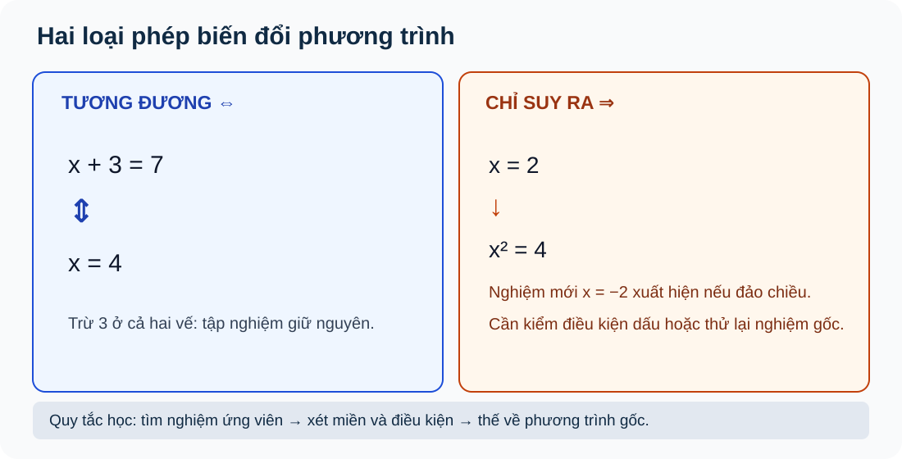
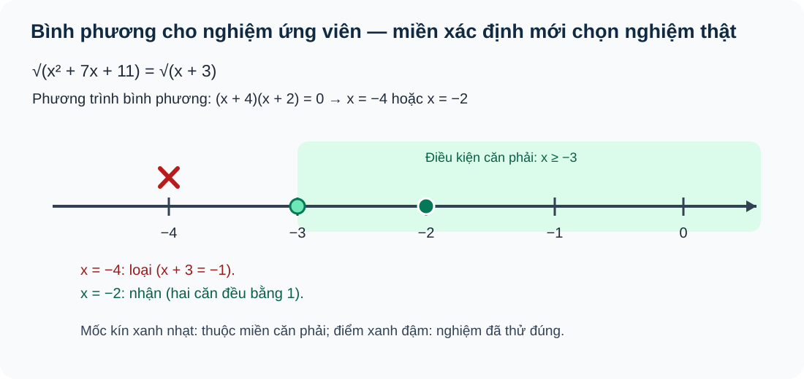
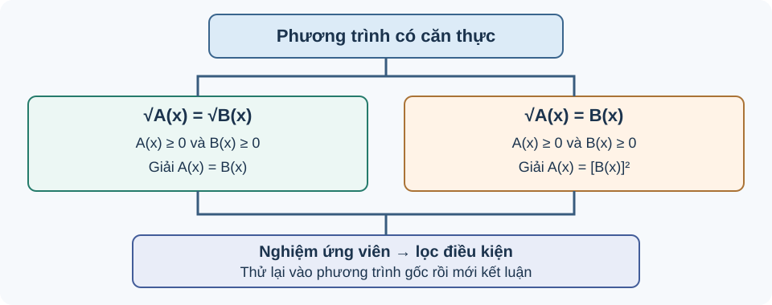

---
hide:
  - toc
---

HỌC THEO CHUYÊN ĐỀ · CĐ03 · TOÁN THPT

<nav class="thpt-sgk-lesson-nav" aria-label="Điều hướng Chuyên đề 03">
<a href="../../cd02/kien-thuc/">← Chuyên đề trước</a>
<a href="../../cd04/kien-thuc/">Chuyên đề sau →</a>
<a href="../luyen-tap/">Luyện tập</a>
<a href="../tu-kiem-tra/">Tự kiểm tra</a>
</nav>

<a href="../../">← Tổng quan các Chuyên đề</a>

Một phép giải đúng cần tìm đủ nghiệm mà không thêm nghiệm ngoại lai. Em sẽ học cách giữ tập nghiệm, nêu điều kiện trước khi khử mẫu hay bình phương, kiểm ứng viên và chuyển kết quả về ý nghĩa bài toán.

<link rel="stylesheet" href="../../../../assets/stylesheets/thpt-topic-w1-golden-v1.css">

Đang chuẩn bị nội dung kiến thức…

<!-- TOPIC03_APPROVED_SOURCE_START -->
<!-- Q18 SOURCE_LEARNER_BLOB 38f41f013e75b42605d7a88f9205c20af6315a41; Q18_RECEIPT_BLOB ef40b5871762558959108cf1879155c7e14158fe; AUTHORING_PR #888; PUBLIC_PROJECTION_ONLY -->

# Kiến thức

## 1. Giữ nguyên tập nghiệm khi biến đổi

Một bạn giải phương trình, thu được hai giá trị nhưng khi thay vào đề gốc thì chỉ một giá trị đúng. Sai sót không nhất thiết nằm ở phép tính: có thể bạn ấy đã dùng một bước **không tương đương**, như bình phương hai vế, hoặc quên điều kiện mẫu số khác 0. Vì vậy, muốn giải đúng một phương trình, ta luôn phải trả lời ba câu hỏi gắn với nhau: *Đang xét những giá trị nào? Bước biến đổi này có giữ nguyên tập nghiệm không? Nghiệm tìm được có thỏa bài toán gốc không?*

Trước hết, số thực được ký hiệu \(\mathbb R\), tập nghiệm là \(S\). Ta sẽ dùng tính chất \(ab=0\) khi và chỉ khi \(a=0\) hoặc \(b=0\); giá trị tuyệt đối \(|u|\) là khoảng cách đến 0; căn bậc hai số học \(\sqrt u\) chỉ xác định khi \(u\ge0\) và luôn không âm. Những tiền đề này sẽ được giải thích qua từng phép biến đổi, từ phương trình bậc nhất/bậc hai đến các trường hợp có phân thức và căn. Đặt ẩn phụ và mô hình thực tế được học sau cùng vì cả hai cũng phải quay lại miền giá trị ban đầu.

Để thấy khác nhau giữa biến đổi hai chiều và một chiều, hãy bắt đầu từ các phương trình đơn giản mà ta có thể tự kiểm nghiệm ngay.

<!-- LESSON_ID: TOP03-M01; OUTCOME_ID: TOP03-O01; PREVIOUS_SOURCE_BLOB: e94bbe37339f7002bd8e29bdf60e0c86fae0aa95 -->

### 1.1. Phép biến đổi tương đương

Vì sao từ x=3 suy ra x²=9 nhưng không được kết luận ngược lại?

Giải phương trình không chỉ là tìm một con số trông có vẻ đúng. Ta cần tìm **tất cả** giá trị trong miền xác định chung làm hai vế bằng nhau, đồng thời không để phép biến đổi nào làm mất hoặc sinh thêm nghiệm. Nếu hai phương trình có đúng cùng tập nghiệm trên miền đang xét, chúng là những phương trình tương đương.

> **ĐỊNH NGHĨA — Hai phương trình tương đương.** Hai phương trình được gọi là *tương đương* trên một miền xác định khi và chỉ khi chúng có **cùng tập nghiệm trên miền đó**; ký hiệu \(\Leftrightarrow\). Mỗi bước biến đổi tương đương phải có chiều suy luận ngược hợp lệ trên miền đang xét.

Với \(x+5=12\), trừ cùng 5 ở hai vế cho \(x=7\); làm ngược lại bằng cách cộng 5 sẽ khôi phục phương trình ban đầu, nên đây là biến đổi tương đương. Nhưng từ \(x=3\) suy ra \(x^2=9\) chỉ là một chiều: phương trình sau còn có \(x=-3\), vốn không thỏa câu đầu. Cùng lý do đó, khi giải phương trình chứa căn và phải bình phương, ta phải giữ điều kiện và **thử nghiệm trở lại đề gốc**.

**Ví dụ**

**Đề bài.** Giải phương trình \(5x-7=3\) và chứng tỏ phép biến đổi giữ tập nghiệm.

**Lời giải.** Cộng 7 vào hai vế được \(5x=10\), rồi chia cho \(5\ne0\) được \(x=2\). Cả hai thao tác đều có phép ngược, nên các phương trình tương đương. Thử \(5\cdot2-7=3\).

**Vận dụng**

Giải \(3x+2=11\). Vì sao hai bước chuyển vế và chia cho 3 không làm đổi tập nghiệm?

Đối chiếu

Trừ 2 ở hai vế được \(3x=9\); chia cho \(3\ne0\) được \(x=3\). Cả hai bước đều có phép ngược hợp lệ. Thử lại: \(3\cdot3+2=11\). Nếu em dùng dấu tương đương cho phép bình phương mà không kiểm điều kiện, hãy so trường hợp \(x=3\) và \(x=-3\) ở ví dụ trên.

**Kiểm lỗi**

Nếu em chỉ tìm một nghiệm sau khi biến đổi hoặc đặt dấu tương đương cho một phép bình phương không có chiều ngược, hãy đọc lại **Kiến thức 1.1**, rồi giải **Bài 1** và **Bài 2** trong Luyện tập. Kiểm từng nghiệm bằng cách thế vào phương trình ban đầu; phân biệt phép trừ/chia hằng số khác 0 với bước có thể sinh nghiệm ngoại lai.

<!-- LESSON_ID: TOP03-M02; OUTCOME_ID: TOP03-O02; PREVIOUS_SOURCE_BLOB: e94bbe37339f7002bd8e29bdf60e0c86fae0aa95 -->

### 1.2. Phương trình bậc nhất có tham số

Nếu hệ số của x là tham số có thể bằng 0, tại sao không được vội chia?

> **PHƯƠNG PHÁP — Phương trình bậc nhất có tham số.** Ngay cả phương trình bậc nhất cũng có thể đổi bản chất khi hệ số của ẩn bằng không. Đôi khi phép chia mất cả một trường hợp vô số nghiệm; hiểu điều kiện chia quan trọng hơn thao tác máy. Điểm xuất phát là thu gọn, phân phối, tính chất số 0. Với ax=b: nếu a≠0 có nghiệm duy nhất x=b/a; nếu a=0,b≠0 thì vô nghiệm; nếu a=b=0 thì mọi x∈ℝ đều là nghiệm. Khi a có chứa tham số m, phải xét a=0 trước. Đây là kỹ thuật nền để tự học phép quy về bậc hai.

Chẳng hạn, Giải m(x−2)=0: m≠0 ⇒ x=2; m=0 ⇒ 0=0 cho mọi x. Không thể chia cả hai vế cho m khi chưa biết m≠0.

**Ví dụ**

**Đề bài.** Biện luận \(m(x-2)=m-1\) trên \(\mathbb R\).

**Lời giải.** Nếu \(m=0\) thì \(0=-1\), phương trình **vô nghiệm**. Nếu \(m\ne0\), chia cho m được \(x-2=1-\frac1m\), hay \(x=3-\frac1m\). Tách \(m=0\) trước để không chia cho 0.

**Vận dụng**

Giải a(x−1)=0 theo tham số a.

Đối chiếu

Nếu a≠0 thì x=1, nếu a=0 thì mọi x∈ℝ.

Nếu quên trường hợp hệ số 0, đặt a=0 và thử x=6; làm lại Bài 3 và Bài 4 trong phần Luyện tập.

<!-- LESSON_ID: TOP03-M03; OUTCOME_ID: TOP03-O03; PREVIOUS_SOURCE_BLOB: e94bbe37339f7002bd8e29bdf60e0c86fae0aa95 -->

### 1.3. Tích bằng 0, tránh làm mất nghiệm

Chia cả hai vế cho x−2 có thể làm mất nghiệm nào?

Khi một biểu thức được tách thành tích, tính chất tích bằng không giúp nhìn thấy nhiều nghiệm. Đưa phương trình về tích làm lộ nhiều nghiệm, nhưng chia cho một nhân tử có thể làm mất nghiệm ngay tại nhân tử ấy. Ta bắt đầu từ tính chất ab=0 ⇔ a=0 hoặc b=0. 

> **TÍNH CHẤT — Tích bằng không.** Trên miền mà cả hai biểu thức \(A(x)\), \(B(x)\) đều có nghĩa, \(A(x)B(x)=0\) khi và chỉ khi \(A(x)=0\) **hoặc** \(B(x)=0\). Không được chia cho \(A(x)\) khi chưa loại trường hợp \(A(x)=0\).

Nghiệm kép khác với hai nghiệm thực phân biệt. Chia cho A(x) chỉ hợp lệ khi A(x)≠0, nếu không phải tách trường hợp A=0.

Xét ví dụ: x²−x−6=0 ⇔ (x−3)(x+2)=0 ⇒ x∈{3,−2}. Nếu vội chia cho x−3 sẽ làm mất x=3; vì thế ưu tiên quy tắc tích bằng 0.

**Ví dụ**

**Đề bài.** Giải \((x+2)(3x-1)=0\).

**Lời giải.** Theo tính chất tích bằng 0, \(x+2=0\) hoặc \(3x-1=0\). Vậy \(S=\{-2,\frac13\}\). Không chia cho một thừa số chứa x, vì như vậy có thể loại mất nghiệm của chính thừa số ấy.

**Vận dụng**

Giải (x−5)(x+1)=0.

Đối chiếu

x=5 hoặc x=−1; thử vào từng thừa số.

Nếu tìm được một nghiệm mà không xét nhân tử còn lại, quay lại ab=0 và làm lại Bài 5 và Bài 6 trong phần Luyện tập.

<!-- LESSON_ID: TOP03-M04; OUTCOME_ID: TOP03-O04; PREVIOUS_SOURCE_BLOB: e94bbe37339f7002bd8e29bdf60e0c86fae0aa95 -->

### 1.4. Phương trình bậc hai và biệt thức

Trường hợp biệt thức âm có nghĩa gì khi ta chỉ tìm nghiệm thực?

Phương trình \(ax^2+bx+c=0\), với \(a,b,c\in\mathbb R\) và \(a\ne0\), là **phương trình bậc hai một ẩn**. Điều kiện \(a\ne0\) rất quan trọng: nếu \(a=0\), phương trình trở thành bậc nhất hoặc suy biến và cần giải theo trường hợp trước. Để tìm tất cả nghiệm thực, ta có thể phân tích thành tích khi thuận lợi; nếu chưa nhìn thấy nhân tử, **biệt thức** cho biết phương trình có bao nhiêu nghiệm thực và cách tính chúng.

> **ĐỊNH NGHĨA — Phương trình bậc hai một ẩn.** Phương trình có dạng \(ax^2+bx+c=0\) với \(a,b,c\in\mathbb R\), \(a\ne0\). Nghiệm là giá trị \(x\in\mathbb R\) khiến hai vế bằng nhau.

> **CÔNG THỨC — Nghiệm theo biệt thức.** Đặt \(\Delta=b^2-4ac\). Nếu \(\Delta>0\), có hai nghiệm phân biệt \(x=\dfrac{-b\pm\sqrt{\Delta}}{2a}\); nếu \(\Delta=0\), có nghiệm kép \(x=-\dfrac b{2a}\); nếu \(\Delta<0\), không có nghiệm thực. Khi giải một phương trình vốn có mẫu hoặc căn bằng phép quy về bậc hai, nghiệm tìm được vẫn phải kiểm lại điều kiện của bài gốc.

Khi hệ số của \(x\) là số chẵn, ta có thể dùng **biệt thức thu gọn** để tính ngắn hơn. Viết \(b=2b'\) (nghĩa là \(b'=b/2\)); khi đó phương trình \(ax^2+bx+c=0\) với \(a\ne0\) chính là \(ax^2+2b'x+c=0\). Không được tính \(\Delta'\) bằng cách thay nhầm \(b\) cho \(b'\), vì \(\Delta=4\Delta'\).

> **CÔNG THỨC — Biệt thức thu gọn và nghiệm tương ứng.** Với \(a\ne0\), \(b=2b'\), đặt \(\Delta'=(b')^2-ac\). Nếu \(\Delta'>0\) thì phương trình có hai nghiệm \(x=\dfrac{-b'\pm\sqrt{\Delta'}}{a}\); nếu \(\Delta'=0\) thì có một nghiệm kép \(x=-\dfrac{b'}{a}\); nếu \(\Delta'<0\) thì không có nghiệm thực. Hai biệt thức \(\Delta=b^2-4ac\) và \(\Delta'=(b')^2-ac\) đưa ra **cùng một tập nghiệm**, chỉ khác cách tính.

Chẳng hạn, \(2x^2-8x+6=0\) có \(a=2,b'=-4,c=6\) nên \(\Delta'=16-12=4\), nghiệm \(x=\dfrac{4\pm2}{2}\), tức \(x=1\) hoặc \(x=3\); thế lại đều cho giá trị 0. Trong xét dấu tam thức, chính những nghiệm này là các mốc chia khoảng, không vì dùng \(\Delta'\) mà đổi quy tắc xét dấu.

Hãy kiểm tra trường hợp sau: x²−4x+3=0: Δ=16−12=4>0 ⇒ x=(4±2)/2∈{1,3}; kiểm (x−1)(x−3). Hai cách giải tương đương cho chính phương trình bậc hai này.

**Ví dụ**

**Đề bài.** Giải \(2x^2-3x-2=0\) trên \(\mathbb R\).

**Lời giải.** Với \(a=2,b=-3,c=-2\), \(\Delta=b^2-4ac=9+16=25>0\). Hai nghiệm \((3\pm5)/4\) là \(2\) và \(-\frac12\). Có thể đối chiếu bằng \((2x+1)(x-2)=0\).

**Vận dụng**

Giải x²+4x+4=0.

Đối chiếu

(x+2)²=0 ⇒ x=−2 (nghiệm kép), không phải hai giá trị khác nhau.

Nếu Δ âm mà cho nghiệm thực, hoàn phương thành tổng số không âm để kiểm; làm lại Bài 7 và Bài 8 trong phần Luyện tập.

## 2. Điều kiện xác định và phép biến đổi

Các phép cộng và trừ cùng một lượng ở hai vế thường có thể đi ngược trở lại, nhưng chia cho một biểu thức chỉ hợp lệ khi biểu thức ấy **khác 0**. Với giá trị tuyệt đối, một biểu thức dương hay âm có thể tạo ra cùng một kết quả, nên không thể tùy tiện bỏ hai vạch. Từ đây, ta thấy "đưa về phương trình quen thuộc" luôn phải đi cùng việc **giữ lại miền xác định**.

<!-- LESSON_ID: TOP03-M05; OUTCOME_ID: TOP03-O05; PREVIOUS_SOURCE_BLOB: e94bbe37339f7002bd8e29bdf60e0c86fae0aa95 -->

### 2.1. Giải phương trình phân thức

Tại sao rút gọn phân thức không được phép nhận một giá trị làm mẫu số bằng 0?

> **PHƯƠNG PHÁP — Giải phương trình phân thức.** Khử mẫu rất nhanh nhưng chỉ đúng trên miền mẫu khác 0; một phép rút gọn có thể ‘lấp’ điểm biểu thức gốc vô nghĩa. Ta có thể sử dụng phân tích nhân tử, số hữu tỉ và mẫu số. Đầu tiên xét **mọi mẫu số khác 0**. Khi nhân hai vế với mẫu M(x), phép tương đương chỉ đúng **trên miền M(x)≠0**. Giải phương trình kết quả, loại các nghiệm làm mẫu bằng 0 và thay thử. Phương pháp này đặc biệt hữu ích khi một phép biến đổi có thể làm mẫu bằng \(0\); điều kiện của phân thức luôn phải được giữ đến cuối lời giải.

Chẳng hạn, (x+1)/(x−3)=2, x≠3. Nhân x−3 được x+1=2x−6 ⇒ x=7; thử (7+1)/(7−3)=8/4=2. Nếu nghiệm x=3 xuất hiện, phải loại chứ không được chia 0.

**Ví dụ**

**Đề bài.** Giải \(\frac{x^2-1}{x-1}=0\) trên \(\mathbb R\).

**Lời giải.** Điều kiện \(x\ne1\). Tử số \((x-1)(x+1)=0\) cho ứng viên \(1,-1\); loại \(1\) vì mẫu bằng 0. Thay \(x=-1\), tử bằng 0, mẫu bằng \(-2\ne0\). Vậy \(S=\{-1\}\).

**Vận dụng**

Giải (x²−9)/(x−3)=0.

Đối chiếu

Điều kiện x≠3. Tử (x−3)(x+3)=0 cho 3 hoặc −3; loại 3, nghiệm duy nhất −3.

Nếu rút gọn rồi kết luận nhận x=3, thay x=3 vào mẫu để thấy vô nghĩa; làm lại Bài 9 và Bài 10 trong phần Luyện tập.

<!-- LESSON_ID: TOP03-M06; OUTCOME_ID: TOP03-O06; PREVIOUS_SOURCE_BLOB: e94bbe37339f7002bd8e29bdf60e0c86fae0aa95 -->

### 2.2. Phương trình có giá trị tuyệt đối

Từ |x−1|=3, tại sao phải xét cả hai nhánh?

> **PHƯƠNG PHÁP — Phương trình có giá trị tuyệt đối.** Giá trị tuyệt đối cũng yêu cầu chia trường hợp, bởi nó xóa dấu của biểu thức bên trong. Giá trị tuyệt đối luôn không âm; bỏ dấu bằng mắt có thể tạo nghiệm không có trong phương trình gốc. Để xác định điều đó, cần xét giá trị tuyệt đối |u| là khoảng cách đến 0 trên trục số. Nếu |A|=c hằng số: c<0 vô nghiệm; c≥0 giải A=±c (c=0 hai nhánh trùng). Nếu |A(x)|=B(x), cần B(x)≥0 rồi tách A=B hoặc A=−B, **kiểm lại điều kiện trên từng nhánh**. Nhờ phân nhánh đúng theo dấu, ta không bỏ sót nghiệm do giá trị tuyệt đối xóa dấu của biểu thức bên trong.

Chẳng hạn, |x−1|=3 ⇒ x−1=3 hoặc −3 ⇒ x=4 hoặc −2; thử khoảng cách đến 1 đều là 3. Không thể chỉ lấy nghiệm x=4 vì giá trị tuyệt đối xóa dấu.

**Ví dụ**

**Đề bài.** Giải \(|x+2|=4\).

**Lời giải.** Vì \(4\ge0\), ta xét \(x+2=4\) hoặc \(x+2=-4\), được \(x=2\) hoặc \(x=-6\). Thử lại cả hai đều cho khoảng cách đến \(-2\) bằng 4. Không chỉ chọn nhánh dương.

**Vận dụng**

Giải |x+3|=x+3.

Đối chiếu

Vì |u|=u khi u≥0, ta có x+3≥0 ⇒ x≥−3. Thử x=−4 cho |−1|=1 khác −1.

Nếu quên điều kiện B≥0, thử một x làm B âm; làm lại Bài 11 và Bài 12 trong phần Luyện tập.

## 3. Kiểm nghiệm ứng viên sau bình phương

Một **phương trình chứa căn thức** là phương trình có ẩn xuất hiện trong biểu thức dưới dấu căn, chẳng hạn \(\sqrt{x+2}=x\). Trong chuyên đề này ta tập trung vào hai dạng quan trọng: \(\sqrt{A(x)}=\sqrt{B(x)}\) và \(\sqrt{A(x)}=C(x)\), trong đó \(A,B,C\) là các biểu thức được nêu rõ theo \(x\). Với các căn bậc hai số học, biểu thức dưới căn phải không âm. Khi giải các dạng đó, bình phương giúp đưa bài toán về phương trình đại số, nhưng phép bình phương **không giữ lại thông tin về dấu**: từ \(A=B\) suy ra \(A^2=B^2\), chiều ngược không luôn đúng. Vì vậy nghiệm sau bình phương mới chỉ là **ứng viên**. Ta sẽ so sánh hai căn bằng nhau với một căn bằng biểu thức, giải thích điều kiện của từng dạng, rồi lọc nghiệm qua miền và phép thay trực tiếp.

<!-- LESSON_ID: TOP03-M07; OUTCOME_ID: TOP03-O07; PREVIOUS_SOURCE_BLOB: e94bbe37339f7002bd8e29bdf60e0c86fae0aa95 -->

### 3.1. Bình phương có thể sinh nghiệm ngoại lai

Vì sao nghiệm của phương trình bình phương chưa chắc là nghiệm phương trình chứa căn?

Đây là nguyên nhân chính của nghiệm ngoại lai khi giải phương trình chứa căn. Điểm xuất phát là dấu không âm của √A, bình phương hai vế. Từ A=B suy ra A²=B²; chiều đảo không đúng nếu A,B có thể trái dấu. 

> **TÍNH CHẤT — Bình phương hai vế.** Với hai biểu thức thực có nghĩa, từ \(U=V\) luôn suy ra \(U^2=V^2\). Chiều ngược lại không bắt buộc đúng: \(U^2=V^2\) chỉ cho \(U=V\) hoặc \(U=-V\). Vì vậy, bình phương hai vế của phương trình có thể tạo thêm ứng viên, không được coi là phép biến đổi tương đương nếu thiếu điều kiện về dấu.

Khi vế trái là một căn bậc hai số học, nó không âm; nếu vế phải âm thì ứng viên tìm được sau bình phương phải bị loại. Ta sẽ phát biểu đầy đủ điều kiện tương đương cho hai dạng phương trình chứa căn ở hai mục tiếp theo, rồi kiểm nghiệm vào phương trình gốc.

Chẳng hạn, √(x+3)=x−1 ⇒ điều kiện x≥1; bình phương x+3=(x−1)² ⇒ x²−3x−2=0 ⇒ x=(3±√17)/2. Chỉ x=(3+√17)/2≥1 thỏa; nghiệm còn lại cho vế phải âm nên ngoại lai.

*Quan sát hình:* Phân biệt mũi tên hai chiều khi giữ nguyên tập nghiệm với mũi tên một chiều khi bình phương có thể sinh nghiệm ngoại lai; luôn thử vào phương trình đầu.

**Ví dụ**

**Đề bài.** Giải \(\sqrt{x+4}=x-2\) trên \(\mathbb R\).

**Lời giải.** Điều kiện cần là \(x-2\ge0\), tức \(x\ge2\). Bình phương được \(x+4=(x-2)^2\), hay \(x(x-5)=0\), cho ứng viên \(0,5\). Loại 0 vì vế phải âm; với 5, \(\sqrt9=3=5-2\). Vậy \(S=\{5\}\).

**Vận dụng**

Giải √(x+1)=x.

Đối chiếu

Điều kiện x≥0; bình phương x+1=x² ⇒ x=(1±√5)/2. Chỉ x=(1+√5)/2≥0 được nhận.

Nếu hai nghiệm sau bình phương đều được nhận, thử nghiệm âm và so dấu hai vế; làm lại Bài 19 và Bài 20 trong phần Luyện tập.

<!-- LESSON_ID: TOP03-M08; OUTCOME_ID: TOP03-O08; PREVIOUS_SOURCE_BLOB: e94bbe37339f7002bd8e29bdf60e0c86fae0aa95 -->

### 3.2. Hai căn bậc hai và điều kiện đồng thời

Với hai căn cùng bằng nhau, phải kiểm điều kiện của những biểu thức nào?

> **TÍNH CHẤT — Hai căn bậc hai và điều kiện đồng thời.** Hai căn bậc hai bằng nhau chỉ khi các biểu thức bên trong thỏa những điều kiện cần thiết. Một căn không xác định có thể tạo nghiệm ảo tưởng sau phép bình phương. Ta bắt đầu từ điều kiện √u xác định khi u≥0. Với √A(x)=√B(x) trên ℝ, tương đương với **A=B và A≥0** (khi A=B, B≥0 tự theo). Có thể ghi riêng A≥0, B≥0 để dễ kiểm. Tìm nghiệm ứng viên từ A=B, lọc miền trước khi thế. Không suy ra |A|=|B|.

Xét ví dụ sát hình trục số: \(\sqrt{x^2+7x+11}=\sqrt{x+3}\). Hai vế đều là căn số học nên, **sau khi ghi điều kiện xác định**, ta giải \(x^2+7x+11=x+3\), hay \((x+2)(x+4)=0\), được các ứng viên \(x=-2,-4\). Điều kiện từ căn phải đòi \(x\ge-3\): loại \(-4\); với \(-2\), cả hai biểu thức dưới căn bằng 1, nên hai vế đều bằng 1. Do đó nghiệm duy nhất là \(x=-2\). Việc kiểm căn trái và thay lại cho thấy không bỏ sót điều kiện ẩn.

*Đọc trục số:* Đầu mút \(-3\) là ranh giới miền \(x\ge-3\), không phải nghiệm. Điểm \(-4\) bị loại vì nằm ngoài miền; \(-2\) được giữ vì hai căn đều bằng 1 khi thay lại. Trục số **minh họa cho chính ví dụ hai căn phía trên**, không thay phép kiểm biểu thức dưới căn trái.

**Ví dụ**

**Đề bài.** Giải \(\sqrt{x^2+4x+5}=\sqrt{x+5}\) trên \(\mathbb R\).

**Lời giải.** Hai căn xác định khi \(x+5\ge0\) và \(x^2+4x+5\ge0\); điều kiện thứ hai luôn đúng vì \((x+2)^2+1>0\). Bình phương hai căn được \(x^2+3x=0\), nên \(x=0\) hoặc \(x=-3\). Cả hai thỏa \(x\ge-5\) và khi thế vào thì hai biểu thức dưới căn bằng nhau, không âm. Vậy \(S=\{-3,0\}\). Hình trục số phía trên minh họa một trường hợp *khác*, có ứng viên \(-4\) bị loại.

**Vận dụng**

Giải √(x²+5)=√(4x+2).

Đối chiếu

Miền x≥−1/2. Bình phương x²+5=4x+2 ⇒ (x−1)(x−3)=0, x=1 hoặc 3; cả hai hợp miền, thử được √6 và √14 tương ứng ở mỗi vế.

Nếu quên một miền căn, thay nghiệm âm khiến radicand âm để tự bác; làm lại Bài 21, Bài 14 và Bài 18 trong phần Luyện tập.

<!-- LESSON_ID: TOP03-M09; OUTCOME_ID: TOP03-O09; PREVIOUS_SOURCE_BLOB: e94bbe37339f7002bd8e29bdf60e0c86fae0aa95 -->

### 3.3. Một căn bằng một biểu thức

Vì sao vế phải của phương trình √A=B phải không âm?

> **TÍNH CHẤT — Một căn bằng một biểu thức.** Nếu chỉ một vế chứa căn, điều kiện không âm của vế kia trở nên đặc biệt quan trọng. Căn số học không âm, nên không thể bằng số âm dù phương trình sau bình phương thỏa. Trước hết, hãy nhớ căn √u không âm và công thức giải PT bậc hai. √A=B tương đương với **B≥0 và A=B²** trên ℝ; khi A=B²≥0 thì căn cũng xác định. Có thể ghi thêm A≥0 để học sinh kiểm, nhưng đó không phải điều kiện độc lập mới. Giải ứng viên từ A=B² rồi lọc dấu B và thử gốc.

Hãy kiểm tra trường hợp sau: √(3x+1)=x−1: x≥1. Bình phương 3x+1=(x−1)² ⇒ x²−5x=0 ⇒ x=0 hoặc 5. Loại 0, nhận 5 vì √16=4=5−1.

**Ví dụ**

**Đề bài.** Giải \(\sqrt{x+6}=x\).

**Lời giải.** Vì căn bậc hai số học không âm nên vế phải phải thỏa \(x\ge0\); khi đó \(x+6\ge6>0\), căn có nghĩa. Bình phương hai vế được \(x+6=x^2\), hay \((x-3)(x+2)=0\). Hai ứng viên là \(x=3\) và \(x=-2\); loại \(-2\) vì không thỏa \(x\ge0\). Thử trực tiếp \(x=3\): \(\sqrt{3+6}=3\), đúng bằng vế phải. Vậy tập nghiệm là \(S=\{3\}\).

**Vận dụng**

Giải √(2x+7)=x+1.

Đối chiếu

Cần x≥−1. Bình phương x²−6=0 ⇒ x=±√6; chỉ +√6≥−1 đạt, âm bị loại. Thử căn bằng √6+1.

Nếu chỉ dùng điều kiện A≥0 rồi giữ nghiệm B âm, thử gốc sẽ sai; làm lại Bài 22, Bài 13, Bài 15 và Bài 16 trong phần Luyện tập.

<!-- LESSON_ID: TOP03-M10; OUTCOME_ID: TOP03-O10; PREVIOUS_SOURCE_BLOB: e94bbe37339f7002bd8e29bdf60e0c86fae0aa95 -->

### 3.4. Lọc ứng viên bằng điều kiện và thế ngược

Muốn chắc một nghiệm không ngoại lai, phép kiểm cuối cùng phải dùng phương trình nào?

Như vậy, một nghiệm xuất hiện sau bình phương mới là ứng viên, chưa hẳn nghiệm thật. Một phương trình bình phương có nghiệm không có nghĩa phương trình gốc có nghiệm. Ta có thể sử dụng quy trình √A=√B và √A=B, ĐKXĐ. Lập **bảng ứng viên**: nghiệm của phương trình biến đổi → điều kiện miền → điều kiện dấu của vế phải → thay thử gốc. Đặc biệt với hai căn, ứng viên có thể nằm ngoài miền xác định; với một căn bằng biểu thức, có thể sai do dấu. Phương trình vẫn có thể vô nghiệm sau khi lọc.

Chẳng hạn, √(x+6)=x−2: điều kiện x≥2. Bình phương x+6=(x−2)² ⇒ x²−5x−2=0, nghiệm (5±√33)/2. Chỉ nghiệm dương lớn hơn 2 hợp lệ; nghiệm âm là ngoại lai do vế phải âm. Kiểm x=(5+√33)/2 làm hai vế bằng nhau.

> **PHƯƠNG PHÁP — Lọc ứng viên bằng điều kiện và thế ngược.** *Đọc sơ đồ:* Nhánh \(\sqrt A=\sqrt B\) cần hai biểu thức dưới căn không âm; nhánh \(\sqrt A=B\) còn cần \(B\ge0\). Cả hai đều phải kiểm nghiệm ứng viên trở lại phương trình ban đầu. Hãy đọc hai nhánh trên hình từ bước kiểm miền xác định, rồi chỉ nhận nghiệm sau khi đối chiếu phương trình ban đầu.

**Ví dụ**

**Đề bài.** Giải \(\sqrt{x+1}=x-3\).

**Lời giải.** Phải có \(x\ge3\). Bình phương cho \(x+1=(x-3)^2\), tức \(x^2-7x+8=0\), nên \(x=(7\pm\sqrt{17})/2\). Ứng viên \((7-\sqrt{17})/2<3\) bị loại; ứng viên \((7+\sqrt{17})/2>3\) nhận sau khi thế lại vào phương trình gốc. Đọc sơ đồ để phân biệt bước tạo ứng viên và bước kiểm nghiệm.

**Vận dụng**

Giải √(x²+5)=x−2 trong ℝ.

Đối chiếu

Điều kiện x≥2. Bình phương x²+5=x²−4x+4 ⇒ x=−1/4, trái miền. Vậy S=∅, không nhận ứng viên.

Nếu kết luận nghiệm chỉ bằng giải phương trình sau bình phương, hãy lập bảng ‘ứng viên→miền→dấu→gốc’; làm lại Bài 23, Bài 24 và Bài 25 trong phần Luyện tập.

## 4. Đổi biến và kiểm ý nghĩa thực tế

Khi một phương trình quá phức tạp, ta có thể đặt ẩn phụ để nhìn cấu trúc quen thuộc hơn. Nhưng sau khi giải theo ẩn mới, phải kiểm miền của ẩn ấy rồi **đổi trở lại** biến ban đầu. Điều tương tự xảy ra với bài toán thực tế: ẩn đại diện cho chiều dài, thời gian hoặc vận tốc phải mang đúng đơn vị và điều kiện, nên không thể lấy mọi nghiệm đại số làm đáp số.

<!-- LESSON_ID: TOP03-M11; OUTCOME_ID: TOP03-O11; PREVIOUS_SOURCE_BLOB: e94bbe37339f7002bd8e29bdf60e0c86fae0aa95 -->

### 4.1. Đặt t=x², nhớ t không âm

Khi đặt t=x², một nghiệm t âm phải xử lí ra sao?

> **PHƯƠNG PHÁP — Đặt t=x², nhớ t không âm.** Một phương trình bậc bốn đôi khi trở thành bậc hai nhưng nghiệm ẩn phụ âm không có nghĩa trên ℝ. Để xác định điều đó, cần xét bình phương ≥0 và nghiệm PT bậc hai. Với x⁴+px²+q=0, đặt t=x²≥0. Giải t²+pt+q=0, **lọc t≥0**, rồi giải x²=t: t=0 cho x=0, t>0 cho x=±√t. Đây là một cách mở rộng phương pháp quy về phương trình bậc hai: biến đổi chỉ có ý nghĩa khi ta giữ điều kiện \(t\ge0\) và trả kết quả về ẩn \(x\).

Chẳng hạn, x⁴−10x²+9=0 ⇒ t²−10t+9=(t−1)(t−9)=0 ⇒ t=1 hoặc 9, x=±1 hoặc ±3. Không nhận t âm.

**Ví dụ**

**Đề bài.** Giải \(x^4-13x^2+36=0\) trên \(\mathbb R\).

**Lời giải.** Đặt \(t=x^2\ge0\), ta có \(t^2-13t+36=(t-4)(t-9)=0\). Hai giá trị \(t=4,9\) đều không âm; quay về ẩn gốc cho \(x=\pm2,\pm3\). Nếu \(t<0\), phải loại vì bình phương số thực không âm.

**Vận dụng**

Giải x⁴−2x²−3=0.

Đối chiếu

t=x²≥0; t²−2t−3=(t−3)(t+1)=0. Chỉ t=3 hợp lệ ⇒ x=±√3.

Nếu suy x²=−1 có nghiệm thực, kiểm tính không âm của bình phương; làm lại Bài 28 và Bài 29 trong phần Luyện tập.

<!-- LESSON_ID: TOP03-M12; OUTCOME_ID: TOP03-O12; PREVIOUS_SOURCE_BLOB: e94bbe37339f7002bd8e29bdf60e0c86fae0aa95 -->

### 4.2. Mô hình hóa và giữ đơn vị

Vì sao nghiệm âm có thể đúng đại số nhưng sai với chiều dài hoặc vận tốc?

> **PHƯƠNG PHÁP — Mô hình hóa và giữ đơn vị.** Cuối cùng, nghiệm đại số phải quay về đúng đại lượng và đơn vị của tình huống thực tế. Trong hình học và chuyển động, một nghiệm âm hay thời gian vô nghĩa không thể dùng làm đáp án. Điểm xuất phát là pythagore, quãng đường/vận tốc=thời gian, đơn vị đo. Ghi biến, đơn vị và điều kiện **trước** phương trình. Chọn mô hình căn độ dài nếu cạnh huyền, phân thức nếu thời gian; giải thành phương trình đại số, lọc điều kiện, kiểm tính đúng của cả số lẫn đơn vị. Điều quan trọng không phải mô hình dùng phương tiện nào, mà là phương trình phải diễn tả đúng cùng một tình huống và nghiệm cuối cùng phải đáp ứng ý nghĩa của đại lượng.

Chẳng hạn, Tam giác vuông có hai cạnh góc vuông x>0 và x+7 mét, cạnh huyền 13 mét: √[x²+(x+7)²]=13. Bình phương 2x²+14x+49=169 ⇒ x²+7x−60=0 ⇒ (x+12)(x−5)=0. Nhận x=5, loại −12; ba cạnh 5,12,13 m, thử 25+144=169.

**Ví dụ**

**Đề bài.** Một tam giác vuông có hai cạnh góc vuông dài \(x>0\) mét và \(x+17\) mét, cạnh huyền 25 mét. Tìm các cạnh góc vuông.

**Lời giải.** Đặt điều kiện \(x>0\); theo Pythagore, \(x^2+(x+17)^2=25^2\). Suy ra \(x^2+17x-168=(x+24)(x-7)=0\), nên \(x=-24\) hoặc \(7\). Loại số âm; với \(x=7\), cạnh còn lại 24 m và \(7^2+24^2=25^2\).

**Vận dụng**

Một xe đi 90 km với tốc độ v>0; nếu tăng 15 km/h thì nhanh hơn 1 giờ. Tìm v.

Đối chiếu

90/v−90/(v+15)=1 ⇒ v²+15v−1350=0 ⇒ (v−30)(v+45)=0. Lọc v>0 ⇒ v=30 km/h; thời gian 3 giờ và 2 giờ.

Nếu quên miền vật lý hoặc mẫu v(v+15)≠0, đặt biến/đơn vị lại rồi thử số; làm lại Bài 30, Bài 26, Bài 27 và Bài 31 trong phần Luyện tập.

> **Kiến thức cần ghi nhớ**
>
> - **Tương đương** có nghĩa là giữ nguyên tập nghiệm trên miền xác định, không chỉ suy ra một chiều. Nhân hoặc chia cho biểu thức có thể bằng 0 phải tách trường hợp.
> - **Tích bằng 0:** \(A(x)B(x)=0\) khi \(A(x)=0\) hoặc \(B(x)=0\), với các biểu thức có nghĩa.
> - **Phân thức và căn:** luôn ghi miền xác định trước khi khử mẫu hoặc bình phương; với \(\sqrt A=B\), thêm \(B\ge0\) và \(A=B^2\). Nghiệm sau phép bình phương chỉ là ứng viên cho đến khi kiểm lại đề gốc.
> - **Đổi biến và bài toán thực tế:** đặt \(t=x^2\) thì \(t\ge0\); nghiệm cần thỏa điều kiện của đại lượng và đơn vị ban đầu.

<!-- TOPIC03_APPROVED_SOURCE_END -->

<a href="../../">← Tổng quan các Chuyên đề</a>

