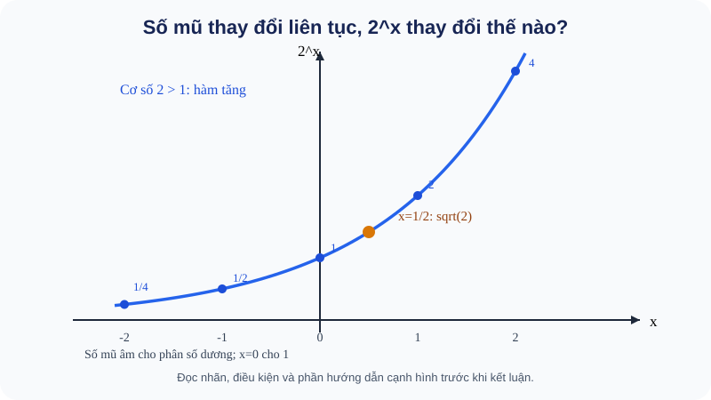
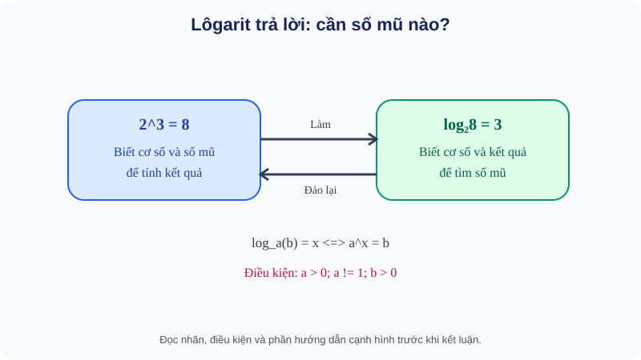
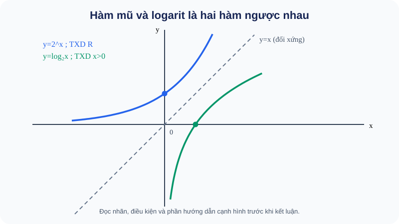
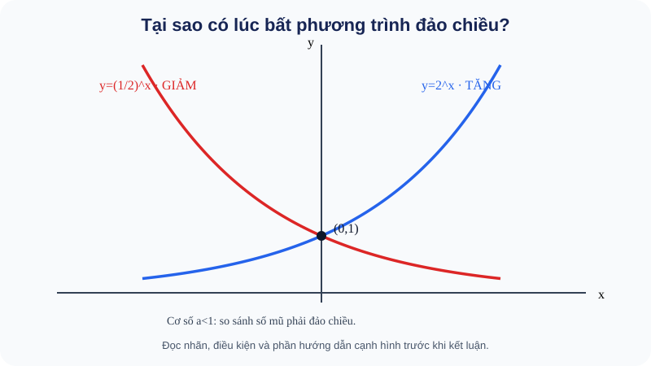
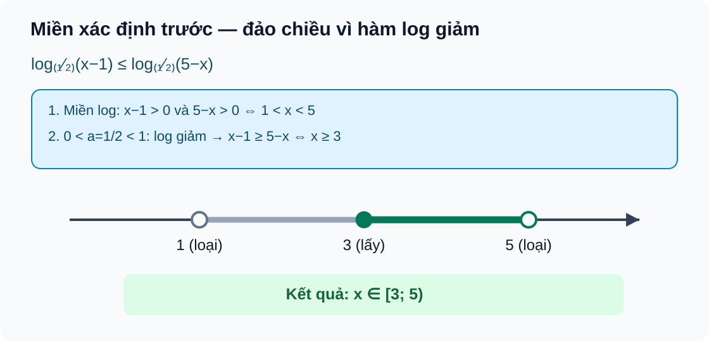

---
hide:
  - toc
---

HỌC THEO CHUYÊN ĐỀ · CĐ04 · TOÁN THPT

<nav class="thpt-sgk-lesson-nav" aria-label="Điều hướng Chuyên đề 04">
<a href="../../cd03/kien-thuc/">← Chuyên đề trước</a>
<a href="../../cd05/kien-thuc/">Chuyên đề sau →</a>
<a href="../luyen-tap/">Luyện tập</a>
<a href="../tu-kiem-tra/">Tự kiểm tra</a>
</nav>

<a href="../../">← Tổng quan các Chuyên đề</a>

Từ một số vốn nhân lên nhiều lần, em học cách biểu diễn <strong>giá trị</strong> bằng lũy thừa rồi đặt câu hỏi ngược: <strong>số mũ nào</strong> cho giá trị đó? Câu hỏi này dẫn tới lôgarit. Khi xét đồ thị và giải phương trình, điều kiện cơ số và đối số giúp biết phép biến đổi nào thực sự hợp lệ. Kết thúc bài, em sẽ tự chọn số kỳ nguyên trong một mô hình tăng hoặc giảm theo tỉ lệ.

<link rel="stylesheet" href="../../../../assets/stylesheets/thpt-topic-w1-golden-v1.css">

Đang chuẩn bị nội dung kiến thức…

<!-- TOPIC04_APPROVED_SOURCE_START -->
<!-- Q18 SOURCE_LEARNER_BLOB 71853ed34cb5cb21e312a0a9f9c713b76e5219b4; Q18_RECEIPT_BLOB 0e605108aefcf18b81348311445225d559f96e8e; AUTHORING_PR #890; PUBLIC_PROJECTION_ONLY -->

# Kiến thức

## 1. Từ phép nhân lặp đến lũy thừa thực

Giả sử một khoản tiền tăng 8% mỗi năm và tiền lãi được nhập vào vốn. Sau năm thứ nhất, số tiền được nhân với \(1{,}08\); sau năm thứ hai, lại nhân với \(1{,}08\). Nếu cứ nhân như vậy, sau \(n\) năm số tiền được nhân với \((1{,}08)^n\). Đây là tình huống tự nhiên đưa đến **lũy thừa**: số mũ cho biết ta lặp lại phép nhân bao nhiêu lần. Khi muốn hỏi “cần bao nhiêu năm để vượt một ngưỡng?”, ta phải làm phép ngược lại: tìm **số mũ** đã tạo nên một giá trị cho trước — đó là ý tưởng của **lôgarit**. Nhìn hai câu hỏi này như một cặp sẽ giúp em hiểu cả đồ thị, phép biến đổi và ứng dụng thay vì nhớ nhiều công thức rời rạc.

Trước khi dùng các ký hiệu mới, ta chỉ cần các kiến thức quen thuộc: nhân số thực, phân số, căn bậc hai không âm, tìm nghiệm phương trình và biểu diễn điểm trên mặt phẳng tọa độ. Số mũ âm sẽ dẫn tới phép chia; căn bậc chẵn dẫn tới điều kiện không âm; các logarit sẽ đòi đối số dương. Những điều kiện ấy không phải phụ lục học thuộc: chúng giải thích tại sao một phép biến đổi có thể hợp lệ ở giá trị này nhưng không hợp lệ ở giá trị khác.

Vì vậy ta bắt đầu bằng những quy tắc của lũy thừa, rồi dần chuyển từ phép tính với một số mũ sang câu hỏi ngược “số mũ nào?”, từ đó mới xét hàm số, bất phương trình và bài toán số kỳ.

Số mũ giúp diễn tả gọn việc nhân nhiều lần, nhưng các công thức chỉ dùng an toàn khi hiểu dấu, cơ số và miền. Ta mở rộng dần từ mũ nguyên sang căn, mũ hữu tỉ và thực để thấy điều kiện xuất hiện từ đâu.

<!-- LESSON_ID: TOP04-M01; OUTCOME_ID: TOP04-O01; R04_SNAPSHOT: 1f51b01357f87359b689131fd6afcc1ad998209d -->

### 1.1. Số mũ nguyên, số mũ không và số mũ âm

Khi số mũ giảm từ 2 xuống 1 rồi 0, tại sao ta chia cơ số chứ không đổi dấu giá trị?

Ta biết \(2^3=2\cdot2\cdot2=8\): số mũ dương đếm số lần nhân cùng một cơ số. Nhưng khi giảm số mũ đi một đơn vị, kết quả phải **chia cho cơ số**, không phải đổi dấu. Vì thế số mũ bằng không và âm tiếp nối quy luật nhân/chia của lũy thừa.

> **CÔNG THỨC — Số mũ không và số mũ nguyên âm.** Với \(a\ne0\) và \(n\) là số nguyên dương, \(a^0=1\), \(a^{-n}=\dfrac1{a^n}\). Riêng \(0^0\) và \(0^{-n}\) (với \(n>0\)) không xác định; số \(0^n=0\) vẫn có nghĩa khi \(n\) là số nguyên dương. Không được bỏ điều kiện \(a\ne0\) khi số mũ bằng 0 hoặc âm.

Lấy \(\left(\frac23\right)^{-2}\). Số mũ âm yêu cầu lấy nghịch đảo rồi bình phương: \(\left(\frac32\right)^2=\frac94\), vẫn là một số **dương**. Tương tự, số rất nhỏ \(0{,}0000075\) có thể viết thành \(7{,}5\cdot10^{-6}\); dấu trừ thuộc **số mũ**, không phải dấu của số. Trong ký hiệu khoa học chuẩn, phần hệ số phải có trị tuyệt đối từ 1 đến dưới 10.

*Quan sát hình:* Quan sát các giá trị \(2^x\) tại \(x=-2,-1,0,1,2\): số mũ âm cho số dương nhỏ hơn 1, không phải kết quả âm.

**Ví dụ**

**Đề bài.** Tính \(\left(\frac34\right)^{-2}\cdot\frac9{16}\). Giải thích vì sao \(0^{-1}\) không có nghĩa.

**Lời giải.** Vì \(\frac34\ne0\), ta lấy nghịch đảo: \(\left(\frac34\right)^{-2}=\left(\frac43\right)^2=\frac{16}{9}\). Tích với \(\frac9{16}\) bằng 1. Còn nếu áp dụng quy tắc số mũ âm cho \(0^{-1}\), ta sẽ gặp phép chia cho 0, không xác định.

**Vận dụng**

Tính \(5^{-2}\cdot25\). Biểu thức \(0^{-1}\) có nghĩa không? Vì sao?

Đối chiếu

\(5^{-2}\cdot25=\frac1{25}\cdot25=1\). \(0^{-1}\) không xác định vì dẫn tới phép chia cho 0. Nếu em nhầm dấu âm của số mũ thành dấu âm của giá trị, hãy so \(-2^2=-4\) với \(2^{-2}=\frac14\).

**Kiểm lỗi**

Nếu nghĩ số mũ âm làm kết quả âm, đọc lại **Kiến thức 1.1** rồi giải **Bài 13** và **Bài 11**: viết thành phân số nghịch đảo và kiểm điều kiện cơ số khác 0.

<!-- LESSON_ID: TOP04-M02; OUTCOME_ID: TOP04-O02; R04_SNAPSHOT: 1f51b01357f87359b689131fd6afcc1ad998209d -->

### 1.2. Căn bậc chẵn, căn bậc lẻ và mũ hữu tỉ

Ký hiệu căn bậc chẵn nói đến một giá trị hay tất cả nghiệm của phương trình tương ứng?

> **ĐỊNH NGHĨA — Căn bậc chẵn, căn bậc lẻ và mũ hữu tỉ.** Số thực \(b\) là **căn bậc \(n\)** của \(a\) nếu \(b^n=a\), trong đó \(n\) là số nguyên dương. Nếu \(n\) **lẻ**, mỗi \(a\in\mathbb R\) có đúng một căn bậc \(n\), kể cả \(a<0\). Nếu \(n\) **chẵn**, \(a>0\) có hai căn đối nhau, \(a=0\) có duy nhất căn \(0\), còn \(a<0\) không có căn thực; ký hiệu \(\sqrt[n]{a}\) luôn chỉ **căn số học không âm** khi \(n\) chẵn.

Với cơ số \(a>0\), số hữu tỉ \(r=\frac mn\) (\(m\in\mathbb Z,\ n\in\mathbb N^*\)) cho \(a^r=\sqrt[n]{a^m}=(\sqrt[n]{a})^m\). Khi \(m<0\), lũy thừa vẫn có nghĩa vì \(a>0\), và \(a^{-\frac mn}=\frac1{a^{\frac mn}}\) với \(m>0\). Không áp dụng tùy tiện các quy tắc lũy thừa số mũ thực cho cơ số âm.

Từ định nghĩa căn bậc \(n\), ta suy ra những tính chất hữu ích để rút gọn. Khi các căn đều có nghĩa, **căn của tích** là tích các căn và **căn của thương** là thương các căn (mẫu khác \(0\)); nhờ đó có thể gộp những căn cùng bậc rồi tính.

> **TÍNH CHẤT — Phép tính với căn bậc \(n\).** Với \(n,k\) nguyên dương, \(m\in\mathbb Z\) và giả thiết **tất cả biểu thức có nghĩa**, ta có:
>
> - \(\sqrt[n]{a}\sqrt[n]{b}=\sqrt[n]{ab}\).
> - \(\frac{\sqrt[n]{a}}{\sqrt[n]{b}}=\sqrt[n]{\frac ab}\) với \(b\ne0\).
> - \((\sqrt[n]{a})^m=\sqrt[n]{a^m}\).
> - \(\sqrt[n]{\sqrt[k]{a}}=\sqrt[nk]{a}\).
>
> Đặc biệt, \(\sqrt[n]{a^n}=a\) nếu \(n\) **lẻ**, nhưng \(\sqrt[n]{a^n}=|a|\) nếu \(n\) **chẵn**. Với căn bậc chẵn phải bảo đảm các số dưới dấu căn không âm; với số mũ âm còn phải loại cơ số bằng \(0\).

Vì sao ở bậc chẵn lại là giá trị tuyệt đối? Cả \(7^2\) và \((-7)^2\) đều bằng \(49\), nhưng \(\sqrt{49}=7\) là căn số học không âm. Do đó \(\sqrt{(-7)^2}=7=|-7|\), **không** phải \(-7\). Còn với căn bậc lẻ, \(\sqrt[3]{-125}\cdot\sqrt[3]{8}=(-5)\cdot2=-10=\sqrt[3]{-1000}\), đúng quy tắc tích ngay cả khi số dưới căn âm.

Chẳng hạn, \(81^{\frac34}=(\sqrt[4]{81})^3=3^3=27\). Nhưng \(\sqrt[4]{16}=2\) còn \(x^4=16\) có \(x=\pm2\); lý do là ký hiệu căn và tập nghiệm phương trình có vai trò khác nhau.

**Ví dụ**

**Đề bài.** Tính \(16^{\frac34}\); phân biệt \(\sqrt[4]{81}\) với mọi nghiệm của \(x^4=81\).

**Lời giải.** Vì \(16>0\), \(16^{\frac34}=(\sqrt[4]{16})^3=2^3=8\). Ký hiệu \(\sqrt[4]{81}=3\) là căn số học không âm; phương trình \(x^4=81\) có hai nghiệm thực \(x=\pm3\).

**Vận dụng**

Tính \(27^{\frac23}\) và \(\sqrt[3]{-27}\).

Đối chiếu

\(27^{\frac23}=3^2=9\); \(\sqrt[3]{-27}=-3\) vì \((-3)^3=-27\).

Nếu chỉ nhận nghiệm dương khi giải \(x^4=16\), thử số đối; nếu đổi dấu căn bậc chẵn, nhớ căn số học không âm.

**Kiểm lỗi**

Nếu nhầm căn bậc chẵn số học với cả hai nghiệm của phương trình, đọc **Kiến thức 1.2**, làm **Bài 14** rồi **Bài 5**; luôn kiểm dấu của căn và trường hợp bậc lẻ.

<!-- LESSON_ID: TOP04-M03; OUTCOME_ID: TOP04-O03; R04_SNAPSHOT: 1f51b01357f87359b689131fd6afcc1ad998209d -->

### 1.3. Lũy thừa với số mũ thực

Tại sao không thể hiểu \(a^{\sqrt2}\) là “nhân \(a\) đúng \(\sqrt2\) lần”? Với số mũ vô tỉ, cách đếm phép nhân không còn phù hợp. Ta đi từ những số mũ hữu tỉ tiến ngày càng gần số mũ muốn xét, rồi xem các giá trị lũy thừa tiến đến đâu.

> **ĐỊNH NGHĨA — Lũy thừa với số mũ thực.** Với \(a>0\) và số vô tỉ \(\alpha\), chọn một dãy số hữu tỉ \(r_n\to\alpha\). Khi đó các giá trị \(a^{r_n}\) có giới hạn không phụ thuộc cách chọn dãy; định nghĩa \(a^\alpha=\lim_{n\to\infty}a^{r_n}\). Với số mũ hữu tỉ, dùng định nghĩa đã học ở mục 1.2. Như vậy \(a^x>0\) cho mọi \(x\in\mathbb R\) nếu \(a>0\).

Định nghĩa này mở rộng lũy thừa sang mọi số mũ thực, nhưng không có nghĩa phải “nhân \(a\)” một số lần vô tỉ. Sự tăng hay giảm theo số mũ phụ thuộc vào cơ số: \(a>1\) thì giá trị tăng khi số mũ tăng, còn \(0<a<1\) thì giảm. Cơ số âm không mặc nhiên xác định với mọi số mũ thực.

Khi cần **tính gần đúng** một lũy thừa có số mũ vô tỉ, máy tính cầm tay có thể dùng phím lũy thừa: nhập cơ số dương, nhập số mũ (có thể chứa \(\sqrt{\phantom x}\)), rồi yêu cầu kết quả. Chẳng hạn, \(3^{\sqrt2}\approx4{,}7288\) nếu làm tròn đến bốn chữ số thập phân. Kết quả máy tính là **xấp xỉ**, không thay cho lời giải thích tính đơn điệu khi cần so sánh chính xác hai lũy thừa.

Xét ví dụ: Vì \(\sqrt2<\frac32\) và \(2>1\), \(2^{\sqrt2}<2^{\frac32}\); còn vì \(0<\frac12<1\), \(\left(\frac12\right)^{\sqrt2}>\left(\frac12\right)^{\frac32}\). Cùng hai số mũ nhưng hai cơ số cho chiều so sánh ngược nhau.

**Ví dụ**

**Đề bài.** So sánh \(3^{\sqrt2}\) với \(3^{\frac32}\), rồi so sánh \(\left(\frac13\right)^{\sqrt2}\) với \(\left(\frac13\right)^{\frac32}\).

**Lời giải.** Vì \((\sqrt2)^2=2<\frac94=\left(\frac32\right)^2\) và cả hai số không âm, \(\sqrt2<\frac32\). Cơ số \(3>1\) làm lũy thừa tăng nên \(3^{\sqrt2}<3^{\frac32}\). Cơ số \(\frac13\in(0;1)\) làm lũy thừa giảm nên chiều so sánh đảo: \(\left(\frac13\right)^{\sqrt2}>\left(\frac13\right)^{\frac32}\).

**Vận dụng**

So sánh \(\left(\frac13\right)^{\sqrt3}\) với \(\left(\frac13\right)^2\).

Đối chiếu

\(\sqrt3&lt;2\); hàm mũ cơ số \(\frac13\) nghịch biến nên \(\left(\frac13\right)^{\sqrt3}>\left(\frac13\right)^2\).

Nếu đảo dấu sai, dùng \(x=0\) và \(x=1\) để quan sát 1 và cơ số a; xem lại mục Kiến thức 1.3 về chiều tăng/giảm của lũy thừa khi cơ số lớn hơn 1 hoặc nằm giữa 0 và 1.

**Kiểm lỗi**

Nếu so sánh mũ thực mà giữ chiều như cơ số lớn hơn 1, quay lại **Kiến thức 1.3**, giải **Bài 15** và **Bài 16**, dùng cơ số trong khoảng (0,1) để thử ngược kết luận.

<!-- LESSON_ID: TOP04-M04; OUTCOME_ID: TOP04-O04; R04_SNAPSHOT: 1f51b01357f87359b689131fd6afcc1ad998209d -->

### 1.4. Quy tắc lũy thừa và điều kiện sử dụng

Một biểu thức rút gọn thành 1 có thể vẫn vô nghĩa tại một giá trị cơ số không?

> **TÍNH CHẤT — Quy tắc lũy thừa và điều kiện sử dụng.** Các quy tắc tính lũy thừa chỉ đáng tin khi đi kèm điều kiện của cơ số. Nén nhiều phép nhân/chia bằng quy tắc số mũ rất nhanh, nhưng rút gọn xong không được quên giá trị ban đầu vô nghĩa. Ta bắt đầu từ cộng/trừ số mũ hữu tỉ, mẫu số khác 0. Với \(a>0\) và \(r,s\in\mathbb R\): \(a^ra^s=a^{r+s}\), \(\dfrac{a^r}{a^s}=a^{r-s}\), \((a^r)^s=a^{rs}\). Với \(a,b>0\), còn có \((ab)^r=a^rb^r\) và \(\left(\dfrac ab\right)^r=\dfrac{a^r}{b^r}\). Đặc biệt khi số mũ \(m\in\mathbb Z\), các quy tắc tích/thương vẫn áp dụng cho \(a,b\ne0\) dù cơ số âm; điều này **không** cho phép mở rộng tùy tiện sang mọi số mũ thực của cơ số âm. Với biểu thức gốc có chia/căn thì kiểm điều kiện trước; không có quy tắc \(a^r+a^s=a^{r+s}\).

Chẳng hạn, \(E=\frac{a^{\frac32}\cdot a^{-\frac12}}{a}=a^{\frac32-\frac12-1}=a^0=1\) khi \(a>0\). Không nhận \(a=0\) dù kết quả rút gọn là 1, vì biểu thức gốc chia cho a.

**Ví dụ**

**Đề bài.** Với \(a>0\), rút gọn \(E=\frac{a^{\frac53}\cdot a^{-\frac23}}a\) và giải thích điều kiện.

**Lời giải.** Cộng trừ số mũ vì cùng cơ số dương: \(E=a^{\frac53-\frac23-1}=a^0=1\). Giữ \(a>0\) vì biểu thức gốc có mũ thực và phép chia cho a, không được nhận \(a=0\) chỉ vì kết quả rút gọn bằng 1.

**Vận dụng**

Với \(a>0\), rút gọn \(\frac{a^{\frac34}\cdot a^{-\frac14}}{\sqrt a}\).

Đối chiếu

Bằng \(a^{\frac34-\frac14-\frac12}=1\); giữ \(a>0\) để mẫu và mũ hữu tỉ được xác định.

Nếu cộng số mũ cho phép **cộng** hai lũy thừa, thử \(2^2+2^3=12\) khác \(2^5=32\).

**Kiểm lỗi**

Nếu rút gọn lũy thừa mà quên \(a>0\) hoặc dùng nhầm quy tắc cộng hai lũy thừa, đọc **Kiến thức 1.4**, làm **Bài 17** và **Bài 9**; thế một số dương để kiểm kết quả.

## 2. Lôgarit: câu hỏi ngược của lũy thừa

Từ \(2^3=8\) ta biết cơ số và số mũ để tìm kết quả. Nếu đổi câu hỏi thành “phải nâng 2 lên lũy thừa bao nhiêu để được 8?”, đáp án vẫn là 3, nhưng thao tác suy nghĩ đã đảo chiều. Lôgarit đặt tên cho chính thao tác ấy. Vì lũy thừa cơ số dương không thể cho kết quả âm hay bằng 0, điều kiện đối số lôgarit phải dương xuất phát ngay từ ý nghĩa, trước mọi quy tắc tính.

<!-- LESSON_ID: TOP04-M05; OUTCOME_ID: TOP04-O05; R04_SNAPSHOT: 1f51b01357f87359b689131fd6afcc1ad998209d -->

### 2.1. Định nghĩa lôgarit qua câu hỏi ngược

Đã biết \(5^3=125\), nếu muốn tìm ‘mũ nào cho 125’ thì em hỏi thế nào?

Biết số ban đầu và số cuối, ta muốn biết cần bao nhiêu lần nhân theo tỉ lệ a. Cần nhớ hàm mũ cơ số dương, tính đơn ánh của \(a^x\) khi \(a\ne1\). 

> **ĐỊNH NGHĨA — Lôgarit.** Với \(a>0\), \(a\ne1\) và \(b>0\), số \(\log_a b\) là số thực duy nhất \(y\) thỏa \(a^y=b\). Do đó \(\log_a1=0\), \(\log_a a=1\), \(a^{\log_a b}=b\) (với \(b>0\)) và \(\log_a(a^x)=x\) (với mọi \(x\in\mathbb R\)). Đây là hai cách quay lại số ban đầu sau phép thuận/ngược; kết quả lôgarit có thể âm, nhưng **đối số** \(b\) phải dương.

 Đừng học công thức log trước khi hiểu câu hỏi ‘số mũ nào?’.

Chẳng hạn, \(\log_2\frac18=-3\) vì \(2^{-3}=\frac18\). Dấu âm nằm ở **số mũ được tìm**, không phải ở đối số \(\frac18>0\).

*Quan sát hình:* So \(2^3=8\) với \(\log_2 8=3\), đồng thời ghi điều kiện cơ số dương, khác 1 và đối số lôgarit dương.

**Ví dụ**

**Đề bài.** Tính \(\log_5\frac1{125}\) và diễn giải bằng lũy thừa.

**Lời giải.** Cơ số \(5>0\), \(5\ne1\), đối số \(\frac1{125}>0\). Do \(5^{-3}=\frac1{125}\), số mũ cần tìm là \(-3\): \(\log_5\frac1{125}=-3\).

**Vận dụng**

Tính \(\log_4\frac18\).

Đối chiếu

Vì \(4^{-\frac32}=\frac18\) nên \(\log_4\frac18=-\frac32\).

Nếu nhầm \(\log_a(-b)\) với một giá trị lôgarit âm, nhớ rằng lôgarit chỉ có nghĩa khi đối số dương; làm lại Bài 29 (lôgarit âm), Bài 19 và Bài 20 (định nghĩa lôgarit) trong phần Luyện tập.

<!-- LESSON_ID: TOP04-M06; OUTCOME_ID: TOP04-O06; R04_SNAPSHOT: 1f51b01357f87359b689131fd6afcc1ad998209d -->

### 2.2. Điều kiện đối số và bẫy tách lôgarit

Vì sao hai thừa số âm có tích dương nhưng không thể tách log tích thành hai log riêng?

Nhưng phép tính ngược ấy chỉ có nghĩa khi đối số và cơ số thỏa điều kiện. Nếu biến đổi log tích thành tổng log mà chưa xét miền, có thể đánh mất nghiệm hợp lệ. Để xác định điều đó, cần xét dấu tích hai nhân tử và bất phương trình bậc hai của tiền đề đã giải thích lại ở đây. 

> **KIẾN THỨC CẦN GHI NHỚ — Miền xác định và tách lôgarit.** Trên số thực, \(\log_a(F(x))\) có nghĩa khi \(a>0\), \(a\ne1\) và \(F(x)>0\). Công thức \(\log_a(uv)=\log_a u+\log_a v\) đòi **riêng từng** \(u>0\), \(v>0\); điều kiện \(uv>0\) chưa đủ để tách hai lôgarit.

Vì vậy với \(\log_a[(x-1)(x-4)]\), miền xác định là \(x<1\) hoặc \(x>4\) (cơ số hợp lệ), nhưng chỉ tách thành tổng hai lôgarit thực trên miền \(x>4\).

Chẳng hạn, với \(x=0\): \((x-1)(x-4)=4>0\) nên \(\log_2 4\) có nghĩa, còn \(\log_2(-1)\) và \(\log_2(-4)\) không. Hai số âm nhân lại dương không làm lôgarit từng số âm có nghĩa.

**Ví dụ**

**Đề bài.** Tìm miền xác định của \(\log_3[(x-2)(x+1)]\). Có thể tách thành hai log riêng trên toàn miền không?

**Lời giải.** Cần \((x-2)(x+1)>0\), suy ra \(x<-1\) hoặc \(x>2\). Công thức \(\log_3(x-2)+\log_3(x+1)\) chỉ có nghĩa khi \(x>2\). Tại \(x=-2\), tích \(4>0\) nhưng cả \(x-2\), \(x+1\) đều âm, nên không tách được.

**Vận dụng**

Tìm miền xác định của \(\log_2(x^2-9)\); có thể tách thành \(\log_2(x-3)+\log_2(x+3)\) trên toàn miền đó không?

Đối chiếu

Miền xác định là \(x&lt;-3\) hoặc \(x>3\), nhưng hai lôgarit riêng cùng có nghĩa chỉ khi \(x>3\).

Nếu mắc lỗi ‘log của tích’ trên toàn miền, lấy \(x=-4\) làm phản ví dụ; làm lại Bài 30, Bài 31 (điều kiện tách lôgarit) và Bài 28 (tự luận về miền xác định) trong phần Luyện tập.

<!-- LESSON_ID: TOP04-M07; OUTCOME_ID: TOP04-O07; R04_SNAPSHOT: 1f51b01357f87359b689131fd6afcc1ad998209d -->

### 2.3. Các quy tắc tính lôgarit

Khi đổi phép nhân thành phép cộng lôgarit, tại sao từng đối số phải dương?

> **TÍNH CHẤT — Các quy tắc tính lôgarit.** Ta suy các quy tắc lôgarit từ chính phép nhân và chia các lũy thừa. Ta đã biết tính chất \(a^r\cdot a^s=a^{r+s}\), \(a>0\). Với \(a>0,\ a\ne1,\ x>0,\ y>0\): \(\log_a(xy)=\log_a x+\log_a y\), \(\log_a\frac xy=\log_a x-\log_a y\), \(\log_a(x^r)=r\log_a x\) với \(r\in\mathbb R\). Chúng đúng vì lấy lôgarit hai vế của các tích lũy thừa dương, không phải công thức thuộc lòng không điều kiện.

Chẳng hạn, \(\log_3 81-\log_3 3=\log_3\frac{81}{3}=\log_3 27=3\). Trừ hai lôgarit là lôgarit của **thương**, không phải \(\log_3(81-3)\).

**Ví dụ**

**Đề bài.** Tính \(\log_2 32-\log_2 4\) bằng quy tắc thương và kiểm bằng lũy thừa.

**Lời giải.** Hai đối số đều dương. Quy tắc thương cho \(\log_2\frac{32}{4}=\log_2 8=3\). Kiểm lại: \(\log_2 32=5\), \(\log_2 4=2\), nên \(5-2=3\).

**Vận dụng**

Tính \(\log_2 24-\log_2 3\).

Đối chiếu

\(\log_2\frac{24}{3}=\log_2 8=3\) vì hai đối số dương và \(2^3=8\).

Nếu viết \(\log(x+y)=\log x+\log y\), thử \(x=y=1\): \(\log 2\ne0\); phân biệt tổng với tích.

**Kiểm lỗi**

Nếu tự ý biến \(\log_a(x+y)\) thành hai lôgarit, đọc **Kiến thức 2.3**, làm **Bài 22** và **Bài 32**; chỉ dùng quy tắc tích/thương sau khi kiểm từng đối số dương.

<!-- LESSON_ID: TOP04-M08; OUTCOME_ID: TOP04-O08; R04_SNAPSHOT: 1f51b01357f87359b689131fd6afcc1ad998209d -->

### 2.4. Đổi cơ số và dấu của lôgarit

Đổi cơ số về ln có thể đổi dấu kết quả khi nào?

Khi máy tính hiện phím `log` và `ln`, đó không phải hai phép toán mới: cả hai đều là lôgarit, chỉ khác **cơ số**. Vì thế, trước khi dùng \(\ln\) trong công thức đổi cơ số, em cần biết số \(e\) đến từ đâu và các ký hiệu có nghĩa gì. Khi chia một khoảng thời gian thành càng nhiều kỳ tính lãi, một giới hạn tự nhiên xuất hiện; nó dẫn đến một cơ số đặc biệt lớn hơn 1.

> **ĐỊNH NGHĨA — Số \(e\).** Số \(e\) là số dương có giá trị gần đúng \(2{,}71828\), được xác định bởi giới hạn \(e=\lim_{t\to+\infty}\left(1+\frac1t\right)^t\). Đây là một số vô tỉ và là cơ số quan trọng của hàm số mũ. Với vốn \(P>0\), lãi suất năm không đổi \(r\) và thời gian \(t\ge0\), mô hình lãi kép liên tục (khi các kỳ tính lãi ngày càng ngắn) cho công thức \(A(t)=Pe^{rt}\); phải phân biệt mô hình liên tục với lãi kép theo kỳ hữu hạn.

> **ĐỊNH NGHĨA — Lôgarit thập phân và lôgarit tự nhiên.** Với mọi \(M>0\), lôgarit **thập phân** là \(\log M=\log_{10}M\) (cũng viết \(\lg M\)); lôgarit **tự nhiên** là \(\ln M=\log_e M\). Cả hai chỉ xác định với \(M>0\); \(\ln e=1\), \(\log 10=1\), và \(\ln1=\log1=0\). Ký hiệu \(\log\) không ghi cơ số trong giáo trình này được hiểu là cơ số 10, còn \(\ln\) luôn dùng cơ số \(e\).

Chẳng hạn, \(\log100=2\) vì \(10^2=100\), còn \(\ln(e^2)=2\). Khi tính \(\log_4 8\) bằng máy chỉ có hai phím trên, em có thể dùng \(\frac{\ln8}{\ln4}\) hoặc \(\frac{\log8}{\log4}\); cả hai bằng \(\frac32\), vì tỷ số đổi cơ số giống nhau. Chỉ dùng các phép tính đó khi **mọi đối số lôgarit dương** và các cơ số hợp lệ.

> **CÔNG THỨC — Đổi cơ số và dấu của lôgarit.** Với \(a>0,\ a\ne1,\ b>0\), đặt \(t=\log_a b\) thì \(a^t=b\). Lấy lôgarit tự nhiên hai vế: \(t\ln a=\ln b\). Vì \(\ln a\ne0\) do \(a\ne1\), ta có \(\log_a b=\frac{\ln b}{\ln a}\). Khi \(0<a<1\), \(\ln a<0\); \(\log_a b\) vẫn có nghĩa với \(b>0\) và có thể dương, âm hoặc bằng 0.

Xét ví dụ: \(\log_4 8=\frac{\ln 8}{\ln 4}=\frac32\); \(\log_{\frac19}3=-\frac12\) vì \(\left(\frac19\right)^{-\frac12}=3\). Điều kiện từng cơ số và đối số đều đúng.

**Ví dụ**

**Đề bài.** Tính \(\log_{\frac14}2\) bằng phép đổi cơ số, rồi kiểm bằng định nghĩa.

**Lời giải.** Cơ số \(\frac14\in(0;1)\), đối số \(2>0\) nên hợp lệ. \(\log_{\frac14}2=\frac{\ln2}{\ln(\frac14)}=\frac{\ln2}{-2\ln2}=-\frac12\). Kiểm \(\left(\frac14\right)^{-\frac12}=2\).

**Vận dụng**

Tính \(\log_8 2\) bằng đổi cơ số.

Đối chiếu

\(\frac{\ln2}{\ln8}=\frac13\) (hoặc \(8^{\frac13}=2\)).

Nếu tính \(\log_{\frac19}3=+\frac12\), kiểm cơ số nhỏ hơn 1 và thử lũy thừa.

**Kiểm lỗi**

Nếu dấu của lôgarit cơ số nhỏ hơn 1 hoặc phép đổi cơ số bị nhầm, đọc **Kiến thức 2.4**, làm **Bài 26** rồi **Bài 33**, so lại với định nghĩa lũy thừa.

## 3. Từ phép tính sang đồ thị hàm số

Nếu xem số mũ \(x\) thay đổi liên tục, lũy thừa \(a^x\) tạo thành một hàm số. Thay vì chỉ tính vài giá trị riêng lẻ, ta quan sát xem khi \(x\) tăng thì kết quả tăng hay giảm, có bao giờ bằng 0 hay không. Đảo vai trò đầu vào và đầu ra của hàm mũ ta gặp hàm lôgarit; đồ thị của hai hàm cho ta một cách giải thích trực quan tính đơn điệu và miền xác định.

Hàm mũ diễn tả quá trình nhân theo bước, còn logarit giúp tìm số bước để đạt một mức. Đặt hai hàm cạnh nhau giúp hiểu tính đơn điệu, đồ thị và miền trước khi giải phương trình.

<!-- LESSON_ID: TOP04-M09; OUTCOME_ID: TOP04-O09; R04_SNAPSHOT: 1f51b01357f87359b689131fd6afcc1ad998209d -->

### 3.1. Miền, giá trị và đồ thị hàm mũ

Hàm mũ luôn dương thì đồ thị có cắt trục hoành không?

> **ĐỊNH NGHĨA — Miền, giá trị và đồ thị hàm mũ.** Với \(a>0,\ a\ne1\), hàm số \(f(x)=a^x\) có tập xác định \(\mathbb R\), tập giá trị \((0;+\infty)\), qua hai điểm \((0;1),(1;a)\), luôn dương. Khi \(a>1\), \(f(x)\to0\) khi \(x\to-\infty\); khi \(0<a<1\), \(f(x)\to0\) khi \(x\to+\infty\). Trục Ox là tiệm cận ngang; hàm không cắt Ox.

Chẳng hạn, \(f(x)=\left(\frac13\right)^x\): \(f(-1)=3,\ f(0)=1,\ f(1)=\frac13\); các giá trị giảm khi x tăng. Chọn bảng ba điểm vì nó nối được đồ thị và mô hình giảm theo tỉ lệ.

**Ví dụ**

**Đề bài.** Với \(f(x)=4^x\), tính \(f(-1),f(0),f(1)\), nêu miền và tập giá trị.

**Lời giải.** Ta được \(f(-1)=\frac14,\ f(0)=1,\ f(1)=4\). Vì \(4>0\) và \(4\ne1\), tập xác định là \(\mathbb R\), tập giá trị là \((0;+\infty)\). Đồ thị qua ba điểm tương ứng và không cắt Ox vì \(4^x>0\) với mọi x.

**Vận dụng**

Cho \(f(x)=2^x\), có x thực nào để \(f(x)=0\) không?

Đối chiếu

Không: \(2^x>0\) với mọi \(x\in\mathbb R\), chỉ tiến dần về 0 khi \(x\to-\infty\).

Nếu nhầm số rất nhỏ với 0, thử \(x=-10\) và viết \(2^{-10}=\frac1{1024}>0\).

**Kiểm lỗi**

Nếu cho rằng \(2^x=0\) có nghiệm, đọc **Kiến thức 3.1** rồi làm **Bài 36** và **Bài 46**; phân biệt tiệm cận ngang với điểm thuộc đồ thị.

<!-- LESSON_ID: TOP04-M10; OUTCOME_ID: TOP04-O10; R04_SNAPSHOT: 1f51b01357f87359b689131fd6afcc1ad998209d -->

### 3.2. Tính đơn điệu của hàm mũ

Hàm mũ cùng cơ số nhỏ hơn 1 thay đổi theo chiều nào khi số mũ tăng?

> **TÍNH CHẤT — Tính đơn điệu của hàm mũ.** Đưa bất phương trình về so số mũ chỉ đúng nếu biết hàm tăng hay giảm. Cần nhớ \(a^0=1,\ a^1=a\). Với \(a>1\), hàm \(a^x\) đồng biến nghiêm ngặt; với \(0<a<1\), hàm \(a^x\) nghịch biến nghiêm ngặt. Nếu \(a^u>a^v\), thì \(u>v\) khi \(a>1\), nhưng \(u<v\) khi \(0<a<1\). Bản chất: tăng một đơn vị số mũ sẽ nhân giá trị với a; nhân số dương với \(a>1\) làm lớn, với \(0<a<1\) làm nhỏ.

Chẳng hạn, với cơ số cố định \(\frac14\), ta có \(\left(\frac14\right)^0=1\) và \(\left(\frac14\right)^1=\frac14\). Hàm số nghịch biến: số mũ tăng thì giá trị lũy thừa giảm, còn cơ số không đổi. Vì \(-1<2\), \(\left(\frac14\right)^{-1}=4>\left(\frac14\right)^2=\frac1{16}\).

**Ví dụ**

**Đề bài.** Giải \(\left(\frac13\right)^{x-1}\ge\left(\frac13\right)^2\).

**Lời giải.** Hàm \(t\mapsto\left(\frac13\right)^t\) nghịch biến do cơ số trong \((0;1)\). Vì thế dấu \(\ge\) của giá trị dẫn tới \(x-1\le2\), hay \(x\le3\). Dấu đảo khi so số mũ, không phải do thao tác chia số âm.

**Vận dụng**

So \(\left(\frac15\right)^{-1}\) và \(\left(\frac15\right)^2\).

Đối chiếu

\(5>\frac1{25}\). Cơ số \(\frac15\) không đổi và thuộc \((0;1)\), nên hàm số nghịch biến: số mũ \(-1\) nhỏ hơn 2 thì giá trị lũy thừa lớn hơn.

Nếu luôn giữ dấu so sánh khi bỏ mũ, vẽ hai điểm 0,1 trên đồ thị để sửa.

**Kiểm lỗi**

Nếu so sánh hai lũy thừa cơ số \(0&lt;a&lt;1\) mà không đảo chiều, đọc **Kiến thức 3.2**, thực hiện **Bài 37** và **Bài 41** với điểm thử 0, 1.

<!-- LESSON_ID: TOP04-M11; OUTCOME_ID: TOP04-O11; R04_SNAPSHOT: 1f51b01357f87359b689131fd6afcc1ad998209d -->

### 3.3. Miền và đồ thị hàm lôgarit

Điểm \((1,0)\) của đồ thị lôgarit có nghĩa gì về số mũ?

> **ĐỊNH NGHĨA — Miền và đồ thị hàm lôgarit.** Với \(a>0,\ a\ne1\), \(g(x)=\log_a x\) có tập xác định \((0;+\infty)\), tập giá trị \(\mathbb R\), qua \((1;0)\) và \((a;1)\); \(x=0\) là tiệm cận đứng. Hàm tăng nếu \(a>1\), giảm nếu \(0<a<1\). Không có điểm đồ thị với \(x\le0\).

Chẳng hạn, \(g(x)=\log_{\frac12}x\): \(g(\frac14)=2,\ g(4)=-2\); từ \(x=\frac14\) sang \(x=4\) giá trị giảm, phản ánh cơ số cố định nhỏ hơn 1.

**Ví dụ**

**Đề bài.** Với \(g(x)=\log_3 x\), tính \(g(\frac19)\) và \(g(9)\), nêu miền xác định.

**Lời giải.** Vì \(3^{-2}=\frac19\), \(g(\frac19)=-2\); vì \(3^2=9\), \(g(9)=2\). Chỉ \(x>0\) là đối số lôgarit hợp lệ. Đồ thị đi qua \((1;0)\), tăng và có tiệm cận đứng \(x=0\).

**Vận dụng**

Với \(y=\log_2 x\), giá trị tại \(x=\frac18\) và \(x=8\) là gì?

Đối chiếu

\(\log_2\frac18=-3,\ \log_2 8=3\), hàm tăng vì cơ số \(2>1\).

Nếu đặt điểm \(x=0\) lên đồ thị lôgarit, hỏi số mũ nào cho lũy thừa của cơ số hợp lệ bằng 0 (không có).

**Kiểm lỗi**

Nếu nhận \(x\le0\) vào tập xác định của \(\log_a x\), đọc **Kiến thức 3.3**, thử **Bài 38** và **Bài 40**; kiểm từng tọa độ theo điều kiện đối số dương.

<!-- LESSON_ID: TOP04-M12; OUTCOME_ID: TOP04-O12; R04_SNAPSHOT: 1f51b01357f87359b689131fd6afcc1ad998209d -->

### 3.4. Hàm mũ và lôgarit là hai hàm ngược

Vì sao điểm \((u,v)\) của hàm mũ trở thành \((v,u)\) trên hàm lôgarit?

> **TÍNH CHẤT — Hàm mũ và lôgarit là hai hàm ngược.** Với \(a>0,\ a\ne1\), \(f(x)=a^x\) là ánh xạ một-một từ \(\mathbb R\) lên \((0;+\infty)\), \(g(x)=\log_a x\) là hàm ngược từ \((0;+\infty)\) về \(\mathbb R\). Nếu \((u;v)\) trên đồ thị f thì \((v;u)\) trên đồ thị g; hai đồ thị đối xứng qua \(y=x\). Ta có \(g(f(x))=x\) với mọi x thực, còn \(f(g(x))=x\) chỉ với \(x>0\).

Chẳng hạn, \(2^{-1}=\frac12\), nên đồ thị f có điểm \((-1;\frac12)\), đồ thị g có điểm \((\frac12;-1)\). Đây là hoán đổi đầu vào và đầu ra, không phải phép đổi dấu.

*Quan sát hình:* Đối chiếu tọa độ hai điểm bị hoán đổi và chú ý logarit chỉ nhận đầu vào dương; phép đối xứng không xóa miền.

**Ví dụ**

**Đề bài.** Cho \(f(x)=5^x\), \(g(x)=\log_5 x\). Từ điểm \((-1;\frac15)\) trên f, xác định điểm tương ứng trên g.

**Lời giải.** Vì \(5^{-1}=\frac15\), \(f(-1)=\frac15\). Hai hàm ngược hoán đổi vai trò đầu vào/đầu ra nên \(g(\frac15)=-1\): điểm tương ứng là \((\frac15;-1)\). Đối số \(\frac15\) dương nên có nghĩa.

**Vận dụng**

Cho \(f(x)=3^x\). Điểm \((1;3)\) trên f tương ứng điểm nào trên đồ thị \(y=\log_3 x\)?

Đối chiếu

\((3;1)\) vì \(\log_3 3=1\).

Nếu dùng \(\log_3(-3)\) để đảo hàm, kiểm miền lôgarit phải có đối số dương; làm lại Bài 50 (hàm ngược) và Bài 44 (đối xứng đồ thị hàm mũ–lôgarit) trong phần Luyện tập.

## 4. Từ đồ thị đến phương trình và bất phương trình

Khi hai vế cùng là lũy thừa có chung cơ số hợp lệ, tính đơn ánh của hàm mũ cho phép chuyển việc so sánh giá trị sang so sánh số mũ. Nhưng nếu cơ số ở giữa 0 và 1, hàm giảm nên dấu bất phương trình phải đảo chiều. Với logarit, trước khi so sánh hai đối số còn phải bảo đảm **cả hai đối số dương**. Những điều kiện này được rút ra từ đồ thị vừa học, không phải mẹo biến đổi riêng rẽ.

Việc đưa hai vế về cùng cơ số chỉ là một bước kỹ thuật. Miền xác định, tính một-một và chiều biến thiên mới quyết định phép suy luận có đúng và đủ hay không.

<!-- LESSON_ID: TOP04-M13; OUTCOME_ID: TOP04-O13; R04_SNAPSHOT: 1f51b01357f87359b689131fd6afcc1ad998209d -->

### 4.1. Phương trình mũ và ẩn phụ dương

Đặt \(t=a^x\) khi giải phương trình mũ thì \(t\) được nhận những giá trị nào?

> **PHƯƠNG PHÁP — Phương trình mũ và ẩn phụ dương.** Với \(a>0,\ a\ne1\), hàm mũ đơn ánh nên \(a^u=a^v\iff u=v\). Nếu phải đặt \(t=a^x\), luôn ghi \(t>0\); nghiệm \(t\le0\) phải loại trước khi quay lại x. Ưu tiên đưa về cùng cơ số khi làm được; chỉ đặt ẩn phụ nếu phương trình có thể quy về đa thức của \(a^x\).

Trước cả các phép biến đổi nhiều bước, hãy nhận biết **phương trình mũ cơ bản** \(a^x=b\), với \(a>0\), \(a\ne1\). Vì mọi \(a^x>0\), khi \(b\le0\) phương trình **vô nghiệm**; khi \(b>0\), tính đơn ánh của hàm mũ và định nghĩa lôgarit cho đúng **một nghiệm** \(x=\log_a b\). Ví dụ, \(2^x=7\) có nghiệm \(x=\log_2 7\), không cần ép \(7\) thành lũy thừa nguyên của \(2\); còn \(2^x=-1\) vô nghiệm. Sau đó ta mới đưa các phương trình phức tạp về cùng cơ số hoặc đặt ẩn phụ.

> **CÔNG THỨC — Phương trình mũ cơ bản.** Với \(a>0,\ a\ne1\), phương trình \(a^x=b\) có nghiệm duy nhất \(x=\log_a b\) nếu \(b>0\); không có nghiệm thực nếu \(b\le0\).

Xét ví dụ: \(4^x=2^{x+3}\iff2^{2x}=2^{x+3}\iff2x=x+3\iff x=3\). Nếu có \(9^x-4\cdot3^x+3=0\), đặt \(t=3^x>0\) thì \(t^2-4t+3=0\). Hai nghiệm \(t=1,3\) đều dương, suy ra \(x=0,1\).

**Ví dụ**

**Đề bài.** Giải phương trình \(8^x=2^{x+4}\).

**Lời giải.** Vì \(8=2^3\), ta có \(2^{3x}=2^{x+4}\). Hàm mũ cơ số \(2>1\) đơn ánh nên \(3x=x+4\), suy ra \(x=2\). Thế lại \(8^2=64=2^6\).

**Vận dụng**

Giải phương trình \(2^{2x}-3\cdot2^x-4=0\). Đặt \(t=2^x\), xác định điều kiện của \(t\) rồi giải.

Đối chiếu

Đặt \(t=2^x>0\). Phương trình trở thành \(t^2-3t-4=0\), hay \((t-4)(t+1)=0\). Ta nhận \(t=4\) và loại \(t=-1\) vì \(2^x\) luôn dương. Từ \(2^x=4\), suy ra \(x=2\). Kiểm lại: \(16-3\cdot4-4=0\).

**Kiểm lỗi**

Nếu em nhận cả \(t=-1\), hãy nhớ không tồn tại số thực \(x\) sao cho \(2^x=-1\). Ôn Bài 60 (đặt ẩn dương) và Bài 51 (phương trình mũ) trong Luyện tập.

<!-- LESSON_ID: TOP04-M14; OUTCOME_ID: TOP04-O14; R04_SNAPSHOT: 1f51b01357f87359b689131fd6afcc1ad998209d -->

### 4.2. Phương trình lôgarit và lọc nghiệm

Vì sao giải xong phương trình đa thức chưa đủ để kết luận nghiệm log?

> **PHƯƠNG PHÁP — Phương trình lôgarit và lọc nghiệm.** Nếu ẩn nằm trong lôgarit, xác định miền phải đi trước mọi bước biến đổi. Một phương trình đa thức sau gộp lôgarit có thể sinh nghiệm không thỏa điều kiện đối số. Với \(a>0,\ a\ne1\), ta có \(\log_a U=\log_a V\iff U=V\) **trong miền** \(U>0,\ V>0\). Khi cộng các lôgarit, chỉ gộp nếu từng đối số dương. Giải phương trình đại số thu được ứng viên, kiểm vào miền và đề gốc, đặc biệt khi bình phương hay đưa về tích.

Dạng đơn giản nhất là \(\log_a x=b\) với \(a>0,\ a\ne1\). Theo định nghĩa, nó luôn có nghiệm duy nhất \(x=a^b>0\) với mọi \(b\in\mathbb R\); ví dụ \(\log_2 x=-3\) cho \(x=2^{-3}=\frac18\). Khi trong lôgarit là một biểu thức \(U(x)\), ta giải \(U(x)=a^b\) rồi kiểm miền \(U(x)>0\), đồng thời giữ mọi điều kiện phụ của biểu thức ban đầu.

> **CÔNG THỨC — Phương trình lôgarit cơ bản.** Nếu \(a>0,\ a\ne1\), thì \(\log_a x=b\iff x=a^b\), với \(b\in\mathbb R\) và \(x>0\).

Chẳng hạn, \(\log_2(x-1)+\log_2(x+1)=3\) có miền \(x>1\). Gộp lôgarit được \((x-1)(x+1)=8\), suy ra \(x=\pm3\), chỉ \(x=3\) thỏa. Kiểm \(\log_2 2+\log_2 4=1+2=3\).

**Ví dụ**

**Đề bài.** Giải \(\log_3(x-2)=\log_3(4-x)\) trên \(\mathbb R\).

**Lời giải.** Điều kiện \(x-2>0\) và \(4-x>0\), tức \(2<x<4\). Lôgarit cùng cơ số hợp lệ là đơn ánh nên \(x-2=4-x\), suy ra \(x=3\). Tại 3 hai đối số đều bằng 1; nghiệm được nhận.

**Vận dụng**

Giải \(\log_2(x-2)+\log_2(x+2)=3\).

Đối chiếu

Điều kiện \(x-2>0,\ x+2>0\), tức \(x>2\). Gộp hai lôgarit trong miền đó rồi chuyển sang dạng lũy thừa: \((x-2)(x+2)=2^3=8\). Suy ra \(x^2-4=8\), tức \(x=\pm2\sqrt3\). Chỉ \(x=2\sqrt3\) thỏa \(x>2\).

**Kiểm lỗi**

Nghiệm âm xuất hiện khi giải phương trình bậc hai thu được từ tích hai đối số, không phải do bình phương hai vế. Nếu em nhận nghiệm âm, thay vào từng đối số để thấy lôgarit không xác định. Ôn Bài 61, Bài 64 và Bài 27 trong Luyện tập.

<!-- LESSON_ID: TOP04-M15; OUTCOME_ID: TOP04-O15; R04_SNAPSHOT: 1f51b01357f87359b689131fd6afcc1ad998209d -->

### 4.3. Bất phương trình mũ và chiều so sánh

Với cơ số \(\frac14\), tăng số mũ thì giá trị tăng hay giảm?

> **TÍNH CHẤT — Bất phương trình mũ và chiều so sánh.** Với \(a>1\), \(a^u\le a^v\iff u\le v\); với \(0<a<1\), \(a^u\le a^v\iff u\ge v\). Không thể so trực tiếp hai số mũ nếu cơ số khác nhau mà chưa quy về cùng cơ số một cách hợp lệ.

Với dạng đơn giản \(a^x>b\) (\(a>0,\ a\ne1\)), cũng phải xét **dấu của \(b\)** trước. Nếu \(b\le0\), mọi \(x\in\mathbb R\) đều thỏa vì \(a^x>0\). Nếu \(b>0\), viết \(b=a^{\log_a b}\): với \(a>1\) ta có \(x>\log_a b\), còn với \(0<a<1\) ta có \(x<\log_a b\). Các dấu \(<,\le,\ge\) xử lý tương tự, nhưng giá trị \(a^x\) **không bao giờ bằng \(0\)** nên cần đặc biệt chú ý khi \(b\le0\).

Chẳng hạn, \(\left(\frac12\right)^{x-2}<\left(\frac12\right)^1\iff x-2>1\iff x>3\) (đảo chiều vì cơ số nhỏ hơn 1). Thử \(x=4\): \(\left(\frac12\right)^2=\frac14<\frac12\) đúng.

*Đọc hình:* Hai đồ thị \(y=2^x\) và \(y=\left(\frac12\right)^x\) đều qua \((0,1)\) và luôn dương. Khi \(x\) tăng, đồ thị cơ số 2 đi lên còn cơ số \(\frac12\) đi xuống. Đó là lý do so sánh các số mũ cùng cơ số \(\frac12\) phải **đảo chiều** bất phương trình.

**Ví dụ**

**Đề bài.** Giải \(\left(\frac14\right)^{2x+1}\le\left(\frac14\right)^5\).

**Lời giải.** Vì \(0<\frac14<1\), hàm mũ nghịch biến nên khi so số mũ phải đảo chiều: \(2x+1\ge5\). Suy ra \(x\ge2\). Kiểm \(x=2\) hai vế bằng nhau nên lấy 2.

**Vận dụng**

Giải \(\left(\frac13\right)^{2x-1}\ge\left(\frac13\right)^{x+2}\).

Đối chiếu

Hàm nghịch biến nên \(2x-1\le x+2\Rightarrow x\le3\), lấy dấu bằng tại \(x=3\).

Nếu giữ chiều khi cơ số nhỏ hơn 1, kiểm \(x=4\); làm lại Bài 62 (bất phương trình mũ), Bài 53 và Bài 57 (cùng kiểm chiều bất đẳng thức) trong phần Luyện tập.

<!-- LESSON_ID: TOP04-M16; OUTCOME_ID: TOP04-O16; R04_SNAPSHOT: 1f51b01357f87359b689131fd6afcc1ad998209d -->

### 4.4. Bất phương trình lôgarit giảm, giao miền

Điểm mút khiến đối số log bằng 0 có được nhận dù dấu bất phương trình không nghiêm không?

> **TÍNH CHẤT — Bất phương trình lôgarit giảm, giao miền.** Điều kiện xác định là **hai đối số** \(U>0,\ V>0\), không phải giá trị hai lôgarit dương. Với \(a>1\): \(\log_a U\le\log_a V\iff U\le V\) khi \(U,V>0\). Với \(0<a<1\): \(\log_a U\le\log_a V\iff U\ge V\) khi \(U,V>0\). Kết luận là giao với điều kiện xác định; các mốc khiến đối số bằng 0 luôn **loại**. Chẳng hạn \(\log_2\frac12=-1\) vẫn có nghĩa.

Với bất phương trình cơ bản \(\log_a x>b\), trước hết **bắt buộc \(x>0\)**. Viết \(b=\log_a(a^b)\): nếu \(a>1\), nghiệm là \(x>a^b\); nếu \(0<a<1\), nghiệm là \(0<x<a^b\). Tương tự cho các dấu còn lại, luôn lấy giao với miền của biểu thức trong lôgarit. Khác với \(a^x\), lôgarit nhận mọi giá trị thực nhưng chỉ khi **đối số dương**.

Chẳng hạn, \(\log_{\frac12}(x-1)\le\log_{\frac12}(5-x)\) có miền \(1<x<5\); hàm nghịch biến nên \(x-1\ge5-x\Rightarrow x\ge3\). Giao miền được \([3;5)\), không nhận 5.

*Quan sát hình:* Đầu mút \(1\) và \(5\) bị loại vì có đối số logarit bằng 0; tại \(3\) hai vế bằng nhau, nên nhận \(3\). Cơ số \(\frac12\) cho chiều nghịch biến: với \(x\ge3\) (và \(x<5\)), bất phương trình đúng.

**Ví dụ**

**Đề bài.** Giải \(\log_{\frac12}(x+2)>\log_{\frac12}(6-x)\).

**Lời giải.** Điều kiện \(x+2>0\) và \(6-x>0\) cho \(-2<x<6\). Vì lôgarit cơ số \(\frac12\) nghịch biến, bất phương trình tương đương \(x+2<6-x\), hay \(x<2\). Giao miền được \((-2;2)\); loại \(-2\) vì đối số bằng 0.

**Vận dụng**

Giải \(\log_{\frac13}(x+1)>\log_{\frac13}4\).

Đối chiếu

Miền \(x>-1\); hàm lôgarit nghịch biến nên \(x+1&lt;4\Rightarrow x&lt;3\). Tập nghiệm \(S=(-1;3)\).

Nếu em nhận đầu mút \(x=-2\) hoặc \(x=6\) trong **Ví dụ**, một đối số bằng 0 nên lôgarit không xác định; xét lại điều kiện trước khi so sánh. Với câu Vận dụng, hai đầu mút phải loại là \(x=-1\) và \(x=3\) (đầu thứ hai là biên bất phương trình nghiêm, không phải biên miền).

**Kiểm lỗi**

Nếu quên giao miền đối số dương hoặc không đảo dấu khi cơ số \(0&lt;a&lt;1\), đọc **Kiến thức 4.4**, làm **Bài 54** và **Bài 58**; kiểm riêng từng điểm biên.

## 5. Tăng trưởng và quyết định theo số kỳ

Cuối cùng, ta quay về câu hỏi về vốn và số kỳ ở đầu chuyên đề. Công thức tăng theo tỉ lệ không đổi giúp tính giá trị sau một số kỳ; muốn biết **kỳ đầu tiên** vượt ngưỡng, ta dùng logarit để tìm mốc thời gian liên tục rồi kiểm các kỳ nguyên liền kề. Một kết quả như \(2{,}9\) năm không tự động là “năm thứ 2,9” khi đề hỏi số năm nguyên — chính ngữ cảnh quyết định cách kết luận.

Lũy thừa và logarit giúp mô hình hóa lãi theo kỳ hay thời gian tới ngưỡng. Đáp án cần khớp miền, đơn vị và giả thiết của mô hình thay vì chỉ đẹp về đại số.

<!-- LESSON_ID: TOP04-M17; OUTCOME_ID: TOP04-O17; R04_SNAPSHOT: 1f51b01357f87359b689131fd6afcc1ad998209d -->

### 5.1. Mô hình tăng giảm theo kỳ nguyên

Khi đề hỏi ‘kỳ nguyên đầu tiên vượt ngưỡng’, tại sao cần thử hai kỳ liên tiếp?

> **PHƯƠNG PHÁP — Mô hình tăng giảm theo kỳ nguyên.** Bài toán lãi kép, giá trị giảm dần hay số lượng quần thể đều liên quan nhân theo tỉ lệ, không cộng lượng cố định. Ta đã biết phần trăm, lũy thừa, logarit và n nguyên không âm cho số kỳ. Nếu mỗi kỳ nhân \(q>0\) và ban đầu \(A_0>0\) thì \(A(n)=A_0q^n\), \(n\) nguyên không âm. Riêng **lãi kép** theo kỳ với vốn \(P>0\), lãi suất \(r>-1\) trên mỗi kỳ và không gửi thêm/rút ra có \(A(n)=P(1+r)^n\), nêu rõ lãi suất tính **theo cùng một kỳ**; \(q>1\) tăng, \(0<q<1\) giảm. Để tìm kỳ đầu tiên đạt ngưỡng dùng log với đúng dấu của \(\ln q\), sau đó kiểm các kỳ nguyên kề nhau. Mô hình giả định q không đổi và n nguyên, không tự chứng minh thực tế sẽ tuân chính xác.

Chẳng hạn, 200 triệu đồng lãi gộp 5% mỗi năm, sau 2 năm có \(200\cdot(1{,}05)^2=220{,}5\) triệu đồng. Nếu 100 triệu tăng 8% mỗi năm và muốn vượt 125 triệu thì \(n>\frac{\ln(1{,}25)}{\ln(1{,}08)}\approx2{,}8994\), nên năm nguyên nhỏ nhất là \(n=3\).

**Ví dụ**

**Đề bài.** Ban đầu có 400 sản phẩm, mỗi kỳ chỉ còn \(90\%\). Kỳ nguyên không âm đầu tiên mà lượng còn lại **nhỏ hơn** 300 là kỳ nào?

**Lời giải.** Mô hình \(N(n)=400(0{,}9)^n\), \(n\in\mathbb Z_{\ge0}\). Cần \((0{,}9)^n<0{,}75\). Vì \(\ln(0{,}9)<0\), ta có \(n>\frac{\ln(0{,}75)}{\ln(0{,}9)}\approx2{,}73\). Do đó \(n=3\) là kỳ đầu: \(N(2)=324>300\), \(N(3)=291{,}6<300\).

**Vận dụng**

Một quần thể giả định ban đầu có 640 cá thể và giảm 25% mỗi kỳ theo quy tắc nhân cố định. (a) Tính số lượng theo mô hình sau 2 kỳ; vì sao không trừ 160 cá thể ở mỗi kỳ? (b) Kỳ nguyên đầu tiên mà số lượng theo mô hình nhỏ hơn 300 là kỳ nào?

Đối chiếu

(a) Sau 2 kỳ, mô hình cho \(N(2)=640\cdot(0{,}75)^2=360\) cá thể. Mỗi kỳ số còn lại nhân với \(0{,}75\): kỳ 1 còn 480, kỳ 2 còn 360. Nếu trừ cố định 160 cá thể mỗi kỳ thì chỉ còn 320, không phải quy tắc giảm 25% của số còn lại. (b) Cần \(640(0{,}75)^n&lt;300\), hay \((0{,}75)^n&lt;\frac{15}{32}\). Vì \(\ln(0{,}75)&lt;0\), suy ra \(n>\frac{\ln(\frac{15}{32})}{\ln(0{,}75)}\approx2{,}63\). Kiểm \(N(2)=360>300\), \(N(3)=270&lt;300\), vậy kỳ 3 là kỳ đầu. Đây là kết quả của mô hình giả định, không phải dự đoán chắc chắn số lượng ngoài thực tế.

Nếu tăng/giảm tuyến tính theo số cộng, kiểm tỷ lệ thực mỗi năm; làm lại Bài 73, Bài 75 (mô hình tăng/giảm theo kỳ) và Bài 65 (lãi kép) trong phần Luyện tập.

<!-- LESSON_ID: TOP04-M18; OUTCOME_ID: TOP04-O18; R04_SNAPSHOT: 1f51b01357f87359b689131fd6afcc1ad998209d -->

### 5.2. Bài toán tổng hợp nhiều điều kiện

Bài toán có nhiều logarit: khi nào nên kiểm miền, khi nào thử nghiệm lại?

> **PHƯƠNG PHÁP — Bài toán tổng hợp nhiều điều kiện.** Đọc bài theo chuỗi: xác định cơ số \(a>0,\ a\ne1\); kiểm từng đối số lôgarit dương; chọn quy tắc hoặc tính đơn ánh; giải ứng viên; giao mọi miền; thử nghiệm. Không trộn điều kiện của mô hình lãi kép với điều kiện lôgarit, và phải thử lại kết quả trong các miền xác định trước khi kết luận.

Xét ví dụ: \(\log_2(x^2-1)=\log_2(3x+3)\). Miền \(x^2-1>0\) và \(3x+3>0\) cho \(x>1\). Đồng nhất đối số được \(x^2-3x-4=0\), suy ra \(x=4\) hoặc \(x=-1\); nghiệm \(-1\) sai miền. Nghiệm \(x=4\), thử hai đối số bằng 15.

**Ví dụ**

**Đề bài.** Giải \(\log_2(x-1)+\log_2(x-3)=3\) trên \(\mathbb R\).

**Lời giải.** Cần \(x-1>0,\ x-3>0\), nên \(x>3\). Gộp log thành \(\log_2[(x-1)(x-3)]=3\), suy ra \(x^2-4x+3=8\), tức \((x-5)(x+1)=0\). Ứng viên \(5,-1\); chỉ \(5>3\), và tại 5 hai đối số 4 và 2 cho tích 8. Vậy nghiệm \(x=5\).

**Vận dụng**

Giải \(\log_3(x-1)=1+\log_3(5-x)\). Hãy nêu miền trước khi dùng quy tắc logarit.

Đối chiếu

Điều kiện \(x-1>0\), \(5-x>0\), tức \(1&lt;x&lt;5\). Vì \(1=\log_3 3\), ta có \(\log_3(x-1)=\log_3[3(5-x)]\). Hai đối số dương và cơ số 3 hợp lệ nên \(x-1=15-3x\), suy ra \(x=4\). Thử: \(\log_3 3=1+\log_3 1=1\). Nếu em bỏ điều kiện và nhận nghiệm ngoài \((1;5)\), quay lại bước xác định miền trước khi giải.

**Kiểm lỗi**

Nếu giải phương trình logarit rồi quên lọc nghiệm theo đồng thời hai đối số, đọc **Kiến thức 5.2** rồi thử **Bài 67** và **Bài 69**; chỉ kết luận sau khi thế vào phương trình gốc.

> **Kiến thức cần ghi nhớ**
>
> - **Lũy thừa:** với \(a\ne0\), \(a^0=1\), \(a^{-n}=\frac1{a^n}\) với n nguyên dương. Các quy tắc mũ thực dùng an toàn cho cơ số \(a>0\), không tùy tiện thay bằng cơ số âm.
> - **Lôgarit:** \(\log_a b=y\iff a^y=b\), luôn cần \(a>0\), \(a\ne1\), \(b>0\). Trước khi tách hay gộp lôgarit, kiểm **từng đối số**.
> - **Đồ thị và bất phương trình:** cơ số \(a>1\) cho hàm mũ/lôgarit tăng; \(0<a<1\) cho hàm giảm nên phép so sánh đảo chiều. Kết luận nghiệm luôn giao miền xác định.
> - **Ẩn phụ và bài toán số kỳ:** đặt \(t=a^x\) thì \(t>0\); với mô hình theo kỳ nguyên, kiểm thời điểm và hai kỳ nguyên lân cận ngưỡng.

<!-- TOPIC04_APPROVED_SOURCE_END -->

<a href="../../">← Tổng quan các Chuyên đề</a>

