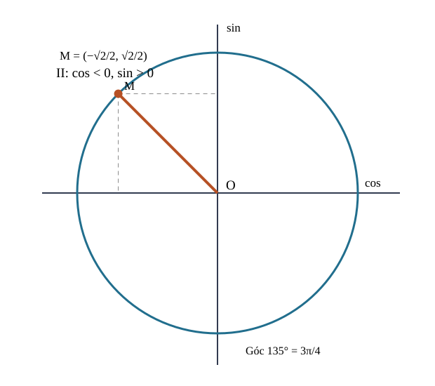
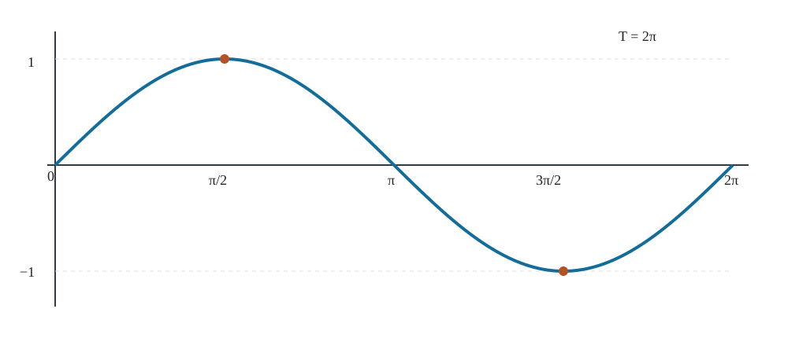

---
hide:
  - toc
---

HỌC THEO CHUYÊN ĐỀ · CĐ06 · TOÁN THPT

<nav class="thpt-sgk-lesson-nav" aria-label="Điều hướng Chuyên đề 06">
<a href="../../cd05/kien-thuc/">← Chuyên đề trước</a>
<a href="../../cd07/kien-thuc/">Chuyên đề sau →</a>
<a href="../luyen-tap/">Luyện tập</a>
<a href="../tu-kiem-tra/">Tự kiểm tra</a>
</nav>

<a href="../../">← Tổng quan các Chuyên đề</a>

Học lượng giác và phương trình lượng giác qua các mảng kiến thức bên dưới; tự thử trước khi mở Đối chiếu.

Khám phá thêm: <a href="../../../math-lab/models/slm-top06-unit-circle-01/">Mô hình trực quan Chuyên đề 06</a> (tùy chọn).

<link rel="stylesheet" href="../../../../assets/stylesheets/thpt-topic-w1-golden-v1.css">

Đang chuẩn bị kiến thức…

<!-- TOPIC06_APPROVED_SOURCE_START -->
<!-- Q18 SOURCE_LEARNER_BLOB edfecb3edd165e87bcb615ec4cbb66833ad52675; Q18_RECEIPT_BLOB ef1e607675b82fcbf7c7aa6005c0c1005a836d1f; AUTHORING_PR #891; PUBLIC_PROJECTION_ONLY -->

# Kiến thức

## 1. Góc quay và tọa độ trên đường tròn

Khi bánh xe quay, điều quan trọng không chỉ là nó đã quay một góc bao nhiêu độ mà còn là **theo chiều nào** và **bao nhiêu vòng**. Ta có thể đánh dấu một điểm trên vành bánh xe: trong quá trình quay, hoành độ và tung độ của điểm này thay đổi rồi lặp lại. Chính hai tọa độ ấy dẫn đến \(\cos\) và \(\sin\). Nếu hiểu góc có hướng và đường tròn trước, các dấu, công thức và đồ thị tuần hoàn về sau đều có lý do hình học.

Trước hết hãy xem tia cuối của một góc được xác định ra sao, vì sao hai góc khác nhau có thể cùng tia cuối và tại sao không thể bỏ qua số vòng khi tính quãng đường chuyển động.

<!-- LESSON_ID: TOP06-M01; OUTCOME_ID: TOP06-O01; PREVIOUS_R04_BLOB: 9fee274efababcf7ffd91c78c7e39e89191f17c0 -->

### 1.1. Độ và radian của góc có hướng

Hai góc cùng tia cuối có kể cùng số vòng quay không?

Khi quay một chiếc kim, ta có thể quay theo hoặc ngược chiều kim đồng hồ, quay chưa hết một vòng hay nhiều vòng. Một **góc lượng giác** được xác định bởi tia đầu, tia cuối và chuyển động quay theo một chiều nhất định. Chiều quay ngược kim đồng hồ được quy ước dương, chiều thuận kim đồng hồ là âm. Với cùng tia đầu và tia cuối, ta có thể quay thêm số vòng nguyên tùy ý, nên số đo của các góc lượng giác ấy sai khác nhau bội của \(360^\circ\), hay \(2\pi\) radian. Đơn vị radian gắn số đo góc với độ dài cung tròn.

Khi ghép hai lần quay liên tiếp từ \(Ou\) đến \(Ov\), rồi từ \(Ov\) đến \(Ow\), ta được một lần quay từ \(Ou\) đến \(Ow\), nhưng có thể khác số vòng. Từ đó có **hệ thức Chasles**, công cụ giúp tính góc từ các tia mà không cần đo lại trên hình:

> **TÍNH CHẤT — Hệ thức Chasles.** Với ba tia \(Ou,Ov,Ow\) cùng gốc \(O\), số đo góc lượng giác thỏa
> \[
> \operatorname{sđ}(Ou,Ov)+\operatorname{sđ}(Ov,Ow)=\operatorname{sđ}(Ou,Ow)+2k\pi,\qquad k\in\mathbb Z.
> \]
> Nếu đo bằng độ, thay \(2k\pi\) bằng \(360^\circ k\). Suy ra \(\operatorname{sđ}(Ou,Ov)=\operatorname{sđ}(Ox,Ov)-\operatorname{sđ}(Ox,Ou)+2k\pi\) khi cùng dùng radian. Đây là **đẳng thức theo lớp góc cùng tia cuối**, không phải khẳng định hai phép quay thực hiện đúng bằng số vòng.

Chẳng hạn, từ trục \(Ox\) quay đến \(Ou\) được \(60^\circ\), còn từ \(Ox\) quay đến \(Ov\) được \(150^\circ\), thì góc từ \(Ou\) đến \(Ov\) có các số đo \(150^\circ-60^\circ+360^\circ k=90^\circ+360^\circ k\). Hệ thức cho các góc cùng tia cuối; nếu bài hỏi số vòng quay thực tế, phải giữ số đo của chuyển động cụ thể.

> **CÔNG THỨC — Đổi độ và radian.** Một vòng tròn ứng với \(360^\circ=2\pi\) radian. Vì vậy \(\alpha_{\mathrm{rad}}=\alpha_{\mathrm{độ}}\,\pi/180\); khi đổi ngược, nhân số radian với \(180/\pi\). Với góc có hướng, giữ nguyên dấu của phép quay. Hai góc chênh nhau \(2k\pi\) có cùng tia cuối nhưng không nhất thiết cùng số vòng quay. Khi sử dụng ký hiệu \(\operatorname{sđ}(Ou,Ov)\), cần biết đang tính theo độ hay radian để không trộn \(360^\circ\) với \(2\pi\).

Chẳng hạn, quay \(-450^\circ\) nghĩa là quay một vòng và thêm \(90^\circ\) theo chiều âm. Đổi sang radian: \(-450\cdot\pi/180=-5\pi/2\). Điểm cuối của góc này trùng điểm cuối \(-\pi/2\), nhưng phép quay đầu tiên thực hiện thêm một vòng. Vì vậy khi gặp yêu cầu tính độ dài cung hoặc số vòng, không thể tùy ý thay mọi góc bằng góc cùng tia cuối nếu mất thông tin về chuyển động.

**Ví dụ**

**Đề bài.** Quay \(585^\circ\) ngược chiều kim đồng hồ. Đổi sang radian và tìm góc cùng tia cuối trong \([0,2\pi)\).

**Lời giải.** \(585^\circ=585\pi/180=13\pi/4\). Trừ \(2\pi\) được \(5\pi/4\). Tia cuối trùng nhau, nhưng góc \(13\pi/4\) ghi cả một vòng nhiều hơn góc đại diện; không bỏ số vòng nếu bài hỏi chuyển động.

**Vận dụng**

Đổi \(-150^\circ\) sang radian, rồi cho biết góc quay mang dấu gì.

Đối chiếu

\(-150^\circ=-150\pi/180=-5\pi/6\) radian. Dấu âm cho biết chiều quay thuận kim đồng hồ. Nếu em làm mất dấu, hãy so vị trí cuối của \(+90^\circ\) và \(-90^\circ\) trên đường tròn.

**Kiểm lỗi**

Nếu em đổi độ sang radian nhưng bỏ dấu quay hoặc thay góc ban đầu bằng góc đại diện mà quên số vòng, đọc lại **Kiến thức 1.1** rồi làm **Bài 1** (đổi độ sang radian, xác định góc phần tư) và **Bài 6** (góc âm và tia cuối) trong Luyện tập. Giữ nguyên góc quay gốc khi đề hỏi chuyển động đã thực hiện.

<!-- LESSON_ID: TOP06-M02; OUTCOME_ID: TOP06-O02; PREVIOUS_R04_BLOB: 9fee274efababcf7ffd91c78c7e39e89191f17c0 -->

### 1.2. Sin/cos từ tọa độ đường tròn

Dấu sin và cos khác nhau ở hai phía của trục Oy vì sao?

Trên đường tròn đơn vị, dấu của sin và cos được đọc từ tọa độ. Làm sao biết dấu sin, cos trước khi tính giá trị chính xác? Ta đã biết đường tròn đơn vị, tọa độ (x,y). 

> **ĐỊNH NGHĨA — Sin, côsin trên đường tròn đơn vị.** Với điểm cuối \(M=(x,y)\) ứng với góc lượng giác \(\alpha\) trên đường tròn đơn vị, \(\cos\alpha=x\), \(\sin\alpha=y\). Vì vậy các dấu phụ thuộc góc phần tư; \(\tan\alpha=\sin\alpha/\cos\alpha\) chỉ khi \(\cos\alpha\ne0\), còn \(\cot\alpha=\cos\alpha/\sin\alpha\) chỉ khi \(\sin\alpha\ne0\).

Chẳng hạn, tại góc \(135^\circ\) (góc phần tư II) trên hình, \(\cos135^\circ=-\sqrt2/2\) là **hoành độ âm**, còn \(\sin135^\circ=\sqrt2/2\) là **tung độ dương**. Một ví dụ không cần góc đặc biệt: nếu \(\sin\alpha=4/5\) và \(\alpha\) ở phần tư II, thì \(\cos\alpha=-\sqrt{1-16/25}=-3/5\), \(\tan\alpha=-4/3\). Cả hai trường hợp đều phải chọn dấu từ góc phần tư trước khi lấy căn.

*Đọc hình:* Điểm \(M\) ở \(135^\circ\) có tọa độ \((-\sqrt2/2,\sqrt2/2)\). Hãy đọc dấu âm ở trục ngang và dấu dương ở trục đứng; chỉ sau đó mới gắn các giá trị \(\cos\), \(\sin\). Hình minh họa góc cụ thể, còn quy tắc đúng ở mọi góc phần tư.

**Bảng giá trị lượng giác của các góc thường gặp** là kết quả từ tọa độ trên đường tròn và tam giác vuông đặc biệt. Khi cần tính góc khác, hãy giảm về góc cùng tia cuối và dùng đối xứng để chọn đúng dấu.

| Góc | \(0\) | \(\pi/6\) | \(\pi/4\) | \(\pi/3\) | \(\pi/2\) |
|---|---:|---:|---:|---:|---:|
| \(\sin\) | \(0\) | \(1/2\) | \(\sqrt2/2\) | \(\sqrt3/2\) | \(1\) |
| \(\cos\) | \(1\) | \(\sqrt3/2\) | \(\sqrt2/2\) | \(1/2\) | \(0\) |
| \(\tan\) | \(0\) | \(\sqrt3/3\) | \(1\) | \(\sqrt3\) | Không xác định |
| \(\cot\) | Không xác định | \(\sqrt3\) | \(1\) | \(\sqrt3/3\) | \(0\) |

Để dùng **máy tính cầm tay**, trước tiên chọn chế độ góc **DEG** khi số đo bằng độ hoặc **RAD** khi bằng radian. Sau đó dùng phím \(\sin,\cos,\tan\) (hoặc các phím nghịch đảo khi cần tìm góc). Ví dụ \(\sin30^\circ=1/2\) trong chế độ DEG, còn \(\sin(\pi/6)=1/2\) trong RAD; nếu chọn sai chế độ sẽ cho kết quả khác. Giá trị tìm bằng máy có thể là gần đúng; khi đề cần giá trị chính xác, ưu tiên bảng góc đặc biệt, công thức và biến đổi.

**Ví dụ**

**Đề bài.** Biết \(\cos\alpha=-12/13\), góc \(\alpha\) thuộc phần tư II. Tính \(\sin\alpha,\tan\alpha\).

**Lời giải.** \(\sin^2\alpha=1-144/169=25/169\). Phần tư II sin dương nên \(\sin\alpha=5/13\); cos khác 0 nên \(\tan\alpha=-5/12\). Chọn dấu theo góc phần tư trước khi lấy căn.

**Vận dụng**

Sinα=−3/5, α thuộc góc phần tư IV; cosα bằng bao nhiêu?

Đối chiếu

+4/5 vì cos dương ở góc IV.

Nếu ra −4/5, xem lại trục hoành phía phải; làm lại Bài 2 và Bài 7 trong phần Luyện tập.

<!-- LESSON_ID: TOP06-M03; OUTCOME_ID: TOP06-O03; PREVIOUS_R04_BLOB: 9fee274efababcf7ffd91c78c7e39e89191f17c0 -->

### 1.3. Cung hình học và độ dời có hướng

Quãng đường đi có âm khi kim quay thuận chiều không?

> **TÍNH CHẤT — Cung hình học và độ dời có hướng.** Các góc khác số đo vẫn có thể dẫn tới cùng vị trí trên đường tròn. Đo được quãng đường trên một vòng cung từ góc ở tâm bằng cách nào? Ta sử dụng định nghĩa radian và chu vi 2πr. Độ dài cung hình học s=r|θ| với θ radian, r>0; độ dời có hướng d=rθ giữ dấu. Góc chênh 2kπ có cùng tia cuối nhưng cung quét có thể khác nhiều vòng.

Xét ví dụ: Bánh xe bán kính 7 cm quay −120° tức −2π/3: độ dời cung theo chiều quay là −14π/3 cm, độ dài quãng đường là 14π/3 cm. Trước hết đổi radian để đơn vị đúng.

**Ví dụ**

**Đề bài.** Một bánh xe bán kính \(9\) cm quay \(-240^\circ\). Tìm độ dời cung có hướng và quãng đường trên vành.

**Lời giải.** \(-240^\circ=-4\pi/3\) rad. Độ dời \(d=r\theta=-12\pi\) cm, quãng đường \(s=r|\theta|=12\pi\) cm. Độ dài quãng đường phải không âm.

**Vận dụng**

Bán kính 3, quay 3π/2 rad: cung dài bao nhiêu?

Đối chiếu

9π/2; góc đã ở radian.

Nếu dùng r×góc độ trực tiếp, đổi 270°=3π/2 rồi tính lại. Hãy làm lại Bài 4 và Bài 8 trong phần Luyện tập.

## 2. Công thức lượng giác có điều kiện

Trên đường tròn bán kính 1, một điểm luôn thỏa \(x^2+y^2=1\). Thay \(x=\cos\alpha\), \(y=\sin\alpha\), ta hiểu được hệ thức nền tảng trước khi ghi nhớ. Khi đổi góc, các điểm trên đường tròn quay hoặc phản xạ; công thức cộng, trừ và góc nhân đôi là cách diễn tả những phép biến đổi hình học ấy bằng ký hiệu. Vì vậy cần kiểm đúng góc và dấu, không chỉ áp dụng công thức theo mẫu.

Các công thức không phải những dòng cần học thuộc riêng lẻ: chúng phát triển từ vị trí điểm trên đường tròn, điều kiện tan/cot và phép cộng hai góc. Ta sẽ lần lượt kiểm nghiệm chúng bằng những trường hợp cụ thể.

<!-- LESSON_ID: TOP06-M04; OUTCOME_ID: TOP06-O04; PREVIOUS_R04_BLOB: 9fee274efababcf7ffd91c78c7e39e89191f17c0 -->

### 2.1. Hệ thức lượng giác cùng điều kiện

Khi nào các tỉ số tan/cot không được phép sử dụng?

Có thể tìm một giá trị lượng giác từ các giá trị còn lại không? Ta bắt đầu từ tam giác vuông; cos²+sin²=1 trên đường tròn đơn vị. 

> **TÍNH CHẤT — Hệ thức cơ bản và điều kiện.** Với mọi \(x\in\mathbb R\), \(\sin^2x+\cos^2x=1\). Khi \(\cos x\ne0\), \(1+\tan^2x=1/\cos^2x\); khi \(\sin x\ne0\), \(1+\cot^2x=1/\sin^2x\). Không dùng các hệ thức có mẫu bằng 0.

 Không được chia cho sin hoặc cos tại nghiệm bằng 0.

Chẳng hạn, Nếu sinx=3/5 và x ở góc phần tư I: cosx=4/5; tanx=3/4. Nếu sinx=0 thì cotx không xác định, dù các hệ thức không có dấu chia sau biến đổi.

**Ví dụ**

**Đề bài.** Biết \(\sin\alpha=-8/17\), \(\alpha\) ở phần tư IV. Tìm cos và tan.

**Lời giải.** \(\cos^2\alpha=1-64/289=225/289\); cos dương ở phần tư IV nên \(\cos\alpha=15/17\). Vì cos khác 0, \(\tan\alpha=-8/15\). Không được chia cho cos tại góc mà cos bằng 0.

**Vận dụng**

Với x=π/2, tanx tồn tại không?

Đối chiếu

Không, cos(π/2)=0.

Ghi điều kiện trước khi áp dụng đẳng thức phân thức; làm lại Bài 10 và Bài 23 trong phần Luyện tập.

<!-- LESSON_ID: TOP06-M05; OUTCOME_ID: TOP06-O05; PREVIOUS_R04_BLOB: 9fee274efababcf7ffd91c78c7e39e89191f17c0 -->

### 2.2. Góc liên quan và đối xứng

Phản xạ qua trục Oy đổi giá trị nào?

> **TÍNH CHẤT — Góc liên quan và đối xứng.** Những góc đối xứng trên đường tròn tạo ra các quy luật về giá trị lượng giác. Vì sao hai góc khác nhau có thể có sin bằng nhau nhưng cos trái dấu? Cần nhớ phép đối xứng qua trục Oy trên đường tròn. Đối xứng của điểm (cosα,sinα) qua Oy biến α thành π−α; do đó sin(π−α)=sinα, cos(π−α)=−cosα. Với −α: cos chẵn, sin lẻ. Lý do hình học đi trước việc học thuộc dấu.

Ngoài đối xứng bù và đối đã thấy, góc **phụ nhau** đổi vai trò hoành độ–tung độ: \(\sin(\tfrac{\pi}{2}-\alpha)=\cos\alpha\), \(\cos(\tfrac{\pi}{2}-\alpha)=\sin\alpha\). Góc hơn kém \(\pi\) đưa điểm tới điểm đối diện trên đường tròn nên \(\sin(\pi+\alpha)=-\sin\alpha\), \(\cos(\pi+\alpha)=-\cos\alpha\); vì cả tử và mẫu đổi dấu nên \(\tan(\pi+\alpha)=\tan\alpha\) khi \(\cos\alpha\ne0\). Có thể tự kiểm với \(\alpha=\pi/6\). Những quan hệ góc liên kết này áp dụng cho mọi góc có nghĩa; riêng với tan/cot, vẫn phải kiểm mẫu số bằng \(0\) hay không.

Chẳng hạn, α=π/6; góc 5π/6 đối xứng qua Oy nên sin(5π/6)=1/2, cos(5π/6)=−√3/2. Dùng điểm trên đường tròn thay vì nhớ hai bảng dấu.

**Ví dụ**

**Đề bài.** Từ góc \(\pi/4\), tính \(\sin(3\pi/4)\) và \(\cos(3\pi/4)\) bằng đối xứng.

**Lời giải.** Vì \(3\pi/4=\pi-\pi/4\), đối xứng qua Oy giữ tung độ, đổi dấu hoành độ. Suy ra \(\sin(3\pi/4)=\sqrt2/2\), \(\cos(3\pi/4)=-\sqrt2/2\).

**Vận dụng**

So sánh sin(−π/3) với sin(π/3).

Đối chiếu

sin(−π/3)=−√3/2 do sin là hàm lẻ.

Vẽ trục Ox và phản xạ trên đường tròn; làm lại Bài 20 và Bài 24 trong phần Luyện tập.

<!-- LESSON_ID: TOP06-M06; OUTCOME_ID: TOP06-O06; PREVIOUS_R04_BLOB: 9fee274efababcf7ffd91c78c7e39e89191f17c0 -->

### 2.3. Công thức cộng/trừ góc

Vì sao sin(u+v) không bằng sin u+sin v?

> **CÔNG THỨC — Công thức cộng/trừ góc.** Hai góc cộng hoặc trừ nhau tạo ra công thức có thể suy từ hình học. Sin(u+v) có bằng sin u+sin v không? Để xác định điều đó, cần xét đường tròn đơn vị, tích vô hướng của hai vectơ đơn vị. Hiệu hai góc chi phối tích vô hướng: cos(u−v)=cosu cosv+sinu sinv. Thay v→−v suy ra cos(u+v)=cosu cosv−sinu sinv; các công thức sin tương ứng: sin(u±v)=sinu cosv±cosu sinv. Không tách sin một tổng bằng tổng các sin.

Đối với **tang của tổng/hiệu**, chia công thức cộng của sin cho công thức cộng của cos:

\[
\tan(u+v)=\frac{\tan u+\tan v}{1-\tan u\,\tan v},\qquad
\tan(u-v)=\frac{\tan u-\tan v}{1+\tan u\,\tan v}.
\]

Các dạng phân thức này chỉ dùng khi \(\cos u\ne0,\cos v\ne0\), đồng thời mẫu tương ứng khác \(0\) (tức \(\cos(u\pm v)\ne0\)); không triệt mẫu hay lấy tang của góc chưa xác định. Chẳng hạn \(\tan(\pi/3-\pi/4)=(\sqrt3-1)/(1+\sqrt3)=2-\sqrt3\), còn \(\tan(\pi/4+\pi/4)\) không xác định dù \(\tan(\pi/4)\) tồn tại.

Chẳng hạn, Cos15°=cos(45°−30°)=√6/4+√2/4. Chọn phép trừ vì 15° không có trong bảng cơ bản nhưng 45°,30° thì có.

**Ví dụ**

**Đề bài.** Tính chính xác \(\cos105^\circ\) bằng công thức cộng.

**Lời giải.** Viết \(105^\circ=60^\circ+45^\circ\). \(\cos105^\circ=\cos60^\circ\cos45^\circ-\sin60^\circ\sin45^\circ=(\sqrt2-\sqrt6)/4\). Dấu âm hợp lý vì góc ở phần tư II.

**Vận dụng**

Tính sin75° từ 45°+30°.

Đối chiếu

(√6+√2)/4.

Nếu ghi sin45°+sin30°, thử u=v=π/2 để tìm phản ví dụ. Hãy làm lại Bài 12 và Bài 25 trong phần Luyện tập.

<!-- LESSON_ID: TOP06-M07; OUTCOME_ID: TOP06-O07; PREVIOUS_R04_BLOB: 9fee274efababcf7ffd91c78c7e39e89191f17c0 -->

### 2.4. Góc nhân đôi và đổi dạng

Có thể chọn dạng tích hay tổng để thuận lợi giải phương trình?

> **CÔNG THỨC — Góc nhân đôi và đổi dạng.** Công thức góc đôi và tích–tổng gắn liền với công thức cộng. Một tổ hợp sin2x hoặc sinx cosx có thể biến đổi gọn hơn ra sao? Ta đã biết công thức cộng; phân phối biểu thức. Lấy u=v=x trong công thức cộng được sin2x=2sinx cosx và cos2x=cos²x−sin²x. Cộng/trừ các công thức cho u±v tạo biến đổi tích–tổng, tổng–tích. Chọn dạng đơn giản hóa theo mục tiêu, luôn giữ biểu thức xác định.

**CÔNG THỨC — Các dạng nhân đôi, tích–tổng và tổng–tích cần sử dụng.** Từ \(\cos(a-b)\) và \(\cos(a+b)\), lấy tổng để triệt hai tích sin, lấy hiệu để triệt hai tích cos; làm tương tự với công thức cộng của sin. Như vậy ta không cần học một bộ quy tắc rời rạc:

\[
\begin{aligned}
\sin 2a&=2\sin a\cos a,\\
\cos 2a&=\cos^2a-\sin^2a=2\cos^2a-1=1-2\sin^2a,\\
\tan 2a&=\frac{2\tan a}{1-\tan^2a}\quad(\cos a\ne0,\ \cos 2a\ne0).
\end{aligned}
\]

**Tích thành tổng** (dùng khi gặp tích của hai giá trị lượng giác, chẳng hạn để tính giá trị hoặc đưa về tổng):

\[
\begin{aligned}
\cos a\cos b&=\tfrac12[\cos(a-b)+\cos(a+b)],\\
\sin a\sin b&=\tfrac12[\cos(a-b)-\cos(a+b)],\\
\sin a\cos b&=\tfrac12[\sin(a+b)+\sin(a-b)].
\end{aligned}
\]

**Tổng thành tích** (dùng khi một tổng hoặc hiệu cần đặt nhân tử, chẳng hạn để giải phương trình):

\[
\begin{aligned}
\cos a+\cos b&=2\cos\tfrac{a+b}{2}\cos\tfrac{a-b}{2},\\
\cos a-\cos b&=-2\sin\tfrac{a+b}{2}\sin\tfrac{a-b}{2},\\
\sin a+\sin b&=2\sin\tfrac{a+b}{2}\cos\tfrac{a-b}{2},\\
\sin a-\sin b&=2\cos\tfrac{a+b}{2}\sin\tfrac{a-b}{2}.
\end{aligned}
\]

Có thể kiểm dấu hiệu bằng \(a=b=0\) hoặc bằng cách khai triển ngược với công thức cộng. Ví dụ, \(\cos3x+\cos x=2\cos2x\cos x\); còn \(\sin3x\cos x=\frac12(\sin4x+\sin2x)\). Đối với tang, phải kiểm cả \(\cos a\ne0\) và mẫu \(1-\tan^2a\ne0\), thay vì áp công thức ở điểm không xác định.

Chẳng hạn, sin3x+sinx=2sin2x cosx: đặt A=3x,B=x rồi dùng sinA+sinB=2sin((A+B)/2)cos((A−B)/2). Cách này phù hợp khi muốn đặt nhân tử hoặc xét nghiệm.

**Ví dụ**

**Đề bài.** Cho \(\cos x=3/5\), \(\sin x=4/5\). Tính \(\sin2x,\cos2x\).

**Lời giải.** \(\sin2x=2(3/5)(4/5)=24/25\). \(\cos2x=(3/5)^2-(4/5)^2=-7/25\). Kiểm \((24/25)^2+(-7/25)^2=1\).

**Vận dụng**

Viết 2sinx cosx thành hàm của 2x.

Đối chiếu

sin2x.

Nếu nhầm hệ số 2, thay x=π/4 để kiểm. Hãy làm lại Bài 17, Bài 18 và Bài 26 trong phần Luyện tập.

## 3. Hàm lượng giác và các đồ thị tuần hoàn

Nếu góc tiếp tục tăng, hình chiếu của điểm trên đường tròn lúc đi lên, lúc đi xuống và trở về giá trị cũ sau một vòng. Đó là cách hàm \(y=\sin x\) xuất hiện: từ chuyển động tròn thành đường sóng. Các phép co giãn và dịch pha sẽ thay đổi biên độ, chu kỳ hoặc vị trí đỉnh nhưng không thay bản chất của một quy luật tuần hoàn.

Khi góc thay đổi liên tục, sin, cos, tan và cot trở thành hàm số có miền, chu kỳ, đối xứng và đồ thị. Quan sát sự lặp lại giúp hiểu vì sao một phương trình lượng giác thường có nhiều nghiệm.

<!-- LESSON_ID: TOP06-M08; OUTCOME_ID: TOP06-O08; PREVIOUS_R04_BLOB: 9fee274efababcf7ffd91c78c7e39e89191f17c0 -->

### 3.1. Miền xác định của biểu thức lượng giác

Khi biểu thức có căn và tan, phải giao những miền nào?

> **KIẾN THỨC CẦN GHI NHỚ — Miền xác định của biểu thức lượng giác.** Vì sao không phải mọi hàm lượng giác đều có miền xác định ℝ? Ta sử dụng khái niệm hàm số và mẫu số khác 0. Sin, cos xác định trên ℝ, nhận giá trị trong [−1,1]. Tanx không xác định tại x=π/2+kπ; cotx không xác định tại x=kπ. Với biểu thức ghép như \(\sqrt{2\sin x-1}\), phải thêm điều kiện \(2\sin x-1\ge0\). Nếu có đồng thời căn, phân thức, tang hoặc côtang thì lấy **giao tất cả điều kiện**, không chỉ kiểm một biểu thức.

Xét ví dụ: Tìm D của f(x)=√(2sinx−1): cần sinx≥1/2, nên x∈[π/6+2kπ,5π/6+2kπ], k∈ℤ. Chọn hình đường tròn hoặc đồ thị sin để xác định các cung đủ điều kiện.

**Ví dụ**

**Đề bài.** Tìm miền xác định của \(f(x)=\sqrt{1-2\cos x}\).

**Lời giải.** Cần \(1-2\cos x\ge0\), tức \(\cos x\le1/2\). Trong mỗi vòng điều này đúng trên \([\pi/3,5\pi/3]\); vậy \(D=\bigcup_{k\in\mathbb Z}[\pi/3+2k\pi,5\pi/3+2k\pi]\). Hai biên được nhận vì căn 0 có nghĩa.

**Vận dụng**

Tập giá trị của y=2cosx−3 là gì?

Đối chiếu

[−5,−1] do cosx∈[−1,1].

Nếu bỏ mất miền xác định của tan, đặt cosx=0 làm thử phản ví dụ. Hãy làm lại Bài 28 và Bài 39 trong phần Luyện tập.

<!-- LESSON_ID: TOP06-M09; OUTCOME_ID: TOP06-O09; PREVIOUS_R04_BLOB: 9fee274efababcf7ffd91c78c7e39e89191f17c0 -->

### 3.2. Chu kỳ cơ bản và đối xứng

Hai điểm cùng độ cao đã đủ chứng minh chu kỳ chưa?

> **TÍNH CHẤT — Chu kỳ cơ bản và đối xứng.** Chu kỳ và đối xứng giúp đọc hàm lượng giác trên cả miền, không chỉ vài điểm. Làm thế nào dự đoán khi nào một dạng sóng lặp lại? Ta bắt đầu từ hàm số trên miền xác định; giá trị sin,cos trên vòng tròn. f có chu kỳ T>0 khi x±T đều thuộc miền nếu x thuộc miền và f(x+T)=f(x) với mọi x. Sin và cos có chu kỳ cơ bản \(2\pi\); tan và cot có chu kỳ cơ bản \(\pi\). Sin, tan, cot là **hàm lẻ** trên miền đối xứng tương ứng, còn cos là **hàm chẵn**; đổi biến và nhân hệ số có thể làm chu kỳ khác. Để đọc chiều biến thiên, ta xét **từng khoảng**, không suy từ một vài điểm có cùng tung độ:
- \(\sin x\) tăng trên \([-\pi/2+2k\pi,\ \pi/2+2k\pi]\) và giảm trên \([\pi/2+2k\pi,\ 3\pi/2+2k\pi]\).
- \(\cos x\) giảm trên \([2k\pi,\ \pi+2k\pi]\) và tăng trên \([\pi+2k\pi,\ 2\pi+2k\pi]\).
- \(\tan x\) tăng trên mỗi khoảng \((-\pi/2+k\pi,\ \pi/2+k\pi)\).
- \(\cot x\) giảm trên mỗi khoảng \((k\pi,\ (k+1)\pi)\), với \(k\in\mathbb Z\).

Đây là các khoảng đủ dài để thấy một nhánh tăng/giảm trọn vẹn; tại các điểm **tiệm cận của tan/cot**, hàm không xác định nên không được gộp hai nhánh thành một khoảng. Tập giá trị sin/cos là \([-1,1]\), còn tan/cot là \(\mathbb R\), bởi mỗi nhánh tan/cot đi từ âm vô hạn đến dương vô hạn hoặc ngược lại.

Chẳng hạn, y=sin(3x) có chu kỳ cơ bản 2π/3 vì tăng x lên 2π/3 làm góc tăng 2π. y=cos2x+sin3x có chu kỳ 2π; hai thành phần có tần số khác nhau và chu kỳ chung phù hợp.

**Ví dụ**

**Đề bài.** Tìm chu kỳ cơ bản của \(f(x)=\sin(5x)\).

**Lời giải.** Tăng \(x\) thêm \(2\pi/5\) làm đối số tăng \(2\pi\), nên lặp với mọi \(x\). Chu kỳ dương nhỏ nhất của sin theo đối số là \(2\pi\), vì thế \(5T=2\pi\) nhỏ nhất, tức \(T=2\pi/5\). Hai điểm có cùng tung độ chưa đủ chứng minh chu kỳ.

**Vận dụng**

Chu kỳ cơ bản của y=cos(4x) là gì?

Đối chiếu

π/2.

Nếu đo chu kỳ bằng cách nhìn một đỉnh, kiểm đỉnh tiếp theo và điều kiện trên mọi x. Hãy làm lại Bài 30 và Bài 40 trong phần Luyện tập.

<!-- LESSON_ID: TOP06-M10; OUTCOME_ID: TOP06-O10; PREVIOUS_R04_BLOB: 9fee274efababcf7ffd91c78c7e39e89191f17c0 -->

### 3.3. Biên độ, pha và trục giữa

Biên độ khác dịch pha và trục giữa ra sao?

Với sin và cos, dịch pha làm đổi vị trí đỉnh nhưng giữ tính tuần hoàn. Đồ thị giúp đọc điều gì ngoài một bảng giá trị? Cần nhớ mỗi điểm đồ thị là (x,f(x)); chuyển dịch ngang/đứng. y=A sin(ωx+φ)+d (A,ω≠0) có biên độ |A|, chu kỳ 2π/|ω|, trục giữa y=d và tập giá trị [d−|A|,d+|A|]. Pha dịch ngang −φ/ω; không nhầm chiều dấu. Nếu ω=0, hàm hằng và không có chu kỳ cơ bản.

> **PHƯƠNG PHÁP — Biên độ, pha và trục giữa.** Trước hết, hình bên dưới vẽ \(y=\sin x\) trên một chu kỳ \([0,2\pi]\): đi qua \((0,0)\), cực đại 1 ở \(x=\pi/2\), về 0 ở \(\pi\), cực tiểu −1 ở \(3\pi/2\), rồi về 0 ở \(2\pi\). Khi kết hợp các phép biến đổi, ví dụ \(y=-2\sin(3x-\pi/2)+1\) có biên độ 2, chu kỳ \(2\pi/3\), đường giữa \(y=1\), tập giá trị \([-1,3]\), dịch pha phải \(\pi/6\) trước khi lật và co giãn đứng. Hình gốc giải thích chu kỳ, **không phải hình của hàm đã biến đổi**.

*Đọc hình:* Đồ thị đang vẽ \(y=\sin x\) trên \([0,2\pi]\), đánh dấu các mốc 0, \(\pi/2\), \(\pi\), \(3\pi/2\), \(2\pi\) với tung độ lần lượt 0,1,0,−1,0. Đó là chu kỳ gốc; khi học hàm \(\sin(3x-\pi/2)\), phải **tính lại** chu kỳ và pha chứ không đo thẳng trên hình này.

**Ví dụ**

**Đề bài.** Với \(y=1+3\cos(2x+\pi/3)\), tìm biên độ, chu kỳ, trục giữa, tập giá trị và dịch pha.

**Lời giải.** Biên độ 3, chu kỳ \(\pi\), trục giữa \(y=1\), tập giá trị \([-2,4]\). Do \(2x+\pi/3=2(x+\pi/6)\), dịch pha trái \(\pi/6\) so với \(\cos2x\). Hình cạnh bài là \(\sin x\) gốc, không phải đồ thị hàm này.

**Vận dụng**

y=3cos(2x)+4 có giá trị lớn nhất, nhỏ nhất là bao nhiêu?

Đối chiếu

7 và 1.

Nếu tìm sai giá trị lớn nhất, nhỏ nhất của \(y=3\cos(2x)+4\), hãy dùng \(-1\le\cos(2x)\le1\) để được ngay \(1\le y\le7\), rồi làm lại Bài 33 (tập giá trị) và Bài 41 (trục giữa, biên độ và chu kỳ) trong phần Luyện tập. Nếu nhầm chiều dịch pha của ví dụ \(y=1+3\cos(2x+\pi/3)\), hãy viết \(2x+\pi/3=2(x+\pi/6)\) để nhận ra dịch trái \(\pi/6\); luyện thêm Bài 34 về chu kỳ của hàm cos có pha.

<!-- LESSON_ID: TOP06-M11; OUTCOME_ID: TOP06-O11; PREVIOUS_R04_BLOB: 9fee274efababcf7ffd91c78c7e39e89191f17c0 -->

### 3.4. Nhánh tan/cot và tiệm cận đứng

Có thể nối hai nhánh tan qua tiệm cận không?

Đồ thị tan và cot có điểm cấm, nên phải tách thành từng nhánh. Tại sao đồ thị tan không nối liền qua x=π/2? Để xác định điều đó, cần xét tan là sin/cos, cot là cos/sin. Tan có miền \(\mathbb R\setminus\{\pi/2+k\pi:k\in\mathbb Z\}\), chu kỳ \(\pi\) và tiệm cận đứng ở điểm loại. Cot có miền \(\mathbb R\setminus\{k\pi:k\in\mathbb Z\}\), chu kỳ \(\pi\) và tiệm cận đứng tại các điểm đó. **Mỗi nhánh tan đồng biến, mỗi nhánh cot nghịch biến** trên khoảng nằm giữa hai tiệm cận liên tiếp. Đồ thị chia nhánh, không nối qua tiệm cận.

> **TÍNH CHẤT — Nhánh tan/cot và tiệm cận đứng.** Trên hình, \(y=\tan x\) không xác định tại \(x=\pm\pi/2\) (và nói chung \(\pi/2+k\pi\)), vì \(\cos x=0\). Những đường này là **tiệm cận đứng**, không phải điểm để nối các nhánh. Nếu thay đối số thành \(2x\), hàm \(y=\tan(2x)\) sẽ có điểm loại tại \(x=\pi/4+k\pi/2\) và chu kỳ cơ bản \(\pi/2\). Hình đang minh họa \(\tan x\), không vẽ phiên bản \(\tan(2x)\).

*Đọc hình:* Các nhánh của \(y=\tan x\) tăng giữa hai tiệm cận \(x=-\pi/2\), \(x=\pi/2\). Đường tiệm cận bị loại khỏi miền; không thể nối nhánh qua vạch đứt hoặc đánh dấu tại đó một giá trị hàm hữu hạn.

**Ví dụ**

**Đề bài.** Cho \(g(x)=\tan(x-\pi/4)\). Tìm miền xác định và chu kỳ.

**Lời giải.** Cần \(\cos(x-\pi/4)\ne0\), tức \(x\ne3\pi/4+k\pi\), \(k\in\mathbb Z\). Chu kỳ cơ bản \(\pi\). Tiệm cận của \(\tan x\) trong hình chuyển sang phải \(\pi/4\), không nối nhánh qua tiệm cận.

**Vận dụng**

Tanx xác định tại x=π không?

Đối chiếu

Có, tanπ=0; cotπ mới không xác định.

Ghi bảng điểm loại trước khi nối hình; làm lại Bài 37, Bài 38 và Bài 42 trong phần Luyện tập.

## 4. Họ nghiệm, khoảng nghiệm và mô hình chu kỳ

Một giá trị sin có thể đạt được ở nhiều góc trong cùng một vòng và lặp vô hạn lần qua các vòng tiếp theo. Khi giải phương trình lượng giác, đáp số vì thế thường là **họ góc**, không chỉ một góc chính. Chọn đúng các họ rồi lọc theo đoạn yêu cầu và điểm bị loại bởi \(\tan\) hoặc \(\cot\) là bước quyết định để không bỏ sót hay nhận nhầm nghiệm.

Một nghiệm trên đường tròn có thể lặp lại sau những chu kỳ, nhưng bài toán thực tế hoặc một khoảng cụ thể chỉ cho phép vài giá trị. Ta phải xử lý điều kiện, công thức và phép lọc nghiệm cùng lúc.

<!-- LESSON_ID: TOP06-M12; OUTCOME_ID: TOP06-O12; PREVIOUS_R04_BLOB: 9fee274efababcf7ffd91c78c7e39e89191f17c0 -->

### 4.1. Nghiệm của sin/cos

Vì sao sin/cos thường phải ghi hai họ nghiệm?

> **PHƯƠNG PHÁP — Nghiệm của sin/cos.** Giải sinx=a khác giải đa thức chỗ nào? Ta đã biết đường tròn đơn vị, nghiệm cùng vị trí theo chu kỳ. Sinx=a có nghiệm thực khi |a|≤1; nếu sinα=a thì x=α+2kπ hoặc x=π−α+2kπ. Cosx=a có x=±arccos(a)+2kπ khi |a|≤1. Trong công thức này \(\arccos(a)\in[0,\pi]\), còn \(\alpha\) phải là góc đã biết thỏa \(\sin\alpha=a\).

Khi đề cho giá trị lượng giác **không phải góc đặc biệt**, máy tính cầm tay có thể tìm **một góc đại diện** bằng các phím nghịch đảo như \(\sin^{-1},\cos^{-1},\tan^{-1}\). Chọn trước chế độ **RAD** nếu lời giải ghi radian, **DEG** nếu ghi độ. Ví dụ, với \(\sin x=0{,}3\), dùng \(\alpha=\arcsin(0{,}3)\) trong chế độ RAD rồi vẫn phải viết **hai họ** \(x=\alpha+2k\pi\) hoặc \(x=\pi-\alpha+2k\pi\), \(k\in\mathbb Z\); giá trị máy tính không thay thế các họ nghiệm. Các phím ngược trả một **giá trị chính**, không phải toàn bộ nghiệm.

Chẳng hạn, Sin(2x)=√3/2: 2x=π/3+2kπ hoặc 2π/3+2kπ ⇒ x=π/6+kπ hoặc π/3+kπ, k∈ℤ. Có hai họ vì đường ngang cắt đường tròn tại hai điểm.

**Ví dụ**

**Đề bài.** Giải \(\cos(2x)=\sqrt2/2\) trên \(\mathbb R\).

**Lời giải.** \(\cos\theta=\sqrt2/2\) khi \(\theta=\pm\pi/4+2k\pi\). Đặt \(\theta=2x\) và chia hai vế cho 2, được \(x=\pm\pi/8+k\pi\), \(k\in\mathbb Z\). Hai dấu cho hai họ; kiểm lại bằng \(\cos(\pm\pi/4+2k\pi)=\sqrt2/2\).

**Vận dụng**

Giải cosx=0 trên ℝ.

Đối chiếu

x=π/2+kπ (k∈ℤ).

Nếu chỉ viết một nghiệm, quay thêm chu kỳ; nếu |a|>1 thì vô nghiệm. Hãy làm lại Bài 44, Bài 45 và Bài 60 trong phần Luyện tập.

<!-- LESSON_ID: TOP06-M13; OUTCOME_ID: TOP06-O13; PREVIOUS_R04_BLOB: 9fee274efababcf7ffd91c78c7e39e89191f17c0 -->

### 4.2. Nghiệm của tan/cot

Vì sao tan/cot chỉ có một họ nghiệm mỗi chu kỳ?

> **PHƯƠNG PHÁP — Nghiệm của tan/cot.** Khi giải phương trình tan hoặc cot, miền xác định thuộc về lời giải. Tại sao tanx=a chỉ cần một họ nghiệm? Ta sử dụng tan xác định khi cosx≠0; tính chu kỳ π. Tan là tỉ số với cos không bằng 0; tanx=a ⇔ x=arctan(a)+kπ, k∈ℤ. Cotx=a ⇔ x=arccot(a)+kπ với arccot chọn trong (0,π), k∈ℤ; cách viết khác phải định rõ nhánh arccot. Luôn xét điều kiện ban đầu khi có biểu thức ghép.

Xét ví dụ: Tan(x+π/4)=−1 ⇒ x+π/4=−π/4+kπ ⇒ x=−π/2+kπ. Thế lại: góc tan bằng −π/4+kπ, không chạm điểm loại.

**Ví dụ**

**Đề bài.** Giải \(\tan(3x)=\sqrt3\) trên \(\mathbb R\).

**Lời giải.** Điều kiện \(\cos(3x)\ne0\). Từ \(\tan\theta=\sqrt3\) suy ra \(\theta=\pi/3+k\pi\), nên \(x=\pi/9+k\pi/3\), \(k\in\mathbb Z\). Tại mọi nghiệm \(\cos(3x)=\pm1/2\ne0\), các nghiệm đều hợp lệ.

**Vận dụng**

Giải tan(2x)=0.

Đối chiếu

x=kπ/2, k∈ℤ; mọi nghiệm nằm trong miền tan.

Không nhân chéo cho cos=0; làm lại Bài 46, Bài 47 và Bài 61 trong phần Luyện tập.

<!-- LESSON_ID: TOP06-M14; OUTCOME_ID: TOP06-O14; PREVIOUS_R04_BLOB: 9fee274efababcf7ffd91c78c7e39e89191f17c0 -->

### 4.3. Biến đổi không làm mất nghiệm

Chia cho sin/cos có thể làm mất nghiệm nào?

> **TÍNH CHẤT — Biến đổi không làm mất nghiệm.** Biến đổi phương trình lượng giác có thể sinh nghiệm ngoài điều kiện. Rút gọn có thể vô tình tạo nghiệm mới như thế nào? Ta bắt đầu từ hệ thức cơ bản và quy tắc biến đổi tương đương. Phân tích thành tích chỉ tương đương nếu không chia cho biểu thức có thể bằng 0. Nếu khử mẫu/biến đổi căn cần giữ điều kiện ban đầu rồi thử lại. Một tích bằng 0 cho hợp các họ nghiệm của từng thừa số; không vứt một nhánh.

Chẳng hạn, Sinx(2cosx−1)=0 ⇒ sinx=0 hoặc cosx=1/2, nên x=kπ hoặc x=±π/3+2kπ. Không được chia cả hai vế cho sinx vì mất x=kπ.

**Ví dụ**

**Đề bài.** Giải \(2\sin x\cos x=\cos x\) mà không chia cho cos.

**Lời giải.** \(\cos x(2\sin x-1)=0\). Do đó \(x=\pi/2+k\pi\) hoặc \(x=\pi/6+2k\pi\) hoặc \(x=5\pi/6+2k\pi\), \(k\in\mathbb Z\). Chia cho cos sẽ làm mất cả họ đầu.

**Vận dụng**

Giải 2sinx cosx=0.

Đối chiếu

x=kπ/2, k∈ℤ; hoặc sinx=0 (kπ) hoặc cosx=0 (π/2+kπ).

Nếu định chia hai vế cho \(\sin x\), hãy xét riêng trường hợp \(\sin x=0\) trước để không mất nghiệm. Làm lại Bài 62 (phương trình phân thức cần lọc điểm mẫu bằng 0), rồi Bài 55 (điều kiện xác định của hai biểu thức tang) trong phần Luyện tập; không chia hoặc nhân với biểu thức có thể bằng 0 khi chưa xét điều kiện.

<!-- LESSON_ID: TOP06-M15; OUTCOME_ID: TOP06-O15; PREVIOUS_R04_BLOB: 9fee274efababcf7ffd91c78c7e39e89191f17c0 -->

### 4.4. Lọc nghiệm theo khoảng

Đoạn [0,2π) có lấy góc 2π không?

> **PHƯƠNG PHÁP — Lọc nghiệm theo khoảng.** Nghiệm tổng quát cần lọc khi chỉ xét một khoảng hữu hạn. Một họ nghiệm có vô hạn số nguyên k, nhưng bài toán chỉ chọn khoảng nhất định. Cần nhớ bất đẳng thức, khoảng mở/đóng và hàm lượng giác. Giải trên ℝ trước, sau đó lọc k theo khoảng hoặc xét trực tiếp các góc trên đường tròn trong [a,b]. Với [a,b) chỉ lấy a nếu thỏa, loại b; tránh đếm hai góc 0 và 2π là hai nghiệm khác nhau khi khoảng nửa mở.

Chẳng hạn, 2sin²x−3sinx+1=0 ⇒ (2sinx−1)(sinx−1)=0. Với [0,2π): x=π/6,5π/6,π/2, tổng 3 nghiệm. Không thêm 2π vì không thuộc khoảng.

**Ví dụ**

**Đề bài.** Giải \(\cos2x=1/2\) trên \([0,2\pi)\).

**Lời giải.** Trên toàn trục \(x=\pm\pi/6+k\pi\). Chọn \(0\le x&lt;2\pi\) cho bốn nghiệm \(\pi/6,5\pi/6,7\pi/6,11\pi/6\). Không tự thêm điểm mút bị loại.

**Vận dụng**

Giải sinx=0 trên [0,2π).

Đối chiếu

x=0,π; loại 2π.

Vẽ dãy nghiệm trên trục số và đánh dấu đầu mút; làm lại Bài 53, Bài 54 và Bài 63 trong phần Luyện tập.

<!-- LESSON_ID: TOP06-M16; OUTCOME_ID: TOP06-O16; PREVIOUS_R04_BLOB: 9fee274efababcf7ffd91c78c7e39e89191f17c0 -->

### 4.5. Chu kỳ trong mô hình có giới hạn

Nghiệm của mô hình ngoài miền thời gian có hợp lệ không?

> **PHƯƠNG PHÁP — Chu kỳ trong mô hình có giới hạn.** Mô hình tuần hoàn thực tế còn có giới hạn thời gian và đơn vị phải kiểm. Sóng, thủy triều và nhiệt độ thay đổi trong thời gian hữu hạn có thể mô tả bằng công thức nào? Để xác định điều đó, cần xét đồ thị sin/cos, chu kỳ, đơn vị thời gian. Mô hình h(t)=d+Acos(ωt+φ) có điều kiện miền t thực tế, mức nền d, biên độ |A|, chu kỳ 2π/|ω| khi ω≠0. Dữ liệu thực không nhất thiết đúng sinus lý tưởng; phải phân biệt mô hình giả định với kết luận về thế giới.

Chẳng hạn, Mực nước giả định h(t)=3+1,2cos(πt/6) (m), 0≤t≤24 h. Chu kỳ 12 h; h(0)=4,2 m; h(6)=1,8 m; lần đầu đạt mức nền h=3 m khi t=3 h. Đây chỉ là mô hình luyện toán, không phải dự báo thật.

**Ví dụ**

**Đề bài.** Mô hình \(h(t)=2+0{,}5\cos(\pi t/4)\) m, \(0\le t\le12\) giờ. Tính chu kỳ, cực đại/cực tiểu trong miền.

**Lời giải.** Chu kỳ \(T=2\pi/(\pi/4)=8\) giờ. Cực đại \(2{,}5\) m tại \(t=0,8\); cực tiểu \(1{,}5\) m tại \(t=4,12\). Những thời điểm ngoài miền không được nhận; đây là mô hình giả định.

**Vận dụng**

Một mô hình giả định mô tả độ cao \(h(t)=4+0{,}8\sin(\pi t/8)\) mét trong khoảng \(0\le t\le16\) giờ. Tìm chu kỳ của hàm theo công thức, tính \(h(4)\), và cho biết có được dùng mô hình này để khẳng định độ cao tại \(t=20\) giờ không.

Đối chiếu

Với \(\omega=\pi/8\ne0\), chu kỳ của hàm sin là \(T=2\pi/(\pi/8)=16\) giờ. Tại \(t=4\), góc bằng \(\pi/2\), do đó \(h(4)=4+0{,}8\sin(\pi/2)=4{,}8\) m. Vì mô hình chỉ được giả thiết trên \([0,16]\), thời điểm \(t=20\) **ngoài miền đã cho**: không thể khẳng định độ cao thực tế lúc ấy từ công thức này, dù phép tính đại số vẫn thực hiện được.

**Kiểm lỗi**

Nếu em quên hệ số \(\omega\) khi tính chu kỳ, viết \(\omega T=2\pi\); nếu em áp dụng công thức ở mọi thời điểm chỉ vì hàm sin tuần hoàn, kiểm lại miền thời gian của **mô hình**, khác miền xác định của hàm sin. Đọc lại **Kiến thức 4.5**, làm **Bài 64** (giới hạn thời gian và chu kỳ) và **Bài 56** (lọc điều kiện trong bài toán lượng giác) ở Luyện tập.

> **Kiến thức cần ghi nhớ**
>
> - **Góc và radian:** \(180^\circ=\pi\) radian; các góc lệch \(2k\pi\) có cùng tia cuối nhưng độ quay có thể khác. Với bán kính \(r\), quãng đường cung là \(r|\theta|\) khi \(\theta\) tính bằng radian.
> - **Đường tròn đơn vị:** \(\cos\alpha\) là hoành độ, \(\sin\alpha\) là tung độ; \(\sin^2\alpha+\cos^2\alpha=1\). Tan cần cos khác 0, cot cần sin khác 0.
> - **Hàm tuần hoàn:** sin, cos có chu kỳ cơ bản \(2\pi\); tan, cot có chu kỳ \(\pi\) trên miền hợp lệ. Với \(y=A\sin(\omega x+\varphi)+d\), \(A\omega\ne0\), biên độ \(|A|\) và chu kỳ \(2\pi/|\omega|\).
> - **Giải phương trình lượng giác:** ghi đủ các họ nghiệm và chỉ số nguyên \(k\); không chia cho sin/cos có thể bằng 0, kiểm miền xác định và lọc đúng mút của khoảng nghiệm.

<!-- TOPIC06_APPROVED_SOURCE_END -->

<a href="../../">← Tổng quan các Chuyên đề</a>

