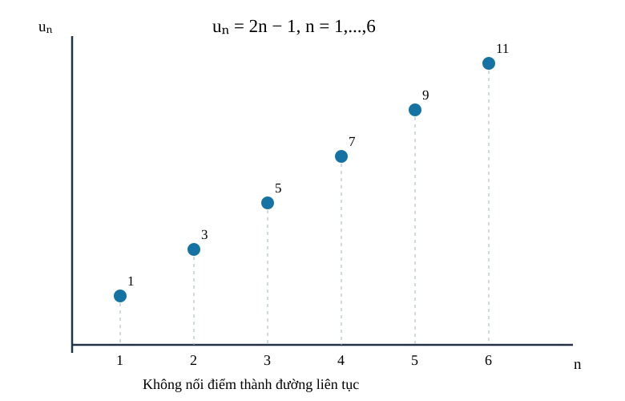
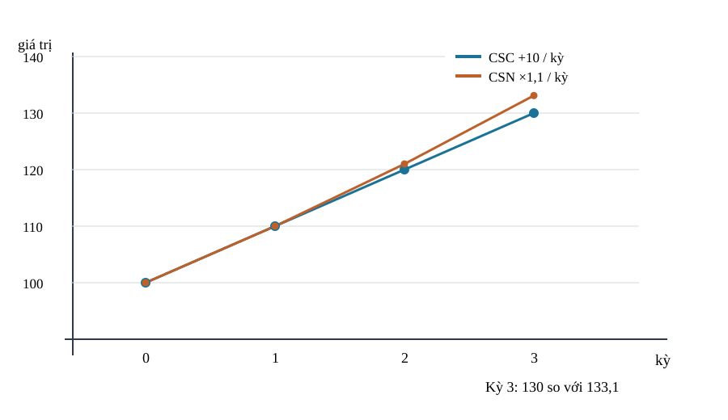
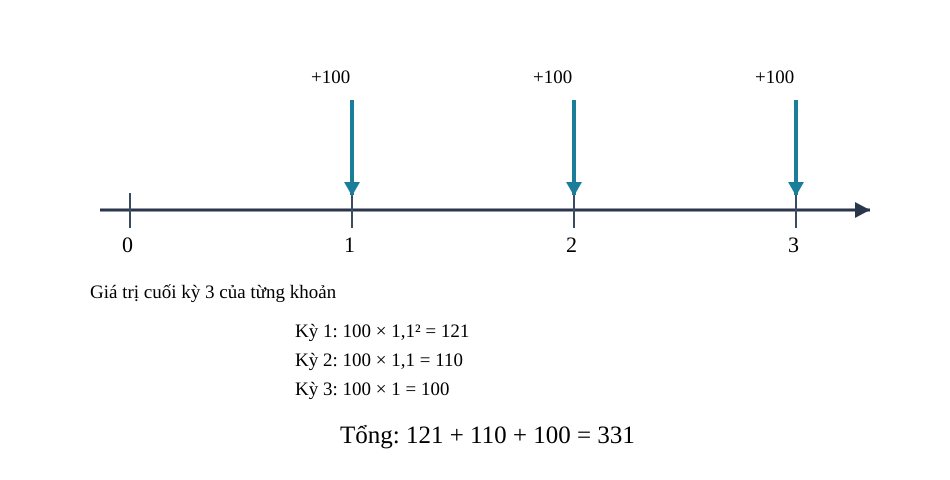

---
hide:
  - toc
---

HỌC THEO CHUYÊN ĐỀ · CĐ07 · TOÁN THPT

<nav class="thpt-sgk-lesson-nav" aria-label="Điều hướng Chuyên đề 07">
<a href="../../cd06/kien-thuc/">← Chuyên đề trước</a>
<a href="../../cd08/kien-thuc/">Chuyên đề sau →</a>
<a href="../luyen-tap/">Luyện tập</a>
<a href="../tu-kiem-tra/">Tự kiểm tra</a>
</nav>

<a href="../../">← Tổng quan các Chuyên đề</a>

Học dãy số, cấp số cộng và cấp số nhân qua các mảng kiến thức bên dưới; tự thử trước khi mở Đối chiếu.

Khám phá thêm: <a href="../../../math-lab/models/slm-top07-sequence-01/">Mô hình trực quan Chuyên đề 07</a> (tùy chọn).

<link rel="stylesheet" href="../../../../assets/stylesheets/thpt-topic-w1-golden-v1.css">

Đang chuẩn bị kiến thức…

<!-- TOPIC07_APPROVED_SOURCE_START -->
<!-- Q18 SOURCE_LEARNER_BLOB 7ce02dd8894f8d270ad39c66ca81abaa3b3eb0ba; Q18_RECEIPT_BLOB 737f3c09766f4c15b50ee05ce93bcf0bb375d861; AUTHORING_PR #828; PUBLIC_PROJECTION_ONLY -->

# Kiến thức

## 1. Từ những lần quan sát đến một dãy số

Một rạp hát thêm ghế theo từng hàng, còn khoản tiền gửi ngân hàng tăng sau mỗi kỳ. Cả hai đều cho ta một danh sách số **có thứ tự**, nhưng hai cách tăng rất khác: thêm một lượng cố định và nhân với một tỉ lệ cố định. Trước khi chọn công thức, hãy hỏi “mỗi số ứng với hàng hay kỳ **thứ mấy**?”, “chỉ số bắt đầu từ đâu?” và “quy luật đúng trong bao lâu?”. Những câu hỏi ấy quyết định chúng ta có đang giải đúng bài toán hay không.

Ta sẽ bắt đầu từ một dãy rời rạc theo chỉ số nguyên, thử tìm công thức hoặc hệ thức truy hồi, rồi chứng minh tính chất với mọi chỉ số nguyên thuộc miền xác định của dãy. Sau đó mới đi đến cấp số cộng, cấp số nhân, tổng hữu hạn và các mô hình tiền theo kỳ; mỗi bước xuất phát từ **ý nghĩa của sự thay đổi**, không từ một bảng công thức cần học thuộc.

### 1.1. Dãy số và tập chỉ số

<!-- LESSON_ID: TOP07-M01; OUTCOME_ID: TOP07-O01 -->

Một danh sách như 1, 4, 9, 16 có thể được tạo ra từ quy luật \(u_n=n^2\), nhưng để gọi đó là một dãy **đã được xác định**, ta cần biết chỉ số \(n\) được phép nhận những giá trị nào. Có thể đây là dãy hữu hạn với \(n=1,2,3,4\), hoặc một dãy vô hạn với \(n\in\mathbb N^*\). Cùng công thức, hai miền chỉ số khác nhau cho hai dãy khác nhau. Vì vậy, không thể xác định đầy đủ một dãy nếu chưa nói chỉ số được phép nhận những giá trị nào.

> **ĐỊNH NGHĨA — Dãy số.** Dãy số là một hàm xác định trên một tập chỉ số nguyên được chỉ định; mỗi chỉ số \(n\) trong tập ấy tương ứng với đúng một số hạng \(u_n\).

Trên hình ngay dưới, dãy hữu hạn \(u_n=2n-1\) chỉ được cho với \(1\le n\le6\): sáu điểm rời rạc lần lượt là \((1,1),(2,3),(3,5),(4,7),(5,9),(6,11)\). Không có điểm nào ở chỉ số \(n=2{,}5\), vì đây không phải biến liên tục. Tương tự, với \(v_n=n^2\) trên \(n=1,\ldots,4\), ta được 1,4,9,16; dù công thức vẫn tính được khi \(n=5\), \(v_5\) **không thuộc dãy hữu hạn đã cho**. Xét tập chỉ số là bước đầu tiên của mọi phép tính với dãy.

*Đọc hình:* Theo đúng sáu điểm của \(u_n=2n-1\) với \(n=1,\ldots,6\). Chúng có hoành độ nguyên, cách nhau 1 đơn vị, nhưng không có đoạn đồ thị liên tục giữa hai số hạng. Số hạng của một dãy không phải mọi điểm trên đường thẳng \(y=2x-1\).

**Ví dụ**

**Đề bài.** Dãy hữu hạn \(a_n=3n+2\) có \(n\in\{2,3,4,5\}\). Liệt kê dãy và xét \(a_1\).

**Lời giải.** Thay đúng bốn chỉ số: \(a_2=8,a_3=11,a_4=14,a_5=17\). Không có \(a_1\) trong dãy vì \(1\) không thuộc miền chỉ số, dù biểu thức vẫn tính được tại \(n=1\).

**Vận dụng** Dãy \(u_n=3n\) được cho với \(n\in\{1,2,3\}\). Dãy có các số hạng nào? Có \(u_0\) không?

Đối chiếu

Dãy gồm 3, 6, 9 và **không có \(u_0\)** vì 0 không thuộc miền chỉ số. Nếu em tính \(u_0=0\), hãy phân biệt giá trị của biểu thức đại số tại 0 với số hạng thực sự thuộc dãy.

**Kiểm lỗi**

Nếu em tính thêm số hạng ở một chỉ số **ngoài tập đã cho**, em đang nhầm công thức đại số với miền chỉ số của dãy. Đọc lại **Kiến thức 1.1**, giải **Bài 2** (dãy hữu hạn không có số hạng thứ năm) và **Bài 1** (liệt kê đúng số hạng trong miền).

### 1.2. Công thức tường minh và quy luật

<!-- LESSON_ID: TOP07-M02; OUTCOME_ID: TOP07-O02 -->

**Các cách cho một dãy số.** Có bốn cách thường dùng để cho một dãy số, bổ trợ nhau: **liệt kê** các số hạng, **mô tả bằng lời** một quy luật xác định, **cho công thức số hạng tổng quát** và **cho bằng hệ thức truy hồi** kèm điều kiện ban đầu. Chúng không phải bốn loại dãy riêng biệt: cùng một dãy có thể viết theo nhiều cách. Chẳng hạn, số ghế của các hàng lần lượt là \(12,15,18,21,\ldots\) khi biết rõ quy luật **hàng đầu có 12 ghế, mỗi hàng sau nhiều hơn 3 ghế**. Viết bằng công thức được \(u_n=12+3(n-1)\), \(n\ge1\); còn bằng truy hồi là \(u_1=12\), \(u_{n+1}=u_n+3\) với mọi \(n\ge1\). Liệt kê một vài số đầu **chỉ minh họa**; nếu không có lời mô tả, công thức hay giả thiết thêm thì chưa xác định được duy nhất các số tiếp theo.

Cách nào thuận tiện tùy câu hỏi: cần ngay số hạng thứ \(100\) thì công thức tổng quát hiệu quả; biết mỗi bước phụ thuộc bước trước thì truy hồi tự nhiên hơn; bảng liệt kê hữu ích để **quan sát** nhưng không thay thế quy luật cần chứng minh.

> **PHƯƠNG PHÁP — Công thức tường minh và quy luật.** Với một dãy số \((u_n)\), mỗi số hạng \(u_n\) được gắn với một chỉ số \(n\) thuộc miền chỉ số đã cho (chẳng hạn \(n=1,2,3,\ldots\)). Làm thế nào tìm \(u_{100}\) mà không phải liệt kê 99 số hạng trước đó? Một **công thức tường minh** \(u_n=f(n)\) cho phép tính trực tiếp bằng cách thay \(n\); tuy nhiên, vài số hạng đầu **không xác định duy nhất** toàn bộ dãy nếu thiếu quy luật hoặc giả thiết. Muốn khẳng định một công thức đúng cho mọi chỉ số cho phép, ta cần định nghĩa hoặc chứng minh, không chỉ dựa vào ba giá trị đầu.

Chẳng hạn, u_n=2n+1, n≥1 cho u_1=3,u_2=5,u_3=7 và u_10=21. Nhưng thêm một biểu thức bội (n−1)(n−2)(n−3) vẫn giữ ba số đầu mà đổi các số sau; do đó suy từ ba số không đủ duy nhất.

**Ví dụ**

**Đề bài.** Với \(u_n=\dfrac{n+2}{n+1}\), \(n\ge1\), hãy tính \(u_3\) và xem \(1\) có là số hạng không.

**Lời giải.** \(u_3=5/4\). Nếu \(u_n=1\) thì \(n+2=n+1\), vô lý. Tiến gần \(1\) không có nghĩa là có số hạng đúng bằng \(1\).

**Vận dụng** Với u_n=4n−1, tính u_6.

Đối chiếu

23; n bắt đầu từ 1 nhưng số hạng thứ sáu thế n=6, không phải 5.

Nếu dùng n−1 vô cớ, phân biệt chỉ số của biểu thức với số lần tăng trong cấp số.

**Kiểm lỗi**

Nếu thế sai chỉ số hoặc cho rằng một giá trị có thể đạt chỉ vì biểu thức tiến gần tới nó, đọc lại **Kiến thức 1.2** rồi làm **Bài 5** (đúng thứ tự chỉ số) và **Bài 6** (kiểm tra một giá trị có thực sự là số hạng hay không).

### 1.3. Hệ thức truy hồi

<!-- LESSON_ID: TOP07-M03; OUTCOME_ID: TOP07-O03 -->

> **ĐỊNH NGHĨA — Hệ thức truy hồi.** Không phải dãy nào cũng có công thức trực tiếp; có khi bước sau phụ thuộc bước trước. Một dãy mô tả 'năm sau phụ thuộc năm trước' có cần công thức trực tiếp không? Ta sử dụng thế số và biến đổi đại số; điều kiện số hạng đầu. Truy hồi cho u_{n+1} qua u_n (hoặc nhiều số trước) phải kèm đủ giá trị khởi tạo. Có thể đổi biến v_n=u_n−c để nhận ra quy luật nhân đều; không bao giờ bỏ điều kiện đầu. Cùng một công thức truy hồi với hai số đầu khác nhau tạo hai dãy khác nhau.

Xét ví dụ: u_1=3, u_{n+1}=2u_n+1. Đặt v_n=u_n+1, v_{n+1}=2v_n và v_1=4, nên v_n=4·2^{n−1}, u_n=4·2^{n−1}−1. Thử u_2=7 khớp 2·3+1; chọn đổi biến vì dấu +1 được hấp thụ.

**Ví dụ**

**Đề bài.** Cho \(u_1=5\), \(u_{n+1}=2u_n-3\) với \(n\ge1\). Tìm \(u_2,u_3\) và công thức tường minh.

**Lời giải.** \(u_2=7\), \(u_3=11\). Đặt \(v_n=u_n-3\) thì \(v_1=2\), \(v_{n+1}=2v_n\), nên \(v_n=2\cdot2^{n-1}\). Do đó \(u_n=3+2^n\). Kiểm \(n=1,2,3\) lần lượt được \(5,7,11\).

**Vận dụng** Cho u_1=2,u_{n+1}=u_n+4. Tính u_3.

Đối chiếu

u_2=6,u_3=10; cần chạy truy hồi hai lần.

Nếu nhảy trực tiếp từ u_1 đến u_3, ghi hai mũi tên n=1→2→3 và kiểm chênh lệch.

**Kiểm lỗi**

Nếu bỏ qua điều kiện đầu hoặc nhảy một bước khi dùng hệ thức truy hồi, đọc lại **Kiến thức 1.3**, làm **Bài 8** (tính từng bước) rồi **Bài 11** (chứng minh công thức tường minh bằng dãy đã cho).

### 1.4. Chứng minh tăng, giảm

<!-- LESSON_ID: TOP07-M04; OUTCOME_ID: TOP07-O04 -->

> **TÍNH CHẤT — Chứng minh tăng, giảm.** Muốn khẳng định tăng hay giảm, phải chứng minh cho mọi chỉ số hợp lệ. Thấy ba số đầu đang tăng có đủ để nói dãy luôn tăng không? Ta bắt đầu từ bất đẳng thức số thực và n≥1. Dãy tăng nghiêm ngặt nếu u_{n+1}>u_n với mọi n hợp lệ; giảm nếu ngược. Dùng hiệu u_{n+1}−u_n, hoặc tỉ số chỉ khi có dấu thích hợp và số hạng khác 0. Đừng dùng vài giá trị quan sát thay chứng minh trên mọi n.

Chẳng hạn, u_n=n/(n+1) với n≥1. u_{n+1}−u_n=(n+1)/(n+2)−n/(n+1)=[(n+1)²−n(n+2)]/[(n+1)(n+2)]=1/[(n+1)(n+2)]>0. Chọn hiệu vì không cần chia số hạng.

**Ví dụ**

**Đề bài.** Chứng minh \(u_n=4-\dfrac1{n+2}\), \(n\ge1\), tăng nghiêm ngặt.

**Lời giải.** \(u_{n+1}-u_n=\dfrac1{n+2}-\dfrac1{n+3}=\dfrac1{(n+2)(n+3)}>0\) với mọi \(n\ge1\). Dấu này, chứ không phải vài số hạng đầu, là chứng minh.

**Vận dụng** Dãy u_n=1/n (n≥1) tăng hay giảm?

Đối chiếu

Giảm nghiêm ngặt vì 1/(n+1)&lt;1/n với mẫu dương.

Nếu chỉ nhìn 1,1/2,1/3 thì đó mới là gợi ý; chứng minh dấu cho mọi n.

**Kiểm lỗi**

Nếu chỉ dựa vào vài số hạng đầu để khẳng định dãy tăng/giảm, đọc lại **Kiến thức 1.4**; giải **Bài 14** và **Bài 16**, luôn xét dấu hiệu hai số hạng liên tiếp cho **mọi chỉ số hợp lệ**.

### 1.5. Tính bị chặn

<!-- LESSON_ID: TOP07-M05; OUTCOME_ID: TOP07-O05 -->

> **ĐỊNH NGHĨA — Tính bị chặn.** Một dãy có thể bị chặn bởi giá trị mà nó không bao giờ đạt. Một dãy có thể tiến gần 1 mãi mà không bao giờ bằng 1 không? Cần nhớ dấu phân thức dương, bất đẳng thức. Bị chặn trên nếu tồn tại M sao cho u_n≤M cho mọi n, bị chặn dưới tương tự; chặn không đồng nghĩa giá trị đạt. Dãy tăng và có chặn trên không tự nói giá trị giới hạn bằng cận khi chưa chứng minh. Trong phần này, em cần phân biệt một cận với giá trị mà dãy thực sự đạt.

> **ĐỊNH NGHĨA — Dãy số bị chặn.** Dãy \((u_n)\) **bị chặn trên** nếu tồn tại số thực \(M\) sao cho \(u_n\le M\) với **mọi** chỉ số \(n\) hợp lệ; **bị chặn dưới** nếu tồn tại số thực \(m\) sao cho \(u_n\ge m\) với mọi \(n\). Dãy **bị chặn** nếu có cả hai cận, tức tồn tại \(m,M\in\mathbb R\) thỏa \(m\le u_n\le M\) với mọi \(n\). Các cận không nhất thiết là số hạng của dãy và cũng không nhất thiết là cận tốt nhất.

Chẳng hạn, u_n=1−1/(n+1), n≥1. Vì 0<1/(n+1)≤1/2 nên 1/2≤u_n<1. u_1=1/2 là cận dưới đạt, còn 1 không là một số hạng của dãy. Chọn tách thành 1 trừ số dương để nhìn cận.

**Ví dụ**

**Đề bài.** Tìm cận dưới đạt được và cận trên không đạt được của \(u_n=5-\dfrac2{n+1}\), \(n\ge1\).

**Lời giải.** Vì \(0<2/(n+1)\le1\) nên \(4\le u_n<5\). Tại \(n=1\), \(u_1=4\); không có số hạng bằng \(5\) vì \(2/(n+1)>0\).

**Vận dụng** u_n=2−1/n (n≥1) có đạt 2 không?

Đối chiếu

Không; 1/n>0 nên u_n&lt;2 với mọi n nguyên dương.

Phân biệt ký hiệu '≤' và '&lt;'; thử giải u_n=2 bằng phương trình.

**Kiểm lỗi**

Nếu nhầm cận trên với số hạng lớn nhất, hoặc dấu nhỏ hơn nghiêm ngặt với dấu bằng, đọc lại **Kiến thức 1.5**, làm **Bài 19** (chứng minh hai cận) và **Bài 20** (cận dưới đạt, cận trên không đạt).

## 2. Khi mỗi bước thêm đúng một lượng như nhau

Nếu số ghế mỗi hàng thêm 4 chỗ so với hàng trước, **hiệu** giữa hai số hạng liên tiếp luôn bằng 4. Đây là điều cốt lõi của cấp số cộng: công sai mô tả thay đổi tuyệt đối trên từng bước. Từ đó ta suy được số hạng ở xa và tổng nhiều hàng bằng cách ghép các cặp đầu–cuối, thay vì ghi nhớ riêng hai công thức.

Nếu độ tăng giữa hai kỳ giữ nguyên, dãy có cấu trúc cấp số cộng. Từ công sai, số hạng thứ n đến tổng nhiều số hạng, các công thức cùng xuất phát từ một ý tưởng cộng đều.

### 2.1. Nhận diện cấp số cộng

<!-- LESSON_ID: TOP07-M06; OUTCOME_ID: TOP07-O06 -->

Mỗi kỳ tăng thêm 5 đơn vị và mỗi kỳ tăng 5% có phải cùng một quy luật? Để xác định điều đó, cần xét hiệu hai số thực. 

> **ĐỊNH NGHĨA — Cấp số cộng.** Dãy \((u_n)\) là cấp số cộng khi có một số thực \(d\) không đổi sao cho \(u_{n+1}=u_n+d\) với mọi cặp chỉ số liên tiếp của dãy. Khi đó \(d=u_{n+1}-u_n\) gọi là *công sai*.

 \(d=0\) cho dãy hằng, \(d<0\) cho dãy giảm nghiêm ngặt. Một phần trăm cố định thường cho cấp số nhân chứ không phải CSC (trừ trường hợp suy biến đặc biệt).

Chẳng hạn, Dãy 14,11,8,5 có các hiệu −3; là CSC với d=−3. Dãy 10,20,40 có hiệu 10,20 nên không CSC. Chọn kiểm hiệu trước khi áp công thức.

**Ví dụ**

**Đề bài.** Cho dãy \(13,9,5,1,\ldots\) và giả thiết hiệu các số liên tiếp luôn không đổi. Tìm công sai và hai số tiếp.

**Lời giải.** Các hiệu đã thấy đều là \(-4\); theo giả thiết, \(d=-4\), nên hai số sau là \(-3,-7\). Nếu chỉ biết bốn giá trị mà không biết quy luật tiếp tục, không thể khẳng định dãy vô hạn là CSC.

**Vận dụng** Dãy 2,2,2,2 có phải CSC không?

Đối chiếu

Có, công sai d=0.

Nếu thấy 'không tăng' rồi loại, nhớ CSC cho phép công sai 0.

**Kiểm lỗi**

Nếu loại một cấp số cộng chỉ vì các số hạng không tăng, đọc lại **Kiến thức 2.1**: công sai có thể bằng 0 hoặc âm. Làm **Bài 22** (hiệu âm không đổi) và **Bài 23** (nhận diện quy luật, viết công sai).

### 2.2. Công thức số hạng tổng quát

<!-- LESSON_ID: TOP07-M07; OUTCOME_ID: TOP07-O07 -->

> **CÔNG THỨC — Công thức số hạng tổng quát.** Khi mỗi bước cộng cùng một lượng, ta suy được số hạng bất kỳ. Vì sao ở số hạng thứ n lại xuất hiện n−1? Ta đã biết truy hồi cộng d và số đếm bước. Từ \(u_1\) đến \(u_n\) thực hiện đúng \(n-1\) lần cộng công sai, nên **\(u_n=u_1+(n-1)d\)**. Nếu d=0 công thức vẫn đúng; nếu cho u_k thì u_n=u_k+(n−k)d với cả n<k.

Chẳng hạn, u_1=7,d=−2, u_6=7+5(−2)=−3. Ta chọn công thức tổng quát thay vì cộng năm bước riêng lẻ; thử u_2=5 để kiểm chiều âm.

**Ví dụ**

**Đề bài.** CSC có \(u_1=-6\), \(d=5\). Tính \(u_9\), giải thích số bước cộng.

**Lời giải.** Từ chỉ số \(1\) đến \(9\) có \(8\) bước cộng. Vì thế \(u_9=-6+8\cdot5=34\).

**Vận dụng** CSC u_1=10,d=−3: tính u_4.

Đối chiếu

u_4=10+3(−3)=1.

Nếu tính thành −2, xem lại từ số hạng 1 đến 4 chỉ có 3 khoảng.

**Kiểm lỗi**

Nếu dùng n thay n−1 lần cộng công sai, đọc lại **Kiến thức 2.2**, làm **Bài 26** (tìm số hạng theo chỉ số) và **Bài 27** (giải số hạng xa). Đếm số *khoảng cách chỉ số* từ số hạng đầu.

### 2.3. Tìm công sai từ hai số hạng

<!-- LESSON_ID: TOP07-M08; OUTCOME_ID: TOP07-O08 -->

Ngược lại, hai số hạng cách xa nhau có thể cho biết công sai. Có thể tìm cả u_1 và d khi chỉ biết u_5,u_9 không? Ta sử dụng hiệu hai phương trình tuyến tính. Vì u_m−u_k=(m−k)d, khi m≠k ta tìm d=(u_m−u_k)/(m−k), sau đó u_1=u_k−(k−1)d. Hai giá trị theo hai chỉ số khác nhau đủ xác định một CSC; kiểm điều kiện m≠k.

> **PHƯƠNG PHÁP — Tìm công sai từ hai số hạng.** Nếu đề cho **ba số hạng liên tiếp** \(a,b,c\), cũng dùng cùng ý tưởng hiệu không đổi: \(b-a=c-b\), tương đương \(2b=a+c\). Ngược lại, nếu ba số được cho theo đúng thứ tự và thỏa \(2b=a+c\), thì hai hiệu bằng nhau và chúng có thể là ba số hạng liên tiếp của một cấp số cộng. Với biểu thức chứa ẩn, hãy lập phương trình từ điều kiện này, giải rồi kiểm lại cả hai hiệu.

Xét ví dụ: u_3=5,u_7=21 ⇒ d=(21−5)/(7−3)=4, u_1=5−2·4=−3. Thử u_7=−3+6·4=21. Chọn phép trừ để khử u_1.

**Ví dụ**

**Đề bài.** Biết \(u_4=7,\ u_9=27\) thuộc cùng một CSC. Tìm \(d\) và \(u_1\).

**Lời giải.** Có \(5\) khoảng chỉ số nên \(d=(27-7)/5=4\). \(u_1=u_4-3d=7-12=-5\). Kiểm \(u_9=-5+8\cdot4=27\).

**Vận dụng** u_2=7,u_5=16 thì d bằng bao nhiêu?

Đối chiếu

d=(16−7)/(5−2)=3.

Không chia cho số thứ tự lớn hơn; chia chênh chỉ số.

**Kiểm lỗi**

Nếu tính công sai bằng cách chia cho số thứ tự thay vì **hiệu chỉ số**, đọc lại **Kiến thức 2.3**, làm **Bài 25** và **Bài 30**; lấy hiệu hai giá trị chia cho hiệu hai chỉ số rồi thế ngược để kiểm.

### 2.4. Tổng các số hạng đầu

<!-- LESSON_ID: TOP07-M09; OUTCOME_ID: TOP07-O09 -->

> **CÔNG THỨC — Tổng các số hạng đầu.** Cộng nhiều số hạng bằng ghép cặp dẫn tới công thức tổng. Tại sao tổng các số 1 đến n tính nhanh được mà không cộng từng số? Ta bắt đầu từ cộng giao hoán và công thức u_n. Ghép u_1+u_n, u_2+u_{n−1},… mỗi cặp có cùng tổng 2u_1+(n−1)d, cho \(2S_n=n(u_1+u_n)\); do đó **\(S_n=\dfrac{n(u_1+u_n)}{2}=\dfrac{n[2u_1+(n-1)d]}{2}\)**. Đếm đúng n số hạng; công thức dùng cả n lẻ vì số ở giữa ghép với chính nó khi nhân 2.

Chẳng hạn, CSC u_1=2,d=3,n=6 có u_6=17 và S_6=6(2+17)/2=57. Chọn ghép đầu/cuối để nhìn cấu trúc đối xứng.

**Ví dụ**

**Đề bài.** CSC có \(u_1=3,d=2\). Tính tổng tám số hạng đầu.

**Lời giải.** \(u_8=3+7\cdot2=17\). Ghép cặp đầu–cuối được \(S_8=\dfrac{8(3+17)}2=80\).

**Vận dụng** Tính 1+3+5+7+9.

Đối chiếu

25; đây là CSC 5 số, đầu1 cuối9, S=5(1+9)/2.

Nếu lấy n bằng số cuối 9, viết rõ có bao nhiêu số được cộng.

**Kiểm lỗi**

Nếu nhầm số số hạng n với số hạng cuối, đọc lại **Kiến thức 2.4**, tính tổng ở **Bài 34** và **Bài 35** theo cặp đầu–cuối; kiểm xem đã xác định đúng n và u_n chưa.

### 2.5. Bài toán tích lũy

<!-- LESSON_ID: TOP07-M10; OUTCOME_ID: TOP07-O10 -->

> **PHƯƠNG PHÁP — Bài toán tích lũy.** Tổng cấp số cộng mô tả lượng tích lũy trong các bài toán theo kỳ. Khi số sản phẩm mỗi tuần tăng cố định, cần phân biệt tuần cuối với tổng cả giai đoạn. Cần nhớ đơn vị đếm, CSC, tổng hữu hạn. Nếu sản lượng tuần n là a+(n−1)d, tổng n tuần là S_n. Trong mô hình thực tế phải đặt rõ tuần đầu, số tuần, mức tăng và tính hợp lệ (không có số lượng âm). Không suy từ CSC sang lãi kép vì lãi kép nhân theo tỷ lệ.

Chẳng hạn, Xưởng tuần đầu làm 20 sản phẩm, mỗi tuần thêm 4 sản phẩm, trong 5 tuần: tuần 5 làm 36, tổng 20+24+28+32+36=140; cũng S_5=5(20+36)/2=140. Chọn tổng vì bài hỏi toàn giai đoạn.

**Ví dụ**

**Đề bài.** Một xưởng làm \(15\) sản phẩm tuần đầu, mỗi tuần thêm \(5\) sản phẩm. Tổng sản lượng sáu tuần là bao nhiêu?

**Lời giải.** Tuần thứ sáu có \(15+5\cdot5=40\) sản phẩm; \(S_6=\dfrac{6(15+40)}2=165\) sản phẩm. Phân biệt sản lượng tuần cuối với tổng sáu tuần.

**Vận dụng** Hàng 1 có 8 ghế, mỗi hàng thêm 2 ghế, 4 hàng có bao nhiêu ghế?

Đối chiếu

8+10+12+14=44 ghế.

Nếu chỉ trả số ghế hàng cuối, phân biệt 'mỗi hàng' và 'tổng toàn bộ'.

**Kiểm lỗi**

Nếu chỉ trả sản lượng hàng cuối thay vì tổng tất cả hàng/kỳ, đọc lại **Kiến thức 2.5**, giải **Bài 38** và **Bài 40**; trước khi cộng, ghi rõ số hàng và số ghế hàng cuối.

## 3. Khi mỗi bước nhân theo cùng một tỉ lệ

Nếu lượng hàng tồn kho mỗi kỳ tăng 10% so với **chính kỳ trước**, lượng tăng tuyệt đối không còn cố định: 100 tăng thành 110, kỳ sau tăng thêm 11 chứ không phải 10. Điều giữ nguyên là **tỉ số**, ở đây bằng 1,1. Cấp số nhân vì thế khác cấp số cộng ngay ở cách đặt câu hỏi; từ số hạng đầu, công bội quyết định mọi số hạng và tổng tích lũy.

Không phải mọi tăng trưởng đều cộng đều. Khi mỗi bước nhân với cùng một hệ số, dấu, số 0, công bội, số hạng và tổng phải được hiểu trong một cấu trúc khác.

### 3.1. Công bội và trường hợp đặc biệt

<!-- LESSON_ID: TOP07-M11; OUTCOME_ID: TOP07-O11 -->

Tăng gấp đôi nhưng có kỳ đổi dấu: vẫn là cấp số nhân chứ? Để xác định điều đó, cần xét phép nhân số thực, số hạng khác 0 khi chia tỉ số. 

> **ĐỊNH NGHĨA — Cấp số nhân.** Dãy \((u_n)\) là cấp số nhân khi có một số thực \(q\) không đổi sao cho \(u_{n+1}=qu_n\) với mọi cặp chỉ số liên tiếp của dãy. Số \(q\) gọi là *công bội*.

 Khi các số hạng khác 0 có thể kiểm tỉ số u_{n+1}/u_n=q. q=0 là trường hợp hợp lệ nếu u_1≠0: từ u_2 trở đi bằng 0; không chia cho 0. q<0 làm dấu luân phiên nếu u_1 khác 0.

Chẳng hạn, Dãy 2,−6,18,−54 là CSN q=−3. Dãy 5,0,0,… là CSN q=0; tỉ số 0/0 không có nghĩa nhưng truy hồi u_{n+1}=0·u_n vẫn đúng. Chọn kiểm phép nhân thay chia khi xuất hiện 0.

**Ví dụ**

**Đề bài.** Dãy \(1,-4,16,-64,\ldots\) được xác định bằng phép nhân cùng một số. Tìm \(q\) và số tiếp theo.

**Lời giải.** Ta có công bội \(q=-4\), số tiếp là \(256\). Dấu luân phiên vẫn là cấp số nhân; nếu xuất hiện số \(0\), phải kiểm qua truy hồi \(u_{n+1}=qu_n\), không chia cho \(0\).

**Vận dụng** Dãy 4,0,0,0,… có là CSN không?

Đối chiếu

Có, với q=0.

Nếu loại vì phép chia 0/0, hãy quay lại định nghĩa u_{n+1}=qu_n.

**Kiểm lỗi**

Nếu cố tìm công bội bằng phép chia 0/0 hoặc loại q âm, q=0, đọc lại **Kiến thức 3.1**, làm **Bài 41** (q=0) và **Bài 44** (công bội âm). Ưu tiên hệ thức nhân liên tiếp thay vì phép chia khi mẫu bằng 0.

### 3.2. Số hạng tổng quát

<!-- LESSON_ID: TOP07-M12; OUTCOME_ID: TOP07-O12 -->

> **CÔNG THỨC — Số hạng tổng quát.** Từ công bội cố định, ta tìm số hạng ở bất kỳ vị trí nào. Sau nhiều lần nhân cùng một số, số mũ là n hay n−1? Ta đã biết lũy thừa và thứ tự số hạng. CSN có **\(u_n=u_1q^{n-1}\)** khi \(q\ne0\) hoặc \(n\ge2\); khi q âm, dấu do số mũ chẵn/lẻ; q=1 cho dãy hằng, q=0 cho u_1 ban đầu rồi từ số 2 bằng 0 (đối với n=1 quy ước q^0=1, riêng 0^0 trong biểu thức tính toán cần tránh thay máy móc). Khi q=0 dùng truy hồi cho trường hợp n=1 và n≥2 thay công thức lũy thừa tại n=1.

Chẳng hạn, u_1=−2, q=3, u_4=−2·3³=−54. Chọn số mũ 3 vì từ số 1 đến 4 chỉ nhân 3 lần; thử u_2=−6 để kiểm.

**Ví dụ**

**Đề bài.** CSN có \(u_1=-4,\ q=2\). Tính \(u_6\).

**Lời giải.** Có năm lần nhân từ \(u_1\) đến \(u_6\), nên \(u_6=-4\cdot2^5=-128\). Trường hợp \(q=0\) tại số hạng đầu phải xét riêng, tránh \(0^0\).

**Vận dụng** CSN u_1=5,q=−2: tính u_4.

Đối chiếu

5(−2)³=−40.

Đặt dấu âm trong ngoặc của lũy thừa; không tính −2³ như (−2)³ mà không xét ngữ cảnh.

**Kiểm lỗi**

Nếu đặt mũ là n thay cho n−1 hoặc làm mất dấu của công bội âm, đọc lại **Kiến thức 3.2**, làm **Bài 46** (số hạng thứ sáu) và **Bài 47** (công bội âm). Kiểm trực tiếp hai số hạng đầu.

### 3.3. Suy công bội từ hai số hạng

<!-- LESSON_ID: TOP07-M13; OUTCOME_ID: TOP07-O13 -->

> **PHƯƠNG PHÁP — Suy công bội từ hai số hạng.** Hai số hạng được biết giúp suy công bội, nhưng dấu và điều kiện cần kiểm. Hai số hạng cách hai vị trí có cho biết duy nhất công bội? Ta sử dụng căn bậc hai, dấu dương/âm, phép chia hợp lệ. Nếu u_k≠0 và u_m=u_k q^{m−k}, chênh chỉ số chẵn có thể dẫn q=±c, không tự chọn q dương. Với ba số liên tiếp khác 0, b²=ac là điều kiện cần cho CSN; nếu a,b,c phù hợp và a,b khác 0 thì b/a=c/b. Với a,c dương, b có thể ±√(ac), phải nêu ràng buộc dấu nếu muốn duy nhất.

Xét ví dụ: u_2=6,u_4=24 ⇒ q²=4 nên q=±2. Với q=2 thì u_1=3; q=−2 thì u_1=−3. Chọn xét bình phương trước rồi giải đủ hai dấu.

**Ví dụ**

**Đề bài.** Biết \(u_2=16,\ u_4=256\) của một CSN, các số hạng liên quan khác \(0\). Tìm mọi công bội thực và số đầu tương ứng.

**Lời giải.** \(q^2=u_4/u_2=256/16=16\), nên \(q=4\) hoặc \(q=-4\). Tương ứng \(u_1=16/4=4\) hoặc \(u_1=16/(-4)=-4\). Cả hai cho đúng \(u_4=256\); không tự bỏ dấu âm.

**Vận dụng** Ba số 2,b,18 là CSN với b≠0: b có thể bằng bao nhiêu?

Đối chiếu

b²=36 ⇒ b=±6; q=b/2 là ±3.

Nếu chỉ ra b=6, xem lại phép lấy căn bình phương.

**Kiểm lỗi**

Nếu từ q² chỉ lấy một căn dương mà đề **không yêu cầu mọi số hạng dương**, đọc lại **Kiến thức 3.3**, so **Bài 48** (giả thiết các số dương) với **Bài 50** (cả q dương và âm có thể thỏa).

### 3.4. Tổng hữu hạn

<!-- LESSON_ID: TOP07-M14; OUTCOME_ID: TOP07-O14 -->

> **CÔNG THỨC — Tổng hữu hạn.** Tổng của các số hạng nhân lặp khác hẳn tổng cấp số cộng. Có thể ghép đầu–cuối như cấp số cộng để tính tổng cấp số nhân không? Ta bắt đầu từ nhân phân phối và khử vế. S_n=u_1+u_1q+...+u_1q^{n−1}. Nhân q và trừ: \((1-q)S_n=u_1(1-q^n)\), nên với \(q\ne1\) ta được **\(S_n=\dfrac{u_1(1-q^n)}{1-q}\)**. Nếu \(q=1\), **\(S_n=nu_1\)**. q=0 vẫn cho S_n=u_1 khi n≥1, tránh công thức u_1q^{n−1} tại n=1 của trường hợp q=0.

Chẳng hạn, Với u_1=2,q=3,n=4: S_4=2(1−3^4)/(1−3)=2·40=80. Thử bằng cộng 2+6+18+54=80. Chọn nhân trừ để rút gọn n phần tử.

**Ví dụ**

**Đề bài.** CSN có \(u_1=3,\ q=2\). Tính tổng năm số hạng đầu.

**Lời giải.** Vì \(q\ne1\), \(S_5=3\dfrac{1-2^5}{1-2}=93\). Kiểm \(3+6+12+24+48=93\); tổng hữu hạn không cần \(|q|<1\).

**Vận dụng** Tính S_5 nếu u_1=−4, q=1.

Đối chiếu

S_5=5(−4)=−20; không chia cho 1−q=0.

Nếu gặp 0 ở mẫu, tách q=1 trước.

**Kiểm lỗi**

Nếu dùng công thức có mẫu 1−q khi q=1, hoặc nhầm tổng hữu hạn với tổng vô hạn, đọc lại **Kiến thức 3.4**, làm **Bài 52** (q=1) và **Bài 55** (q khác 1). Thử cộng trực tiếp vài số hạng để kiểm dấu.

### 3.5. Tổng vô hạn và phần dư

<!-- LESSON_ID: TOP07-M15; OUTCOME_ID: TOP07-O15 -->

> **CÔNG THỨC — Tổng vô hạn và phần dư.** Nếu trị tuyệt đối công bội nhỏ hơn 1, phần dư của tổng giảm dần. Vì sao có thể cộng vô hạn số hạng mà được một số hữu hạn? Cần nhớ tổng n số hạng cấp số nhân và xem số hạng \(q^n\) thay đổi như thế nào khi \(n\) tăng mãi. Với \(|q|<1\), \(q^n\to0\); lấy giới hạn của \(S_n=\dfrac{u_1(1-q^n)}{1-q}\) được **\(S_\infty=\dfrac{u_1}{1-q}\)**. Điều kiện |q|<1 là bắt buộc cho cấp số nhân có u_1≠0; q=−1 làm tổng riêng dao động, |q|>1 thường không hội tụ. Phần dư S_∞−S_n=u_1q^n/(1−q); trị tuyệt đối đo sai số.

Chẳng hạn, Với u_1=6,q=1/2, S_n=12[1−(1/2)^n], S_∞=12; sau n=4 phần dư=12/16=3/4. Chọn công thức phần dư khi muốn biết phải cộng bao nhiêu số hạng để đủ chính xác.

**Ví dụ**

**Đề bài.** CSN có \(u_1=5,\ q=\frac14\). Tính tổng vô hạn và phần dư sau ba số hạng.

**Lời giải.** Do \(|q|<1\), \(S_\infty=\dfrac5{1-1/4}=\dfrac{20}3\). Phần dư sau ba số hạng \(R_3=\dfrac{5(1/4)^3}{1-1/4}=\dfrac5{48}\).

**Vận dụng** Với u_1=4,q=−1, tổng vô hạn có giá trị theo công thức trên không?

Đối chiếu

Không; |q|=1, tổng riêng lần lượt 4,0,4,0,… không hội tụ.

Nếu tự thay q=−1 vào biểu thức u_1/(1−q) được 2, đó là lạm dụng công thức ngoài miền |q|&lt;1.

**Kiểm lỗi**

Nếu lấy tổng vô hạn khi |q|≥1 hoặc bỏ mất dấu phần dư với công bội âm, đọc lại **Kiến thức 3.5**, làm **Bài 58** (chuỗi lùi có hội tụ) và **Bài 61** (tổng cùng phần dư). Chỉ sử dụng công thức sau khi kiểm |q|&lt;1.

## 4. Phân biệt tăng đều, tăng theo phần trăm và tiền gửi theo thời điểm

Khi hai mô hình cùng bắt đầu từ một số, những kỳ đầu có thể rất gần nhau. Nhưng cộng 10 đơn vị mỗi kỳ khác với nhân 1,1 vào số dư hiện có: mức tăng của mô hình thứ hai tự lớn lên theo kỳ. Với khoản tiền gửi thêm **cuối mỗi kỳ**, ta còn phải biết khoản nào đã sinh lãi một kỳ, khoản nào hai kỳ và khoản mới gửi chưa sinh lãi. Bởi vậy, đếm đúng **thời điểm** quan trọng không kém chọn đúng công thức.

Tăng đều về lượng và tăng đều theo phần trăm dẫn đến kết quả rất khác khi số kỳ lớn. Mô hình lãi kép hay gửi góp chỉ có nghĩa khi biết thời điểm tiền vào, lãi suất kỳ và giới hạn giả định.

### 4.1. Thay đổi tuyệt đối so với thay đổi theo tỉ lệ

<!-- LESSON_ID: TOP07-M16; OUTCOME_ID: TOP07-O16 -->

> **TÍNH CHẤT — Thay đổi tuyệt đối so với thay đổi theo tỉ lệ.** Một báo cáo ghi 'tăng 10' và 'tăng 10%' khác nhau ra sao qua nhiều kỳ? Để xác định điều đó, cần xét đơn vị phần trăm, CSC và CSN. Tăng cố định \(d\) mỗi kỳ: \(u_n=u_1+(n-1)d\) khi đếm số hạng từ \(n=1\) (CSC). Tăng cố định theo tỉ lệ \(r\) của kỳ trước: \(v_n=v_1(1+r)^{n-1}\) khi đếm từ \(n=1\) (CSN với \(q=1+r\)). **Nếu hình bắt đầu từ kỳ 0**, phải dùng \(u_k=u_0+kd\) và \(v_k=v_0(1+r)^k\) với \(k=0,1,2,\ldots\); không dịch chỉ số mà giữ nguyên số mũ. Nói '10%' phải xác định 10% của giá trị kỳ nào; số phần trăm tăng đều khác số tuyệt đối tăng đều. Mô hình có thể lệch dữ liệu thực và chỉ hợp lệ trong miền giả định.

Chẳng hạn, bắt đầu ở kỳ 0 với 100 đơn vị. Nếu mỗi kỳ cộng thêm 10, các giá trị trong hình ở kỳ 0,1,2,3 là \(100,110,120,130\). Nếu mỗi kỳ tăng 10% của số kỳ trước, ta được \(100,110,121,133{,}1\). Hai cách cùng tăng thêm 10 ở kỳ đầu, nhưng từ kỳ thứ hai **khác nhau**, vì 10% của 110 là 11. Ví dụ thứ hai là mô hình cấp số nhân, không được nhầm với cấp số cộng.

*Đọc hình:* Tại kỳ 0 và 1, hai mô hình trùng nhau ở 100 và 110. Tại kỳ 2, một bên 120, bên kia 121; kỳ 3 là 130 và 133,1. Nhìn các **điểm theo kỳ**, không tự hiểu hai đường là mô hình liên tục ở mọi thời gian thực.

**Ví dụ**

**Đề bài.** Hai đại lượng đều bằng \(80\) ở kỳ \(0\); A cộng \(8\) đơn vị mỗi kỳ, B tăng \(10\%\) so với kỳ trước. Sau hai kỳ bằng bao nhiêu?

**Lời giải.** \(A_2=80+2\cdot8=96\), \(B_2=80(1{,}1)^2=96{,}8\). Ở kỳ đầu cùng tăng \(8\), kỳ sau B tăng \(8{,}8\). Hình phía trên minh họa đầu kỳ \(100\), khác dữ kiện bài này.

**Vận dụng** Khởi đầu 50, tăng 10% mỗi kỳ sau hai lần tăng có phải 60 không?

Đối chiếu

Không, 50·1,1²=60,5.

Nếu ghi 60, bạn đã cộng 5 cố định và vô tình dùng CSC thay CSN.

**Kiểm lỗi**

Nếu nhầm tăng đều một lượng với tăng theo phần trăm của **giá trị kỳ trước**, đọc lại **Kiến thức 4.1**, làm **Bài 40** (mô hình cộng đều) rồi **Bài 63** (đặt hai quy luật tăng cạnh nhau theo chỉ số kỳ).

### 4.2. Mô hình lãi kép

<!-- LESSON_ID: TOP07-M17; OUTCOME_ID: TOP07-O17 -->

> **CÔNG THỨC — Mô hình lãi kép.** Trong lãi kép, tỷ lệ theo kỳ làm số kỳ và đơn vị trở nên quan trọng. Vì sao gửi 5%/năm qua nhiều năm không chỉ lấy 5% nhân số năm? Ta đã biết phần trăm, lũy thừa, hợp đồng kỳ hạn. Nếu lãi gộp vào vốn mỗi kỳ với lãi suất r *theo chính kỳ đó*, không nộp/rút/phí, số dư sau n kỳ là P(1+r)^n, P≥0, 1+r>0 (thực tế thường r≥0). Nếu lãi theo tháng thì n phải là số tháng, không dùng lãi năm như lãi tháng; lãi hiệu dụng khác lãi danh nghĩa. Bài toán tài chính này chỉ là tình huống mô hình hóa dựa trên cấp số nhân, không phải báo giá thực tế.

Chẳng hạn, P=10 triệu, r=6%/năm, hai năm: 10·1,06²=11,236 triệu. Chọn lũy thừa vì tiền lãi năm đầu đã nằm trong số dư sinh lãi năm hai.

**Ví dụ**

**Đề bài.** Gửi \(8\) triệu đồng một lần, lãi nhập gốc \(4\%\) mỗi năm, không gửi/rút thêm, bỏ qua phí. Sau ba năm có bao nhiêu?

**Lời giải.** Qua ba kỳ, số dư theo mô hình là \(8(1{,}04)^3=8\cdot1{,}124864=8{,}998912\) triệu đồng, không cộng lãi đơn ba lần.

**Vận dụng** P=1 triệu, r=10% mỗi kỳ, hai kỳ còn bao nhiêu?

Đối chiếu

1·1,1²=1,21 triệu.

Nếu làm thành 1,2 triệu, bạn đã dùng lãi đơn thay lãi kép; ghi rõ 'không nộp/rút'.

**Kiểm lỗi**

Nếu cộng cùng một khoản lãi mỗi kỳ dù đề đã nói **lãi nhập gốc**, đọc lại **Kiến thức 4.2**, giải **Bài 65** và **Bài 67**; ghi mốc kỳ 0, kỳ 1 rồi kỳ 2 và nhân hệ số tăng cho từng kỳ.

### 4.3. Gửi góp và trả nợ theo kỳ

<!-- LESSON_ID: TOP07-M18; OUTCOME_ID: TOP07-O18 -->

> **CÔNG THỨC — Gửi góp và trả nợ theo kỳ.** Gửi góp khác gửi một lần vì mỗi khoản tiền sinh lãi trong số kỳ khác nhau. Cùng gọi là 'trả mỗi tháng', vì sao một bài tính tổng tương lai, bài kia tính tiền trả nợ hiện tại? Ta sử dụng tổng CSN hữu hạn, số kỳ và phân biệt đầu/cuối kỳ. Gửi \(a\ge0\) vào **cuối mỗi kỳ**, xét \(n\ge1\) kỳ và lãi suất \(r\) theo kỳ với \(1+r>0\). Nếu \(r\ne0\), số dư **ngay sau khoản gửi cuối kỳ n**: \(FV=a\dfrac{(1+r)^n-1}{r}\); nếu \(r=0\) thì \(FV=na\). Vay \(V\) tại đầu kỳ 0, trả \(a\) vào cuối mỗi kỳ: \(B_0=V\), \(B_k=(1+r)B_{k-1}-a\). Nếu tất toán sau \(n\) kỳ và \(r\ne0\), \(V=a\dfrac{1-(1+r)^{-n}}{r}\); khi \(r=0\), \(V=na\). Phải kiểm điều kiện số tiền, thời điểm và số dư của mô hình. Các công thức là tổng CSN hữu hạn, không phải tổng vô hạn và phải đánh dấu thời điểm dòng tiền.

Xét ví dụ đúng với sơ đồ: gửi **100 đơn vị vào cuối mỗi kỳ** 1, 2, 3, với lãi 10%/kỳ. Tính số dư **ngay sau khi gửi kỳ 3**: khoản gửi kỳ 1 có hai kỳ lãi, thành \(100\cdot1{,}1^2=121\); khoản kỳ 2 có một kỳ, thành 110; khoản vừa gửi kỳ 3 vẫn là 100. Tổng \(121+110+100=331\). Nếu số gửi chỉ là 50 mỗi kỳ, tổng tương ứng mới là 165,5. Với bài trả nợ, ta theo dõi dư nợ \(B_{k+1}=(1+r)B_k-a\); khoản trả làm **giảm** số dư, khác khoản gửi.

*Đọc hình:* Kỳ 0 chưa có khoản gửi; các mũ 2,1,0 ứng với ba khoản 100 gửi cuối kỳ 1, 2, 3. Kỳ 3 được tính **ngay sau lần gửi cuối**, nên khoản thứ ba chưa có lãi. Tổng 331 phải khớp cả dòng thời gian lẫn phép tính.

**Ví dụ**

**Đề bài.** Gửi \(25\) đơn vị vào cuối mỗi kỳ trong bốn kỳ, lãi cố định \(4\%\)/kỳ, không phí/rút. Tính số dư ngay sau khoản gửi thứ tư.

**Lời giải.** Bốn khoản gửi được hưởng \(3,2,1,0\) kỳ lãi, nên \(FV=25[(1{,}04)^3+(1{,}04)^2+1{,}04+1]=25(1{,}124864+1{,}0816+1{,}04+1)=106{,}1616\). Không tính lãi cho khoản gửi cuối kỳ thứ tư; hình minh họa bên trên có ba khoản \(100\), là dữ liệu khác.

**Vận dụng** Gửi 20 vào cuối hai kỳ với r=10%/kỳ, số dư cuối kỳ 2 là bao nhiêu?

Đối chiếu

20·1,1+20=42; khoản gửi cuối kỳ 2 chưa sinh lãi.

Nếu nhân cả hai khoản với 1,1², vẽ trục kỳ 0–1–2 và đánh dấu ngay sau khi nộp.

**Kiểm lỗi**

Nếu cộng lãi cho khoản gửi ngay **cuối kỳ** vừa nộp hoặc nhầm thời điểm trả nợ với tính lãi, đọc lại **Kiến thức 4.3**, làm **Bài 68** (gửi đầu/cuối kỳ) và **Bài 69** (trả nợ cuối kỳ); vẽ trục thời gian và đánh dấu khoản tiền trước khi lập công thức.

<!-- AUTHORING_ONLY: source-locked figure custody and interaction SPEC_ONLY notes preserved in original R02 blob 5068c400b2d8361fab9d3f30a2145455dd8a6fcf. The learner text already places verified SVG inline. -->

> **Kiến thức cần ghi nhớ**
>
> - **Dãy số** phải đi kèm miền chỉ số. Công thức có thể tính được ở ngoài miền ấy nhưng giá trị đó không phải số hạng của dãy đã cho.
> - **Cấp số cộng:** \(u_{n+1}=u_n+d\) với công sai \(d\) cố định; muốn dùng công thức theo \(n\), phải biết số hạng đầu và chỉ số bắt đầu.
> - **Cấp số nhân:** \(u_{n+1}=qu_n\) với công bội \(q\) cố định. Trường hợp \(q=0\) vẫn hợp lệ; không lấy tỉ số hai số hạng khi mẫu bằng \(0\).
> - **Bài toán tài chính theo kỳ:** đặt rõ thời điểm gửi/rút và lúc tính số dư; không tự cho khoản vừa gửi cuối kỳ hưởng thêm một kỳ lãi.

<!-- TOPIC07_APPROVED_SOURCE_END -->

<a href="../../">← Tổng quan các Chuyên đề</a>

