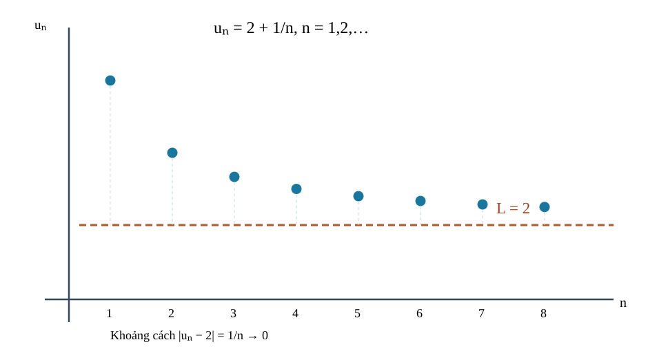
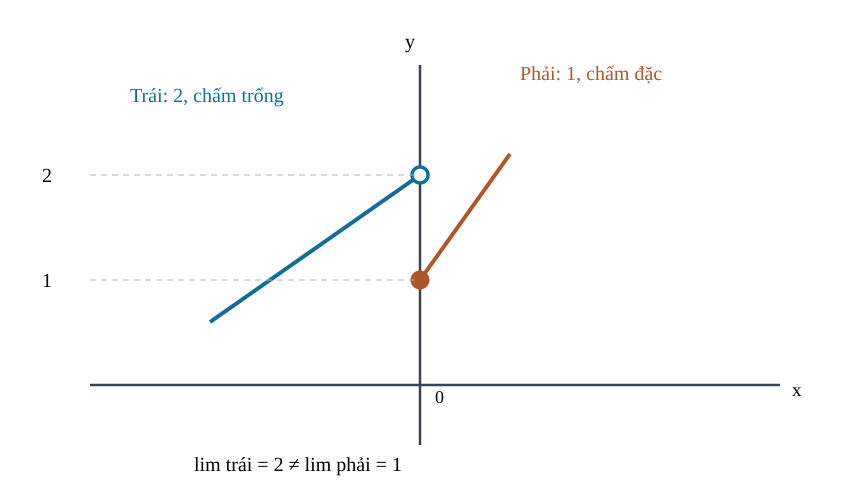
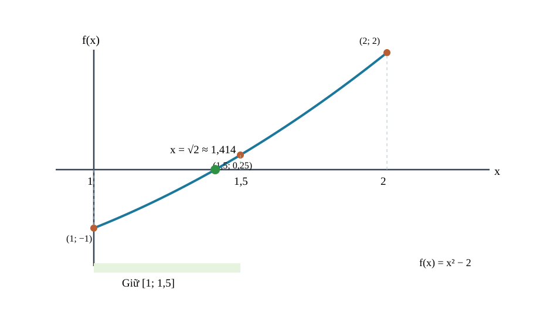

---
hide:
  - toc
---

HỌC THEO CHUYÊN ĐỀ · CĐ08 · TOÁN THPT

<nav class="thpt-sgk-lesson-nav" aria-label="Điều hướng Chuyên đề 08">
<a href="../../cd07/kien-thuc/">← Chuyên đề trước</a>
<a href="../../cd09/kien-thuc/">Chuyên đề sau →</a>
<a href="../luyen-tap/">Luyện tập</a>
<a href="../tu-kiem-tra/">Tự kiểm tra</a>
</nav>

<a href="../../">← Tổng quan các Chuyên đề</a>

Học giới hạn và tính liên tục qua các mảng kiến thức bên dưới; tự thử trước khi mở Đối chiếu.

Khám phá thêm: <a href="../../../math-lab/models/slm-top08-limit-01/">Mô hình trực quan Chuyên đề 08</a> (tùy chọn).

<link rel="stylesheet" href="../../../../assets/stylesheets/thpt-topic-w1-golden-v1.css">

Đang chuẩn bị kiến thức…

<!-- TOPIC08_APPROVED_SOURCE_START -->
<!-- Q18 SOURCE_LEARNER_BLOB 0853a6de4be055d63a767b58dab20fa113e11098; Q18_RECEIPT_BLOB 9e80780f05096269b7cd1942c7006138d72d7ec9; AUTHORING_PR #829; PUBLIC_PROJECTION_ONLY -->

# Kiến thức

## 1. Từ một điểm đến gần, đến sát và đến đúng

Khi muốn đo chính xác một độ dài, ta có thể thu nhỏ sai số đo mãi, dù chưa bao giờ ghi được giá trị hoàn toàn chính xác ở một lần thử. Một dãy số cũng có thể tiến sát giá trị đích mà không có số hạng nào bằng đích. Sau đó ta sẽ gặp hiện tượng tương tự ở hàm số: điều xảy ra **gần một điểm** không nhất thiết trùng giá trị của hàm tại chính điểm ấy. Hiểu sự khác biệt đó là chìa khóa để xét tính liên tục, phân biệt các kiểu gián đoạn và chứng minh sự tồn tại nghiệm bằng định lý giá trị trung gian.

Ta bắt đầu bằng câu hỏi đơn giản: muốn nói “càng ngày càng gần 2”, khoảng cách phải nhỏ đi như thế nào? Khi trả lời được bằng sai số, ta mới dùng quy tắc đại số để tính giới hạn và mở rộng sang đồ thị.

### 1.1. Giới hạn dãy số qua sai số

<!-- LESSON_ID: TOP08-M01; OUTCOME_ID: TOP08-O01 -->

Ta xét dãy \(u_n=2+1/n\) với \(n\) nguyên dương. Mọi số hạng đều lớn hơn 2, nên không số hạng nào bằng 2. Tuy vậy, khi \(n\) tăng, khoảng cách \(|u_n-2|=1/n\) nhỏ dần và có thể nhỏ hơn **bất kỳ độ sai lệch dương nào** nếu \(n\) đủ lớn. Đó là ý nghĩa của câu “dãy tiến tới giới hạn 2”: không đòi chạm giá trị đích ở một chỉ số hữu hạn.

> **ĐỊNH NGHĨA — Giới hạn hữu hạn của dãy số.** Viết \(\lim_{n\to\infty}u_n=L\) khi với **mọi** \(\varepsilon>0\) đều có một chỉ số \(N\) sao cho \(|u_n-L|<\varepsilon\) với **mọi** \(n\ge N\) thuộc miền chỉ số. Không yêu cầu dãy có số hạng bằng \(L\).

 Trong ví dụ, chỉ cần chọn \(N>1/\varepsilon\) và \(n\ge N\), ta được \(1/n<\varepsilon\). Việc chứng minh bằng khoảng cách cho thấy công thức giới hạn không chỉ là phép thế \(n=\infty\), mà là một khẳng định về mọi mức sai số.

*Đọc hình:* Đồ thị gồm đúng **tám điểm** \((n,2+1/n)\) với \(n=1,\ldots,8\). Từng điểm đều nằm **phía trên** đường ngang \(L=2\) và không chạm đường này; chỉ số \(n\) là số nguyên. Chính khoảng cách \(1/n\) giảm dần mới giải thích giới hạn, không phải việc kéo dài nét vẽ thành một đường liên tục.

**Ví dụ**

**Đề bài.** Cho dãy \(v_n=4-\dfrac2n\), \(n\ge1\). Chứng minh \(\lim v_n=4\) bằng sai số và xem dãy có nhận giá trị \(4\) không.

**Lời giải.** Khoảng cách \(|v_n-4|=2/n\). Với bất kỳ \(\varepsilon>0\), lấy \(N\) nguyên lớn hơn \(2/\varepsilon\); mọi \(n\ge N\) đều cho \(2/n<\varepsilon\), nên \(v_n\to4\). Không số hạng nào bằng \(4\) vì \(2/n>0\) khi \(n\ge1\).

**Vận dụng** Với \(v_n=1+3/n\), \(n\ge1\), dãy tiến tới số nào? Giải thích bằng khoảng cách.

Đối chiếu

Giới hạn bằng 1 vì \(|v_n-1|=3/n\to0\). Nếu em cho rằng giới hạn phải là một số hạng, hãy thử giải \(1+3/n=1\) để thấy không có \(n\) hữu hạn nào thỏa, dù dãy vẫn tiến tới 1.

**Kiểm lỗi**

Nếu em cho rằng giới hạn phải là một số hạng của dãy, đọc lại **Kiến thức 1.1** rồi giải **Bài 1** và **Bài 3** trong Luyện tập. Tách điều kiện chỉ số nguyên dương khỏi việc khoảng cách tới giá trị giới hạn tiến về 0.

### 1.2. Dãy tiến vô cực và dãy dao động

<!-- LESSON_ID: TOP08-M02; OUTCOME_ID: TOP08-O02 -->

> **ĐỊNH NGHĨA — Dãy tiến vô cực và dãy dao động.** Một dãy không tiến gần số hữu hạn nào có thể tăng ra vô hạn hoặc dao động. Nếu các số hạng không tiến tới một số hữu hạn thì chắc chắn tiến +∞ hoặc −∞? Ta đã biết dấu số, n tăng, dãy chỉ số chẵn/lẻ. Có ba hành vi cần tách: hữu hạn, tiến vô cực có dấu, và không có giới hạn (dao động, có thể không bị chặn). u_n→+∞ nếu cuối cùng vượt mọi ngưỡng M, u_n→−∞ nếu cuối cùng nhỏ hơn −M. Dãy (−1)^n dao động giữa ±1: không có giới hạn hữu hạn nhưng cũng không tiến đến vô cực; xem hai dãy con chẵn/lẻ.

Chẳng hạn, v_n=−n² với n≥1 đi về −∞ vì với mọi M>0, n>√M thì v_n<−M. Còn w_n=(−1)^n có dãy con chẵn=1, lẻ=−1, nên không thể có cùng giới hạn. Chọn kiểm dãy con thay vì dựa trên vài số hạng.

**Ví dụ**

**Đề bài.** Xét \(a_n=n+(-1)^n\) và \(b_n=(-1)^n\). Dãy nào tiến tới \(+\infty\), dãy nào dao động?

**Lời giải.** Với \(a_n\), luôn có \(a_n\ge n-1\); khi \(n\) đủ lớn thì \(a_n\) vượt mọi ngưỡng dương, vậy \(a_n\to+\infty\) dù có thành phần đổi dấu. Với \(b_n\), hai dãy con chẵn và lẻ bằng \(1\) và \(-1\), nên không có giới hạn chung hay giới hạn vô cực có dấu.

**Vận dụng** u_n=n², n≥1, giới hạn là gì?

Đối chiếu

+∞, vì n vượt mọi căn của ngưỡng dương.

Nếu viết 'vô hạn' cho (−1)^n, hãy liệt kê các số hạng chẵn và lẻ rồi xét giới hạn từng dãy con.

**Kiểm lỗi**

Nếu em cho rằng mọi dãy không hội tụ hữu hạn đều tiến ra vô cực có dấu, đọc lại **Kiến thức 1.2**, làm **Bài 4** (dao động chẵn/lẻ), **Bài 5** (tiến −∞) rồi **Bài 6** (dãy con có hai giới hạn khác nhau).

### 1.3. Giới hạn dãy lũy thừa

<!-- LESSON_ID: TOP08-M03; OUTCOME_ID: TOP08-O03 -->

> **TÍNH CHẤT — Giới hạn dãy lũy thừa.** Dãy q^n cho thấy điều kiện về trị tuyệt đối q quyết định giới hạn. Số hạng đổi dấu luân phiên có nhất thiết không hội tụ? Ta sử dụng lũy thừa số thực và trị tuyệt đối. Khi |q|<1, |q^n|=|q|^n→0 nên q^n→0, kể cả q âm. Nếu q=1 thì q^n=1; q=−1 dao động; nếu q>1 thì q^n→+∞; q<−1 cho các nhánh dấu luân phiên với độ lớn tăng, không có giới hạn vô cực có dấu. Trường hợp q=0 cho 0^n=0 với n≥1.

Xét ví dụ: Với q=−1/4, số hạng q^n đổi dấu nhưng có độ lớn 1/4^n→0, nên giới hạn là 0. Chọn trị tuyệt đối để nhìn thấy cơ chế hội tụ trước khi hỏi dấu.

**Ví dụ**

**Đề bài.** Tính \(\lim_{n\to\infty}(-3/5)^n\) và so với \((-1)^n\).

**Lời giải.** Vì \(|-3/5|=3/5<1\), độ lớn \((3/5)^n\to0\), nên \((-3/5)^n\to0\) dù luân phiên dấu. Ngược lại \((-1)^n\) có độ lớn luôn bằng \(1\), hai dãy con trái dấu, không hội tụ.

**Vận dụng** lim(n→∞)(3/2)^n là gì?

Đối chiếu

+∞ vì 3/2>1 và lũy thừa tăng không bị chặn.

Nếu nhầm q âm với không hội tụ, so (−1/4)^n và (−1)^n qua |q|.

**Kiểm lỗi**

Nếu nhầm lũy thừa cơ số âm có độ lớn nhỏ hơn 1 với dãy dao động không hội tụ, đọc **Kiến thức 1.3** rồi giải **Bài 7** và so sánh **Bài 4**. Hãy xét \(|q|^n\) trước, sau đó mới xét dấu.

### 1.4. Tính giới hạn dãy phân thức

<!-- LESSON_ID: TOP08-M04; OUTCOME_ID: TOP08-O04 -->

> **PHƯƠNG PHÁP — Tính giới hạn dãy phân thức.** Ta tính giới hạn các tổng và tỉ số nhưng mẫu cần được kiểm soát. Tại sao ký hiệu ∞/∞ không giúp tính giới hạn dãy phân thức? Ta bắt đầu từ giới hạn của 1/n, phép cộng/nhân/chia với mẫu giới hạn khác 0. Quy tắc cộng, nhân, chia giới hạn hữu hạn chỉ dùng trực tiếp khi các giới hạn liên quan hữu hạn và mẫu giới hạn khác 0. Đối với tỉ số đa thức theo n, chia cho lũy thừa cao nhất để các hạng 1/n^k tiến 0. Nếu có căn chứa n², nhớ n>0 nên √(n²)=n, còn với biến thực x có thể âm phải giữ |x|.

> **ĐỊNH LÍ — Phép toán với giới hạn hữu hạn của dãy số.** Giả sử \(u_n\to A\) và \(v_n\to B\), với \(A,B\) là các số thực. Khi đó
> \[
> \lim(u_n\pm v_n)=A\pm B,\qquad
> \lim(u_nv_n)=AB,\qquad
> \lim(cu_n)=cA
> \]
> với hằng số \(c\in\mathbb R\). Nếu \(B\ne0\), thì \(v_n\ne0\) từ một chỉ số đủ lớn trở đi và \(\lim(u_n/v_n)=A/B\). **Không** áp dụng trực tiếp công thức thương khi \(B=0\); cần biến đổi biểu thức hoặc xét dấu. Tất cả giới hạn trong định lí này đều là **giới hạn hữu hạn**; các ký hiệu \(0/0,\infty/\infty,\infty-\infty\) không phải những phép tính số thực.

Vì sao được làm như vậy? Nếu \(u_n=A+\varepsilon_n\), \(v_n=B+\eta_n\) với \(\varepsilon_n,\eta_n\to0\), thì tổng và tích của chúng vẫn có phần sai lệch tiến về \(0\); với thương, cần \(B\ne0\) để mẫu không tiến sát \(0\). Định lí này là lý do toán học của phép tính giới hạn theo từng hạng, **không** chỉ là mẹo thay \(n=\infty\).

Chẳng hạn, lim(n→∞)(3n²+n)/(n²+7)=lim(3+1/n)/(1+7/n²)=3. Chọn bậc 2 vì đây là lũy thừa lớn nhất; sau chia mẫu tiến 1 khác 0.

**Ví dụ**

**Đề bài.** Tính \(\lim_{n\to\infty}\dfrac{5n^2-n+2}{2n^2+3}\).

**Lời giải.** Chia cả tử và mẫu cho \(n^2\): \(\dfrac{5-1/n+2/n^2}{2+3/n^2}\to\dfrac52\). Mẫu mới tiến tới \(2\ne0\), nên quy tắc giới hạn của thương được phép áp dụng.

**Vận dụng** lim(n→∞)(4n+3)/(2n−1) bằng bao nhiêu?

Đối chiếu

2, vì chia cho n cho (4+3/n)/(2−1/n)→2.

Nếu thế 'n=∞', hãy thực hiện phép chia n^k để chuyển sang giới hạn có thể tính.

**Kiểm lỗi**

Nếu lấy các hệ số khác bậc hoặc thế máy móc \(n=\infty\), đọc lại **Kiến thức 1.4**, làm **Bài 11** và **Bài 12**: chia đúng lũy thừa bậc cao nhất và kiểm mẫu giới hạn khác 0.

### 1.5. Tổng cấp số nhân vô hạn

<!-- LESSON_ID: TOP08-M05; OUTCOME_ID: TOP08-O05 -->

Tổng vô hạn của cấp số nhân chỉ hữu hạn khi điều kiện hội tụ được thỏa. Vô hạn số hạng có thể cộng thành hữu hạn như thế nào mà không mâu thuẫn? Cần nhớ CĐ07 định nghĩa CSN và tổng S_n hữu hạn, giới hạn q^n. Số S=∑_{k=0}^∞ a q^k được định nghĩa là giới hạn của các tổng riêng S_n, không phải phép cộng xong vô hạn bước. 

> **CÔNG THỨC — Tổng cấp số nhân vô hạn.** Với \(|q|<1\), tổng \(\sum_{k=0}^{\infty}aq^k\) hội tụ và bằng \(\dfrac{a}{1-q}\), vì các tổng hữu hạn \(a(1-q^n)/(1-q)\) tiến đến giá trị ấy. Với \(|q|\ge1\) và \(a\ne0\), số hạng không tiến 0 nên tổng không hội tụ.

 Phần dư R_n=a q^n/(1−q) quyết định sai số.

Chẳng hạn, 10+5+2,5+… có a=10,q=1/2; S_n=20(1−(1/2)^n), phần dư=20/2^n nên tổng tiến 20. Ta chọn xem S_n trước S∞ để thấy nguồn gốc điều kiện hội tụ.

**Ví dụ**

**Đề bài.** Tính tổng vô hạn của \(8-4+2-1+\cdots\), và tính phần dư sau hai số hạng đầu.

**Lời giải.** Đây là cấp số nhân với \(a=8,q=-1/2\) và \(|q|<1\). Tổng vô hạn là \(S_\infty=8/(1+1/2)=16/3\). Hai số hạng đầu có tổng \(S_2=8-4=4\); phần dư có dấu \(S_\infty-S_2=4/3\), đúng công thức \(R_2=8(-1/2)^2/(1+1/2)=4/3\).

**Vận dụng** 6+2+2/3+… có tổng vô hạn bao nhiêu?

Đối chiếu

9, vì q=1/3 và S=6/(1−1/3)=9.

Nếu dùng công thức khi q=1 hoặc −1, hãy xét giới hạn của số hạng trước: nó không về 0.

**Kiểm lỗi**

Nếu áp dụng tổng cấp số nhân vô hạn khi \(|q|\ge1\) hoặc nhầm dấu phần dư, đọc lại **Kiến thức 1.5**, giải **Bài 16** và **Bài 18**; thử thêm **Bài 19** để kiểm điều kiện sai số nghiêm ngặt.

## 2. Từ dãy rời rạc tới hành vi của hàm số gần một điểm

Ở dãy số, ta tiến bằng những chỉ số nguyên ngày càng lớn. Với hàm số, ta có thể tiến tới cùng một hoành độ từ **bên trái hoặc bên phải** bằng các giá trị thực rất gần nhau. Đôi khi hàm bị khuyết ngay tại điểm đó, nhưng hai phía vẫn có thể cùng tiến tới một số. Ngược lại, khi hai phía tiến tới hai giá trị khác nhau, ta không thể gọi đó là một giới hạn hai phía. Nhìn lần lượt hai phía sẽ giúp em tự chọn đúng phép biến đổi khi gặp dạng chưa xác định.

### 2.1. Giới hạn hàm tại một điểm

<!-- LESSON_ID: TOP08-M06; OUTCOME_ID: TOP08-O06 -->

> **ĐỊNH NGHĨA — Giới hạn hàm tại một điểm.** Vì sao một hàm không được định nghĩa tại x=a mà vẫn có giới hạn ở a? Để xác định điều đó, cần xét hàm số và phép biến đổi trên miền xác định. lim(x→a)f(x)=L hỏi giá trị f(x) khi x đủ gần a nhưng x≠a và thuộc miền xác định. Giá trị f(a) có thể khác L hoặc không tồn tại. Để tính giới hạn của phân thức có dạng 0/0, trước tiên nêu điều kiện loại điểm rồi biến đổi tương đương trên lân cận bỏ điểm, tuyệt đối không dùng kết quả để tự cho f(a) bằng L.

> **ĐỊNH NGHĨA — Giới hạn hàm số qua dãy tiến tới điểm.** Giả sử \(a\) là điểm mà miền xác định \(D\) có các điểm khác \(a\) nằm gần tùy ý, và \(L\in\mathbb R\). Ta viết \(\lim_{x\to a}f(x)=L\) nếu **với mọi** dãy \(x_n\in D\setminus\{a\}\) thỏa \(x_n\to a\), ta đều có \(f(x_n)\to L\). Điều kiện \(x_n\ne a\) cho thấy **không cần biết** \(f(a)\). Khi \(a\) là điểm trong của miền, các dãy có thể tiến từ cả hai phía; nếu hai phía cho giới hạn khác nhau thì giới hạn hai phía không tồn tại.

Với hàm có giới hạn hữu hạn, các quy tắc cộng, trừ, nhân và chia cũng hoạt động tương tự như ở dãy số: nếu \(f(x)\to A\), \(g(x)\to B\) khi \(x\to a\), thì \(f\pm g\to A\pm B\), \(fg\to AB\), và \(f/g\to A/B\) **chỉ khi \(B\ne0\)** và thương có nghĩa trong lân cận đang xét. Khi gặp dạng \(0/0\), không thể chia các giới hạn ngay mà phải phân tích nhân tử, liên hợp hoặc dùng phương pháp khác.

Chẳng hạn, f(x)=(x²−5x+6)/(x−2) với x≠2. Tử=(x−2)(x−3), rút còn x−3 trên miền x≠2; lim(x→2)f(x)=−1 dù f(2) không xác định. Chọn phân tích nhân tử vì thế trực tiếp cho 0/0.

**Ví dụ**

**Đề bài.** Với \(f(x)=\dfrac{x^2-49}{x-7}\), \(x\ne7\), tính \(\lim_{x\to7}f(x)\). Có tự suy ra \(f(7)=14\) được không?

**Lời giải.** Với \(x\ne7\), \(x^2-49=(x-7)(x+7)\), nên \(f(x)=x+7\). Do đó giới hạn tại \(7\) là \(14\). Tuy vậy \(f(7)\) vẫn không xác định trong hàm gốc, vì phép khử chỉ hợp lệ ở các \(x\ne7\).

**Vận dụng** lim(x→0) [x(x−4)]/x (x≠0) bằng bao nhiêu?

Đối chiếu

−4 do biểu thức rút còn x−4 trên miền x≠0.

Nếu gọi 0/0 là giới hạn, xem hai hàm (x−2)/(x−2) và 2(x−2)/(x−2), cùng thế 0/0 nhưng có giới hạn 1 và 2.

**Kiểm lỗi**

Nếu coi dạng \(0/0\) là đáp số hoặc tự gán giá trị của hàm tại điểm cấm, đọc **Kiến thức 2.1**, làm **Bài 21** và **Bài 22**. Chỉ rút gọn trên lân cận bỏ điểm rồi mới tính giới hạn.

### 2.2. Giới hạn trái và phải

<!-- LESSON_ID: TOP08-M07; OUTCOME_ID: TOP08-O07 -->

> **ĐỊNH NGHĨA — Giới hạn trái và phải.** Tiến đến điểm từ trái và phải có thể cho hai kết quả khác nhau. Hàm có thể tiến đến hai giá trị khác nhau khi ta lại gần từ trái và từ phải không? Ta đã biết bất đẳng thức x<a/x>a, hàm xác định từng phần. Giới hạn trái lim(x→a⁻) xét x<a, phải lim(x→a⁺) xét x>a, đều đi trong miền xác định. Giới hạn hai phía hữu hạn tồn tại và bằng L khi và chỉ khi cả hai giới hạn một phía cùng tồn tại và bằng L. f(a) không quyết định hai giới hạn này; đọc điều kiện từng nhánh trước khi thế.

Chẳng hạn, f(x)=x+2 nếu x<0; f(x)=2x+1 nếu x≥0. Khi x→0⁻, f→2; khi x→0⁺, f→1. Hai giá trị khác nên không có giới hạn hai phía, mặc dù f(0)=1. Chọn phương pháp tách nhánh vì hàm từng phần.

**Ví dụ**

**Đề bài.** Cho \(f(x)=x+3\) khi \(x<1\), \(f(x)=x^2+1\) khi \(x\ge1\). Tính hai giới hạn một phía ở \(1\).

**Lời giải.** Từ trái dùng nhánh \(x+3\), được \(4\); từ phải dùng \(x^2+1\), được \(2\). Hai phía khác nhau nên giới hạn hai phía tại \(1\) không tồn tại, dù \(f(1)=2\) xác định. Hình nhảy ở bài sau có điểm nhảy ở \(0\), không phải ví dụ này.

**Vận dụng** lim(x→0⁻)|x|/x và lim(x→0⁺)|x|/x bằng gì?

Đối chiếu

−1 và +1, nên giới hạn hai phía không tồn tại.

Nếu chỉ thế nhánh x≥0 tại 0, hãy vẽ hai mũi tên tiến vào 0 từ hai phía.

**Kiểm lỗi**

Nếu dùng cùng một nhánh của hàm cho cả trái và phải, đọc lại **Kiến thức 2.2**, làm **Bài 24** rồi **Bài 25**. Tính hai giới hạn một phía riêng; chỉ ghép thành giới hạn hai phía khi chúng bằng nhau.

### 2.3. Giới hạn vô cực gần điểm

<!-- LESSON_ID: TOP08-M08; OUTCOME_ID: TOP08-O08 -->

> **ĐỊNH NGHĨA — Giới hạn vô cực gần điểm.** Khi hàm tăng không bị chặn gần điểm, ta gặp giới hạn vô cực. Một phân thức có mẫu tiến đến 0 thì luôn tiến +∞ không? Ta sử dụng bảng dấu, 0⁺ và 0⁻, tử khác 0 gần điểm. Khi tử tiến đến một số khác 0 và mẫu tiến 0, giới hạn có thể là +∞ hoặc −∞ tùy dấu tử/mẫu trên từng phía. Kí hiệu f(x)→+∞ hay −∞ mô tả không bị chặn theo dấu, không phải giới hạn hữu hạn. Nếu trái và phải vô cực khác dấu thì không thể nói có giới hạn vô cực chung có một dấu.

Xét ví dụ: f(x)=1/(x−5): x→5⁻ thì mẫu âm nhỏ ⇒ f→−∞; x→5⁺ thì mẫu dương nhỏ ⇒ f→+∞. Chọn bảng dấu mẫu vì tử dương không đổi.

**Ví dụ**

**Đề bài.** Xét \(f(x)=\dfrac{x-4}{x-3}\). Nêu giới hạn khi \(x\to3^-\) và \(x\to3^+\).

**Lời giải.** Gần \(3\), tử \(x-4\) âm và gần \(-1\). Từ trái, mẫu \(x-3<0\) rất nhỏ nên \(f(x)\to+\infty\); từ phải, mẫu dương rất nhỏ nên \(f(x)\to-\infty\). Không nhập hai giới hạn khác dấu thành một kết quả hữu hạn.

**Vận dụng** lim(x→3⁻) 1/(3−x) là gì?

Đối chiếu

+∞ vì 3−x tiến 0 từ phía dương.

Nếu cứ thấy mẫu tiến tới 0 là tự kết luận +∞, thử x=2,99 (từ trái 3) và x=3,01 (từ phải 3) để kiểm: 3−x lần lượt dương và âm, nên hai phía có dấu giới hạn khác nhau.

**Kiểm lỗi**

Nếu thấy mẫu về 0 rồi tự kết luận \(+\infty\), đọc **Kiến thức 2.3**, làm **Bài 27** và **Bài 29**. Lập bảng dấu tử/mẫu theo từng phía; đừng kết luận theo mẫu số bằng 0 ở đúng điểm.

### 2.4. Giới hạn khi x tiến vô cực

<!-- LESSON_ID: TOP08-M09; OUTCOME_ID: TOP08-O09 -->

> **ĐỊNH NGHĨA — Giới hạn khi x tiến vô cực.** Ra xa trên trục hoành lại dẫn đến giới hạn ở vô cực. Hai đa thức đều rất lớn thì tỉ số sẽ luôn tiến đến 1? Ta bắt đầu từ quy tắc giới hạn 1/x^k→0 và dấu x âm. Với phân thức đa thức, so bậc tử/mẫu và chia cho lũy thừa x thích hợp. Nếu bậc bằng nhau thì giới hạn là tỉ số hệ số đầu (mẫu đầu khác 0); nếu bậc tử nhỏ hơn, giới hạn 0. Nếu bậc tử lớn hơn, cần xét dấu và bậc của phần còn lại, không tự viết ∞. Khi x→−∞, x lũy thừa chẵn dương, lẻ âm.

Chẳng hạn, lim(x→−∞)(2x²+5x)/(5x²−1) = lim(2+5/x)/(5−1/x²)=2/5. Chọn chia x² vì hai đa thức cùng bậc; −∞ không đổi dấu x².

**Ví dụ**

**Đề bài.** Tính \(\lim_{x\to-\infty}\dfrac{3x^2-2x}{x^2+1}\).

**Lời giải.** Chia tử và mẫu cho \(x^2\ne0\) với \(|x|\) lớn: \(\dfrac{3-2/x}{1+1/x^2}\to3\). Dù \(x\) âm khi tiến về \(-\infty\), \(x^2\) vẫn dương; mẫu mới tiến về \(1\ne0\).

**Vận dụng** lim(x→+∞)(−3x³+1)/(x³+4) bằng bao nhiêu?

Đối chiếu

−3; chia cả tử/mẫu cho x³.

Nếu giữ dấu 'x âm' ở mọi hạng, tách x² và x³ ra để so dấu của từng lũy thừa.

**Kiểm lỗi**

Nếu dùng dấu của x thay cho dấu của \(x^2\), hoặc chọn sai bậc chia, đọc lại **Kiến thức 2.4**, làm **Bài 31** và **Bài 32**; kiểm riêng x tiến \(+\infty\) và \(-\infty\).

### 2.5. Khử dạng 0/0 bằng nhân tử

<!-- LESSON_ID: TOP08-M10; OUTCOME_ID: TOP08-O10 -->

> **PHƯƠNG PHÁP — Khử dạng 0/0 bằng nhân tử.** Thế trực tiếp cho dạng 0/0 đòi hỏi biến đổi có thể khử hợp lệ. Làm sao biến một biểu thức 'không xác định ở điểm' thành giới hạn tính được? Cần nhớ hằng đẳng thức và phân thức khác 0 ở lân cận bỏ điểm. 0/0 là dạng vô định khi thế thử, không phải kết quả. Tìm nhân tử chung và khử chỉ trên các x khác điểm cấm; biểu thức sau khử giúp tính giới hạn nhưng không mở rộng miền của hàm gốc. Khi nhân tử không triệt tiêu hoặc hàm từng nhánh khác, phải kiểm lại một phía.

Chẳng hạn, (x²−7x+12)/(x−3) có tử (x−3)(x−4); với x≠3 rút thành x−4, giới hạn tại 3 là −1. Chọn phân tích nhân tử vì nghiệm tử trùng nghiệm mẫu.

**Ví dụ**

**Đề bài.** Tính \(\lim_{x\to-2}\dfrac{x^2+5x+6}{x+2}\).

**Lời giải.** Tử \((x+2)(x+3)\). Với \(x\ne-2\), phân thức bằng \(x+3\), do đó giới hạn tại \(-2\) là \(1\). Dạng \(0/0\) ban đầu chỉ báo cần biến đổi, không phải đáp án.

**Vận dụng** lim(x→6)(x²−36)/(x−6) bằng gì?

Đối chiếu

12, vì tử=(x−6)(x+6) và x≠6.

Nếu viết 0/0 như đáp số hoặc nhầm giới hạn với giá trị hàm tại x=6, hãy trở lại lân cận bỏ điểm x=6; phân thức gốc không xác định ở đúng điểm ấy.

**Kiểm lỗi**

Nếu khử nhân tử chung ngay tại điểm cấm rồi kết luận hàm gốc được định nghĩa ở đó, đọc **Kiến thức 2.5**, làm **Bài 33** và **Bài 34**. Phép khử chỉ đúng trên lân cận bỏ điểm; giới hạn không phải giá trị hàm tại điểm ấy.

### 2.6. Khử dạng 0/0 bằng liên hợp

<!-- LESSON_ID: TOP08-M11; OUTCOME_ID: TOP08-O11 -->

> **PHƯƠNG PHÁP — Khử dạng 0/0 bằng liên hợp.** Với căn thức, nhân liên hợp làm lộ nhân tử chung. Khi tử chứa √(x+a)−b, vì sao nhân liên hợp giúp thay dạng 0/0 bằng một phân thức có giới hạn? Để xác định điều đó, cần xét (A−B)(A+B)=A²−B², miền căn. Với phân thức chứa √(x+c)−d và điểm thế cho tử/mẫu đều 0, nhân cả tử và mẫu với liên hợp √(x+c)+d để trừ hai bình phương, lộ nhân tử khử. Phép biến đổi chỉ hợp lệ trên miền gốc, khi mẫu liên hợp khác 0; sau khử mới thế giới hạn. Không dùng phép nhân liên hợp để 'thay' điều kiện căn.

Chẳng hạn, lim(x→0)(√(x+16)−4)/x: nhân liên hợp (√(x+16)+4), được 1/(√(x+16)+4) với x≠0 nên giới hạn 1/8. Chọn liên hợp vì bình phương sẽ tạo x để khử.

**Ví dụ**

**Đề bài.** Tính \(\lim_{x\to1}\dfrac{\sqrt{x+3}-2}{x-1}\).

**Lời giải.** Trong miền \(x+3\ge0\) và \(x\ne1\), nhân liên hợp: \(\dfrac{(\sqrt{x+3}-2)(\sqrt{x+3}+2)}{(x-1)(\sqrt{x+3}+2)}=\dfrac1{\sqrt{x+3}+2}\). Khi \(x\to1\), mẫu tiến tới \(4\), nên giới hạn bằng \(1/4\).

**Vận dụng** lim(x→0)(√(x+25)−5)/x bằng bao nhiêu?

Đối chiếu

1/10, vì bằng 1/(√(x+25)+5) gần x=0.

Nếu căn khiến bạn 'bình phương cả phân thức', thử nhân liên hợp đúng dạng và giữ điều kiện x+c≥0.

**Kiểm lỗi**

Nếu biến đổi căn bằng cách bình phương tùy ý hoặc bỏ điều kiện trong căn, đọc **Kiến thức 2.6**, làm **Bài 35** và **Bài 36**: nhân **liên hợp** đúng cả tử/mẫu và kiểm miền xác định.

### 2.7. Biến đổi dạng vô cực trừ vô cực

<!-- LESSON_ID: TOP08-M12; OUTCOME_ID: TOP08-O12 -->

> **PHƯƠNG PHÁP — Biến đổi dạng vô cực trừ vô cực.** Dạng vô cực trừ vô cực cần biến đổi mà không được bỏ dấu. Tại sao √(x²) không luôn bằng x? Ta đã biết trị tuyệt đối |x|, nhân liên hợp, giới hạn 1/x. Khi x→+∞, √(x²)=x vì x>0; khi x→−∞, √(x²)=−x. Với √(x²+a x)−x ở +∞, nhân liên hợp để biến hiệu hai lượng lớn thành phân thức có giới hạn. Ở −∞ không được chia bằng cùng giả thiết x>0. Giới hạn có thể hữu hạn dù hai thành phần đều vô hạn.

Chẳng hạn, lim(x→+∞)[√(x²+6x)−x] = lim(6x)/[√(x²+6x)+x]=lim 6/[√(1+6/x)+1]=3. Chọn nhân liên hợp thay cho viết '∞−∞'.

**Ví dụ**

**Đề bài.** Tính \(\lim_{x\to+\infty}\left(\sqrt{x^2+8x}-x\right)\).

**Lời giải.** Nhân liên hợp được \(\dfrac{8x}{\sqrt{x^2+8x}+x}\). Vì \(x>0\) khi đủ lớn, chia cho \(x\) được \(\dfrac8{\sqrt{1+8/x}+1}\to4\). Không dùng \(\sqrt{x^2}=x\) nếu biến tiến về \(-\infty\).

**Vận dụng** Tính \(\lim_{x\to-\infty}\bigl(\sqrt{x^2+6x}+x\bigr)\). Vì sao không thể thay \(\sqrt{x^2}\) bằng x trong bước biến đổi?

Đối chiếu

Với x đủ âm, biểu thức trong căn không âm. Nhân liên hợp: \(\sqrt{x^2+6x}+x=\dfrac{6x}{\sqrt{x^2+6x}-x}\). Do \(x<0\), ta có \(\sqrt{x^2+6x}=(-x)\sqrt{1+6/x}\). Bởi vậy phân thức bằng \(\dfrac{-6}{\sqrt{1+6/x}+1}\to-3\). Nếu thay sai \(\sqrt{x^2}=x\), em sẽ đánh mất dấu khi chia cho x âm. Chỉ dùng công thức trong miền xác định và ở phía x→−∞.

**Kiểm lỗi**

Nếu thay \(\sqrt{x^2}=x\) cả khi x âm, đọc **Kiến thức 2.7**, làm **Bài 37** và **Bài 38** trước khi đối chiếu **Bài 39**. Với \(x\to-\infty\), phải dùng \(\sqrt{x^2}=|x|=-x\), không tự bỏ dấu.

## 3. Khi giới hạn gần điểm khớp với chính giá trị tại điểm

Một đường cong có thể đi sát tới cùng một độ cao từ hai phía, nhưng điểm được tô đặc trên đồ thị lại nằm ở nơi khác. Ta chỉ gọi hàm **liên tục tại điểm** nếu giá trị được xác định ở điểm đó và bằng giới hạn từ hai phía. Nhờ vậy, hình vẽ không phải dấu hiệu để đoán bằng mắt: ta có thể kiểm chính xác một lỗ thủng, một bước nhảy hay một tiệm cận vô cực.

Tính liên tục nối giới hạn với giá trị hàm. Ta sẽ thấy sự khác biệt giữa một lỗ có thể vá, một bước nhảy và một nhánh lao ra vô cực trước khi dùng quy tắc liên tục.

### 3.1. Liên tục tại một điểm

<!-- LESSON_ID: TOP08-M13; OUTCOME_ID: TOP08-O13 -->

Giới hạn có thể tồn tại nhưng hàm vẫn 'đứt' tại đúng điểm không? Ta sử dụng giới hạn hai phía, giá trị hàm và đẳng thức. 

> **ĐỊNH NGHĨA — Liên tục tại một điểm.** Khi \(a\) nằm trong khoảng đang xét và thuộc miền xác định của \(f\), hàm \(f\) liên tục tại \(a\) nếu \(\lim_{x\to a}f(x)=f(a)\) là một giá trị hữu hạn. Tại đầu mút của đoạn chỉ cần giới hạn **một phía bên trong miền**, như mục 3.3.

 Hàm có thể sửa bằng gán lại f(a) nếu giới hạn hữu hạn tồn tại; không thể sửa một cú nhảy với hai giới hạn một phía khác nhau chỉ bằng đổi một giá trị.

Xét ví dụ: Đặt \(f(x)=\frac{x^2-5x+6}{x-2}\) khi \(x\ne2\) và \(f(2)=k\). Với \(x\ne2\), rút gọn được \(f(x)=x-3\), nên \(\lim_{x\to2}f(x)=-1\). Vì tính liên tục đòi giá trị tại điểm đúng bằng giới hạn, chỉ \(k=-1\) làm hàm liên tục. Không thế trực tiếp \(x=2\) vào phân thức gốc vì mẫu bằng 0.

**Ví dụ**

**Đề bài.** Cho \(f(x)=\dfrac{x^2-64}{x-8}\) khi \(x\ne8\) và \(f(8)=k\). Tìm \(k\) để liên tục tại \(8\).

**Lời giải.** Khi \(x\ne8\), ta có \(f(x)=x+8\). Do đó \(\lim_{x\to8}f(x)=16\), và liên tục tại \(8\) đòi \(f(8)=k=16\). Nếu \(k\ne16\), đó là gián đoạn có thể khử bằng một giá trị đúng tại điểm.

**Vận dụng** Cho f(x)=sin x khi x≠0 và f(0)=c; cần c bằng gì để liên tục?

Đối chiếu

c=0 vì lim(x→0)sin x=0, bằng giá trị ở điểm.

Nếu quên hàm phải được định nghĩa tại a, so 'hole' và 'point f(a)=...' trên đồ thị.

**Kiểm lỗi**

Nếu tính được giới hạn nhưng quên điều kiện giá trị hàm phải bằng giới hạn tại điểm, đọc **Kiến thức 3.1**, làm **Bài 42** và **Bài 43**. Kiểm đủ: có \(f(a)\), có giới hạn khi x→a và chúng bằng nhau.

### 3.2. Ba kiểu gián đoạn thường gặp

<!-- LESSON_ID: TOP08-M14; OUTCOME_ID: TOP08-O14 -->

Giới hạn và giá trị tại điểm có thể lệch nhau theo những cách rất khác. Đồ thị 'đứt' có phải lúc nào cũng vá được bằng một điểm mới? Ta bắt đầu từ giới hạn trái/phải và miền xác định. Gián đoạn khử được khi giới hạn hai phía hữu hạn tồn tại nhưng giá trị tại điểm thiếu/khác; có thể đặt lại f(a)=L. Gián đoạn nhảy khi hai giới hạn hữu hạn một phía khác nhau, không thể vá bằng một giá trị. Gián đoạn vô cực khi ít nhất một phía tăng không bị chặn; cần xem chiều và dấu. Nhận dạng dựa vào giới hạn, không chỉ nét đồ thị.

Chẳng hạn, f=|x|/x (x≠0) có giới hạn trái −1, phải +1 ⇒ gián đoạn nhảy tại 0. g=1/x có hai phía ±∞ ⇒ gián đoạn vô cực tại 0. h=(x²−36)/(x−6) nếu x≠6 rút x+6, lim=12 ⇒ gián đoạn có thể khử ở 6. Chọn so một phía trước khi kết luận.

> **TÍNH CHẤT — Ba kiểu gián đoạn thường gặp.** Xét hàm từng đoạn \(f(x)=x+2\) khi \(x<0\), còn \(f(x)=2x+1\) khi \(x\ge0\), được minh họa bằng hình ngay bên dưới. Khi \(x\to0^-\), nhánh trái tiến tới 2 nhưng **không lấy** \((0,2)\); khi \(x\to0^+\), nhánh phải tiến tới 1 và có điểm đặc \((0,1)\), nên \(f(0)=1\). Vì 2 khác 1, hàm **không có giới hạn hai phía** ở 0 và không liên tục tại 0. Đây cũng là gián đoạn nhảy như \(|x|/x\), nhưng cặp giới hạn một phía của \(|x|/x\) là \((-1,1)\), còn ở hình này là \((2,1)\).

*Đọc hình:* Nhánh trái \(y=x+2\) có chấm rỗng \((0,2)\); nhánh phải \(y=2x+1\) có chấm đặc \((0,1)\). Chấm đặc cho biết giá trị **tại** 0, còn độ cao khi tiến tới 0 từ hai phía là hai giới hạn riêng, khác nhau.

**Ví dụ**

**Đề bài.** Xét \(g(x)=\dfrac1{(x-3)^2}\) khi \(x\ne3\). Phân loại hành vi tại \(x=3\); có thể làm liên tục bằng cách bổ sung duy nhất \(g(3)\) không?

**Lời giải.** Khi \(x\to3^-\) hoặc \(x\to3^+\), mẫu \((x-3)^2\) luôn dương và tiến \(0^+\), nên cả hai phía \(g(x)\to+\infty\). Đây là gián đoạn vô cực: không có giới hạn hữu hạn ở \(3\), vì vậy không thể sửa tính liên tục chỉ bằng gán một giá trị tại \(3\).

**Vận dụng** Nếu g(x)=(x²−1)/(x−1) với x≠1 và g(1)=3, thuộc kiểu gián đoạn nào?

Đối chiếu

Khử được: lim(x→1)g(x)=2 nhưng g(1)=3; đổi g(1)=2 thì liên tục.

Nếu gọi tất cả lỗ bằng vô cực, kiểm có khử được nhân tử chung hay không.

**Kiểm lỗi**

Nếu thấy mẫu số bằng 0 rồi gọi tất cả là gián đoạn vô cực, đọc **Kiến thức 3.2**, làm **Bài 45** và **Bài 46**: xét giới hạn trái/phải và xem có thể sửa bằng một giá trị tại điểm hay không.

### 3.3. Liên tục trên khoảng và đoạn

<!-- LESSON_ID: TOP08-M15; OUTCOME_ID: TOP08-O15 -->

> **ĐỊNH NGHĨA — Liên tục trên khoảng và đoạn.** Trên khoảng và đoạn, tính liên tục phải được xét cả đầu mút. Hàm √x có thiếu 'giới hạn trái' tại x=0 trong miền của nó, vậy có thể liên tục trên [0,9] không? Cần nhớ miền căn không âm, giới hạn một phía. Hàm liên tục trên (a,b) khi liên tục tại từng điểm bên trong; liên tục trên [a,b] còn yêu cầu liên tục từ phải tại a và từ trái tại b, theo miền xác định. Ở đầu mút không yêu cầu xét bên ngoài miền. Nếu miền là tập hợp nhiều khoảng rời, không tuyên bố 'liên tục qua lỗ' ở điểm ngoài miền.

Với **nửa khoảng**, ta áp dụng cùng ý tưởng nhưng chỉ kiểm đầu mút **được lấy**. Trên \([a,+\infty)\), hàm phải liên tục tại mọi \(x>a\) và có giới hạn phải ở \(a\) bằng \(f(a)\); trên \((a,b]\), hàm liên tục trong \((a,b)\) và giới hạn trái ở \(b\) bằng \(f(b)\). Không cần kiểm phía của đầu mút bị loại khỏi miền. Chẳng hạn, \(g(x)=x^2\) liên tục trên \((-\infty,2]\), bởi đa thức liên tục ở mọi điểm trong khoảng và khi \(x\to2^-\), giới hạn bằng \(g(2)=4\).

Chẳng hạn, f(x)=√x trên [0,9] liên tục bên trong vì căn liên tục trên [0,+∞), tại 0 giới hạn phải=0=f(0) và tại 9 giới hạn trái=3=f(9). Chọn kiểm đầu mút theo đúng phía trong đoạn.

**Ví dụ**

**Đề bài.** Xét \(f(x)=\sqrt{16-(x-2)^2}\). Tìm miền xác định và giải thích tính liên tục tại hai đầu mút.

**Lời giải.** Điều kiện \(16-(x-2)^2\ge0\) tương đương \(|x-2|\le4\), nên miền xác định là \([-2,6]\). Hàm là hợp của đa thức và căn không âm, liên tục bên trong. Tại \(-2\) dùng giới hạn phải và tại \(6\) giới hạn trái, đều bằng \(0\), đúng các giá trị \(f(-2)=f(6)=0\).

**Vận dụng** g(x)=√(16−x²) có liên tục trên [−4,4] không?

Đối chiếu

Có; trong đoạn biểu thức trong căn không âm và liên tục, tại −4 chỉ cần giới hạn phải, tại 4 chỉ cần trái.

Nếu hỏi giới hạn trái của √x ở 0 trong ℝ và nói 'không liên tục', hãy trở về định nghĩa liên tục trên miền [0,9].

**Kiểm lỗi**

Nếu cho rằng đầu mút không liên tục vì thiếu một phía nằm ngoài miền xác định, đọc **Kiến thức 3.3**, làm **Bài 48** và **Bài 50**. Tại đầu đoạn dùng giới hạn từ phía **trong miền**, không yêu cầu một phía không có giá trị.

### 3.4. Miền xác định và phép toán liên tục

<!-- LESSON_ID: TOP08-M16; OUTCOME_ID: TOP08-O16 -->

> **TÍNH CHẤT — Miền xác định và phép toán liên tục.** Phép toán giữ tính liên tục khi miền và điều kiện phù hợp. Nếu mỗi phép tính trong hàm trông quen thuộc, có thể bỏ qua miền xác định khi kết luận liên tục? Để xác định điều đó, cần xét đa thức, căn, mẫu khác 0, hợp hàm. Đa thức, \(\sin x\) và \(\cos x\) liên tục trên toàn \(\mathbb R\); căn liên tục nơi đối số không âm; phân thức liên tục tại điểm có mẫu khác \(0\). Vì \(\tan x=\sin x/\cos x\) và \(\cot x=\cos x/\sin x\), \(\tan x\) liên tục tại các điểm \(\cos x\ne0\), còn \(\cot x\) liên tục tại các điểm \(\sin x\ne0\); không được kết luận qua điểm cấm mẫu. Tổng, hiệu, tích, thương (khi mẫu khác \(0\)) và hợp các hàm liên tục vẫn liên tục khi giữ đúng điều kiện miền. Luôn tìm miền chung của căn và mẫu trước khi viết khoảng liên tục. Tại đầu mút của miền liên tục tương đối có thể chỉ xét một phía.

Chẳng hạn, f(x)=(x²+1)/(x−1) có miền ℝ\{1} nên liên tục trên (−∞,1) và (1,∞), không thể nói liên tục trên toàn ℝ. Phép chia thất bại tại 1 dù tử vẫn có nghĩa.

**Ví dụ**

**Đề bài.** Tìm miền xác định và các phần liên tục của \(g(x)=\dfrac{\sqrt{(x-1)(x-4)}}{x-3}\).

**Lời giải.** Điều kiện căn: \((x-1)(x-4)\ge0\) nên \(x\le1\) hoặc \(x\ge4\). Điều kiện mẫu \(x\ne3\) tự thỏa trong miền vừa tìm. Vậy \(D=(-\infty,1]\cup[4,+\infty)\), và hàm liên tục trên từng thành phần; ở \(1\), \(4\) dùng giới hạn một phía trong miền. Không kết luận liên tục xuyên khoảng trống \((1,4)\).

**Vận dụng** h(x)=√(x+2)/(x+1): miền xác định là gì?

Đối chiếu

x≥−2 và x≠−1; liên tục trên [−2,−1) và (−1,∞) theo miền.

Nếu kiểm căn x+2≥0 nhưng bỏ mẫu x+1≠0, hãy ghi hai điều kiện bằng dấu 'và'.

**Kiểm lỗi**

Nếu xét mỗi điều kiện căn nhưng quên mẫu khác 0, hoặc nói liên tục xuyên khoảng bị loại, đọc **Kiến thức 3.4**, làm **Bài 51** và **Bài 52**; giao tất cả điều kiện miền trước khi kết luận các thành phần liên tục.

## 4. Từ đường cong không đứt tới khẳng định có nghiệm

Nếu một hàm liên tục trên đoạn và nhận giá trị âm ở đầu này, dương ở đầu kia, nó buộc phải đi qua mức 0 ở một vị trí giữa hai đầu. Đây không phải suy đoán từ vài điểm trên đồ thị mà là định lý giá trị trung gian. Từ bảo đảm **tồn tại** ấy, ta có thể dùng phép chia đôi để tìm khoảng ngày càng nhỏ chứa nghiệm, dù chưa biết công thức nghiệm chính xác.

Biết đồ thị không đứt và hai đầu một khoảng có dấu trái nhau, ta có thể kết luận có điểm cắt trục ngay cả khi chưa giải phương trình chính xác. Phương pháp chia đôi biến kết luận tồn tại ấy thành cách tìm xấp xỉ.

### 4.1. Định lí giá trị trung gian

<!-- LESSON_ID: TOP08-M17; OUTCOME_ID: TOP08-O17 -->

Làm sao biết một phương trình có nghiệm dù chưa tìm được công thức nghiệm? Ta đã biết liên tục trên đoạn đóng, dấu âm/dương. 

> **ĐỊNH LÝ — Trường hợp đổi dấu của định lý giá trị trung gian.** Nếu \(f\) **liên tục trên đoạn** \([a,b]\), \(a<b\), và \(f(a)f(b)<0\), thì tồn tại **ít nhất một** \(c\in(a,b)\) sao cho \(f(c)=0\). Kết luận tồn tại không tự khẳng định nghiệm duy nhất.

 Định lí cho tồn tại, không tự cho duy nhất; nếu f(a)f(b)>0 cũng không đủ kết luận vô nghiệm. Muốn duy nhất cần lý do độc lập (đơn điệu, v.v.). Không dùng IVT khi có điểm gián đoạn trong đoạn.

Chẳng hạn, g(x)=x³−2 liên tục trên [1,2]; g(1)=−1, g(2)=6, nên tồn tại c∈(1,2) với g(c)=0. Có nghiệm thực ∛2, nhưng IVT chỉ khẳng định tồn tại; ta chọn IVT để làm chứng cứ không cần tính căn chính xác.

**Ví dụ**

**Đề bài.** Dùng định lí giá trị trung gian chứng minh \(x^3-7=0\) có ít nhất một nghiệm trong \((1,2)\).

**Lời giải.** Đặt \(g(x)=x^3-7\), là đa thức liên tục trên \([1,2]\). Vì \(g(1)=-6<0\), \(g(2)=1>0\), IVT đảm bảo có \(c\in(1,2)\) sao cho \(g(c)=0\). Kết luận **ít nhất một**, không tự nhận duy nhất nếu chưa chứng minh thêm.

**Vận dụng** x²−3 có nghiệm trong (1,2) theo IVT không?

Đối chiếu

Có; f(1)=−2<0, f(2)=1>0 và đa thức liên tục.

Nếu viết 'duy nhất do IVT', thử g(x)=x(x−1)(x+1) trên [−2,2] có nhiều nghiệm mặc dù đổi dấu hai đầu.

**Kiểm lỗi**

Nếu suy ngay nghiệm **duy nhất** chỉ từ trái dấu ở hai đầu, đọc **Kiến thức 4.1**, làm **Bài 54** và **Bài 56**. Định lí giá trị trung gian cho tồn tại **ít nhất một** nghiệm trên đoạn liên tục; tính duy nhất cần lập luận riêng.

### 4.2. Chia đôi khoảng để khoanh nghiệm

<!-- LESSON_ID: TOP08-M18; OUTCOME_ID: TOP08-O18 -->

> **PHƯƠNG PHÁP — Chia đôi khoảng để khoanh nghiệm.** Sau kết luận tồn tại nghiệm, chia đôi giúp khoanh nghiệm bằng phép tính. Sau khi biết có nghiệm, làm thế nào khoanh vùng được nó mà chưa dùng máy tính? Ta sử dụng IVT, giá trị tại trung điểm, dấu trái/phải. Chia đôi đoạn [a,b] có f liên tục và hai đầu trái dấu: tại m=(a+b)/2, nếu f(m)=0 thì tìm xong; nếu không, giữ nửa đoạn có hai giá trị đầu trái dấu. Lặp lại, độ dài đoạn sau k bước bằng (b−a)/2^k. Phải nói rõ mô hình toán có miền t và đơn vị; nghiệm mô hình không tự là kết luận thực nghiệm.

Xét ví dụ: Với g(x)=x²−2 trên [1,2], g(1)=−1,g(2)=2. Bước 1 m=1,5: g=0,25>0 giữ [1,1,5]. Bước 2 m=1,25: g=−0,4375<0 giữ [1,25,1,5]; nghiệm √2 vẫn trong khoảng dài 0,25. Chọn dấu bảo toàn điều kiện IVT sau mỗi bước.

*Đọc hình:* Với \(f(x)=x^2-2\), đầu \(x=1\) có \(f=-1\) và \(x=2\) có \(f=2\), nên có ít nhất một nghiệm giữa chúng. Tại trung điểm \(1{,}5\), \(f=0{,}25>0\), vì thế bước đầu giữ \([1,1{,}5]\). Định lý bảo đảm **tồn tại**, còn tính duy nhất cần lập luận riêng.

**Ví dụ**

**Đề bài.** Dùng hai bước chia đôi để khoanh nghiệm của \(x^2-5=0\) trong \([2,3]\).

**Lời giải.** Vì \(g(2)=-1<0\), \(g(3)=4>0\), bước 1 lấy \(m=2{,}5\) có \(g(m)=1{,}25>0\), giữ \([2,2{,}5]\). Bước 2 có \(m=2{,}25\), \(g(m)=0{,}0625>0\), giữ \([2,2{,}25]\), dài \(0{,}25\). Các đầu đoạn luôn trái dấu; hình phía trên dùng \(x^2-2\), không phải phương trình này.

**Vận dụng** Với x²−3 trên [1,2], sau một bước chia đôi giữ nửa nào?

Đối chiếu

g(1,5)=−0,75, g(2)=1 nên giữ [1,5; 2]; g vẫn đổi dấu.

Nếu chọn nửa không trái dấu, viết bảng f(a),f(m),f(b) và tìm cặp tích âm trước khi loại nửa còn lại.

**Kiểm lỗi**

Nếu chọn nửa khoảng không còn đổi dấu hoặc đếm sai độ dài sau mỗi bước, đọc **Kiến thức 4.2**, làm **Bài 57** và **Bài 58**; lập bảng dấu \(g(a),g(m),g(b)\), mỗi lần chỉ giữ nửa có hai đầu trái dấu.

<!-- AUTHORING_ONLY: source-locked figure custody and interaction SPEC_ONLY notes preserved in original R02 blob ef118d499f0c6bb4828f5f2db169e3135b187169. The learner text already places verified SVG inline. -->

> **Kiến thức cần ghi nhớ**
>
> - **Giới hạn:** một dãy có thể tiến đến \(L\) mà không bao giờ bằng \(L\). Khi tính giới hạn hàm tại \(a\), xét \(x\) tiến gần \(a\) trong miền, không tự gán giá trị \(f(a)\).
> - **Cấp số nhân vô hạn:** chỉ dùng \(S=a/(1-q)\) khi \(|q|<1\); phải hiểu tổng là giới hạn các tổng riêng.
> - **Liên tục:** ở điểm trong miền, cần \(\lim_{x\to a}f(x)=f(a)\); ở đầu mút đoạn chỉ kiểm phía thuộc miền. Một điểm mất hoặc sai giá trị có thể khử gián đoạn nếu giới hạn hữu hạn tồn tại.
> - **Định lý giá trị trung gian:** phải có liên tục trên **cả đoạn** và đổi dấu hai đầu để khẳng định **tồn tại** nghiệm; không suy nghiệm duy nhất nếu thiếu lập luận thêm.

<!-- TOPIC08_APPROVED_SOURCE_END -->

<a href="../../">← Tổng quan các Chuyên đề</a>

