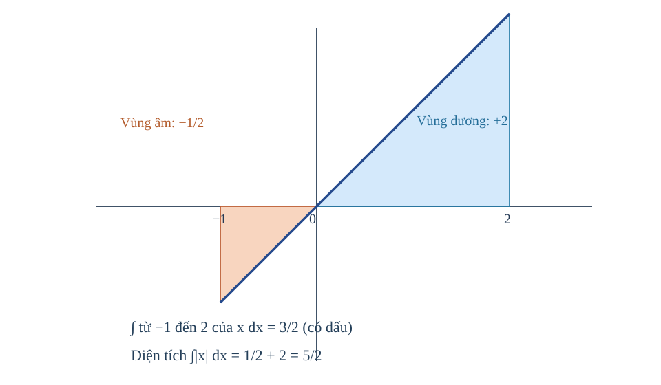
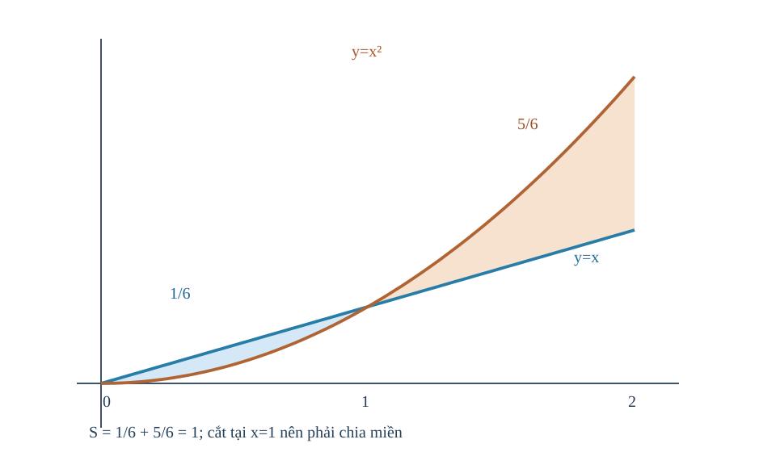
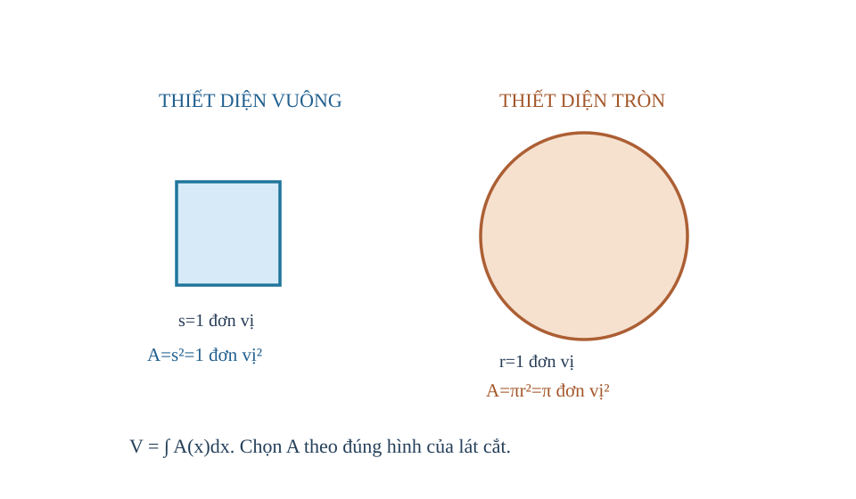
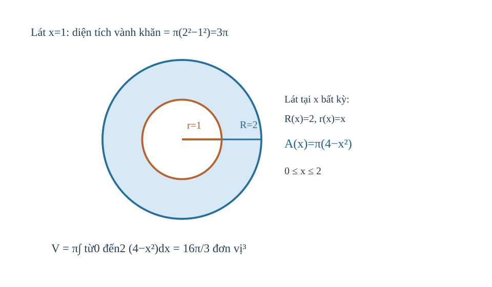

---
hide:
  - toc
---

HỌC THEO CHUYÊN ĐỀ · CĐ11 · TOÁN THPT

<nav class="thpt-sgk-lesson-nav" aria-label="Điều hướng Chuyên đề 11">
<a href="../../cd10/kien-thuc/">← Chuyên đề trước</a>
<a href="../../cd12/kien-thuc/">Chuyên đề sau →</a>
<a href="../luyen-tap/">Luyện tập</a>
<a href="../tu-kiem-tra/">Tự kiểm tra</a>
</nav>

<a href="../../">← Tổng quan các Chuyên đề</a>

Khám phá thêm: <a href="../../../math-lab/models/slm-top11-riemann-01/">Mô hình trực quan Chuyên đề 11</a> (tùy chọn).

<link rel="stylesheet" href="../../../../assets/stylesheets/thpt-topic-w1-golden-v1.css">

Đang chuẩn bị kiến thức…

<!-- TOPIC11_APPROVED_SOURCE_START -->
<!-- Q18 SOURCE_LEARNER_BLOB 64688cf81991a432264c06a2ff0a908371ca1f21; Q18_RECEIPT_BLOB e63f9a5df598ea3c6d57efdbeb6808e86ad9f68f; AUTHORING_PR #887; PUBLIC_PROJECTION_ONLY -->

# Kiến thức

## 1. Từ biết tốc độ biến đổi đến khôi phục đại lượng

Nếu một thiết bị đo cho ta vận tốc theo thời gian mà không cho trực tiếp vị trí, ta có thể hỏi: liệu có thể **khôi phục vị trí** từ vận tốc ấy không? Đạo hàm biến một đại lượng thành tốc độ biến đổi, còn nguyên hàm giúp đi ngược lại. Nhưng đi ngược không xác định ngay vị trí ban đầu: các hàm chỉ khác hằng số đều có cùng đạo hàm. Chính vì thế ta cần điều kiện đầu để chọn đúng một đại lượng.

Khi muốn biết đại lượng đã thay đổi bao nhiêu trong cả một quãng thời gian, ta cộng những thay đổi rất nhỏ thành **tích phân xác định**. Từ đây xuất hiện hai câu hỏi phải phân biệt: thay đổi ròng có thể dương hay âm, còn độ dài, diện tích hay thể tích **không thể âm**. Bài học đi từ nguyên hàm qua tích phân có dấu đến hình học lát cắt, không nhảy thẳng vào công thức diện tích và thể tích.

### 1.1. Nhận ra nguyên hàm từ đạo hàm

<!-- LESSON_ID: TOP11-M01; OUTCOME_ID: TOP11-O01 -->

Giả sử ta biết một đại lượng thay đổi nhanh thế nào, nhưng lại muốn tìm quy luật của chính đại lượng ấy. Đó là lúc ta đi ngược từ đạo hàm về **nguyên hàm**. 

> **ĐỊNH NGHĨA — Nguyên hàm.** Hàm \(F\) là một nguyên hàm của \(f\) trên một khoảng \(I\) nếu \(F'(x)=f(x)\) với mọi \(x\in I\). Trên một khoảng, nếu \(F\) là nguyên hàm thì họ nguyên hàm có dạng \(F(x)+C\), \(C\in\mathbb R\); phải phân biệt các thành phần miền rời.

Không chỉ trên khoảng mở: ta có thể xét nguyên hàm trên một khoảng, một nửa khoảng hoặc một đoạn \(K\). Chẳng hạn với \(K=[a,b]\), tại đầu \(a\) ta hiểu \(F'(a)=f(a)\) theo **đạo hàm bên phải**, còn tại đầu \(b\) theo **đạo hàm bên trái**; không đòi lấy đạo hàm ở phía nằm ngoài đoạn. Nếu \(f\) **liên tục trên một khoảng** thì \(f\) có ít nhất một nguyên hàm trên khoảng ấy; đây là điều kiện đủ bảo đảm tồn tại, không phải yêu cầu bắt buộc trong định nghĩa. Khi \(F'=f\), ký hiệu \(dF(x)=F'(x)\,dx=f(x)\,dx\) gọi là **vi phân** của \(F\); ký hiệu này mô tả quan hệ đạo hàm–nguyên hàm, không cho phép coi \(\int f(x)\,dx\) là phép nhân đại số tùy ý.

Ví dụ, với \(f(x)=4x^3+2\), ta nhận thấy \((x^4)'=4x^3\) và \((2x)'=2\), nên \(F(x)=x^4+2x\) là một nguyên hàm. Nhưng \(x^4+2x+5\) cũng có đạo hàm ấy, bởi đạo hàm của hằng số bằng 0. Vì thế khi hỏi **họ nguyên hàm**, ta phải viết \(F(x)=x^4+2x+C\). Hãy kiểm bằng cách lấy đạo hàm ngược; phép tích phân bất định không phải một phép nhân với ký hiệu \(dx\).

**Ví dụ**

**Đề bài:** Tìm mọi nguyên hàm của \(f(x)=9x^2-4x+1\) trên \(\mathbb R\).

**Lời giải:** Lấy nguyên hàm từng hạng tử: \(F(x)=3x^3-2x^2+x+C\). Kiểm tra \(F'(x)=9x^2-4x+1\) trên \(\mathbb R\). Hằng số \(C\) cần có vì đạo hàm của mọi hằng số bằng 0.

**Vận dụng** Tìm họ nguyên hàm của \(f(x)=8x^3-2\). Em kiểm lại được bằng đạo hàm không?

Đối chiếu

\(F(x)=2x^4-2x+C\). Đạo hàm của biểu thức này là \(8x^3-2\), đúng bằng \(f\). Nếu em quên \(+C\), hãy thử cộng thêm 5 vào nguyên hàm của mình rồi lấy đạo hàm: kết quả vẫn không đổi.

**Kiểm lỗi**

Nếu em chỉ thấy một nguyên hàm mà bỏ \(+C\), hoặc kết luận bằng cách nhìn dạng hàm, đọc **Kiến thức 1.1**, giải **Bài 3** (đạo hàm để kiểm) và **Bài 5** (tìm cả họ). Cứ lấy đạo hàm kết quả để đối chiếu với \(f\).

### 1.2. Một họ nguyên hàm và điều kiện đầu

<!-- LESSON_ID: TOP11-M02; OUTCOME_ID: TOP11-O02 -->

> **TÍNH CHẤT — Một họ nguyên hàm và điều kiện đầu.** Nếu hai hàm có cùng đạo hàm trên một khoảng thì chúng chỉ khác nhau một hằng số. Chọn một nguyên hàm \(F_0\) của \(f\), ta viết \(F(x)=F_0(x)+C\). Nếu biết \(a\) thuộc khoảng đó và \(F(a)=b\), ta có \(F_0(a)+C=b\), từ đó xác định \(C=b-F_0(a)\). Dữ kiện ở một khoảng không xác định hằng số trên một khoảng tách rời khác. Hãy kiểm cả đạo hàm và giá trị ban đầu.

Chẳng hạn, \(F'(x)=3x^2-4\), \(F(1)=5\). Họ nguyên hàm là \(F(x)=x^3-4x+C\). Thay \(x=1\), ta được \(1-4+C=5\), suy ra \(C=8\). Vậy \(F(x)=x^3-4x+8\). Kiểm lại \(F'(x)=3x^2-4\) và \(F(1)=5\).

**Ví dụ**

**Đề bài:** Biết \(F'(x)=4x-3\) trên \(\mathbb R\) và \(F(2)=5\). Tìm \(F(x)\).

**Lời giải:** Từ \(F'\) suy ra \(F(x)=2x^2-3x+C\). Điều kiện \(F(2)=8-6+C=5\) cho \(C=3\), vậy \(F(x)=2x^2-3x+3\). Thế lại \(x=2\) và lấy đạo hàm để kiểm cả hai điều kiện.

**Vận dụng** \(F'(x)=2x+1\) và \(F(0)=7\): tìm \(F\).

Đối chiếu

\(F(x)=x^2+x+7\).

Nếu dùng \(F'(0)=7\), em đã dùng sai loại dữ kiện; \(F(0)\) mới là giá trị ban đầu.

**Kiểm lỗi**

Nếu em thay điều kiện \(F(a)\) thành \(F'(a)\) hoặc không tìm hằng \(C\), đọc **Kiến thức 1.2**, giải **Bài 8** rồi **Bài 10**. Phải thỏa đồng thời đạo hàm và giá trị ban đầu.

### 1.3. Nguyên hàm lũy thừa

<!-- LESSON_ID: TOP11-M03; OUTCOME_ID: TOP11-O03 -->

Từ quy tắc đạo hàm lũy thừa, ta biết \((x^{n+1})'=(n+1)x^n\) trên khoảng thích hợp. Muốn đạo hàm trở về đúng \(x^n\), ta chia cho \(n+1\). Khi \(n=-1\), phép chia này không thực hiện được; ta sẽ xét trường hợp ấy riêng.

> **CÔNG THỨC — Nguyên hàm lũy thừa.** Với \(n\ne-1\) và trên khoảng mà biểu thức thực \(x^n\) được xác định, \(\displaystyle\int x^n\,dx=\frac{x^{n+1}}{n+1}+C\). Trường hợp \(n=-1\) dùng \(\ln|x|+C\) trên từng khoảng tránh \(0\); không thay trực tiếp vào mẫu \(n+1=0\).

 Nếu \(F'=f\), \(G'=g\) trên cùng một khoảng và \(\alpha,\beta\) là các hằng số thì họ nguyên hàm của \(\alpha f+\beta g\) là \(\alpha F+\beta G+C\). Các hằng số cộng được gộp thành một hằng số \(C\) duy nhất.

Xét ví dụ: \(\int (6x^2-4x+3)\,\mathrm dx=2x^3-2x^2+3x+C\). Đạo hàm của \(2x^3\) là \(6x^2\), của \(-2x^2\) là \(-4x\) và của \(3x\) là \(3\). Kiểm từng hạng giúp tránh lỗi hệ số.

**Ví dụ**

**Đề bài:** Tính \(\int (2x^{5}-4x^{3}+6)\,\mathrm dx\).

**Lời giải:** Trên \(\mathbb R\), dùng tính tuyến tính và quy tắc lũy thừa. Một nguyên hàm của \(2x^5\) là \(\frac{x^6}{3}\), của \(-4x^3\) là \(-x^4\), của \(6\) là \(6x\). Kết quả \(F(x)=\frac{x^6}{3}-x^4+6x+C\). Lấy đạo hàm được \(F'(x)=2x^5-4x^3+6\).

**Vận dụng** \(\int (5x^4+2x)\,\mathrm dx\)?

Đối chiếu

\(x^5+x^2+C\).

Nếu không chia hệ số mũ mới, kiểm đạo hàm ngược sẽ phát hiện hệ số dư.

**Kiểm lỗi**

Nếu em quên chia hệ số theo mũ mới khi tính nguyên hàm lũy thừa, đọc **Kiến thức 1.3**, làm **Bài 14** rồi **Bài 16**. Lấy đạo hàm ngược để phát hiện hệ số thiếu.

### 1.4. Nguyên hàm của \(\frac1x\) trên khoảng

<!-- LESSON_ID: TOP11-M04; OUTCOME_ID: TOP11-O04 -->

> **CÔNG THỨC — Nguyên hàm của \(\frac1x\).** Khi \(x>0\), ta có \((\ln x)'=\frac1x\). Khi \(x&lt;0\), \(-x>0\) nên \((\ln(-x))'=\frac1{-x}\cdot(-1)=\frac1x\). Hai biểu thức logarit này được viết gọn thành \(\ln|x|\). Vì vậy \(\int\frac1x\,\mathrm dx=\ln|x|+C\) trên từng khoảng \((-\infty;0)\) hoặc \((0;+\infty)\). Không thể áp dụng công thức trên một khoảng chứa \(0\), vì hàm số không xác định tại đó. Hai khoảng có thể có các hằng số \(C_-\) và \(C_+\) khác nhau; một điều kiện tại \(-1\) không xác định hằng số ở nhánh dương.

Chẳng hạn, trên \(x&lt;0\), \(\int\frac3x\,\mathrm dx=3\ln(-x)+C\). Lấy đạo hàm: \(3\cdot\frac{-1}{-x}=\frac3x\), đúng với hàm đã cho. Ta chọn \(\ln(-x)\) vì \(-x>0\) trên nhánh âm; \(\ln x\) không xác định ở đó.

**Ví dụ**

**Đề bài:** Tìm \(F(x)\) biết \(F'(x)=\frac{3}{x}\) trên \(x&lt;0\) và \(F(-2)=7\).

**Lời giải:** Trên khoảng \((-\infty;0)\), \(F(x)=3\ln|x|+C=3\ln(-x)+C\). Thay \(x=-2\): \(3\ln 2+C=7\), nên \(C=7-3\ln 2\). Vậy \(F(x)=3\ln(-x)+7-3\ln 2\). Không dùng \(\ln x\) trên khoảng \(x&lt;0\) hoặc nối qua \(x=0\).

**Vận dụng** \(F'(x)=\frac1x\) trên \(x&lt;0\), \(F(-1)=2\). Tìm \(F(x)\).

Đối chiếu

\(F(x)=\ln(-x)+2\) trên \(x&lt;0\).

Không viết \(\ln x\) khi \(x&lt;0\); sau đó kiểm đạo hàm trước khi kết luận.

**Kiểm lỗi**

Nếu em dùng \(\ln x\) cho \(x&lt;0\) hoặc ghép hằng số xuyên qua điểm \(x=0\) bị loại, đọc **Kiến thức 1.4**, làm **Bài 17** và **Bài 21**. Luôn chọn một khoảng xác định không qua 0.

### 1.5. Hàm mũ và hệ số bù

<!-- LESSON_ID: TOP11-M05; OUTCOME_ID: TOP11-O05 -->

> **CÔNG THỨC — Hàm mũ và hệ số bù.** Từ quy tắc đạo hàm hàm hợp, \((e^{kx})'=ke^{kx}\). Khi \(k\ne0\), ta chia cho \(k\) để có đạo hàm đúng bằng \(e^{kx}\). Vì vậy \(\int e^{kx}\,\mathrm dx=\frac{e^{kx}}k+C\). Tương tự, \((a^x)'=a^x\ln a\), nên \(\int a^x\,\mathrm dx=\frac{a^x}{\ln a}+C\) với \(a>0,\ a\ne1\). Không áp dụng quy tắc nguyên hàm lũy thừa \(x^n\) cho hàm mũ \(a^x\), vì vị trí của biến khác nhau.

Chẳng hạn, \(\int(6e^{3x}+2^x)\,\mathrm dx=2e^{3x}+\frac{2^x}{\ln 2}+C\). Lấy đạo hàm kết quả, ta được \(6e^{3x}+2^x\). Hệ số \(2\) ở số hạng đầu xuất hiện vì ta chia \(6\) cho \(3\).

**Ví dụ**

**Đề bài:** Tính \(\int (3e^{3x}+2^x)\,\mathrm dx\).

**Lời giải:** Vì \((e^{3x})'=3e^{3x}\) và \(\left(\frac{2^x}{\ln 2}\right)'=2^x\) (cơ số \(2>0,\ 2\ne1\)), họ nguyên hàm là \(e^{3x}+\frac{2^x}{\ln 2}+C\). Lấy đạo hàm để xác nhận các hệ số.

**Vận dụng** Tìm \(\int 5e^{5x}\,\mathrm dx\).

Đối chiếu

\(e^{5x}+C\).

Nếu kết quả là \(5e^{5x}\), lấy đạo hàm sẽ được \(25e^{5x}\), gấp năm lần hàm đã cho. Em cần chia hệ số cho \(5\).

**Kiểm lỗi**

Nếu em đạo hàm ngược \(e^{kx}\) hay \(a^x\) mà thiếu hệ số bù, đọc **Kiến thức 1.5**, làm **Bài 25** và **Bài 27**; phải dùng \(\ln a\) khi cơ số là \(a>0,a\ne1\).

### 1.6. Nguyên hàm lượng giác

<!-- LESSON_ID: TOP11-M06; OUTCOME_ID: TOP11-O06 -->

> **CÔNG THỨC — Nguyên hàm lượng giác.** Với góc tính bằng radian, \((\sin x)'=\cos x\), \((\cos x)'=-\sin x\). Theo quy tắc đạo hàm hàm hợp, khi \(k\ne0\), ta có \(\int\cos(kx)\,\mathrm dx=\frac{\sin(kx)}k+C\) và \(\int\sin(kx)\,\mathrm dx=-\frac{\cos(kx)}k+C\). Dấu trừ trong công thức thứ hai xuất hiện vì đạo hàm của cos mang dấu âm. Nếu góc được cho theo độ, phải đổi đơn vị trước khi áp dụng.

Từ hai đạo hàm \((\tan x)'=\dfrac{1}{\cos^2x}\) (khi \(\cos x\ne0\)) và \((\cot x)'=-\dfrac{1}{\sin^2x}\) (khi \(\sin x\ne0\)), ta còn hai nguyên hàm cơ bản mà chỉ học sin và cos sẽ bỏ sót:

\[
\int \frac{1}{\cos^2x}\,dx=\tan x+C\quad(\cos x\ne0),\qquad
\int \frac{1}{\sin^2x}\,dx=-\cot x+C\quad(\sin x\ne0).
\]

Mỗi công thức được áp dụng trên **một khoảng** không chứa điểm làm mẫu bằng 0. Chẳng hạn, trên khoảng \(0&lt;x&lt;\frac{\pi}{2}\), ta có \(\int\left(\frac{2}{\cos^2x}-\frac{3}{\sin^2x}\right)\mathrm dx=2\tan x+3\cot x+C\). Lấy đạo hàm kết quả cho đúng \(\frac{2}{\cos^2x}-\frac{3}{\sin^2x}\); dấu cộng trước \(3\cot x\) đến từ \((\cot x)'=-\frac{1}{\sin^2x}\). Trên những khoảng xác định tách rời, hằng số \(C\) có thể khác nhau.

Chẳng hạn, \(\int(4\cos(2x)+3\sin(3x))\,\mathrm dx=2\sin(2x)-\cos(3x)+C\). Kiểm bằng đạo hàm: \((2\sin(2x))'=4\cos(2x)\) và \((-\cos(3x))'=3\sin(3x)\).

**Ví dụ**

**Đề bài:** Tính \(\int (4\cos (2x)-3\sin (3x))\,\mathrm dx\), góc đo radian.

**Lời giải:** Ta có \((2\sin(2x))'=4\cos(2x)\) và \((\cos(3x))'=-3\sin(3x)\). Vậy \(F(x)=2\sin(2x)+\cos(3x)+C\). Khi lấy đạo hàm để kiểm lại, dùng góc radian và quy tắc đạo hàm hàm hợp.

**Vận dụng** \(\int 2\sin (2x)\,\mathrm dx\)?

Đối chiếu

\(-\cos(2x)+C\).

Nếu thiếu dấu âm, em hãy lấy đạo hàm của \(\cos(2x)\): kết quả là \(-2\sin(2x)\), trái dấu với hàm đề bài.

**Kiểm lỗi**

Nếu em mất dấu khi nguyên hàm \(\sin\) hoặc quên nhân hệ số góc theo radian, đọc **Kiến thức 1.6**, làm **Bài 30** rồi **Bài 32**. Lấy đạo hàm kết quả theo quy tắc dây chuyền.

### 1.7. Từ vận tốc khôi phục vị trí

<!-- LESSON_ID: TOP11-M07; OUTCOME_ID: TOP11-O07 -->

> **PHƯƠNG PHÁP — Từ vận tốc khôi phục vị trí.** Vận tốc có hướng \(v(t)=s'(t)\) cho biết vị trí \(s(t)\) biến đổi nhanh thế nào. Nếu \(F\) là một nguyên hàm của \(v\) thì \(s(t)=F(t)+C\). Ta cần biết vị trí ban đầu \(s(t_0)\) để tìm \(C\); chỉ biết vận tốc chưa đủ để xác định vị trí. Tích phân của \(v\) trên \([a;b]\) cho **độ dời**, không phải luôn là tổng quãng đường. Nếu thời gian tính bằng giây và vị trí tính bằng mét, đơn vị vận tốc là \(\mathrm{m/s}\), còn gia tốc \(v'(t)\) có đơn vị \(\mathrm{m/s^2}\).

Chẳng hạn, cho \(v(t)=4t-2\) (m/s), \(s(0)=3\) m. Một họ nguyên hàm là \(s(t)=2t^2-2t+C\); từ vị trí ban đầu suy ra \(C=3\). Sau 2 giây, \(s(2)=8-4+3=7\) m. Kiểm lại \(s'(t)=4t-2\) (m/s).

**Ví dụ**

**Đề bài:** Vận tốc có hướng \(v(t)=4t+1\) (m/s), \(t\ge0\), và \(s(1)=6\) m. Tính \(s(2)\).

**Lời giải:** Vì \(s'=v\), ta có \(s(t)=2t^2+t+C\) (m). Thay \(t=1\), \(s(1)=2+1+C=6\), suy ra \(C=3\). Do đó \(s(2)=8+2+3=13\) m. Cần điều kiện vị trí đã biết để xác định hằng số; riêng tích phân vận tốc chỉ cho độ dời.

**Vận dụng** Vật chuyển động thẳng có vận tốc \(v(t)=6t\) (m/s), thời gian \(t\) tính bằng giây, vị trí ban đầu \(s(0)=1\) m. Tính vị trí \(s(1)\).

Đối chiếu

Vì \(s'(t)=v(t)\), ta có \(s(t)=3t^2+C\). Thế \(s(0)=1\) được \(C=1\); do đó \(s(1)=4\) m.

Nếu không biết \(s(0)\), ta chưa xác định được vị trí tuyệt đối cụ thể.

**Kiểm lỗi**

Nếu em tích phân vận tốc để ra độ dời nhưng ghi ngay vị trí tuyệt đối không có dữ kiện đầu, đọc **Kiến thức 1.7**, làm **Bài 35** và **Bài 37**. Viết \(s'=v\), tìm hằng \(C\) từ vị trí đã biết rồi mới tính.

## 2. Từ các bước thay đổi nhỏ đến tích phân trên cả khoảng

Nếu vận tốc đổi theo thời gian, lấy một giá trị vận tốc nhân cả khoảng thời gian chỉ là ước lượng thô. Chia thời gian thành nhiều đoạn rất ngắn, cộng độ dời gần đúng trên từng đoạn rồi cho độ rộng đoạn giảm dần giúp ta hiểu **tích phân** là giới hạn của quá trình cộng dồn. Định lý cơ bản liên hệ tổng ấy với hiệu hai giá trị của một nguyên hàm; từ đó mới dùng các quy tắc đổi cận, tuyến tính và đổi biến có điều kiện.

Khi biến thiên diễn ra suốt một khoảng, tích phân cộng dồn các phần rất nhỏ. Nhờ nguyên hàm, ta tính được sự thay đổi ròng bằng hiệu tại hai cận, nhưng dấu của kết quả vẫn phụ thuộc vào chiều lấy tích phân và dấu của hàm.

### 2.1. Tích phân xác định và Newton–Leibniz

<!-- LESSON_ID: TOP11-M08; OUTCOME_ID: TOP11-O08 -->

Các nguyên hàm của cùng một hàm số trên một khoảng có thể khác nhau hằng số. Vì sao khi tính tích phân có cận, ta vẫn luôn thu được cùng một số? Với \(f\) liên tục trên đoạn \([a;b]\), chọn nguyên hàm \(F\) của \(f\) trên đoạn ấy.

> **ĐỊNH NGHĨA — Tích phân xác định.** Với \(f\) liên tục trên đoạn \([a,b]\), chọn một nguyên hàm \(F\) của \(f\) trên đoạn ấy. **Tích phân của \(f\) từ \(a\) đến \(b\)** là số \(F(b)-F(a)\), ký hiệu \(\displaystyle\int_a^b f(x)\,dx\). Kết quả không phụ thuộc vào việc chọn nguyên hàm nào: nếu chọn \(F+C\) thì hai hằng số ở hai cận triệt tiêu. \(a\) là cận dưới, \(b\) là cận trên, \(f\) là hàm dưới dấu tích phân; khi đảo hai cận thì tích phân đổi dấu.

Như vậy định nghĩa giải thích **vì sao tích phân xác định là một số**, còn công thức Newton–Leibniz dưới đây là cách tính bằng một nguyên hàm. Trong một bài toán thực tế, đơn vị tích phân bằng đơn vị của \(f\) nhân với đơn vị của \(x\).

> **ĐỊNH LÝ — Newton–Leibniz.** Nếu \(f\) liên tục trên đoạn \([a,b]\), \(a&lt;b\), và \(F\) liên tục trên \([a,b]\), khả vi trên \((a,b)\) với \(F'(x)=f(x)\) tại mọi \(x\in(a,b)\), thì \(\displaystyle\int_a^b f(x)\,dx=F(b)-F(a)\). Đây là **một số thực**, không có \(+C\).

 Hằng số \(C\) bị triệt tiêu trong hiệu \((F(b)+C)-(F(a)+C)=F(b)-F(a)\). Khác với nguyên hàm bất định, tích phân xác định không thêm \(+C\). Tên biến lấy tích phân là **ký hiệu thay chỗ**, nên nếu giữ cùng hàm và cận thì \(\int_a^b f(x)\,\mathrm dx=\int_a^b f(t)\,\mathrm dt\); còn đổi hàm hoặc đổi cận thì nói chung giá trị thay đổi. Nếu hàm không xác định hoặc không liên tục trên đoạn, cần kiểm điều kiện trước khi áp dụng công thức.

Xét ví dụ: \(\int_1^2 4x^3\,\mathrm dx=\left[x^4\right]_1^2=16-1=15\). Chọn nguyên hàm \(F(x)=x^4\); hàm dưới dấu tích phân là đa thức, liên tục trên \([1;2]\). Kết quả là một số, không thêm \(+C\).

**Ví dụ**

**Đề bài:** Tính \(\int_{1}^{3} 4x\,\mathrm dx\) bằng nguyên hàm và cận.

**Lời giải:** \(f(x)=4x\) liên tục trên \([1;3]\), chọn \(F(x)=2x^2\). Theo công thức Newton–Leibniz, \(\int_1^3 4x\,\mathrm dx=F(3)-F(1)=18-2=16\). Tích phân có cận là một số, không thêm \(+C\).

**Vận dụng** Tính \(\displaystyle\int_1^3 2x\,dx\). Viết rõ giá trị nguyên hàm ở cả hai cận.

Đối chiếu

\(\left[x^2\right]_1^3=3^2-1^2=8\). Nếu em ra 9, em mới thế cận trên mà quên trừ giá trị tại cận dưới.

Nếu chỉ thế cận trên, hãy nhớ công thức là hiệu \(F(b)-F(a)\).

**Kiểm lỗi**

Nếu em thêm \(+C\) vào tích phân có cận hoặc chỉ thế cận trên, đọc **Kiến thức 2.1**, làm **Bài 40** và **Bài 42**. Kiểm hàm liên tục trên đoạn và tính đúng \(F(b)-F(a)\).

### 2.2. Tính tuyến tính của tích phân

<!-- LESSON_ID: TOP11-M09; OUTCOME_ID: TOP11-O09 -->

> **TÍNH CHẤT — Tính tuyến tính của tích phân.** Nếu \(f,g\) liên tục trên \([a;b]\) và \(\alpha,\beta\) là hằng số, thì \(\int_a^b(\alpha f(x)+\beta g(x))\,\mathrm dx=\alpha\int_a^b f(x)\,\mathrm dx+\beta\int_a^b g(x)\,\mathrm dx\). Vì hiệu giá trị nguyên hàm cũng tuân theo phép cộng và nhân với hằng số, ta có thể tách một biểu thức dài thành các tích phân đơn giản hơn. Tất cả tích phân trong công thức đều giữ cùng hai cận. Nếu một thành phần không xác định trên đoạn, cần kiểm điều kiện trước.

Chẳng hạn, \(\int_0^1(3x^2+2x+1)\,\mathrm dx=\left[x^3+x^2+x\right]_0^1=3\). Có thể tính ba tích phân thành phần riêng rồi cộng: \(1+1+1=3\).

**Ví dụ**

**Đề bài:** Tính \(\int_{0}^{2} (3x^{2}-2x+4)\,\mathrm dx\) và giải thích phép tách.

**Lời giải:** Các đa thức đều liên tục trên \([0;2]\); dùng tính tuyến tính, chọn nguyên hàm \(F(x)=x^3-x^2+4x\). Giá trị là \(F(2)-F(0)=8-4+8=12\). Cũng có thể tách thành ba tích phân và tính riêng từng tích phân **với cùng hai cận 0 và 2**:

\[
\int_0^2 3x^2\,dx-\int_0^2 2x\,dx+\int_0^2 4\,dx
=8-4+8=12.
\]

Hai cách hoàn toàn tương đương; không được tự ý thay cận của một số hạng mà không có phép biến đổi hợp lệ.

**Vận dụng** \(\int_{0}^{2} (2x+3)\,\mathrm dx\)?

Đối chiếu

\(\left[x^2+3x\right]_0^2=4+6=10\).

Nếu ghép các tích phân khác cận mà không đổi cận, đó không phải quy tắc tuyến tính.

**Kiểm lỗi**

Nếu em tách biểu thức nhưng đổi nhầm cận hoặc không nhân hệ số, đọc **Kiến thức 2.2**, làm **Bài 45** và **Bài 47**. Quy tắc tuyến tính giữ nguyên cận cho các tích phân thành phần.

### 2.3. Đảo cận và ghép cận

<!-- LESSON_ID: TOP11-M10; OUTCOME_ID: TOP11-O10 -->

> **TÍNH CHẤT — Đảo cận và ghép cận.** Với \(f\) liên tục trên đoạn chứa các cận, từ hiệu \(F(b)-F(a)\) của một nguyên hàm \(F\), suy ra \(\int_b^a f(x)\,\mathrm dx=-\int_a^b f(x)\,\mathrm dx\) và \(\int_a^a f(x)\,\mathrm dx=0\). Nếu \(a\le c\le b\), thì \(\int_a^b f(x)\,\mathrm dx=\int_a^c f(x)\,\mathrm dx+\int_c^b f(x)\,\mathrm dx\), vì giá trị \(F(c)\) được cộng rồi trừ đi. Tích phân có hướng, không đồng nhất với diện tích hình học. Quy tắc ghép cận giúp ta chia khoảng tại điểm hàm đổi dấu.

Chẳng hạn, \(\int_2^0(3x^2+1)\,\mathrm dx=-\int_0^2(3x^2+1)\,\mathrm dx=-10\). Giá trị âm xuất phát từ việc đảo cận, không đại diện cho một diện tích âm.

**Ví dụ**

**Đề bài:** Tính \(\int_{4}^{1} 2x\,\mathrm dx\) và so với \(\int_{1}^{4} 2x\,\mathrm dx\).

**Lời giải:** Chọn \(F(x)=x^2\). Theo chiều cận từ 4 đến 1, \(\int_4^1 2x\,\mathrm dx=F(1)-F(4)=1-16=-15\). Khi đảo lại hai cận, \(\int_1^4 2x\,\mathrm dx=15\). Dấu âm biểu thị hướng lấy tích phân, không phải diện tích hình học âm.

**Vận dụng** Biết \(\int_1^3 f(x)\,dx=5\) và \(\int_3^5 f(x)\,dx=-2\), trong đó \(f\) liên tục trên \([1;5]\). Tính \(\int_1^5 f(x)\,dx\), \(\int_5^1 f(x)\,dx\) và \(\int_3^3 f(x)\,dx\).

Đối chiếu

Ghép tại \(3\): \(\int_1^5 f(x)\,dx=5+(-2)=3\). Đảo cận cho \(\int_5^1 f(x)\,dx=-3\); hai cận bằng nhau cho \(\int_3^3 f(x)\,dx=0\). Nếu em cộng thành 7, em đã thay số hạng âm bằng trị tuyệt đối, trong khi đề hỏi tích phân có dấu.

**Kiểm lỗi**

Nếu em quên dấu khi đảo cận hoặc ghép sai khoảng, đọc **Kiến thức 2.3**, làm **Bài 48** và **Bài 52**. Xác định đúng chiều cận và điểm nối trước khi cộng.

### 2.4. Từ tích lũy tới diện tích không âm

<!-- LESSON_ID: TOP11-M11; OUTCOME_ID: TOP11-O11 -->

> **CÔNG THỨC — Từ tích lũy tới diện tích không âm.** Giả sử \(f\) liên tục và \(f(x)\ge0\) trên \([a;b]\), với \(a&lt;b\). Chia đoạn thành nhiều khoảng nhỏ: một dải đứng có chiều cao gần bằng \(f(x)\), chiều rộng rất nhỏ \(\Delta x\), nên diện tích gần bằng \(f(x)\Delta x\). Khi các dải ngày càng hẹp, tổng diện tích tiến đến \(S=\int_a^b f(x)\,\mathrm dx\). Đây là diện tích vùng giới hạn bởi đồ thị, trục \(Ox\) và hai đường \(x=a,\ x=b\). Nếu hàm đổi dấu, tích phân có dấu không còn bằng tổng diện tích hình học.

Chẳng hạn, \(y=2x\) không âm trên \([0;2]\). Ta có \(S=\int_0^2 2x\,\mathrm dx=\left[x^2\right]_0^2=4\). Kiểm bằng hình học: tam giác có đáy 2 và chiều cao 4, diện tích \(\frac12\cdot2\cdot4=4\).

**Ví dụ**

**Đề bài:** Tính diện tích hình phẳng dưới đồ thị \(y=2x+1\), giới hạn bởi trục \(Ox\) và hai đường \(x=0,\ x=2\).

**Lời giải:** Hàm \(f(x)=2x+1\) liên tục và \(f(x)\ge1>0\) trên \([0;2]\). Đồ thị nằm trên \(Ox\), do đó \(S=\int_0^2(2x+1)\,\mathrm dx=\left[x^2+x\right]_0^2=4+2=6\) đơn vị diện tích.

**Vận dụng** Tính diện tích dưới đồ thị \(y=x^2\), phía trên trục \(Ox\), từ \(x=0\) đến \(x=1\).

Đối chiếu

\(\int_0^1 x^2\,\mathrm dx=\frac13\) đơn vị diện tích.

Nếu trả diện tích âm, kiểm f có âm trên đoạn hay không.

**Kiểm lỗi**

Nếu em coi tích phân âm là diện tích âm, hoặc bỏ kiểm dấu \(f\), đọc **Kiến thức 2.4**, làm **Bài 55** và **Bài 57**. Diện tích hình học yêu cầu hàm không âm trên đoạn, hoặc phải tách theo dấu.

### 2.5. Phân biệt độ dời và quãng đường

<!-- LESSON_ID: TOP11-M12; OUTCOME_ID: TOP11-O12 -->

Độ dời khác quãng đường vì các phần có dấu trái nhau trong tích phân có thể triệt tiêu. Với vận tốc có hướng \(v\) liên tục trên \([a;b]\), độ dời là \(\int_a^b v(t)\,\mathrm dt\), còn quãng đường là \(\int_a^b |v(t)|\,\mathrm dt\). Tương tự, diện tích giữa đồ thị của \(f\) và trục \(Ox\) là \(\int_a^b |f(x)|\,\mathrm dx\). Khi hàm đổi dấu tại một số hữu hạn điểm, chia đoạn tại các điểm đó để tính từng phần không âm. Không thay tích phân của trị tuyệt đối bằng trị tuyệt đối của tích phân khi chưa kiểm dấu.

Chẳng hạn, \(v(t)=t-1\) (m/s) trong \(0\le t\le2\) giây. Độ dời là \(\int_0^2(t-1)\,\mathrm dt=0\) m. Vật đổi chiều tại \(t=1\); quãng đường là \(\int_0^1(1-t)\,\mathrm dt+\int_1^2(t-1)\,\mathrm dt=\frac12+\frac12=1\) m.

> **PHƯƠNG PHÁP — Phân biệt độ dời và quãng đường.** Hình dưới minh họa một ví dụ khác: \(f(x)=x\) trên \([-1;2]\). Trên \([-1;0]\), đồ thị nằm dưới trục nên phần tích phân bằng \(-\frac12\); trên \([0;2]\), vùng tam giác phía trên có diện tích 2 và đóng góp \(+2\). Vì thế \(\int_{-1}^2 x\,\mathrm dx=\frac32\), nhưng **diện tích hình học** của hai vùng là \(\frac12+2=\frac52\). Trong bài vận tốc \(v(t)=t-1\) trên \([0;2]\) vừa xét, hai số tương ứng là 0 và 1; không dùng kết quả của hình này cho bài vận tốc đó.

*Đọc hình:* Đây là \(y=x\) trên \([-1;2]\), đổi dấu tại \(x=0\). Hai vùng tam giác có diện tích lần lượt \(\frac12\) và 2, nên phần dưới góp số **âm** vào tích phân nhưng vẫn là diện tích **dương** khi cộng diện tích hình học.

**Ví dụ**

**Đề bài:** Với \(f(x)=x-1\) trên \([0;4]\), tính tích phân có dấu và diện tích hình học giữa đồ thị với \(Ox\).

**Lời giải:** Hàm đổi dấu tại \(x=1\). Tích phân có dấu là \(\int_0^4(x-1)\,\mathrm dx=\left[\frac{x^2}2-x\right]_0^4=4\). Để tính diện tích, tách tại \(x=1\): \(\int_0^1(1-x)\,\mathrm dx=\frac12\) và \(\int_1^4(x-1)\,\mathrm dx=\frac92\). Tổng diện tích là \(S=\frac12+\frac92=5\), khác với \(|4|=4\).

**Vận dụng** Một vật chuyển động thẳng với vận tốc có hướng \(v(t)=2-t\) (m/s), \(0\le t\le5\) giây. Tìm thời điểm đổi chiều, độ dời và tổng quãng đường của vật.

Đối chiếu

Vận tốc bằng 0 tại \(t=2\), dương trước 2 và âm sau 2 nên vật đổi chiều tại đó. Độ dời là

\[
\int_0^5(2-t)\,dt=\left[2t-\frac{t^2}2\right]_0^5=-\frac52\ \text{m}.
\]

Hai phần quãng đường là \(\int_0^2(2-t)\,dt=2\) m và \(\int_2^5(t-2)\,dt=\frac92\) m. Tổng quãng đường \(\frac{13}2\) m. Nếu lấy \(\frac52\) m, em mới lấy trị tuyệt đối của độ dời, chưa cộng quãng đường ở cả hai chiều.

**Kiểm lỗi**

Nếu em lấy trị tuyệt đối của **một** tích phân có dấu làm quãng đường/diện tích khi hàm đổi dấu, đọc **Kiến thức 2.5**, làm **Bài 58** và **Bài 62**. Tách các khoảng tại điểm đổi dấu, tích phân \(|f|\) hoặc \(|v|\).

### 2.6. Tích phân lượng giác

<!-- LESSON_ID: TOP11-M13; OUTCOME_ID: TOP11-O13 -->

> **CÔNG THỨC — Tích phân lượng giác.** Nếu hàm liên tục trên đoạn lấy tích phân, công thức Newton–Leibniz vẫn là \(F(b)-F(a)\), dù hàm dưới dấu tích phân là đa thức, hàm mũ hay lượng giác. Với góc radian, ta chọn nguyên hàm của \(\cos x\) là \(\sin x\), của \(\sin x\) là \(-\cos x\). Với \(e^x\), nguyên hàm là \(e^x\); với \(e^{kx}\), nguyên hàm là \(\frac{e^{kx}}k\) khi \(k\ne0\). Sau khi chọn nguyên hàm, thay cả hai cận và lấy hiệu; không thêm \(+C\) vào kết quả tích phân.

Xét ví dụ: \(\int_0^{\ln 3} e^x\,\mathrm dx=\left[e^x\right]_0^{\ln 3}=e^{\ln 3}-1=2\). Chọn \(F(x)=e^x\) vì \(F'(x)=e^x\). Lưu ý cận trên là \(\ln 3\), không phải 3.

**Ví dụ**

**Đề bài:** Tính \(\int_{0}^{\pi} \sin  x\,\mathrm dx\) khi góc đo radian.

**Lời giải:** Hàm sin liên tục trên đoạn; chọn \(F(x)=-\cos x\). Ta có \(\int_0^\pi\sin x\,\mathrm dx=\left[-\cos x\right]_0^\pi=1-(-1)=2\). Góc được tính bằng radian.

**Vận dụng** \(\int_{0}^{\frac{\pi}{2}} \sin  x\,\mathrm dx\)?

Đối chiếu

\(\left[-\cos x\right]_0^{\frac{\pi}{2}}=0-(-1)=1\).

Nếu thay cận góc độ mà không quy đổi, xem lại giả thiết radian.

**Kiểm lỗi**

Nếu em quên đạo hàm \(-\cos x\) bằng \(\sin x\) hoặc thế cận góc độ vào công thức radian, đọc **Kiến thức 2.6**, giải **Bài 64** và **Bài 68**. Chọn nguyên hàm đúng trước khi tính hiệu giá trị tại cận.

### 2.7. Tích lũy từ tốc độ biến thiên

<!-- LESSON_ID: TOP11-M14; OUTCOME_ID: TOP11-O14 -->

> **PHƯƠNG PHÁP — Tích lũy từ tốc độ biến thiên.** Giả sử \(Q'(t)=r(t)\) và \(r\) liên tục trên \([a;b]\). Lượng biến đổi ròng là \(Q(b)-Q(a)=\int_a^b r(t)\,\mathrm dt\). Nếu tốc độ \(r\) không hằng, không thể chỉ lấy tốc độ cuối \(r(b)\) nhân với thời gian \(b-a\). Ta phải cộng dồn sự thay đổi trong toàn khoảng. Nếu tốc độ tính bằng lượng mỗi giây và thời gian tính bằng giây, tích phân có đơn vị lượng. Khi tốc độ đổi dấu, kết quả vẫn là biến đổi ròng.

Chẳng hạn, lưu lượng \(r(t)=2t\) lít/phút trong \(0\le t\le2\) phút. Lượng nước tăng thêm là \(Q(2)-Q(0)=\int_0^2 2t\,\mathrm dt=4\) lít, không phải \(r(2)\cdot2=8\) lít.

**Ví dụ**

**Đề bài:** Một vật chuyển động thẳng với vận tốc có hướng \(v(t)=5-2t\) (m/s) trong \(0\le t\le2\) giây. Tính độ dời của vật.

**Lời giải:** Độ dời là \(s(2)-s(0)=\int_0^2(5-2t)\,\mathrm dt=\left[5t-t^2\right]_0^2=10-4=6\) m. Không tính bằng \(v(2)\cdot2=2\) m vì vận tốc không hằng; trên \([0;2]\) có \(v(t)\ge1\) (m/s), nên quãng đường cũng bằng 6 m.

**Vận dụng** Một vật có vận tốc có hướng \(v(t)=3t^2\) (m/s) trong \(0\le t\le1\) giây. Độ dời là bao nhiêu?

Đối chiếu

Độ dời bằng \(\int_0^1 3t^2\,\mathrm dt=1\) m.

Nếu kết quả còn đơn vị m/s, em chưa tích phân theo thời gian (giây).

**Kiểm lỗi**

Nếu em lấy giá trị vận tốc cuối nhân tổng thời gian, hoặc không đổi đơn vị m/s theo giây thành mét, đọc **Kiến thức 2.7**, làm **Bài 71** và **Bài 73**. Độ dời là \(\int_a^b v(t)\,\mathrm dt\); quãng đường mới cần \(\int_a^b|v(t)|\,\mathrm dt\).

## 3. Từ tổng có dấu đến diện tích hình học không âm

Một vật đi về phía phải rồi quay lại có thể có **độ dời ròng bằng 0** dù đã đi một quãng đường dương. Tích phân của vận tốc giữ dấu nên các phần dương/âm có thể triệt tiêu; quãng đường thì phải cộng **độ lớn** của từng phần. Diện tích hình học cũng vậy: ta cần biết đồ thị nằm trên hay dưới trục, hoặc đường nào nằm trên đường nào, trước khi đưa ra công thức tích phân. Khi hai đường cắt nhau, phải chia khoảng tại nơi chúng đổi thứ tự.

Diện tích hình học không thể âm. Vì vậy, khi đồ thị đổi phía so với trục Ox hoặc hai đường cắt nhau, ta cần chia miền và cộng những phần dương, không dùng ngay tích phân đại số của một hiệu xuyên suốt.

### 3.1. Diện tích dưới hàm căn

<!-- LESSON_ID: TOP11-M15; OUTCOME_ID: TOP11-O15 -->

> **PHƯƠNG PHÁP — Diện tích dưới hàm căn.** Hàm \(y=\sqrt{x}\) liên tục, không âm trên đoạn \([a;b]\) với \(0\le a&lt;b\). Vùng giới hạn bởi đồ thị, trục \(Ox\) và hai đường \(x=a,\ x=b\) có diện tích \(S=\int_a^b\sqrt{x}\,\mathrm dx=\frac23\left[x^{\frac32}\right]_a^b\). Để tìm nguyên hàm, viết \(\sqrt{x}=x^{\frac12}\) rồi dùng quy tắc lũy thừa. Không lấy cận âm khi hàm căn không xác định trên số thực.

Chẳng hạn, diện tích dưới \(y=\sqrt{x}\) trên \([0;1]\) là \(\int_0^1 x^{\frac12}\,\mathrm dx=\frac23\) đơn vị diện tích. Kiểm lại: đường cong nằm trong hình vuông cạnh 1, nên diện tích nhỏ hơn 1.

Không phải mọi hình phẳng có hàm căn đều cần tìm nguyên hàm bằng công thức. Chẳng hạn, đồ thị \(y=\sqrt{4-x^2}\), \(-2\le x\le2\), chính là **nửa đường tròn phía trên** của đường tròn \(x^2+y^2=4\): bình phương hai vế được phương trình đường tròn, còn dấu \(y\ge0\) chọn nửa trên. Do đó, diện tích dưới đồ thị từ \(-2\) tới \(2\) là nửa diện tích hình tròn bán kính \(2\).

> **PHƯƠNG PHÁP — Nhận diện diện tích hình học.** Với \(R>0\), \(\displaystyle\int_{-R}^{R}\sqrt{R^2-x^2}\,dx=\frac{\pi R^2}{2}\), vì đó là nửa hình tròn phía trên trục \(Ox\). Chỉ dùng trực tiếp khi **cận và miền thật sự khớp** nửa đường tròn; nếu cận chỉ lấy một phần, cần xác định hình quạt/hình tương ứng hoặc dùng phương pháp phù hợp.

**Ví dụ minh họa.** Tính \(\displaystyle\int_{-2}^{2}\sqrt{4-x^2}\,dx\). Đường cong là nửa đường tròn tâm \(O\), bán kính \(2\) và nằm trên trục hoành. Vậy tích phân bằng diện tích của nửa hình tròn: \(\frac12\pi\cdot2^2=2\pi\). Không thay nhầm số \(4\) dưới căn thành bán kính \(4\).

**Ví dụ**

**Đề bài:** Tính diện tích dưới \(y=\sqrt{x}\) và trên \(Ox\), từ \(x=1\) đến \(x=4\).

**Lời giải:** Hàm \(\sqrt{x}\) liên tục và không âm trên \([1;4]\). Ta có \(S=\int_1^4 x^{\frac12}\,\mathrm dx=\frac23\left[x^{\frac32}\right]_1^4=\frac23(8-1)=\frac{14}{3}\) đơn vị diện tích. Hai cận đều thuộc miền xác định.

**Vận dụng** Tính diện tích dưới \(y=\sqrt{x}\) và trên \(Ox\), từ \(x=0\) đến \(x=9\).

Đối chiếu

\(\frac23\cdot9^{\frac32}=\frac23\cdot27=18\) đơn vị diện tích.

Nếu em nhầm \(\sqrt{x}\) với \(x^2\), hãy viết lại \(\sqrt{x}=x^{\frac12}\) trước khi tìm nguyên hàm.

**Kiểm lỗi**

Nếu em áp dụng công thức nguyên hàm \(x^2\) cho \(\sqrt{x}\) hoặc bỏ miền \(x\ge0\), đọc **Kiến thức 3.1**, làm **Bài 74** và **Bài 78**. Đổi \(\sqrt{x}=x^{\frac12}\) rồi kiểm cận và đơn vị diện tích.

### 3.2. Diện tích đổi dấu qua trục

<!-- LESSON_ID: TOP11-M16; OUTCOME_ID: TOP11-O16 -->

Khi đồ thị cắt trục \(Ox\), những mảnh nằm dưới trục vẫn có diện tích dương. Tìm các điểm mà \(f(x)=0\), xét dấu của \(f\) trên từng khoảng và cộng độ lớn của các tích phân tương ứng.

> **CÔNG THỨC — Diện tích hình phẳng so với trục Ox.** Nếu \(f\) liên tục trên \([a,b]\) thì diện tích hình phẳng giới hạn bởi đồ thị, trục \(Ox\) và các đường \(x=a,x=b\) là \(\displaystyle S=\int_a^b|f(x)|\,dx\). Nếu \(f\) đổi dấu, chia đoạn ở các nghiệm trước khi tính; không lấy \(\left|\int_a^b f(x)\,dx\right|\) thay thế nói chung.

 Nếu hàm đổi dấu tại hữu hạn điểm, ta chia đoạn tại các điểm đổi dấu và lấy dấu thích hợp cho từng tích phân. Nếu hàm giữ dấu trên toàn đoạn thì không cần chia. Diện tích luôn không âm; không thay \(\int_a^b |f(x)|\,\mathrm dx\) bằng \(\left|\int_a^b f(x)\,\mathrm dx\right|\) khi chưa kiểm dấu.

Chẳng hạn, \(f(x)=x\) trên \([-2;2]\): tích phân có dấu bằng 0, nhưng \(S=\int_{-2}^0(-x)\,\mathrm dx+\int_0^2 x\,\mathrm dx=2+2=4\). Ta chọn mốc \(x=0\) vì đồ thị cắt \(Ox\) tại đó.

**Ví dụ**

**Đề bài:** Với \(y=x^2-1\) trên \([-2;2]\), tính tích phân có dấu và diện tích giữa đồ thị với \(Ox\).

**Lời giải:** Hàm đổi dấu tại \(x=-1\) và \(x=1\). Tích phân có dấu là \(\int_{-2}^2(x^2-1)\,\mathrm dx=\left[\frac{x^3}3-x\right]_{-2}^2=\frac43\). Do tính đối xứng, hai mảnh ngoài mỗi mảnh có diện tích \(\int_1^2(x^2-1)\,\mathrm dx=\frac43\); mảnh giữa có diện tích \(\int_{-1}^1(1-x^2)\,\mathrm dx=\frac43\). Vậy \(S=3\cdot\frac43=4\).

**Vận dụng** Tính diện tích hình phẳng giữa \(y=2x-2\) và trục hoành trên \([0;3]\). Tự tìm mốc chia đoạn.

Đối chiếu

Hàm bằng 0 tại \(x=1\), âm trên \([0;1)\) và dương trên \((1;3]\). Diện tích là \(\int_0^1(2-2x)\,dx+\int_1^3(2x-2)\,dx=1+4=5\) đơn vị diện tích. Tích phân có dấu chỉ bằng \(-1+4=3\); hai mảnh diện tích không triệt tiêu nhau.

**Kiểm lỗi**

Nếu em cho phép hai phần hình nằm trên/dưới Ox triệt tiêu thành diện tích 0, đọc **Kiến thức 3.2**, làm **Bài 79** và **Bài 83**. Tìm mọi nghiệm \(f(x)=0\), tách đoạn và tích phân \(|f|\).

### 3.3. Diện tích giữa hai đường

<!-- LESSON_ID: TOP11-M17; OUTCOME_ID: TOP11-O17 -->

> **CÔNG THỨC — Diện tích giữa hai đường.** Nếu \(f,g\) liên tục trên \([a;b]\) và \(f(x)\ge g(x)\) trên cả đoạn, dải đứng giữa hai đồ thị có chiều cao \(f(x)-g(x)\ge0\). Diện tích là \(S=\int_a^b(f(x)-g(x))\,\mathrm dx\). Cần xác định đường trên và đường dưới trước khi lấy hiệu. Nếu hai đường đổi thứ tự, chia miền tại các giao điểm đổi dấu.

Chẳng hạn, trên \([0;1]\), \(2>x^2\), nên diện tích giữa \(y=2\) và \(y=x^2\) là \(S=\int_0^1(2-x^2)\,\mathrm dx=2-\frac13=\frac53\).

**Ví dụ**

**Đề bài:** Tính diện tích giữa \(y=2x+1\) và \(y=x+1\) trên \([0;2]\).

**Lời giải:** Hiệu \((2x+1)-(x+1)=x\ge0\) trên \([0;2]\), nên đường thứ nhất nằm trên. Do đó \(S=\int_0^2 x\,\mathrm dx=\left[\frac{x^2}2\right]_0^2=2\) đơn vị diện tích. Lấy đường trên trừ đường dưới, không cộng hai hàm.

**Vận dụng** Tính diện tích giữa \(y=3\) và \(y=x\) trên \([0;2]\).

Đối chiếu

\(S=\int_0^2(3-x)\,\mathrm dx=4\).

Nếu hiệu âm, hãy kiểm đã trừ đúng 'trên−dưới'.

**Kiểm lỗi**

Nếu em lấy đường dưới trừ đường trên hoặc bỏ kiểm vị trí đường cong, đọc **Kiến thức 3.3**, làm **Bài 84** và **Bài 88**. Kiểm dấu hiệu hai hàm trên từng khoảng để chọn \(\int(\text{trên}-\text{dưới})dx\).

### 3.4. Hai đường đổi thứ tự

<!-- LESSON_ID: TOP11-M18; OUTCOME_ID: TOP11-O18 -->

> **PHƯƠNG PHÁP — Hai đường đổi thứ tự.** Với \(f,g\) liên tục trên \([a;b]\), diện tích giữa hai đồ thị là \(S=\int_a^b|f(x)-g(x)|\,\mathrm dx\). Giải phương trình \(f(x)=g(x)\) để tìm giao điểm, rồi xét dấu của hiệu trên các khoảng. Nếu hai đường đổi thứ tự tại một số hữu hạn điểm, chia đoạn tại những điểm đó và lấy đường trên trừ đường dưới ở mỗi phần. Các diện tích không âm phải được cộng lại. Nếu hai đường chỉ tiếp xúc mà không đổi thứ tự, không bắt buộc chia tại điểm đó.

Xét \(f(x)=x,\ g(x)=x^2\) trên \([0;2]\), giao nhau tại \(x=0,\ x=1\). Trên \((0;1)\), \(x>x^2\); trên \((1;2)\), \(x^2>x\). Diện tích là \(S=\int_0^1(x-x^2)\,\mathrm dx+\int_1^2(x^2-x)\,\mathrm dx=\frac16+\frac56=1\). Trong khi đó \(\int_0^2(x-x^2)\,\mathrm dx=-\frac23\), không phải diện tích.

*Quan sát hình:* Trên \([0;1]\) lấy \(x-x^2\), trên \([1;2]\) lấy \(x^2-x\). Hai diện tích là \(\frac16\) và \(\frac56\), nên tổng bằng 1, không phải trị tuyệt đối của tích phân có dấu.

**Ví dụ**

**Đề bài:** Tính diện tích giữa \(y=3x\) và \(y=x^2\) trên \([0;4]\); cần chia ở đâu?

**Lời giải:** Hai đường giao khi \(x^2=3x\), tức \(x=0\) hoặc \(x=3\). Trên \((0;3)\), \(3x>x^2\); trên \((3;4)\), \(x^2>3x\). Do đó \(S=\int_0^3(3x-x^2)\,\mathrm dx+\int_3^4(x^2-3x)\,\mathrm dx=\frac92+\frac{11}6=\frac{19}3\). Không lấy trị tuyệt đối của một tích phân duy nhất.

**Vận dụng** Tính diện tích giữa \(y=2x\) và \(y=x^2\) trên đoạn \([0;3]\). Vì sao phải chia miền tại một giao điểm ở trong đoạn?

Đối chiếu

Giải \(2x=x^2\) được \(x=0\) và \(x=2\). Trên \([0,2]\), \(2x\ge x^2\); trên \([2,3]\), \(x^2\ge2x\). Vì thế \(S=\int_0^2(2x-x^2)\,\mathrm dx+\int_2^3(x^2-2x)\,\mathrm dx=\frac43+\frac43=\frac83\). Nếu em lấy ngay \(\left|\int_0^3(2x-x^2)dx\right|\), hai phần trái dấu sẽ bị triệt và không cho diện tích thực.

**Kiểm lỗi**

Nếu em dùng một hiệu có dấu xuyên qua giao điểm đổi thứ tự của hai đường, đọc **Kiến thức 3.4**, làm **Bài 89** và **Bài 93**; thử thêm **Bài 94** để lập hai tích phân đúng chiều. Diện tích phải cộng trị dương từng mảnh.

### 3.5. Mô hình diện tích từ giao điểm

<!-- LESSON_ID: TOP11-M19; OUTCOME_ID: TOP11-O19 -->

> **PHƯƠNG PHÁP — Mô hình diện tích từ giao điểm.** Trước khi tính nguyên hàm, hãy xác định miền hình phẳng: các đường biên, giao điểm thực thuộc miền đang xét và biến tích phân. Với các lát cắt đứng, giải phương trình \(f(x)=g(x)\) để tìm giao điểm; kiểm tra thứ tự trên/dưới trên từng khoảng rồi lập tích phân. Hai đường không nhất thiết tạo thành một miền kín; không tự đặt cận nếu đề bài hoặc giao điểm chưa xác định chúng.

Chẳng hạn, \(y=2x\) và \(y=x^2\) giao tại \(x=0\) và \(x=2\). Trên \((0;2)\), \(2x>x^2\), nên \(S=\int_0^2(2x-x^2)\,\mathrm dx=\frac43\) đơn vị diện tích. Hai cận được xác định từ phương trình giao điểm.

**Ví dụ**

**Đề bài:** Tìm diện tích hình phẳng giới hạn bởi \(y=2-x^2\) và \(y=x\) giữa hai giao điểm.

**Lời giải:** Giải \(2-x^2=x\), tương đương \(x^2+x-2=0\), được \(x=-2\) hoặc \(x=1\). Trên \((-2;1)\), hiệu \(2-x^2-x=(1-x)(x+2)>0\). Vậy \(S=\int_{-2}^1(2-x^2-x)\,\mathrm dx=\left[2x-\frac{x^3}3-\frac{x^2}2\right]_{-2}^1=\frac92\) đơn vị diện tích.

**Vận dụng** Hai đồ thị \(y=4-x^2\) và \(y=0\) tạo thành một hình phẳng bị chặn. Tự tìm hai giao điểm, xác định đường nằm trên giữa chúng rồi tính diện tích.

Đối chiếu

Giải \(4-x^2=0\), được \(x=-2\) hoặc \(x=2\). Trên \((-2;2)\), \(4-x^2>0\), nên parabol nằm trên trục hoành. Vậy \(S=\int_{-2}^{2}(4-x^2)\,dx=\left[4x-\dfrac{x^3}{3}\right]_{-2}^{2}=\dfrac{32}{3}\) đơn vị diện tích. Hai cận phải đến từ giao điểm; không lấy lại cận của ví dụ đã học.

**Kiểm lỗi**

Nếu em lấy cận theo cảm tính thay vì giải giao điểm, hoặc quên miền của mô hình, đọc **Kiến thức 3.5**, làm **Bài 95** và **Bài 99**. Giao điểm cùng điều kiện đề mới xác định cận và miền diện tích.

## 4. Khi mỗi lát cắt có diện tích, toàn khối có thể tích

Đối với một khối ba chiều, ta không cộng chiều cao theo từng lát mà cộng **diện tích mặt cắt nhân độ dày**. Hình cắt là hình vuông thì dùng cạnh bình phương; hình tròn thì dùng \(\pi r^2\); nếu quay một miền có lỗ quanh trục, mặt cắt là vành khăn và phải trừ **diện tích hai đĩa**. Việc xác định đúng mặt cắt, trục quay, miền và đơn vị quyết định công thức, không có một hệ số \(\pi\) dùng chung cho mọi bài thể tích.

Mỗi lát cắt mỏng của một khối có diện tích riêng; cộng chúng bằng tích phân cho thể tích. Công thức chỉ đúng khi chọn đúng hình tiết diện — hình vuông, hình tròn, hay vành khăn khi quay quanh một trục.

### 4.1. Thể tích từ thiết diện vuông

<!-- LESSON_ID: TOP11-M20; OUTCOME_ID: TOP11-O20 -->

Nếu mặt cắt vuông góc với \(Ox\) tại \(x\) có diện tích \(A(x)\ge0\) và \(A\) liên tục trên \([a;b]\), thể tích khối là \(V=\int_a^b A(x)\,\mathrm dx\). Một lát mỏng có thể tích gần bằng diện tích mặt cắt nhân độ dày. Vì vậy cần chọn đúng diện tích mặt cắt: hình vuông cạnh \(s\) có diện tích \(s^2\), hình tròn bán kính \(r\) có diện tích \(\pi r^2\). Không thêm \(\pi\) nếu mặt cắt không phải hình tròn.

Chẳng hạn, thiết diện vuông cạnh \(2x\) trên \([0;1]\) (độ dài tính bằng cm) có diện tích \(A(x)=4x^2\) cm² và thể tích \(V=\int_0^1 4x^2\,\mathrm dx=\frac43\) cm³. Không nhân thêm \(\pi\) vì mặt cắt là hình vuông.

> **CÔNG THỨC — Thể tích từ thiết diện vuông.** Hình minh họa **hai lát cắt có cùng độ dài tham chiếu bằng 1**, không phải các thiết diện cạnh \(2x\) của ví dụ tính \(\frac43\) vừa giải. Nếu cạnh hình vuông \(s=1\), diện tích là \(s^2=1\); nếu bán kính hình tròn \(r=1\), diện tích là \(\pi r^2=\pi\). Bởi vậy phải xác định hình dạng mặt cắt **trước** khi lập \(V=\int A(x)\,dx\): khác hình, khác diện tích dù dùng cùng một số đo chiều dài.

*Đọc hình:* Lát vuông có cạnh 1 nên diện tích 1; lát tròn có bán kính 1 nên diện tích \(\pi\). Đây là so sánh diện tích của hai mặt cắt, không phải thể tích của hai khối.

Từ công thức thiết diện, ta còn có thể **tự suy ra thể tích khối chóp cụt**, không phải học thuộc một công thức không có nguồn gốc. Xét khối chóp cụt có hai đáy đồng dạng diện tích \(S_0\) và \(S_1\), chiều cao \(h>0\). Đặt \(x\) là khoảng cách từ đáy thứ nhất (\(0\le x\le h\)). Vì các thiết diện song song với đáy đồng dạng, kích thước dài thay đổi tuyến tính, nên căn bậc hai diện tích thiết diện biến thiên tuyến tính:

\[
\sqrt{A(x)}=\sqrt{S_0}+\frac{x}{h}(\sqrt{S_1}-\sqrt{S_0}).
\]

Bình phương rồi lấy tích phân từ \(0\) đến \(h\) cho thể tích.

> **CÔNG THỨC — Thể tích khối chóp cụt.** Với hai đáy đồng dạng diện tích \(S_0,S_1\ge0\) và chiều cao \(h>0\), thể tích là \(\displaystyle V=\frac h3(S_0+\sqrt{S_0S_1}+S_1)\). Khi một đáy thu về đỉnh (\(S_1=0\)), nhận được công thức khối chóp \(V=\frac h3S_0\). Cần đúng giả thiết các tiết diện đồng dạng và kích thước biến thiên tuyến tính theo chiều cao.

**Ví dụ minh họa.** Một khối chóp cụt đều có hai đáy diện tích \(9\) và \(36\) cm², cao \(6\) cm. Thể tích là \(V=\frac63(9+\sqrt{9\cdot36}+36)=2(9+18+36)=126\) cm³. Cách suy từ diện tích thiết diện giải thích hạng căn \(\sqrt{S_0S_1}\), không phải cộng tùy ý hai diện tích đáy.

**Ví dụ**

**Đề bài:** Một khối có tiết diện vuông cạnh \(s(x)=2x+1\) cm, với \(x\in[0;1]\) (cm). Tính thể tích.

**Lời giải:** Diện tích mặt cắt là \(A(x)=(2x+1)^2=4x^2+4x+1\) cm². Do đó \(V=\int_0^1(4x^2+4x+1)\,\mathrm dx=\frac43+2+1=\frac{13}3\) cm³. Không nhân \(\pi\) vì tiết diện là hình vuông.

**Vận dụng** Một khối có thiết diện vuông cạnh 3 không đổi trên đoạn dài 2 (cùng đơn vị độ dài). Tính thể tích.

Đối chiếu

\(V=3^2\cdot2=18\) đơn vị thể tích.

Nếu dùng 3 thay cho9, bạn lấy cạnh làm diện tích.

**Kiểm lỗi**

Nếu em lấy chiều dài cạnh hình vuông làm diện tích, hoặc nhân thêm \(\pi\) dù thiết diện là vuông, đọc **Kiến thức 4.1**, làm **Bài 100** và **Bài 104**. Phải lập \(A(x)=s(x)^2\) rồi tích phân theo chiều dài.

### 4.2. Thể tích từ tiết diện tròn

<!-- LESSON_ID: TOP11-M21; OUTCOME_ID: TOP11-O21 -->

> **CÔNG THỨC — Thể tích từ tiết diện tròn.** Nếu khối có mặt cắt vuông góc với \(Ox\) là hình tròn bán kính \(r(x)\ge0\) trên \([a;b]\), diện tích mặt cắt là \(A(x)=\pi r(x)^2\). Khi \(A\) liên tục, thể tích là \(V=\pi\int_a^b r(x)^2\,\mathrm dx\). Đây là phương pháp mặt cắt, không bắt buộc khối được tạo bởi phép quay. Nếu bán kính và độ dày tính bằng cm, diện tích tính bằng cm² và thể tích tính bằng cm³.

Chẳng hạn, với \(r(x)=2x\) trên \([0;1]\), thể tích là \(V=\pi\int_0^1 4x^2\,\mathrm dx=\frac{4\pi}3\) đơn vị thể tích. Phải bình phương bán kính trước khi lấy tích phân.

**Ví dụ**

**Đề bài:** Khối có thiết diện tròn bán kính \(r(x)=\sqrt{x+1}\) cm với \(x\in[0;3]\) (cm). Tính thể tích \(V\).

**Lời giải:** Bán kính không âm trên đoạn; diện tích mặt cắt là \(A(x)=\pi r(x)^2=\pi(x+1)\) cm². Vậy \(V=\pi\int_0^3(x+1)\,\mathrm dx=\pi\left(\frac92+3\right)=\frac{15\pi}2\) cm³.

**Vận dụng** Một khối có thiết diện tròn bán kính \(r(x)=1+x\) trên \([0;1]\). Tính thể tích.

Đối chiếu

\(V=\pi\int_0^1(1+x)^2\,\mathrm dx=\frac{7\pi}3\).

Nếu ra \(\frac{3\pi}2\), em đã tính \(\pi\int_0^1(1+x)\,dx\), tức tích phân bán kính thay vì diện tích tiết diện. Phải bình phương bán kính trước: \(\pi(1+x)^2\).

**Kiểm lỗi**

Nếu em quên bình phương bán kính hoặc nhầm đường kính với bán kính, đọc **Kiến thức 4.2**, làm **Bài 106** và **Bài 110**. Với tiết diện tròn, \(A(x)=\pi r(x)^2\); kiểm đơn vị cm³.

### 4.3. Đĩa và vành khăn khối xoay

<!-- LESSON_ID: TOP11-M22; OUTCOME_ID: TOP11-O22 -->

> **CÔNG THỨC — Đĩa và vành khăn khối xoay.** Nếu \(f\) liên tục, không âm trên \([a;b]\), khi quay miền \(0\le y\le f(x)\) quanh \(Ox\), mặt cắt là đĩa bán kính \(f(x)\). Thể tích là \(V=\pi\int_a^b f(x)^2\,\mathrm dx\). Nếu quay miền \(g(x)\le y\le f(x)\) với \(f,g\) liên tục và \(0\le g(x)\le f(x)\), mặt cắt là vành khăn bán kính ngoài \(R(x)=f(x)\), bán kính trong \(r(x)=g(x)\). Khi đó \(V=\pi\int_a^b\left(R(x)^2-r(x)^2\right)\mathrm dx\). Nếu miền cắt hoặc nằm khác phía trục quay, cần xác định lại bán kính và hình dạng mặt cắt, không áp dụng máy móc công thức này.

Chẳng hạn, quay miền \(0\le y\le x\), \(x\in[0;1]\) quanh \(Ox\), ta được \(V=\pi\int_0^1 x^2\,\mathrm dx=\frac{\pi}3\). Nếu quay miền \(x\le y\le2\), \(x\in[0;2]\), bán kính ngoài là 2, bán kính trong là \(x\); khi đó \(V=\pi\int_0^2(4-x^2)\,\mathrm dx=\frac{16\pi}3\). Phải lấy hiệu hai bình phương, không bình phương hiệu hai bán kính.

Ngay trên hình, lấy miền \(0\le x\le2\), \(x\le y\le2\) quay quanh \(Ox\). Tại lát \(x=1\), vành khăn có bán kính ngoài 2, trong 1 nên diện tích \(\pi(2^2-1^2)=3\pi\). Khi cộng các lát, \(V=\pi\int_0^2(4-x^2)\,\mathrm dx=\frac{16\pi}3\). Việc **trừ hai bình phương** xuất phát từ diện tích đĩa lớn trừ đĩa nhỏ, không từ bình phương bề dày.

*Đọc hình:* Ở mỗi \(x\), bán kính ngoài luôn 2 và bán kính trong bằng \(x\). Lát \(x=1\) có diện tích \(3\pi\), còn tổng cả khối \(\frac{16\pi}3\); không thay \(R^2-r^2\) bằng \((R-r)^2\).

**Ví dụ**

**Đề bài:** Miền \(0\le x\le1\), \(x\le y\le x+2\) quay quanh \(Ox\). Tính thể tích khối xoay.

**Lời giải:** Bán kính ngoài \(R=x+2\), bán kính trong \(r=x\ge0\). Lát cắt là vành khăn có diện tích \(A(x)=\pi(R^2-r^2)=\pi\left((x+2)^2-x^2\right)=\pi(4x+4)\). Do đó \(V=\pi\int_0^1(4x+4)\,\mathrm dx=6\pi\) đơn vị thể tích. Không tính \(\pi(R-r)^2\) và không nhầm với đĩa đặc.

**Vận dụng** Quay miền \(0\le x\le2,\ 1\le y\le3\) quanh trục \(Ox\). Tính thể tích và giải thích vì sao không dùng đĩa đặc.

Đối chiếu

Miền không chạm trục \(Ox\), nên mỗi thiết diện là vành khăn có bán kính ngoài \(R=3\), trong \(r=1\). Diện tích là \(\pi(3^2-1^2)=8\pi\). Thể tích \(V=\int_0^2 8\pi\,dx=16\pi\) đơn vị thể tích. Nếu ra \(18\pi\), em đã tính cả phần lỗ; nếu ra \(8\pi\), em đã dùng \(\pi(R-r)^2\) thay hiệu hai diện tích.

**Kiểm lỗi**

Nếu em dùng công thức đĩa đặc cho một miền quay có lỗ hoặc lấy \((R-r)^2\) thay \(R^2-r^2\), đọc **Kiến thức 4.3**, làm **Bài 111** và **Bài 115**; giải **Bài 116** về vành khăn trước khi kết luận. Chỉ áp dụng công thức sau khi xác định vùng và bán kính thật.

<!-- AUTHORING_ONLY: source-locked figure custody and interaction SPEC_ONLY notes preserved in original R02 blob 1150ecb3681ce180ff7db889a30a61f164b7fa3b. The learner text already places verified SVG inline. -->

> **Kiến thức cần ghi nhớ**
>
> - **Nguyên hàm** \(F'=f\) trên một khoảng có họ \(F+C\); điều kiện đầu mới xác định \(C\). Với \(x^n\), công thức chia cho \(n+1\) chỉ khi \(n\ne-1\); \(\frac1x\) dùng \(\ln|x|\) trên từng nhánh.
> - **Newton–Leibniz:** với \(f\) liên tục và \(F'=f\) trên đoạn, \(\int_a^b f=F(b)-F(a)\), không viết \(+C\). Đảo cận làm đổi dấu, ghép cận phải theo đúng vị trí.
> - **Phân biệt tích phân và diện tích:** tích phân có dấu có thể âm/triệt tiêu; diện tích dùng \(\int_a^b|f(x)|\,\mathrm dx\), quãng đường dùng \(\int_a^b|v(t)|\,\mathrm dt\), còn độ dời dùng \(\int_a^b v(t)\,\mathrm dt\). Kiểm chỗ đổi dấu.
> - **Thể tích theo thiết diện:** \(V=\int_a^b A(x)\,dx\); đĩa tròn \(A=\pi r^2\), vành khăn \(A=\pi(R^2-r^2)\) khi bán kính ngoài/trong và miền quay đã xác định đúng.

<!-- TOPIC11_APPROVED_SOURCE_END -->

<a href="../../">← Tổng quan các Chuyên đề</a>

