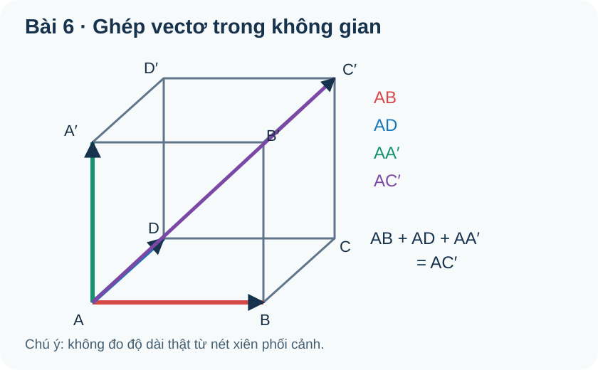
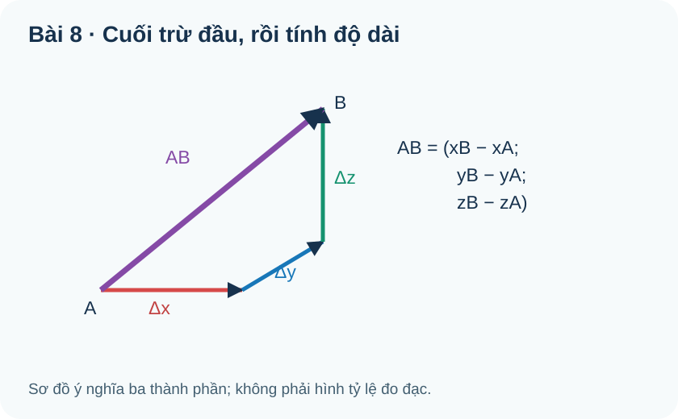
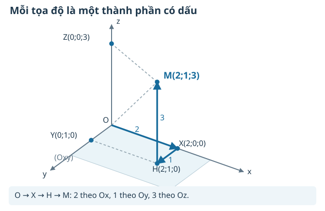

---
hide:
  - toc
---

HỌC THEO CHUYÊN ĐỀ · CĐ13 · TOÁN THPT

<nav class="thpt-sgk-lesson-nav" aria-label="Điều hướng Chuyên đề 13">
<a href="../../cd12/kien-thuc/">← Chuyên đề trước</a>
<a href="../../cd14/kien-thuc/">Chuyên đề sau →</a>
<a href="../luyen-tap/">Luyện tập</a>
<a href="../tu-kiem-tra/">Tự kiểm tra</a>
</nav>

<a href="../../">← Tổng quan các Chuyên đề</a>

Khám phá thêm: <a href="../../../math-lab/models/slm-top13-dot-01/">Mô hình trực quan Chuyên đề 13</a> (tùy chọn).

<link rel="stylesheet" href="../../../../assets/stylesheets/thpt-topic-w1-golden-v1.css">

Đang chuẩn bị kiến thức…

<!-- TOPIC13_APPROVED_SOURCE_START -->
<!-- Q18 SOURCE_LEARNER_BLOB 7bd211326e4f644a94e1dfad7868c03e1c415adb; Q18_RECEIPT_BLOB 24f5cd26b47852259cdc932fce7577fcf2f44866; AUTHORING_PR #841; PUBLIC_PROJECTION_ONLY -->

# Kiến thức

Từ mũi tên chỉ hướng trên mặt phẳng, em sẽ hiểu phép cộng, trừ và nhân vectơ trước khi tính bằng tọa độ. Các ví dụ về chuyển động, lực và hình không gian cho thấy một vectơ luôn mô tả cả độ lớn lẫn hướng. Em hãy tự giải câu Vận dụng rồi mở Đối chiếu; kiến thức về tọa độ Oxy và Oxyz được giải thích tại chỗ, không đòi học một chuyên đề khác trước.

## 1. Từ mũi tên đến phép toán vectơ

### 1.1. Độ dời cần cả độ lớn lẫn hướng
<!-- LESSON_ID: TOP13-M01; OUTCOME_ID: TOP13-O01 -->

Hai người có thể cùng đi 5 m, nhưng nếu một người đi về đông và người kia đi về tây thì hai độ dời khác nhau. Vì vậy, khi mô tả vị trí thay đổi, ta phải giữ cả độ lớn lẫn hướng, không chỉ ghi một con số.

> **ĐỊNH NGHĨA — Vectơ.** Vectơ \(\overrightarrow{AB}\) là đoạn thẳng có hướng với điểm đầu \(A\), điểm cuối \(B\). Độ dài vectơ là \(|\overrightarrow{AB}|=AB\ge0\); \(AB\) chỉ là số đo độ dài, không phải chính vectơ.

 Vectơ \(\overrightarrow{BA}=-\overrightarrow{AB}\) là vectơ đối; \(\overrightarrow{AA}=\vec 0\) là vectơ-không, có độ dài 0. **Quy ước đối với vectơ-không:** vectơ-không được coi là cùng phương và cùng hướng với mọi vectơ; đây là quy ước so sánh, không phải một hướng hình học riêng. Khi một vectơ bằng \(\vec0\), số đo góc của nó với vectơ còn lại **có thể chọn tùy ý** trong đoạn \(0^\circ\) đến \(180^\circ\), không được xác định duy nhất bởi hình vẽ. Tích vô hướng với vectơ-không vẫn bằng 0, nhưng không được lấy \(0/(|\vec0||\vec u|)\) để tính cos góc vì mẫu bằng 0.

**Ví dụ**

**Đề bài:** Robot đi 3 m về đông rồi 4 m về bắc. Tính quãng đường và độ dài độ dời, giải thích vì sao khác nhau.

**Lời giải:** Quãng đường cộng độ dài hai chặng là 3+4=7 m. Độ dời là vectơ nối thẳng vị trí đầu tới vị trí cuối, có hai thành phần vuông góc (3,4), nên dài √(3²+4²)=5 m. Vì hướng của hai chặng khác nhau nên không thể lấy 7 m làm độ dài độ dời.

**Vận dụng:** Hai mũi tên dài 4 ô theo hai chiều trái/ngược phải có bằng nhau không?

Đối chiếu

Không: cùng độ dài nhưng ngược hướng.

**Khi làm sai:** Nếu chỉ so số 4, vẽ đuôi và đầu mũi tên rồi so **chiều**, không so mỗi độ dài.

**Kiểm lỗi**

Nếu em chỉ so độ dài mà quên hướng, đọc **Kiến thức 1.1** rồi làm **Bài luyện 33** (cùng hướng) và **Bài luyện 9** (nhân số âm đổi chiều). Mũi tên ngược chiều không phải vectơ bằng nhau.

### 1.2. Cùng phương, cùng hướng và vectơ bằng nhau
<!-- LESSON_ID: TOP13-M02; OUTCOME_ID: TOP13-O02 -->

Thử hình dung em dời nguyên một mũi tên sang chỗ khác mà không quay nó: độ dời được biểu diễn vẫn như cũ. Nhưng quay mũi tên nửa vòng sẽ đảo chiều. Nhờ đó, ta cần phân biệt cùng phương, cùng hướng và bằng nhau.

Với hai vectơ khác không, cùng phương nghĩa là có giá song song hoặc trùng nhau; cùng hướng còn đòi chiều thống nhất. 

> **ĐỊNH NGHĨA — Hai vectơ bằng nhau.** Hai vectơ bằng nhau khi chúng cùng hướng **và** cùng độ dài. Không đòi hai mũi tên phải cùng vị trí; chỉ bằng nhau về độ dài chưa đủ.

 Trong hình bình hành ABCD theo thứ tự, \(\overrightarrow{AB}=\overrightarrow{DC}\), còn \(\overrightarrow{CD}=-\overrightarrow{AB}\); **đây là các đẳng thức vectơ**, không phải đẳng thức chỉ nói về độ dài. Cùng hướng của AB và AM không đủ để khẳng định M nằm giữa A,B.

**Cách đọc hình:** Đi từ đuôi tới đầu mỗi mũi tên rồi so hướng, không suy cùng hướng chỉ từ hai cạnh dài bằng nhau.

**Ví dụ**

**Đề bài:** Trong hình bình hành ABCD theo đúng thứ tự A–B–C–D, so sánh \(\overrightarrow{AB}\), \(\overrightarrow{DC}\) và \(\overrightarrow{CD}\).

**Lời giải:** Hai vectơ \(\overrightarrow{AB}\), \(\overrightarrow{DC}\) cùng hướng và cùng độ dài nên \(\overrightarrow{AB}=\overrightarrow{DC}\). Vectơ \(\overrightarrow{CD}\) ngược hướng với \(\overrightarrow{AB}\) nên \(\overrightarrow{CD}=-\overrightarrow{AB}\). Chỉ có cùng độ dài thì chưa đủ để hai vectơ bằng nhau.

**Vận dụng:** Vectơ nào bằng \(\overrightarrow{AD}\): \(\overrightarrow{BC}\) hay \(\overrightarrow{CB}\)?

Đối chiếu

BC, vì cùng hướng và độ dài; CB là vectơ đối.

**Khi làm sai:** Nếu nhầm BC/CB, đọc mũi tên từ điểm đầu đến điểm cuối trước khi dùng tính chất hình bình hành.

**Kiểm lỗi**

Nếu em đọc \(\overrightarrow{CB}\) như \(\overrightarrow{BC}\), đọc **Kiến thức 1.2**, làm **Bài luyện 3** và **Bài luyện 33**. Kiểm riêng điểm đầu, điểm cuối, phương, chiều và độ dài.

### 1.3. Tổng vectơ là đường tắt giữa điểm đầu và điểm cuối
<!-- LESSON_ID: TOP13-M03; OUTCOME_ID: TOP13-O03 -->

Khi đi từ A tới B rồi B tới C, điều ta muốn biết đôi khi chỉ là từ A tới C đã dịch chuyển thế nào. Hãy nối điểm đầu và điểm cuối trước khi cộng hai độ dài đường đi: phép cộng vectơ lưu hướng của từng chặng.

> **TÍNH CHẤT — Quy tắc ba điểm.** Với ba điểm \(A,B,C\), luôn có \(\overrightarrow{AB}+\overrightarrow{BC}=\overrightarrow{AC}\). Khi vẽ quy tắc tam giác, đặt điểm đầu của mũi tên thứ hai tại điểm cuối mũi tên thứ nhất.

Vì mũi tên tổng cho biết đúng **độ dời cuối cùng**, đổi thứ tự hai chặng không thay kết quả nếu ta dịch các mũi tên song song về cùng gốc. Khi có ba chặng, việc ghép hai chặng đầu hay hai chặng sau cũng cho cùng vectơ từ điểm xuất phát tới đích. Đây là lý do ta có thể rút gọn các tổng vectơ dài mà không phụ thuộc thứ tự nhóm. Vectơ-không đóng vai trò một độ dời bằng 0, cộng vào không làm thay đổi kết quả.

> **TÍNH CHẤT — Phép cộng vectơ.** Với các vectơ \(\vec u,\vec v,\vec w\) bất kỳ trong cùng mặt phẳng (và cũng đúng trong không gian), ta có:
>
> \[\vec u+\vec v=\vec v+\vec u\quad\text{(giao hoán)},\]
> \[(\vec u+\vec v)+\vec w=\vec u+(\vec v+\vec w)\quad\text{(kết hợp)},\]
> \[\vec u+\vec0=\vec0+\vec u=\vec u\quad\text{(vectơ-không)}.\]
>
> Những đẳng thức này nói về **vectơ tổng**, không nói rằng độ dài của tổng luôn bằng tổng độ dài. Chẳng hạn \((2,0)+(0,3)=(2,3)=(0,3)+(2,0)\), nhưng độ dài vectơ tổng là \(\sqrt{13}\), không phải \(5\).

 **Độ dài của tổng vectơ** \(\left|\overrightarrow{AB}+\overrightarrow{BC}\right|\) không nhất thiết bằng tổng **độ dài hai đoạn** \(AB+BC\). Với hai bước vuông góc, dùng Pitago để tìm độ dời; không cộng hai độ dài như khi tính quãng đường.

**Ví dụ**

**Đề bài:** Từ vị trí đầu, đi 4 m đông và tiếp 6 m bắc. Viết vectơ tổng và tính độ dài đường tắt.

**Lời giải:** Chọn Ox hướng đông, Oy hướng bắc: \(\vec u=(4,0)\), \(\vec v=(0,6)\) m. Theo quy tắc tam giác, độ dời tổng \(\vec u+\vec v=(4,6)\) m, dài \(\sqrt{4^2+6^2}=2\sqrt{13}\) m. Quãng đường đi hai chặng là 10 m; công thức cộng vectơ lưu cả chiều, không chỉ số đo.

**Vận dụng:** Đi 6 m đông rồi 8 m bắc, độ dài độ dời bằng mấy mét?

Đối chiếu

10 m, còn quãng đường đã đi là 14 m.

**Khi làm sai:** Nếu chọn 14 m, vẽ đường thẳng nối điểm xuất phát với đích: đó mới là độ dời.

**Kiểm lỗi**

Nếu em cộng quãng đường thay cho độ dài độ dời, đọc **Kiến thức 1.3**, làm **Bài luyện 5** (Chasles) và **Bài luyện 35** (đi hai chặng). Độ dời nối điểm đầu với điểm cuối, không phải tổng mọi đoạn đã đi.

### 1.4. Hình bình hành và phép trừ vectơ
<!-- LESSON_ID: TOP13-M04; OUTCOME_ID: TOP13-O04 -->

Hai lực xuất phát tại cùng một điểm thường được vẽ thành hai cạnh kề của hình bình hành, còn hợp lực theo đường chéo. Muốn biết hiệu hai độ dời, ta đảo hướng vectơ bị trừ rồi cộng; cách vẽ này ngăn nhầm chiều kết quả.

> **TÍNH CHẤT — Hình bình hành và phép trừ vectơ.** Đặt hai vectơ cùng gốc, đường chéo của hình bình hành biểu diễn tổng. Phép trừ là cộng vectơ đối: \(\vec u-\vec v=\vec u+(-\vec v)\). Với ba điểm, \(\overrightarrow{AB}-\overrightarrow{AC}=\overrightarrow{CB}\). Dấu âm đảo chiều vectơ AC, không phải AB; đây là nguyên nhân nhầm CB thành BC.

**Ví dụ**

**Đề bài:** Cho A=(2,1), B=(5,3), C=(7,−2). Rút gọn \(\overrightarrow{AB}-\overrightarrow{AC}\) và nhận dạng vectơ thu được.

**Lời giải:** \(\overrightarrow{AB}=B-A=(3,2)\), \(\overrightarrow{AC}=C-A=(5,-3)\) theo tọa độ, nên \(\overrightarrow{AB}-\overrightarrow{AC}=(-2,5)\). Đồng thời \(\overrightarrow{CB}=B-C=(-2,5)\), do đó \(\overrightarrow{AB}-\overrightarrow{AC}=\overrightarrow{CB}\). Chỉ phép trừ hai vectơ chung gốc mới triệt A theo cách này.

**Vận dụng:** Rút gọn \(\overrightarrow{PQ}-\overrightarrow{PR}\) thành vectơ nối R và Q.

Đối chiếu

RQ.

**Khi làm sai:** Nếu ra QR, thay tọa độ đơn giản để kiểm chiều của kết quả.

**Kiểm lỗi**

Nếu em đổi chiều \(\overrightarrow{RQ}\) thành \(\overrightarrow{QR}\), đọc **Kiến thức 1.4**, làm **Bài luyện 7** và **Bài luyện 36**. Viết phép trừ thành cộng vectơ đối rồi đối chiếu tọa độ cuối trừ đầu.

### 1.5. Nhân vectơ với một số và xét cùng phương
<!-- LESSON_ID: TOP13-M05; OUTCOME_ID: TOP13-O05 -->

Khi tăng gấp đôi một độ dời, mũi tên dài gấp đôi nhưng vẫn đi cùng hướng. Khi nhân với số âm, mũi tên đảo chiều. Quan sát ấy giúp em hiểu phép nhân vectơ với một số trước khi tính tọa độ.

> **TÍNH CHẤT — Nhân vectơ với một số và xét cùng phương.** Với k thực, độ dài của ku bằng |k|·|u|. k>0 giữ chiều, k&lt;0 đảo chiều, k=0 cho vectơ-không. Quy tắc k(u+v)=ku+kv đúng ở cả mặt phẳng và không gian. Với u,v khác không, v=ku thì chúng cùng phương; dấu k cho biết cùng hay ngược hướng.

Phép nhân một vectơ với số thực còn có những tính chất giúp **khai triển hoặc thu gọn** biểu thức. Khi nhân \(k\) với một tổng, ta có thể nhân từng vectơ thành phần rồi cộng. Tương tự, gộp hai lần nhân cùng một vectơ theo tổng hệ số, hoặc nhân liên tiếp hai số, không thay đổi vectơ cuối cùng.

> **TÍNH CHẤT — Phép nhân vectơ với số thực.** Với hai số thực \(k,l\) và hai vectơ \(\vec u,\vec v\):
>
> \[k(\vec u+\vec v)=k\vec u+k\vec v,\qquad (k+l)\vec u=k\vec u+l\vec u,\]
> \[k(l\vec u)=(kl)\vec u,\qquad 1\vec u=\vec u,\quad 0\vec u=\vec0.\]
>
> Ví dụ \(2[(1,2)+(3,-1)]=(8,2)\) và \(2(1,2)+2(3,-1)=(8,2)\), nên phép phân phối cho kết quả giống nhau. Đối với số âm, vẫn phải xét đúng chiều và giữ dấu của hệ số trước khi kết luận.

Khi cần mô tả một độ dời theo **hai phương đã biết**, ta có thể tách nó thành hai vectơ thành phần. Hãy đặt \(\vec a\) và \(\vec b\) cùng gốc, khác \(\vec0\) và **không cùng phương**. Qua đầu mút của \(\vec u\), kẻ các đường song song với hai phương ấy để dựng hình bình hành. Hai cạnh của hình bình hành cho các vectơ thành phần cùng phương \(\vec a\), \(\vec b\), nên có thể viết \(\vec u=x\vec a+y\vec b\). Việc hai phương không song song là điều kiện quyết định: khi đã chọn chúng, vị trí đầu mút của \(\vec u\) xác định đúng một cặp hệ số \((x,y)\). Trong mặt phẳng, điều này đúng với **mọi vectơ \(\vec u\), kể cả vectơ-không**.

> **ĐỊNH LÝ — Phân tích một vectơ theo hai vectơ không cùng phương.** Cho hai vectơ \(\vec a,\vec b\) **không cùng phương** trong cùng một mặt phẳng. Khi đó, với mỗi vectơ \(\vec u\) trong mặt phẳng ấy, tồn tại **duy nhất** một cặp số thực \((x,y)\) sao cho
>
> \[\vec u=x\vec a+y\vec b.\]
>
> Đây là tính chất dành cho **hai phương độc lập trong một mặt phẳng**. Không khẳng định hai vectơ bất kỳ có thể biểu diễn mọi vectơ trong không gian ba chiều.

Để **tự kiểm cách phân tích**, xét \(\vec a=(1,1)\), \(\vec b=(1,-1)\), \(\vec u=(5,1)\). Từ \(\vec u=x\vec a+y\vec b\) suy ra \(x+y=5\), \(x-y=1\); giải được \(x=3,y=2\), nên \(\vec u=3\vec a+2\vec b\). Kiểm lại theo từng tọa độ: \(3(1,1)+2(1,-1)=(5,1)\). Nếu chọn \(\vec a=(1,0),\vec b=(2,0)\), hai vectơ **cùng phương**, thì với \(\vec u=(1,0)\) có vô số cặp \((x,y)\) thỏa \(x+2y=1\), còn với \(\vec u=(0,1)\) không có cặp nào; vì thế không được bỏ điều kiện **không cùng phương**. Trên hình minh họa quy tắc hình bình hành, đọc hai cạnh thành phần rồi kiểm chúng cộng thành đường chéo, không suy hệ số chỉ từ độ dài mũi tên vẽ không theo tỉ lệ.

**Ví dụ**

**Đề bài:** Với u=(2,−3), tính v=−2u, độ dài và hướng của v so với u.

**Lời giải:** Nhân từng tọa độ v=(−4,6). |u|=√(2²+(−3)²)=√13, nên |v|=|−2|·|u|=2√13. Vì hệ số âm và u khác vectơ-không, v ngược hướng u; độ dài không thể là số âm.

**Vận dụng:** v=−3u, |u|=2: |v| và quan hệ hướng thế nào?

Đối chiếu

|v|=6; v ngược hướng u.

**Khi làm sai:** Nếu ghi −6, nhớ độ dài không thể âm; lấy |k| trước.

**Kiểm lỗi**

Nếu em ghi độ dài \(|-3\vec u|=-6\) hoặc nói vectơ cùng chiều, đọc **Kiến thức 1.5**, làm **Bài luyện 9** và **Bài luyện 37**. Độ dài nhân \(|k|\), dấu âm chỉ làm ngược hướng vectơ khác không.

### 1.6. Trung điểm và trọng tâm từ sự cân bằng vectơ
<!-- LESSON_ID: TOP13-M06; OUTCOME_ID: TOP13-O06 -->

Muốn tìm vị trí cân bằng của hai hay ba điểm, lấy trung bình độ dài các đoạn thường không đủ: điều quan trọng là vị trí tương đối theo từng hướng. Từ cách cộng độ dời, ta có thể diễn tả trung điểm và trọng tâm bằng vectơ.

> **TÍNH CHẤT — Trung điểm và trọng tâm từ sự cân bằng vectơ.** Nếu M là trung điểm AB, \(\overrightarrow{MA}+\overrightarrow{MB}=\vec0\) và \(\overrightarrow{OM}=\tfrac12(\overrightarrow{OA}+\overrightarrow{OB})\) với gốc O bất kỳ. Với trọng tâm G của tam giác ABC, \(\overrightarrow{GA}+\overrightarrow{GB}+\overrightarrow{GC}=\vec0\); \(\overrightarrow{OG}=\tfrac13(\overrightarrow{OA}+\overrightarrow{OB}+\overrightarrow{OC})\). Nếu M là trung điểm BC, \(\overrightarrow{AG}=\tfrac23\overrightarrow{AM}\). Đây là trung bình **vị trí**, không phải trung bình độ dài.

**Ví dụ**

**Đề bài:** Cho tam giác A(0,0), B(6,0), C(0,3). Tìm trung điểm M của BC, trọng tâm G và kiểm tra hệ thức \(\overrightarrow{AG}=\tfrac23\overrightarrow{AM}\).

**Lời giải:** Trung điểm M=((6+0)/2,(0+3)/2)=(3,3/2). Trọng tâm G=((0+6+0)/3,(0+0+3)/3)=(2,1). Từ A, \(\overrightarrow{AG}=(2,1)\), \(\overrightarrow{AM}=(3,\tfrac32)\), nên \(\tfrac23\overrightarrow{AM}=(2,1)=\overrightarrow{AG}\). Hệ số 2/3 chỉ áp dụng khi M là trung điểm của BC.

**Vận dụng:** Tam giác A(0,0),B(3,0),C(0,6) có trọng tâm ở đâu?

Đối chiếu

G=(1,2).

**Khi làm sai:** Nếu lấy trung bình ba độ dài cạnh, hãy nhớ mỗi tọa độ của G là trung bình ba tọa độ tương ứng.

**Kiểm lỗi**

Nếu em lấy trung bình độ dài thay vì tọa độ đỉnh, đọc **Kiến thức 1.6**, làm **Bài luyện 8** và **Bài luyện 38**. Trung điểm và trọng tâm là các tổ hợp vectơ của vị trí các đỉnh.

## 2. Vectơ trong mặt phẳng tọa độ Oxy

### 2.1. Tọa độ Oxy: vì sao phải lấy cuối trừ đầu?
<!-- LESSON_ID: TOP13-M07; OUTCOME_ID: TOP13-O07 -->

Trên bản đồ tọa độ, chuyển động từ A đến B được mô tả bằng thay đổi hoành độ và tung độ, chứ không phải bằng tọa độ riêng của B. Ngay cả khi dời cả bản đồ, hiệu hai vị trí vẫn giữ nguyên.

> **CÔNG THỨC — Tọa độ Oxy: vì sao phải lấy cuối trừ đầu?.** Nếu A=(xA,yA), B=(xB,yB) thì \(\overrightarrow{AB}=(x_B-x_A,y_B-y_A)\). Tọa độ **điểm** mô tả vị trí, còn tọa độ **vectơ** mô tả hai thay đổi theo trục. Bảo toàn vectơ khi tịnh tiến cả A,B như nhau. Phép cộng, trừ và nhân số trên Oxy tính theo từng thành phần.

**Ví dụ**

**Đề bài:** Hai điểm A=(−2,1), B=(3,5) trong Oxy. Tính tọa độ \(\overrightarrow{AB}\), \(\overrightarrow{BA}\) và so sánh độ dài, hướng.

**Lời giải:** \(\overrightarrow{AB}=(3-(-2),5-1)=(5,4)\), \(\overrightarrow{BA}=(-2-3,1-5)=(-5,-4)\). Hai vectơ là đối nhau, cùng độ dài \(AB=BA=\sqrt{5^2+4^2}=\sqrt{41}\) nhưng ngược hướng. Cần lấy tọa độ điểm cuối trừ điểm đầu.

**Vận dụng:** A=(4,−1), B=(−2,3); tọa độ \(\overrightarrow{AB}\) bằng bao nhiêu?

Đối chiếu

\(\overrightarrow{AB}=(-6,4)\).

**Khi làm sai:** Nếu ra (6,−4), em đã tính \(\overrightarrow{BA}\); hãy viết “cuối trừ đầu” bên cạnh phép tính.

**Kiểm lỗi**

Nếu em tính A−B thay vì B−A, đọc **Kiến thức 2.1**, làm **Bài luyện 13** và **Bài luyện 39**. Viết rõ tọa độ điểm cuối trừ điểm đầu rồi mới tính độ dài.

### 2.2. Độ dài, khoảng cách và cùng phương trong Oxy
<!-- LESSON_ID: TOP13-M08; OUTCOME_ID: TOP13-O08 -->

Đi từ A đến B vừa lệch ngang vừa lệch dọc tạo thành một tam giác vuông. Độ dài đoạn thẳng là cạnh huyền của tam giác ấy; còn cùng phương và cùng hướng là hai câu hỏi khác nhau cần kiểm riêng.

> **CÔNG THỨC — Độ dài, khoảng cách và cùng phương trong Oxy.** Với vectơ \(\vec u=(u_x,u_y)\), độ dài \(|\vec u|=\sqrt{u_x^2+u_y^2}\). Độ dài đoạn \(AB=|\overrightarrow{AB}|\), còn tọa độ vectơ \(\overrightarrow{AB}\) là một cặp số. Trung điểm lấy trung bình hoành và tung; trọng tâm tam giác lấy trung bình ba tọa độ từng trục. Hai vectơ **khác không** cùng phương khi \(u_xv_y-u_yv_x=0\); kết quả này không đồng nghĩa cùng hướng. Không dùng tỉ số có mẫu 0.

**Ví dụ**

**Đề bài:** Trong Oxy, A=(−1,2), B=(5,−6). Tính tọa độ \(\overrightarrow{AB}\), độ dài đoạn \(AB\) và tọa độ trung điểm M.

**Lời giải:** \(\overrightarrow{AB}=(6,-8)\), còn độ dài đoạn \(AB=|\overrightarrow{AB}|=\sqrt{6^2+(-8)^2}=10\). Trung điểm \(M=((-1+5)/2,(2-6)/2)=(2,-2)\). Độ dài dùng căn tổng bình phương, còn tọa độ trung điểm là trung bình hai tọa độ cùng trục.

**Vận dụng:** u=(2,4),v=(−1,−2): chúng cùng phương, cùng hướng không?

Đối chiếu

Cùng phương nhưng ngược hướng vì v=−u/2.

**Khi làm sai:** Nếu dựa vào định thức bằng 0 để chọn cùng hướng, cần kiểm tiếp dấu của hệ số tỉ lệ.

**Kiểm lỗi**

Nếu em suy cùng hướng chỉ từ định thức bằng 0, đọc **Kiến thức 2.2**, làm **Bài luyện 16** và **Bài luyện 40**. Cùng phương vẫn có thể ngược hướng khi hệ số tỉ lệ âm.

### 2.3. Tích vô hướng qua góc: lực cùng hướng và ngược hướng
<!-- LESSON_ID: TOP13-M09; OUTCOME_ID: TOP13-O09 -->

Nếu một người dùng lực kéo ngang mà vật chỉ chuyển thẳng đứng, độ lớn của lực không nói lên công sinh ra. Ta cần biết góc giữa hướng lực và độ dời, vì phần lực theo hướng chuyển động mới đóng góp vào công.

> **ĐỊNH NGHĨA — Tích vô hướng qua góc: lực cùng hướng và ngược hướng.** Với hai vectơ **khác không**, u·v=|u||v|cosθ, góc θ trong [0°,180°]. Tích dương cho góc nhọn, 0 cho góc vuông, âm cho góc tù. Vectơ-không có tích vô hướng 0 với mọi vectơ nhưng góc với vectơ-không **theo quy ước có thể chọn tùy ý số đo từ 0° đến 180°**; không suy góc bằng công thức cos khi độ dài mẫu bằng 0. Công W=F·s khi lực F không đổi và s là độ dời.

**Ví dụ**

**Đề bài:** Hai vectơ không bằng không có độ dài 3 và 4, góc giữa chúng 120°. Tính tích vô hướng và giải thích dấu.

**Lời giải:** Theo định nghĩa u·v=|u||v|cos120°=3·4·(−1/2)=−6. Dấu âm cho thấy góc giữa chúng tù, hai hướng có phần đối nhau; không được thay cos120° bằng cos60° dương.

**Vận dụng:** Lực 5 N vuông góc độ dời 2 m: công của lực?

Đối chiếu

0 J.

**Khi làm sai:** Nếu nhân thành 10 J, còn thiếu cos của góc giữa hai vectơ.

**Kiểm lỗi**

Nếu em nhân \(5\cdot2\) mà quên góc lực–độ dời, đọc **Kiến thức 2.3**, làm **Bài luyện 18** và **Bài luyện 41**. Công bằng tích vô hướng, cần hệ số \(\cos\theta\).

### 2.4. Tích vô hướng trong Oxy và cách kiểm vuông góc
<!-- LESSON_ID: TOP13-M10; OUTCOME_ID: TOP13-O10 -->

Hình tọa độ không phải lúc nào cũng đủ chính xác để nhìn một góc vuông. Tính tích vô hướng theo các thành phần giúp kiểm vuông góc bằng số; chỉ sau đó mới suy góc giữa hai vectơ khác không.

> **CÔNG THỨC — Tích vô hướng trong Oxy và cách kiểm vuông góc.** Với u=(ux,uy), v=(vx,vy), u·v=ux·vx+uy·vy. Với u,v **khác không**, chúng vuông góc khi và chỉ khi tích bằng 0. Khi tìm góc bằng cosθ=(u·v)/(|u||v|), phải kiểm hai độ dài khác 0 và cos trong [−1,1]. Tích vô hướng là **số**, không phải vectơ.

**Ví dụ**

**Đề bài:** Trong Oxy, u=(2,−1), v=(3,6). Kiểm tra vuông góc; lực F=(3,4) N gây độ dời s=(5,0) m thì sinh công bao nhiêu?

**Lời giải:** Tích vô hướng u·v=2·3+(−1)·6=0; vì hai vectơ đều khác không nên chúng vuông góc. Công của lực F·s=3·5+4·0=15 N·m=15 J. Với lực vuông góc độ dời, công bằng 0, không phải tích độ lớn.

**Vận dụng:** u=(1,2),v=(4,−2) có vuông góc không?

Đối chiếu

Có, tích 1×4+2×(−2)=0.

**Khi làm sai:** Nếu cộng thành phần thay vì nhân từng cặp, xem lại hai trục tọa độ vuông góc.

**Kiểm lỗi**

Nếu em cộng các thành phần thay vì nhân từng cặp tọa độ khi kiểm vuông góc, đọc **Kiến thức 2.4**, làm **Bài luyện 19** và **Bài luyện 42**. Chỉ khi cả hai vectơ khác không mới suy góc 90° từ tích vô hướng bằng 0.

## 3. Vectơ trong không gian và tọa độ Oxyz

### 3.1. Ba hướng không gian: từ hình bình hành đến hình hộp
<!-- LESSON_ID: TOP13-M11; OUTCOME_ID: TOP13-O11 -->

Một drone có thể chuyển về đông, về bắc và lên cao. Hai tọa độ không đủ biểu diễn ba thay đổi ấy, nhưng quy tắc nối đuôi các độ dời vẫn không đổi khi ta bước sang không gian.

> **TÍNH CHẤT — Ba hướng không gian: từ hình bình hành đến hình hộp.** Phép cộng vectơ trong không gian giữ nguyên quy tắc nối đuôi. Trong hình hộp ABCD.A'B'C'D', \(\overrightarrow{AC'}=\overrightarrow{AB}+\overrightarrow{AD}+\overrightarrow{AA'}\): ba cạnh xuất phát từ A đưa ta tới đỉnh C'. Hình phối cảnh có thể làm góc trông bị méo; không lấy góc trên giấy làm góc không gian thật. Chỉ khi ba cạnh vuông góc đôi một mới dùng căn tổng bình phương để tìm đường chéo.

**Cách đọc hình:** Theo đúng cạnh AB, AD, AA' rồi kiểm đỉnh đích C'; phối cảnh không giữ độ dài và góc thật.

**Ví dụ**

**Đề bài:** Hình hộp chữ nhật có ba cạnh xuất phát từ A vuông góc đôi một và dài 2,3,4. Tính độ dài đường chéo nối A tới đỉnh đối diện C'.

**Lời giải:** Chọn ba trục theo ba cạnh: vectơ \(\overrightarrow{AC'}\) có thành phần (2,3,4). Do các trục vuông góc, độ dài \(AC'=|\overrightarrow{AC'}|=\sqrt{2^2+3^2+4^2}=\sqrt{29}\). Đây là đường chéo không gian, không phải tổng ba cạnh 2+3+4.

**Vận dụng:** \(\overrightarrow{AB}+\overrightarrow{AD}+\overrightarrow{AA'}\) đi tới C hay C'?

Đối chiếu

C' vì còn một bước theo chiều cao AA'.

**Khi làm sai:** Nếu chọn C, nhìn ký hiệu dấu phẩy ở đỉnh và vẽ ba mũi tên theo thứ tự.

**Kiểm lỗi**

Nếu em dừng tại đỉnh C thay vì C′ khi còn vectơ \(\overrightarrow{AA'}\), đọc **Kiến thức 3.1**, làm **Bài luyện 22** và **Bài luyện 43**. Hãy đi đủ ba phương trong hình hộp và phân biệt vectơ đường chéo với độ dài 13.

### 3.2. Chasles, trung điểm và trọng tâm vẫn đúng trong không gian
<!-- LESSON_ID: TOP13-M12; OUTCOME_ID: TOP13-O12 -->

Ba điểm không nhất thiết cùng nằm trên mặt phẳng tọa độ Oxy. Dù đường đi A→B→C có nghiêng trong không gian, vectơ từ A đến C vẫn bằng tổng hai độ dời nối tiếp.

> **TÍNH CHẤT — Chasles, trung điểm và trọng tâm vẫn đúng trong không gian.** Trong không gian, \(\overrightarrow{AB}+\overrightarrow{BC}=\overrightarrow{AC}\) vẫn đúng dù A,B,C không nằm trong Oxy. Trung điểm M của AB thỏa \(\overrightarrow{MA}+\overrightarrow{MB}=\vec0\); trọng tâm tam giác ABC thỏa \(\overrightarrow{GA}+\overrightarrow{GB}+\overrightarrow{GC}=\vec0\). Không nhầm giao điểm hai đoạn nhìn thấy trên hình chiếu với giao điểm thật của chúng trong không gian.

Trong không gian, **trọng tâm của tứ diện** không chỉ là trung bình ba đỉnh. Cho tứ diện \(ABCD\) và \(G\) là trọng tâm tam giác \(BCD\). Vì \(G\) là trung bình ba vị trí \(B,C,D\), muốn cân bằng **cả bốn đỉnh** phải lấy điểm \(I\) trên đoạn \(AG\) sao cho \(\overrightarrow{AI}=\frac34\overrightarrow{AG}\).

> **TÍNH CHẤT — Trọng tâm tứ diện.** Với gốc \(O\) bất kỳ, trọng tâm \(I\) thỏa \(\displaystyle\overrightarrow{OI}=\frac14(\overrightarrow{OA}+\overrightarrow{OB}+\overrightarrow{OC}+\overrightarrow{OD})\), hay \(\overrightarrow{IA}+\overrightarrow{IB}+\overrightarrow{IC}+\overrightarrow{ID}=\vec0\). Công thức có **bốn vectơ vị trí**, khác trọng tâm tam giác có ba vectơ.

**Ví dụ minh họa.** Xét \(A(0,0,0)\), \(B(4,0,0)\), \(C(0,4,0)\), \(D(0,0,4)\). Trọng tâm của mặt \(BCD\) là \(G(4/3,4/3,4/3)\). Trung bình bốn tọa độ đỉnh cho \(I(1,1,1)\), và \(\overrightarrow{AI}=\frac34\overrightarrow{AG}\). Kiểm cả độ lớn lẫn hướng của hai vectơ, không đo hình phối cảnh để suy tỉ lệ.

**Ví dụ**

**Đề bài:** Trong Oxyz, A=(1,0,2), B=(4,−2,5), C=(5,1,7). Kiểm tra quy tắc Chasles \(\overrightarrow{AB}+\overrightarrow{BC}=\overrightarrow{AC}\).

**Lời giải:** \(\overrightarrow{AB}=(3,-2,3)\), \(\overrightarrow{BC}=(1,3,2)\), cộng thành \((4,1,5)\). \(\overrightarrow{AC}=C-A=(4,1,5)\) theo tọa độ, khớp. Quy tắc Chasles nối điểm đầu A qua B đến điểm cuối C, đúng trong không gian như trong mặt phẳng.

**Vận dụng:** \(\overrightarrow{AB}=(2,-1,3)\), \(\overrightarrow{BC}=(-4,2,0)\): tọa độ \(\overrightarrow{AC}\) là gì?

Đối chiếu

\(\overrightarrow{AC}=(-2,1,3)\).

**Khi làm sai:** Nếu trừ vì nghĩ chiều BC ngược AB, nhớ quy tắc đường đi là cộng nối tiếp.

**Kiểm lỗi**

Nếu em trừ \(\overrightarrow{BC}\) vì nhìn hai mũi tên khác chiều trên hình, đọc **Kiến thức 3.2**, làm **Bài luyện 23** và **Bài luyện 44**. Quy tắc ba điểm vẫn là \(\overrightarrow{AB}+\overrightarrow{BC}=\overrightarrow{AC}\).

### 3.3. Góc, tích vô hướng và vuông góc trong không gian
<!-- LESSON_ID: TOP13-M13; OUTCOME_ID: TOP13-O13 -->

Trên hình phối cảnh, hai mũi tên ở các vị trí khác nhau có thể trông lệch lạc dù cùng một góc. Tịnh tiến về chung gốc và tính tích vô hướng giúp em so góc thật, không suy từ nét xiên trên giấy.

> **CÔNG THỨC — Góc, tích vô hướng và vuông góc trong không gian.** Tích vô hướng hình học u·v=|u||v|cosθ đúng cho vectơ không gian. Trong Oxyz cũng có u·v=uxvx+uyvy+uzvz. Với hai vectơ khác không, tích 0 tương đương vuông góc. Hai đường thẳng chéo nhau có thể có vectơ chỉ phương vuông góc dù hai đường không cắt nhau; không gọi hai đoạn vẽ phối cảnh là cắt nhau chỉ vì ảnh chiếu chồng.

**Cách đọc hình:** Ba thành phần tọa độ trên các trục hợp thành vectơ tím từ A tới B. Hình chỉ minh họa cách phân tích **một vectơ**, không biểu diễn góc giữa hai vectơ khác nhau; muốn xác định góc của hai vectơ trong ví dụ tiếp theo, dùng tích vô hướng của các cặp thành phần tương ứng, không đo góc trên phối cảnh.

Tích vô hướng còn cho phép tính **độ dài của tổng và hiệu** từ độ dài hai vectơ và góc giữa chúng. Vì \(\vec u\cdot\vec u=|\vec u|^2\), tích vô hướng giao hoán và phân phối theo phép cộng, nên:
\[
\vec u\cdot\vec v=\vec v\cdot\vec u,\quad
(\vec u+\vec v)\cdot\vec w=\vec u\cdot\vec w+\vec v\cdot\vec w,\quad
(k\vec u)\cdot\vec v=k(\vec u\cdot\vec v);
\]
\[
|\vec u+\vec v|^2=|\vec u|^2+2\vec u\cdot\vec v+|\vec v|^2,\qquad
|\vec u-\vec v|^2=|\vec u|^2-2\vec u\cdot\vec v+|\vec v|^2.
\]
Các tính chất này đúng trong mặt phẳng và không gian; muốn suy ra góc bằng \(\cos\theta=\frac{\vec u\cdot\vec v}{|\vec u||\vec v|}\), **hai vectơ phải khác \(\vec0\)**.

**Ví dụ minh họa.** Nếu \(|\vec u|=3\), \(|\vec v|=4\) và góc của chúng là \(60^\circ\), thì \(\vec u\cdot\vec v=6\), nên \(|\vec u-\vec v|^2=9-12+16=13\), hay \(|\vec u-\vec v|=\sqrt{13}\). Chọn phép khai triển này vì đã biết độ dài và góc nhưng chưa biết các tọa độ.

**Ví dụ**

**Đề bài:** Hai vectơ u=(1,2,2), v=(2,0,−1) trong Oxyz có vuông góc không? Kiểm điều kiện.

**Lời giải:** u·v=1·2+2·0+2·(−1)=0. Cả hai đều khác không (|u|=3, |v|=√5), nên cos góc=0/(3√5)=0 và góc bằng 90°. Không suy góc của vectơ-không từ tích vô hướng 0.

**Vận dụng:** u=(1,1,0),v=(1,−1,5) có vuông góc không?

Đối chiếu

Có: dot=1−1+0=0, cả hai khác không.

**Khi làm sai:** Nếu hình xiên đánh lừa thị giác, dùng phép tích vô hướng.

**Kiểm lỗi**

Nếu em tin trực giác hình xiên mà không kiểm tích vô hướng, đọc **Kiến thức 3.3**, làm **Bài luyện 42** và **Bài luyện 45**. Tính tổng ba tích thành phần; dùng góc chỉ khi hai vectơ khác không.

### 3.4. Oxyz: tọa độ điểm khác tọa độ vectơ
<!-- LESSON_ID: TOP13-M14; OUTCOME_ID: TOP13-O14 -->

Đổi gốc tọa độ của bản đồ làm số chỉ vị trí mỗi điểm thay đổi, nhưng độ dời từ A tới B phải giữ nguyên nếu các trục và đơn vị không đổi. Ta cần phân biệt tọa độ điểm với tọa độ vectơ.

> **ĐỊNH NGHĨA — Oxyz: tọa độ điểm khác tọa độ vectơ.** Điểm \(M=(x,y,z)\) là **vị trí**, còn \(\overrightarrow{OM}=(x,y,z)\) là **vectơ dịch chuyển** từ gốc. Với A,B, \(\overrightarrow{AB}=(x_B-x_A,y_B-y_A,z_B-z_A)\). Ba trục vuông góc được vẽ xiên trên mặt giấy; độ dài trên bản vẽ không phải dữ kiện thật. Khi giữ hướng trục và đơn vị, tịnh tiến gốc làm tọa độ điểm thay đổi nhưng hiệu B−A không đổi.

**Cách đọc hình:** Ba trục thật vuông góc dù hình vẽ xiên; nét đứt là đường gióng tọa độ, không phải chặng di chuyển.

**Ba trục Descartes vuông góc** \(Ox,Oy,Oz\) có chung gốc \(O\), đôi một vuông góc; \(\vec i,\vec j,\vec k\) là các **vectơ đơn vị** lần lượt cùng chiều dương ba trục. Chúng tạo thành ba hướng cơ sở độc lập: mọi vectơ \(\vec u\) được viết **duy nhất** thành \(\vec u=u_x\vec i+u_y\vec j+u_z\vec k\). Với điểm \(M(x,y,z)\), \(\overrightarrow{OM}=x\vec i+y\vec j+z\vec k\).

> **ĐỊNH NGHĨA — Ba mặt phẳng tọa độ.** Trong Oxyz, \((Oxy)\) có \(z=0\), \((Oyz)\) có \(x=0\), \((Ozx)\) có \(y=0\). Điểm thuộc **một trục tọa độ** phải có hai tọa độ còn lại bằng 0; điểm thuộc **một mặt phẳng tọa độ** chỉ cần tọa độ vuông góc với mặt phẳng đó bằng 0.

**Ví dụ minh họa.** Nếu \(\overrightarrow{OM}=2\vec i-\vec j+3\vec k\) thì \(M(2,-1,3)\). Điểm \(N(4,0,-2)\) thuộc mặt phẳng \((Ozx)\) vì tung độ bằng 0, nhưng không thuộc riêng trục \(Ox\) hoặc \(Oz\) do hoành độ và cao độ đều khác 0. Bước kiểm là đối chiếu đúng trục vuông góc, không suy từ hình vẽ xiên.

**Ví dụ**

**Đề bài:** Trong Oxyz, A=(1,−1,2), B=(4,3,−2). Tính tọa độ \(\overrightarrow{AB}\), \(\overrightarrow{BA}\) và độ dài đoạn \(AB\).

**Lời giải:** \(\overrightarrow{AB}=(4-1,3-(-1),-2-2)=(3,4,-4)\), còn \(\overrightarrow{BA}=(-3,-4,4)\). Độ dài \(AB=|\overrightarrow{AB}|=\sqrt{3^2+4^2+(-4)^2}=\sqrt{41}\). Tọa độ điểm B không tự là tọa độ vectơ \(\overrightarrow{AB}\) nếu gốc không phải O.

**Vận dụng:** A=(2,0,−1), B=(−1,5,3): tọa độ \(\overrightarrow{AB}\) là gì?

Đối chiếu

\(\overrightarrow{AB}=(-3,5,4)\).

**Khi làm sai:** Nếu đổi dấu tất cả, bạn đã làm A−B thay vì B−A.

**Kiểm lỗi**

Nếu em viết tọa độ điểm B thay vì tọa độ \(\overrightarrow{AB}\), đọc **Kiến thức 3.4**, làm **Bài luyện 25** và **Bài luyện 46**. Phân biệt vị trí so với O với độ dời B−A.

### 3.5. Cộng, tính độ dài và điểm cân bằng trong Oxyz
<!-- LESSON_ID: TOP13-M15; OUTCOME_ID: TOP13-O15 -->

Một robot di chuyển theo ba trục nên muốn biết vị trí cuối phải cộng từng thành phần, rồi mới dùng độ dài không gian. Cách cộng ba khoảng cách riêng rẽ không cho độ dài đường nối thẳng.

> **CÔNG THỨC — Cộng, tính độ dài và điểm cân bằng trong Oxyz.** Với u=(u1,u2,u3), v=(v1,v2,v3): u+v=(u1+v1,u2+v2,u3+v3); ku=(ku1,ku2,ku3); |u|=√(u1²+u2²+u3²); u·v=u1v1+u2v2+u3v3. Trung điểm là trung bình tọa độ hai đỉnh, trọng tâm là trung bình tọa độ ba đỉnh. Không cộng trị tuyệt đối ba thành phần để tính độ dài.

**Cách đọc hình:** Ba thành phần theo trục cộng thành vectơ tím A→B; không cộng ba độ dài thành độ dời.

Tính tọa độ còn giúp **xét ba điểm thẳng hàng** trong không gian. Với hai điểm phân biệt \(A,B\) và một điểm \(C\), ba điểm \(A,B,C\) thẳng hàng khi và chỉ khi có \(t\in\mathbb R\) sao cho \(\overrightarrow{AC}=t\overrightarrow{AB}\). Ta so tỉ lệ **cùng một hệ số** trên cả ba thành phần, không chia cho một tọa độ bằng 0; nếu \(A=B\), cần xét riêng vì \(\overrightarrow{AB}=\vec0\).

**Ví dụ minh họa.** Với \(A(1,0,2)\), \(B(2,2,1)\), \(C(4,6,-1)\), ta được \(\overrightarrow{AB}=(1,2,-1)\), \(\overrightarrow{AC}=(3,6,-3)=3\overrightarrow{AB}\), nên ba điểm thẳng hàng. Việc ba đoạn có độ dài nào đó bằng nhau không đủ thay cho điều kiện vectơ cùng phương.

**Ví dụ**

**Đề bài:** Cho A=(1,0,2), B=(5,2,−2). Tìm trung điểm M, tọa độ vectơ \(\overrightarrow{AB}\) và kiểm tra hai độ dài \(AM=MB\).

**Lời giải:** \(\overrightarrow{AB}=(4,2,-4)\), có độ dài \(AB=|\overrightarrow{AB}|=\sqrt{16+4+16}=6\). Trung điểm \(M=((1+5)/2,(0+2)/2,(2-2)/2)=(3,1,0)\). Hai vectơ \(\overrightarrow{AM}=\overrightarrow{MB}=(2,1,-2)\), do đó \(AM=MB=3\); M nằm giữa A và B.

**Vận dụng:** A=(0,0,0),B=(6,0,0),C=(0,3,9): trọng tâm?

Đối chiếu

G=(2,1,3).

**Khi làm sai:** Nếu z=9, bạn đã quên chia z cho 3.

**Kiểm lỗi**

Nếu em chia tọa độ trọng tâm sai hoặc nhầm khoảng cách với vectơ, đọc **Kiến thức 3.5**, làm **Bài luyện 31** và **Bài luyện 47**. Trung điểm lấy trung bình từng tọa độ, độ dài luôn là một số không âm.

### 3.6. Độ dời, quãng đường và công trong ứng dụng ba chiều
<!-- LESSON_ID: TOP13-M16; OUTCOME_ID: TOP13-O16 -->

Drone bay qua hai chặng có thể trở gần điểm xuất phát dù đã đi một quãng dài. Vì thế quãng đường phải cộng độ dài từng chặng, còn độ dời phải cộng vectơ; nếu có lực không đổi, công còn phụ thuộc hướng của độ dời.

> **PHƯƠNG PHÁP — Độ dời, quãng đường và công trong ứng dụng ba chiều.** Với P ban đầu và hai chặng vectơ u,v, vị trí cuối Q=P+u+v. Độ dài độ dời là |u+v|; nếu hai chặng thẳng, quãng đường là |u|+|v|≥|u+v|. Lực F không đổi trên độ dời s tạo công W=F·s; khi F tính bằng N và s bằng m thì W tính bằng J. Luôn ghi trục, đơn vị, giả thiết lực không đổi; không suy quãng đường thật chỉ từ tọa độ P,Q.

**Ví dụ**

**Đề bài:** Drone xuất phát P=(1,2,3) m, đi hai chặng u=(3,−2,1) m và v=(−1,4,2) m; lực không đổi F=(2,−1,3) N. Tính Q, độ dài độ dời, quãng đường hai chặng và công.

**Lời giải:** Tổng u+v=(2,2,3) m nên Q=P+(2,2,3)=(3,4,6) m. Độ dời dài √(4+4+9)=√17 m; đường đi gấp khúc dài |u|+|v|=√14+√21 m (lớn hơn √17). Công của lực không đổi trên độ dời tổng là F·(u+v)=2·2+(−1)·2+3·3=11 J. Không suy quãng đường chỉ từ P,Q.

**Vận dụng:** Đi (1,0,0) m rồi (−1,0,0) m: độ dời và quãng đường?

Đối chiếu

Độ dài độ dời 0 m, quãng đường 2 m.

**Khi làm sai:** Nếu trả lời cả hai bằng 0, bạn đang triệt tiêu cả quãng đường; chỉ vectơ mới triệt tiêu.

**Kiểm lỗi**

Nếu em cho quãng đường bằng 0 khi hai chặng triệt tiêu vectơ, đọc **Kiến thức 3.6**, làm **Bài luyện 48** và **Bài luyện 52**. Cộng vectơ cho độ dời; cộng **độ dài** mỗi chặng mới là quãng đường.

> **Kiến thức cần ghi nhớ**
>
> - **Vectơ có hướng:** \(\overrightarrow{AB}\) khác số đo độ dài \(AB=|\overrightarrow{AB}|\); không cộng các độ dài để thay cho phép cộng vectơ.
> - **Vectơ bằng nhau** khi cùng hướng, cùng độ dài. Quy tắc ba điểm: \(\overrightarrow{AB}+\overrightarrow{BC}=\overrightarrow{AC}\); phép trừ là cộng vectơ đối.
> - **Tích vô hướng và góc:** với hai vectơ khác \(\vec0\), \(\vec a\cdot\vec b=|\vec a||\vec b|\cos\theta\). Không dùng công thức góc bằng phép chia cho độ dài khi có vectơ-không.
> - **Trong ứng dụng:** quãng đường gấp khúc là tổng độ dài các chặng; độ dời là tổng vectơ. Công của lực không đổi là \(W=\vec F\cdot\vec s\) với đơn vị phù hợp.

<!-- TOPIC13_APPROVED_SOURCE_END -->

<a href="../../">← Tổng quan các Chuyên đề</a>

