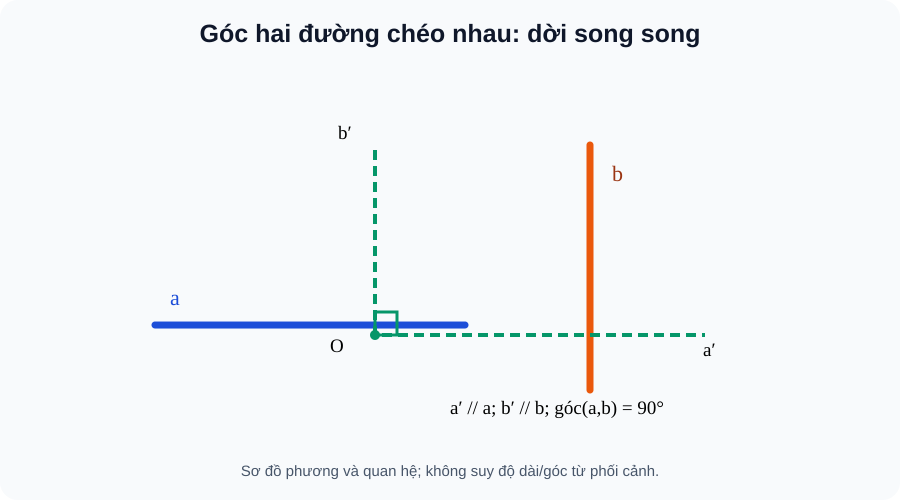
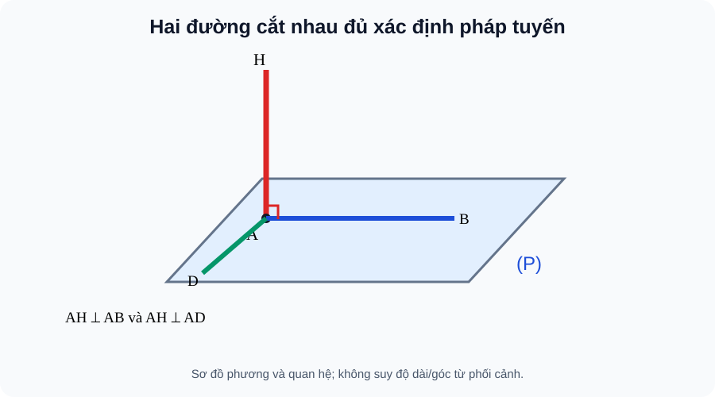
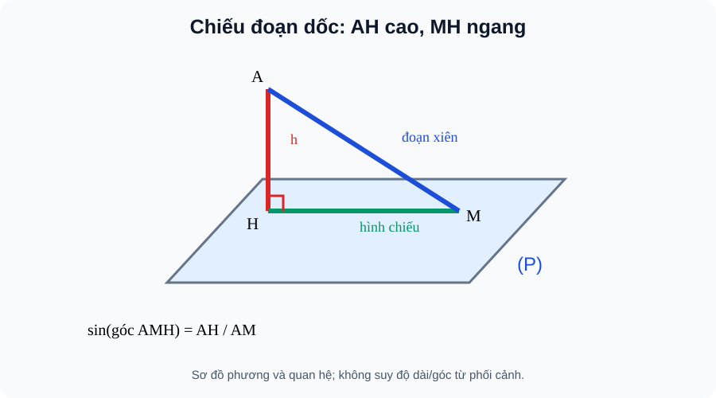
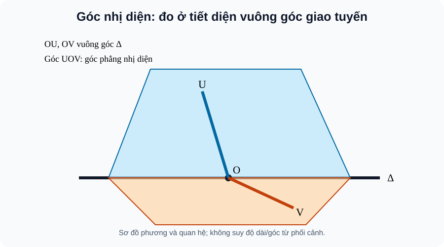

---
hide:
  - toc
---

HỌC THEO CHUYÊN ĐỀ · CĐ16 · TOÁN THPT

<nav class="thpt-sgk-lesson-nav" aria-label="Điều hướng Chuyên đề 16">
<a href="../../cd15/kien-thuc/">← Chuyên đề trước</a>
<a href="../../cd17/kien-thuc/">Chuyên đề sau →</a>
<a href="../luyen-tap/">Luyện tập</a>
<a href="../tu-kiem-tra/">Tự kiểm tra</a>
</nav>

<a href="../../">← Tổng quan các Chuyên đề</a>

Khám phá thêm: <a href="../../../math-lab/models/slm-top16-ramp-angle-r00/">Mô hình trực quan Chuyên đề 16</a> (tùy chọn).

<link rel="stylesheet" href="../../../../assets/stylesheets/thpt-topic-w1-golden-v1.css">

Đang chuẩn bị kiến thức…

<!-- TOPIC16_APPROVED_SOURCE_START -->
<!-- Q18 SOURCE_LEARNER_BLOB 1d45c826ca9fc2aa9fc9ef65797620c97d8f8f84; Q18_RECEIPT_BLOB 19a2ed6ebfd7898da5f186350ea6042e2134fa7e; AUTHORING_PR #848; PUBLIC_PROJECTION_ONLY -->

# Kiến thức

Quan sát các cạnh của căn phòng, cột và mái dốc, em sẽ học cách chứng minh quan hệ vuông góc bằng phương và mặt phẳng thay vì đo theo nét phối cảnh.

<!-- AUTHORING_R03_CANDIDATE; PRIOR_R02_BLOB: 60f69d43bfa3f4508e8c7a787bad517141f9b2b2; FROZEN_R01_BLOB: 0e934389ebfe239ace19cc23c5dedf9c23d8ebdc; ORIGINAL_SGK_BLOB: 5646241f4bb72f12419aaf585ee1fbea6f4185d0; NO_PRIVATE_RD1; AUTHOR_ONLY -->

**Mạch mở đầu — Từ quan sát đến lập luận.** Hãy tưởng tượng một căn phòng: các cạnh tường giao nhau ở những chỗ nhìn thấy được, nhưng nhiều thanh ngang và thanh đứng ở hai phía phòng không hề chạm nhau. Chúng ta vẫn muốn trả lời chúng có vuông góc hay không. Điểm khởi đầu không phải là đo góc trên bức hình phối cảnh: hãy tìm hai **phương** và đưa chúng về cùng một điểm. Khi đã làm được việc đó, quan hệ hai đường vuông góc trở thành một cách nhìn xuyên suốt các bài toán cột, sàn, mái và góc.

**Cách tự học:** Ở mỗi bước, đừng học một định lí rời rạc. Hãy tự hỏi: *Mình cần kiểm tra điều gì? Kiểm tra ít hơn có đủ không? Giả thiết nào làm cho kết luận đúng?* Bốn chặng dưới đây dẫn từ góc giữa hai đường, sang pháp tuyến mặt, rồi hình chiếu và góc giữa hai mặt.

## 1. Hai đường thẳng vuông góc

**Đọc hình:**

Quan sát đường **a** và **b** ở hai vị trí không cắt nhau; đừng cố nối đầu mút để lấy góc. Theo các dấu **a′∥a**, **b′∥b**, đưa hai phương về điểm **O** và đọc góc tại O. Nếu thay O bằng điểm khác thì hai phương không đổi, nên góc không đổi.

*Nếu không hiển thị hình, hãy đọc lại mô tả bằng lời ở trên và tự dựng quan hệ theo giả thiết; không suy góc hay độ dài từ nét phối cảnh.*

### 1.1. Góc giữa hai đường

<!-- LESSON_ID: TOP16-M01; OUTCOME_ID: TOP16-O01; S1_ORIGINAL_OUTCOME: G11-B22-ANGLE_LINES -->

Muốn đo góc hai thanh ở xa nhau, hãy dời hai phương đến cùng một điểm. Góc nhỏ giữa các hướng mới phản ánh hình thật, không phải góc do phối cảnh tạo ra.

> **ĐỊNH NGHĨA**
>
> Góc giữa hai đường trong không gian là góc nhỏ giữa hai đường cùng đi qua một điểm và lần lượt song song với hai đường đã cho; vì thế góc luôn trong [0°,90°]. Việc dời phương là để đo được ngay cả khi hai đường chéo nhau.

**Vì sao góc không phụ thuộc vị trí đặt hai đường?** Qua một điểm \(O\) tùy ý, dựng \(a'\parallel a\), \(b'\parallel b\). Hai phương không thay đổi khi dịch song song, nên trong bốn góc tại \(O\) luôn có một góc nhỏ \(\varphi\in[0^\circ,90^\circ]\); đây chính là góc giữa hai đường \(a,b\), bất kể chúng cắt nhau, chéo nhau hay song song. Nếu hai đường song song thì \(\varphi=0^\circ\), còn **vuông góc** khi và chỉ khi \(\varphi=90^\circ\).

> **PHƯƠNG PHÁP — Đưa hai phương về chung gốc.** Chọn điểm dễ dựng (thường là một đỉnh hình hộp), thay mỗi đường bằng đường qua điểm đó song song với nó, rồi dùng góc thật của tam giác hoặc hình chữ nhật; không đọc góc trực tiếp từ hình phối cảnh. Không bắt buộc biết tọa độ Oxyz lớp 12.

**Ví dụ minh họa.** Trong hình lập phương \(ABCD.A'B'C'D'\), \(AB\parallel A'B'\). Do \(A'B'\) và \(B'C'\) là hai cạnh kề của mặt vuông \(A'B'C'D'\), chúng tạo \(90^\circ\); vì vậy góc giữa \(AB\) và \(B'C'\) cũng bằng \(90^\circ\), mặc dù hai đường không cắt nhau. Lý do chọn cạnh trên để thay \(AB\) là vì chúng song song và nằm cùng một mặt vuông với \(B'C'\).

**Ví dụ**

**Đề bài:** Trong hộp chữ nhật ABCD.A′B′C′D′, xác định góc giữa AB và CC′, biết cạnh bên vuông góc đáy.

**Lời giải:** CC′∥AA′, trong khi AA′⊥(ABCD) nên AA′⊥AB. Dời phương CC′ về AA′ qua A; góc giữa AB và CC′ bằng góc BAA′=90°, dù AB không cắt CC′.

**Vận dụng**

Trong hình hộp chữ nhật, góc giữa AB và A′B′ bằng bao nhiêu?

<!-- ITEM_ID: THPT-TOP16-T01; ROLE: TOPIC_FIRST_TRY; PRIMARY_OUTCOME: TOP16-O01 -->

Đối chiếu

0° vì AB và A′B′ song song.

**Kiểm lỗi**

Nếu lấy góc tù 145° làm góc giữa hai đường, đọc lại **Kiến thức 1.1**: phải đưa hai phương về chung gốc và chọn góc không tù. Thử **Bài luyện 1** (góc bù) và **Bài luyện 10** (hai cạnh song song).

### 1.2. Hai đường chéo nhau có thể vuông góc

<!-- LESSON_ID: TOP16-M02; OUTCOME_ID: TOP16-O02; S1_ORIGINAL_OUTCOME: G11-B22-PERP_SKEW -->

Hai thanh ở hai góc hộp có thể không cắt và cũng không đồng phẳng, nhưng vẫn vuông góc về phương. Vì vậy, hãy tách phép thử 'chéo nhau' khỏi phép thử 'góc 90°'.

> **ĐỊNH NGHĨA**
>
> Vuông góc giữa hai đường là quan hệ **phương**: hai đường chéo nhau vẫn vuông góc nếu hai phương tạo góc 90°. Điều kiện cắt nhau không phải thành phần của định nghĩa này.

**Ví dụ**

**Đề bài:** Trong hình lập phương ABCD.A′B′C′D′, chứng minh AD và BB′ chéo nhau nhưng vuông góc.

**Lời giải:** Nếu AD và BB′ đồng phẳng thì mặt ấy chứa A,D,B, do đó là đáy, nhưng B′ nằm ngoài đáy; suy hai đường chéo nhau. BB′∥AA′ và AA′⊥AD nên góc hai phương là 90°.

**Vận dụng**

AB và DD′ ở hộp chữ nhật có phải là hai đường vuông góc không?

<!-- ITEM_ID: THPT-TOP16-T02; ROLE: TOPIC_FIRST_TRY; PRIMARY_OUTCOME: TOP16-O02 -->

Đối chiếu

Có. Chúng chéo nhau nhưng cùng phương với hai cạnh vuông góc AB, AA′.

**Kiểm lỗi**

Nếu nghĩ hai đường không cắt thì không thể vuông góc, đọc **Kiến thức 1.2**: vuông góc là quan hệ giữa hai phương, còn chéo nhau là quan hệ vị trí. Thử **Bài luyện 7** (phản ví dụ) và **Bài luyện 11** (hình hộp).

### 1.3. Chuyển phương bằng đường song song

<!-- LESSON_ID: TOP16-M03; OUTCOME_ID: TOP16-O03; S1_ORIGINAL_OUTCOME: G11-B22-PARALLEL_DIRECTION -->

Một cạnh khuất có thể thay bằng cạnh nhìn thấy song song với nó. Do hai đường song song cùng phương, kết luận về góc vuông được giữ nguyên.

> **ĐỊNH LÝ**
>
> Thay một đường bằng đường song song bảo toàn góc giữa các phương. Nếu a⊥b và b∥c thì a⊥c, dù a,c có thể chéo nhau.

**Ví dụ**

**Đề bài:** Trong hình hộp chữ nhật, AD⊥AA′ và CC′∥AA′. Chứng minh AD⊥CC′.

**Lời giải:** Do CC′∥AA′ trong hình hộp nên chúng có cùng phương; AD⊥AA′ là góc vuông đã biết ở một đỉnh. Khi dời đường CC′ về đường AA′ qua A, ta đo đúng cùng một góc giữa các phương. Vì vậy AD⊥CC′, dù hai đường ban đầu không gặp nhau.

**Vận dụng**

Nếu a⊥b và c∥b thì kết luận gì về a,c?

<!-- ITEM_ID: THPT-TOP16-T03; ROLE: TOPIC_FIRST_TRY; PRIMARY_OUTCOME: TOP16-O03 -->

Đối chiếu

a⊥c theo tính bất biến của góc khi thay đường bằng đường song song.

**Kiểm lỗi**

Nếu suy 'cùng vuông góc một đường' thì phải song song, xem lại **Kiến thức 1.3**: phép chuyển phương đúng là thay **một** đường bằng đường song song với nó. Thử **Bài luyện 3** và **Bài luyện 12**, xác định cặp đường nào thật sự song song.

### 1.4. Không đo góc từ hình phối cảnh

<!-- LESSON_ID: TOP16-M04; OUTCOME_ID: TOP16-O04; S1_ORIGINAL_OUTCOME: G11-B22-PROOF_CONTEXT -->

Nếu trên giấy hai nét vuông góc, ta vẫn chưa chứng minh hai thanh thật vuông góc. Phải tìm hình chữ nhật hoặc đường song song đã được bảo đảm bởi giả thiết.

> **PHƯƠNG PHÁP**
>
> Hình chiếu trên giấy có thể làm hai cạnh dường như cắt hoặc vuông góc. Bằng chứng thật phải là một góc trong mặt phẳng xác định hoặc phép chuyển phương hợp lệ.

**Ví dụ**

**Đề bài:** Trong hộp chữ nhật, chứng minh AB⊥B′C′ bằng tính chất hình, không dùng thước đo nét vẽ.

**Lời giải:** Trong đáy hình chữ nhật, AB⊥BC. Vì B′C′∥BC, hai hướng của B′C′ và BC trùng nhau, do đó AB⊥B′C′.

**Vận dụng**

Nét vẽ có hai đoạn tạo góc 90° trên giấy, đủ kết luận hai thanh trong không gian vuông góc chưa?

<!-- ITEM_ID: THPT-TOP16-T04; ROLE: TOPIC_FIRST_TRY; PRIMARY_OUTCOME: TOP16-O04 -->

Đối chiếu

Chưa; cần chứng cứ hình học về phương hoặc góc thật.

**Kiểm lỗi**

Nếu kết luận chỉ vì hình vẽ trông có góc vuông, trở lại **Kiến thức 1.4** và thay nét vẽ bằng dữ kiện về phương, cạnh đáy và cạnh bên. Thử **Bài luyện 4** và **Bài luyện 13**.

**Từ hai đường đến cả mặt phẳng.** Một chiếc cột nhìn có vẻ đứng thẳng vẫn có thể bị nghiêng về một phía mà ảnh chụp không nhận ra. Nếu chỉ kiểm tra cột vuông góc với **một** đường trên sàn, ta chưa loại trừ được hướng nghiêng khác. Chọn **hai đường cắt nhau** trên cùng mặt sàn thì hai phương độc lập mới đủ kiểm tra cột có vuông góc với toàn bộ sàn hay không. Đây là ý nghĩa của định lí, không phải mẹo ghi nhớ.

Chẳng hạn, Cho chóp S.ABC, tam giác ABC vuông tại B và SA⊥(ABC). Vì SA⊥BC và AB⊥BC; hai đường SA,AB cắt nhau ở A cùng thuộc (SAB), nên BC⊥(SAB), do đó BC⊥SB. Một kết luận từ “vô số phương” được đưa về hai điều kiện có thể chứng minh.

## 2. Đường thẳng vuông góc mặt phẳng

**Đọc hình:**

Chỉ hai cạnh **AB** và **AD** trong mặt **(P)**, chúng cắt nhau tại **A**. Cột **AH** vuông góc với cả hai: không phải “hai góc vuông là đủ” một cách máy móc, mà vì AB,AD tạo hai hướng không song song cùng nằm trong một mặt. Nếu hai cạnh kiểm tra song song thì không được suy AH⊥(P).

*Nếu không hiển thị hình, hãy đọc lại mô tả bằng lời ở trên và tự dựng quan hệ theo giả thiết; không suy góc hay độ dài từ nét phối cảnh.*

### 2.1. Đường vuông góc mặt phẳng

<!-- LESSON_ID: TOP16-M05; OUTCOME_ID: TOP16-O05; S1_ORIGINAL_OUTCOME: G11-B23-PERP_PLANE_DEF -->

Mặt sàn có vô số hướng. Một cột chỉ vuông góc một vạch sàn chưa chắc đứng thẳng; điều cần chứng minh là vuông góc cả mặt phẳng.

> **ĐỊNH NGHĨA**
>
> Đường d vuông góc mặt phẳng (P) nghĩa là d vuông góc **mọi đường thẳng** nằm trong (P). Chứng minh vuông góc một đường là chưa đủ.

**Ví dụ**

**Đề bài:** Xét mặt (P):z=0 và đường d:(0,0,t) với t thực. Chứng minh d⊥(P) theo định nghĩa.

**Lời giải:** Mọi đường của z=0 có hướng (u,v,0) khác vectơ không. Hướng d là (0,0,1), tích vô hướng bằng 0 với (u,v,0). Do đó d vuông góc mọi đường của (P), tức d⊥(P).

**Vận dụng**

d vuông góc chỉ một đường a thuộc (P). Đủ kết luận d⊥(P) không?

<!-- ITEM_ID: THPT-TOP16-T05; ROLE: TOPIC_FIRST_TRY; PRIMARY_OUTCOME: TOP16-O05 -->

Đối chiếu

Không; cần thêm dữ kiện, thường là d vuông góc hai đường cắt nhau trong (P).

**Kiểm lỗi**

Nếu thấy d vuông góc một đường trên sân rồi kết luận d vuông góc cả mặt, đọc **Kiến thức 2.1**: một hướng không đủ đại diện cho mọi hướng trong mặt phẳng. Thử **Bài luyện 15** và **Bài luyện 25**; đối chiếu dữ kiện cần bổ sung.

### 2.2. Dấu hiệu hai đường cắt nhau

<!-- LESSON_ID: TOP16-M06; OUTCOME_ID: TOP16-O06; S1_ORIGINAL_OUTCOME: G11-B23-TWO_INTERSECT -->

Không ai có thể kiểm vô số đường nằm trong một mặt. Hai đường cắt nhau đã xác định hai hướng độc lập, đủ kiểm phương vuông góc mặt ấy.

> **ĐỊNH LÝ**
>
> Hai đường a,b **cắt nhau** trong (P) tạo hai hướng độc lập. Nếu d⊥a và d⊥b thì d vuông góc cả mặt phẳng; điều kiện cắt nhau không thể bỏ.

Dấu hiệu hai đường cắt nhau là **điều kiện đủ**, không phải lời khuyên kiểm hai đường bất kỳ: hai đường được chọn phải cùng thuộc một mặt phẳng và **cắt nhau** để xác định hai hướng độc lập. Nếu chọn hai đường song song trong mặt, có thể tồn tại đường vuông góc cả hai nhưng vẫn **nằm trong** mặt, nên không vuông góc mặt.

**Ví dụ phản chứng điều kiện.** Trong \((P):z=0\), xét hai đường \(a:y=0,z=0\) và \(b:y=1,z=0\) cùng hướng \(Ox\), song song phân biệt. Đường \(d:x=0,z=0\) có hướng \(Oy\), nên \(d\perp a\) và \(d\perp b\) theo **góc giữa hai phương**. Tuy nhiên \(d\subset(P)\), rõ ràng \(d\not\perp(P)\). Vì thế không được bỏ chữ **cắt nhau** trong định lí hai đường.

**Ví dụ**

**Đề bài:** Trong đáy hình bình hành ABCD, d qua A và d⊥AB, d⊥AD. Chứng minh d⊥(ABCD).

**Lời giải:** AB,AD thuộc (ABCD), cắt nhau tại A và không song song. Vì d vuông góc cả AB và AD, theo dấu hiệu hai đường cắt trong mặt, d⊥(ABCD).

**Vận dụng**

Nếu a∥b trong (P), d⊥a và d⊥b đã đủ d⊥(P) chưa?

<!-- ITEM_ID: THPT-TOP16-T06; ROLE: TOPIC_FIRST_TRY; PRIMARY_OUTCOME: TOP16-O06 -->

Đối chiếu

Chưa, vì hai phương song song chỉ kiểm tra một hướng.

**Kiểm lỗi**

Nếu hai đường dùng để kiểm tra lại song song, điều kiện của dấu hiệu chưa đủ; đọc **Kiến thức 2.2**: phải có hai đường **cắt nhau** thuộc cùng mặt. Thử **Bài luyện 21** và **Bài luyện 26**.

### 2.3. Chuyển vuông góc qua đường/mặt song song

<!-- LESSON_ID: TOP16-M07; OUTCOME_ID: TOP16-O07; S1_ORIGINAL_OUTCOME: G11-B23-PARALLEL_TRANSFER -->

Nhiều cạnh bên của hình hộp ở vị trí khác nhau nhưng cùng hướng. Nếu một cạnh vuông góc đáy thì cạnh song song với nó cũng vuông góc đáy.

> **ĐỊNH LÝ**
>
> Vuông góc mặt phẳng được bảo toàn khi thay đường bởi đường song song hoặc thay mặt phẳng bởi mặt phẳng song song phân biệt. Cần xác nhận đúng các quan hệ song song.

**Ví dụ**

**Đề bài:** Trong hình hộp chữ nhật, AA′⊥(ABCD). Chứng minh DD′⊥(ABCD).

**Lời giải:** DD′∥AA′ trong hình hộp. Một đường song song với đường vuông góc mặt phẳng cũng vuông góc mặt ấy, nên DD′⊥(ABCD).

**Vận dụng**

Nếu a⊥(P) và b∥a thì b có vuông góc (P) không?

<!-- ITEM_ID: THPT-TOP16-T07; ROLE: TOPIC_FIRST_TRY; PRIMARY_OUTCOME: TOP16-O07 -->

Đối chiếu

Có; mọi đường của (P) vẫn vuông góc phương b.

**Kiểm lỗi**

Nếu thay đường/mặt mà không kiểm tra song song thực sự, đọc **Kiến thức 2.3**: đường cùng phương pháp tuyến vẫn vuông góc với mặt song song. Thử **Bài luyện 17** và **Bài luyện 27**, ghi rõ giả thiết song song.

### 2.4. Pháp tuyến duy nhất qua một điểm

<!-- LESSON_ID: TOP16-M08; OUTCOME_ID: TOP16-O08; S1_ORIGINAL_OUTCOME: G11-B23-PLANE_PROPERTY -->

Qua mỗi điểm chỉ có một phương pháp tuyến đối với một mặt phẳng. Dựng hai đường khác nhau cùng qua một điểm và cùng vuông góc mặt ấy là điều không thể.

> **ĐỊNH LÝ**
>
> Qua mỗi điểm có một đường duy nhất vuông góc mặt phẳng cho trước. Hai đường cùng vuông góc một mặt phẳng thì song song hoặc trùng nhau.

**Ví dụ**

**Đề bài:** Với (P):z=0 và M(2,−1,3), tìm đường qua M vuông góc (P) và giải thích duy nhất.

**Lời giải:** Pháp tuyến mặt z=0 có hướng (0,0,1), nên đường d=(2,−1,3)+t(0,0,1) đi qua M và vuông góc mặt. Mọi đường khác qua M vuông góc mặt phải cùng hướng này, do đó trùng d.

**Vận dụng**

Qua điểm M có thể có hai đường phân biệt cùng vuông góc (P) không?

<!-- ITEM_ID: THPT-TOP16-T08; ROLE: TOPIC_FIRST_TRY; PRIMARY_OUTCOME: TOP16-O08 -->

Đối chiếu

Không; pháp tuyến qua M xác định duy nhất.

**Kiểm lỗi**

Nếu cho rằng qua M có hai pháp tuyến phân biệt, đọc **Kiến thức 2.4**: một điểm và một phương pháp tuyến xác định một đường duy nhất. Thử **Bài luyện 18** và **Bài luyện 28**, phân biệt đường trùng với đường song song khác.

### 2.5. Kiểm cột đứng bằng hai hướng sàn

<!-- LESSON_ID: TOP16-M09; OUTCOME_ID: TOP16-O09; S1_ORIGINAL_OUTCOME: G11-B23-PRACTICAL_POST -->

Chỉ dùng một thước vuông với một vạch trên nền vẫn cho phép cột nghiêng theo hướng ngang còn lại. Thêm vạch cắt vạch đầu giúp khóa phương cột.

> **PHƯƠNG PHÁP**
>
> Kiểm tra cột vuông góc nền cần hai hướng không song song trên nền, tương ứng kiểm tra hai mặt đứng giao nhau; đo theo một cạnh nền chỉ xác định một điều kiện.

**Ví dụ**

**Đề bài:** Nền z=0 có hai hướng Ox và Oy. Cột qua O có hướng (0,0,1). Vì sao cột vuông góc nền? Một hướng sàn có đủ không?

**Lời giải:** Hướng cột (0,0,1) vuông góc với Ox(1,0,0) và Oy(0,1,0) là hai đường cắt nhau trong nền, nên cột vuông góc nền. Nếu chỉ vuông góc Ox, hướng (0,1,1) vẫn thỏa nhưng không vuông góc Oy.

**Vận dụng**

Đo cột vuông góc cạnh AB của nền có đủ khẳng định cột thẳng đứng?

<!-- ITEM_ID: THPT-TOP16-T09; ROLE: TOPIC_FIRST_TRY; PRIMARY_OUTCOME: TOP16-O09 -->

Đối chiếu

Chưa; cần thêm một đường cắt AB trong nền (ví dụ AD).

**Kiểm lỗi**

Nếu chỉ kiểm cột với một cạnh sàn, quay lại **Kiến thức 2.5**: cần hai hướng sàn cắt nhau. Thử **Bài luyện 19** và **Bài luyện 29**, nêu hai đường trong nền trước khi kết luận.

**Từ cột thẳng sang mái dốc.** Với một mái nghiêng, ta không thể lấy ngay góc giữa mái và cột đứng rồi gọi đó là “góc nghiêng so với sàn”. Hãy hạ chân vuông góc từ một điểm trên mái xuống sàn. Khi ấy cạnh xiên, chiều cao và hình chiếu tạo thành một tam giác vuông: góc với sàn nằm **giữa cạnh xiên và hình chiếu**, còn góc với cột đứng là góc phụ. Mục tiêu của hình chiếu là biến một câu hỏi ba chiều thành một tam giác có thể chứng minh và tính được.

## 3. Phép chiếu vuông góc và góc đường–mặt

**Đọc hình:**

Tìm **A** ở cao, **H** là chân AH⊥(P), **M** ở nền. Đường xiên **AM** chiếu thành **HM**, do đó góc cần đo là **AMH tại M**, không phải góc ở A. Tam giác AHM vuông tại H nên khi biết AH,AM có thể dùng sin(góc AMH)=AH/AM; không lấy nét vẽ phối cảnh làm phép đo.

*Nếu không hiển thị hình, hãy đọc lại mô tả bằng lời ở trên và tự dựng quan hệ theo giả thiết; không suy góc hay độ dài từ nét phối cảnh.*

**Khám phá tương tác — Đường dốc, hình chiếu và góc:** <a href="../../../math-lab/models/slm-top16-ramp-angle-r00/">Mở mô hình thao tác tại nguồn học liệu</a>. Hãy dự đoán góc và độ dài trước khi điều chỉnh độ cao/khoảng ngang, rồi kiểm bằng Pitago và sin/tan. Mô hình minh họa không thay chứng minh định lí ba đường vuông góc.

<!-- AUTHOR_ONLY_MODEL_REFERENCE: SLM-TOP16-RAMP-ANGLE-R00; FILE: Temp_THPT_TOPIC16_RAMP_ANGLE_R01_SCOPE_CORRECTED_20261113.html; PUBLIC_DISCOVERY_NO_MASTERY -->

### 3.1. Chân hình chiếu vuông góc của một điểm

<!-- LESSON_ID: TOP16-M10; OUTCOME_ID: TOP16-O10; S1_ORIGINAL_OUTCOME: G11-B24-POINT_PROJECTION -->

Chiếu điểm xuống nền theo phương vuông góc là đi theo đường pháp tuyến cho đến khi gặp nền. Nếu điểm đã ở trên nền, ảnh chính là điểm ấy.

> **ĐỊNH NGHĨA**
>
> Hình chiếu vuông góc H của A trên (P) là chân duy nhất của AH⊥(P). Độ dài AH là khoảng cách ngắn nhất từ A đến (P).

**Ví dụ**

**Đề bài:** Tìm hình chiếu vuông góc của A(1,2,4) trên mặt (P):z=0.

**Lời giải:** Đường pháp tuyến qua A có dạng (1,2,4+t); cho z=0 được t=−4, nên H(1,2,0). AH có hướng thẳng đứng, vuông góc (P), H thuộc (P).

**Vận dụng**

Nếu A thuộc (P), hình chiếu vuông góc của A trên (P) ở đâu?

<!-- ITEM_ID: THPT-TOP16-T10; ROLE: TOPIC_FIRST_TRY; PRIMARY_OUTCOME: TOP16-O10 -->

Đối chiếu

Chính là A; khoảng cách A đến (P) bằng 0.

**Kiểm lỗi**

Nếu chọn hình chiếu theo cảm giác gần nhất trên hình vẽ, đọc **Kiến thức 3.1**: chân H phải thỏa AH vuông góc mặt. Thử **Bài luyện 30** và **Bài luyện 40**, phân biệt chân hình chiếu với đoạn xiên.

### 3.2. Hình chiếu của đoạn và ảnh suy biến

<!-- LESSON_ID: TOP16-M11; OUTCOME_ID: TOP16-O11; S1_ORIGINAL_OUTCOME: G11-B24-LINE_PROJECTION -->

Hai đầu đoạn có hai ảnh khác nhau thì hình chiếu là một đoạn. Nếu cả hai đi trên cùng một đường pháp tuyến, hình chiếu co về một điểm.

> **ĐỊNH NGHĨA**
>
> Muốn chiếu một đường, chiếu hai điểm phân biệt của nó rồi nối ảnh; nếu đường theo phương vuông góc mặt phẳng thì toàn bộ ảnh chỉ là **một điểm**.

**Ví dụ**

**Đề bài:** Trong lăng trụ đứng ABC.A′B′C′, xác định hình chiếu A′C′ và AA′ lên đáy (ABC).

**Lời giải:** Do lăng trụ đứng, A′ chiếu thành A, C′ chiếu thành C; ảnh A′C′ là AC (hai ảnh phân biệt). A′ và A có cùng ảnh A nên ảnh đoạn AA′ chỉ là điểm A.

**Vận dụng**

Đường d⊥(P). Ảnh vuông góc của d lên (P) là gì?

<!-- ITEM_ID: THPT-TOP16-T11; ROLE: TOPIC_FIRST_TRY; PRIMARY_OUTCOME: TOP16-O11 -->

Đối chiếu

Một điểm: chân giao d∩(P).

**Kiểm lỗi**

Nếu nối hai ảnh trùng nhau rồi gọi đó là một đường, đọc **Kiến thức 3.2**: ảnh đường pháp tuyến có thể suy biến thành một điểm. Thử **Bài luyện 31** và **Bài luyện 41**, kiểm ảnh từng đầu mút.

### 3.3. Định lí ba đường vuông góc

<!-- LESSON_ID: TOP16-M12; OUTCOME_ID: TOP16-O12; S1_ORIGINAL_OUTCOME: G11-B24-THREE_PERP -->

Một đường xiên có thành phần nằm ngang và thành phần thẳng đứng. Một hướng trong nền vuông góc hình chiếu ngang cũng vuông góc đường xiên, vì hướng đó đã vuông góc thành phần đứng.

> **ĐỊNH LÝ**
>
> Định lí ba đường vuông góc liên hệ đường xiên, hình chiếu vuông góc của nó và đường nằm trong mặt phẳng: đường của mặt phẳng vuông góc hình chiếu thì cũng vuông góc đường xiên.

Định lí có **cả hai chiều**. Lấy \(A\notin(P)\), \(H\) là chân đường vuông góc từ \(A\) xuống \((P)\), \(B\in(P)\) với \(B\ne H\). Đoạn \(BH\) chính là hình chiếu vuông góc của đường xiên \(AB\). Với **bất kỳ đường \(c\subset(P)\)**, dù \(c\) không đi qua \(H\), quan hệ vuông góc giữa các đường được hiểu theo **phương** nên:
\[
c\perp AB\quad\Longleftrightarrow\quad c\perp BH.
\]
**Vì sao?** Vectơ \(\overrightarrow{AB}=\overrightarrow{AH}+\overrightarrow{HB}\), trong đó \(AH\perp(P)\) nên phương của \(AH\) vuông góc \(c\). Phần có thể đóng góp thành phần theo phương \(c\) chỉ là \(HB\). Vì vậy \(c\perp AB\) đúng khi và chỉ khi \(c\perp HB\). Nếu \(B=H\), hình chiếu \(AB\) co thành **một điểm**, không có đường \(BH\) để áp định lí theo dạng trên; xử lý riêng \(AB\perp(P)\).

**Ví dụ minh họa.** Trong mặt \(z=0\), cho \(A(0,0,3)\), \(H(0,0,0)\), \(B(4,2,0)\). Đường \(c\) ở trong mặt có phương \((1,-2,0)\). Ta có \(\overrightarrow{HB}=(4,2,0)\), tích với phương \(c\) bằng \(4-4=0\). Với \(\overrightarrow{AB}=(4,2,-3)\), tích với \(c\) vẫn bằng \(4-4+0=0\). Đây là cách kiểm **hai chiều**, không kết luận từ việc đường thẳng nhìn cắt nhau trên hình.

**Ví dụ**

**Đề bài:** Với mặt phẳng (P): z=0, lấy A(0,0,2) nằm ngoài (P), H(0,0,0) và B(3,0,0) thuộc (P). Chứng minh đường c qua H có hướng (0,1,0) vuông góc với đường AB.

**Lời giải:** AH⊥(P) vì A và H có cùng hai tọa độ ngang, H∈(P); BH nằm trong (P) và B≠H. Đường c qua H có hướng (0,1,0) nằm trong (P), vuông góc BH theo (1,0,0). Định lí ba đường vuông góc cho c⊥AB; kiểm bằng tọa độ vectơ \(\overrightarrow{AB}=(3,0,-2)\) có tích vô hướng với hướng (0,1,0) của c bằng 0.

**Vận dụng**

AH⊥(P), B∈(P) và B≠H nên BH là một đường thẳng trên (P). Nếu c⊂(P), c⊥BH, có thể kết luận c⊥AB không?

<!-- ITEM_ID: THPT-TOP16-T12; ROLE: TOPIC_FIRST_TRY; PRIMARY_OUTCOME: TOP16-O12 -->

Đối chiếu

Có: BH là hình chiếu của AB lên (P); dùng định lí ba đường vuông góc.

**Kiểm lỗi**

Nếu dùng định lí ba đường vuông góc mà chưa xác định đúng hình chiếu của đường xiên, đọc **Kiến thức 3.3**: H là chân từ A và B≠H để BH không suy biến. Thử **Bài luyện 32** (chiều thuận) và **Bài luyện 42** (chiều đảo), chỉ rõ ba đường liên quan.

### 3.4. Góc đường thẳng với mặt phẳng

<!-- LESSON_ID: TOP16-M13; OUTCOME_ID: TOP16-O13; S1_ORIGINAL_OUTCOME: G11-B24-LINE_PLANE_ANGLE -->

Góc một đường với mặt nền cần lấy qua chính hình chiếu của đường trên nền. Nếu đường vuông góc nền thì ảnh co thành điểm và góc 90° được xét riêng.

> **ĐỊNH NGHĨA**
>
> Góc giữa đường xiên AB và (P) là góc giữa AB và hình chiếu BH của nó, trong [0°,90°]. Nếu AB⊥(P) thì góc 90° dù hình chiếu thu thành điểm.

Cần xét đủ **ba vị trí** trước khi dùng hình chiếu để tính góc:
- Nếu \(d\subset(P)\) hoặc \(d\parallel(P)\), góc bằng \(0^\circ\) vì phương của \(d\) song song một đường trong \((P)\).
- Nếu \(d\perp(P)\), góc bằng \(90^\circ\); hình chiếu của \(d\) suy biến thành một điểm nên **không** dựng góc với một “đường ảnh” không tồn tại.
- Nếu \(d\) cắt \((P)\) nhưng không vuông góc, lấy \(B=d\cap(P)\), chọn \(A\in d\setminus(P)\) và \(H\) là chân chiếu của \(A\). Góc cần tính là \(\theta=\widehat{ABH}\) của tam giác vuông \(ABH\), với \(0^\circ&lt;\theta&lt;90^\circ\), nên:
\[
\sin\theta=\frac{AH}{AB},\quad
\cos\theta=\frac{BH}{AB},\quad
\tan\theta=\frac{AH}{BH}.
\]
Trong đó \(AH\) là **độ cao vuông góc**, \(BH\) là **độ dài hình chiếu trong mặt**, \(AB\) là đoạn xiên. Những tỉ số này đòi \(B\ne H\), \(AB>0\), \(BH>0\).

**Ví dụ minh họa.** Một thanh dài \(10\) m nối \(A\) cao \(6\) m với chân \(B\) trên nền. Trong tam giác vuông \(ABH\), ta có \(BH=\sqrt{10^2-6^2}=8\) m; góc thanh–nền thỏa \(\sin\theta=6/10=3/5\), hay \(\theta\approx36{,}87^\circ\). Nếu tính \(\tan\theta=6/10\) là sai vì mẫu của tang phải là **hình chiếu ngang \(8\) m**, không phải chiều dài thanh.

**Ví dụ**

**Đề bài:** Cho A cao 3 m so với nền, H là chân hình chiếu, B trên nền, BH=4 m. Tính góc giữa AB và nền.

**Lời giải:** Tam giác ABH vuông H, AB=√(3²+4²)=5 m. Góc giữa AB và nền là góc ABH với sinθ=3/5, nên θ≈36,87°. Điều kiện B≠H đảm bảo hình chiếu BH là đường.

**Vận dụng**

Đường nằm trong (P) tạo góc bao nhiêu với (P)?

<!-- ITEM_ID: THPT-TOP16-T13; ROLE: TOPIC_FIRST_TRY; PRIMARY_OUTCOME: TOP16-O13 -->

Đối chiếu

0°. Khi đường vuông góc (P), góc 90°.

**Kiểm lỗi**

Nếu đo góc với đường pháp tuyến thay cho góc đường–mặt, đọc **Kiến thức 3.4**: dùng góc giữa đường xiên và hình chiếu không suy biến. Thử **Bài luyện 33** và **Bài luyện 43**, kiểm xem tỉ số sin lấy đúng cạnh.

### 3.5. Tam giác vuông và góc dốc

<!-- LESSON_ID: TOP16-M14; OUTCOME_ID: TOP16-O14; S1_ORIGINAL_OUTCOME: G11-B24-ANGLE_APPLICATION -->

Đường dốc cao và đoạn ngang tạo thành hai cạnh góc vuông. Muốn tính góc đúng, phải phân biệt cạnh đối là độ cao, kề là khoảng ngang, huyền là chiều dài dốc.

> **PHƯƠNG PHÁP**
>
> Một đường dốc tạo tam giác vuông với mặt nền: chiều cao là cạnh đối góc dốc, khoảng ngang là cạnh kề, và độ dài đường dốc là cạnh huyền.

**Ví dụ**

**Đề bài:** Đoạn dốc cao 5 m và có khoảng ngang 12 m. Tính chiều dài dốc và tang góc dốc.

**Lời giải:** Tam giác vuông có hai cạnh góc vuông 5 và 12, nên cạnh huyền √(25+144)=13 m. Với góc dốc θ, tanθ=5/12; không lấy 13 làm khoảng ngang.

**Vận dụng**

Dốc cao 3 m, ngang 4 m: độ dài đoạn dốc?

<!-- ITEM_ID: THPT-TOP16-T14; ROLE: TOPIC_FIRST_TRY; PRIMARY_OUTCOME: TOP16-O14 -->

Đối chiếu

5 m theo định lí Pitago, không phải 7 m.

**Kiểm lỗi**

Nếu cộng 5 và 12 để tính chiều dài dốc hoặc dùng nhầm tan với sin, đọc **Kiến thức 3.5**: dựng tam giác vuông giữa chiều cao, chiều ngang và đoạn xiên. Thử **Bài luyện 36** và **Bài luyện 44**.

**Từ góc của một đường đến góc của cả mặt.** Hai bề mặt của mái và trần có thể gặp nhau theo một đường dài; nếu lấy bất kỳ đường xiên nào trong từng mặt để đo, đáp án sẽ thay đổi theo vị trí thước. Muốn đo góc ổn định, tại một điểm trên **giao tuyến** hãy dựng trong mỗi mặt một đường vuông góc giao tuyến. Chính góc trong thiết diện vuông góc ấy là thông tin cần dùng. Lưu ý: góc phẳng của một **góc nhị diện** có thể là góc tù, còn góc giữa hai **mặt phẳng không định hướng** luôn được lấy là góc nhỏ.

**Một ví dụ nối ba ý tưởng:** Cho SA⊥(ABC) và H là chân vuông góc từ A đến BC. Khi ấy BC⊥SA và BC⊥AH; suy BC⊥(SAH), nên BC⊥SH. Hai đường AH⊂(ABC) và SH⊂(SBC) cùng vuông góc BC tại H, vì vậy góc SHA trong tiết diện SAH diễn tả góc phẳng của nhị diện có bờ BC (với hai nửa mặt tương ứng), còn góc giữa hai mặt phẳng là góc nhỏ giữa AH và SH. Đừng nhầm góc tại S với góc tại H.

## 4. Hai mặt phẳng vuông góc và hình khối đặc biệt

**Đọc hình:**

Trước hết chỉ **giao tuyến Δ**, sau đó xem hai tia **OU, OV** cùng vuông góc Δ tại **O** nhưng nằm trên hai mặt khác nhau. **UOV** là góc phẳng của nhị diện đã chọn, có thể tù. Khi câu hỏi nói góc **giữa hai mặt phẳng**, lấy góc không tù giữa hai đường thẳng chứa OU và OV, không tùy tiện giữ góc nhị diện lớn hơn 90°.

*Nếu không hiển thị hình, hãy đọc lại mô tả bằng lời ở trên và tự dựng quan hệ theo giả thiết; không suy góc hay độ dài từ nét phối cảnh.*

### 4.1. Góc giữa hai mặt phẳng

<!-- LESSON_ID: TOP16-M15; OUTCOME_ID: TOP16-O15; S1_ORIGINAL_OUTCOME: G11-B25-PLANE_ANGLE -->

Hai mặt phẳng có giao tuyến không nhất thiết vuông góc. Hãy dựng một mặt cắt vuông góc giao tuyến để đọc góc nhỏ giữa hai vết cắt.

> **ĐỊNH NGHĨA**
>
> Góc giữa hai **mặt phẳng** được đo bằng góc nhỏ của hai đường lần lượt nằm trong hai mặt và cùng vuông góc giao tuyến; kết quả thuộc [0°,90°] khi xét mặt phẳng không định hướng.

**Ví dụ**

**Đề bài:** Cho hai mặt (P):z=0 và (Q):x=0. Tìm góc giữa hai mặt bằng một tiết diện vuông góc giao tuyến.

**Lời giải:** Giao tuyến hai mặt là trục Oy. Trong z=0 chọn Ox, trong x=0 chọn Oz, hai đường cùng qua O và vuông góc Oy. Vì Ox⊥Oz nên góc giữa hai mặt là 90°.

**Vận dụng**

Hai mặt phẳng song song tạo góc giữa hai mặt bằng bao nhiêu?

<!-- ITEM_ID: THPT-TOP16-T15; ROLE: TOPIC_FIRST_TRY; PRIMARY_OUTCOME: TOP16-O15 -->

Đối chiếu

0° theo quy ước góc giữa các mặt phẳng.

**Kiểm lỗi**

Nếu lấy hai đường tùy ý trên hai mặt để đo góc, trở lại **Kiến thức 4.1**: cần đường vuông góc giao tuyến trong tiết diện phù hợp (hoặc hai pháp tuyến). Thử **Bài luyện 46** và **Bài luyện 58**, ghi rõ cách chọn góc không tù.

### 4.2. Góc nhị diện và góc hai mặt

<!-- LESSON_ID: TOP16-M16; OUTCOME_ID: TOP16-O16; S1_ORIGINAL_OUTCOME: G11-B25-DIHEDRAL -->

Nhị diện dùng hai nửa mặt phẳng có chọn phía nên góc phẳng có thể tù; góc giữa hai mặt không định hướng chỉ lấy góc nhỏ.

> **ĐỊNH NGHĨA**
>
> Góc nhị diện gắn với **hai nửa mặt phẳng** có chung bờ: góc phẳng của nhị diện có thể lớn hơn 90°. Góc giữa hai mặt phẳng không định hướng lấy góc nhỏ.

**Cách dựng góc phẳng nhị diện theo đúng hai nửa mặt:** Hai nửa mặt phẳng \((\alpha)\), \((\beta)\) có chung bờ \(d\) xác định góc nhị diện. Chọn \(O\in d\); trong mỗi nửa mặt, kẻ tia \(Om\), \(On\) **vuông góc \(d\) tại \(O\)** và đi về phía trong từng nửa mặt. Khi đó \(\widehat{mOn}\in[0^\circ,180^\circ]\) là **góc phẳng của góc nhị diện**. Nếu đổi phía một nửa mặt, góc phẳng trở thành góc bù \(180^\circ-\widehat{mOn}\), trong khi **góc nhỏ giữa hai mặt phẳng** vẫn không đổi.

> **PHƯƠNG PHÁP — Đo nhị diện đúng phía.** Xác định bờ \(d\) trước; chọn mặt cắt vuông góc \(d\), rồi chọn đúng **hai tia** đi trong hai nửa mặt đã cho. Không lấy bừa một góc của tứ giác trong hình chiếu. Góc nhị diện có thể tù, nhưng góc giữa hai **mặt phẳng không định hướng** luôn là góc nhỏ thuộc \([0^\circ,90^\circ]\).

**Ví dụ minh họa.** Một nhị diện có góc phẳng \(120^\circ\). Nếu thay nửa mặt \((\beta)\) bằng nửa mặt đối trên cùng mặt phẳng, góc phẳng mới \(60^\circ\); song góc giữa hai **mặt chứa** chúng luôn là \(60^\circ\). Ta so góc nhị diện theo hai tia, còn góc hai mặt theo **góc nhỏ**. Kết luận không phụ thuộc hình vẽ nhìn từ phía nào.

**Ví dụ**

**Đề bài:** Một nhị diện có góc phẳng 135°. Tính góc nhỏ giữa hai mặt phẳng chứa nó.

**Lời giải:** Góc nhị diện 135° là góc của hai nửa mặt phẳng có hướng. Góc nhỏ giữa hai mặt không định hướng là min(135°,180°−135°)=45°.

**Vận dụng**

Nhị diện 120° cho góc nhỏ giữa hai mặt phẳng chứa nó bằng bao nhiêu?

<!-- ITEM_ID: THPT-TOP16-T16; ROLE: TOPIC_FIRST_TRY; PRIMARY_OUTCOME: TOP16-O16 -->

Đối chiếu

60° = 180°−120°.

**Kiểm lỗi**

Nếu kết luận góc hai mặt bằng trực tiếp góc nhị diện tù, đọc **Kiến thức 4.2**: nhị diện gắn hai nửa mặt có hướng, còn góc giữa hai mặt lấy góc không tù. Thử **Bài luyện 47** và **Bài luyện 59**.

### 4.3. Dấu hiệu hai mặt vuông góc

<!-- LESSON_ID: TOP16-M17; OUTCOME_ID: TOP16-O17; S1_ORIGINAL_OUTCOME: G11-B25-PERP_PLANES -->

Mặt tường chứa một đường vuông góc sàn thì cả mặt tường vuông góc sàn. Đó là một dấu hiệu mạnh hơn việc thấy hai đường tùy ý có góc vuông.

> **ĐỊNH LÝ**
>
> Muốn chứng minh (P)⊥(Q), tìm **một đường** nằm trong (P) và vuông góc với (Q). Không chỉ chứng minh hai đường thuộc hai mặt vuông góc.

**Ví dụ**

**Đề bài:** Cho (P):x=0, (Q):z=0. Dùng một đường trong (P) để chứng minh hai mặt vuông góc.

**Lời giải:** Trục Oz nằm trong x=0, có hướng (0,0,1), vuông góc mọi đường của z=0. Vì (P) chứa đường Oz⊥(Q), suy (P)⊥(Q).

**Vận dụng**

d⊂(P), d⊥(Q). Quan hệ hai mặt (P),(Q)?

<!-- ITEM_ID: THPT-TOP16-T17; ROLE: TOPIC_FIRST_TRY; PRIMARY_OUTCOME: TOP16-O17 -->

Đối chiếu

(P)⊥(Q), theo dấu hiệu một đường trong mặt vuông góc mặt kia.

**Kiểm lỗi**

Nếu chỉ tìm được một cặp đường vuông góc mà kết luận hai mặt vuông góc, đọc **Kiến thức 4.3**: cần một **đường nằm trong mặt này** vuông góc **toàn bộ mặt kia**. Thử **Bài luyện 48** và **Bài luyện 60**.

### 4.4. Đường vuông góc giao tuyến

<!-- LESSON_ID: TOP16-M18; OUTCOME_ID: TOP16-O18; S1_ORIGINAL_OUTCOME: G11-B25-PERP_PLANE_RULE -->

Hai mặt vuông góc có giao tuyến d. Muốn một đường trong mặt thứ nhất vuông góc cả mặt thứ hai, ta còn cần nó vuông góc d.

> **ĐỊNH LÝ**
>
> Khi hai mặt (P)⊥(Q) cắt theo d, đường a **trong (P)** và **vuông góc d** sẽ vuông góc (Q), theo định lí về hai mặt vuông góc.

**Ví dụ**

**Đề bài:** Hai mặt (P):x=0 và (Q):z=0 giao theo Oy. Lấy a là trục Oz. Dùng tính chất hai mặt vuông góc chứng minh a⊥(Q).

**Lời giải:** Oz thuộc mặt x=0 và vuông góc Oy là giao tuyến d. Vì hai mặt vuông góc, đường trong mặt thứ nhất vuông góc d cũng vuông góc mặt thứ hai, nên Oz⊥(Q).

**Vận dụng**

(P)⊥(Q) theo d. a⊂(P), a⊥d. Có a⊥(Q) không?

<!-- ITEM_ID: THPT-TOP16-T18; ROLE: TOPIC_FIRST_TRY; PRIMARY_OUTCOME: TOP16-O18 -->

Đối chiếu

Có, theo định lí hai mặt phẳng vuông góc. a phải nằm trong (P) và vuông góc giao tuyến d.

**Kiểm lỗi**

Nếu quên điều kiện đường a vuông góc với giao tuyến, đọc **Kiến thức 4.4**: với hai mặt vuông góc, a phải thuộc một mặt và vuông góc giao tuyến mới suy ra a vuông góc mặt kia. Thử **Bài luyện 49** và **Bài luyện 61**.

### 4.5. Lăng trụ đứng và chiều cao

<!-- LESSON_ID: TOP16-M19; OUTCOME_ID: TOP16-O19; S1_ORIGINAL_OUTCOME: G11-B25-RIGHT_PRISM -->

Lăng trụ đứng và lăng trụ xiên đều có hai đáy song song. Chỉ lăng trụ đứng có cạnh bên vuông góc đáy và bằng chiều cao.

> **TÍNH CHẤT**
>
> Lăng trụ đứng có cạnh bên vuông góc hai đáy; chiều cao chính là cạnh bên. Lăng trụ đều có đáy đa giác đều và là lăng trụ đứng. Hộp chữ nhật/lập phương là các trường hợp đặc biệt.

**Ví dụ**

**Đề bài:** Lăng trụ đứng có cạnh bên dài 6 cm. Tính chiều cao và giải thích dựa vào hình học.

**Lời giải:** Cạnh bên của lăng trụ đứng vuông góc cả hai đáy song song. Chiều cao là độ dài đoạn vuông góc giữa hai đáy, nên bằng cạnh bên: 6 cm.

**Vận dụng**

Lăng trụ đứng có cạnh bên 7 cm, chiều cao bao nhiêu?

<!-- ITEM_ID: THPT-TOP16-T19; ROLE: TOPIC_FIRST_TRY; PRIMARY_OUTCOME: TOP16-O19 -->

Đối chiếu

7 cm, vì cạnh bên vuông góc mặt đáy.

**Kiểm lỗi**

Nếu cho rằng lăng trụ đứng có đáy bất kì cũng là lăng trụ đều, đọc **Kiến thức 4.5**: lăng trụ đều phải có đáy là đa giác đều, còn chiều cao lăng trụ đứng bằng cạnh bên. Thử **Bài luyện 50** và **Bài luyện 62**.

### 4.6. Chóp đều: chiều cao và đường cao mặt bên

<!-- LESSON_ID: TOP16-M20; OUTCOME_ID: TOP16-O20; S1_ORIGINAL_OUTCOME: G11-B25-REGULAR_PYRAMID -->

Chóp đều có đường cao qua tâm đáy. Đường nối đỉnh với trung điểm cạnh đáy là đường cao mặt bên: hai đoạn này khác nhau, phải dùng tam giác vuông để tính.

> **TÍNH CHẤT**
>
> Chóp đều có đáy là đa giác đều và chân đường cao là tâm của đáy, nên các cạnh bên bằng nhau. Độ dài cạnh bên, chiều cao và đường cao mặt bên là ba khái niệm khác.

Tính chất cạnh bên bằng nhau **không** cho phép đồng nhất cạnh bên với chiều cao hay trung đoạn của mặt bên. Trong chóp đều \(S.ABCD\) có đáy vuông tâm \(O\), lấy \(M\) là trung điểm \(AB\). Vì \(SO\perp(ABCD)\), tam giác \(SOM\) vuông tại \(O\), nên đường cao mặt bên \(SM\) là:
\[
SM^2=SO^2+OM^2.
\]
Mặt khác đường cạnh bên \(SA\) thỏa \(SA^2=SO^2+OA^2\). Do \(OA>OM\), thường \(SA>SM>SO\). **Không** nhầm \(OM\) với \(OA\): \(OM\) là bán kính nội tiếp hình vuông đáy, còn \(OA\) là nửa đường chéo đáy.

**Ví dụ minh họa.** Đáy vuông cạnh \(6\) cm và đường cao \(SO=4\) cm. Khi đó \(OM=3\) cm, \(OA=3\sqrt2\) cm. Suy \(SM=\sqrt{4^2+3^2}=5\) cm, còn \(SA=\sqrt{4^2+(3\sqrt2)^2}=\sqrt{34}\) cm. Chọn tam giác \(SOM\) khi hỏi **đường cao mặt bên**, chọn \(SOA\) khi hỏi **cạnh bên**.

**Ví dụ**

**Đề bài:** Chóp tứ giác đều có đáy vuông cạnh 10 cm, chiều cao 12 cm. Tính đường cao mặt bên qua trung điểm một cạnh đáy.

**Lời giải:** Tâm O của đáy vuông cách trung điểm M cạnh đáy OM=5 cm. SO=12 cm vuông góc đáy, nên tam giác SOM vuông O; đường cao mặt bên SM=√(12²+5²)=13 cm, không phải 12 cm.

**Vận dụng**

Chóp đều đáy vuông cạnh 6, h=4. Đường cao của mặt bên qua trung điểm cạnh đáy dài bao nhiêu?

<!-- ITEM_ID: THPT-TOP16-T20; ROLE: TOPIC_FIRST_TRY; PRIMARY_OUTCOME: TOP16-O20 -->

Đối chiếu

5, do tam giác vuông có hai cạnh 4 và 3.

**Kiểm lỗi**

Nếu nhầm cạnh bên SA hay đường cao mặt bên với chiều cao SO, đọc **Kiến thức 4.6**: chóp đều có SO vuông góc đáy, còn đường cao mặt bên tới trung điểm một cạnh đáy. Thử **Bài luyện 57** và **Bài luyện 63**, vẽ hai tam giác vuông khác nhau.

### 4.7. Chóp cụt đều: tỉ số đồng dạng

<!-- LESSON_ID: TOP16-M21; OUTCOME_ID: TOP16-O21; S1_ORIGINAL_OUTCOME: G11-B25-REGULAR_FRUSTUM -->

Cắt chóp đều bằng mặt song song đáy tạo chóp cụt đều với hai đáy đồng dạng. Diện tích thay theo bình phương tỉ số cạnh, không theo tỉ số cạnh.

> **TÍNH CHẤT**
>
> Chóp cụt đều thu được khi cắt chóp đều bởi mặt phẳng song song đáy; hai đáy là đa giác đều đồng dạng, các mặt bên là hình thang cân. Tỉ số diện tích bằng bình phương tỉ số cạnh.

**Ví dụ**

**Đề bài:** Chóp cụt đều có hai đáy hình vuông cạnh 10 cm và 4 cm. Tính tỉ số diện tích hai đáy.

**Lời giải:** Diện tích hai đáy là 10²=100 và 4²=16 cm². Tỉ số 100:16=25:4, bằng bình phương tỉ số cạnh (10/4)².

**Vận dụng**

Hai đáy hình vuông cạnh 6 và 3 có tỉ số diện tích đáy lớn : đáy nhỏ?

<!-- ITEM_ID: THPT-TOP16-T21; ROLE: TOPIC_FIRST_TRY; PRIMARY_OUTCOME: TOP16-O21 -->

Đối chiếu

36:9 = 4:1.

**Kiểm lỗi**

Nếu lấy tỉ số cạnh 8:4 làm ngay tỉ số diện tích, đọc **Kiến thức 4.7**: hai đáy chóp cụt đều đồng dạng nên tỉ số diện tích là bình phương tỉ số cạnh tương ứng. Thử **Bài luyện 52** và **Bài luyện 64**.

> **Kiến thức cần ghi nhớ**
>
> - **Góc giữa hai đường:** để so hai đường chéo nhau, chuyển hai phương về cùng điểm bằng đường song song rồi đo góc nhỏ; không lấy số đo góc vẽ phối cảnh.
> - **Vuông góc đường–mặt:** đường thẳng vuông góc mặt phẳng nếu vuông góc với mọi đường nằm trong mặt; khi chứng minh, đủ chỉ ra vuông góc với **hai đường cắt nhau** nằm trong mặt ấy, không thay bằng hai đường song song.
> - **Hình chiếu và góc đường–mặt:** dựng chân vuông góc trước khi chọn tam giác tính góc; nếu đường vuông góc mặt phẳng thì góc bằng 90°, đường song song thì góc bằng 0°. Phân biệt góc đường–mặt với góc hai mặt.
> - **Góc nhị diện, hình khối:** đo góc hai mặt bằng hai đường cùng vuông góc giao tuyến tại cùng một điểm trong các mặt; chiều cao lăng trụ/chóp phải vuông góc với mặt đáy, không lấy độ dài cạnh xiên thay thế.

<!-- TOPIC16_APPROVED_SOURCE_END -->

<a href="../../">← Tổng quan các Chuyên đề</a>

