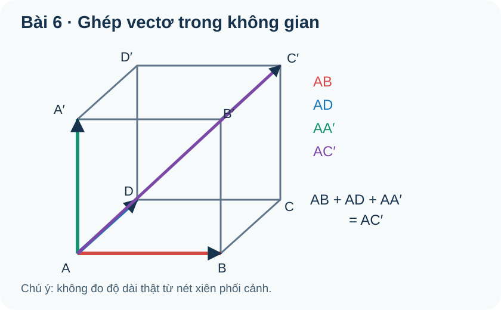
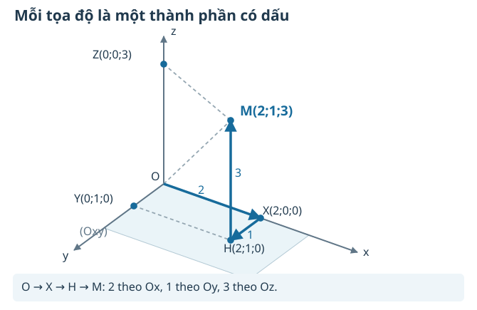
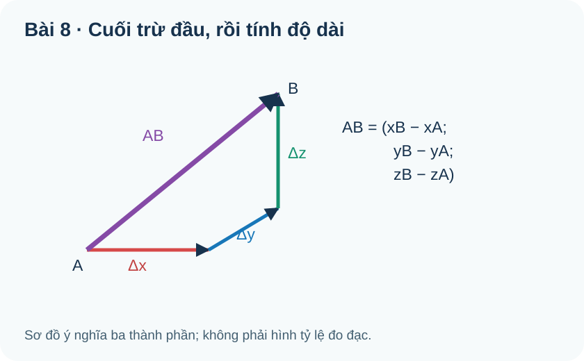
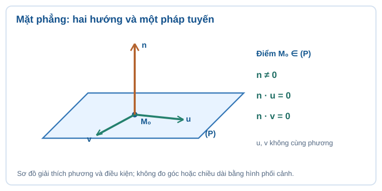
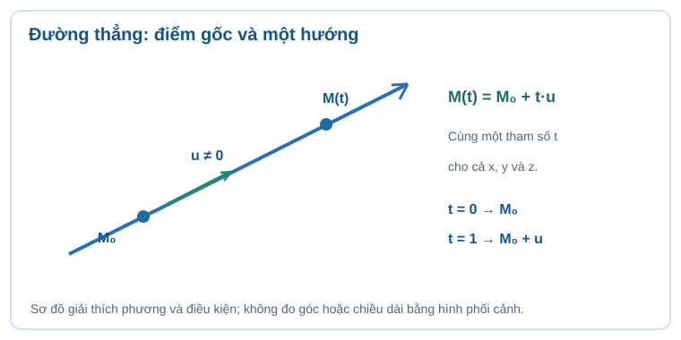
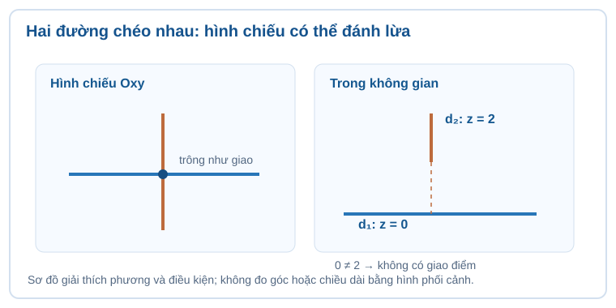
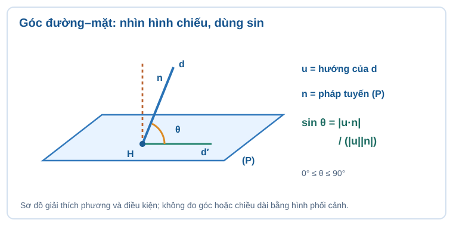
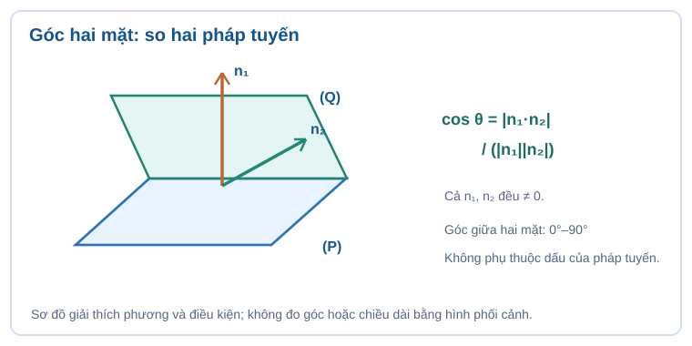
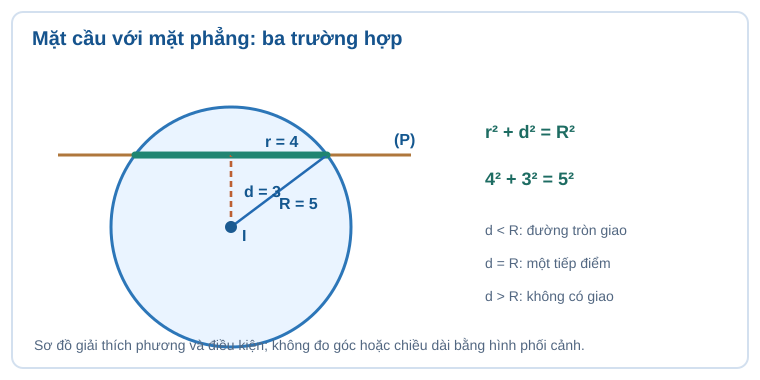

---
hide:
  - toc
---

HỌC THEO CHUYÊN ĐỀ · CĐ18 · TOÁN THPT

<nav class="thpt-sgk-lesson-nav" aria-label="Điều hướng Chuyên đề 18">
<a href="../../cd17/kien-thuc/">← Chuyên đề trước</a>
Chuyên đề sau →
<a href="../luyen-tap/">Luyện tập</a>
<a href="../tu-kiem-tra/">Tự kiểm tra</a>
</nav>

<a href="../../">← Tổng quan các Chuyên đề</a>

Khám phá thêm: <a href="../../../math-lab/models/slm-top18-oxyz-geometry-r00/">Mô hình trực quan Chuyên đề 18</a> (tùy chọn).

<link rel="stylesheet" href="../../../../assets/stylesheets/thpt-topic-w1-golden-v1.css">

Đang chuẩn bị kiến thức…

<!-- TOPIC18_APPROVED_SOURCE_START -->
<!-- Q18 SOURCE_LEARNER_BLOB d8f30dc5a62b1706e5464e5a7b3b52b15e5bd960; Q18_RECEIPT_BLOB 3a0cbbfb74252787f08c9504de9018c7e58bf8a1; AUTHORING_PR #855; PUBLIC_PROJECTION_ONLY -->

# Kiến thức

Ta bắt đầu từ những câu hỏi gần gũi: một vật chuyển động ra sao, mặt phẳng nghiêng thế nào, và một vùng không gian hình cầu có bao phủ một vị trí không? Tọa độ cho phép chuyển từng câu hỏi hình học thành suy luận có thể kiểm tra bằng phép tính. Mỗi khi dùng công thức, hãy nhận diện đối tượng và điều kiện trước.

<!-- AUTHORING_R04_LEARNER_CANDIDATE; EDITORIAL_R03_BLOB: 66df020c242cbbeb5c4bd50670e245a4d8c7f31f; FROZEN_R02_BLOB: f84dee296e2880c2d17fa2306c44458031c057cd; SGK_CHII_BLOB: 856a37bd16d2746ffc2e12906de18d1f4338a3b6; SGK_CHV_BLOB: ad4165de0a2c3442b50d7f3d0019a99b5bbdef39; NOT_REVIEWED_INDEPENDENTLY; NO_PRIVATE_RD1 -->

## 1. Vectơ và phép toán hình học

**Đọc hình:** Hãy chỉ điểm A, theo lần lượt ba hướng AB, AD, AA′ và xác định C′. Đường chéo AC′ là độ dời tổng hợp; không dùng độ dài nét xiên trên màn hình để tính độ dài thật.

### 1.1. Vectơ và vectơ-không

<!-- LESSON_ID: TOP18-M01; OUTCOME_ID: TOP18-O01; S1_ORIGINAL_OUTCOME: G12-CHII-B06-O01 -->

Một vectơ biểu diễn độ dời có hướng từ điểm đầu đến điểm cuối. Ta có thể tịnh tiến mũi tên song song mà không đổi vectơ; vì thế vectơ không gắn với vị trí tuyệt đối. Vectơ-không có độ dài 0 và không xác định một hướng riêng, nên không dùng nó để đo góc.

> **Kiến thức cần ghi nhớ**
>
> Một vectơ biểu diễn độ dời có hướng từ điểm đầu đến điểm cuối.

**Ví dụ**

**Đề bài:** Trong ba điểm A–B–C thẳng hàng theo thứ tự, ghép AB với BC thu được độ dời nào? Khi A=B, AB có hướng riêng không?

**Lời giải:** Nếu A,B,C thẳng hàng và AB,BC cùng hướng thì khi đi A→B rồi B→C, ta thu được độ dời A→C. Khi A trùng B, vectơ AB là vectơ-không dù hai điểm mang cùng vị trí. Vectơ-không không được gán một góc riêng.

**Vận dụng**

A trùng B. Vectơ AB có độ dài và hướng thế nào?

<!-- ITEM_ID: THPT-TOP18-T01; ROLE: TOPIC_FIRST_TRY; PRIMARY_OUTCOME: TOP18-O01 -->

Đối chiếu

Độ dài bằng 0; không có hướng xác định. Không gán góc riêng cho vectơ-không.

**Kiểm lỗi**

Vectơ-không dài 0 và không có hướng riêng, dù vẽ mũi tên thế nào; kiểm xem hai đầu có trùng nhau, không dùng nó để đo góc. Quay về **Kiến thức 1.1**, sau đó tự giải **Bài luyện 3** và **Bài luyện 5** trong Luyện tập.

### 1.2. Bằng nhau, đối nhau và cùng phương

<!-- LESSON_ID: TOP18-M02; OUTCOME_ID: TOP18-O02; S1_ORIGINAL_OUTCOME: G12-CHII-B06-O02 -->

Hai vectơ bằng nhau phải cùng hướng và cùng độ dài; chỉ cùng độ dài chưa đủ. Hai vectơ đối nhau có cùng độ dài nhưng ngược hướng. 'Cùng phương' nói về giá song song hoặc trùng nhau, không tự khẳng định cùng hướng.

> **Kiến thức cần ghi nhớ**
>
> Hai vectơ bằng nhau phải cùng hướng và cùng độ dài; chỉ cùng độ dài chưa đủ.

**Ví dụ**

**Đề bài:** Trong hình bình hành ABCD, so các vectơ AB, DC và CD: đâu là cặp bằng nhau, đâu là cặp đối?

**Lời giải:** Trên hình bình hành ABCD, vectơ AB bằng vectơ DC; vectơ AB đối vectơ CD. Cùng hai cạnh nhưng đổi thứ tự đầu–cuối thì đảo chiều, không đổi độ dài.

**Vận dụng**

Trong hình bình hành ABCD, vectơ AB có bằng vectơ CD không?

<!-- ITEM_ID: THPT-TOP18-T02; ROLE: TOPIC_FIRST_TRY; PRIMARY_OUTCOME: TOP18-O02 -->

Đối chiếu

Không. AB và CD đối nhau; AB bằng DC.

**Kiểm lỗi**

Bằng nhau cần cả cùng hướng lẫn độ dài; hai độ dời dài bằng nhau mà ngược chiều thì đối nhau, không phải bằng nhau. Quay về **Kiến thức 1.2**, sau đó tự giải **Bài luyện 7** và **Bài luyện 10** trong Luyện tập.

### 1.3. Cộng vectơ theo đường đi

<!-- LESSON_ID: TOP18-M03; OUTCOME_ID: TOP18-O03; S1_ORIGINAL_OUTCOME: G12-CHII-B06-O03 -->

Cộng vectơ là ghép các độ dời, không cộng số đo chiều dài tùy ý. Quy tắc ba điểm AB+BC=AC phản ánh đi liên tiếp; trong hình hộp, tổng ba cạnh kề ở A đưa đến đỉnh đối diện C′.

> **Kiến thức cần ghi nhớ**
>
> Cộng vectơ là ghép các độ dời, không cộng số đo chiều dài tùy ý.

**Ví dụ**

**Đề bài:** Trong hình hộp ABCD.A′B′C′D′, ba độ dời AB, AD, AA′ đưa ta tới đỉnh nào?

**Lời giải:** Trong hình hộp ABCD.A′B′C′D′, đi A→B, rồi B→C, rồi C→C′ có cùng độ dời với A→C′. Vì AB+AD=AC và AC+AA′=AC′, suy AB+AD+AA′=AC′.

**Vận dụng**

Tính dạng rút gọn của vectơ PQ + vectơ QR.

<!-- ITEM_ID: THPT-TOP18-T03; ROLE: TOPIC_FIRST_TRY; PRIMARY_OUTCOME: TOP18-O03 -->

Đối chiếu

Vectơ PR theo quy tắc ba điểm, miễn các điểm được lấy đúng thứ tự.

**Kiểm lỗi**

Để cộng vectơ, đặt đuôi mũi tên sau vào đầu mũi tên trước; không cộng độ dài nếu các hướng khác nhau. Quay về **Kiến thức 1.3**, sau đó tự giải **Bài luyện 13** và **Bài luyện 15** trong Luyện tập.

### 1.4. Nhân vectơ với một số

<!-- LESSON_ID: TOP18-M04; OUTCOME_ID: TOP18-O04; S1_ORIGINAL_OUTCOME: G12-CHII-B06-O04 -->

Nhân vectơ với số k thay đổi độ dài theo |k|, cùng hướng nếu k>0, ngược hướng nếu k&lt;0 và tạo vectơ-không nếu k=0. Điều này giải thích tại sao nhân 3 biểu thị ba lần độ dời cùng hướng, còn nhân −1 là đảo chiều.

> **Kiến thức cần ghi nhớ**
>
> Nhân vectơ với số k thay đổi độ dài theo |k|, cùng hướng nếu k>0, ngược hướng nếu k&lt;0 và tạo vectơ-không nếu k=0.

**Ví dụ**

**Đề bài:** Vectơ u dài 2 m hướng Bắc. Xác định độ dài và hướng của −3u.

**Lời giải:** Nếu vectơ u dài 2 m về hướng Bắc, −3u dài 6 m về hướng Nam. Không viết độ dài −6 m; độ dài luôn không âm.

**Vận dụng**

Vectơ u khác không, 0u có cùng hướng u không?

<!-- ITEM_ID: THPT-TOP18-T04; ROLE: TOPIC_FIRST_TRY; PRIMARY_OUTCOME: TOP18-O04 -->

Đối chiếu

Không. 0u là vectơ-không, không có hướng xác định.

**Kiểm lỗi**

Nhân k làm độ dài nhân |k|; k âm đảo chiều và k=0 cho vectơ không, không có độ dài âm. Quay về **Kiến thức 1.4**, sau đó tự giải **Bài luyện 16** và **Bài luyện 20** trong Luyện tập.

### 1.5. Góc và tích vô hướng

<!-- LESSON_ID: TOP18-M05; OUTCOME_ID: TOP18-O05; S1_ORIGINAL_OUTCOME: G12-CHII-B06-O05 -->

Tích vô hướng đo phần 'đi cùng phương' của hai vectơ; nó dương khi góc nhọn, âm khi góc tù và bằng 0 khi vuông góc. Công thức u·v=|u||v|cosφ đúng cho mọi vectơ, nhưng góc φ chỉ được định nghĩa khi hai vectơ khác không.

> **Kiến thức cần ghi nhớ**
>
> Hai vectơ khác không có tích vô hướng \(\vec u\cdot\vec v=|\vec u||\vec v|\cos\theta\); tích bằng 0 khi chúng vuông góc. Không định nghĩa góc với vectơ-không.

**Ví dụ**

**Đề bài:** Hai vectơ lực khác 0 vuông góc nhau. Tích vô hướng bằng bao nhiêu? Có vectơ nào phải bằng 0 không?

**Lời giải:** Hai lực vuông góc có tích vô hướng 0 không có nghĩa chúng bằng vectơ-không. Chỉ là không có thành phần theo hướng của nhau. Hai vectơ vuông góc vẫn có thể cùng khác 0.

**Vận dụng**

Hai vectơ khác không vuông góc; tích vô hướng bằng bao nhiêu?

<!-- ITEM_ID: THPT-TOP18-T05; ROLE: TOPIC_FIRST_TRY; PRIMARY_OUTCOME: TOP18-O05 -->

Đối chiếu

Bằng 0 vì cos90°=0.

**Kiểm lỗi**

Tích vô hướng dùng độ dài của hai vectơ và cos của góc; khi một vectơ bằng 0, không chia để tìm cos góc. Quay về **Kiến thức 1.5**, sau đó tự giải **Bài luyện 22** và **Bài luyện 25** trong Luyện tập.

### 1.6. Hợp lực và tổng vectơ

<!-- LESSON_ID: TOP18-M06; OUTCOME_ID: TOP18-O06; S1_ORIGINAL_OUTCOME: G12-CHII-B06-O06 -->

Bài lực ba chiều thường hỏi hợp lực, hình chiếu hay công sinh ra bởi một lực. Chọn phép cộng vectơ khi ghép các tác dụng, chọn tích vô hướng khi đo đóng góp của lực dọc theo chuyển dời; không cộng độ lớn nếu các lực khác hướng.

> **Kiến thức cần ghi nhớ**
>
> Hợp lực hai lực là tổng hai vectơ lực. Nếu chúng vuông góc, độ lớn hợp lực là \(\sqrt{F_1^2+F_2^2}\), không phải \(F_1+F_2\).

**Ví dụ**

**Đề bài:** Hai lực cùng điểm dài 3 N và 4 N vuông góc. Tính hợp lực và so với hai lực cùng hướng.

**Lời giải:** Hai lực cùng điểm có độ lớn 3 N và 4 N vuông góc thì hợp lực dài 5 N theo Pitago. Nếu cùng hướng, hợp lực 7 N; vì thế phải đọc hướng trước khi tính.

**Để phân biệt trước khi luyện:** Hợp lực của hai lực là tổng **vectơ lực**, có đơn vị N. **Công** của một lực là tích vô hướng với độ dời, đơn vị J: lực 10 N hợp với độ dời 2 m góc 60° sinh công \(10\cdot 2\cdot\cos60^\circ=10\) J. Bài luyện 13 giúp kiểm cộng vectơ, còn Bài luyện 30 rèn tính công. Hai kết quả không được dùng thay nhau.

**Vận dụng**

Hai lực 6 N và 8 N vuông góc, độ lớn hợp lực?

<!-- ITEM_ID: THPT-TOP18-T06; ROLE: TOPIC_FIRST_TRY; PRIMARY_OUTCOME: TOP18-O06 -->

Đối chiếu

10 N vì bình phương độ lớn tổng bằng 6²+8².

**Kiểm lỗi**

Hợp lực dùng **cộng vectơ lực**, còn công dùng **tích vô hướng lực với độ dời**. Hai bài thử củng cố hai thao tác khác nhau, không coi công là độ lớn hợp lực. Quay về **Kiến thức 1.6**, sau đó tự giải **Bài luyện 13** và **Bài luyện 30** trong Luyện tập.

## 2. Làm quen hệ tọa độ Oxyz

**Từ mũi tên đến vị trí thật.** Hãy theo dõi một chiếc drone đang bay trong kho: nếu gốc O đặt ở một góc nhà, ta chọn Ox hướng Đông, Oy hướng Bắc, Oz hướng lên. Drone bắt đầu ở **A=(1;1;2)** (m). Thay vì mô tả “hơi lệch sang phải và khá cao”, ba tọa độ cho biết chính xác ba độ dời có dấu. Đến cuối chuyên đề, chính drone này sẽ giúp ta nối vectơ vận tốc, phương trình đường bay, mặt phẳng và hình cầu trong một bài toán.

**Tự quan sát trước công thức:** Trong mô hình công khai phía dưới, giữ x,y cố định và chỉ kéo z. Điểm M thay đổi độ cao nhưng chân H chiếu xuống mặt Oxy vẫn có tọa độ (x;y;0). Đây là ý nghĩa cụ thể của hình chiếu vuông góc, không phải một công thức cần thuộc lòng trước khi hiểu.

<a href="../../../math-lab/models/slm-top18-oxyz-geometry-r00/">Mở mô hình khám phá tọa độ và mặt cầu</a> — chọn phần **“Một điểm M có ba tọa độ”**. Mô hình chỉ giúp hình dung, không thay bước Vận dụng và không ghi điểm.

<!-- AUTHOR_INTERACTIVE_PLACEMENT: MODEL_ID=SLM-TOP18-OXYZ-GEOMETRY-R00; SCENE=XYZ_PROJECTION; OUTCOMES=TOP18-O07/TOP18-O08/TOP18-O15; PUBLIC_DISCOVERY_NO_MASTERY -->

**Đọc hình:** Tìm O và ba trục x,y,z, rồi đọc M(2;1;3). Các nét đứt chỉ dẫn từ M xuống mặt Oxy: tọa độ z là độ cao theo trục chứ không phải độ dài đo trên giấy.

### 2.1. Hệ trục và các mặt tọa độ

<!-- LESSON_ID: TOP18-M07; OUTCOME_ID: TOP18-O07; S1_ORIGINAL_OUTCOME: G12-CHII-B07-O01 -->

Ba trục Ox,Oy,Oz vuông góc đôi một giúp định vị một điểm trong phòng bằng ba số. Các mặt phẳng tọa độ Oxy, Oyz, Oxz là ba mặt khác nhau: z=0, x=0, y=0. Hình phối cảnh không phải thước để đọc chiều sâu.

> **Kiến thức cần ghi nhớ**
>
> Trong hệ trực chuẩn Oxyz, điểm thuộc (Oxy) khi z=0, thuộc (Oxz) khi y=0, thuộc (Oyz) khi x=0.

**Ví dụ**

**Đề bài:** Điểm thuộc (Oxy) và điểm thuộc trục Oz cần có những tọa độ nào bằng 0?

**Lời giải:** Điểm nằm ở mặt Oxy thì z=0 dù hình vẽ giấy có thể cho cảm giác nó ở cao. Trục Oz có x=y=0, không phải x=z=0. Hình phối cảnh không thay điều kiện tọa độ z=0.

**Vận dụng**

Điểm M=(2,−1,0) thuộc mặt phẳng tọa độ nào?

<!-- ITEM_ID: THPT-TOP18-T07; ROLE: TOPIC_FIRST_TRY; PRIMARY_OUTCOME: TOP18-O07 -->

Đối chiếu

Thuộc Oxy vì z=0.

**Kiểm lỗi**

Mặt Oxy cần z=0, Oyz cần x=0; trục Oz cần x=y=0. Không suy dấu tọa độ từ nét hình xiên. Quay về **Kiến thức 2.1**, sau đó tự giải **Bài luyện 31** và **Bài luyện 35** trong Luyện tập.

### 2.2. Tọa độ của điểm và vectơ

<!-- LESSON_ID: TOP18-M08; OUTCOME_ID: TOP18-O08; S1_ORIGINAL_OUTCOME: G12-CHII-B07-O02 -->

Tọa độ của một điểm là ba số xác định vị trí so với gốc O; tọa độ vectơ là ba thành phần dịch chuyển theo cùng trục. Cùng bộ ba số vẫn là hai đối tượng khác nhau, dù vectơ OM có tọa độ trùng tọa độ của điểm M.

> **Kiến thức cần ghi nhớ**
>
> Tọa độ của một điểm là ba số xác định vị trí so với gốc O; tọa độ vectơ là ba thành phần dịch chuyển theo cùng trục.

**Ví dụ**

**Đề bài:** Điểm M(2;−1;3). Viết tọa độ OM và giải thích ảnh hưởng của đổi gốc.

**Lời giải:** M=(2,−1,3) thì vectơ OM=(2,−1,3). Nhưng chuyển gốc tọa độ sẽ đổi tọa độ điểm M, còn độ dời của một vectơ tự do không đổi trong các trục cùng hướng.

**Vận dụng**

Điểm M(1,2,3), tọa độ vectơ OM?

<!-- ITEM_ID: THPT-TOP18-T08; ROLE: TOPIC_FIRST_TRY; PRIMARY_OUTCOME: TOP18-O08 -->

Đối chiếu

(1,2,3) trong cùng hệ Oxyz.

**Kiểm lỗi**

Tọa độ OM bằng tọa độ M chỉ khi O là gốc của cùng hệ; không tự đổi dấu các thành phần âm của vectơ. Quay về **Kiến thức 2.2**, sau đó tự giải **Bài luyện 37** và **Bài luyện 40** trong Luyện tập.

### 2.3. Chọn hệ quy chiếu thực tế

<!-- LESSON_ID: TOP18-M09; OUTCOME_ID: TOP18-O09; S1_ORIGINAL_OUTCOME: G12-CHII-B07-O03 -->

Ứng dụng Oxyz bắt đầu bằng chọn gốc, hướng dương và đơn vị. Một tọa độ âm không có nghĩa khoảng cách âm; nó chỉ nằm ở phía đối diện của trục. Bài radar, kho vận hoặc đồ họa đều cần tuyên bố hệ quy chiếu trước.

> **Kiến thức cần ghi nhớ**
>
> Ứng dụng Oxyz bắt đầu bằng chọn gốc, hướng dương và đơn vị.

**Ví dụ**

**Đề bài:** Chọn Ox Đông, Oy Bắc, Oz hướng lên. Đèn ở (2;−1;3) m nằm về hướng nào?

**Lời giải:** Chọn O ở góc nhà, Ox hướng Đông, Oy hướng Bắc, Oz hướng lên. Một đèn ở (2,−1,3) m nằm lệch 1 m về Nam và cao 3 m; không phải thấp hơn sàn.

**Vận dụng**

Trong hệ Ox Đông, Oy Bắc, Oz lên, N=(−4,3,2) m nằm về phía nào của O?

<!-- ITEM_ID: THPT-TOP18-T09; ROLE: TOPIC_FIRST_TRY; PRIMARY_OUTCOME: TOP18-O09 -->

Đối chiếu

4 m về Tây, 3 m về Bắc, cao 2 m.

**Kiểm lỗi**

Vị trí phụ thuộc gốc và chiều dương đã chọn; xác định hướng trục, mốc và đơn vị trước khi đọc tọa độ. Quay về **Kiến thức 2.3**, sau đó tự giải **Bài luyện 42** và **Bài luyện 45** trong Luyện tập.

### 2.4. Vectơ từ hai điểm

<!-- LESSON_ID: TOP18-M10; OUTCOME_ID: TOP18-O10; S1_ORIGINAL_OUTCOME: G12-CHII-B07-O04 -->

Vectơ từ A đến B được tính bằng cuối trừ đầu theo từng trục: AB=(xB−xA,yB−yA,zB−zA). Công thức là bản dịch đại số của việc bắt đầu ở A rồi di chuyển tới B; đổi AB thành BA thì toàn bộ dấu đảo.

> **Kiến thức cần ghi nhớ**
>
> Vectơ từ A đến B được tính bằng cuối trừ đầu theo từng trục: AB=(xB−xA,yB−yA,zB−zA).

**Ví dụ**

**Đề bài:** Cho hai điểm A(1;2;−1) và B(4;−2;3) trong cùng hệ Oxyz. Tính vectơ độ dời từ A đến B, rồi kiểm bằng cộng tọa độ.

**Lời giải:** A=(1,2,−1), B=(4,−2,3) cho AB=(3,−4,4). Kiểm bằng A+AB=B theo từng thành phần. Ta lấy từng tọa độ điểm cuối trừ điểm đầu: (4−1;−2−2;3−(−1))=(3;−4;4). Lấy A cộng độ dời thu lại đúng B, nên không bị đảo dấu.

**Vận dụng**

A=(2,0,−1), B=(5,−2,3). Tính vectơ AB.

<!-- ITEM_ID: THPT-TOP18-T10; ROLE: TOPIC_FIRST_TRY; PRIMARY_OUTCOME: TOP18-O10 -->

Đối chiếu

(3,−2,4).

**Kiểm lỗi**

Vectơ từ A tới B là B−A, không phải A−B; kiểm lại bằng phép cộng A+AB=B. Quay về **Kiến thức 2.4**, sau đó tự giải **Bài luyện 46** và **Bài luyện 50** trong Luyện tập.

## 3. Phép toán tọa độ và khoảng cách

**Khi điểm bắt đầu chuyển động.** Drone từ A=(1;1;2) m, mỗi giây tiến **1 m theo Ox, 0 m theo Oy và 1 m theo Oz**. Ta ghi vectơ vận tốc v=(1;0;1) m/s: cùng một vectơ cho biết *hướng và tốc độ theo từng trục*. Sau t giây, vị trí trở thành M(t)=(1+t;1;2+t). Chỉ cần thử t=0 và t=1 là kiểm được: drone từ A tới (2;1;3), thay đổi (1;0;1). Nhờ vậy, phép cộng vectơ không còn là một bảng quy tắc rời rạc.

**Đọc hình:** Đọc ba nhãn Δx,Δy,Δz từ A sang B; từng thành phần là tọa độ B trừ tọa độ A. Đừng lấy tổng ba thành phần làm độ dài AB: còn phải áp dụng Pitago 3D.

### 3.1. Phép toán theo từng tọa độ

<!-- LESSON_ID: TOP18-M11; OUTCOME_ID: TOP18-O11; S1_ORIGINAL_OUTCOME: G12-CHII-B08-O01 -->

Phép cộng, trừ và nhân số trên vectơ trong ba trục vuông góc thực hiện theo từng thành phần. Đây là phép cộng độ dời độc lập trên Ox,Oy,Oz chứ không cộng ba độ dài của vectơ.

> **Kiến thức cần ghi nhớ**
>
> Phép cộng, trừ và nhân số trên vectơ trong ba trục vuông góc thực hiện theo từng thành phần.

**Ví dụ**

**Đề bài:** Hai vectơ u=(1;2;−1), v=(−2;0;3) được cho theo ba trục Oxyz. Tính u+v và tổ hợp 2u−v.

**Lời giải:** u=(1,2,−1), v=(−2,0,3) thì u+v=(−1,2,2); 2u−v=(4,4,−5). Mỗi phép cộng và trừ xử lý từng thành phần. Cộng theo tọa độ cho (1−2;2+0;−1+3)=(−1;2;2). Với 2u−v, tính 2u=(2;4;−2) rồi trừ v được (4;4;−5).

**Vận dụng**

u=(1,−2,3), v=(2,0,−1); u+v?

<!-- ITEM_ID: THPT-TOP18-T11; ROLE: TOPIC_FIRST_TRY; PRIMARY_OUTCOME: TOP18-O11 -->

Đối chiếu

(3,−2,2).

**Kiểm lỗi**

Cộng/trừ/nhân vectơ theo từng thành phần, không nhân chéo tọa độ; cẩn thận khi trừ số âm. Quay về **Kiến thức 3.1**, sau đó tự giải **Bài luyện 51** và **Bài luyện 55** trong Luyện tập.

### 3.2. Kiểm hai vectơ cùng phương

<!-- LESSON_ID: TOP18-M12; OUTCOME_ID: TOP18-O12; S1_ORIGINAL_OUTCOME: G12-CHII-B08-O02 -->

Hai vectơ khác không cùng phương nếu một vectơ là bội của vectơ kia. Đừng chia các tọa độ tùy tiện khi có thành phần bằng 0; cách chắc chắn là thử k sao cho u=kv ở *tất cả* ba vị trí. Vectơ-không cần xử lí theo định nghĩa quy ước chứ không chia để tìm tỉ số.

> **Kiến thức cần ghi nhớ**
>
> Hai vectơ khác không cùng phương nếu một vectơ là bội của vectơ kia.

**Ví dụ**

**Đề bài:** Với u=(2;−4;0), v=(−1;2;0), hai vectơ cùng phương/hướng thế nào? Nếu v_z=1?

**Lời giải:** u=(2,−4,0),v=(−1,2,0), ta có u=−2v nên cùng phương ngược hướng. Nếu v=(−1,2,1), quan hệ vỡ ở tọa độ thứ ba.

**Vận dụng**

u=(3,6,0), v=(1,2,0) có cùng phương không?

<!-- ITEM_ID: THPT-TOP18-T12; ROLE: TOPIC_FIRST_TRY; PRIMARY_OUTCOME: TOP18-O12 -->

Đối chiếu

Có, u=3v và đều khác không.

**Kiểm lỗi**

Hai vectơ cùng phương cần một hệ số k áp dụng cho đủ ba thành phần; không bỏ qua trục z hoặc chia cho 0. Quay về **Kiến thức 3.2**, sau đó tự giải **Bài luyện 58** và **Bài luyện 60** trong Luyện tập.

### 3.3. Trung điểm và trọng tâm

<!-- LESSON_ID: TOP18-M13; OUTCOME_ID: TOP18-O13; S1_ORIGINAL_OUTCOME: G12-CHII-B08-O03 -->

Trung điểm và trọng tâm của tam giác là trung bình *tọa độ*, không phải trung bình khoảng cách tới gốc. Vì mỗi trục độc lập, trung điểm M=(A+B)/2; trọng tâm G=(A+B+C)/3 theo từng thành phần.

> **Kiến thức cần ghi nhớ**
>
> Trung điểm A,B có tọa độ \(((x_A+x_B)/2;(y_A+y_B)/2;(z_A+z_B)/2)\); trọng tâm tam giác là trung bình tọa độ ba đỉnh.

**Ví dụ**

**Đề bài:** Trong hệ tọa độ Oxyz, hai điểm A(0;2;4), B(2;0;0) là hai đầu của một đoạn. Hãy tìm trung điểm.

**Lời giải:** A=(0,2,4),B=(2,0,0) có M=(1,1,2). Không lấy trung bình độ dài OA và OB. Điểm giữa phải cân bằng độ dời tới hai đầu mút, nên mỗi tọa độ là trung bình của hai giá trị tương ứng: ((0+2)/2;(2+0)/2;(4+0)/2)=(1;1;2).

**Vận dụng**

Trung điểm A=(0,0,2), B=(2,4,0)?

<!-- ITEM_ID: THPT-TOP18-T13; ROLE: TOPIC_FIRST_TRY; PRIMARY_OUTCOME: TOP18-O13 -->

Đối chiếu

M=(1,2,1).

**Kiểm lỗi**

Trung điểm lấy trung bình của hai điểm; trọng tâm tam giác là trung bình tọa độ ba đỉnh, không lấy hiệu. Quay về **Kiến thức 3.3**, sau đó tự giải **Bài luyện 61** và **Bài luyện 65** trong Luyện tập.

### 3.4. Tích vô hướng trong tọa độ

<!-- LESSON_ID: TOP18-M14; OUTCOME_ID: TOP18-O14; S1_ORIGINAL_OUTCOME: G12-CHII-B08-O04 -->

Tích vô hướng trong hệ trực chuẩn Oxyz là u·v=uxvx+uyvy+uzvz; chia cho |u||v| chỉ khi hai vectơ khác không mới suy góc. Vuông góc nghĩa tích bằng 0; góc giữa các vectơ có thể tù, khác góc không tù giữa hai đường thẳng.

> **Kiến thức cần ghi nhớ**
>
> Tích vô hướng trong hệ trực chuẩn Oxyz là u·v=uxvx+uyvy+uzvz; chia cho |u||v| chỉ khi hai vectơ khác không mới suy góc.

**Ví dụ**

**Đề bài:** Cho u=(1;2;0), v=(2;−1;0). Dùng tích vô hướng kiểm vuông góc.

**Lời giải:** u=(1,2,0),v=(2,−1,0), tích 1·2+2·(−1)+0=0, nên hai vectơ khác không vuông góc. Trước khi kết luận vuông góc, kiểm cả hai vectơ đều khác 0; ở đây u và v đều có thành phần không bằng 0. Tích vô hướng bằng 0 nên góc giữa chúng là 90°.

**Vận dụng**

u=(1,1,0),v=(1,−1,0). Góc giữa chúng?

<!-- ITEM_ID: THPT-TOP18-T14; ROLE: TOPIC_FIRST_TRY; PRIMARY_OUTCOME: TOP18-O14 -->

Đối chiếu

90° vì tích vô hướng 1−1=0 và cả hai khác không.

**Kiểm lỗi**

Để tính góc, hai vectơ phải khác 0 và cosθ=(u·v)/(|u||v|). Tích vô hướng 0 với hai vectơ khác 0 là vuông góc. Quay về **Kiến thức 3.4**, sau đó tự giải **Bài luyện 67** và **Bài luyện 70** trong Luyện tập.

### 3.5. Độ dài và khoảng cách hai điểm

<!-- LESSON_ID: TOP18-M15; OUTCOME_ID: TOP18-O15; S1_ORIGINAL_OUTCOME: G12-CHII-B08-O05 -->

Độ dài vectơ dùng căn tổng bình phương ba thành phần; khoảng cách AB là độ dài vectơ AB. Điều này nối Pitago phẳng thành ba phương vuông góc, kết quả luôn không âm.

> **Kiến thức cần ghi nhớ**
>
> Độ dài \(|\vec u|=\sqrt{u_x^2+u_y^2+u_z^2}\); khoảng cách AB là độ dài vectơ \(\overrightarrow{AB}=\vec B-\vec A\).

**Ví dụ**

**Đề bài:** Cho hai điểm A(1;2;3) và B(4;6;3) trong hệ Oxyz. Tính tọa độ vectơ AB và độ dài đoạn thẳng AB.

**Lời giải:** A=(1,2,3),B=(4,6,3) có AB=(3,4,0) nên AB=√(9+16)=5. Dùng cuối trừ đầu, AB=(4−1;6−2;3−3)=(3;4;0). Độ dài là căn tổng bình phương ba tọa độ, được √(9+16)=5; tọa độ z không đổi không làm mất dữ kiện.

**Vận dụng**

Độ dài vectơ u=(2,−1,2)?

<!-- ITEM_ID: THPT-TOP18-T15; ROLE: TOPIC_FIRST_TRY; PRIMARY_OUTCOME: TOP18-O15 -->

Đối chiếu

√(4+1+4)=3.

**Kiểm lỗi**

Độ dài là căn tổng **bình phương cả ba** độ chênh, không phải tổng các chênh lệch. Quay về **Kiến thức 3.5**, sau đó tự giải **Bài luyện 74** và **Bài luyện 75** trong Luyện tập.

### 3.6. Mô hình chuyển động

<!-- LESSON_ID: TOP18-M16; OUTCOME_ID: TOP18-O16; S1_ORIGINAL_OUTCOME: G12-CHII-B08-O06 -->

Mô hình chuyển động thẳng đều có vị trí M(t)=M0+t·v, ba tọa độ thay đổi độc lập theo tốc độ trên từng trục. Đơn vị tốc độ và thời gian phải tương thích; kiểm t≥0 nếu bài chỉ nói chuyển động sau khi xuất phát.

> **Kiến thức cần ghi nhớ**
>
> Mô hình chuyển động thẳng đều có vị trí M(t)=M0+t·v, ba tọa độ thay đổi độc lập theo tốc độ trên từng trục.

**Ví dụ**

**Đề bài:** Drone tại A=(0;0;5) m bay theo v=(2;−1;0) m/s. Sau 3 giây ở đâu?

**Lời giải:** Drone xuất phát A=(0,0,5) m, v=(2,−1,0) m/s. Sau 3 s, ở (6,−3,5) m: cao độ không đổi. Theo công thức vị trí A+t v, ba thành phần là (0+3·2;0+3·(−1);5+3·0)=(6;−3;5). Đơn vị mét khớp vì v tính bằng m/s và thời gian tính bằng giây.

**Vận dụng**

M0=(1,0,2), v=(0,3,−1), t=2. Tọa độ M(2)?

<!-- ITEM_ID: THPT-TOP18-T16; ROLE: TOPIC_FIRST_TRY; PRIMARY_OUTCOME: TOP18-O16 -->

Đối chiếu

(1,6,0).

**Kiểm lỗi**

Vị trí M(t)=M0+t·v chỉ đúng khi đơn vị thời gian phù hợp với đơn vị vận tốc; kiểm mốc t và miền thời gian vật lí. Quay về **Kiến thức 3.6**, sau đó tự giải **Bài luyện 79** và **Bài luyện 81** trong Luyện tập.

## 4. Mặt phẳng trong Oxyz

**Từ vị trí một vật đến cả một bức tường.** Ở chặng trước, ta biết drone sau t giây ở M(t)=(1+t;1;2+t). Bây giờ xét tấm chắn có phương trình **(P): x+y+z=6**. Phương trình không cho một điểm đơn lẻ: bất cứ điểm nào có tổng ba tọa độ bằng 6 đều nằm trên tấm chắn ấy. Vectơ n=(1;1;1) vuông góc với mặt, nên được gọi là *pháp tuyến*. Hãy thử thế M(0)=(1;1;2): tổng là 4, chưa thuộc tấm chắn. Bao giờ tổng đạt 6? Ta sẽ tìm ngay khi học phương trình đường thẳng.

**Đọc hình:** Chỉ M₀ thuộc (P), hai vectơ u,v không cùng phương và pháp tuyến n khác 0. Kiểm n·u=n·v=0; hình phối cảnh không dùng để đo góc.

<!-- AUTHOR_TOPIC18_WHITE_SVG: docs/assets/images/thpt/FIG-TOP18-B14-NORMAL-WHITE-R00.svg; NEW_SOURCE_BLOB: 353ab2fb6f070c03e7895706fd68362c73904fc7; WHITE_BACKGROUND=YES; ORIGINAL_SGK_PNG_REFERENCE_ONLY=Temp_FIG-G12-CHV-B14-R00.png; ORIGINAL_PNG_BLOB=5763cbd3c555a40e2644e9666611a7b4ecaa4070; ORIGINAL_PNG_NOT_VISUALLY_QA_VERIFIED -->

### 4.1. Dựng vectơ pháp tuyến

<!-- LESSON_ID: TOP18-M17; OUTCOME_ID: TOP18-O17; S1_ORIGINAL_OUTCOME: G12-CHV-B14-O01; SCOPE: G12_CHV -->

Một mặt phẳng có vô số hướng nằm trong nó; một vectơ pháp tuyến n khác 0 phải vuông góc với mọi hướng đó. Nếu đã biết hai vectơ chỉ phương u,v **không cùng phương**, tích có hướng u×v là một cách dựng n. Tích có hướng bằng 0 khi u,v cùng phương, khi ấy chưa xác định được pháp tuyến mặt bằng cặp vectơ ấy.

> **Kiến thức cần ghi nhớ**
>
> Nếu u,v không cùng phương, một pháp tuyến mặt phẳng là \(n=u\times v\ne 0\), vuông góc với cả hai hướng u,v.

**Cách thực sự tính được pháp tuyến (không cần học thuộc ngay):** Nếu hai hướng là u=(u₁;u₂;u₃), v=(v₁;v₂;v₃) thì có thể tìm n=(a;b;c) bằng cách giải hai điều kiện **a·u₁+b·u₂+c·u₃=0** và **a·v₁+b·v₂+c·v₃=0**, rồi chọn một nghiệm n khác 0. Một cách gọn hơn là công thức tích có hướng

\[
u\times v=(u_2v_3-u_3v_2;\;u_3v_1-u_1v_3;\;u_1v_2-u_2v_1).
\]

Từng thành phần được tạo để khi nhân vô hướng lại với u hay v, các hạng tử triệt tiêu nhau, nên n·u=n·v=0. **Điều kiện quan trọng:** u và v phải không cùng phương, nếu không tích có hướng trở thành vectơ-không và không xác định được một pháp tuyến khác 0. Tính xong hãy **thử lại hai tích vô hướng**, không chỉ chép công thức.

**Ví dụ**

**Đề bài:** u=(1;0;1), v=(0;1;1) là hai hướng độc lập trong mặt. Hãy dựng và kiểm pháp tuyến.

**Lời giải:** u=(1,0,1), v=(0,1,1) độc lập. Theo công thức tích có hướng, n=u×v=(−1,−1,1). Kiểm n·u=−1+1=0 và n·v=−1+1=0; vì n≠0, có thể dùng n làm pháp tuyến. Hai hướng không cùng phương làm tích có hướng khác vectơ-không.

**Vận dụng**

u=(1,0,0),v=(0,1,0) có pháp tuyến đơn giản nào?

<!-- ITEM_ID: THPT-TOP18-T17; ROLE: TOPIC_FIRST_TRY; PRIMARY_OUTCOME: TOP18-O17 -->

Đối chiếu

n=(0,0,1), vì vuông góc cả u lẫn v.

**Kiểm lỗi**

Nếu hai hướng trong mặt cùng phương thì tích có hướng bằng 0, **không** được chọn vectơ đó làm pháp tuyến. Quay về **Kiến thức 4.1**, sau đó tự giải **Bài luyện 83** và **Bài luyện 86** trong Luyện tập.

### 4.2. Mặt phẳng qua một điểm

<!-- LESSON_ID: TOP18-M18; OUTCOME_ID: TOP18-O18; S1_ORIGINAL_OUTCOME: G12-CHV-B14-O02; SCOPE: G12_CHV -->

Một mặt phẳng là tập các điểm M có độ dời từ điểm M0 nằm vuông góc với một pháp tuyến n khác 0. Điều kiện n·M0M=0 dẫn đến A(x−x0)+B(y−y0)+C(z−z0)=0. Vì vậy cần một điểm đi qua và một hướng pháp tuyến, không thể chỉ biết n để xác định vị trí duy nhất.

> **Kiến thức cần ghi nhớ**
>
> Một mặt phẳng là tập các điểm M có độ dời từ điểm M0 nằm vuông góc với một pháp tuyến n khác 0.

**Ví dụ**

**Đề bài:** Qua M0=(1;0;−1) có n=(2;−1;3). Viết phương trình mặt và kiểm M0.

**Lời giải:** M0=(1,0,−1),n=(2,−1,3). Thay vào 2(x−1)−(y−0)+3(z+1)=0, thu 2x−y+3z+1=0. Thử điểm M0: 2−3+1=0. Thử lại điểm M0 giúp phát hiện lỗi hệ số tự do.

**Vận dụng**

M0=(0,0,2), n=(0,0,1). Viết mặt phẳng.

<!-- ITEM_ID: THPT-TOP18-T18; ROLE: TOPIC_FIRST_TRY; PRIMARY_OUTCOME: TOP18-O18 -->

Đối chiếu

z−2=0, tức z=2.

**Kiểm lỗi**

Mặt có pháp tuyến khác 0 phải đi qua đúng điểm M0; thay M0 vào phương trình để kiểm dấu. Quay về **Kiến thức 4.2**, sau đó tự giải **Bài luyện 87** và **Bài luyện 91** trong Luyện tập.

### 4.3. Mặt phẳng qua ba điểm

<!-- LESSON_ID: TOP18-M19; OUTCOME_ID: TOP18-O19; S1_ORIGINAL_OUTCOME: G12-CHV-B14-O03; SCOPE: G12_CHV -->

Ba điểm phân biệt chưa đủ xác định một mặt: chúng phải **không thẳng hàng**. Lấy AB và AC không cùng phương, dựng n=AB×AC rồi áp dụng phương trình mặt qua A. Nếu ba điểm thẳng hàng, tích có hướng bằng 0 và tồn tại vô số mặt phẳng qua đường đó.

> **Kiến thức cần ghi nhớ**
>
> Ba điểm phân biệt chưa đủ xác định một mặt: chúng phải **không thẳng hàng**.

**Ví dụ**

**Đề bài:** Qua A=(1;0;0), B=(0;1;0), C=(0;0;1), lập phương trình mặt.

**Lời giải:** A=(1,0,0), B=(0,1,0), C=(0,0,1) cho AB=(−1,1,0), AC=(−1,0,1). Một n=(1,1,1) vuông cả hai; mặt phẳng qua A là x+y+z−1=0. Ba điểm phải không thẳng hàng.

**Vận dụng**

Ba giao điểm trục A=(2,0,0),B=(0,2,0),C=(0,0,2). Mặt phẳng?

<!-- ITEM_ID: THPT-TOP18-T19; ROLE: TOPIC_FIRST_TRY; PRIMARY_OUTCOME: TOP18-O19 -->

Đối chiếu

x+y+z=2. Ba điểm không thẳng hàng.

**Kiểm lỗi**

Ba điểm không thẳng hàng mới xác định một mặt duy nhất; kiểm AB×AC≠0 và thế lại đủ ba điểm. Quay về **Kiến thức 4.3**, sau đó tự giải **Bài luyện 93** và **Bài luyện 96** trong Luyện tập.

### 4.4. Mặt phẳng chứa trục

<!-- LESSON_ID: TOP18-M20; OUTCOME_ID: TOP18-O20; S1_ORIGINAL_OUTCOME: G12-CHV-B14-O04; SCOPE: G12_CHV -->

Khi mặt phẳng chứa một đường hoặc trục, mọi vectơ chỉ phương của đường ấy phải vuông góc với pháp tuyến của mặt. Nếu mặt chứa Ox và điểm P ngoài Ox, dùng e1=(1,0,0) và OP làm hai hướng độc lập. Điều kiện 'chứa trục' mạnh hơn 'song song trục' vì mặt còn phải đi qua mọi điểm trên trục.

> **Kiến thức cần ghi nhớ**
>
> Khi mặt phẳng chứa một đường hoặc trục, mọi vectơ chỉ phương của đường ấy phải vuông góc với pháp tuyến của mặt.

**Ví dụ**

**Đề bài:** Mặt phẳng cần đi qua toàn bộ trục Ox và điểm P(0;1;1) nằm ngoài trục. Hãy tìm một phương trình đơn giản của mặt phẳng.

**Lời giải:** Mặt chứa Ox và P=(0,1,1). Hai hướng e1=(1,0,0), OP=(0,1,1) nên một pháp tuyến n=(0,−1,1); mặt qua O là y−z=0. Mặt phải chứa cả trục và điểm đã cho. Chọn hai vectơ độc lập trong mặt: e1=(1;0;0) và OP=(0;1;1). Một pháp tuyến là (0;−1;1), do đó mặt qua O có phương trình y−z=0.

**Vận dụng**

Mặt chứa trục Oz và điểm (1,1,0). Tìm phương trình đơn giản.

<!-- ITEM_ID: THPT-TOP18-T20; ROLE: TOPIC_FIRST_TRY; PRIMARY_OUTCOME: TOP18-O20 -->

Đối chiếu

x−y=0, vì mọi điểm Oz có x=y=0 và điểm thêm cũng thỏa.

**Kiểm lỗi**

Mặt chứa cả trục phải nhận **mọi** điểm trên trục, không chỉ qua gốc; cần kiểm cả điểm ngoài trục đã cho. Quay về **Kiến thức 4.4**, sau đó tự giải **Bài luyện 99** và **Bài luyện 102** trong Luyện tập.

### 4.5. Hai mặt phẳng: song song hay vuông góc?

<!-- LESSON_ID: TOP18-M21; OUTCOME_ID: TOP18-O21; S1_ORIGINAL_OUTCOME: G12-CHV-B14-O05; SCOPE: G12_CHV -->

Hai mặt có pháp tuyến tỉ lệ có cùng phương, nhưng có thể **trùng nhau** hoặc **song song phân biệt**; phải kiểm thêm hằng số hoặc một điểm. Hai mặt vuông góc khi hai pháp tuyến khác không có tích vô hướng bằng 0. Góc giữa mặt là góc nhỏ, không phụ thuộc dấu chọn của pháp tuyến.

> **Kiến thức cần ghi nhớ**
>
> Hai mặt có pháp tuyến tỉ lệ có cùng phương, nhưng có thể **trùng nhau** hoặc **song song phân biệt**; phải kiểm thêm hằng số hoặc một điểm.

**Ví dụ**

**Đề bài:** P:x+2y−z=0 và Q:2x+4y−2z+3=0: trùng hay song song phân biệt?

**Lời giải:** P:x+2y−z=0 và Q:2x+4y−2z+3=0 có pháp tuyến tỉ lệ nhưng không trùng vì các hệ số cả phương trình không tỉ lệ; chúng song song phân biệt. Pháp tuyến cùng phương chưa đủ để hai mặt trùng.

**Vận dụng**

P:x+y+z=1, Q:2x+2y+2z=2. Hai mặt trùng hay song song phân biệt?

<!-- ITEM_ID: THPT-TOP18-T21; ROLE: TOPIC_FIRST_TRY; PRIMARY_OUTCOME: TOP18-O21 -->

Đối chiếu

Trùng nhau do chia phương trình Q cho 2 thu đúng P.

**Kiểm lỗi**

Pháp tuyến tỉ lệ chưa đủ phân biệt hai mặt trùng hay song song; kiểm cả hệ số tự do, còn vuông góc dùng tích vô hướng. Quay về **Kiến thức 4.5**, sau đó tự giải **Bài luyện 103** và **Bài luyện 107** trong Luyện tập.

### 4.6. Khoảng cách điểm đến mặt phẳng

<!-- LESSON_ID: TOP18-M22; OUTCOME_ID: TOP18-O22; S1_ORIGINAL_OUTCOME: G12-CHV-B14-O06; SCOPE: G12_CHV -->

Khoảng cách từ điểm M đến mặt P là độ dài đường vuông góc ngắn nhất, không phải khoảng cách đến một điểm tùy ý của P. Với P:Ax+By+Cz+D=0 có n=(A,B,C) khác không, lấy trị tuyệt đối của vế trái tại M và chia độ dài pháp tuyến √(A²+B²+C²).

> **Kiến thức cần ghi nhớ**
>
> Với \((P):Ax+By+Cz+D=0\) có \((A;B;C)\ne(0;0;0)\), khoảng cách \(d(M,(P))=\frac{|Ax_M+By_M+Cz_M+D|}{\sqrt{A^2+B^2+C^2}}\).

**Ví dụ**

**Đề bài:** Cho mặt phẳng (P):x+2y+2z−6=0 và điểm O(0;0;0). Hãy tính khoảng cách từ O đến (P) và nêu điều kiện áp dụng công thức.

**Lời giải:** M=O, P:x+2y+2z−6=0 có độ dài n=3, trị tuyệt đối −6 là 6, nên d=6/3=2. Mẫu số là độ dài pháp tuyến, phải khác 0. Pháp tuyến n=(1;2;2) khác 0 có độ dài √(1+4+4)=3. Tại O, trị tuyệt đối của vế trái là 6 nên d=6/3=2; giá trị không âm vì đây là độ dài đoạn vuông góc.

**Vận dụng**

Khoảng cách từ O đến mặt z=−5?

<!-- ITEM_ID: THPT-TOP18-T22; ROLE: TOPIC_FIRST_TRY; PRIMARY_OUTCOME: TOP18-O22 -->

Đối chiếu

5 đơn vị, bởi pháp tuyến (0,0,1), độ chênh z là 5.

**Kiểm lỗi**

Khoảng cách điểm–mặt phải lấy trị tuyệt đối tử và chia độ dài pháp tuyến khác 0, không thể âm. Quay về **Kiến thức 4.6**, sau đó tự giải **Bài luyện 108** và **Bài luyện 112** trong Luyện tập.

## 5. Đường thẳng và giao điểm

**Tiếp tục chuyến bay đã biết.** Drone có điểm xuất phát A=(1;1;2) và hướng v=(1;0;1), do đó đường bay là M(t)=(1+t;1;2+t). Thế vào (P):x+y+z=6, ta được (1+t)+1+(2+t)=6, tức **4+2t=6**; suy ra **t=1 giây**, vị trí gặp tấm chắn **M(1)=(2;1;3)**. Kiểm lại: 2+1+3=6. Một tham số chung cho đủ ba tọa độ chính là cách giữ cho ba phép tính đang nói về *cùng một điểm trên đường bay*.

**Đọc hình:** Xác định M₀, hướng u khác 0; M(t)=M₀+t u có cùng tham số t ở đủ ba tọa độ. Tại t=0 là M₀, tại t=1 là M₀+u.

<!-- AUTHOR_TOPIC18_WHITE_SVG: docs/assets/images/thpt/FIG-TOP18-B15-LINE-WHITE-R00.svg; NEW_SOURCE_BLOB: d99c0dd13170111f1b72aededc843d64c3ada4d8; WHITE_BACKGROUND=YES; ORIGINAL_SGK_PNG_REFERENCE_ONLY=Temp_FIG-G12-CHV-B15-R00.png; ORIGINAL_PNG_BLOB=8991b0aaa4e532c0b7b8284608462b2286035733; ORIGINAL_PNG_NOT_VISUALLY_QA_VERIFIED -->

**Đọc hình:** Khung trái chiếu lên Oxy trông có giao; khung phải d₁ có z=0, d₂ có z=2 nên không giao trong không gian. Hai hướng không cùng phương thì chúng chéo nhau.

<!-- AUTHOR_TOPIC18_WHITE_SVG: docs/assets/images/thpt/FIG-TOP18-B15-SKEW-WHITE-R00.svg; NEW_SOURCE_BLOB: 1683f44f7d159081caca47152c1bf75c16440488; WHITE_BACKGROUND=YES; ORIGINAL_SGK_PNG_REFERENCE_ONLY=Temp_FIG-G12-CHV-B151-R00.png; ORIGINAL_PNG_BLOB=447205394c355531845746ccf3a2474a2e910974; ORIGINAL_PNG_NOT_VISUALLY_QA_VERIFIED -->

### 5.1. Phương trình tham số đường thẳng

<!-- LESSON_ID: TOP18-M24; OUTCOME_ID: TOP18-O24; S1_ORIGINAL_OUTCOME: G12-CHV-B15-O01; SCOPE: G12_CHV -->

Một đường thẳng vô hạn được mô tả bằng một điểm M0 nó đi qua và một vectơ chỉ phương u khác không. Mọi điểm trên đường có M=M0+t u với t thực. Ba tọa độ phải dùng **cùng một tham số t**; nếu mỗi tọa độ có một t khác, đó không còn là phương trình một đường cụ thể.

> **Kiến thức cần ghi nhớ**
>
> Đường qua \(M_0\) có hướng \(u\ne0\) có phương trình tham số \(M(t)=M_0+tu\) với cùng một tham số thực t ở cả ba tọa độ.

**Ví dụ**

**Đề bài:** Đường qua M0=(1;2;3) có hướng u=(2;−1;0). Viết tham số.

**Lời giải:** M0=(1,2,3),u=(2,−1,0): x=1+2t,y=2−t,z=3. Độ cao không đổi vì thành phần chỉ phương z bằng 0. Cả ba tọa độ đều dùng một tham số t.

**Vận dụng**

Đường qua O hướng u=(1,0,2). Viết dạng tham số.

<!-- ITEM_ID: THPT-TOP18-T24; ROLE: TOPIC_FIRST_TRY; PRIMARY_OUTCOME: TOP18-O24 -->

Đối chiếu

x=t, y=0, z=2t, t∈R.

**Kiểm lỗi**

Vectơ chỉ phương phải khác 0; khi một thành phần bằng 0, tọa độ tương ứng là hằng theo t. Quay về **Kiến thức 5.1**, sau đó tự giải **Bài luyện 114** và **Bài luyện 118** trong Luyện tập.

### 5.2. Đường thẳng qua hai điểm

<!-- LESSON_ID: TOP18-M25; OUTCOME_ID: TOP18-O25; S1_ORIGINAL_OUTCOME: G12-CHV-B15-O02; SCOPE: G12_CHV -->

Hai điểm phân biệt A,B xác định một đường và cho vectơ chỉ phương AB=B−A khác 0. Lấy A làm điểm t=0; không cần pháp tuyến như phương trình mặt. Nếu A=B, không có hướng AB khác không để xác định duy nhất một đường.

> **Kiến thức cần ghi nhớ**
>
> Hai điểm phân biệt A,B xác định một đường và cho vectơ chỉ phương AB=B−A khác 0.

**Ví dụ**

**Đề bài:** Đường qua A=(0;1;2), B=(2;3;2). Viết tham số và kiểm B.

**Lời giải:** A=(0,1,2),B=(2,3,2), AB=(2,2,0); đường AB có x=2t,y=1+2t,z=2. Thay t=1 cho B, nên phương trình phù hợp.

**Vận dụng**

Đường qua A=(0,0,0), B=(1,2,3) có một dạng tham số?

<!-- ITEM_ID: THPT-TOP18-T25; ROLE: TOPIC_FIRST_TRY; PRIMARY_OUTCOME: TOP18-O25 -->

Đối chiếu

x=t,y=2t,z=3t.

**Kiểm lỗi**

Đường qua A,B cần A≠B, hướng B−A; thử hai giá trị tham số để lấy lại đúng cả hai điểm. Quay về **Kiến thức 5.2**, sau đó tự giải **Bài luyện 119** và **Bài luyện 123** trong Luyện tập.

### 5.3. Khi một tọa độ hướng bằng không

<!-- LESSON_ID: TOP18-M26; OUTCOME_ID: TOP18-O26; S1_ORIGINAL_OUTCOME: G12-CHV-B15-O03; SCOPE: G12_CHV -->

Phương trình chính tắc của đường thẳng cần cẩn thận khi một thành phần vectơ chỉ phương bằng 0. Chỉ những tỉ số có mẫu khác 0 mới xuất hiện; thành phần bằng 0 thành phương trình tọa độ cố định. Không bao giờ viết phép chia cho 0.

> **Kiến thức cần ghi nhớ**
>
> Dạng chính tắc chỉ viết tỉ số ở tọa độ có thành phần hướng khác 0; thành phần hướng bằng 0 phải viết thành tọa độ cố định, không chia cho 0.

**Ví dụ**

**Đề bài:** Đường x=1+2t, y=3, z=4−t. Viết dạng chính tắc mà không chia cho 0.

**Lời giải:** x=1+2t,y=3,z=4−t. Với thành phần y=0 của hướng, giữ y=3 và viết (x−1)/2=(z−4)/(−1). Tọa độ chỉ phương bằng 0 tương ứng tọa độ cố định.

**Vận dụng**

Đường x=2+t,y=−1,z=3+2t. Dạng chính tắc an toàn?

<!-- ITEM_ID: THPT-TOP18-T26; ROLE: TOPIC_FIRST_TRY; PRIMARY_OUTCOME: TOP18-O26 -->

Đối chiếu

(x−2)/1=(z−3)/2; y=−1.

**Kiểm lỗi**

Không viết tỉ số có mẫu 0 trong dạng chính tắc; giữ một phương trình tọa độ hằng ở thành phần hướng bằng 0. Quay về **Kiến thức 5.3**, sau đó tự giải **Bài luyện 125** và **Bài luyện 128** trong Luyện tập.

### 5.4. Kiểm điểm thuộc đường thẳng

<!-- LESSON_ID: TOP18-M27; OUTCOME_ID: TOP18-O27; S1_ORIGINAL_OUTCOME: G12-CHV-B15-O04; SCOPE: G12_CHV -->

Kiểm tra điểm M thuộc đường bằng cách tìm **một** giá trị t đồng thời thỏa cả ba phương trình tham số. Nếu tọa độ x cho t1 nhưng y cho t2 khác, điểm không thuộc đường, dù hai tọa độ trông khớp.

> **Kiến thức cần ghi nhớ**
>
> Kiểm tra điểm M thuộc đường bằng cách tìm **một** giá trị t đồng thời thỏa cả ba phương trình tham số.

**Ví dụ**

**Đề bài:** d: x=1+t, y=2−2t, z=t. Kiểm M=(3;−2;2) có thuộc không.

**Lời giải:** Đường x=1+t,y=2−2t,z=t. M=(3,−2,2) cho t=2 theo x; y=2−4=−2 và z=2 đều đúng nên M thuộc đường. Không được dùng ba tham số khác nhau cho ba tọa độ.

**Vận dụng**

Điểm N=(0,2,0) có thuộc d: x=t,y=2−t,z=0 không?

<!-- ITEM_ID: THPT-TOP18-T27; ROLE: TOPIC_FIRST_TRY; PRIMARY_OUTCOME: TOP18-O27 -->

Đối chiếu

Có, chọn t=0 thỏa cả ba.

**Kiểm lỗi**

Điểm thuộc đường phải thỏa **cùng một t** trong cả ba tọa độ, không được chọn ba tham số độc lập. Quay về **Kiến thức 5.4**, sau đó tự giải **Bài luyện 129** và **Bài luyện 133** trong Luyện tập.

### 5.5. Hai đường có cùng phương

<!-- LESSON_ID: TOP18-M28; OUTCOME_ID: TOP18-O28; S1_ORIGINAL_OUTCOME: G12-CHV-B15-O05; SCOPE: G12_CHV -->

Hai đường có vectơ chỉ phương cùng phương có thể song song phân biệt hoặc trùng nhau; vị trí quyết định bằng một điểm của đường này có thuộc đường kia không. Khi hai hướng khác phương, chúng hoặc cắt nhau hoặc chéo nhau; phải kiểm nghiệm hệ tham số tiếp.

> **Kiến thức cần ghi nhớ**
>
> Hai đường có vectơ chỉ phương cùng phương có thể song song phân biệt hoặc trùng nhau; vị trí quyết định bằng một điểm của đường này có thuộc đường kia không.

**Ví dụ**

**Đề bài:** u=(1;2;0), v=(2;4;0). Hai đường trùng khi cùng qua O? Nếu đường thứ hai qua (0;0;1)?

**Lời giải:** u=(1,2,0) và v=(2,4,0) cùng phương. Nếu cả hai qua O thì trùng; nếu đường thứ hai qua (0,0,1) thì chúng song song phân biệt. Cùng phương chưa kết luận trùng, phải kiểm vị trí.

**Vận dụng**

Hai đường qua A=(0,0,0) và B=(0,0,1), cùng hướng (1,0,0). Quan hệ?

<!-- ITEM_ID: THPT-TOP18-T28; ROLE: TOPIC_FIRST_TRY; PRIMARY_OUTCOME: TOP18-O28 -->

Đối chiếu

Song song phân biệt; A không thuộc đường qua B vì z khác.

**Kiểm lỗi**

Hai hướng cùng phương vẫn có thể cho đường trùng hoặc song song phân biệt; kiểm thêm một điểm thuộc nhau. Quay về **Kiến thức 5.5**, sau đó tự giải **Bài luyện 134** và **Bài luyện 138** trong Luyện tập.

### 5.6. Hai đường cắt hay chéo nhau?

<!-- LESSON_ID: TOP18-M29; OUTCOME_ID: TOP18-O29; S1_ORIGINAL_OUTCOME: G12-CHV-B15-O06; SCOPE: G12_CHV -->

Trong không gian, hai đường không cùng phương **chưa chắc cắt**: chúng còn có thể chéo nhau. Đặt phương trình tham số hai đường d1(t),d2(s), giải hệ ba tọa độ với chỉ hai ẩn t,s; nếu hệ vô nghiệm và hướng không song song, đó là hai đường chéo nhau.

> **Kiến thức cần ghi nhớ**
>
> Trong không gian, hai đường không cùng phương **chưa chắc cắt**: chúng còn có thể chéo nhau.

**Ví dụ**

**Đề bài:** d1(t)=(t;0;0), d2(s)=(0;s;1): hai đường cắt hay chéo?

**Lời giải:** d1(t)=(t,0,0) và d2(s)=(0,s,1). Nếu cắt, tọa độ z phải đồng thời 0 và 1, bất khả; hai hướng (1,0,0),(0,1,0) khác phương nên chéo nhau. Trong không gian, hai hướng khác nhau có thể chéo nhau.

**Vận dụng**

d1(t)=(t,0,0),d2(s)=(0,s,0). Chúng cắt tại đâu?

<!-- ITEM_ID: THPT-TOP18-T29; ROLE: TOPIC_FIRST_TRY; PRIMARY_OUTCOME: TOP18-O29 -->

Đối chiếu

Tại O=(0,0,0) với t=s=0.

**Kiểm lỗi**

Muốn chứng minh hai đường cắt nhau phải giải đủ ba tọa độ với hai tham số; hình chiếu giao nhau không đủ, hai đường có thể chéo. Quay về **Kiến thức 5.6**, sau đó tự giải **Bài luyện 140** và **Bài luyện 143** trong Luyện tập.

### 5.7. Tìm giao giữa đường và mặt

<!-- LESSON_ID: TOP18-M30; OUTCOME_ID: TOP18-O30; S1_ORIGINAL_OUTCOME: G12-CHV-B15-O07; SCOPE: G12_CHV -->

Giao điểm của đường với mặt tìm bằng thay M(t)=M0+t u vào Ax+By+Cz+D=0. Nếu hệ số t là n·u khác 0 thì có một giao điểm; nếu n·u=0, kiểm hằng số: bằng 0 thì đường nằm trong mặt, khác 0 thì song song phân biệt.

> **Kiến thức cần ghi nhớ**
>
> Giao điểm của đường với mặt tìm bằng thay M(t)=M0+t u vào Ax+By+Cz+D=0.

**Ví dụ**

**Đề bài:** d(t)=(1+t;0;2−t), P:x=0, Q:x+z=4. Tìm giao d/P và quan hệ d/Q.

**Lời giải:** d(t)=(1+t,0,2−t), P:x=0. Thay x=1+t=0 suy t=−1, điểm giao (0,0,3). Với Q:x+z=4, vế trái luôn 3 nên đường song song Q nhưng không nằm trong Q. Thay tham số vào mặt giúp phân biệt cắt, nằm trong và song song.

**Vận dụng**

d(t)=(t,1,2), P:z=2. Quan hệ?

<!-- ITEM_ID: THPT-TOP18-T30; ROLE: TOPIC_FIRST_TRY; PRIMARY_OUTCOME: TOP18-O30 -->

Đối chiếu

Đường nằm trong P vì mọi t đều z=2.

**Kiểm lỗi**

Nếu n·u=0 thì không chia để tìm giao: thử một điểm gốc để phân biệt đường nằm trong mặt và song song phân biệt. Quay về **Kiến thức 5.7**, sau đó tự giải **Bài luyện 145** và **Bài luyện 148** trong Luyện tập.

## 6. Góc và quan hệ vị trí

**Vì sao độ dốc không phải góc với pháp tuyến?** Hướng drone v=(1;0;1) có độ tăng cao 1 m cho mỗi 1 m chuyển dời theo Ox, nên góc giữa đường bay và mặt phẳng sàn Oxy bằng **45°**. Nếu chuyển sang bức tường (P):x+y+z=6, phải dùng pháp tuyến n=(1;1;1): vì v·n=2, |v|=√2, |n|=√3 nên sinθ=2/√6. Góc đổi vì mặt dùng để so đã đổi. Không được dùng cùng một góc chỉ vì mũi tên bay không thay đổi.

**Đọc hình:** Đọc d, d′ trong (P), pháp tuyến n và góc θ. Vì góc đường–mặt là với hình chiếu nên dùng sinθ=|u·n|/(|u||n|), không phải góc trực tiếp với n.

<!-- AUTHOR_TOPIC18_WHITE_SVG: docs/assets/images/thpt/FIG-TOP18-B16-LINE-PLANE-ANGLE-WHITE-R00.svg; NEW_SOURCE_BLOB: dafbebf04cbe7cc740eb6d718bf22b6724411737; WHITE_BACKGROUND=YES; ORIGINAL_SGK_PNG_REFERENCE_ONLY=Temp_FIG-G12-CHV-B16-R00.png; ORIGINAL_PNG_BLOB=4dbe38abdc36744cedf69e4e411c8449d7f0b31d; ORIGINAL_PNG_NOT_VISUALLY_QA_VERIFIED -->

**Đọc hình:** Chỉ hai mặt (P),(Q) và hai pháp tuyến n₁,n₂ khác 0. Góc hai mặt lấy góc nhỏ nhờ trị tuyệt đối của tích vô hướng chia tích chuẩn; đổi chiều n không đổi kết quả.

<!-- AUTHOR_TOPIC18_WHITE_SVG: docs/assets/images/thpt/FIG-TOP18-B16-TWO-PLANES-WHITE-R00.svg; NEW_SOURCE_BLOB: 5eac9686ebce6bef48556067a61dfa71fa41b7a3; WHITE_BACKGROUND=YES; ORIGINAL_SGK_PNG_REFERENCE_ONLY=Temp_FIG-G12-CHV-B161-R00.png; ORIGINAL_PNG_BLOB=a6d03ef5310ad93ce2cb8cebc03ff6e54bed55fb; ORIGINAL_PNG_NOT_VISUALLY_QA_VERIFIED -->

### 6.1. Góc giữa hai đường

<!-- LESSON_ID: TOP18-M31; OUTCOME_ID: TOP18-O31; S1_ORIGINAL_OUTCOME: G12-CHV-B16-O01; SCOPE: G12_CHV -->

Góc giữa hai đường thẳng không định hướng được lấy là góc nhỏ 0°–90°. Nếu u,v là hai vectơ chỉ phương khác 0 thì cosθ=|u·v|/(|u||v|). Trị tuyệt đối cần thiết: đảo hướng vectơ không đổi góc hai đường.

> **Kiến thức cần ghi nhớ**
>
> Với hai vectơ chỉ phương u,v khác 0, góc nhỏ giữa hai đường thẳng thỏa \(\cos\theta=\frac{|u\cdot v|}{|u||v|}\), \(0^\circ\le\theta\le90^\circ\).

**Ví dụ**

**Đề bài:** Góc nhỏ giữa hai đường có hướng u=(1;0;0), v=(1;1;0) là bao nhiêu?

**Lời giải:** u=(1,0,0),v=(1,1,0), tích 1 và độ dài 1,√2, nên cosθ=1/√2 ⇒ 45°. Góc hai đường dùng trị tuyệt đối để không phụ thuộc chiều vectơ.

**Vận dụng**

u=(1,0,0),v=(−1,0,0), góc giữa hai đường?

<!-- ITEM_ID: THPT-TOP18-T31; ROLE: TOPIC_FIRST_TRY; PRIMARY_OUTCOME: TOP18-O31 -->

Đối chiếu

0°, không phải 180°, vì hai phương cùng đường dù mũi tên ngược.

**Kiểm lỗi**

Góc giữa hai **đường** là góc không tù; dùng trị tuyệt đối tích vô hướng và hai hướng khác 0. Quay về **Kiến thức 6.1**, sau đó tự giải **Bài luyện 151** và **Bài luyện 154** trong Luyện tập.

### 6.2. Góc giữa đường và mặt

<!-- LESSON_ID: TOP18-M32; OUTCOME_ID: TOP18-O32; S1_ORIGINAL_OUTCOME: G12-CHV-B16-O02; SCOPE: G12_CHV -->

Góc θ giữa đường d và mặt P là góc giữa đường và hình chiếu vuông góc của nó, thuộc 0°–90°. Với vectơ chỉ phương u≠0, pháp tuyến n≠0, sinθ=|u·n|/(|u||n|). Đây là góc phụ của góc nhọn giữa u và n, không dùng cos trực tiếp để gọi góc đường–mặt.

> **Kiến thức cần ghi nhớ**
>
> Với hướng đường u và pháp tuyến mặt n đều khác 0, góc đường–mặt thỏa \(\sin\theta=\frac{|u\cdot n|}{|u||n|}\), \(0^\circ\le\theta\le90^\circ\).

**Ví dụ**

**Đề bài:** Cho đường u=(1;0;1) và mặt có pháp tuyến n=(0;0;1). Tính góc đường–mặt.

**Lời giải:** u=(1,0,1),n=(0,0,1), sinθ=1/√2 ⇒ θ=45°. Nếu u·n=0, θ=0 (đường song song hoặc nằm trong mặt). Góc đường–mặt dùng sin với pháp tuyến, không dùng nhầm cos.

**Vận dụng**

Đường có hướng (0,0,1), mặt z=0. Góc đường–mặt?

<!-- ITEM_ID: THPT-TOP18-T32; ROLE: TOPIC_FIRST_TRY; PRIMARY_OUTCOME: TOP18-O32 -->

Đối chiếu

90° vì hướng đường trùng pháp tuyến.

**Kiểm lỗi**

Góc giữa đường và mặt **phụ** với góc nhọn giữa hướng đường và pháp tuyến; dùng sinθ=|u·n|/(|u||n|). Quay về **Kiến thức 6.2**, sau đó tự giải **Bài luyện 156** và **Bài luyện 159** trong Luyện tập.

### 6.3. Góc giữa hai mặt

<!-- LESSON_ID: TOP18-M33; OUTCOME_ID: TOP18-O33; S1_ORIGINAL_OUTCOME: G12-CHV-B16-O03; SCOPE: G12_CHV -->

Góc nhỏ giữa hai mặt P,Q phụ thuộc pháp tuyến n1,n2 khác 0; cosθ=|n1·n2|/(|n1||n2|). Khi pháp tuyến vuông góc, hai mặt vuông góc; khi pháp tuyến cùng phương, hai mặt song song hoặc trùng và góc 0. Đừng lấy góc nhị diện tù làm góc giữa hai mặt.

> **Kiến thức cần ghi nhớ**
>
> Góc nhỏ giữa hai mặt P,Q phụ thuộc pháp tuyến n1,n2 khác 0; cosθ=|n1·n2|/(|n1||n2|).

**Ví dụ**

**Đề bài:** Hai mặt có pháp tuyến n1=(1;0;0), n2=(1;1;0). Tính góc và thử đổi dấu n2.

**Lời giải:** n1=(1,0,0),n2=(1,1,0), cosθ=1/√2 ⇒ θ=45°. Thay n2 bằng (−1,−1,0), kết quả vẫn 45° vì trị tuyệt đối. Đổi dấu pháp tuyến không đổi góc hai mặt.

**Vận dụng**

Hai mặt P:x=0,Q:y=0 có góc bao nhiêu?

<!-- ITEM_ID: THPT-TOP18-T33; ROLE: TOPIC_FIRST_TRY; PRIMARY_OUTCOME: TOP18-O33 -->

Đối chiếu

90°, vì nP=(1,0,0),nQ=(0,1,0) vuông góc.

**Kiểm lỗi**

Góc hai mặt dùng hai pháp tuyến khác 0 và góc không tù; đổi dấu pháp tuyến không đổi góc. Quay về **Kiến thức 6.3**, sau đó tự giải **Bài luyện 162** và **Bài luyện 165** trong Luyện tập.

### 6.4. Nhận diện đường–mặt song song

<!-- LESSON_ID: TOP18-M34; OUTCOME_ID: TOP18-O34; S1_ORIGINAL_OUTCOME: G12-CHV-B16-O04; SCOPE: G12_CHV -->

Cùng chữ 'song song' và 'vuông góc' nhưng các cặp đối tượng cần điều kiện khác nhau. Đường–mặt: n·u=0 chỉ khẳng định hướng song song mặt, còn phải thử điểm để phân biệt đường nằm trong mặt hay song song phân biệt. Mặt–mặt: n1,n2 cùng phương, cũng phải so hệ số tự do để loại trùng.

> **Kiến thức cần ghi nhớ**
>
> Đường d có hướng u khác 0, mặt (P) có pháp tuyến n khác 0: u·n=0 chỉ cho biết phương của d song song (P); kiểm điểm trên d để phân biệt d nằm trong (P) hay song song phân biệt.

**Ví dụ**

**Đề bài:** Đường d(t)=(t;1;2), mặt z=0. Đường nằm trong hay song song phân biệt?

**Lời giải:** Mặt z=0 và đường d(t)=(t,1,2) có u=(1,0,0), n=(0,0,1), u·n=0; vì z=2 mọi t nên đường song song phân biệt, không nằm trong mặt. Phải kiểm một điểm thuộc mặt.

**Vận dụng**

Đường d(t)=(t,0,0), mặt z=0. Quan hệ?

<!-- ITEM_ID: THPT-TOP18-T34; ROLE: TOPIC_FIRST_TRY; PRIMARY_OUTCOME: TOP18-O34 -->

Đối chiếu

Đường nằm trong mặt vì z=0 với mọi t.

**Kiểm lỗi**

u·n=0 mới chỉ xác định hướng song song mặt; kiểm điểm thuộc mặt để phân biệt nằm trong và song song phân biệt. Quay về **Kiến thức 6.4**, sau đó tự giải **Bài luyện 169** và **Bài luyện 170** trong Luyện tập.

### 6.5. Góc dốc và độ nghiêng

<!-- LESSON_ID: TOP18-M35; OUTCOME_ID: TOP18-O35; S1_ORIGINAL_OUTCOME: G12-CHV-B16-O05; SCOPE: G12_CHV -->

Trong thiết kế đường dốc hoặc băng chuyền, độ nghiêng đối với nền ngang là góc đường–mặt, được tính từ tỉ số **độ tăng cao / chiều dài dốc** khi dùng sin, hoặc **độ tăng cao / quãng ngang** khi dùng tan. Hai tỉ số không giống nhau, và đơn vị chiều dài phải thống nhất.

> **Kiến thức cần ghi nhớ**
>
> Đường dốc có độ tăng cao h, khoảng ngang d>0, chiều dài L>0: \(\tan\theta=h/d\), \(\sin\theta=h/L\).

**Ví dụ**

**Đề bài:** Dốc cao 5 m, ngang 12 m. Tính chiều dài, sin và tan góc dốc.

**Lời giải:** Đường dốc nâng cao 5 m trên quãng ngang 12 m thì chiều dài dốc 13 m theo Pitago; sinθ=5/13, tanθ=5/12. Không lấy θ sao cho sinθ=5/12. Độ dài dốc là cạnh huyền, không phải khoảng ngang.

**Vận dụng**

Một dốc cao 3 m trên nền ngang 4 m, chiều dài dốc 5 m. sinθ?

<!-- ITEM_ID: THPT-TOP18-T35; ROLE: TOPIC_FIRST_TRY; PRIMARY_OUTCOME: TOP18-O35 -->

Đối chiếu

3/5, còn tanθ=3/4.

**Kiểm lỗi**

Đừng lấy độ dài ngang làm cạnh huyền; cần tam giác vuông có cao, ngang và đoạn cáp để phân biệt sin với tan. Quay về **Kiến thức 6.5**, sau đó tự giải **Bài luyện 174** và **Bài luyện 175** trong Luyện tập.

## 7. Mặt cầu và thiết diện

**Từ đường bay đến vùng bao phủ.** Giả sử tại điểm gặp tấm chắn C=(2;1;3), thiết bị phát sóng có vùng phủ dạng cầu bán kính **R=5 m**. Mặt sàn có z=0 nên cách tâm C một đoạn **d=3 m**. Tam giác vuông tạo bởi tâm C, chân H=(2;1;0) và một điểm trên đường tròn giao cho r²+d²=R², tức r=√(25−9)=**4 m**. Đây là lí do bán kính vòng phủ trên sàn nhỏ hơn bán kính hình cầu, dù hình minh họa trông gần bằng nhau.

<a href="../../../math-lab/models/slm-top18-oxyz-geometry-r00/">Mở mô hình mặt phẳng cắt mặt cầu</a> — chọn phần **“Mặt phẳng cắt mặt cầu”**, đặt R=5 và d=3 rồi thử lần lượt d=5 và d=6. Suy đoán kết quả trước khi kéo thanh trượt.

<!-- AUTHOR_INTERACTIVE_PLACEMENT: MODEL_ID=SLM-TOP18-OXYZ-GEOMETRY-R00; SCENE=SPHERE_PLANE; OUTCOMES=TOP18-O40/TOP18-O23; PUBLIC_DISCOVERY_NO_MASTERY -->

**Đọc hình:** Chỉ tâm I, khoảng cách vuông góc d=3 từ I tới (P), bán kính cầu R=5, bán kính thiết diện r=4. Pitago r²+d²=R²; d=R tiếp xúc, d>R không có giao.

<!-- AUTHOR_TOPIC18_WHITE_SVG: docs/assets/images/thpt/FIG-TOP18-B17-SPHERE-SECTION-WHITE-R00.svg; NEW_SOURCE_BLOB: 258d0059806bdc840e9c5200ca8944168aa62f67; WHITE_BACKGROUND=YES; ORIGINAL_SGK_PNG_REFERENCE_ONLY=Temp_FIG-G12-CHV-B17-R00.png; ORIGINAL_PNG_BLOB=3a87aa63ef68d3c12c170a213f7ea6a4ab719532; ORIGINAL_PNG_NOT_VISUALLY_QA_VERIFIED -->

### 7.1. Mặt cầu từ tâm và bán kính

<!-- LESSON_ID: TOP18-M36; OUTCOME_ID: TOP18-O36; S1_ORIGINAL_OUTCOME: G12-CHV-B17-O01; SCOPE: G12_CHV -->

Mặt cầu tâm C bán kính R>0 gồm các điểm M có CM=R. Bình phương khoảng cách giúp viết phương trình (x−a)²+(y−b)²+(z−c)²=R², không phải một mặt phẳng vì có các số hạng bậc hai.

> **Kiến thức cần ghi nhớ**
>
> Mặt cầu tâm C bán kính R>0 gồm các điểm M có CM=R.

**Ví dụ**

**Đề bài:** Lập mặt cầu C=(1;−2;3), R=4 và thử điểm M=(5;−2;3).

**Lời giải:** Tâm C=(1,−2,3), R=4 cho (x−1)²+(y+2)²+(z−3)²=16. Kiểm M=(5,−2,3) thỏa. Kiểm bằng bình phương khoảng cách bằng R².

**Vận dụng**

Mặt cầu tâm O bán kính 5 có phương trình nào?

<!-- ITEM_ID: THPT-TOP18-T36; ROLE: TOPIC_FIRST_TRY; PRIMARY_OUTCOME: TOP18-O36 -->

Đối chiếu

x²+y²+z²=25.

**Kiểm lỗi**

Phương trình mặt cầu phải dùng dấu trừ tọa độ tâm trong ngoặc bình phương và bán kính R>0. Quay về **Kiến thức 7.1**, sau đó tự giải **Bài luyện 177** và **Bài luyện 180** trong Luyện tập.

### 7.2. Hoàn thành bình phương tìm mặt cầu

<!-- LESSON_ID: TOP18-M37; OUTCOME_ID: TOP18-O37; S1_ORIGINAL_OUTCOME: G12-CHV-B17-O02; SCOPE: G12_CHV -->

Từ phương trình x²+y²+z²+Dx+Ey+Fz+G=0, hoàn thành bình phương từng biến để tìm tâm (−D/2,−E/2,−F/2) và R²=(D²+E²+F²)/4−G. Chỉ có mặt cầu thực bán kính dương nếu R²>0; R²=0 chỉ cho một điểm.

> **Kiến thức cần ghi nhớ**
>
> Từ phương trình x²+y²+z²+Dx+Ey+Fz+G=0, hoàn thành bình phương từng biến để tìm tâm (−D/2,−E/2,−F/2) và R²=(D²+E²+F²)/4−G.

**Ví dụ**

**Đề bài:** Cho phương trình x²+y²+z²−2x+4y−6z+5=0. Hãy hoàn thành bình phương để tìm tâm và bán kính nếu là mặt cầu.

**Lời giải:** x²+y²+z²−2x+4y−6z+5=0 thành (x−1)²+(y+2)²+(z−3)²=9, nên tâm (1,−2,3), R=3. Hoàn thành bình phương đúng cả hằng số. Nhóm ba bình phương: (x−1)²+(y+2)²+(z−3)²=1+4+9−5=9. Vì R²=9>0, đây là mặt cầu tâm (1;−2;3) và bán kính R=3.

**Vận dụng**

x²+y²+z²−4x=0 có tâm, bán kính?

<!-- ITEM_ID: THPT-TOP18-T37; ROLE: TOPIC_FIRST_TRY; PRIMARY_OUTCOME: TOP18-O37 -->

Đối chiếu

(2,0,0), R=2 vì (x−2)²+y²+z²=4.

**Kiểm lỗi**

Hoàn thành bình phương phải điều chỉnh hằng số cùng lúc; xem R² trước khi lấy căn, nếu âm không có cầu thực. Quay về **Kiến thức 7.2**, sau đó tự giải **Bài luyện 182** và **Bài luyện 185** trong Luyện tập.

### 7.3. Điểm trong, trên hay ngoài cầu

<!-- LESSON_ID: TOP18-M38; OUTCOME_ID: TOP18-O38; S1_ORIGINAL_OUTCOME: G12-CHV-B17-O03; SCOPE: G12_CHV -->

Muốn biết điểm nằm trong/trên/ngoài mặt cầu, so CM² với R² thay vì bấm căn. Nếu nhỏ hơn là nằm trong, bằng là trên, lớn hơn là ngoài. Điều này là bài kiểm tra vị trí tương đối, không tự cho biết điểm có 'phía trước' trên hình phối cảnh.

> **Kiến thức cần ghi nhớ**
>
> Muốn biết điểm nằm trong/trên/ngoài mặt cầu, so CM² với R² thay vì bấm căn.

**Ví dụ**

**Đề bài:** Trong hệ Oxyz, mặt cầu có tâm O(0;0;0) và bán kính R=5. Hãy xác định M(3;4;0) và N(1;1;1) nằm trong, trên hay ngoài mặt cầu.

**Lời giải:** Mặt cầu tâm O, R=5; M=(3,4,0) có CM²=9+16=25 nên nằm trên. N=(1,1,1) có CM²=3&lt;25 nên nằm trong. So CM² với R² tránh bấm căn không cần thiết.

**Vận dụng**

Với mặt cầu tâm O R=3, điểm (0,0,4) ở đâu?

<!-- ITEM_ID: THPT-TOP18-T38; ROLE: TOPIC_FIRST_TRY; PRIMARY_OUTCOME: TOP18-O38 -->

Đối chiếu

Ngoài mặt vì khoảng cách bình phương 16>9.

**Kiểm lỗi**

So bình phương khoảng cách từ điểm đến **tâm C** với R²: nhỏ hơn nằm trong, bằng trên, lớn hơn ngoài. Quay về **Kiến thức 7.3**, sau đó tự giải **Bài luyện 186** và **Bài luyện 190** trong Luyện tập.

### 7.4. Mặt cầu qua hai đầu đường kính

<!-- LESSON_ID: TOP18-M39; OUTCOME_ID: TOP18-O39; S1_ORIGINAL_OUTCOME: G12-CHV-B17-O04; SCOPE: G12_CHV -->

Nếu hai điểm A,B là hai đầu đường kính của mặt cầu, tâm C là trung điểm AB, bán kính R=AB/2. Không nhầm độ dài đường kính với bán kính; tính trung điểm và độ dài phải theo ba tọa độ.

> **Kiến thức cần ghi nhớ**
>
> Nếu hai điểm A,B là hai đầu đường kính của mặt cầu, tâm C là trung điểm AB, bán kính R=AB/2.

**Ví dụ**

**Đề bài:** Cầu có đường kính A=(0;0;0), B=(2;4;0). Tìm tâm, bán kính, phương trình.

**Lời giải:** A=(0,0,0),B=(2,4,0) cho C=(1,2,0), AB=√20=2√5, R=√5; phương trình (x−1)²+(y−2)²+z²=5. Bán kính bằng nửa đường kính.

**Vận dụng**

A=(−2,0,0),B=(2,0,0). Viết phương trình mặt cầu đường kính AB.

<!-- ITEM_ID: THPT-TOP18-T39; ROLE: TOPIC_FIRST_TRY; PRIMARY_OUTCOME: TOP18-O39 -->

Đối chiếu

Tâm O và bán kính 2 nên x²+y²+z²=4.

**Kiểm lỗi**

Mặt cầu đường kính AB có tâm trung điểm AB, bán kính AB/2, không phải lấy đầu mút làm tâm. Quay về **Kiến thức 7.4**, sau đó tự giải **Bài luyện 194** và **Bài luyện 195** trong Luyện tập.

### 7.5. Tiếp xúc và thiết diện mặt cầu

<!-- LESSON_ID: TOP18-M40; OUTCOME_ID: TOP18-O40; S1_ORIGINAL_OUTCOME: G12-CHV-B17-O05; SCOPE: G12_CHV -->

Giao của mặt cầu bán kính R với mặt phẳng phụ thuộc khoảng cách d từ tâm đến mặt: d>R không có giao, d=R tiếp xúc một điểm, d&lt;R cắt theo đường tròn bán kính √(R²−d²). Tâm đường tròn là chân vuông góc từ tâm mặt cầu đến mặt phẳng.

> **Kiến thức cần ghi nhớ**
>
> Giao của mặt cầu bán kính R với mặt phẳng phụ thuộc khoảng cách d từ tâm đến mặt: d>R không có giao, d=R tiếp xúc một điểm, d&lt;R cắt theo đường tròn bán kính √(R²−d²).

**Ví dụ**

**Đề bài:** Cầu O, R=5: mặt z=3 tạo thiết diện gì và mặt z=5 có tiếp xúc không?

**Lời giải:** Mặt cầu tâm O R=5 với mặt z=3 có d=3 và thiết diện bán kính 4. Với mặt z=5 là tiếp xúc ở (0,0,5). Phân loại theo d so với R.

**Vận dụng**

Mặt cầu tâm O R=5, mặt z=6 có giao không?

<!-- ITEM_ID: THPT-TOP18-T40; ROLE: TOPIC_FIRST_TRY; PRIMARY_OUTCOME: TOP18-O40 -->

Đối chiếu

Không, vì khoảng cách tâm–mặt d=6>R.

**Kiểm lỗi**

Bán kính thiết diện không luôn bằng R; trước hết lấy d từ tâm tới mặt, phân ba trường hợp d&lt;R, d=R, d>R. Quay về **Kiến thức 7.5**, sau đó tự giải **Bài luyện 197** và **Bài luyện 201** trong Luyện tập.

## 8. Vận dụng tích hợp sau B17 (tự chọn)

**Khép lại hành trình của một bài toán.** Câu chuyện drone ban đầu có thể được giải mà không học rời rạc sáu công thức: (1) chọn hệ trục và định vị A=(1;1;2); (2) đọc vectơ v=(1;0;1) để viết M(t); (3) tìm lúc M(t) thuộc mặt x+y+z=6, được t=1 và C=(2;1;3); (4) với cầu tâm C bán kính 5, tìm d(C,z=0)=3 và vòng giao mặt sàn bán kính 4. Mỗi bước chỉ sử dụng một ý nghĩa đã hình thành ở các chặng trước. Đây là ví dụ xuyên suốt, **không phải một câu kiểm tra có ID riêng**, và phần kết nối mặt cầu–mặt phẳng chỉ học sau kiến thức B17.

### 8.1. Mặt cắt và khoảng cách đến mặt cầu

<!-- LESSON_ID: TOP18-M23; OUTCOME_ID: TOP18-O23; S1_ORIGINAL_OUTCOME: G12-CHV-B14-O07; SCOPE: OPTIONAL_AFTER_B17 -->

**Mở rộng tích hợp sau B17, không dùng để kiểm tra Core B14 trước khi học mặt cầu.** Khi cắt mặt cầu bằng mặt phẳng, chỉ cần so khoảng cách d từ tâm C đến mặt phẳng với bán kính R: d>R không cắt, d=R tiếp xúc, d&lt;R cho đường tròn bán kính √(R²−d²). Đây là ứng dụng nối hình học mặt phẳng và hình học mặt cầu, không phải định lí mới thay SGK B14.

> **Kiến thức cần ghi nhớ**
>
> Chỉ dùng sau B17: với mặt cầu tâm C bán kính R>0 và mặt phẳng cách tâm d≥0, nếu d&lt;R thiết diện là đường tròn bán kính \(\sqrt{R^2-d^2}\); d=R tiếp xúc một điểm; d>R không cắt.

**Ví dụ**

**Đề bài:** Sau khi học B17, cho mặt cầu tâm C(1;−2;3), bán kính 13 và mặt phẳng z=8. Xác định tâm, bán kính thiết diện và giải thích vì sao điều kiện d&lt;R quan trọng.

**Lời giải:** Chân đường vuông góc từ tâm C xuống mặt z=8 là H(1;−2;8), nên d(C,(P))=5&lt;13. Mặt cắt là đường tròn tâm H với bán kính r=√(13²−5²)=√144=12. Độ dài r không phải bán kính cầu 13, vì mặt phẳng không qua tâm. Bài kết hợp phương pháp khoảng cách điểm–mặt và kiến thức mặt cầu sau B17, không lấy làm Core bắt buộc ở B14.

**Vận dụng**

Mặt cầu tâm O R=4, mặt z=4 cắt theo hình gì?

<!-- ITEM_ID: THPT-TOP18-T23; ROLE: TOPIC_FIRST_TRY; PRIMARY_OUTCOME: TOP18-O23 -->

Đối chiếu

Tiếp xúc một điểm (0,0,4), vì d=R.

**Kiểm lỗi**

Đây là phần **tự chọn sau B17**, không làm Core B14. Chỉ dùng so d với R khi có mặt cầu với R>0 và khoảng cách d≥0; d=R là tiếp xúc một điểm. Quay về **Kiến thức 8.1**, sau đó tự giải **Bài luyện 203** và **Bài luyện 207** trong Luyện tập.

<!-- TOPIC18_APPROVED_SOURCE_END -->

<a href="../../">← Tổng quan các Chuyên đề</a>

