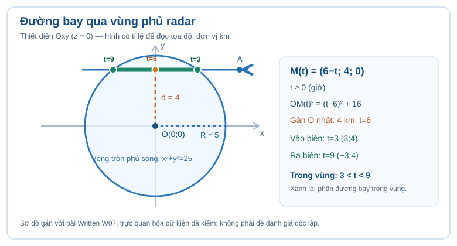

---
hide:
  - toc
---

HỌC THEO CHUYÊN ĐỀ · CĐ18 · TOÁN THPT

<nav class="thpt-sgk-lesson-nav" aria-label="Điều hướng Chuyên đề 18">
<a href="../../cd17/kien-thuc/">← Chuyên đề trước</a>
Chuyên đề sau →
<a href="../kien-thuc/">Kiến thức</a>
<a href="../tu-kiem-tra/">Tự kiểm tra</a>
</nav>

<a href="../../">← Tổng quan các Chuyên đề</a>

<link rel="stylesheet" href="../../../../assets/stylesheets/thpt-topic-w1-golden-v1.css">

Đang chuẩn bị luyện tập…

<!-- TOPIC18_APPROVED_SOURCE_START -->
<!-- Q18 SOURCE_LEARNER_BLOB d8f30dc5a62b1706e5464e5a7b3b52b15e5bd960; Q18_RECEIPT_BLOB 3a0cbbfb74252787f08c9504de9018c7e58bf8a1; AUTHORING_PR #855; PUBLIC_PROJECTION_ONLY -->

# Luyện tập

Hãy đọc đề, thử giải vào vở rồi tự mở lời giải. Khi chọn vectơ pháp tuyến hay chỉ phương, hãy viết rõ điều kiện khác 0; khi tìm góc, chú ý trị tuyệt đối và công thức sin/cos; khi kiểm vị trí, đừng bỏ qua nghiệm tham số và trường hợp suy biến.

## 1. Vectơ và phép toán hình học

<!-- DISPLAY_ONLY_CANONICAL: THPT-G12-B06-C01; ORIGINAL_SOURCE_BLOB: 856a37bd16d2746ffc2e12906de18d1f4338a3b6; ORIGINAL_OWNER: SGK; NO_NEW_ITEM_ID; CHII_SOURCE -->
**Bài 1.** Trong hình lập phương cạnh 4 cm, độ dài vectơ đi dọc một cạnh bằng bao nhiêu?

Lời giải

- **Đáp án:** 4 cm
- **Lời giải/suy luận:** Độ dài vectơ bằng khoảng cách hai đầu cạnh, bằng đúng độ dài cạnh.

<!-- DISPLAY_ONLY_CANONICAL: THPT-G12-B06-P01; ORIGINAL_SOURCE_BLOB: 856a37bd16d2746ffc2e12906de18d1f4338a3b6; ORIGINAL_OWNER: SGK; NO_NEW_ITEM_ID; CHII_SOURCE -->
**Bài 2.** Hình hộp chữ nhật có các cạnh theo ba phương vuông góc dài 3, 4, 12 cm. Độ dài vectơ nối hai đỉnh đối diện?

Lời giải

- **Đáp án:** 13 cm
- **Lời giải/suy luận:** Đường chéo không gian dài $\sqrt{3^2+4^2+12^2}=13$ cm.

<!-- DISPLAY_ONLY_CANONICAL: THPT-G12-B06-P02; ORIGINAL_SOURCE_BLOB: 856a37bd16d2746ffc2e12906de18d1f4338a3b6; ORIGINAL_OWNER: SGK; NO_NEW_ITEM_ID; CHII_SOURCE -->
**Bài 3.** Với hai điểm phân biệt A, B, vectơ $\overrightarrow{AA}$ có độ dài và hướng thế nào?

Lời giải

- **Đáp án:** Độ dài 0, hướng không xác định
- **Lời giải/suy luận:** Vectơ-không có hai đầu trùng nhau, không có hướng xác định.

<!-- DISPLAY_ONLY_CANONICAL: THPT-G12-B06-W01; ORIGINAL_SOURCE_BLOB: 856a37bd16d2746ffc2e12906de18d1f4338a3b6; ORIGINAL_OWNER: SGK; NO_NEW_ITEM_ID; CHII_SOURCE -->
**Bài 4.** Hình hộp chữ nhật có ba kích thước 2, 3, 6 cm. Giải thích vì sao vectơ nối hai đỉnh đối diện có độ dài 7 cm, không phải 11 cm.

Lời giải và rubric

- **Đáp án:** 7 cm
- **Lời giải/suy luận:** Chọn ba cạnh vuông góc, áp dụng Pythagore không gian: $\sqrt{2^2+3^2+6^2}=7$. Tổng $2+3+6$ là độ dài đường đi theo ba cạnh, không phải độ dời.

- **Rubric tự luận (tổng 5 điểm, tự đối chiếu sau khi làm):** 2 điểm lập mô hình ba phương vuông góc; 2 điểm tính căn tổng bình phương; 1 điểm phân biệt đường đi với độ dời.

<!-- DISPLAY_ONLY_CANONICAL: THPT-TOP18-P01; SOURCE_CANONICAL_UNCHANGED -->
<!-- CANONICAL_ITEM_ID: THPT-TOP18-P01; PRIMARY_OUTCOME: TOP18-O01; ROLE: TOPIC_PRACTICE; ORIGINAL_R03_ANSWER_UNCHANGED -->
**Bài 5.** Cho ba điểm P, Q, R thẳng hàng **theo thứ tự P–Q–R** (Q nằm giữa P và R), PQ=3 cm và QR=2 cm. Tính PR. Trong trường hợp riêng P=Q, vectơ PQ có phải vectơ đơn vị không?

Lời giải và tự đối chiếu

Vì Q nằm giữa P và R nên PR=PQ+QR=3+2=5 cm. Ở trường hợp riêng P=Q thì vectơ PQ là vectơ-không, độ dài bằng 0 nên không phải vectơ đơn vị.

**D6:** Không suy hướng từ nét vẽ, kiểm điểm đầu/cuối; vectơ-không không được đưa vào công thức góc.

<!-- DISPLAY_ONLY_CANONICAL: THPT-G12-B06-C02; ORIGINAL_SOURCE_BLOB: 856a37bd16d2746ffc2e12906de18d1f4338a3b6; ORIGINAL_OWNER: SGK; NO_NEW_ITEM_ID; CHII_SOURCE -->
**Bài 6.** Trong hình bình hành ABCD, vectơ nào bằng $\overrightarrow{AB}$?

Lời giải

- **Đáp án:** $\overrightarrow{DC}$
- **Lời giải/suy luận:** Hai vectơ cùng chiều và cùng độ dài trên hai cạnh đối.

<!-- DISPLAY_ONLY_CANONICAL: THPT-G12-B06-P03; ORIGINAL_SOURCE_BLOB: 856a37bd16d2746ffc2e12906de18d1f4338a3b6; ORIGINAL_OWNER: SGK; NO_NEW_ITEM_ID; CHII_SOURCE -->
**Bài 7.** Trong hình bình hành ABCD, vectơ nào đối với $\overrightarrow{AB}$?

Lời giải

- **Đáp án:** $\overrightarrow{BA}$ hoặc $\overrightarrow{CD}$
- **Lời giải/suy luận:** Đều cùng độ dài và ngược chiều so với $\overrightarrow{AB}$.

<!-- DISPLAY_ONLY_CANONICAL: THPT-G12-B06-P04; ORIGINAL_SOURCE_BLOB: 856a37bd16d2746ffc2e12906de18d1f4338a3b6; ORIGINAL_OWNER: SGK; NO_NEW_ITEM_ID; CHII_SOURCE -->
**Bài 8.** Hai vectơ không bằng 0 cùng phương, một vectơ dài 2 cm, vectơ kia dài 5 cm. Chúng có thể bằng nhau không?

Lời giải

- **Đáp án:** Không
- **Lời giải/suy luận:** Hai vectơ bằng nhau phải cùng hướng và cùng độ dài; 2 khác 5.

<!-- DISPLAY_ONLY_CANONICAL: THPT-G12-B06-W02; ORIGINAL_SOURCE_BLOB: 856a37bd16d2746ffc2e12906de18d1f4338a3b6; ORIGINAL_OWNER: SGK; NO_NEW_ITEM_ID; CHII_SOURCE -->
**Bài 9.** Trong hình hộp $ABCD.A\prime B\prime C\prime D\prime$, liệt kê hai vectơ khác vị trí bằng $\overrightarrow{AB}$ và một vectơ đối với nó; giải thích dựa vào hướng và độ dài.

Lời giải và rubric

- **Đáp án:** $\overrightarrow{DC}$ và $\overrightarrow{A\prime B\prime}$ bằng $\overrightarrow{AB}$; $\overrightarrow{BA}$ là vectơ đối.
- **Lời giải/suy luận:** Các cạnh song song đồng hướng tương ứng trong hình hộp có độ dài bằng nhau; đảo đầu-cuối đổi hướng.

- **Rubric tự luận (tổng 5 điểm, tự đối chiếu sau khi làm):** 2 điểm tìm hai vectơ bằng; 1 điểm vectơ đối; 2 điểm giải thích chiều/độ dài.

<!-- DISPLAY_ONLY_CANONICAL: THPT-TOP18-P02; SOURCE_CANONICAL_UNCHANGED -->
<!-- CANONICAL_ITEM_ID: THPT-TOP18-P02; PRIMARY_OUTCOME: TOP18-O02; ROLE: TOPIC_PRACTICE; ORIGINAL_R03_ANSWER_UNCHANGED -->
**Bài 10.** Một con đường đi 4 km về phía Đông, một đường khác dài 4 km về Tây. Hai vectơ độ dời bằng nhau hay đối nhau?

Lời giải và tự đối chiếu

Đối nhau: độ dài bằng nhau nhưng hai hướng ngược nhau. Vị trí đặt mũi tên không làm đổi kết luận.

**D6:** Hãy vẽ mũi tên đầu/cuối thay vì so sánh riêng độ dài.

<!-- DISPLAY_ONLY_CANONICAL: THPT-G12-B06-C03; ORIGINAL_SOURCE_BLOB: 856a37bd16d2746ffc2e12906de18d1f4338a3b6; ORIGINAL_OWNER: SGK; NO_NEW_ITEM_ID; CHII_SOURCE -->
**Bài 11.** Với A,B,C bất kì, $\overrightarrow{AB}+\overrightarrow{BC}$ bằng gì?

Lời giải

- **Đáp án:** $\overrightarrow{AC}$
- **Lời giải/suy luận:** Ghép đường đi đầu–đuôi A→B→C.

<!-- DISPLAY_ONLY_CANONICAL: THPT-G12-B06-P05; ORIGINAL_SOURCE_BLOB: 856a37bd16d2746ffc2e12906de18d1f4338a3b6; ORIGINAL_OWNER: SGK; NO_NEW_ITEM_ID; CHII_SOURCE -->
**Bài 12.** Trong hình bình hành ABCD, $\overrightarrow{AB}+\overrightarrow{AD}$ bằng gì?

Lời giải

- **Đáp án:** $\overrightarrow{AC}$
- **Lời giải/suy luận:** Quy tắc đường chéo hình bình hành.

<!-- DISPLAY_ONLY_CANONICAL: THPT-G12-B06-P06; ORIGINAL_SOURCE_BLOB: 856a37bd16d2746ffc2e12906de18d1f4338a3b6; ORIGINAL_OWNER: SGK; NO_NEW_ITEM_ID; CHII_SOURCE -->
**Bài 13.** Trong hình hộp $ABCD.A\prime B\prime C\prime D\prime$, $\overrightarrow{AB}+\overrightarrow{AD}+\overrightarrow{AA\prime}$ bằng gì?

Lời giải

- **Đáp án:** $\overrightarrow{AC\prime}$
- **Lời giải/suy luận:** Hai cạnh đáy cho AC, cạnh đứng bằng CC′; nối thành AC′.

<!-- DISPLAY_ONLY_CANONICAL: THPT-G12-B06-W03; ORIGINAL_SOURCE_BLOB: 856a37bd16d2746ffc2e12906de18d1f4338a3b6; ORIGINAL_OWNER: SGK; NO_NEW_ITEM_ID; CHII_SOURCE -->
**Bài 14.** Cho tứ diện ABCD. Rút gọn $\overrightarrow{AB}+\overrightarrow{BC}+\overrightarrow{CD}$ theo hai cách: nối đường đi và nhóm đại số.

Lời giải và rubric

- **Đáp án:** $\overrightarrow{AD}$
- **Lời giải/suy luận:** Nối A→B→C→D được AD. Hoặc AB+BC=AC, AC+CD=AD.

- **Rubric tự luận (tổng 5 điểm, tự đối chiếu sau khi làm):** 2 điểm mô tả đường đi; 2 điểm nhóm đúng; 1 điểm kết luận AD.

<!-- DISPLAY_ONLY_CANONICAL: THPT-TOP18-P03; SOURCE_CANONICAL_UNCHANGED -->
<!-- CANONICAL_ITEM_ID: THPT-TOP18-P03; PRIMARY_OUTCOME: TOP18-O03; ROLE: TOPIC_PRACTICE; ORIGINAL_R03_ANSWER_UNCHANGED -->
**Bài 15.** Trong tam giác ABC, viết vectơ AB + vectơ BC − vectơ AC dưới dạng đơn giản.

Lời giải và tự đối chiếu

Bằng vectơ-không vì AB+BC=AC, nên hiệu với AC bằng 0.

**D6:** Nếu không ghép được đầu của mũi tên thứ hai vào cuối mũi tên thứ nhất, hãy tịnh tiến vectơ rồi mới cộng.

<!-- DISPLAY_ONLY_CANONICAL: THPT-G12-B06-C04; ORIGINAL_SOURCE_BLOB: 856a37bd16d2746ffc2e12906de18d1f4338a3b6; ORIGINAL_OWNER: SGK; NO_NEW_ITEM_ID; CHII_SOURCE -->
**Bài 16.** Nếu $|\vec a|=3$ và $k=-2$, độ dài $k\vec a$ bằng bao nhiêu?

Lời giải

- **Đáp án:** 6
- **Lời giải/suy luận:** $|-2|\cdot 3=6$; hướng đổi do k âm.

<!-- DISPLAY_ONLY_CANONICAL: THPT-G12-B06-P07; ORIGINAL_SOURCE_BLOB: 856a37bd16d2746ffc2e12906de18d1f4338a3b6; ORIGINAL_OWNER: SGK; NO_NEW_ITEM_ID; CHII_SOURCE -->
**Bài 17.** Điểm M là trung điểm đoạn AB. Biểu diễn $\overrightarrow{AM}$ qua $\overrightarrow{AB}$.

Lời giải

- **Đáp án:** $\tfrac12\overrightarrow{AB}$
- **Lời giải/suy luận:** Cùng hướng và độ dài bằng một nửa.

<!-- DISPLAY_ONLY_CANONICAL: THPT-G12-B06-P08; ORIGINAL_SOURCE_BLOB: 856a37bd16d2746ffc2e12906de18d1f4338a3b6; ORIGINAL_OWNER: SGK; NO_NEW_ITEM_ID; CHII_SOURCE -->
**Bài 18.** Điểm N ở tia đối của AB, AN=3AB. Viết $\overrightarrow{AN}$ qua $\overrightarrow{AB}$.

Lời giải

- **Đáp án:** $-3\overrightarrow{AB}$
- **Lời giải/suy luận:** Ngược hướng, độ dài gấp ba.

<!-- DISPLAY_ONLY_CANONICAL: THPT-G12-B06-W04; ORIGINAL_SOURCE_BLOB: 856a37bd16d2746ffc2e12906de18d1f4338a3b6; ORIGINAL_OWNER: SGK; NO_NEW_ITEM_ID; CHII_SOURCE -->
**Bài 19.** Cho $\vec a\ne\vec0$. Hai vectơ $\vec b=-\tfrac32\vec a$ và $\vec c=\tfrac12\vec a$ có cùng phương không? Hướng và tỉ số độ dài?

Lời giải và rubric

- **Đáp án:** Có; b ngược hướng a, c cùng hướng a; $|b|:|c|=3:1$.
- **Lời giải/suy luận:** b,c là bội số của a; dấu hệ số xác định chiều, độ lớn xác định tỉ lệ.

- **Rubric tự luận (tổng 5 điểm, tự đối chiếu sau khi làm):** 2 điểm chứng minh cùng phương; 2 điểm giải thích hướng; 1 điểm tỉ số.

<!-- DISPLAY_ONLY_CANONICAL: THPT-TOP18-P04; SOURCE_CANONICAL_UNCHANGED -->
<!-- CANONICAL_ITEM_ID: THPT-TOP18-P04; PRIMARY_OUTCOME: TOP18-O04; ROLE: TOPIC_PRACTICE; ORIGINAL_R03_ANSWER_UNCHANGED -->
**Bài 20.** Cho độ dời u có độ dài 5 cm và k=−2. Tính độ dài ku và so sánh hướng với u.

Lời giải và tự đối chiếu

Độ dài |−2|·5=10 cm; vì k âm nên ngược hướng u.

**D6:** Nếu lẫn dấu và độ dài, tách riêng: độ dài nhân |k|, chiều quyết định theo dấu k.

<!-- DISPLAY_ONLY_CANONICAL: THPT-G12-B06-C05; ORIGINAL_SOURCE_BLOB: 856a37bd16d2746ffc2e12906de18d1f4338a3b6; ORIGINAL_OWNER: SGK; NO_NEW_ITEM_ID; CHII_SOURCE -->
**Bài 21.** Hai vectơ khác 0 dài 2 và 3, tạo góc 60°. Tính tích vô hướng.

Lời giải

- **Đáp án:** 3
- **Lời giải/suy luận:** $2\cdot3\cdot\cos60^\circ=3$.

<!-- DISPLAY_ONLY_CANONICAL: THPT-G12-B06-P09; ORIGINAL_SOURCE_BLOB: 856a37bd16d2746ffc2e12906de18d1f4338a3b6; ORIGINAL_OWNER: SGK; NO_NEW_ITEM_ID; CHII_SOURCE -->
**Bài 22.** Hai vectơ khác 0 dài 5 và 4 vuông góc. Tích vô hướng bằng bao nhiêu?

Lời giải

- **Đáp án:** 0
- **Lời giải/suy luận:** Cos90°=0 nên tích bằng 0.

<!-- DISPLAY_ONLY_CANONICAL: THPT-G12-B06-P10; ORIGINAL_SOURCE_BLOB: 856a37bd16d2746ffc2e12906de18d1f4338a3b6; ORIGINAL_OWNER: SGK; NO_NEW_ITEM_ID; CHII_SOURCE -->
**Bài 23.** Hai vectơ khác 0 dài 3 và 8 tạo góc 120°. Tích vô hướng bằng bao nhiêu?

Lời giải

- **Đáp án:** -12
- **Lời giải/suy luận:** $3\cdot8\cdot\cos120^\circ=-12$.

<!-- DISPLAY_ONLY_CANONICAL: THPT-G12-B06-W05; ORIGINAL_SOURCE_BLOB: 856a37bd16d2746ffc2e12906de18d1f4338a3b6; ORIGINAL_OWNER: SGK; NO_NEW_ITEM_ID; CHII_SOURCE -->
**Bài 24.** Giả sử $|\vec u|=2$, $|\vec v|=5$ và $\vec u\cdot\vec v=-5$. Hãy tìm góc và giải thích dấu âm.

Lời giải và rubric

- **Đáp án:** 120°
- **Lời giải/suy luận:** $\cos\theta=-5/(2\cdot5)=-1/2$ nên $\theta=120^\circ$; hình chiếu ngược hướng.

- **Rubric tự luận (tổng 5 điểm, tự đối chiếu sau khi làm):** 1 điểm kiểm hai độ dài dương; 2 điểm thiết lập cos; 1 điểm tìm góc; 1 điểm giải thích dấu.

<!-- DISPLAY_ONLY_CANONICAL: THPT-TOP18-P05; SOURCE_CANONICAL_UNCHANGED -->
<!-- CANONICAL_ITEM_ID: THPT-TOP18-P05; PRIMARY_OUTCOME: TOP18-O05; ROLE: TOPIC_PRACTICE; ORIGINAL_R03_ANSWER_UNCHANGED -->
**Bài 25.** Hai vectơ độ dài 3 và 4, góc giữa chúng 60°. Tính tích vô hướng.

Lời giải và tự đối chiếu

3·4·cos60°=6. Cần biết cả độ dài và góc; không nhân 3·4 trực tiếp.

**D6:** Nếu một vectơ bằng 0, tích vô hướng vẫn bằng 0 nhưng không dùng phép chia cho tích độ dài để tìm cos góc.

<!-- DISPLAY_ONLY_CANONICAL: THPT-G12-B06-C06; ORIGINAL_SOURCE_BLOB: 856a37bd16d2746ffc2e12906de18d1f4338a3b6; ORIGINAL_OWNER: SGK; NO_NEW_ITEM_ID; CHII_SOURCE -->
**Bài 26.** Lực 10 N cùng hướng với độ dời 4 m. Công của lực là bao nhiêu?

Lời giải

- **Đáp án:** 40 J
- **Lời giải/suy luận:** Góc 0°, W=10·4·cos0°=40 J.

<!-- DISPLAY_ONLY_CANONICAL: THPT-G12-B06-P11; ORIGINAL_SOURCE_BLOB: 856a37bd16d2746ffc2e12906de18d1f4338a3b6; ORIGINAL_OWNER: SGK; NO_NEW_ITEM_ID; CHII_SOURCE -->
**Bài 27.** Lực 12 N vuông góc với độ dời 5 m. Công bằng bao nhiêu?

Lời giải

- **Đáp án:** 0 J
- **Lời giải/suy luận:** Góc 90° nên thành phần lực theo độ dời bằng 0.

<!-- DISPLAY_ONLY_CANONICAL: THPT-G12-B06-P12; ORIGINAL_SOURCE_BLOB: 856a37bd16d2746ffc2e12906de18d1f4338a3b6; ORIGINAL_OWNER: SGK; NO_NEW_ITEM_ID; CHII_SOURCE -->
**Bài 28.** Lực 8 N tạo góc 120° với độ dời 3 m. Công bằng bao nhiêu?

Lời giải

- **Đáp án:** -12 J
- **Lời giải/suy luận:** $W=8\cdot3\cdot(-1/2)=-12$ J; công âm do lực chống chuyển động.

<!-- DISPLAY_ONLY_CANONICAL: THPT-G12-B06-W06; ORIGINAL_SOURCE_BLOB: 856a37bd16d2746ffc2e12906de18d1f4338a3b6; ORIGINAL_OWNER: SGK; NO_NEW_ITEM_ID; CHII_SOURCE -->
**Bài 29.** Hai lực không đổi $\vec F_1,\vec F_2$ lần lượt 10 N, 20 N, cùng tạo góc 60° với cùng độ dời 2 m. Tính tổng công và nêu vì sao có thể cộng.

Lời giải và rubric

- **Đáp án:** 30 J
- **Lời giải/suy luận:** Theo tính phân phối của tích vô hướng, W=W1+W2=10·2·1/2+20·2·1/2=10+20=30 J.

- **Rubric tự luận (tổng 5 điểm, tự đối chiếu sau khi làm):** 2 điểm công mỗi lực; 2 điểm cộng hợp lí bằng phân phối; 1 điểm đơn vị và giả thiết.

<!-- DISPLAY_ONLY_CANONICAL: THPT-TOP18-P06; SOURCE_CANONICAL_UNCHANGED -->
<!-- CANONICAL_ITEM_ID: THPT-TOP18-P06; PRIMARY_OUTCOME: TOP18-O06; ROLE: TOPIC_PRACTICE; ORIGINAL_R03_ANSWER_UNCHANGED -->
**Bài 30.** Một lực 10 N tạo góc 60° với độ dời dài 2 m. Công của lực theo hướng độ dời?

Lời giải và tự đối chiếu

W=10·2·cos60°=10 J, vì chỉ thành phần lực dọc chuyển dời sinh công.

**D6:** D6: phân loại bài hỏi tổng vectơ hay hình chiếu; luôn có sơ đồ phương và đơn vị.

## 2. Làm quen hệ tọa độ Oxyz

<!-- DISPLAY_ONLY_CANONICAL: THPT-G12-B07-C01; ORIGINAL_SOURCE_BLOB: 856a37bd16d2746ffc2e12906de18d1f4338a3b6; ORIGINAL_OWNER: SGK; NO_NEW_ITEM_ID; CHII_SOURCE -->
**Bài 31.** Trong hệ Oxyz, điểm P(4;2;0) nằm trên mặt phẳng tọa độ nào?

Lời giải

- **Đáp án:** (Oxy)
- **Lời giải/suy luận:** Mặt phẳng Oxy đặc trưng bởi z=0.

<!-- DISPLAY_ONLY_CANONICAL: THPT-G12-B07-P01; ORIGINAL_SOURCE_BLOB: 856a37bd16d2746ffc2e12906de18d1f4338a3b6; ORIGINAL_OWNER: SGK; NO_NEW_ITEM_ID; CHII_SOURCE -->
**Bài 32.** Một điểm Q thuộc trục Oz. Hai tọa độ nào bắt buộc bằng 0?

Lời giải

- **Đáp án:** x=0 và y=0
- **Lời giải/suy luận:** Trên trục Oz chỉ có thành phần z.

<!-- DISPLAY_ONLY_CANONICAL: THPT-G12-B07-P02; ORIGINAL_SOURCE_BLOB: 856a37bd16d2746ffc2e12906de18d1f4338a3b6; ORIGINAL_OWNER: SGK; NO_NEW_ITEM_ID; CHII_SOURCE -->
**Bài 33.** Điểm M(-1;0;3) thuộc mặt phẳng tọa độ nào?

Lời giải

- **Đáp án:** (Oxz)
- **Lời giải/suy luận:** y=0 nên M thuộc mặt phẳng Oxz.

<!-- DISPLAY_ONLY_CANONICAL: THPT-G12-B07-W01; ORIGINAL_SOURCE_BLOB: 856a37bd16d2746ffc2e12906de18d1f4338a3b6; ORIGINAL_OWNER: SGK; NO_NEW_ITEM_ID; CHII_SOURCE -->
**Bài 34.** Phân loại A(0;2;-1), B(0;0;5), C(3;-2;0) theo mặt phẳng tọa độ hoặc trục tọa độ; giải thích.

Lời giải và rubric

- **Đáp án:** A thuộc Oyz; B thuộc Oz và cả Oxz, Oyz; C thuộc Oxy.
- **Lời giải/suy luận:** Xét các tọa độ bằng 0 cho từng điểm. Đừng nhầm điều kiện 1 tọa độ bằng 0 của mặt phẳng với 2 tọa độ bằng 0 của trục.

- **Rubric tự luận (tổng 5 điểm, tự đối chiếu sau khi làm):** 3 điểm xác định đúng A/B/C; 2 điểm giải thích điều kiện các tọa độ 0.

<!-- DISPLAY_ONLY_CANONICAL: THPT-TOP18-P07; SOURCE_CANONICAL_UNCHANGED -->
<!-- CANONICAL_ITEM_ID: THPT-TOP18-P07; PRIMARY_OUTCOME: TOP18-O07; ROLE: TOPIC_PRACTICE; ORIGINAL_R03_ANSWER_UNCHANGED -->
**Bài 35.** Điểm A=(0,4,−3) thuộc mặt phẳng Oyz không? Vì sao?

Lời giải và tự đối chiếu

Có, vì x=0. Không bắt buộc y,z dương để thuộc mặt tọa độ.

**D6:** Gắn điều kiện bằng 0 với tên của tọa độ bị thiếu, không suy vị trí chỉ từ hình xiên.

<!-- DISPLAY_ONLY_CANONICAL: THPT-G12-B07-C02; ORIGINAL_SOURCE_BLOB: 856a37bd16d2746ffc2e12906de18d1f4338a3b6; ORIGINAL_OWNER: SGK; NO_NEW_ITEM_ID; CHII_SOURCE -->
**Bài 36.** Cho $\vec a=3\vec i-2\vec j+\vec k$. Tọa độ $\vec a$ là gì?

Lời giải

- **Đáp án:** (3;-2;1)
- **Lời giải/suy luận:** Hệ số theo i,j,k tạo thành ba tọa độ.

<!-- DISPLAY_ONLY_CANONICAL: THPT-G12-B07-P03; ORIGINAL_SOURCE_BLOB: 856a37bd16d2746ffc2e12906de18d1f4338a3b6; ORIGINAL_OWNER: SGK; NO_NEW_ITEM_ID; CHII_SOURCE -->
**Bài 37.** Nếu M(-2;4;1), tọa độ vectơ $\overrightarrow{OM}$ bằng gì?

Lời giải

- **Đáp án:** (-2;4;1)
- **Lời giải/suy luận:** Theo định nghĩa tọa độ điểm từ vectơ vị trí.

<!-- DISPLAY_ONLY_CANONICAL: THPT-G12-B07-P04; ORIGINAL_SOURCE_BLOB: 856a37bd16d2746ffc2e12906de18d1f4338a3b6; ORIGINAL_OWNER: SGK; NO_NEW_ITEM_ID; CHII_SOURCE -->
**Bài 38.** Vectơ $\vec u=(0;0;-5)$ viết dưới dạng i,j,k thế nào?

Lời giải

- **Đáp án:** $-5\vec k$
- **Lời giải/suy luận:** Hai tọa độ x,y bằng 0.

<!-- DISPLAY_ONLY_CANONICAL: THPT-G12-B07-W02; ORIGINAL_SOURCE_BLOB: 856a37bd16d2746ffc2e12906de18d1f4338a3b6; ORIGINAL_OWNER: SGK; NO_NEW_ITEM_ID; CHII_SOURCE -->
**Bài 39.** Cho P(1;-2;3). Viết vectơ vị trí OP và giải thích vì sao vectơ bằng OP đặt ở một điểm khác vẫn có tọa độ tương tự.

Lời giải và rubric

- **Đáp án:** $\overrightarrow{OP}=\vec i-2\vec j+3\vec k$; tọa độ phụ thuộc hướng và độ dài vectơ trong cùng hệ, không phụ thuộc nơi dời song song.
- **Lời giải/suy luận:** Theo định nghĩa tọa độ điểm, $P(1;-2;3)$ nghĩa là $\overrightarrow{OP}=\vec i-2\vec j+3\vec k$. Vectơ có thể dời song song mà không đổi tọa độ trong cùng hệ, nhưng điểm cuối sẽ đổi nếu đổi điểm đầu.

- **Rubric tự luận (tổng 5 điểm, tự đối chiếu sau khi làm):** 2 điểm phân tích đúng; 2 điểm giải thích vectơ tự do; 1 điểm phân biệt điểm/tọa độ.

<!-- DISPLAY_ONLY_CANONICAL: THPT-TOP18-P08; SOURCE_CANONICAL_UNCHANGED -->
<!-- CANONICAL_ITEM_ID: THPT-TOP18-P08; PRIMARY_OUTCOME: TOP18-O08; ROLE: TOPIC_PRACTICE; ORIGINAL_R03_ANSWER_UNCHANGED -->
**Bài 40.** Vectơ u=−2i+3j+k. Viết bộ ba tọa độ của u và của điểm N sao cho ON=u.

Lời giải và tự đối chiếu

u=(−2,3,1) và N(−2,3,1) khi gốc là O và ba trục chuẩn.

**D6:** Nhắc lại điểm cần gốc, vectơ cần thành phần dịch chuyển; không tự đổi dấu khi đọc thành phần âm.

<!-- DISPLAY_ONLY_CANONICAL: THPT-G12-B07-C03; ORIGINAL_SOURCE_BLOB: 856a37bd16d2746ffc2e12906de18d1f4338a3b6; ORIGINAL_OWNER: SGK; NO_NEW_ITEM_ID; CHII_SOURCE -->
**Bài 41.** Trong phòng lấy O góc sàn và ba trục dọc dài/rộng/cao. Vật cách O lần lượt 2,3,4 m theo ba chiều dương có tọa độ gì?

Lời giải

- **Đáp án:** (2;3;4) m
- **Lời giải/suy luận:** Ba chuyển động độc lập theo ba trục từ O.

<!-- DISPLAY_ONLY_CANONICAL: THPT-G12-B07-P05; ORIGINAL_SOURCE_BLOB: 856a37bd16d2746ffc2e12906de18d1f4338a3b6; ORIGINAL_OWNER: SGK; NO_NEW_ITEM_ID; CHII_SOURCE -->
**Bài 42.** Một cảm biến ở trần trong phòng cao 3 m, chọn Oz hướng lên từ sàn. Tọa độ z của cảm biến là gì?

Lời giải

- **Đáp án:** 3 m
- **Lời giải/suy luận:** Độ cao được đo từ mặt sàn z=0 theo chiều dương.

<!-- DISPLAY_ONLY_CANONICAL: THPT-G12-B07-P06; ORIGINAL_SOURCE_BLOB: 856a37bd16d2746ffc2e12906de18d1f4338a3b6; ORIGINAL_OWNER: SGK; NO_NEW_ITEM_ID; CHII_SOURCE -->
**Bài 43.** Khi lấy gốc ở góc trần và Oz hướng xuống, sàn cách gốc 3 m có tọa độ z gì?

Lời giải

- **Đáp án:** 3 m
- **Lời giải/suy luận:** Trục dương đã đổi hướng; do chọn Oz xuống nên sàn có z dương.

<!-- DISPLAY_ONLY_CANONICAL: THPT-G12-B07-W03; ORIGINAL_SOURCE_BLOB: 856a37bd16d2746ffc2e12906de18d1f4338a3b6; ORIGINAL_OWNER: SGK; NO_NEW_ITEM_ID; CHII_SOURCE -->
**Bài 44.** Phòng 5×4×3 m; lấy O ở góc sàn, Ox dài, Oy rộng, Oz cao. Điểm A(5;4;3) là vị trí nào? Nếu gốc thay thành điểm trần đối diện và trục Oz vẫn hướng lên, z của O cũ bằng bao nhiêu?

Lời giải và rubric

- **Đáp án:** A là góc trần đối diện O; z của O cũ bằng -3 m trong hệ mới.
- **Lời giải/suy luận:** Nêu rõ gốc mới; điểm sàn thấp hơn gốc trần 3 m.

- **Rubric tự luận (tổng 5 điểm, tự đối chiếu sau khi làm):** 2 điểm mô tả A; 2 điểm trục mới và dấu; 1 điểm giải thích tính tương đối.

<!-- DISPLAY_ONLY_CANONICAL: THPT-TOP18-P09; SOURCE_CANONICAL_UNCHANGED -->
<!-- CANONICAL_ITEM_ID: THPT-TOP18-P09; PRIMARY_OUTCOME: TOP18-O09; ROLE: TOPIC_PRACTICE; ORIGINAL_R03_ANSWER_UNCHANGED -->
**Bài 45.** Drone ở A=(1,−2,5) m; chuyển sang B=(1,2,5) m. Sự thay đổi theo Oy là bao nhiêu, theo chiều nào?

Lời giải và tự đối chiếu

Tăng 4 m về Bắc; chiều cao z không đổi.

**D6:** Nếu quên quy ước dấu, vẽ ba trục và ghi rõ đơn vị trước khi giải.

<!-- DISPLAY_ONLY_CANONICAL: THPT-G12-B07-C04; ORIGINAL_SOURCE_BLOB: 856a37bd16d2746ffc2e12906de18d1f4338a3b6; ORIGINAL_OWNER: SGK; NO_NEW_ITEM_ID; CHII_SOURCE -->
**Bài 46.** A(1;2;3), B(5;2;1). Tọa độ $\overrightarrow{AB}$?

Lời giải

- **Đáp án:** (4;0;-2)
- **Lời giải/suy luận:** B-A theo từng tọa độ.

<!-- DISPLAY_ONLY_CANONICAL: THPT-G12-B07-P07; ORIGINAL_SOURCE_BLOB: 856a37bd16d2746ffc2e12906de18d1f4338a3b6; ORIGINAL_OWNER: SGK; NO_NEW_ITEM_ID; CHII_SOURCE -->
**Bài 47.** A(-2;3;4), B(1;-1;2). Tọa độ $\overrightarrow{BA}$?

Lời giải

- **Đáp án:** (-3;4;2)
- **Lời giải/suy luận:** A-B vì điểm đầu B, cuối A.

<!-- DISPLAY_ONLY_CANONICAL: THPT-G12-B07-P08; ORIGINAL_SOURCE_BLOB: 856a37bd16d2746ffc2e12906de18d1f4338a3b6; ORIGINAL_OWNER: SGK; NO_NEW_ITEM_ID; CHII_SOURCE -->
**Bài 48.** A(0;0;0), B(-3;2;5). Tọa độ $\overrightarrow{AB}$?

Lời giải

- **Đáp án:** (-3;2;5)
- **Lời giải/suy luận:** Lấy vị trí B trừ vị trí gốc A.

<!-- DISPLAY_ONLY_CANONICAL: THPT-G12-B07-W04; ORIGINAL_SOURCE_BLOB: 856a37bd16d2746ffc2e12906de18d1f4338a3b6; ORIGINAL_OWNER: SGK; NO_NEW_ITEM_ID; CHII_SOURCE -->
**Bài 49.** Cho A(2;-3;1), B(-4;5;0). Tính AB và BA theo tọa độ, rồi giải thích quan hệ.

Lời giải và rubric

- **Đáp án:** $\overrightarrow{AB}=(-6;8;-1)$ và $\overrightarrow{BA}=(6;-8;1)$; đối nhau.
- **Lời giải/suy luận:** B-A và A-B có dấu ngược nhau ở cả 3 thành phần.

- **Rubric tự luận (tổng 5 điểm, tự đối chiếu sau khi làm):** 2 điểm AB; 2 điểm BA; 1 điểm quan hệ vectơ đối.

<!-- DISPLAY_ONLY_CANONICAL: THPT-TOP18-P10; SOURCE_CANONICAL_UNCHANGED -->
<!-- CANONICAL_ITEM_ID: THPT-TOP18-P10; PRIMARY_OUTCOME: TOP18-O10; ROLE: TOPIC_PRACTICE; ORIGINAL_R03_ANSWER_UNCHANGED -->
**Bài 50.** Cho C=(−1,3,2), D=(2,3,−2). Tính CD và DC; có đối nhau không?

Lời giải và tự đối chiếu

CD=(3,0,−4), DC=(−3,0,4)=−CD.

**D6:** Thường xuyên thử lấy tọa độ A cộng kết quả AB để xem có trở về B không.

## 3. Phép toán tọa độ và khoảng cách

<!-- DISPLAY_ONLY_CANONICAL: THPT-G12-B08-C01; ORIGINAL_SOURCE_BLOB: 856a37bd16d2746ffc2e12906de18d1f4338a3b6; ORIGINAL_OWNER: SGK; NO_NEW_ITEM_ID; CHII_SOURCE -->
**Bài 51.** Với a=(1;2;3), b=(3;-1;2), tính a+b.

Lời giải

- **Đáp án:** (4;1;5)
- **Lời giải/suy luận:** Cộng ba tọa độ tương ứng.

<!-- DISPLAY_ONLY_CANONICAL: THPT-G12-B08-P01; ORIGINAL_SOURCE_BLOB: 856a37bd16d2746ffc2e12906de18d1f4338a3b6; ORIGINAL_OWNER: SGK; NO_NEW_ITEM_ID; CHII_SOURCE -->
**Bài 52.** Với a=(2;-3;1), b=(-1;4;0), tính a-b.

Lời giải

- **Đáp án:** (3;-7;1)
- **Lời giải/suy luận:** Trừ ba tọa độ tương ứng; -3-4=-7.

<!-- DISPLAY_ONLY_CANONICAL: THPT-G12-B08-P02; ORIGINAL_SOURCE_BLOB: 856a37bd16d2746ffc2e12906de18d1f4338a3b6; ORIGINAL_OWNER: SGK; NO_NEW_ITEM_ID; CHII_SOURCE -->
**Bài 53.** Với a=(1;-2;4), tính -3a.

Lời giải

- **Đáp án:** (-3;6;-12)
- **Lời giải/suy luận:** Nhân từng tọa độ với -3.

<!-- DISPLAY_ONLY_CANONICAL: THPT-G12-B08-W01; ORIGINAL_SOURCE_BLOB: 856a37bd16d2746ffc2e12906de18d1f4338a3b6; ORIGINAL_OWNER: SGK; NO_NEW_ITEM_ID; CHII_SOURCE -->
**Bài 54.** Với a=(2;1;-1), b=(-1;3;2), hãy tính 2a-3b và mô tả vì sao mỗi thành phần được tính riêng.

Lời giải và rubric

- **Đáp án:** (7;-7;-8)
- **Lời giải/suy luận:** $2a=(4;2;-2)$, $3b=(-3;9;6)$, lấy hiệu (7;-7;-8); tính duy nhất cơ sở trực giao.

- **Rubric tự luận (tổng 5 điểm, tự đối chiếu sau khi làm):** 3 điểm tính đúng ba tọa độ; 2 điểm lý giải phép toán theo trục.

<!-- DISPLAY_ONLY_CANONICAL: THPT-TOP18-P11; SOURCE_CANONICAL_UNCHANGED -->
<!-- CANONICAL_ITEM_ID: THPT-TOP18-P11; PRIMARY_OUTCOME: TOP18-O11; ROLE: TOPIC_PRACTICE; ORIGINAL_R03_ANSWER_UNCHANGED -->
**Bài 55.** Cho u=(−1,2,4), v=(3,−2,1). Tính 2u−v.

Lời giải và tự đối chiếu

2u−v=(−2,4,8)−(3,−2,1)=(−5,6,7).

**D6:** Không nhân chéo tọa độ khi cộng; làm theo từng trục và kiểm dấu số âm.

<!-- DISPLAY_ONLY_CANONICAL: THPT-G12-B08-C02; ORIGINAL_SOURCE_BLOB: 856a37bd16d2746ffc2e12906de18d1f4338a3b6; ORIGINAL_OWNER: SGK; NO_NEW_ITEM_ID; CHII_SOURCE -->
**Bài 56.** a=(2;4;6) và b=(1;2;3) có cùng phương không?

Lời giải

- **Đáp án:** Có; a=2b
- **Lời giải/suy luận:** Một hệ số 2 khớp cả ba tọa độ.

<!-- DISPLAY_ONLY_CANONICAL: THPT-G12-B08-P03; ORIGINAL_SOURCE_BLOB: 856a37bd16d2746ffc2e12906de18d1f4338a3b6; ORIGINAL_OWNER: SGK; NO_NEW_ITEM_ID; CHII_SOURCE -->
**Bài 57.** u=(3;0;-6) và v=(-1;0;2) có cùng phương không?

Lời giải

- **Đáp án:** Có; u=-3v
- **Lời giải/suy luận:** Kiểm thành phần x,z và 0= -3·0; không lấy tỉ số 0/0.

<!-- DISPLAY_ONLY_CANONICAL: THPT-G12-B08-P04; ORIGINAL_SOURCE_BLOB: 856a37bd16d2746ffc2e12906de18d1f4338a3b6; ORIGINAL_OWNER: SGK; NO_NEW_ITEM_ID; CHII_SOURCE -->
**Bài 58.** a=(1;2;3) và b=(2;4;7) có cùng phương không?

Lời giải

- **Đáp án:** Không
- **Lời giải/suy luận:** Tỉ lệ x,y là 2 nhưng z phải là 6, không phải 7.

<!-- DISPLAY_ONLY_CANONICAL: THPT-G12-B08-W02; ORIGINAL_SOURCE_BLOB: 856a37bd16d2746ffc2e12906de18d1f4338a3b6; ORIGINAL_OWNER: SGK; NO_NEW_ITEM_ID; CHII_SOURCE -->
**Bài 59.** Cho u=(t;2;4), v=(3;1;2). Tìm t để u, v cùng phương; chỉ ra hướng của chúng.

Lời giải và rubric

- **Đáp án:** t=6; cùng hướng
- **Lời giải/suy luận:** Từ tọa độ y: u=2v, kiểm z: 4=2·2, suy t=2·3=6; k=2>0.

- **Rubric tự luận (tổng 5 điểm, tự đối chiếu sau khi làm):** 2 điểm xác định hệ số; 2 điểm suy t và kiểm z; 1 điểm giải thích hướng.

<!-- DISPLAY_ONLY_CANONICAL: THPT-TOP18-P12; SOURCE_CANONICAL_UNCHANGED -->
<!-- CANONICAL_ITEM_ID: THPT-TOP18-P12; PRIMARY_OUTCOME: TOP18-O12; ROLE: TOPIC_PRACTICE; ORIGINAL_R03_ANSWER_UNCHANGED -->
**Bài 60.** Kiểm tra cùng phương của u=(2,4,1) và v=(1,2,0).

Lời giải và tự đối chiếu

Không: từ hai thành phần đầu k=2 nhưng thành phần z yêu cầu 1=2·0 sai.

**D6:** Không chia cho 0; kiểm cả ba thành phần, nếu một vectơ là vectơ-không thì nói rõ trường hợp riêng.

<!-- DISPLAY_ONLY_CANONICAL: THPT-G12-B08-C03; ORIGINAL_SOURCE_BLOB: 856a37bd16d2746ffc2e12906de18d1f4338a3b6; ORIGINAL_OWNER: SGK; NO_NEW_ITEM_ID; CHII_SOURCE -->
**Bài 61.** Trung điểm A(1;3;5), B(3;1;7) có tọa độ?

Lời giải

- **Đáp án:** (2;2;6)
- **Lời giải/suy luận:** Trung bình từng thành phần.

<!-- DISPLAY_ONLY_CANONICAL: THPT-G12-B08-P05; ORIGINAL_SOURCE_BLOB: 856a37bd16d2746ffc2e12906de18d1f4338a3b6; ORIGINAL_OWNER: SGK; NO_NEW_ITEM_ID; CHII_SOURCE -->
**Bài 62.** Trọng tâm tam giác A(0;0;0), B(3;0;0), C(0;6;0) là?

Lời giải

- **Đáp án:** (1;2;0)
- **Lời giải/suy luận:** Lấy tổng ba tọa độ rồi chia 3.

<!-- DISPLAY_ONLY_CANONICAL: THPT-G12-B08-P06; ORIGINAL_SOURCE_BLOB: 856a37bd16d2746ffc2e12906de18d1f4338a3b6; ORIGINAL_OWNER: SGK; NO_NEW_ITEM_ID; CHII_SOURCE -->
**Bài 63.** Trung điểm đoạn AB với A(-2;4;0) B(4;-2;6) là?

Lời giải

- **Đáp án:** (1;1;3)
- **Lời giải/suy luận:** Trung bình theo trục x,y,z.

<!-- DISPLAY_ONLY_CANONICAL: THPT-G12-B08-W03; ORIGINAL_SOURCE_BLOB: 856a37bd16d2746ffc2e12906de18d1f4338a3b6; ORIGINAL_OWNER: SGK; NO_NEW_ITEM_ID; CHII_SOURCE -->
**Bài 64.** Cho A(1;2;3), B(3;4;5), C(5;0;1). Tìm trọng tâm G và kiểm tra tọa độ của trung điểm M của AB.

Lời giải và rubric

- **Đáp án:** $G=(3;2;3)$; $M=(2;3;4)$.
- **Lời giải/suy luận:** $G=((1+3+5)/3;(2+4+0)/3;(3+5+1)/3)=(3;2;3)$. Trung điểm là (2;3;4).

- **Rubric tự luận (tổng 5 điểm, tự đối chiếu sau khi làm):** 3 điểm G; 2 điểm M và cách tính từng tọa độ.

<!-- DISPLAY_ONLY_CANONICAL: THPT-TOP18-P13; SOURCE_CANONICAL_UNCHANGED -->
<!-- CANONICAL_ITEM_ID: THPT-TOP18-P13; PRIMARY_OUTCOME: TOP18-O13; ROLE: TOPIC_PRACTICE; ORIGINAL_R03_ANSWER_UNCHANGED -->
**Bài 65.** Tìm trọng tâm tam giác A=(0,0,0), B=(3,0,3), C=(0,6,0).

Lời giải và tự đối chiếu

G=(1,2,1) vì cộng ba tọa độ từng trục rồi chia 3.

**D6:** Nếu kết quả bất ngờ, lấy 2M−A phải thu B; với trọng tâm G, 3G=A+B+C.

<!-- DISPLAY_ONLY_CANONICAL: THPT-G12-B08-C04; ORIGINAL_SOURCE_BLOB: 856a37bd16d2746ffc2e12906de18d1f4338a3b6; ORIGINAL_OWNER: SGK; NO_NEW_ITEM_ID; CHII_SOURCE -->
**Bài 66.** a=(1;2;3), b=(2;0;-1). Tính tích vô hướng a·b.

Lời giải

- **Đáp án:** -1
- **Lời giải/suy luận:** $1·2+2·0+3·(-1)=-1$.

<!-- DISPLAY_ONLY_CANONICAL: THPT-G12-B08-P07; ORIGINAL_SOURCE_BLOB: 856a37bd16d2746ffc2e12906de18d1f4338a3b6; ORIGINAL_OWNER: SGK; NO_NEW_ITEM_ID; CHII_SOURCE -->
**Bài 67.** u=(1;1;0), v=(1;-1;0) có vuông góc không?

Lời giải

- **Đáp án:** Có
- **Lời giải/suy luận:** Tích vô hướng 1-1+0=0, cả hai vectơ khác 0.

<!-- DISPLAY_ONLY_CANONICAL: THPT-G12-B08-P08; ORIGINAL_SOURCE_BLOB: 856a37bd16d2746ffc2e12906de18d1f4338a3b6; ORIGINAL_OWNER: SGK; NO_NEW_ITEM_ID; CHII_SOURCE -->
**Bài 68.** a=(1;0;0), b=(1;1;0). Góc giữa hai vectơ?

Lời giải

- **Đáp án:** 45°
- **Lời giải/suy luận:** $\cos\theta=1/(1\cdot\sqrt2)=1/\sqrt2$.

<!-- DISPLAY_ONLY_CANONICAL: THPT-G12-B08-W04; ORIGINAL_SOURCE_BLOB: 856a37bd16d2746ffc2e12906de18d1f4338a3b6; ORIGINAL_OWNER: SGK; NO_NEW_ITEM_ID; CHII_SOURCE -->
**Bài 69.** Cho a=(1;2;2), b=(2;-1;0). Chứng minh chúng vuông góc và nêu điều kiện để sử dụng tiêu chuẩn tích vô hướng bằng 0.

Lời giải và rubric

- **Đáp án:** a·b=2-2+0=0, hai vectơ khác 0 nên vuông góc.
- **Lời giải/suy luận:** Không được suy vuông góc giữa vectơ-không và vectơ bất kì chỉ từ tích 0.

- **Rubric tự luận (tổng 5 điểm, tự đối chiếu sau khi làm):** 2 điểm tính tích; 1 điểm kiểm khác 0; 2 điểm kết luận và điều kiện.

<!-- DISPLAY_ONLY_CANONICAL: THPT-TOP18-P14; SOURCE_CANONICAL_UNCHANGED -->
<!-- CANONICAL_ITEM_ID: THPT-TOP18-P14; PRIMARY_OUTCOME: TOP18-O14; ROLE: TOPIC_PRACTICE; ORIGINAL_R03_ANSWER_UNCHANGED -->
**Bài 70.** u=(1,0,0),v=(1,1,0). Tính cos góc giữa hai vectơ.

Lời giải và tự đối chiếu

cos=1/(1·√2)=1/√2 nên góc 45°.

**D6:** Khi tìm cos, kiểm |u|,|v|>0; nếu làm tròn dữ liệu máy, cos chỉ nằm trong [−1,1].

<!-- DISPLAY_ONLY_CANONICAL: THPT-G12-B08-C05; ORIGINAL_SOURCE_BLOB: 856a37bd16d2746ffc2e12906de18d1f4338a3b6; ORIGINAL_OWNER: SGK; NO_NEW_ITEM_ID; CHII_SOURCE -->
**Bài 71.** Tính độ dài vectơ u=(3;4;0).

Lời giải

- **Đáp án:** 5
- **Lời giải/suy luận:** $\sqrt{9+16+0}=5$.

<!-- DISPLAY_ONLY_CANONICAL: THPT-G12-B08-P09; ORIGINAL_SOURCE_BLOB: 856a37bd16d2746ffc2e12906de18d1f4338a3b6; ORIGINAL_OWNER: SGK; NO_NEW_ITEM_ID; CHII_SOURCE -->
**Bài 72.** Khoảng cách A(1;2;3), B(1;2;7) bằng?

Lời giải

- **Đáp án:** 4
- **Lời giải/suy luận:** Độ chênh tọa độ (0;0;4) có độ dài 4.

<!-- DISPLAY_ONLY_CANONICAL: THPT-G12-B08-P10; ORIGINAL_SOURCE_BLOB: 856a37bd16d2746ffc2e12906de18d1f4338a3b6; ORIGINAL_OWNER: SGK; NO_NEW_ITEM_ID; CHII_SOURCE -->
**Bài 73.** Độ dài vectơ v=(-2;3;6) bằng?

Lời giải

- **Đáp án:** 7
- **Lời giải/suy luận:** $\sqrt{4+9+36}=7$.

<!-- DISPLAY_ONLY_CANONICAL: THPT-G12-B08-W05; ORIGINAL_SOURCE_BLOB: 856a37bd16d2746ffc2e12906de18d1f4338a3b6; ORIGINAL_OWNER: SGK; NO_NEW_ITEM_ID; CHII_SOURCE -->
**Bài 74.** Cho A(-1;2;3), B(2;-2;15). Tính AB. Nêu vì sao không thể lấy tổng trị tuyệt đối ba độ chênh.

Lời giải và rubric

- **Đáp án:** 13
- **Lời giải/suy luận:** $\overrightarrow{AB}=(3;-4;12)$, $AB=\sqrt{9+16+144}=13$. Tổng trị tuyệt đối là độ dài đi theo ba trục, không phải khoảng cách thẳng.

- **Rubric tự luận (tổng 5 điểm, tự đối chiếu sau khi làm):** 2 điểm vectơ AB; 2 điểm độ dài; 1 điểm giải thích hình học.

<!-- DISPLAY_ONLY_CANONICAL: THPT-TOP18-P15; SOURCE_CANONICAL_UNCHANGED -->
<!-- CANONICAL_ITEM_ID: THPT-TOP18-P15; PRIMARY_OUTCOME: TOP18-O15; ROLE: TOPIC_PRACTICE; ORIGINAL_R03_ANSWER_UNCHANGED -->
**Bài 75.** Khoảng cách giữa A=(0,1,−2) và B=(2,−2,4)?

Lời giải và tự đối chiếu

AB=(2,−3,6), nên khoảng cách √(4+9+36)=7.

**D6:** Nếu căn ra số âm hoặc thiếu tọa độ z, quay lại định lí Pitago ba chiều.

<!-- DISPLAY_ONLY_CANONICAL: THPT-TOP18-W01; SOURCE_CANONICAL_UNCHANGED -->
<!-- CANONICAL_ITEM_ID: THPT-TOP18-W01; PRIMARY_OUTCOME: TOP18-O15; ROLE: TOPIC_WRITTEN; RUBRIC_ORIGINAL_UNCHANGED -->
**Bài 76.** Cho A=(1,2,3), B=(4,6,3). Hãy tìm vectơ AB, độ dài AB và trung điểm I của AB, giải thích vì sao không lấy khoảng cách bằng tổng ba biến thiên tọa độ.

Lời giải và tự đối chiếu

AB=B−A=(3,4,0). Bởi ba trục vuông góc, AB=√(3²+4²+0²)=5. Trung điểm I=((1+4)/2,(2+6)/2,(3+3)/2)=(5/2,4,3), không phải tổng 3+4+0.

**Rubric 4 điểm (mỗi tiêu chí 1 điểm):**
- Tính đúng ba tọa độ vectơ AB=(3,4,0) — **1 điểm**.
- Giải thích và dùng Pitago ba chiều — **1 điểm**.
- Kết luận đúng độ dài AB=5 — **1 điểm**.
- Tính trung điểm I=(5/2,4,3) và loại ngộ nhận cộng tọa độ — **1 điểm**.

<!-- DISPLAY_ONLY_CANONICAL: THPT-G12-B08-C06; ORIGINAL_SOURCE_BLOB: 856a37bd16d2746ffc2e12906de18d1f4338a3b6; ORIGINAL_OWNER: SGK; NO_NEW_ITEM_ID; CHII_SOURCE -->
**Bài 77.** Robot đi thẳng từ A(0;0;0) tới B(3;4;0), tọa độ mét. Quãng đường đi thẳng là bao nhiêu?

Lời giải

- **Đáp án:** 5 m
- **Lời giải/suy luận:** Độ dài đoạn AB là 5 m.

<!-- DISPLAY_ONLY_CANONICAL: THPT-G12-B08-P11; ORIGINAL_SOURCE_BLOB: 856a37bd16d2746ffc2e12906de18d1f4338a3b6; ORIGINAL_OWNER: SGK; NO_NEW_ITEM_ID; CHII_SOURCE -->
**Bài 78.** Drone đi thẳng 10 m trong 2 s. Tốc độ không đổi?

Lời giải

- **Đáp án:** 5 m/s
- **Lời giải/suy luận:** Lấy độ dài đường đi chia thời gian dương.

<!-- DISPLAY_ONLY_CANONICAL: THPT-G12-B08-P12; ORIGINAL_SOURCE_BLOB: 856a37bd16d2746ffc2e12906de18d1f4338a3b6; ORIGINAL_OWNER: SGK; NO_NEW_ITEM_ID; CHII_SOURCE -->
**Bài 79.** Máy bay A(1;2;3) tới B(4;6;15) theo đường thẳng; độ dời dài bao nhiêu?

Lời giải

- **Đáp án:** 13 đơn vị
- **Lời giải/suy luận:** Hiệu (3;4;12), độ dài 13.

<!-- DISPLAY_ONLY_CANONICAL: THPT-G12-B08-W06; ORIGINAL_SOURCE_BLOB: 856a37bd16d2746ffc2e12906de18d1f4338a3b6; ORIGINAL_OWNER: SGK; NO_NEW_ITEM_ID; CHII_SOURCE -->
**Bài 80.** Một thiết bị chuyển động thẳng từ A(2;0;5) đến B(8;-8;11) trong 4 s (tọa độ mét). Tìm vectơ độ dời, độ dài và tốc độ. Khi nào độ dài độ dời khác quãng đường?

Lời giải và rubric

- **Đáp án:** Độ dời (6;-8;6) m, độ dài $\sqrt{136}=2\sqrt{34}$ m, tốc độ $\sqrt{34}/2$ m/s.
- **Lời giải/suy luận:** 4 s>0; nếu đường đi cong hoặc vòng lại thì độ dài độ dời nhỏ hơn hoặc bằng quãng đường thực.

- **Rubric tự luận (tổng 5 điểm, tự đối chiếu sau khi làm):** 2 điểm độ dời; 1 điểm độ dài; 1 điểm tốc độ; 1 điểm điều kiện đường thẳng.

<!-- DISPLAY_ONLY_CANONICAL: THPT-TOP18-P16; SOURCE_CANONICAL_UNCHANGED -->
<!-- CANONICAL_ITEM_ID: THPT-TOP18-P16; PRIMARY_OUTCOME: TOP18-O16; ROLE: TOPIC_PRACTICE; ORIGINAL_R03_ANSWER_UNCHANGED -->
**Bài 81.** Máy bay mô hình M0=(2,−1,4) km, v=(1,2,−1) km/h. Sau 2 h ở đâu?

Lời giải và tự đối chiếu

M=(2,−1,4)+2(1,2,−1)=(4,3,2) km.

**D6:** Nếu thấy độ cao âm mà vật không được dưới mặt đất, kiểm mốc t hoặc chiều dương và giới hạn vật lí.

## 4. Mặt phẳng trong Oxyz

<!-- DISPLAY_ONLY_CANONICAL: THPT-G12-B14-C01; ORIGINAL_SOURCE_BLOB: ad4165de0a2c3442b50d7f3d0019a99b5bbdef39; ORIGINAL_OWNER: SGK; NO_NEW_ITEM_ID; CHV_SOURCE -->
**Bài 82.** Mặt phẳng x−2y+3z−4=0 có pháp tuyến nào?

Lời giải

- **Đáp án:** (1,-2,3)
- **Lời giải có suy luận:** Đọc hệ số x,y,z; (1,-2,3) khác 0.

<!-- DISPLAY_ONLY_CANONICAL: THPT-G12-B14-P01; ORIGINAL_SOURCE_BLOB: ad4165de0a2c3442b50d7f3d0019a99b5bbdef39; ORIGINAL_OWNER: SGK; NO_NEW_ITEM_ID; CHV_SOURCE -->
**Bài 83.** Tìm một n vuông góc với u=(1,2,0),v=(0,1,2).

Lời giải

- **Đáp án:** (4,-2,1)
- **Lời giải có suy luận:** u×v=(4,-2,1); hai tích vô hướng lần lượt 4-4 và -2+2 đều 0.

<!-- DISPLAY_ONLY_CANONICAL: THPT-G12-B14-A01; ORIGINAL_SOURCE_BLOB: ad4165de0a2c3442b50d7f3d0019a99b5bbdef39; ORIGINAL_OWNER: SGK; NO_NEW_ITEM_ID; CHV_SOURCE -->
**Bài 84.** Hai mép mái có hướng (1,0,1) và (0,2,1). Tìm hướng vuông góc mái.

Lời giải

- **Đáp án:** (-2,-1,2)
- **Lời giải có suy luận:** Tích có hướng (-2,-1,2), kiểm trực giao với cả hai mép.

<!-- DISPLAY_ONLY_CANONICAL: THPT-G12-B14-W01; ORIGINAL_SOURCE_BLOB: ad4165de0a2c3442b50d7f3d0019a99b5bbdef39; ORIGINAL_OWNER: SGK; NO_NEW_ITEM_ID; CHV_SOURCE -->
**Bài 85.** Giải thích vì sao u=(1,1,0),v=(2,2,0) không đủ để xác định pháp tuyến duy nhất bằng tích có hướng.

Lời giải và rubric

- **Đáp án:** u×v=0, vì u và v cùng phương.
- **Lời giải có suy luận:** v=2u nên tích có hướng bằng 0. Cần hướng thứ hai không cùng phương; không được lấy n=0 làm pháp tuyến.
- **Rubric Written /5 (chấm theo từng bước) — R01 đã review DELTA_C:** 2đ chỉ ra v=2u, hai vectơ cùng phương/phụ thuộc tuyến tính nên không tạo cặp hướng độc lập; 1đ tính hoặc chứng minh u×v=(0,0,0); 1đ giải thích vectơ không không được dùng làm vectơ pháp tuyến; 1đ nêu cách khắc phục: chọn hướng thứ hai không cùng phương với u rồi mới tính tích có hướng.

<!-- DISPLAY_ONLY_CANONICAL: THPT-TOP18-P17; SOURCE_CANONICAL_UNCHANGED -->
<!-- CANONICAL_ITEM_ID: THPT-TOP18-P17; PRIMARY_OUTCOME: TOP18-O17; ROLE: TOPIC_PRACTICE; ORIGINAL_R03_ANSWER_UNCHANGED -->
**Bài 86.** u=(1,1,0),v=(0,1,1). Tìm một pháp tuyến khác không bằng tích có hướng.

Lời giải và tự đối chiếu

u×v=(1,−1,1). Kiểm n·u=1−1=0, n·v=−1+1=0. Hai vectơ đã cho độc lập nên n≠0.

**Đường khắc phục D6:** Nếu tích có hướng 0, phải kiểm hai hướng có cùng phương hay không; không dùng vectơ 0 làm pháp tuyến.

<!-- DISPLAY_ONLY_CANONICAL: THPT-G12-B14-C02; ORIGINAL_SOURCE_BLOB: ad4165de0a2c3442b50d7f3d0019a99b5bbdef39; ORIGINAL_OWNER: SGK; NO_NEW_ITEM_ID; CHV_SOURCE -->
**Bài 87.** Qua M(0,1,-1), n=(1,2,3) viết mặt phẳng.

Lời giải

- **Đáp án:** x+2y+3z+1=0
- **Lời giải có suy luận:** x+2(y−1)+3(z+1)=0 ⇒ x+2y+3z+1=0.

<!-- DISPLAY_ONLY_CANONICAL: THPT-G12-B14-P02; ORIGINAL_SOURCE_BLOB: ad4165de0a2c3442b50d7f3d0019a99b5bbdef39; ORIGINAL_OWNER: SGK; NO_NEW_ITEM_ID; CHV_SOURCE -->
**Bài 88.** Qua M(2,0,1), n=(1,-2,2), viết (P).

Lời giải

- **Đáp án:** x−2y+2z−4=0
- **Lời giải có suy luận:** (x−2)−2y+2(z−1)=0 ⇒ x−2y+2z−4=0.

<!-- DISPLAY_ONLY_CANONICAL: THPT-G12-B14-A02; ORIGINAL_SOURCE_BLOB: ad4165de0a2c3442b50d7f3d0019a99b5bbdef39; ORIGINAL_OWNER: SGK; NO_NEW_ITEM_ID; CHV_SOURCE -->
**Bài 89.** Mặt sàn ngang qua điểm A(1,2,4). Viết phương trình của sàn.

Lời giải

- **Đáp án:** z=4
- **Lời giải có suy luận:** Mặt ngang có pháp tuyến (0,0,1); đi qua z=4 nên z−4=0.

<!-- DISPLAY_ONLY_CANONICAL: THPT-G12-B14-W02; ORIGINAL_SOURCE_BLOB: ad4165de0a2c3442b50d7f3d0019a99b5bbdef39; ORIGINAL_OWNER: SGK; NO_NEW_ITEM_ID; CHV_SOURCE -->
**Bài 90.** Qua M(-1,2,0) có pháp tuyến n=(2,3,-1). Viết phương trình và kiểm tại M.

Lời giải và rubric

- **Đáp án:** 2x+3y−z−4=0
- **Lời giải có suy luận:** 2(x+1)+3(y−2)−z=0 ⇒ 2x+3y−z−4=0; tại M: -2+6-4=0.
- **Rubric Written /5 (chấm theo từng bước):** 2đ lập đúng dạng điểm–pháp tuyến; 1đ triển khai hệ số tự do; 1đ thử lại điểm M; 1đ ghi điều kiện n khác 0.

<!-- DISPLAY_ONLY_CANONICAL: THPT-TOP18-P18; SOURCE_CANONICAL_UNCHANGED -->
<!-- CANONICAL_ITEM_ID: THPT-TOP18-P18; PRIMARY_OUTCOME: TOP18-O18; ROLE: TOPIC_PRACTICE; ORIGINAL_R03_ANSWER_UNCHANGED -->
**Bài 91.** M0=(−1,2,0), n=(1,2,−1). Viết phương trình mặt phẳng và thử lại M0.

Lời giải và tự đối chiếu

(x+1)+2(y−2)−z=0, suy x+2y−z−3=0. Thay (−1,2,0) được −1+4−3=0.

**Đường khắc phục D6:** Không để pháp tuyến n=0; thay tọa độ điểm đã cho vào phương trình để phát hiện lỗi dấu.

<!-- DISPLAY_ONLY_CANONICAL: THPT-G12-B14-C03; ORIGINAL_SOURCE_BLOB: ad4165de0a2c3442b50d7f3d0019a99b5bbdef39; ORIGINAL_OWNER: SGK; NO_NEW_ITEM_ID; CHV_SOURCE -->
**Bài 92.** A(1,0,0),B(1,1,0),C(1,0,1). Viết (ABC).

Lời giải

- **Đáp án:** x=1
- **Lời giải có suy luận:** AB=(0,1,0),AC=(0,0,1) ⇒ n=(1,0,0); qua A ⇒ x−1=0.

<!-- DISPLAY_ONLY_CANONICAL: THPT-G12-B14-P03; ORIGINAL_SOURCE_BLOB: ad4165de0a2c3442b50d7f3d0019a99b5bbdef39; ORIGINAL_OWNER: SGK; NO_NEW_ITEM_ID; CHV_SOURCE -->
**Bài 93.** A(0,0,0),B(1,1,0),C(0,0,1). Tìm mặt phẳng.

Lời giải

- **Đáp án:** x−y=0
- **Lời giải có suy luận:** AB=(1,1,0), AC=(0,0,1), n=(1,-1,0) theo hệ số khác 0; qua O ⇒ x−y=0.

<!-- DISPLAY_ONLY_CANONICAL: THPT-G12-B14-A03; ORIGINAL_SOURCE_BLOB: ad4165de0a2c3442b50d7f3d0019a99b5bbdef39; ORIGINAL_OWNER: SGK; NO_NEW_ITEM_ID; CHV_SOURCE -->
**Bài 94.** Ba đỉnh tường (4,0,0),(0,4,0),(4,0,2). Viết mặt phẳng tường.

Lời giải

- **Đáp án:** x+y−4=0
- **Lời giải có suy luận:** Hai vectơ trong tường (-4,4,0),(0,0,2) có pháp tuyến cùng phương (1,1,0); qua (4,0,0).

<!-- DISPLAY_ONLY_CANONICAL: THPT-G12-B14-W03; ORIGINAL_SOURCE_BLOB: ad4165de0a2c3442b50d7f3d0019a99b5bbdef39; ORIGINAL_OWNER: SGK; NO_NEW_ITEM_ID; CHV_SOURCE -->
**Bài 95.** Viết mặt phẳng qua A(1,0,0),B(0,1,0),C(0,0,1) và chứng minh ba điểm không thẳng hàng.

Lời giải và rubric

- **Đáp án:** x+y+z−1=0
- **Lời giải có suy luận:** AB=(-1,1,0), AC=(-1,0,1), tích có hướng khác 0; ba điểm đều thỏa x+y+z=1.
- **Rubric Written /5 (chấm theo từng bước):** 2đ lập AB, AC và kiểm không thẳng hàng; 1đ xác định pháp tuyến; 1đ viết phương trình và thử đủ ba điểm; 1đ nêu tính duy nhất.

<!-- DISPLAY_ONLY_CANONICAL: THPT-TOP18-P19; SOURCE_CANONICAL_UNCHANGED -->
<!-- CANONICAL_ITEM_ID: THPT-TOP18-P19; PRIMARY_OUTCOME: TOP18-O19; ROLE: TOPIC_PRACTICE; ORIGINAL_R03_ANSWER_UNCHANGED -->
**Bài 96.** Lập mặt phẳng qua A=(0,0,0),B=(1,0,1),C=(0,1,1).

Lời giải và tự đối chiếu

AB=(1,0,1),AC=(0,1,1), n=(−1,−1,1) nên mặt phẳng −x−y+z=0, hoặc z=x+y.

**Đường khắc phục D6:** Kiểm AB,AC có cùng phương không trước khi dựng n, và thay đủ ba điểm vào đáp án.

<!-- DISPLAY_ONLY_CANONICAL: THPT-TOP18-W02; SOURCE_CANONICAL_UNCHANGED -->
<!-- CANONICAL_ITEM_ID: THPT-TOP18-W02; PRIMARY_OUTCOME: TOP18-O19; ROLE: TOPIC_WRITTEN; RUBRIC_ORIGINAL_UNCHANGED -->
**Bài 97.** Trong Oxyz, cho A=(1,0,0), B=(0,1,0), C=(0,0,1). Chứng minh ba điểm không thẳng hàng, lập phương trình mặt phẳng (ABC) và kiểm lại cả ba điểm.

Lời giải và tự đối chiếu

AB=(−1,1,0), AC=(−1,0,1) không cùng phương (chẳng hạn vì thành phần y). Pháp tuyến n=(1,1,1) vuông góc cả hai. Qua A: (x−1)+y+z=0 ⇒ x+y+z=1. Thay A,B,C đều có tổng tọa độ bằng 1.

**Rubric 4 điểm (mỗi tiêu chí 1 điểm):**
- Tính đúng AB,AC và chứng minh chúng không cùng phương — **1 điểm**.
- Dựng một pháp tuyến khác không của (ABC) — **1 điểm**.
- Viết đúng x+y+z=1 — **1 điểm**.
- Thử lại cả A,B,C và giải thích điều kiện qua ba điểm — **1 điểm**.

<!-- DISPLAY_ONLY_CANONICAL: THPT-G12-B14-C04; ORIGINAL_SOURCE_BLOB: ad4165de0a2c3442b50d7f3d0019a99b5bbdef39; ORIGINAL_OWNER: SGK; NO_NEW_ITEM_ID; CHV_SOURCE -->
**Bài 98.** Qua (2,1,0) song song Ox và Oz. Viết mặt phẳng.

Lời giải

- **Đáp án:** y=1
- **Lời giải có suy luận:** Có 2 hướng (1,0,0),(0,0,1), pháp tuyến (0,1,0); qua điểm cho trước ⇒ y=1.

<!-- DISPLAY_ONLY_CANONICAL: THPT-G12-B14-P04; ORIGINAL_SOURCE_BLOB: ad4165de0a2c3442b50d7f3d0019a99b5bbdef39; ORIGINAL_OWNER: SGK; NO_NEW_ITEM_ID; CHV_SOURCE -->
**Bài 99.** Mặt phẳng chứa trục Oy và điểm (1,0,2). Viết phương trình.

Lời giải

- **Đáp án:** 2x−z=0
- **Lời giải có suy luận:** Hai hướng Oy=(0,1,0) và (1,0,2), n=(2,0,-1); qua O.

<!-- DISPLAY_ONLY_CANONICAL: THPT-G12-B14-A04; ORIGINAL_SOURCE_BLOB: ad4165de0a2c3442b50d7f3d0019a99b5bbdef39; ORIGINAL_OWNER: SGK; NO_NEW_ITEM_ID; CHV_SOURCE -->
**Bài 100.** Mái qua P(0,0,2), song song hai hướng (1,1,0),(0,1,1). Viết mặt mái.

Lời giải

- **Đáp án:** x−y+z−2=0
- **Lời giải có suy luận:** n=(1,-1,1); qua P ⇒ x−y+z−2=0.

<!-- DISPLAY_ONLY_CANONICAL: THPT-G12-B14-W04; ORIGINAL_SOURCE_BLOB: ad4165de0a2c3442b50d7f3d0019a99b5bbdef39; ORIGINAL_OWNER: SGK; NO_NEW_ITEM_ID; CHV_SOURCE -->
**Bài 101.** Mặt phẳng qua O chứa Ox và điểm B(0,2,1); lập phương trình.

Lời giải và rubric

- **Đáp án:** y−2z=0
- **Lời giải có suy luận:** Hai hướng Ox và OB=(0,2,1), n=(0,-1,2) hay (0,1,-2); thay B được 0.
- **Rubric Written /5 (chấm theo từng bước):** 2đ nhận đúng hai hướng của mặt; 1đ tìm pháp tuyến; 1đ lập và thử phương trình; 1đ giải thích điều kiện chứa trục so với song song trục.

<!-- DISPLAY_ONLY_CANONICAL: THPT-TOP18-P20; SOURCE_CANONICAL_UNCHANGED -->
<!-- CANONICAL_ITEM_ID: THPT-TOP18-P20; PRIMARY_OUTCOME: TOP18-O20; ROLE: TOPIC_PRACTICE; ORIGINAL_R03_ANSWER_UNCHANGED -->
**Bài 102.** Tìm mặt phẳng chứa Oy và A=(2,0,−1).

Lời giải và tự đối chiếu

Dùng e2=(0,1,0) và OA=(2,0,−1); pháp tuyến n=(1,0,2), nên x+2z=0; Oy và A đều thỏa.

**Đường khắc phục D6:** Không bỏ điều kiện chứa điểm/đường; một mặt chỉ có pháp tuyến đúng nhưng lệch vị trí vẫn sai.

<!-- DISPLAY_ONLY_CANONICAL: THPT-G12-B14-C05; ORIGINAL_SOURCE_BLOB: ad4165de0a2c3442b50d7f3d0019a99b5bbdef39; ORIGINAL_OWNER: SGK; NO_NEW_ITEM_ID; CHV_SOURCE -->
**Bài 103.** x−2y+z=1 và 2x−4y+2z=5 có vị trí gì?

Lời giải

- **Đáp án:** Song song phân biệt
- **Lời giải có suy luận:** Hai pháp tuyến tỉ lệ 2, nhưng nếu nhân cả phương trình đầu với 2 có vế phải 2 khác 5.

<!-- DISPLAY_ONLY_CANONICAL: THPT-G12-B14-P05; ORIGINAL_SOURCE_BLOB: ad4165de0a2c3442b50d7f3d0019a99b5bbdef39; ORIGINAL_OWNER: SGK; NO_NEW_ITEM_ID; CHV_SOURCE -->
**Bài 104.** Hai mặt 2x+y−z=0 và x−2y=0 có vuông góc?

Lời giải

- **Đáp án:** Có
- **Lời giải có suy luận:** n1=(2,1,-1), n2=(1,-2,0), dot=2−2+0=0.

<!-- DISPLAY_ONLY_CANONICAL: THPT-G12-B14-A05; ORIGINAL_SOURCE_BLOB: ad4165de0a2c3442b50d7f3d0019a99b5bbdef39; ORIGINAL_OWNER: SGK; NO_NEW_ITEM_ID; CHV_SOURCE -->
**Bài 105.** Mặt sàn z=0 và tường x=0 có vuông góc?

Lời giải

- **Đáp án:** Có
- **Lời giải có suy luận:** Pháp tuyến (0,0,1) và (1,0,0) có dot=0.

<!-- DISPLAY_ONLY_CANONICAL: THPT-G12-B14-W05; ORIGINAL_SOURCE_BLOB: ad4165de0a2c3442b50d7f3d0019a99b5bbdef39; ORIGINAL_OWNER: SGK; NO_NEW_ITEM_ID; CHV_SOURCE -->
**Bài 106.** Chứng minh (P):x+y−z=0 song song (Q):2x+2y−2z+1=0 và vuông góc (R):x−y=0.

Lời giải và rubric

- **Đáp án:** P∥Q phân biệt; P⊥R
- **Lời giải có suy luận:** nQ=2nP nhưng hai phương trình không trùng; nP·nR=1−1=0.
- **Rubric Written /5 (chấm theo từng bước):** 2đ xác định hai cặp pháp tuyến; 1đ so sánh tỉ lệ/dot; 1đ kiểm hằng số để phân biệt trùng/song song; 1đ kết luận hai quan hệ rõ ràng.

<!-- DISPLAY_ONLY_CANONICAL: THPT-TOP18-P21; SOURCE_CANONICAL_UNCHANGED -->
<!-- CANONICAL_ITEM_ID: THPT-TOP18-P21; PRIMARY_OUTCOME: TOP18-O21; ROLE: TOPIC_PRACTICE; ORIGINAL_R03_ANSWER_UNCHANGED -->
**Bài 107.** P:x−y=0, Q:x+y=0. Chúng vuông góc không?

Lời giải và tự đối chiếu

Pháp tuyến n1=(1,−1,0),n2=(1,1,0); tích n1·n2=0 và cả hai khác không nên hai mặt vuông góc.

**Đường khắc phục D6:** Nếu n1∥n2, kiểm tỉ lệ cả hệ số tự do trước khi nói 'hai mặt song song phân biệt'.

<!-- DISPLAY_ONLY_CANONICAL: THPT-G12-B14-C06; ORIGINAL_SOURCE_BLOB: ad4165de0a2c3442b50d7f3d0019a99b5bbdef39; ORIGINAL_OWNER: SGK; NO_NEW_ITEM_ID; CHV_SOURCE -->
**Bài 108.** Khoảng cách O tới x+2y+2z−3=0?

Lời giải

- **Đáp án:** 1
- **Lời giải có suy luận:** Tử |−3|=3, mẫu √9=3.

<!-- DISPLAY_ONLY_CANONICAL: THPT-G12-B14-P06; ORIGINAL_SOURCE_BLOB: ad4165de0a2c3442b50d7f3d0019a99b5bbdef39; ORIGINAL_OWNER: SGK; NO_NEW_ITEM_ID; CHV_SOURCE -->
**Bài 109.** M(2,-1,1), P:2x+y+2z−1=0. Tính d.

Lời giải

- **Đáp án:** 4/3
- **Lời giải có suy luận:** Tử |4−1+2−1|=4, mẫu 3.

<!-- DISPLAY_ONLY_CANONICAL: THPT-G12-B14-A06; ORIGINAL_SOURCE_BLOB: ad4165de0a2c3442b50d7f3d0019a99b5bbdef39; ORIGINAL_OWNER: SGK; NO_NEW_ITEM_ID; CHV_SOURCE -->
**Bài 110.** Hai mặt sàn z=0 và trần z=3 có khoảng cách bao nhiêu mét nếu tọa độ mét?

Lời giải

- **Đáp án:** 3m
- **Lời giải có suy luận:** Chọn điểm O thuộc sàn, d(O,z−3=0)=3m.

<!-- DISPLAY_ONLY_CANONICAL: THPT-G12-B14-W06; ORIGINAL_SOURCE_BLOB: ad4165de0a2c3442b50d7f3d0019a99b5bbdef39; ORIGINAL_OWNER: SGK; NO_NEW_ITEM_ID; CHV_SOURCE -->
**Bài 111.** Tính khoảng cách M(1,1,2) đến 2x−2y+z−4=0. Viết đủ tử, mẫu và kết luận.

Lời giải và rubric

- **Đáp án:** 2/3
- **Lời giải có suy luận:** Tử |2−2+2−4|=2; mẫu √(4+4+1)=3 nên d=2/3.
- **Rubric Written /5 (chấm theo từng bước):** 2đ thế tọa độ vào tử số và tính chuẩn n; 1đ sử dụng trị tuyệt đối; 1đ kết quả khoảng cách đúng; 1đ giải thích đơn vị và không âm.

<!-- DISPLAY_ONLY_CANONICAL: THPT-TOP18-P22; SOURCE_CANONICAL_UNCHANGED -->
<!-- CANONICAL_ITEM_ID: THPT-TOP18-P22; PRIMARY_OUTCOME: TOP18-O22; ROLE: TOPIC_PRACTICE; ORIGINAL_R03_ANSWER_UNCHANGED -->
**Bài 112.** Tính khoảng cách M=(1,1,1) đến P:2x−y+2z−6=0.

Lời giải và tự đối chiếu

Thay M: 2−1+2−6=−3, |−3|=3, |n|=√(4+1+4)=3 nên d=1.

**Đường khắc phục D6:** Đừng quên trị tuyệt đối và chuẩn hóa pháp tuyến; đáp án khoảng cách phải không âm.

<!-- DISPLAY_ONLY_CANONICAL: THPT-TOP18-W06; SOURCE_CANONICAL_UNCHANGED -->
<!-- CANONICAL_ITEM_ID: THPT-TOP18-W06; PRIMARY_OUTCOME: TOP18-O22; ROLE: TOPIC_WRITTEN; RUBRIC_ORIGINAL_UNCHANGED -->
**Bài 113.** Một đường bay được mô tả bởi d(t)=(2+t,−1,t), t thực; nó cắt mặt phẳng P:x+y+z=3. Tìm giao điểm và tính khoảng cách từ điểm M=(0,0,0) đến P.

Lời giải và tự đối chiếu

Thay d(t) vào P: (2+t)−1+t=1+2t=3 ⇒ t=1, giao điểm (3,−1,1). Pháp tuyến P là (1,1,1), khoảng cách từ O đến P bằng |−3|/√3=√3; đây là khoảng cách vuông góc, không phải khoảng cách O đến giao điểm.

**Rubric 4 điểm (mỗi tiêu chí 1 điểm):**
- Thế đúng d vào P và giải t=1 — **1 điểm**.
- Kết luận giao điểm (3,−1,1), kiểm thuộc P — **1 điểm**.
- Xác định pháp tuyến (1,1,1) và tính d(O,P)=√3 — **1 điểm**.
- Phân biệt khoảng cách O–mặt với đoạn nối O–giao điểm — **1 điểm**.

## 5. Đường thẳng và giao điểm

<!-- DISPLAY_ONLY_CANONICAL: THPT-G12-B15-C01; ORIGINAL_SOURCE_BLOB: ad4165de0a2c3442b50d7f3d0019a99b5bbdef39; ORIGINAL_OWNER: SGK; NO_NEW_ITEM_ID; CHV_SOURCE -->
**Bài 114.** Đường thẳng qua O hướng (1,0,2)?

Lời giải

- **Đáp án:** (t,0,2t)
- **Lời giải có suy luận:** M=(0,0,0)+t(1,0,2).

<!-- DISPLAY_ONLY_CANONICAL: THPT-G12-B15-P01; ORIGINAL_SOURCE_BLOB: ad4165de0a2c3442b50d7f3d0019a99b5bbdef39; ORIGINAL_OWNER: SGK; NO_NEW_ITEM_ID; CHV_SOURCE -->
**Bài 115.** Qua (-1,0,4), hướng (3,2,-1), viết tham số.

Lời giải

- **Đáp án:** (-1+3t,2t,4−t)
- **Lời giải có suy luận:** Cùng một t nhân từng thành phần của u.

<!-- DISPLAY_ONLY_CANONICAL: THPT-G12-B15-A01; ORIGINAL_SOURCE_BLOB: ad4165de0a2c3442b50d7f3d0019a99b5bbdef39; ORIGINAL_OWNER: SGK; NO_NEW_ITEM_ID; CHV_SOURCE -->
**Bài 116.** Drone xuất phát (0,2,1), bay thẳng theo tốc độ (1,-1,2) m/s. Vị trí sau t giây?

Lời giải

- **Đáp án:** (t,2−t,1+2t)
- **Lời giải có suy luận:** Vị trí=điểm đầu+t·v, điều kiện vật lý t≥0; đường thẳng hình học có t∈R.

<!-- DISPLAY_ONLY_CANONICAL: THPT-G12-B15-W01; ORIGINAL_SOURCE_BLOB: ad4165de0a2c3442b50d7f3d0019a99b5bbdef39; ORIGINAL_OWNER: SGK; NO_NEW_ITEM_ID; CHV_SOURCE -->
**Bài 117.** Qua P(2,1,-1), hướng (-1,3,2). Viết tham số và tìm tọa độ khi t=2.

Lời giải và rubric

- **Đáp án:** (2−t,1+3t,−1+2t); khi t=2 là (0,7,3)
- **Lời giải có suy luận:** Thay t=0 thu P; cùng t=2 vào cả ba dòng: (0,7,3).
- **Rubric Written /5 (chấm theo từng bước):** 2đ xác định M0 và hướng u khác 0; 1đ viết một tham số chung t; 1đ tính tọa độ kiểm theo t; 1đ phân biệt đường thẳng t∈R với chuyển động t≥0.

<!-- DISPLAY_ONLY_CANONICAL: THPT-TOP18-P24; SOURCE_CANONICAL_UNCHANGED -->
<!-- CANONICAL_ITEM_ID: THPT-TOP18-P24; PRIMARY_OUTCOME: TOP18-O24; ROLE: TOPIC_PRACTICE; ORIGINAL_R03_ANSWER_UNCHANGED -->
**Bài 118.** Đường qua P=(−1,2,0) hướng v=(0,3,−2). Viết phương trình tham số.

Lời giải và tự đối chiếu

x=−1,y=2+3t,z=−2t (t∈R). Tại t=0 trở về P; vectơ v khác 0.

**Đường khắc phục D6:** Nếu thành phần hướng bằng 0, tọa độ tương ứng là hằng, không tùy tiện bỏ phương trình đó.

<!-- DISPLAY_ONLY_CANONICAL: THPT-G12-B15-C02; ORIGINAL_SOURCE_BLOB: ad4165de0a2c3442b50d7f3d0019a99b5bbdef39; ORIGINAL_OWNER: SGK; NO_NEW_ITEM_ID; CHV_SOURCE -->
**Bài 119.** Qua A(0,0,0), B(2,0,1).

Lời giải

- **Đáp án:** (2t,0,t)
- **Lời giải có suy luận:** AB=(2,0,1), t=0→A,t=1→B.

<!-- DISPLAY_ONLY_CANONICAL: THPT-G12-B15-P02; ORIGINAL_SOURCE_BLOB: ad4165de0a2c3442b50d7f3d0019a99b5bbdef39; ORIGINAL_OWNER: SGK; NO_NEW_ITEM_ID; CHV_SOURCE -->
**Bài 120.** Qua A(1,2,0),B(1,5,3).

Lời giải

- **Đáp án:** (1,2+3t,3t)
- **Lời giải có suy luận:** AB=(0,3,3) không phải vectơ 0.

<!-- DISPLAY_ONLY_CANONICAL: THPT-G12-B15-A02; ORIGINAL_SOURCE_BLOB: ad4165de0a2c3442b50d7f3d0019a99b5bbdef39; ORIGINAL_OWNER: SGK; NO_NEW_ITEM_ID; CHV_SOURCE -->
**Bài 121.** Cáp căng từ (0,0,4) tới (4,2,0). Viết quỹ đạo cáp.

Lời giải

- **Đáp án:** (4t,2t,4−4t)
- **Lời giải có suy luận:** AB=(4,2,-4), đoạn vật lý 0≤t≤1; đường thẳng kéo dài t∈R.

<!-- DISPLAY_ONLY_CANONICAL: THPT-G12-B15-W02; ORIGINAL_SOURCE_BLOB: ad4165de0a2c3442b50d7f3d0019a99b5bbdef39; ORIGINAL_OWNER: SGK; NO_NEW_ITEM_ID; CHV_SOURCE -->
**Bài 122.** Viết tham số qua P(2,-1,0),Q(0,3,2) và kiểm Q.

Lời giải và rubric

- **Đáp án:** (2−2t,−1+4t,2t)
- **Lời giải có suy luận:** PQ=(-2,4,2). t=1 cho Q; P khác Q nên đường thẳng xác định.
- **Rubric Written /5 (chấm theo từng bước):** 2đ lấy đúng hiệu B−A khác 0; 1đ viết đủ ba phương trình cùng t; 1đ kiểm t=0,1; 1đ giải thích đoạn thẳng 0≤t≤1.

<!-- DISPLAY_ONLY_CANONICAL: THPT-TOP18-P25; SOURCE_CANONICAL_UNCHANGED -->
<!-- CANONICAL_ITEM_ID: THPT-TOP18-P25; PRIMARY_OUTCOME: TOP18-O25; ROLE: TOPIC_PRACTICE; ORIGINAL_R03_ANSWER_UNCHANGED -->
**Bài 123.** Tìm đường qua C=(1,−1,0),D=(1,1,4).

Lời giải và tự đối chiếu

CD=(0,2,4), nên x=1,y=−1+2t,z=4t; t=0 cho C, t=1 cho D.

**Đường khắc phục D6:** Nhớ A≠B, lấy đúng B−A và thử lại tọa độ cả hai điểm.

<!-- DISPLAY_ONLY_CANONICAL: THPT-G12-B15-C03; ORIGINAL_SOURCE_BLOB: ad4165de0a2c3442b50d7f3d0019a99b5bbdef39; ORIGINAL_OWNER: SGK; NO_NEW_ITEM_ID; CHV_SOURCE -->
**Bài 124.** Qua O, hướng (1,2,3). Viết chính tắc.

Lời giải

- **Đáp án:** x/1=y/2=z/3
- **Lời giải có suy luận:** Khử tham số từ (t,2t,3t).

<!-- DISPLAY_ONLY_CANONICAL: THPT-G12-B15-P03; ORIGINAL_SOURCE_BLOB: ad4165de0a2c3442b50d7f3d0019a99b5bbdef39; ORIGINAL_OWNER: SGK; NO_NEW_ITEM_ID; CHV_SOURCE -->
**Bài 125.** Qua (1,2,0), hướng (0,1,-2). Viết dạng không chia cho 0.

Lời giải

- **Đáp án:** x=1; y−2=z/(−2)
- **Lời giải có suy luận:** x là hằng, chỉ khử tham số từ y=2+t và z=−2t.

<!-- DISPLAY_ONLY_CANONICAL: THPT-G12-B15-A03; ORIGINAL_SOURCE_BLOB: ad4165de0a2c3442b50d7f3d0019a99b5bbdef39; ORIGINAL_OWNER: SGK; NO_NEW_ITEM_ID; CHV_SOURCE -->
**Bài 126.** Đường trục thẳng đứng qua (2,3,0) theo hướng Oz có phương trình?

Lời giải

- **Đáp án:** x=2, y=3, z=t
- **Lời giải có suy luận:** Hướng (0,0,1); không tạo x/0 hoặc y/0.

<!-- DISPLAY_ONLY_CANONICAL: THPT-G12-B15-W03; ORIGINAL_SOURCE_BLOB: ad4165de0a2c3442b50d7f3d0019a99b5bbdef39; ORIGINAL_OWNER: SGK; NO_NEW_ITEM_ID; CHV_SOURCE -->
**Bài 127.** Qua (-1,1,2),u=(2,0,3). Viết cả tham số và dạng chính tắc đúng.

Lời giải và rubric

- **Đáp án:** (-1+2t,1,2+3t); y=1, (x+1)/2=(z−2)/3
- **Lời giải có suy luận:** Do thành phần y của hướng bằng 0 nên y phải cố định bằng 1; kiểm ngược bằng t.
- **Rubric Written /5 (chấm theo từng bước):** 2đ xét chính xác thành phần hướng bằng 0; 1đ viết dạng chính tắc/chuyển đúng; 1đ kiểm dạng tham số; 1đ nói rõ vì sao không chia 0.

<!-- DISPLAY_ONLY_CANONICAL: THPT-TOP18-P26; SOURCE_CANONICAL_UNCHANGED -->
<!-- CANONICAL_ITEM_ID: THPT-TOP18-P26; PRIMARY_OUTCOME: TOP18-O26; ROLE: TOPIC_PRACTICE; ORIGINAL_R03_ANSWER_UNCHANGED -->
**Bài 128.** Cho đường x=2,y=−1+3t,z=5−t. Viết chính tắc.

Lời giải và tự đối chiếu

x=2 và (y+1)/3=(z−5)/(−1). Không ghi (x−2)/0.

**Đường khắc phục D6:** D6: nhận từng thành phần hướng bằng 0 rồi giữ phương trình hằng; tỉ số có mẫu 0 là vô nghĩa.

<!-- DISPLAY_ONLY_CANONICAL: THPT-G12-B15-C04; ORIGINAL_SOURCE_BLOB: ad4165de0a2c3442b50d7f3d0019a99b5bbdef39; ORIGINAL_OWNER: SGK; NO_NEW_ITEM_ID; CHV_SOURCE -->
**Bài 129.** d=(t,2t,3). Điểm M(2,4,3) thuộc d?

Lời giải

- **Đáp án:** Có
- **Lời giải có suy luận:** t=2 thỏa x=2,y=4,z cố định 3.

<!-- DISPLAY_ONLY_CANONICAL: THPT-G12-B15-P04; ORIGINAL_SOURCE_BLOB: ad4165de0a2c3442b50d7f3d0019a99b5bbdef39; ORIGINAL_OWNER: SGK; NO_NEW_ITEM_ID; CHV_SOURCE -->
**Bài 130.** d=(1+2t,3−t,0). M(5,1,0) thuộc d?

Lời giải

- **Đáp án:** Có
- **Lời giải có suy luận:** t=2 thỏa x=5,y=1,z=0.

<!-- DISPLAY_ONLY_CANONICAL: THPT-G12-B15-A04; ORIGINAL_SOURCE_BLOB: ad4165de0a2c3442b50d7f3d0019a99b5bbdef39; ORIGINAL_OWNER: SGK; NO_NEW_ITEM_ID; CHV_SOURCE -->
**Bài 131.** Vị trí p(t)=(1+t,2+t,3−t). Tại t=3 drone ở đâu?

Lời giải

- **Đáp án:** (4,5,0)
- **Lời giải có suy luận:** Thay cùng t=3 cho ba tọa độ.

<!-- DISPLAY_ONLY_CANONICAL: THPT-G12-B15-W04; ORIGINAL_SOURCE_BLOB: ad4165de0a2c3442b50d7f3d0019a99b5bbdef39; ORIGINAL_OWNER: SGK; NO_NEW_ITEM_ID; CHV_SOURCE -->
**Bài 132.** d=(2−t,1+2t,3t). Kiểm M(0,5,6) và N(0,5,5).

Lời giải và rubric

- **Đáp án:** M thuộc d, N không
- **Lời giải có suy luận:** M yêu cầu t=2: x=0,y=5,z=6; N cùng x,y đòi t=2 nhưng z phải là 6 khác 5.
- **Rubric Written /5 (chấm theo từng bước):** 2đ giải tham số t từ tọa độ có hệ số khác 0; 1đ kiểm tọa độ thứ hai; 1đ kiểm tọa độ thứ ba và kết luận; 1đ nêu quy tắc cùng một t.

<!-- DISPLAY_ONLY_CANONICAL: THPT-TOP18-P27; SOURCE_CANONICAL_UNCHANGED -->
<!-- CANONICAL_ITEM_ID: THPT-TOP18-P27; PRIMARY_OUTCOME: TOP18-O27; ROLE: TOPIC_PRACTICE; ORIGINAL_R03_ANSWER_UNCHANGED -->
**Bài 133.** Điểm P=(2,0,2) có thuộc d: x=1+t,y=t,z=t không?

Lời giải và tự đối chiếu

Không. Từ x=2 suy t=1; khi đó y=z=1, khác y=0,z=2 của P.

**Đường khắc phục D6:** Không dùng ba tham số khác nhau cho ba tọa độ; kiểm tất cả với một t chung.

<!-- DISPLAY_ONLY_CANONICAL: THPT-G12-B15-C05; ORIGINAL_SOURCE_BLOB: ad4165de0a2c3442b50d7f3d0019a99b5bbdef39; ORIGINAL_OWNER: SGK; NO_NEW_ITEM_ID; CHV_SOURCE -->
**Bài 134.** u=(1,2,0),v=(2,4,0). Hai hướng?

Lời giải

- **Đáp án:** Cùng phương
- **Lời giải có suy luận:** v=2u.

<!-- DISPLAY_ONLY_CANONICAL: THPT-G12-B15-P05; ORIGINAL_SOURCE_BLOB: ad4165de0a2c3442b50d7f3d0019a99b5bbdef39; ORIGINAL_OWNER: SGK; NO_NEW_ITEM_ID; CHV_SOURCE -->
**Bài 135.** u=(1,0,1),v=(1,0,-1). Hai hướng?

Lời giải

- **Đáp án:** Vuông góc
- **Lời giải có suy luận:** u·v=1−1=0.

<!-- DISPLAY_ONLY_CANONICAL: THPT-G12-B15-A05; ORIGINAL_SOURCE_BLOB: ad4165de0a2c3442b50d7f3d0019a99b5bbdef39; ORIGINAL_OWNER: SGK; NO_NEW_ITEM_ID; CHV_SOURCE -->
**Bài 136.** Hai hành lang có hướng (2,1,0),(-1,2,0). Các hướng vuông góc?

Lời giải

- **Đáp án:** Có
- **Lời giải có suy luận:** Tích vô hướng −2+2=0.

<!-- DISPLAY_ONLY_CANONICAL: THPT-G12-B15-W05; ORIGINAL_SOURCE_BLOB: ad4165de0a2c3442b50d7f3d0019a99b5bbdef39; ORIGINAL_OWNER: SGK; NO_NEW_ITEM_ID; CHV_SOURCE -->
**Bài 137.** Chứng minh u=(1,2,-1) vuông góc v=(2,-1,0) và song song w=(3,6,-3).

Lời giải và rubric

- **Đáp án:** u·v=0 và w=3u
- **Lời giải có suy luận:** u·v=2−2+0=0; w=3u. Cần thêm giao điểm để gọi hai đường thẳng vuông góc hình học.
- **Rubric Written /5 (chấm theo từng bước):** 2đ tính dot và kiểm cùng phương đúng; 1đ kết luận hướng vuông góc; 1đ kết luận hướng song song; 1đ phân biệt hướng với quan hệ giao nhau hình học.

<!-- DISPLAY_ONLY_CANONICAL: THPT-TOP18-P28; SOURCE_CANONICAL_UNCHANGED -->
<!-- CANONICAL_ITEM_ID: THPT-TOP18-P28; PRIMARY_OUTCOME: TOP18-O28; ROLE: TOPIC_PRACTICE; ORIGINAL_R03_ANSWER_UNCHANGED -->
**Bài 138.** d1 qua (1,1,0) hướng (2,0,0), d2 qua (3,1,0) hướng (1,0,0). Trùng hay song song phân biệt?

Lời giải và tự đối chiếu

Trùng: hướng cùng phương và điểm (3,1,0) nằm trên d1 khi t=1.

**Đường khắc phục D6:** Khi đã có hướng tỉ lệ, đừng kết luận song song phân biệt trước khi kiểm một điểm.

<!-- DISPLAY_ONLY_CANONICAL: THPT-G12-B15-C06; ORIGINAL_SOURCE_BLOB: ad4165de0a2c3442b50d7f3d0019a99b5bbdef39; ORIGINAL_OWNER: SGK; NO_NEW_ITEM_ID; CHV_SOURCE -->
**Bài 139.** d1=(t,0,0), d2=(0,s,0). Có giao?

Lời giải

- **Đáp án:** Cắt tại O
- **Lời giải có suy luận:** x,y buộc t=s=0, z đều 0; hai hướng không cùng phương.

<!-- DISPLAY_ONLY_CANONICAL: THPT-G12-B15-P06; ORIGINAL_SOURCE_BLOB: ad4165de0a2c3442b50d7f3d0019a99b5bbdef39; ORIGINAL_OWNER: SGK; NO_NEW_ITEM_ID; CHV_SOURCE -->
**Bài 140.** d1=(t,1,0), d2=(0,s,1). Quan hệ?

Lời giải

- **Đáp án:** Chéo nhau
- **Lời giải có suy luận:** Không thể giao vì z luôn là 0 và 1; hai hướng độc lập.

<!-- DISPLAY_ONLY_CANONICAL: THPT-G12-B15-A06; ORIGINAL_SOURCE_BLOB: ad4165de0a2c3442b50d7f3d0019a99b5bbdef39; ORIGINAL_OWNER: SGK; NO_NEW_ITEM_ID; CHV_SOURCE -->
**Bài 141.** Hai cáp d1=(t,0,2),d2=(0,s,2). Chúng giao đâu?

Lời giải

- **Đáp án:** (0,0,2)
- **Lời giải có suy luận:** Từ x=y=0 t=s=0; cùng cao độ z=2.

<!-- DISPLAY_ONLY_CANONICAL: THPT-G12-B15-W06; ORIGINAL_SOURCE_BLOB: ad4165de0a2c3442b50d7f3d0019a99b5bbdef39; ORIGINAL_OWNER: SGK; NO_NEW_ITEM_ID; CHV_SOURCE -->
**Bài 142.** Chứng minh d1=(1+t,t,0), d2=(0,s,1) chéo nhau.

Lời giải và rubric

- **Đáp án:** Không giao và khác hướng
- **Lời giải có suy luận:** Mọi điểm d1 có z=0, d2 có z=1 nên không giao; hướng (1,1,0) và (0,1,0) không cùng phương.
- **Rubric Written /5 (chấm theo từng bước):** 2đ lập hệ giao với hai tham số t,s; 1đ xét hai tọa độ; 1đ kiểm tọa độ còn lại và khác hướng; 1đ kết luận chéo/giao có căn cứ.

<!-- DISPLAY_ONLY_CANONICAL: THPT-TOP18-P29; SOURCE_CANONICAL_UNCHANGED -->
<!-- CANONICAL_ITEM_ID: THPT-TOP18-P29; PRIMARY_OUTCOME: TOP18-O29; ROLE: TOPIC_PRACTICE; ORIGINAL_R03_ANSWER_UNCHANGED -->
**Bài 143.** Phân loại d1(t)=(t,0,0), d2(s)=(0,s,2).

Lời giải và tự đối chiếu

Khác phương, z luôn 0 ở d1 nhưng luôn 2 ở d2, hệ vô nghiệm ⇒ chéo nhau.

**Đường khắc phục D6:** D6: giải đủ ba tọa độ; hình chiếu lên giấy giao nhau không chứng minh hai đường trong không gian cắt nhau.

<!-- DISPLAY_ONLY_CANONICAL: THPT-G12-B15-C07; ORIGINAL_SOURCE_BLOB: ad4165de0a2c3442b50d7f3d0019a99b5bbdef39; ORIGINAL_OWNER: SGK; NO_NEW_ITEM_ID; CHV_SOURCE -->
**Bài 144.** d=(1+t,0,1), P:x=3. Tìm giao.

Lời giải

- **Đáp án:** (3,0,1)
- **Lời giải có suy luận:** 1+t=3 ⇒ t=2.

<!-- DISPLAY_ONLY_CANONICAL: THPT-G12-B15-P07; ORIGINAL_SOURCE_BLOB: ad4165de0a2c3442b50d7f3d0019a99b5bbdef39; ORIGINAL_OWNER: SGK; NO_NEW_ITEM_ID; CHV_SOURCE -->
**Bài 145.** d=(1+2t,t,3−t), P:x+y+z=8. Tìm giao.

Lời giải

- **Đáp án:** (5,2,1)
- **Lời giải có suy luận:** Tổng 4+2t=8 ⇒ t=2; điểm (5,2,1).

<!-- DISPLAY_ONLY_CANONICAL: THPT-G12-B15-A07; ORIGINAL_SOURCE_BLOB: ad4165de0a2c3442b50d7f3d0019a99b5bbdef39; ORIGINAL_OWNER: SGK; NO_NEW_ITEM_ID; CHV_SOURCE -->
**Bài 146.** Quỹ đạo drone (2t,0,5−t), t≥0, chạm mặt đất z=0 ở đâu?

Lời giải

- **Đáp án:** (10,0,0) khi t=5
- **Lời giải có suy luận:** Giải 5−t=0 ⇒ t=5; tọa độ (10,0,0).

<!-- DISPLAY_ONLY_CANONICAL: THPT-G12-B15-W07; ORIGINAL_SOURCE_BLOB: ad4165de0a2c3442b50d7f3d0019a99b5bbdef39; ORIGINAL_OWNER: SGK; NO_NEW_ITEM_ID; CHV_SOURCE -->
**Bài 147.** Tìm giao d=(1+t,2−t,3+2t) với P:x−2y+z=10, kiểm kết quả.

Lời giải và rubric

- **Đáp án:** (3,0,7)
- **Lời giải có suy luận:** Thế vào vế trái: 1+t−2(2−t)+3+2t=5t ⇒ t=2, điểm (3,0,7), 3+0+7=10.
- **Rubric Written /5 (chấm theo từng bước):** 2đ thế đúng ba tham số vào phương trình mặt phẳng; 1đ giải t; 1đ viết và kiểm giao điểm; 1đ nêu trường hợp 0/1/vô số nghiệm.

<!-- DISPLAY_ONLY_CANONICAL: THPT-TOP18-P30; SOURCE_CANONICAL_UNCHANGED -->
<!-- CANONICAL_ITEM_ID: THPT-TOP18-P30; PRIMARY_OUTCOME: TOP18-O30; ROLE: TOPIC_PRACTICE; ORIGINAL_R03_ANSWER_UNCHANGED -->
**Bài 148.** Tìm giao của d(t)=(2+t,−1,t) với mặt P:x+y+z=3.

Lời giải và tự đối chiếu

Thay: (2+t)−1+t=3 → 2t=2 → t=1, điểm (3,−1,1).

**Đường khắc phục D6:** Khi n·u=0, không chia cho 0; so sánh hằng số để phân biệt nằm trong/sóng song.

<!-- DISPLAY_ONLY_CANONICAL: THPT-TOP18-W03; SOURCE_CANONICAL_UNCHANGED -->
<!-- CANONICAL_ITEM_ID: THPT-TOP18-W03; PRIMARY_OUTCOME: TOP18-O30; ROLE: TOPIC_WRITTEN; RUBRIC_ORIGINAL_UNCHANGED -->
**Bài 149.** Máy bay đi theo đường d(t)=(1+t,2−t,t), t đo bằng giờ. Nó đi qua mặt phẳng P:x+y+z=4 tại thời điểm nào và tọa độ nào? Tại sao phải dùng chung một t?

Lời giải và tự đối chiếu

Thay tọa độ vào P: (1+t)+(2−t)+t=3+t=4 ⇒ t=1. Khi ấy M(1)=(2,1,1); kiểm 2+1+1=4. Nếu mỗi tọa độ một tham số, đó không còn là cùng một điểm trên quỹ đạo.

**Rubric 4 điểm (mỗi tiêu chí 1 điểm):**
- Viết đúng điều kiện 3+t=4 khi thế d vào mặt — **1 điểm**.
- Giải đúng t=1 giờ — **1 điểm**.
- Tính tọa độ (2,1,1) và thế kiểm lại P — **1 điểm**.
- Giải thích cùng một t trong ba tọa độ và đơn vị thời gian — **1 điểm**.

## 6. Góc và quan hệ vị trí

<!-- DISPLAY_ONLY_CANONICAL: THPT-G12-B16-C01; ORIGINAL_SOURCE_BLOB: ad4165de0a2c3442b50d7f3d0019a99b5bbdef39; ORIGINAL_OWNER: SGK; NO_NEW_ITEM_ID; CHV_SOURCE -->
**Bài 150.** u=(1,0,0),v=(0,1,0). Góc?

Lời giải

- **Đáp án:** 90°
- **Lời giải có suy luận:** Dot=0 nên cosθ=0.

<!-- DISPLAY_ONLY_CANONICAL: THPT-G12-B16-P01; ORIGINAL_SOURCE_BLOB: ad4165de0a2c3442b50d7f3d0019a99b5bbdef39; ORIGINAL_OWNER: SGK; NO_NEW_ITEM_ID; CHV_SOURCE -->
**Bài 151.** u=(1,1,0),v=(1,-1,0). Góc?

Lời giải

- **Đáp án:** 90°
- **Lời giải có suy luận:** Dot=1−1=0.

<!-- DISPLAY_ONLY_CANONICAL: THPT-G12-B16-A01; ORIGINAL_SOURCE_BLOB: ad4165de0a2c3442b50d7f3d0019a99b5bbdef39; ORIGINAL_OWNER: SGK; NO_NEW_ITEM_ID; CHV_SOURCE -->
**Bài 152.** Hai hướng (1,0,0) và (1,1,0) tạo góc mấy độ?

Lời giải

- **Đáp án:** 45°
- **Lời giải có suy luận:** Cosθ=1/√2, góc45°.

<!-- DISPLAY_ONLY_CANONICAL: THPT-G12-B16-W01; ORIGINAL_SOURCE_BLOB: ad4165de0a2c3442b50d7f3d0019a99b5bbdef39; ORIGINAL_OWNER: SGK; NO_NEW_ITEM_ID; CHV_SOURCE -->
**Bài 153.** Góc giữa u=(1,1,1) và v=(1,1,-1). Tính cos góc, giải thích trị tuyệt đối.

Lời giải và rubric

- **Đáp án:** cosθ=1/3; θ=arccos(1/3)
- **Lời giải có suy luận:** dot=1+1−1=1; hai chuẩn √3, cos=|1|/3. Đảo chiều v không đổi góc đường thẳng.
- **Rubric Written /5 (chấm theo từng bước):** 2đ tìm đúng hai vectơ hướng và tích vô hướng; 1đ tính hai chuẩn; 1đ lấy trị tuyệt đối và kết luận cos/góc; 1đ giải thích góc đường thẳng không tù.

<!-- DISPLAY_ONLY_CANONICAL: THPT-TOP18-P31; SOURCE_CANONICAL_UNCHANGED -->
<!-- CANONICAL_ITEM_ID: THPT-TOP18-P31; PRIMARY_OUTCOME: TOP18-O31; ROLE: TOPIC_PRACTICE; ORIGINAL_R03_ANSWER_UNCHANGED -->
**Bài 154.** u=(1,1,0),v=(1,−1,0). Tính góc giữa hai đường.

Lời giải và tự đối chiếu

Tích vô hướng 0, nên góc 90°. Hai hướng đều khác không.

**Đường khắc phục D6:** Nếu ra góc tù từ cos âm, nhớ góc giữa **đường** lấy giá trị không tù bằng trị tuyệt đối.

<!-- DISPLAY_ONLY_CANONICAL: THPT-G12-B16-C02; ORIGINAL_SOURCE_BLOB: ad4165de0a2c3442b50d7f3d0019a99b5bbdef39; ORIGINAL_OWNER: SGK; NO_NEW_ITEM_ID; CHV_SOURCE -->
**Bài 155.** u=(1,0,0) và mặt z=0 tạo góc?

Lời giải

- **Đáp án:** 0°
- **Lời giải có suy luận:** u·n=0 nên sinθ=0.

<!-- DISPLAY_ONLY_CANONICAL: THPT-G12-B16-P02; ORIGINAL_SOURCE_BLOB: ad4165de0a2c3442b50d7f3d0019a99b5bbdef39; ORIGINAL_OWNER: SGK; NO_NEW_ITEM_ID; CHV_SOURCE -->
**Bài 156.** u=(0,0,1) và mặt z=0 tạo góc?

Lời giải

- **Đáp án:** 90°
- **Lời giải có suy luận:** |u·n|/(|u||n|)=1.

<!-- DISPLAY_ONLY_CANONICAL: THPT-G12-B16-A02; ORIGINAL_SOURCE_BLOB: ad4165de0a2c3442b50d7f3d0019a99b5bbdef39; ORIGINAL_OWNER: SGK; NO_NEW_ITEM_ID; CHV_SOURCE -->
**Bài 157.** Đường dốc hướng (3,0,4) so với nền z=0 có góc?

Lời giải

- **Đáp án:** arcsin(4/5) ≈53.13°
- **Lời giải có suy luận:** Độ tăng theo pháp tuyến z là4 trên quãng dài5, sinθ=4/5.

<!-- DISPLAY_ONLY_CANONICAL: THPT-G12-B16-W02; ORIGINAL_SOURCE_BLOB: ad4165de0a2c3442b50d7f3d0019a99b5bbdef39; ORIGINAL_OWNER: SGK; NO_NEW_ITEM_ID; CHV_SOURCE -->
**Bài 158.** u=(1,2,2), (P):z=0. Tìm sin và góc đường–mặt.

Lời giải và rubric

- **Đáp án:** sinθ=2/3; θ=arcsin(2/3)
- **Lời giải có suy luận:** n=(0,0,1), |u|=3, dot=2 nên sinθ=2/3.
- **Rubric Written /5 (chấm theo từng bước):** 2đ nhận hướng u và pháp tuyến n; 1đ tính tích vô hướng và chuẩn; 1đ dùng đúng sin để tìm góc; 1đ kiểm trường hợp song song/vuông góc.

<!-- DISPLAY_ONLY_CANONICAL: THPT-TOP18-P32; SOURCE_CANONICAL_UNCHANGED -->
<!-- CANONICAL_ITEM_ID: THPT-TOP18-P32; PRIMARY_OUTCOME: TOP18-O32; ROLE: TOPIC_PRACTICE; ORIGINAL_R03_ANSWER_UNCHANGED -->
**Bài 159.** Đường có hướng u=(3,4,0), mặt z=0. Góc giữa đường và mặt?

Lời giải và tự đối chiếu

0°, do n=(0,0,1), u·n=0. Chưa biết đường nằm trong hay song song phân biệt nếu chưa kiểm điểm gốc.

**Đường khắc phục D6:** Không nhầm góc pháp tuyến–đường với góc đường–mặt; trường hợp suy biến hình chiếu khi θ=90° vẫn xác định góc 90°.

<!-- DISPLAY_ONLY_CANONICAL: THPT-TOP18-W04; SOURCE_CANONICAL_UNCHANGED -->
<!-- CANONICAL_ITEM_ID: THPT-TOP18-W04; PRIMARY_OUTCOME: TOP18-O32; ROLE: TOPIC_WRITTEN; RUBRIC_ORIGINAL_UNCHANGED -->
**Bài 160.** Một đường d có vectơ chỉ phương u=(1,0,√3); mặt phẳng P:z=0. Tính góc giữa d và P. So sánh với góc giữa u và pháp tuyến n=(0,0,1), giải thích vì sao hai góc khác nhau.

Lời giải và tự đối chiếu

u·n=√3, |u|=2, |n|=1 ⇒ sinθ=√3/2, nên góc đường–mặt θ=60°. Góc nhọn giữa u và pháp tuyến là arccos(√3/2)=30°, tức hai góc phụ nhau. Nếu dùng cos của u,n để gọi trực tiếp góc đường–mặt thì sai.

**Rubric 4 điểm (mỗi tiêu chí 1 điểm):**
- Nhận diện pháp tuyến n=(0,0,1) và hướng u khác không — **1 điểm**.
- Viết đúng sinθ=|u·n|/(|u||n|) — **1 điểm**.
- Tính được θ=60° và góc với pháp tuyến 30° — **1 điểm**.
- Giải thích vì sao dùng sin/hình chiếu và nêu giới hạn công thức — **1 điểm**.

<!-- DISPLAY_ONLY_CANONICAL: THPT-G12-B16-C03; ORIGINAL_SOURCE_BLOB: ad4165de0a2c3442b50d7f3d0019a99b5bbdef39; ORIGINAL_OWNER: SGK; NO_NEW_ITEM_ID; CHV_SOURCE -->
**Bài 161.** Hai mặt z=0 và x=0 tạo góc?

Lời giải

- **Đáp án:** 90°
- **Lời giải có suy luận:** Pháp tuyến vuông góc.

<!-- DISPLAY_ONLY_CANONICAL: THPT-G12-B16-P03; ORIGINAL_SOURCE_BLOB: ad4165de0a2c3442b50d7f3d0019a99b5bbdef39; ORIGINAL_OWNER: SGK; NO_NEW_ITEM_ID; CHV_SOURCE -->
**Bài 162.** Hai mặt x+y=0 và x−y=0 tạo góc?

Lời giải

- **Đáp án:** 90°
- **Lời giải có suy luận:** n1·n2=1−1=0.

<!-- DISPLAY_ONLY_CANONICAL: THPT-G12-B16-A03; ORIGINAL_SOURCE_BLOB: ad4165de0a2c3442b50d7f3d0019a99b5bbdef39; ORIGINAL_OWNER: SGK; NO_NEW_ITEM_ID; CHV_SOURCE -->
**Bài 163.** Mái z=x và nền z=0 tạo góc?

Lời giải

- **Đáp án:** 45°
- **Lời giải có suy luận:** n_mái=(-1,0,1),n_nền=(0,0,1), cos=1/√2.

<!-- DISPLAY_ONLY_CANONICAL: THPT-G12-B16-W03; ORIGINAL_SOURCE_BLOB: ad4165de0a2c3442b50d7f3d0019a99b5bbdef39; ORIGINAL_OWNER: SGK; NO_NEW_ITEM_ID; CHV_SOURCE -->
**Bài 164.** Góc giữa P:x+2y+2z=0 và Q:z=0?

Lời giải và rubric

- **Đáp án:** cosθ=2/3, θ=arccos(2/3)
- **Lời giải có suy luận:** nP=(1,2,2), |nP|=3, nQ=(0,0,1), cos=2/3.
- **Rubric Written /5 (chấm theo từng bước):** 2đ tìm đúng pháp tuyến của cả hai mặt; 1đ tính dot/chuẩn; 1đ dùng cos trị tuyệt đối; 1đ so sánh với công thức góc đường–mặt.

<!-- DISPLAY_ONLY_CANONICAL: THPT-TOP18-P33; SOURCE_CANONICAL_UNCHANGED -->
<!-- CANONICAL_ITEM_ID: THPT-TOP18-P33; PRIMARY_OUTCOME: TOP18-O33; ROLE: TOPIC_PRACTICE; ORIGINAL_R03_ANSWER_UNCHANGED -->
**Bài 165.** P:x+y=0,Q:x−y=1. Tính góc hai mặt.

Lời giải và tự đối chiếu

Pháp tuyến n1=(1,1,0),n2=(1,−1,0), dot=0 nên góc 90°.

**Đường khắc phục D6:** Kiểm chọn n≠0; nhớ góc giữa hai mặt là góc nhỏ, không lệ thuộc hướng n.

<!-- DISPLAY_ONLY_CANONICAL: THPT-G12-B16-C04; ORIGINAL_SOURCE_BLOB: ad4165de0a2c3442b50d7f3d0019a99b5bbdef39; ORIGINAL_OWNER: SGK; NO_NEW_ITEM_ID; CHV_SOURCE -->
**Bài 166.** u=(0,0,1), mặt z=0. Quan hệ hướng?

Lời giải

- **Đáp án:** Đường vuông góc mặt
- **Lời giải có suy luận:** u cùng phương n=(0,0,1), góc90°.

<!-- DISPLAY_ONLY_CANONICAL: THPT-G12-B16-P04; ORIGINAL_SOURCE_BLOB: ad4165de0a2c3442b50d7f3d0019a99b5bbdef39; ORIGINAL_OWNER: SGK; NO_NEW_ITEM_ID; CHV_SOURCE -->
**Bài 167.** u=(1,0,0), mặt z=0. Góc?

Lời giải

- **Đáp án:** 0°
- **Lời giải có suy luận:** u·n=0, hướng song song mặt.

<!-- DISPLAY_ONLY_CANONICAL: THPT-G12-B16-A04; ORIGINAL_SOURCE_BLOB: ad4165de0a2c3442b50d7f3d0019a99b5bbdef39; ORIGINAL_OWNER: SGK; NO_NEW_ITEM_ID; CHV_SOURCE -->
**Bài 168.** Thang máy đi theo hướng Oz; sàn nằm z=2. Góc đường với sàn?

Lời giải

- **Đáp án:** 90°
- **Lời giải có suy luận:** Oz cùng phương pháp tuyến mặt sàn.

<!-- DISPLAY_ONLY_CANONICAL: THPT-G12-B16-W04; ORIGINAL_SOURCE_BLOB: ad4165de0a2c3442b50d7f3d0019a99b5bbdef39; ORIGINAL_OWNER: SGK; NO_NEW_ITEM_ID; CHV_SOURCE -->
**Bài 169.** u=(1,1,0) và P:x−y=0. Chứng minh góc0 và cho biết điều kiện để đường nằm trọn trong P.

Lời giải và rubric

- **Đáp án:** u·n=0; phải có điểm xuất phát nằm trong P
- **Lời giải có suy luận:** n=(1,-1,0); u·n=1−1=0. Nếu M0∈P thì mọi M0+t u∈P, ngược lại song song phân biệt.
- **Rubric Written /5 (chấm theo từng bước):** 2đ tính dot u·n; 1đ phân biệt u·n=0 và u∥n; 1đ kiểm điểm gốc để nói nằm trong hay song song; 1đ kết luận góc đúng.

<!-- DISPLAY_ONLY_CANONICAL: THPT-TOP18-P34; SOURCE_CANONICAL_UNCHANGED -->
<!-- CANONICAL_ITEM_ID: THPT-TOP18-P34; PRIMARY_OUTCOME: TOP18-O34; ROLE: TOPIC_PRACTICE; ORIGINAL_R03_ANSWER_UNCHANGED -->
**Bài 170.** Mặt x=0 và đường d(t)=(1,t,0). Quan hệ?

Lời giải và tự đối chiếu

n=(1,0,0),u=(0,1,0), n·u=0 và điểm (1,0,0) không thuộc x=0, nên song song phân biệt.

**Đường khắc phục D6:** Một đẳng thức hướng không quyết định vị trí; kiểm điểm/đường thuộc nhau.

<!-- DISPLAY_ONLY_CANONICAL: THPT-G12-B16-C05; ORIGINAL_SOURCE_BLOB: ad4165de0a2c3442b50d7f3d0019a99b5bbdef39; ORIGINAL_OWNER: SGK; NO_NEW_ITEM_ID; CHV_SOURCE -->
**Bài 171.** Đường có hướng (1,0,1) so với nền ngang?

Lời giải

- **Đáp án:** 45°
- **Lời giải có suy luận:** Độ cao1 trên độ dài√2.

<!-- DISPLAY_ONLY_CANONICAL: THPT-G12-B16-P05; ORIGINAL_SOURCE_BLOB: ad4165de0a2c3442b50d7f3d0019a99b5bbdef39; ORIGINAL_OWNER: SGK; NO_NEW_ITEM_ID; CHV_SOURCE -->
**Bài 172.** Pháp tuyến mái n=(0,3,4); mặt đất n0=(0,0,1). Góc hai mặt?

Lời giải

- **Đáp án:** arccos(4/5) ≈36.87°
- **Lời giải có suy luận:** Cos góc giữa pháp tuyến =4/5.

<!-- DISPLAY_ONLY_CANONICAL: THPT-G12-B16-A05; ORIGINAL_SOURCE_BLOB: ad4165de0a2c3442b50d7f3d0019a99b5bbdef39; ORIGINAL_OWNER: SGK; NO_NEW_ITEM_ID; CHV_SOURCE -->
**Bài 173.** Một mái có n=(0,3,4) và nền z=0; độ nghiêng?

Lời giải

- **Đáp án:** ≈36.87°
- **Lời giải có suy luận:** Lấy arccos(|n·n0|/(|n||n0|))=arccos(4/5).

<!-- DISPLAY_ONLY_CANONICAL: THPT-G12-B16-W05; ORIGINAL_SOURCE_BLOB: ad4165de0a2c3442b50d7f3d0019a99b5bbdef39; ORIGINAL_OWNER: SGK; NO_NEW_ITEM_ID; CHV_SOURCE -->
**Bài 174.** Một thanh chống có hướng (6,0,8) dài 10m. Tính sin góc với nền và độ cao tăng sau đoạn đó.

Lời giải và rubric

- **Đáp án:** sinθ=4/5, độ cao8m
- **Lời giải có suy luận:** Chuẩn u=10, thành phần z=8; sinθ=8/10=4/5, độ cao tăng8m.
- **Rubric Written /5 (chấm theo từng bước):** 2đ xác định độ dài dốc và thành phần độ cao; 1đ thiết lập sinθ=Δh/L; 1đ kết quả góc/độ cao; 1đ kiểm đơn vị và ý nghĩa thực tiễn.

<!-- DISPLAY_ONLY_CANONICAL: THPT-TOP18-P35; SOURCE_CANONICAL_UNCHANGED -->
<!-- CANONICAL_ITEM_ID: THPT-TOP18-P35; PRIMARY_OUTCOME: TOP18-O35; ROLE: TOPIC_PRACTICE; ORIGINAL_R03_ANSWER_UNCHANGED -->
**Bài 175.** Một dây cáp có độ dời ngang 8 m, tăng cao 6 m. Tính sin góc cáp với nền và độ dài cáp.

Lời giải và tự đối chiếu

Độ dài cáp √(8²+6²)=10 m, sinθ=6/10=3/5.

**Đường khắc phục D6:** Phân biệt quãng ngang và chiều dài đường xiên; nếu có thể hãy kiểm bằng tam giác vuông.

## 7. Mặt cầu và thiết diện

<!-- DISPLAY_ONLY_CANONICAL: THPT-G12-B17-C01; ORIGINAL_SOURCE_BLOB: ad4165de0a2c3442b50d7f3d0019a99b5bbdef39; ORIGINAL_OWNER: SGK; NO_NEW_ITEM_ID; CHV_SOURCE -->
**Bài 176.** Tâm O, bán kính2, phương trình?

Lời giải

- **Đáp án:** x²+y²+z²=4
- **Lời giải có suy luận:** M cách O đúng2 nên OM²=4.

<!-- DISPLAY_ONLY_CANONICAL: THPT-G12-B17-P01; ORIGINAL_SOURCE_BLOB: ad4165de0a2c3442b50d7f3d0019a99b5bbdef39; ORIGINAL_OWNER: SGK; NO_NEW_ITEM_ID; CHV_SOURCE -->
**Bài 177.** C(2,0,-1),R=3. Viết phương trình.

Lời giải

- **Đáp án:** (x−2)²+y²+(z+1)²=9
- **Lời giải có suy luận:** Trừ đúng tọa độ tâm, R²=9.

<!-- DISPLAY_ONLY_CANONICAL: THPT-G12-B17-A01; ORIGINAL_SOURCE_BLOB: ad4165de0a2c3442b50d7f3d0019a99b5bbdef39; ORIGINAL_OWNER: SGK; NO_NEW_ITEM_ID; CHV_SOURCE -->
**Bài 178.** Bộ phát sóng tâm (0,0,5), bán kính 10m. Biên phủ 3D?

Lời giải

- **Đáp án:** x²+y²+(z−5)²=100
- **Lời giải có suy luận:** Mặt cầu bán kính10m quanh tâm; vùng phủ là bất đẳng thức ≤100 chứ không phải phương trình bề mặt.

<!-- DISPLAY_ONLY_CANONICAL: THPT-G12-B17-W01; ORIGINAL_SOURCE_BLOB: ad4165de0a2c3442b50d7f3d0019a99b5bbdef39; ORIGINAL_OWNER: SGK; NO_NEW_ITEM_ID; CHV_SOURCE -->
**Bài 179.** C(-1,2,0), R=√5. Lập phương trình mặt cầu và chứng minh R>0.

Lời giải và rubric

- **Đáp án:** (x+1)²+(y−2)²+z²=5
- **Lời giải có suy luận:** Thế tâm cho vế trái0; R²=5 dương, dùng công thức chuẩn.
- **Rubric Written /5 (chấm theo từng bước):** 2đ xác định tâm C và bán kính R>0; 1đ lập ba hiệu bình phương; 1đ ghi chính xác R²; 1đ phân biệt bề mặt cầu với khối cầu.

<!-- DISPLAY_ONLY_CANONICAL: THPT-TOP18-P36; SOURCE_CANONICAL_UNCHANGED -->
<!-- CANONICAL_ITEM_ID: THPT-TOP18-P36; PRIMARY_OUTCOME: TOP18-O36; ROLE: TOPIC_PRACTICE; ORIGINAL_R03_ANSWER_UNCHANGED -->
**Bài 180.** Viết mặt cầu tâm (−1,2,0), bán kính 3.

Lời giải và tự đối chiếu

(x+1)²+(y−2)²+z²=9. Các dấu trong ngoặc đối với tọa độ tâm.

**Đường khắc phục D6:** Bán kính phải dương; phương trình không có điểm nếu tổng bình phương bằng số âm.

<!-- DISPLAY_ONLY_CANONICAL: THPT-G12-B17-C02; ORIGINAL_SOURCE_BLOB: ad4165de0a2c3442b50d7f3d0019a99b5bbdef39; ORIGINAL_OWNER: SGK; NO_NEW_ITEM_ID; CHV_SOURCE -->
**Bài 181.** x²+y²+z²−2x=0 có tâm và bán kính?

Lời giải

- **Đáp án:** C(1,0,0), R=1
- **Lời giải có suy luận:** (x−1)²+y²+z²=1.

<!-- DISPLAY_ONLY_CANONICAL: THPT-G12-B17-P02; ORIGINAL_SOURCE_BLOB: ad4165de0a2c3442b50d7f3d0019a99b5bbdef39; ORIGINAL_OWNER: SGK; NO_NEW_ITEM_ID; CHV_SOURCE -->
**Bài 182.** x²+y²+z²+2x−4y+6z+5=0 có tâm, R?

Lời giải

- **Đáp án:** C(-1,2,-3), R=3
- **Lời giải có suy luận:** Hoàn chỉnh: (x+1)²+(y−2)²+(z+3)²=1+4+9−5=9.

<!-- DISPLAY_ONLY_CANONICAL: THPT-G12-B17-A02; ORIGINAL_SOURCE_BLOB: ad4165de0a2c3442b50d7f3d0019a99b5bbdef39; ORIGINAL_OWNER: SGK; NO_NEW_ITEM_ID; CHV_SOURCE -->
**Bài 183.** x²+y²+z²+4=0 có là mặt cầu thực?

Lời giải

- **Đáp án:** Không
- **Lời giải có suy luận:** Tổng ba bình phương ≥0 nên không thể bằng −4; R²&lt;0.

<!-- DISPLAY_ONLY_CANONICAL: THPT-G12-B17-W02; ORIGINAL_SOURCE_BLOB: ad4165de0a2c3442b50d7f3d0019a99b5bbdef39; ORIGINAL_OWNER: SGK; NO_NEW_ITEM_ID; CHV_SOURCE -->
**Bài 184.** Hoàn chỉnh và phân loại x²+y²+z²−4x+2y−2z+1=0.

Lời giải và rubric

- **Đáp án:** C(2,-1,1), R=√5
- **Lời giải có suy luận:** Chuyển về (x−2)²+(y+1)²+(z−1)²=5; R²=4+1+1−1=5>0.
- **Rubric Written /5 (chấm theo từng bước):** 2đ hoàn chỉnh ba bình phương; 1đ tìm đúng tâm; 1đ tính R² và R; 1đ xét điều kiện R²>0 và trường hợp suy biến.

<!-- DISPLAY_ONLY_CANONICAL: THPT-TOP18-P37; SOURCE_CANONICAL_UNCHANGED -->
<!-- CANONICAL_ITEM_ID: THPT-TOP18-P37; PRIMARY_OUTCOME: TOP18-O37; ROLE: TOPIC_PRACTICE; ORIGINAL_R03_ANSWER_UNCHANGED -->
**Bài 185.** Viết tâm và bán kính của x²+y²+z²+2x−4y+4=0.

Lời giải và tự đối chiếu

Hoàn bình phương: (x+1)²+(y−2)²+z²=1; tâm (−1,2,0), R=1.

**Đường khắc phục D6:** Không quên chuyển hằng số khi hoàn bình phương; tính R² trước khi lấy căn, kiểm >0.

<!-- DISPLAY_ONLY_CANONICAL: THPT-G12-B17-C03; ORIGINAL_SOURCE_BLOB: ad4165de0a2c3442b50d7f3d0019a99b5bbdef39; ORIGINAL_OWNER: SGK; NO_NEW_ITEM_ID; CHV_SOURCE -->
**Bài 186.** C=O,R=3,P(1,1,1). Vị trí?

Lời giải

- **Đáp án:** Trong khối cầu
- **Lời giải có suy luận:** OP²=3&lt;9.

<!-- DISPLAY_ONLY_CANONICAL: THPT-G12-B17-P03; ORIGINAL_SOURCE_BLOB: ad4165de0a2c3442b50d7f3d0019a99b5bbdef39; ORIGINAL_OWNER: SGK; NO_NEW_ITEM_ID; CHV_SOURCE -->
**Bài 187.** C(1,0,0),R=2,P(4,0,0). Vị trí?

Lời giải

- **Đáp án:** Ngoài khối cầu
- **Lời giải có suy luận:** CP²=(4−1)²=9>4.

<!-- DISPLAY_ONLY_CANONICAL: THPT-G12-B17-A03; ORIGINAL_SOURCE_BLOB: ad4165de0a2c3442b50d7f3d0019a99b5bbdef39; ORIGINAL_OWNER: SGK; NO_NEW_ITEM_ID; CHV_SOURCE -->
**Bài 188.** Mặt cầu tâm (0,0,3), R=5 cắt nền z=0 theo vòng tròn bán kính?

Lời giải

- **Đáp án:** 4m
- **Lời giải có suy luận:** Khoảng cách tâm-nền3; r²=25−9=16 nên r=4.

<!-- DISPLAY_ONLY_CANONICAL: THPT-G12-B17-W03; ORIGINAL_SOURCE_BLOB: ad4165de0a2c3442b50d7f3d0019a99b5bbdef39; ORIGINAL_OWNER: SGK; NO_NEW_ITEM_ID; CHV_SOURCE -->
**Bài 189.** C(1,2,2),R=3. Phân loại P(4,2,2), Q(1,2,0), Z(1,2,6).

Lời giải và rubric

- **Đáp án:** P trên; Q trong; Z ngoài
- **Lời giải có suy luận:** CP²=9, CQ²=4, CZ²=16, so với R²=9.
- **Rubric Written /5 (chấm theo từng bước):** 2đ tính ba khoảng cách bình phương so với tâm; 1đ so với R²; 1đ phân loại đủ từng điểm; 1đ phân biệt trong khối cầu và trên mặt cầu.

<!-- DISPLAY_ONLY_CANONICAL: THPT-TOP18-P38; SOURCE_CANONICAL_UNCHANGED -->
<!-- CANONICAL_ITEM_ID: THPT-TOP18-P38; PRIMARY_OUTCOME: TOP18-O38; ROLE: TOPIC_PRACTICE; ORIGINAL_R03_ANSWER_UNCHANGED -->
**Bài 190.** Mặt cầu tâm C=(1,1,1) R=2, xét P=(1,1,3) và Q=(2,2,2).

Lời giải và tự đối chiếu

CP²=4=R² nên P trên; CQ²=3&lt;R² nên Q trong.

**Đường khắc phục D6:** So bình phương khoảng cách và bán kính; nếu nhầm tâm, thay hệ tọa độ dịch chuyển M−C.

<!-- DISPLAY_ONLY_CANONICAL: THPT-G12-B17-C04; ORIGINAL_SOURCE_BLOB: ad4165de0a2c3442b50d7f3d0019a99b5bbdef39; ORIGINAL_OWNER: SGK; NO_NEW_ITEM_ID; CHV_SOURCE -->
**Bài 191.** A=(0,0,0),B=(2,0,0). Mặt cầu?

Lời giải

- **Đáp án:** (x−1)²+y²+z²=1
- **Lời giải có suy luận:** Tâm (1,0,0), R=1.

<!-- DISPLAY_ONLY_CANONICAL: THPT-G12-B17-P04; ORIGINAL_SOURCE_BLOB: ad4165de0a2c3442b50d7f3d0019a99b5bbdef39; ORIGINAL_OWNER: SGK; NO_NEW_ITEM_ID; CHV_SOURCE -->
**Bài 192.** A(1,1,1), B(3,1,1). Mặt cầu?

Lời giải

- **Đáp án:** (x−2)²+(y−1)²+(z−1)²=1
- **Lời giải có suy luận:** Trung điểm(2,1,1), R=1.

<!-- DISPLAY_ONLY_CANONICAL: THPT-G12-B17-A04; ORIGINAL_SOURCE_BLOB: ad4165de0a2c3442b50d7f3d0019a99b5bbdef39; ORIGINAL_OWNER: SGK; NO_NEW_ITEM_ID; CHV_SOURCE -->
**Bài 193.** Cáp đối diện A(0,0,0),B(0,6,8). Tâm và bán kính mặt cầu đường kính AB?

Lời giải

- **Đáp án:** C(0,3,4), R=5
- **Lời giải có suy luận:** AB=10, trung điểm (0,3,4), R=5.

<!-- DISPLAY_ONLY_CANONICAL: THPT-G12-B17-W04; ORIGINAL_SOURCE_BLOB: ad4165de0a2c3442b50d7f3d0019a99b5bbdef39; ORIGINAL_OWNER: SGK; NO_NEW_ITEM_ID; CHV_SOURCE -->
**Bài 194.** A(-1,0,2),B(3,2,0) là hai đầu đường kính. Viết mặt cầu và kiểm A,B.

Lời giải và rubric

- **Đáp án:** (x−1)²+(y−1)²+(z−1)²=6
- **Lời giải có suy luận:** C=(1,1,1), AB²=4²+2²+(−2)²=24 nên R²=6. CA²=CB²=6.
- **Rubric Written /5 (chấm theo từng bước):** 2đ tính đúng trung điểm AB; 1đ tính AB² và chia 4; 1đ lập phương trình; 1đ kiểm cả A và B trên mặt cầu.

<!-- DISPLAY_ONLY_CANONICAL: THPT-TOP18-P39; SOURCE_CANONICAL_UNCHANGED -->
<!-- CANONICAL_ITEM_ID: THPT-TOP18-P39; PRIMARY_OUTCOME: TOP18-O39; ROLE: TOPIC_PRACTICE; ORIGINAL_R03_ANSWER_UNCHANGED -->
**Bài 195.** A=(0,2,0),B=(0,2,6). Xác định tâm, bán kính và phương trình mặt cầu.

Lời giải và tự đối chiếu

Tâm C=(0,2,3), AB=6, R=3, phương trình x²+(y−2)²+(z−3)²=9.

**Đường khắc phục D6:** Tính trung điểm trước; đường kính là AB, bán kính nửa AB, không dùng AB trực tiếp làm R.

<!-- DISPLAY_ONLY_CANONICAL: THPT-TOP18-W05; SOURCE_CANONICAL_UNCHANGED -->
<!-- CANONICAL_ITEM_ID: THPT-TOP18-W05; PRIMARY_OUTCOME: TOP18-O39; ROLE: TOPIC_WRITTEN; RUBRIC_ORIGINAL_UNCHANGED -->
**Bài 196.** Mặt cầu có đường kính AB với A=(0,0,0), B=(2,4,0). Tìm tâm, bán kính và phương trình; tính bán kính đường tròn khi mặt phẳng z=1 cắt mặt cầu.

Lời giải và tự đối chiếu

Tâm C=(1,2,0), AB=√(4+16)=2√5, R=√5. Phương trình (x−1)²+(y−2)²+z²=5. Mặt z=1 cách tâm d=1&lt;R, nên tiết diện có bán kính √(5−1)=2.

**Rubric 4 điểm (mỗi tiêu chí 1 điểm):**
- Tính đúng tâm C=(1,2,0) — **1 điểm**.
- Tính đúng bán kính R=√5 và phương trình mặt cầu — **1 điểm**.
- Xác định d=1 đến mặt phẳng z=1, kiểm d&lt;R — **1 điểm**.
- Tính đúng bán kính tiết diện 2 và phân biệt với R — **1 điểm**.

<!-- DISPLAY_ONLY_CANONICAL: THPT-G12-B17-C05; ORIGINAL_SOURCE_BLOB: ad4165de0a2c3442b50d7f3d0019a99b5bbdef39; ORIGINAL_OWNER: SGK; NO_NEW_ITEM_ID; CHV_SOURCE -->
**Bài 197.** C=O, R=3, mặt z=3 phân loại?

Lời giải

- **Đáp án:** Tiếp xúc
- **Lời giải có suy luận:** h=3=R.

<!-- DISPLAY_ONLY_CANONICAL: THPT-G12-B17-P05; ORIGINAL_SOURCE_BLOB: ad4165de0a2c3442b50d7f3d0019a99b5bbdef39; ORIGINAL_OWNER: SGK; NO_NEW_ITEM_ID; CHV_SOURCE -->
**Bài 198.** C(0,0,1),R=5, mặt z=0 cắt theo vòng tròn bán kính?

Lời giải

- **Đáp án:** 2√6
- **Lời giải có suy luận:** h=1&lt;5, r=√(25−1)=√24=2√6.

<!-- DISPLAY_ONLY_CANONICAL: THPT-G12-B17-A05; ORIGINAL_SOURCE_BLOB: ad4165de0a2c3442b50d7f3d0019a99b5bbdef39; ORIGINAL_OWNER: SGK; NO_NEW_ITEM_ID; CHV_SOURCE -->
**Bài 199.** Vùng phát sóng tâm (0,0,10),R=6m có chạm nền z=0 không?

Lời giải

- **Đáp án:** Không
- **Lời giải có suy luận:** h=10>R=6, không có điểm chung.

<!-- DISPLAY_ONLY_CANONICAL: THPT-G12-B17-W05; ORIGINAL_SOURCE_BLOB: ad4165de0a2c3442b50d7f3d0019a99b5bbdef39; ORIGINAL_OWNER: SGK; NO_NEW_ITEM_ID; CHV_SOURCE -->
**Bài 200.** C(1,-2,3), R=4, P:2x−y+2z+2=0. Chứng minh tiếp xúc và tìm tiếp điểm.

Lời giải và rubric

- **Đáp án:** Tiếp xúc tại H(-5/3,-2/3,1/3)
- **Lời giải có suy luận:** h=|2+2+6+2|/3=12/3=4; pháp tuyến n=(2,-1,2); H=C−(12/9)n=(-5/3,-2/3,1/3), H∈P.
- **Rubric Written /5 (chấm theo từng bước):** 2đ tính khoảng cách h từ tâm tới mặt phẳng; 1đ so với R; 1đ tìm bán kính thiết diện hoặc tiếp điểm; 1đ kiểm kết luận và điều kiện h&lt;R/h=R/h>R.

<!-- DISPLAY_ONLY_CANONICAL: THPT-TOP18-P40; SOURCE_CANONICAL_UNCHANGED -->
<!-- CANONICAL_ITEM_ID: THPT-TOP18-P40; PRIMARY_OUTCOME: TOP18-O40; ROLE: TOPIC_PRACTICE; ORIGINAL_R03_ANSWER_UNCHANGED -->
**Bài 201.** Mặt cầu tâm C=(0,0,1) bán kính 5, mặt z=4. Tính bán kính đường tròn thiết diện.

Lời giải và tự đối chiếu

Khoảng cách d=|4−1|=3, r=√(25−9)=4; hình tròn có tâm (0,0,4).

**Đường khắc phục D6:** Đầu tiên tính khoảng cách tâm–mặt chuẩn; không lấy trực tiếp số D của phương trình làm d nếu pháp tuyến chưa chuẩn hóa.

**Vận dụng tổng hợp — radar và hành trình bay**

**Bối cảnh liên thông.** Một radar đặt tại O=(0;0;0), vùng phủ bán kính 5 km. Máy bay tại A=(6;4;0) km và bay theo hướng u=(−1;0;0) km/giờ, chỉ xét thời gian t≥0. Ta muốn biết **nó có đi vào vùng phủ hay không, và vào–ra lúc nào**. Đây là bài vận dụng tổng hợp: em cần kết hợp tọa độ, tham số thời gian, khoảng cách và phương trình mặt cầu.

<!-- DISPLAY_ONLY_CANONICAL: THPT-TOP18-W07; SOURCE_CANONICAL_UNCHANGED -->
<!-- CANONICAL_ITEM_ID: THPT-TOP18-W07; PRIMARY_OUTCOME: TOP18-O38; ROLE: TOPIC_WRITTEN; APPLICATION_ONLY_AFTER_B17; ORIGINAL_R03_RUBRIC_UNCHANGED -->
**Bài 202.** Một radar đặt tại O=(0;0;0) km, vùng phủ là khối cầu bán kính 5 km. Máy bay xuất phát từ A=(6;4;0) km, bay thẳng đều với vectơ vận tốc u=(−1;0;0) km/giờ; chỉ xét thời gian t≥0 giờ. (a) Viết tọa độ M(t). (b) Tính khoảng cách ngắn nhất từ radar đến đường bay trong khoảng t≥0. (c) Tìm thời điểm máy bay nằm trên biên vùng phủ và khoảng thời gian nó nằm trong vùng.

Lời giải và tự đối chiếu

**Bước 1 – biểu diễn hành trình:** M(t)=A+t u=(6−t;4;0), t≥0. Ta không dùng một tham số riêng cho mỗi tọa độ.

**Bước 2 – xác định điểm gần nhất:** OM(t)²=(6−t)²+4²+0²=(t−6)²+16. Vì (t−6)²≥0 và t=6 thỏa t≥0, khoảng cách nhỏ nhất bằng **4 km**, đạt khi M(6)=(0;4;0). Khoảng cách 4&lt;5 nên máy bay có đi vào vùng phủ.

**Bước 3 – tìm hai thời điểm qua biên:** Biên cầu thỏa OM(t)²=5² nên (t−6)²+16=25, tức (t−6)²=9. Suy ra **t=3 giờ** và **t=9 giờ**, lần lượt tại M(3)=(3;4;0) và M(9)=(−3;4;0). Kiểm cả hai điểm: 3²+4²=5².

**Bước 4 – kết luận có điều kiện:** Với **3&lt;t&lt;9**, OM(t)&lt;5, máy bay ở trong vùng cầu; t=3 hoặc t=9 ở đúng biên; t&lt;3 hay t>9 ngoài vùng. Bài giả định máy bay đi đều với đơn vị km/giờ và radar có vùng phủ hình cầu cố định.

**Đối chiếu bằng hình sau khi tự giải:**

**Đọc hình nền trắng:** Xem thiết diện Oxy (z=0): đường tròn tâm O bán kính 5, đường bay có tung độ y=4. Mũi tên chỉ chiều bay từ A=(6;4) sang phía x giảm. Hai chấm xanh ở t=3 và t=9 là **giao với biên**; chấm cam ở t=6 là vị trí gần radar nhất, cách O đúng 4 km. Hình biểu diễn đúng tỉ lệ trong mặt phẳng Oxy nhưng **không** thay phép chứng minh bằng bình phương khoảng cách.

**Rubric 4 điểm, mỗi tiêu chí 1 điểm:**
- Viết đúng M(t)=(6−t;4;0), nêu t≥0 — **1 điểm**.
- Lập OM(t)²=(t−6)²+16 và tìm đúng khoảng cách nhỏ nhất 4 km tại t=6 — **1 điểm**.
- Giải đúng phương trình giao biên t=3 và t=9, kiểm lại tọa độ — **1 điểm**.
- Phân loại trong/ngoài/biên theo t, nêu rõ điều kiện thời gian và đơn vị — **1 điểm**.

## 8. Vận dụng tích hợp sau B17 (tự chọn)

<!-- DISPLAY_ONLY_CANONICAL: THPT-G12-B14-C07; ORIGINAL_SOURCE_BLOB: ad4165de0a2c3442b50d7f3d0019a99b5bbdef39; ORIGINAL_OWNER: SGK; NO_NEW_ITEM_ID; CHV_SOURCE -->
**Bài 203.** C(0,0,2),R=3; sàn z=0. Bán kính giao?

Lời giải

- **Đáp án:** √5
- **Lời giải có suy luận:** r=√(3²−2²)=√5.

<!-- DISPLAY_ONLY_CANONICAL: THPT-G12-B14-P07; ORIGINAL_SOURCE_BLOB: ad4165de0a2c3442b50d7f3d0019a99b5bbdef39; ORIGINAL_OWNER: SGK; NO_NEW_ITEM_ID; CHV_SOURCE -->
**Bài 204.** C(1,2,1),R=2; sàn z=0. Bán kính giao?

Lời giải

- **Đáp án:** √3
- **Lời giải có suy luận:** h=1, r=√(4−1)=√3.

<!-- DISPLAY_ONLY_CANONICAL: THPT-G12-B14-A07; ORIGINAL_SOURCE_BLOB: ad4165de0a2c3442b50d7f3d0019a99b5bbdef39; ORIGINAL_OWNER: SGK; NO_NEW_ITEM_ID; CHV_SOURCE -->
**Bài 205.** Bóng phủ của nguồn cầu đặt cao 6m, bán kính 10m trên nền ngang có bán kính?

Lời giải

- **Đáp án:** 8m
- **Lời giải có suy luận:** h=6&lt;R=10 nên r=√(100−36)=8m.

<!-- DISPLAY_ONLY_CANONICAL: THPT-G12-B14-W07; ORIGINAL_SOURCE_BLOB: ad4165de0a2c3442b50d7f3d0019a99b5bbdef39; ORIGINAL_OWNER: SGK; NO_NEW_ITEM_ID; CHV_SOURCE -->
**Bài 206.** Giải thích ba trường hợp giao của cầu tâm cách mặt phẳng h và bán kính R.

Lời giải và rubric

- **Đáp án:** h&lt;R: hình tròn; h=R: tiếp xúc; h>R: không giao.
- **Lời giải có suy luận:** Dùng vuông góc tâm–mặt phẳng và r²=R²−h² khi vế phải không âm.
- **Rubric Written /5 (chấm theo từng bước):** 2đ xác định khoảng cách tâm–mặt và điều kiện h so R; 1đ lập r²+h²=R²; 1đ tính bán kính/3 trường hợp; 1đ giải thích ý nghĩa vật lý.

<!-- DISPLAY_ONLY_CANONICAL: THPT-TOP18-P23; SOURCE_CANONICAL_UNCHANGED -->
<!-- CANONICAL_ITEM_ID: THPT-TOP18-P23; PRIMARY_OUTCOME: TOP18-O23; ROLE: TOPIC_PRACTICE; ORIGINAL_R03_ANSWER_UNCHANGED -->
**Bài 207.** Mặt cầu tâm O R=10, mặt phẳng z=6. Tính bán kính đường tròn cắt.

Lời giải và tự đối chiếu

r=√(100−36)=8. Nếu mặt ở z=11 thì d>R nên không có giao.

**Đường khắc phục D6:** Cần học khái niệm mặt cầu B17 trước; không cho O23 làm outcome Core bắt buộc của B14 hay SGK-ChII.

<!-- TOPIC18_APPROVED_SOURCE_END -->

<a href="../../">← Tổng quan các Chuyên đề</a>

