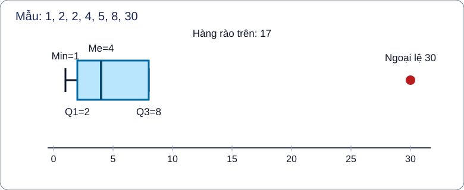
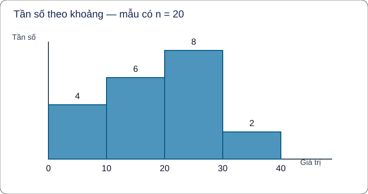

---
hide:
  - toc
---

HỌC THEO CHUYÊN ĐỀ · CĐ22 · TOÁN THPT

<nav class="thpt-sgk-lesson-nav" aria-label="Điều hướng Chuyên đề 22">
<a href="../../cd21/kien-thuc/">← Chuyên đề trước</a>
Chuyên đề sau →
<a href="../luyen-tap/">Luyện tập</a>
<a href="../tu-kiem-tra/">Tự kiểm tra</a>
</nav>

<a href="../../">← Tổng quan các Chuyên đề</a>

Khám phá thêm: <a href="../../../math-lab/models/slm-top22-distribution-r01/">Mô hình trực quan Chuyên đề 22</a> (tùy chọn).

<link rel="stylesheet" href="../../../../assets/stylesheets/thpt-topic-w1-golden-v1.css">

Đang chuẩn bị kiến thức…

<!-- TOPIC22_APPROVED_SOURCE_START -->
<!-- Q18 SOURCE_LEARNER_BLOB 7ac79e5ed705a5ce482c3d9c42a4451e659e1109; Q18_RECEIPT_BLOB 2e35a06020768e5a6db2e9f2fe65a46f577960c2; AUTHORING_PR #812; PUBLIC_PROJECTION_ONLY -->
<!-- W5_LINK_EQUIVALENT: source statistics SVG Temp_STATISTICS_BOX_OUTLIER_R00_20261111.svg, source statistics SVG Temp_STATISTICS_GROUPED_FREQ_R00_20261111.svg; canonical source immutable -->

# Kiến thức

<!-- TOP22_R09_SOURCE_EQUIVALENT_EDITORIAL; R07_BASE_BLOB: e31771e0fb9347c8c242ec8ca9e8a91a1ab74ff6; ITEM_COUNT: 114; ID_CANONICAL_SGK_SOURCE_UNCHANGED; PUBLIC_SELF_CHECK_NO_MASTERY; AUTHORING_ONLY -->

Thống kê giúp ta mô tả mức điển hình và mức dao động của một tập dữ liệu. Nhưng kết quả đo có thể gần đúng và số tính từ bảng ghép nhóm chỉ là ước lượng. Chúng ta sẽ đi từ dữ liệu thô tới dữ liệu theo khoảng, tìm hiểu lúc nào nên dùng mỗi thước đo và kết luận nào không thể rút ra.

Để bắt đầu, em chỉ cần biết các phép tính cơ bản, căn bậc hai, sắp xếp số và đọc bảng. Những kiến thức nền khác sẽ được nhắc ngay ở đoạn cần dùng.

## 1. Dữ liệu thô, độ chính xác và các số đặc trưng

### 1.1. Dữ liệu đo và sai số

Một bạn đếm đủ học sinh trong lớp, một bạn đo chiều dài bàn. Vì sao số đếm và số đo không có cùng mức chắc chắn?

Một giá trị đọc từ dụng cụ có thể là **số gần đúng**, không phải số đúng. Khi biết số đúng \(\bar a\) và số ghi \(a\), sai số tuyệt đối \(\Delta=|\bar a-a|\); sai số tương đối theo số gần đúng \(a\ne0\) là \(\delta_a=\Delta/|a|\). Nếu chỉ biết độ chính xác \(d\), ta biết \(\Delta\le d\), **không** biết chắc sai số thực bằng \(d\). Quy tròn đến hàng phần mười theo quy tắc thông thường có chặn sai số \(0{,}05\) đơn vị. Ví dụ giá trị thật \(12{,}47\) mm và bản ghi \(12{,}5\) mm: \(\Delta=0{,}03\) mm, \(\delta_a=0{,}03/12{,}5=0{,}24\%\).

> **ĐỊNH NGHĨA — Sai số của số gần đúng**
>
> \[\Delta=|\bar a-a|,\qquad \delta_a=\frac{\Delta}{|a|}\quad(a\ne0).\] Nếu chỉ biết chặn \(d\), kết luận \(\Delta\le d\), không khẳng định \(\Delta=d\). Dữ liệu phải nêu đơn vị và vị trí làm tròn.

<!-- OUTCOME_REF: G10-B12-APPROX_CONCEPT -->

Hỏi trước: số này do **đếm** hay do **đo**? Đếm đủ 25 học sinh cho số đúng trong tình huống đã xác định; thước ghi 120,3 cm cho một giá trị gần đúng. Số chữ số dài không biến số đo thành giá trị chính xác. Nếu còn nghi ngờ, viết rõ đối tượng, đơn vị, dụng cụ và độ chính xác.
<!-- OUTCOME_REF: G10-B12-ABS_ERROR -->

Muốn tính **sai số tuyệt đối thực**, cần biết cả giá trị đúng và gần đúng. Ví dụ \(a=7{,}2,\bar a=7{,}16\) cho \(\Delta=0{,}04\). Nếu chỉ biết \(d=0{,}1\), điều đúng là \(\Delta\le0{,}1\); không khẳng định \(\Delta=0{,}1\).
<!-- OUTCOME_REF: G10-B12-REL_ERROR -->

Sai số \(0{,}1\) ở vật dài 1 đơn vị đáng kể hơn ở vật dài 100 đơn vị. Vì vậy chia sai số tuyệt đối cho \(|a|>0\), rồi nhân 100% nếu muốn tỷ lệ phần trăm. Khi \(a=0\), tỷ lệ theo \(|a|\) không xác định; hãy trở về sai số tuyệt đối.
<!-- OUTCOME_REF: G10-B12-ROUNDING -->

Làm tròn là thay giá trị bởi số thuận tiện hơn ở một hàng xác định. Quy tắc chặn bằng nửa đơn vị hàng làm tròn cho phép **ước lượng sai số tối đa**, chứ không cho sai số thật khi chưa biết số gốc. Sau khi làm tròn, viết lại số và so giá trị trước–sau; không chỉ dừng ở quy tắc nhìn chữ số tiếp theo.

**Vì sao “độ chính xác \(d\)” không phải sai số thực?** Khi một phép đo chỉ được bảo đảm có sai số tuyệt đối không vượt quá \(d\), giá trị đúng có thể nằm bất kỳ trong đoạn từ \(a-d\) đến \(a+d\). Chỉ khi biết giá trị đúng \(\bar a\) mới tính được **sai số thực** \(|\bar a-a|\). Không tự nói “sai số đúng bằng \(d\)”, vì \(d\) chỉ là **giới hạn**.

**Ví dụ minh họa.** Một dụng cụ ghi chiều dài \(12{,}5\) cm với độ chính xác \(d=0{,}1\) cm. Ta chỉ suy giá trị đúng nằm trong đoạn \([12{,}4;12{,}6]\) cm theo chặn đã cho. Nếu sau đó biết giá trị đúng thực sự là \(12{,}47\) cm, sai số tuyệt đối là \(0{,}03\) cm, nhỏ hơn \(d\). Sai số tương đối theo số gần đúng là \(\delta=0{,}03/12{,}5=0{,}0024=0{,}24\%\). Phải ghi rõ **đơn vị** ở sai số tuyệt đối, còn sai số tương đối không mang đơn vị.

**Ví dụ**

**Đề bài.** Một chi tiết dài thật \(12{,}47\) mm nhưng số đo được ghi là \(12{,}5\) mm. Tính sai số tuyệt đối, sai số tương đối theo số gần đúng.

**Lời giải.** \(\Delta=|12{,}47-12{,}5|=0{,}03\) mm. Vì \(12{,}5\ne0\), \(\delta_a=0{,}03/12{,}5=0{,}24\%\). Có số đúng mới tính được sai số thực.

<!-- ITEM_ID: THPT-TOP22-T01; ROLE: TOPIC_FIRST_TRY; PRIMARY_OUTCOME: G10-B12-ABS_ERROR; SECONDARY_OUTCOME: G10-B12-REL_ERROR; CONTENT_VERSION: TOP22-R09-20261121-FT01; LEARNER_LABEL: VAN_DUNG; PUBLIC_FORMATIVE_NO_MASTERY -->

**Vận dụng**

Giá trị thật 9,68 mm ghi 9,7 mm: tìm sai số tuyệt đối và phần trăm tương đối.

Đối chiếu

\(\Delta=0{,}02\) mm; \(\delta_a=(0{,}02/9{,}7)\cdot100\%\approx0{,}206\%\).

**Kiểm lỗi**

Đừng lấy độ chính xác làm sai số thật; kiểm đơn vị và việc nhân 100 để ra phần trăm. Đọc lại **Kiến thức 1.1**, rồi tự làm **Bài luyện 2**, **Bài luyện 3**, **Bài luyện 4** trong phần Luyện tập theo đúng điều kiện bài; chỉ mở lời giải sau khi đã thử.

### 1.2. Số trung bình và mốt

Hai lớp có cùng điểm trung bình nhưng điểm xuất hiện nhiều nhất có thể khác. Em chọn đại lượng nào để mô tả giá trị phổ biến?

Khi cần mô tả một mẫu, **số trung bình** cho biết mức chia đều: \(\bar x=(x_1+\cdots+x_n)/n\). Bảng tần số dùng \(\bar x=\sum f_iv_i/\sum f_i\). **Mốt** là giá trị xuất hiện với tần số lớn nhất, có thể có nhiều mốt nếu có những giá trị đồng hạng xuất hiện thường xuyên hơn các giá trị còn lại. **Theo quy ước SGK Toán 10**, nếu mẫu có từ hai giá trị phân biệt trở lên và **mọi giá trị đều xuất hiện với tần số như nhau** thì mẫu **không có mốt**. Chẳng hạn, \(1,2,3,4\) không có mốt; \(1,1,2,2,3\) có hai mốt 1 và 2. Với 2,2,3,5,8, số trung bình là \(20/5=4\) nhưng mốt là 2. Chọn mốt khi hỏi giá trị phổ biến, trung bình khi quan tâm tổng mức phân bổ; trung bình nhạy với giá trị lớn bất thường.

> **ĐỊNH NGHĨA — Trung bình và mốt mẫu**
>
> \[\bar x=\frac{x_1+\cdots+x_n}{n}=\frac{\sum f_iv_i}{\sum f_i}.\] Mốt là giá trị có tần số lớn nhất; có thể nhiều mốt khi các tần số lớn nhất bằng nhau và còn giá trị có tần số thấp hơn. **Ngoại lệ theo SGK:** với ít nhất hai giá trị phân biệt mà tất cả tần số bằng nhau, mẫu không có mốt. Dữ liệu định lượng dùng số trung bình cho mức chia đều, nhưng trung bình nhạy với giá trị bất thường.

> **KIẾN THỨC CẦN GHI NHỚ — Mốt cho dữ liệu định tính.** Mốt không chỉ dành cho số đo. Với dữ liệu là **loại hoặc nhãn**, mốt là nhãn có tần số lớn nhất. Chẳng hạn, các lựa chọn A, B, B, C, B có mốt là **B**. Tần số của các nhãn phải được đếm trước; nếu nhiều nhãn phân biệt cùng tần số và không nhãn nào nổi trội, theo quy ước trên mẫu không có mốt.

<!-- OUTCOME_REF: G10-B13-MEAN -->

Trung bình là mức chia đều, không nhất thiết thuộc danh sách số liệu. Nếu giá trị 5 có tần số 3, phải cộng 5 **ba lần** hoặc nhân (\(5\cdot3\)); đừng lấy trung bình các giá trị khác nhau mà quên tần số. Khi có số cực đoan, so thêm trung vị để giải thích.
<!-- OUTCOME_REF: G10-B13-MODE -->

Mốt trả lời 'giá trị gặp thường nhất' chứ không đo vị trí trung tâm hay tổng. Khi tần số cao nhất xuất hiện ở hai giá trị **và có giá trị khác ít gặp hơn**, ta có **hai mốt**, không tự chọn một. Nhưng nếu tất cả giá trị phân biệt cùng tần số thì **không có mốt**, không được gọi mọi giá trị là mốt. Kiểm bằng cách viết bảng hai cột 'giá trị–số lần xuất hiện' trước khi kết luận.

**Ví dụ**

**Đề bài.** Với dãy \(2,2,3,5,8\), tính số trung bình và mốt.

**Lời giải.** Tổng là \(20\), có năm quan sát nên \(\bar x=4\). Giá trị \(2\) xuất hiện hai lần, các giá trị khác một lần, nên mốt bằng \(2\).

<!-- ITEM_ID: THPT-TOP22-T02; ROLE: TOPIC_FIRST_TRY; PRIMARY_OUTCOME: G10-B13-MEAN; SECONDARY_OUTCOME: G10-B13-MODE; CONTENT_VERSION: TOP22-R09-20261121-FT02; LEARNER_LABEL: VAN_DUNG; PUBLIC_FORMATIVE_NO_MASTERY -->

**Vận dụng**

Mẫu 1,3,3,5,8 có trung bình và mốt nào?

Đối chiếu

Trung bình 4, mốt 3. Năm số có tổng bằng 20.

**Kiểm lỗi**

Nếu nhầm mốt với trung vị, lập bảng số lần xuất hiện trước khi kết luận. Đọc lại **Kiến thức 1.2**, rồi tự làm **Bài luyện 11**, **Bài luyện 13** trong phần Luyện tập theo đúng điều kiện bài; chỉ mở lời giải sau khi đã thử.

### 1.3. Trung vị và tứ phân vị

Nếu đảo thứ tự nhập các giá trị trong mẫu, trung vị có thay đổi không? Hãy tự sắp xếp một dãy trước khi tính.

Phải **sắp dãy theo thứ tự**. Trung vị là phần tử ở giữa khi \(n\) lẻ, hoặc trung bình của hai phần tử giữa khi \(n\) chẵn. \(Q_2\) là trung vị; theo cách chia nửa mẫu KNTT, khi \(n\) lẻ loại trung vị rồi lấy trung vị của hai nửa để có \(Q_1,Q_3\). Ví dụ dãy 1,2,2,4,5,8,10 có \(Me=4,Q_1=2,Q_3=8\). Đây là phân vị **dữ liệu thô**, không dùng công thức nội suy ghép nhóm.

> **ĐỊNH NGHĨA — Trung vị và tứ phân vị trên dãy thô**
>
> Trước hết **sắp xếp dữ liệu**. Trung vị \(Me=Q_2\) là giá trị giữa (n lẻ) hoặc trung bình hai giá trị giữa (n chẵn). Theo cách chia nửa dãy KNTT: n lẻ **loại trung vị** rồi lấy trung vị hai nửa để có \(Q_1,Q_3\). Đây không phải nội suy trên bảng ghép nhóm.

<!-- OUTCOME_REF: G10-B13-MEDIAN -->

Muốn tìm trung vị, bước không được bỏ là **xếp lại dãy tăng dần**. Với số phần tử chẵn, hai giá trị ở giữa cần lấy trung bình, dù trung vị có thể không có trong dãy quan sát. Nếu kết quả thay đổi khi hoán vị thứ tự nhập dữ liệu, cách làm đã sai.
<!-- OUTCOME_REF: G10-B13-QUARTILES -->

Trên dãy thô, dùng đúng quy ước chia nửa mẫu của SGK KNTT. Với dãy lẻ, tách phần tử trung vị ra rồi mới lấy \(Q_1,Q_3\) từ hai nửa; với dãy chẵn, chia đôi theo vị trí. Đây **không phải** phép nội suy tần số ghép nhóm sẽ học sau.

**Ví dụ**

**Đề bài.** Tìm trung vị và \(Q_1,Q_3\) của \(1,2,2,4,5,8,10\).

**Lời giải.** Có bảy số đã sắp tăng; trung vị ở vị trí bốn là \(4\). Bỏ số giữa, hai nửa \(1,2,2\) và \(5,8,10\) có trung vị \(2\) và \(8\), nên \(Q_1=2,Q_3=8\).

<!-- ITEM_ID: THPT-TOP22-T03; ROLE: TOPIC_FIRST_TRY; PRIMARY_OUTCOME: G10-B13-MEDIAN; SECONDARY_OUTCOME: G10-B13-QUARTILES; CONTENT_VERSION: TOP22-R09-20261121-FT03; LEARNER_LABEL: VAN_DUNG; PUBLIC_FORMATIVE_NO_MASTERY -->

**Vận dụng**

Tìm Me, Q1, Q3 của 2,4,6,8,10,12.

Đối chiếu

Có 6 số: \(Me=(6+8)/2=7\); nửa dưới 2,4,6 có \(Q_1=4\), nửa trên 8,10,12 có \(Q_3=10\).

**Kiểm lỗi**

Đánh dấu vị trí giữa và chia hai nửa sau khi đã sắp; không đoán từ thứ tự đề liệt kê. Đọc lại **Kiến thức 1.3**, rồi tự làm **Bài luyện 12**, **Bài luyện 15** trong phần Luyện tập theo đúng điều kiện bài; chỉ mở lời giải sau khi đã thử.

### 1.4. Khoảng biến thiên, IQR và ngoại lệ

Một số rất lớn tác động thế nào đến độ trải toàn mẫu và độ trải của nửa số liệu ở giữa?

Khoảng biến thiên \(R=x_{\max}-x_{\min}\) phản ánh độ trải từ đầu tới cuối nhưng rất nhạy với cực trị. Khoảng tứ phân vị \(IQR=Q_3-Q_1\) tập trung vào nửa giữa. Quy ước hàng rào \(Q_1-1{,}5IQR\) và \(Q_3+1{,}5IQR\) giúp **đánh dấu để xem xét**, không chứng minh dữ liệu sai. Với 1,2,2,4,5,8,30: \(Me=4,Q_1=2,Q_3=8,IQR=6\); hàng rào trên 17, nên 30 là ngoại lệ theo quy tắc này. Trung bình \(52/7\approx7{,}43\) chịu ảnh hưởng mạnh hơn trung vị.

> **CÔNG THỨC — Độ trải và hàng rào ngoại lệ**
>
> \[R=x_{\max}-x_{\min},\quad IQR=Q_3-Q_1.\] Hàng rào tham khảo \(Q_1-1{,}5IQR\) và \(Q_3+1{,}5IQR\) giúp nhận diện điểm đáng xem xét, **không chứng minh quan sát bị sai**.

<!-- OUTCOME_REF: G10-B13-INTERPRETATION -->

Nếu hầu hết thu nhập khoảng 5 nhưng một giá trị là 50, số trung bình bị kéo lên, còn trung vị vẫn mô tả người ở giữa. Không có một số đặc trưng luôn tốt nhất: muốn nói mức chia đều dùng trung bình, còn muốn một mức ít nhạy ngoại lệ hãy cân nhắc trung vị. Nêu lý do chọn.
<!-- OUTCOME_REF: G10-B14-RANGE_IQR -->

Khoảng biến thiên chỉ dùng hai cực trị nên nhạy với một số rất lớn, còn IQR dùng \(Q_3-Q_1\) để đo độ trải trung tâm. Khi hai mẫu cùng trung bình, hãy dùng thêm R/IQR thay vì kết luận mức ổn định như nhau. IQR và R đều cùng đơn vị với dữ liệu.
<!-- OUTCOME_REF: G10-B14-OUTLIERS -->

Hàng rào \(Q_1-1{,}5IQR\) và \(Q_3+1{,}5IQR\) là quy tắc **phát hiện điểm đáng kiểm tra**. Một điểm vượt hàng rào có thể là quan sát hợp lệ. Nêu đúng ngưỡng và chiều so sánh trước khi gắn nhãn; không xóa dữ liệu chỉ vì bị đánh dấu.

**Ví dụ**

**Đề bài.** Xét \(1,2,2,4,5,8,30\). Giá trị \(30\) có vượt hàng rào ngoại lệ không?

**Lời giải.** \(Q_1=2,Q_3=8\), \(IQR=6\). Hàng rào trên \(8+1{,}5\cdot6=17\). Vì \(30>17\), đây là giá trị cần xem xét, không tự coi là sai số đo.

**Đọc hình:** Đọc \(Q_1=2\), trung vị \(Me=4\), \(Q_3=8\); \(IQR=6\), hàng rào trên \(8+1{,}5\cdot6=17\). Điểm 30 vượt 17 nên được đánh dấu để kiểm tra **chứ không tự xóa** khỏi mẫu. Hãy tìm \(Q_1,Me,Q_3\) trên hình và so với vị trí các điểm nằm ngoài hàng rào.

<!-- ITEM_ID: THPT-TOP22-T04; ROLE: TOPIC_FIRST_TRY; PRIMARY_OUTCOME: G10-B14-RANGE_IQR; SECONDARY_OUTCOME: G10-B14-OUTLIERS; CONTENT_VERSION: TOP22-R09-20261121-FT04; LEARNER_LABEL: VAN_DUNG; PUBLIC_FORMATIVE_NO_MASTERY -->

**Vận dụng**

Mẫu 2,3,4,5,6,7,25 có IQR và hàng rào trên bao nhiêu?

Đối chiếu

\(Q_1=3,Q_3=7,IQR=4\); hàng rào trên \(7+1{,}5\cdot4=13\). Số 25 vượt hàng rào.

**Kiểm lỗi**

Đọc đúng Q1/Q3 trước khi gán nhãn ngoại lệ; đừng loại bỏ điểm dữ liệu chỉ vì trông khác. Đọc lại **Kiến thức 1.4**, rồi tự làm **Bài luyện 21**, **Bài luyện 31** trong phần Luyện tập theo đúng điều kiện bài; chỉ mở lời giải sau khi đã thử.

### 1.5. Phương sai và độ lệch chuẩn

Hai nhóm cùng trung bình nhưng mức ổn định khác nhau. Làm thế nào đo độ lệch mà các số âm và dương không triệt tiêu?

Để so sánh hai nhóm có cùng trung bình, xét sai lệch từng giá trị so với \(\bar x\). **Phương sai mô tả** \(s^2=\frac1n\sum_{i=1}^n(x_i-\bar x)^2\), **độ lệch chuẩn** \(s=\sqrt{s^2}\). Dữ liệu đo bằng phút thì \(s\) tính phút, \(s^2\) tính phút bình phương. Ví dụ A=3,4,5 và B=1,4,7 đều có trung bình 4; \(s_A^2=2/3\), \(s_B^2=6\) nên A ổn định hơn. Không tự thay mẫu số \(n\) bằng \(n-1\) trong công thức SGK này.

> **CÔNG THỨC — Phương sai mô tả và độ lệch chuẩn (dữ liệu thô)**
>
> \[s^2=\frac1n\sum_{i=1}^{n}(x_i-\bar x)^2,\qquad s=\sqrt{s^2}.\] Đây là **phương sai mô tả dùng mẫu số n** theo học liệu SGK, không tự thay bằng \(n-1\). \(s\) cùng đơn vị với dữ liệu, \(s^2\) bình phương đơn vị.

> **KIẾN THỨC CẦN GHI NHỚ — Đại lượng phân tán dùng mẫu số \(n-1\).** Ngoài phương sai mô tả \(s^2\) chia cho \(n\), SGK Toán 10 tập 1 Bài 14 còn nêu \(\hat{s}^2=\frac{\sum_{i=1}^{n}(x_i-\bar x)^2}{n-1}\) khi \(n>1\). Đây là **đại lượng khác** chứ không được tự thay vào công thức \(s^2\) của bài. Với mẫu \(3,4,5\), ta có \(s^2=2/3\) trong khi \(\hat{s}^2=1\). Khi làm bài, đọc rõ đề yêu cầu đại lượng nào.

<!-- OUTCOME_REF: G10-B14-VARIANCE -->

Bình phương sai lệch giúp các độ lệch âm/dương không triệt tiêu. Theo phương sai mô tả SGK, chia **cho \(n\)** chứ không tự đổi sang \(n-1\). Khi tính \(s^2\), hãy kiểm \(\sum(x_i-\bar x)^2\ge0\); nếu phương sai âm, chắc chắn có lỗi số học.
<!-- OUTCOME_REF: G10-B14-STDDEV -->

Độ lệch chuẩn là căn bậc hai của phương sai, giúp thước đo trở lại cùng **đơn vị** với dữ liệu. Nếu số đo tính bằng cm, \(s\) tính cm nhưng \(s^2\) tính cm². So sánh độ lệch chuẩn có ý nghĩa khi các mẫu dùng cùng đơn vị và bối cảnh.
<!-- OUTCOME_REF: G10-B14-COMPARISON -->

Hai dãy có cùng số trung bình không nhất thiết phân tán như nhau. Với A=3,4,5 và B=1,4,7, trung bình đều là 4, nhưng B biến động mạnh hơn. Hãy ghi rõ bạn đang so theo phương sai, độ lệch chuẩn hay IQR; không kết luận nguyên nhân chỉ từ khác biệt thống kê.

**Có thể kiểm công thức phương sai bằng cách rút gọn đại số.** Từ công thức mô tả với mẫu số \(n>0\) và \(\bar x=\frac1n\sum x_i\), khai triển bình phương:
\[
s^2=\frac1n\sum_{i=1}^{n}(x_i-\bar x)^2
=\frac1n\sum_{i=1}^{n}x_i^2-\bar x^2.
\]
Vì tổng bình phương không âm, luôn \(s^2\ge0\); và \(s^2=0\) **khi và chỉ khi tất cả các giá trị đều bằng nhau**. Cách rút gọn này giúp tự kiểm hai phép tính thay vì tin một kết quả máy.

**Ví dụ minh họa.** Dữ liệu \(2,4,6\) có trung bình \(4\), nên \(s^2=(4+0+4)/3=8/3\). Kiểm cách hai: \((2^2+4^2+6^2)/3-4^2=56/3-16=8/3\). Nếu **cộng cùng một hằng số** \(c\) vào mọi dữ liệu, độ lệch từng số so với trung bình không đổi nên \(s^2\) không đổi; nếu **nhân mọi số với** \(k\), phương sai nhân \(k^2\) và độ lệch chuẩn nhân \(|k|\). Điều này cho thấy cần đồng nhất **đơn vị đo** khi so phương sai.

**Ví dụ**

**Đề bài.** So độ phân tán của \(A=(3,4,5)\) và \(B=(1,4,7)\) bằng phương sai mô tả.

**Lời giải.** Cả hai có \(\bar x=4\). \(s_A^2=(1+0+1)/3=2/3\); \(s_B^2=(9+0+9)/3=6\). Do \(2/3<6\), A ít phân tán hơn.

<!-- ITEM_ID: THPT-TOP22-T05; ROLE: TOPIC_FIRST_TRY; PRIMARY_OUTCOME: G10-B14-VARIANCE; SECONDARY_OUTCOME: G10-B14-COMPARISON; CONTENT_VERSION: TOP22-R09-20261121-FT05; LEARNER_LABEL: VAN_DUNG; PUBLIC_FORMATIVE_NO_MASTERY -->

**Vận dụng**

So sánh phương sai A=4,5,6 và B=2,5,8.

Đối chiếu

Trung bình cùng bằng 5; \(s_A^2=2/3\), \(s_B^2=6\). A ít phân tán hơn.

**Kiểm lỗi**

Lập bảng x−x̄ rồi bình phương và chia đúng n; kiểm phương sai không âm. Đọc lại **Kiến thức 1.5**, rồi tự làm **Bài luyện 22**, **Bài luyện 23**, **Bài luyện 32** trong phần Luyện tập theo đúng điều kiện bài; chỉ mở lời giải sau khi đã thử.

## 2. Dữ liệu ghép nhóm và các ước lượng vị trí

### 2.1. Ghép nhóm: biên, độ rộng, tần số

Khi số đo nằm đúng ranh giới hai khoảng, ta phải đếm thế nào để không tính hai lần?

Khi có quá nhiều quan sát, gom thành các khoảng **trái đóng, phải mở** \([a,b)\) để một số ở ranh giới chỉ thuộc **một** nhóm. Độ rộng nhóm \(h=b-a\); tần số \(f_i\) là số phần tử thuộc nhóm, tổng \(\sum f_i=n\). Ví dụ dữ liệu 0,9,10,19,20 ghép \([0,10),[10,20),[20,30)\) có tần số 2,2,1. Sau ghép nhóm, thông tin từng quan sát mất đi: không thể khẳng định mọi số ở nhóm [10,20) đều bằng 15.

> **ĐỊNH NGHĨA — Bảng tần số ghép nhóm**
>
> Các nhóm dạng \([a_i,b_i)\) **trái đóng, phải mở**, không trùng và phủ các quan sát. Độ rộng \(h_i=b_i-a_i>0\); tần số \(f_i\) là số quan sát trong nhóm; \(\sum_i f_i=n\). Gán điểm biên vào một nhóm duy nhất.

<!-- OUTCOME_REF: G11-B08-GROUPED-DEFINITION -->

Bảng ghép nhóm thay các số đo riêng lẻ bằng số phần tử nằm trong các khoảng. Được lợi khả năng đọc tổng quan nhưng **mất độ chính xác từng cá thể**. Khi nhóm [10,20) có tần số 5, ta biết có năm quan sát từ 10 đến dưới 20, không biết mỗi người bằng 15.
<!-- OUTCOME_REF: G11-B08-CLASS-BOUNDARIES -->

Trong ký hiệu [10,20), 10 được lấy nhưng 20 không; số 20 chuyển sang [20,30). Điều này bảo đảm một điểm biên không bị đếm hai lần. Trước khi lập bảng, hãy kiểm nhóm có liền nhau, không trùng và không bỏ lọt số đo cần xét.
<!-- OUTCOME_REF: G11-B08-GROUP-WIDTH -->

Độ rộng nhóm \(h=b-a\) phải dương. Nhóm [0,10) có độ rộng 10, khác nhóm [10,30) rộng 20. Với độ rộng không đều, chỉ so chiều cao cột tần số hoặc dùng công thức mốt cho nhóm bằng nhau có thể gây sai; phải kiểm điều kiện nhóm của bài.
<!-- OUTCOME_REF: G11-B08-FREQUENCY-TABLE -->

Mỗi quan sát được gán đúng **một** khoảng, rồi đếm tần số. Tổng \(\sum f_i\) phải bằng số quan sát gốc \(n\); nếu thiếu hoặc dư, kiểm ngay các số ở ranh giới. Sau khi tạo bảng, đọc tỷ lệ \(f_i/n\) thay vì tự gán xác suất hay giá trị trung điểm cho mọi cá thể.
<!-- OUTCOME_REF: G11-B08-INTERPRETATION -->

Tần số 8 trên tổng 20 nghĩa là 40% mẫu nằm trong khoảng đó. Điều này **không** cho biết bao nhiêu người đúng bằng trung điểm, và cũng không suy thẳng tỷ lệ tổng thể từ một mẫu thiếu thông tin chọn mẫu. Khi báo cáo, hãy gọi đúng là tỷ lệ trong mẫu.

**Nhóm rộng gấp đôi có thể có nhiều quan sát gấp đôi mà không đông hơn theo “mỗi đơn vị đo”.** Với nhóm \([0,10)\) có tần số \(10\), nhóm \([10,30)\) có tần số \(20\), thì độ rộng hai nhóm lần lượt \(10\) và \(20\); tần số **trên một đơn vị độ dài** đều bằng \(10/10=1\) và \(20/20=1\). Trong một biểu đồ histogram có các cột rộng theo đúng khoảng, để **diện tích cột** biểu diễn tần số, chiều cao tương ứng là \(f_i/h_i\), không phải \(f_i\).

**Ví dụ minh họa.** Hai nhóm trên có tần số lần lượt \(10\) và \(20\) nhưng mật độ tần số đều bằng \(1\). Nếu chỉ đặt hai cột cao \(10\) và \(20\) với độ rộng khác nhau rồi so **chiều cao**, em sẽ tưởng nhóm thứ hai có mức tập trung theo đơn vị đo cao hơn; trong khi nó chỉ chứa **khoảng dài gấp đôi**. Đây là phần hướng dẫn đọc biểu đồ khi **độ rộng nhóm không bằng nhau**, không sửa quy tắc đếm \(n=\sum f_i\).

**Ví dụ**

**Đề bài.** Ghép \(0,9,10,19,20\) vào \([0,10),[10,20),[20,30)\); tìm tần số.

**Lời giải.** Nhóm đầu có \(0,9\), nhóm thứ hai có \(10,19\), nhóm cuối có \(20\). Tần số \(2,2,1\), tổng đúng bằng năm; không đếm điểm cận phải vào nhóm trước.

<!-- ITEM_ID: THPT-TOP22-T06; ROLE: TOPIC_FIRST_TRY; PRIMARY_OUTCOME: G11-B08-FREQUENCY-TABLE; SECONDARY_OUTCOME: G11-B08-CLASS-BOUNDARIES; CONTENT_VERSION: TOP22-R09-20261121-FT06; LEARNER_LABEL: VAN_DUNG; PUBLIC_FORMATIVE_NO_MASTERY -->

**Vận dụng**

Tần số của các nhóm [0,10), [10,20), [20,30) với dữ liệu 3,10,10,20,29?

Đối chiếu

1,2,2; tổng 5. Hai số 10 thuộc nhóm thứ hai.

**Kiểm lỗi**

Khoanh từng quan sát theo biên trái đóng–phải mở, rồi đối chiếu tổng tần số với n. Đọc lại **Kiến thức 2.1**, rồi tự làm **Bài luyện 38**, **Bài luyện 40**, **Bài luyện 44** trong phần Luyện tập theo đúng điều kiện bài; chỉ mở lời giải sau khi đã thử.

### 2.2. Đại diện, trung bình nhóm và tích lũy

Nếu hai nhóm có số quan sát khác nhau, khi tính trung bình từ trung điểm, hai nhóm có được đóng góp ngang nhau không?

Trung điểm \(c_i=(a_i+b_i)/2\) đại diện nhóm, không phải giá trị đo của từng cá thể. Ước lượng trung bình nhóm \(\bar x_g=\sum f_i c_i/n\); tần số tích lũy \(F_i=\sum_{j\le i}f_j\). Với \([0,10):2,[10,20):3,[20,30):1\), trung điểm 5,15,25, tổng trọng số 80, \(n=6\): \(\bar x_g=80/6=40/3\). Tích lũy 2,5,6. Số trung bình này chỉ là **ước lượng từ bảng nhóm**.

> **CÔNG THỨC — Trung điểm, trung bình và tần số tích lũy**
>
> \[c_i=\frac{a_i+b_i}{2},\quad \bar x_g=\frac{\sum_i f_ic_i}{n},\quad F_i=\sum_{j\le i}f_j.\] \(\bar x_g\) là **ước lượng** từ trung điểm, không phải trung bình chính xác của dữ liệu thô.

<!-- OUTCOME_REF: G11-B09-REPRESENTATIVE -->

Trung điểm của khoảng \([10,20)\) là \(15\), được dùng thay thế khi chỉ còn số nhóm. Nó đại diện cho phép **ước lượng**, không phải số đo gốc của từng người. Nếu khoảng không đều, trung điểm tính riêng cho từng nhóm; không dùng cùng một trung điểm cho các nhóm.
<!-- OUTCOME_REF: G11-B09-GROUPED-MEAN -->

Số trung bình ghép nhóm dùng \(\sum f_ic_i/n\) vì nhóm nhiều quan sát phải có trọng số lớn hơn. Nếu nhóm 1 có tần số 9 và nhóm 2 là 1, trung bình hai trung điểm đơn thuần sẽ sai. Kết quả là ước lượng từ bảng nhóm; hãy viết rõ dấu xấp xỉ khi so với trung bình gốc.
<!-- OUTCOME_REF: G11-B09-CUMULATIVE -->

Tần số tích lũy nối lần lượt các nhóm từ trái sang phải; nhóm chứa vị trí \(p\) là nhóm đầu tiên có tần số tích lũy đạt tới hoặc vượt \(p\) theo quy ước nội suy đang dùng. Nếu số tích lũy cuối khác \(n\), cần sửa bảng tần số trước khi tìm trung vị hay tứ phân vị.

**Cùng một bảng ghép nhóm có thể đến từ các dữ liệu thô khác nhau.** Xét hai khoảng \([0,10),[10,20)\), mỗi khoảng có tần số \(2\). Khi chỉ còn bảng, trung điểm là \(5\) và \(15\), nên trung bình **ước lượng** \(\bar x_g=(2\cdot5+2\cdot15)/4=10\). Nhưng bảng có thể xuất phát từ \(D_1=(1,1,11,11)\), trung bình thực là \(6\); cũng có thể từ \(D_2=(9,9,19,19)\), trung bình thực là \(14\). **Cả hai** đều cho đúng bảng tần số \(2,2\) và cùng ước lượng \(10\).

**Ví dụ minh họa.** Khi một báo cáo chỉ cho hai nhóm \([0,10),[10,20)\) có \(f_1=f_2=2\), em hãy nêu **một** dãy gốc có trung bình \(6\) và **một** dãy gốc có trung bình \(14\), như hai dãy trên. Việc hai trung bình thật khác nhau chứng minh \(\bar x_g\) không nhất thiết là trung bình **chính xác**. Từ bảng nhóm không thể khôi phục từng số đo gốc nếu không có dữ liệu bổ sung.

**Ví dụ**

**Đề bài.** Với bảng \([0,10):2,[10,20):3,[20,30):1\), ước lượng trung bình và tần số tích lũy.

**Lời giải.** Trung điểm \(5,15,25\); tổng trọng số \(2\cdot5+3\cdot15+1\cdot25=80\), \(n=6\), nên \(\bar x_g=40/3\approx13{,}33\). Tích lũy \(2,5,6\). Trung bình là ước lượng theo trung điểm.

<!-- ITEM_ID: THPT-TOP22-T07; ROLE: TOPIC_FIRST_TRY; PRIMARY_OUTCOME: G11-B09-GROUPED-MEAN; SECONDARY_OUTCOME: G11-B09-CUMULATIVE; CONTENT_VERSION: TOP22-R09-20261121-FT07; LEARNER_LABEL: VAN_DUNG; PUBLIC_FORMATIVE_NO_MASTERY -->

**Vận dụng**

Nhóm [0,10):1, [10,20):2, [20,30):1: ước lượng trung bình, tích lũy.

Đối chiếu

Trung điểm 5,15,25; trung bình (5+30+25)/4=15, tích lũy 1,3,4.

**Kiểm lỗi**

Không lấy trung bình ba trung điểm nếu nhóm có tần số khác nhau. Đọc lại **Kiến thức 2.2**, rồi tự làm **Bài luyện 47**, **Bài luyện 48**, **Bài luyện 51** trong phần Luyện tập theo đúng điều kiện bài; chỉ mở lời giải sau khi đã thử.

### 2.3. Nội suy trung vị và tứ phân vị ghép nhóm

Sau khi chỉ còn bảng tần số theo khoảng, ta biết trung vị thật hay phải ước lượng qua tần số tích lũy?

Với bảng nhóm, tìm nhóm chứa vị trí \(p\) từ **tần số tích lũy**, rồi nội suy: \(\mathrm{estimate}=L+(p-F_{\mathrm{trước}})h/f\) khi tần số nhóm \(f>0\). Với trung vị dùng \(p=n/2\), tứ phân vị \(p=n/4,3n/4\). Ví dụ nhóm [0,10):4, [10,20):6, [20,30):8, [30,40):2 có \(n=20\), tích lũy 4,10,18,20. \(Me=20\), \(Q_1=10+(5-4)10/6=35/3\), \(Q_3=20+(15-10)10/8=26{,}25\). Đều là **ước lượng** từ bảng, không là số gốc chính xác.

**Đọc hình:** Bốn cột có tần số \(4,6,8,2\) trên tổng \(20\). Cộng tích lũy lần lượt \(4,10,18,20\). Trục/cột biểu diễn **số quan sát trong mỗi khoảng**, không khẳng định tất cả số trong một khoảng đều bằng trung điểm.

> **CÔNG THỨC — Nội suy các phân vị của bảng ghép nhóm**
>
> \[Q_p\approx L+\frac{(p-F_{\rm trước})h}{f},\qquad f>0.\] Chọn \(p=n/4,n/2,3n/4\) cho \(Q_1,Me,Q_3\); trước đó phải định vị đúng lớp chứa p bằng tần số tích lũy. Đây là **ước lượng**, không phải dữ liệu gốc.

<!-- OUTCOME_REF: G11-B09-GROUPED-MEDIAN -->

Trung vị ghép nhóm là **ước lượng**: đánh dấu vị trí \(n/2\), tìm nhóm dựa tích lũy, rồi nội suy từ cận trái \(L\) với tần số nhóm \(f>0\). Nếu lấy sai \(F_{\mathrm{trước}}\) hoặc nhầm với tần số nhóm hiện tại, kết quả sẽ lệch. Đặt hai giá trị lên cùng trục để kiểm phạm vi nhóm.
<!-- OUTCOME_REF: G11-B09-GROUPED-QUARTILES -->

Với \(Q_1,Q_3\), thay vị trí \(p\) bằng \(n/4\) hoặc \(3n/4\) trong quy tắc nội suy nhóm. Hai phân vị có thể nằm trong hai nhóm khác nhau; phải tìm nhóm riêng **trước** khi dùng công thức. Cuối cùng kiểm \(Q_1\le Me\le Q_3\).

**Khi vị trí phân vị rơi đúng biên tích lũy.** Với bốn nhóm rộng \(10\) có tần số \(4,6,8,2\), \(n=20\), tần số tích lũy \(4,10,18,20\). Vị trí trung vị \(p=n/2=10\) đúng bằng tần số tích lũy nhóm \([10,20)\). Nội suy trong nhóm ấy cho \(L=10,F_{\text{trước}}=4,f=6,h=10\), nên \(Me\approx10+(10-4)\cdot10/6=20\). Nếu chọn nhóm kế \([20,30)\), thì \(L=20,F_{\text{trước}}=10\), kết quả cũng \(Me\approx20\). Hai phép nội suy gặp nhau ở **cùng biên**; đây không phải hai kết quả mâu thuẫn.

**Ví dụ minh họa.** Tứ phân vị thấp có vị trí \(5\), nằm **bên trong** nhóm \([10,20)\), nên \(Q_1\approx10+(5-4)\cdot10/6=35/3\). Tứ phân vị cao có vị trí \(15\), thuộc nhóm \([20,30)\), nên \(Q_3\approx20+(15-10)\cdot10/8=26{,}25\). Kiểm \(35/3<20<26{,}25\). Phải xác định **đúng nhóm cho từng vị trí** trước khi nội suy; mọi giá trị đều chỉ là **ước lượng**.

**Ví dụ**

**Đề bài.** Bốn nhóm liên tiếp rộng 10 từ \([0,10)\) đến \([30,40)\) có tần số \(4,6,8,2\). Ước lượng \(Me,Q_1,Q_3\).

**Lời giải.** \(n=20\), tích lũy \(4,10,18,20\). Nội suy tại vị trí \(10\) cho \(Me\approx20\); \(Q_1\approx10+(5-4)10/6=35/3\), \(Q_3\approx20+(15-10)10/8=26{,}25\). Không gọi các số này là số liệu gốc chính xác.

<!-- ITEM_ID: THPT-TOP22-T08; ROLE: TOPIC_FIRST_TRY; PRIMARY_OUTCOME: G11-B09-GROUPED-MEDIAN; SECONDARY_OUTCOME: G11-B09-GROUPED-QUARTILES; CONTENT_VERSION: TOP22-R09-20261121-FT08; LEARNER_LABEL: VAN_DUNG; PUBLIC_FORMATIVE_NO_MASTERY -->

**Vận dụng**

Nhóm [0,10):5, [10,20):5, [20,30):10: ước lượng Me, Q1, Q3.

Đối chiếu

Tích lũy 5,10,20. \(Me=20,Q_1=10,Q_3=25\).

**Kiểm lỗi**

Nếu chọn nhầm nhóm, tô cột tích lũy đến n/4,n/2,3n/4 trước khi nội suy. Đọc lại **Kiến thức 2.3**, rồi tự làm **Bài luyện 52**, **Bài luyện 53**, **Bài luyện 58** trong phần Luyện tập theo đúng điều kiện bài; chỉ mở lời giải sau khi đã thử.

### 2.4. Mốt ghép nhóm và giới hạn áp dụng

Một nhóm có nhiều quan sát nhất có chắc cho biết mốt chính xác? Điều gì thay đổi nếu các nhóm rộng khác nhau?

Với nhóm **cùng độ rộng**, nhóm tần số lớn nhất là nhóm mốt. Nếu \(f_m\) là tần số nhóm mốt và \(f_-,f_+\) là hai tần số kề, ước lượng \(Mo=L+\frac{f_m-f_-}{(f_m-f_-)+(f_m-f_+)}h\) khi mẫu dương. Khi nhóm mốt ở biên hoặc các khoảng có độ rộng khác nhau, cần kiểm điều kiện mô hình trước khi tính. Nếu nhiều nhóm cùng cực đại, nhóm không đều hoặc thiếu nhóm kề, không dùng máy móc công thức.

> **CÔNG THỨC — Mốt ước lượng cho nhóm cùng độ rộng**
>
> \[M_o\approx L+\frac{f_m-f_-}{(f_m-f_-)+(f_m-f_+)}\,h.\] Trong đó \(L\) là cận dưới nhóm mốt, \(h>0\) là độ rộng nhóm, \(f_m\) là tần số nhóm mốt, \(f_-\) và \(f_+\) lần lượt là tần số nhóm liền trước và liền sau. **Quy ước biên:** Nếu nhóm mốt đứng đầu thì lấy \(f_-=0\); nếu đứng cuối thì lấy \(f_+=0\). Chỉ áp dụng cho các nhóm **cùng độ rộng**, nhóm mốt được chọn rõ và **mẫu số dương**; nếu nhiều nhóm cùng đạt cực đại cần xét lại tình huống thay vì thế máy móc.

<!-- OUTCOME_REF: G11-B09-GROUPED-MODE -->

Nhóm mốt có tần số lớn nhất khi **các khoảng cùng độ rộng**. Sau khi xác định nhóm, dùng tần số nhóm trước/nhóm sau để nội suy vị trí mốt; đáp số không nhất thiết là một số đã được quan sát. Mốt ghép nhóm khác mốt của dãy số thô.
<!-- OUTCOME_REF: G11-B09-MODE-CONDITIONS -->

Nếu nhóm cao nhất nằm ở biên, nhiều nhóm cùng cao nhất hoặc độ rộng nhóm khác nhau, không thế chỗ điều kiện bằng thói quen máy móc. Với nhóm khác độ rộng, cách đọc biểu đồ tần số cần chú ý diện tích/mật độ; không chỉ nhìn số tần số lớn mà áp dụng công thức nhóm đều.
<!-- OUTCOME_REF: G11-B09-INTERPRETATION -->

Từ bảng nhóm, trung bình, trung vị, tứ phân vị và mốt đều được suy qua đại diện/nội suy, nên chỉ báo **ước lượng**. Không suy kết quả chính xác của dữ liệu gốc hoặc kết luận nhóm có 'mọi người như nhau'. Dùng bảng nhóm thích hợp cho mô tả tổng quan, không thay dữ liệu cá nhân.

**Ví dụ**

**Đề bài.** Ba nhóm cùng rộng 10 có tần số \([0,10):12,[10,20):7,[20,30):3\). Ước lượng mốt nhóm ở biên trái.

**Lời giải.** Quy ước nhóm ở biên lấy \(f_-=0\). Khi đó \(L=0,h=10,f_m=12,f_+=7\) và mẫu số \(12+5=17>0\), nên \(M_o\approx(12/17)\cdot10=120/17\approx7{,}06\). Đây chỉ là ước lượng nội suy.

**Lưu ý.** Với nhóm không đều độ rộng, cần xem mật độ tần số, không tự áp công thức nhóm đều. Ví dụ \([0,5):6,[5,20):12\) có mật độ \(1{,}2\) và \(0{,}8\) nên chỉ so tần số thô dễ sai.

<!-- ITEM_ID: THPT-TOP22-T09; ROLE: TOPIC_FIRST_TRY; PRIMARY_OUTCOME: G11-B09-GROUPED-MODE; SECONDARY_OUTCOME: G11-B09-MODE-CONDITIONS; CONTENT_VERSION: TOP22-R09-20261121-FT09; LEARNER_LABEL: VAN_DUNG; PUBLIC_FORMATIVE_NO_MASTERY -->

**Vận dụng**

Nhóm [0,10):4,[10,20):10,[20,30):6, cùng độ rộng: ước lượng mốt.

Đối chiếu

Nhóm mốt [10,20); \(Mo=10+(6/(6+4))10=16\).

**Kiểm lỗi**

Kiểm mẫu số dương, tần số các nhóm kề và điều kiện cùng độ rộng. Đọc lại **Kiến thức 2.4**, rồi tự làm **Bài luyện 50**, **Bài luyện 54**, **Bài luyện 59** trong phần Luyện tập theo đúng điều kiện bài; chỉ mở lời giải sau khi đã thử.

## 3. Độ phân tán ghép nhóm và phân tích số liệu

### 3.1. Khoảng biến thiên ghép nhóm

Từ bảng ghép nhóm, ta còn biết giá trị nhỏ nhất/lớn nhất thật hay chỉ biết chúng nằm trong khoảng nào?

Khi dữ liệu chỉ còn nhóm, ta không biết số nhỏ nhất/lớn nhất thật. Độ rộng phủ nhóm không rỗng từ \([a_1,b_1)\) tới \([a_k,b_k)\) cho ước lượng \(R_g=b_k-a_1\), **không** đồng nhất với khoảng biến thiên thật. Ví dụ [0,10):2,[10,20):4,[20,30):3 cho \(R_g=30\). Đây là khoảng phủ theo biên nhóm; các quan sát có thể nằm cách xa cận.

> **KIẾN THỨC CẦN GHI NHỚ — Khoảng biến thiên ghép nhóm**
>
> \[R_g=b_k-a_1\] là **độ phủ theo biên các nhóm không rỗng** từ nhóm đầu đến nhóm cuối, không nhất thiết bằng khoảng biến thiên thực của các quan sát.

<!-- OUTCOME_REF: G12-CHIII-B09-O01 -->

Trước khi tính độ phân tán, đọc xem bảng là số liệu ghép nhóm với tần số hay dữ liệu thô. Phải kiểm tổng tần số, nhóm cực biên có tần số dương và cận nhóm. Không gọi trung điểm và cận là giá trị gốc chính xác của mẫu.
<!-- OUTCOME_REF: G12-CHIII-B09-O02 -->

Khoảng biến thiên ghép nhóm dựa cận thấp nhất và cận cao nhất của nhóm có số liệu. Vì không biết giá trị thực trong các nhóm, kết quả mô tả **độ rộng phủ** của bảng. Nêu rõ sự khác nhau với khoảng biến thiên của dữ liệu chưa ghép.
<!-- OUTCOME_REF: G12-CHIII-B09-O03 -->

Chỉ một nhóm cực biên có vài quan sát cũng có thể khiến độ phủ nhóm rất rộng. Khi so sánh, thước đo R nhạy với cực trị, nên cần xem thêm IQR. Không khẳng định hai mẫu 'ổn định như nhau' chỉ vì chúng có trung bình bằng nhau.

**Ví dụ**

**Đề bài.** Bảng \([0,10):2,[10,20):4,[20,30):3\). Tính khoảng phủ theo nhóm.

**Lời giải.** Nhóm đầu và cuối đều có quan sát; khoảng phủ bằng \(30-0=30\). Không suy khoảng biến thiên thật cũng bằng 30 khi không có dữ liệu thô.

<!-- ITEM_ID: THPT-TOP22-T10; ROLE: TOPIC_FIRST_TRY; PRIMARY_OUTCOME: G12-CHIII-B09-O01; SECONDARY_OUTCOME: G12-CHIII-B09-O02; CONTENT_VERSION: TOP22-R09-20261121-FT10; LEARNER_LABEL: VAN_DUNG; PUBLIC_FORMATIVE_NO_MASTERY -->

**Vận dụng**

Nhóm [5,15):3,[15,25):4,[25,35):1: ước lượng độ rộng phủ theo nhóm.

Đối chiếu

35−5=30 đơn vị; không kết luận R thực chắc chắn bằng 30.

**Kiểm lỗi**

Nếu nhầm đầu mút nhóm với quan sát thực, thử đặt hai bộ số liệu khác nhau vào cùng nhóm. Đọc lại **Kiến thức 3.1**, rồi tự làm **Bài luyện 71**, **Bài luyện 73**, **Bài luyện 74** trong phần Luyện tập theo đúng điều kiện bài; chỉ mở lời giải sau khi đã thử.

### 3.2. IQR ghép nhóm và so sánh

Vì sao muốn mô tả nửa mẫu ở giữa phải dùng hai tứ phân vị thay vì chỉ nhìn biên xa nhất?

Ước lượng \(Q_1,Q_3\) từ tần số tích lũy và nội suy như mảng trước, sau đó \(IQR_g=Q_3-Q_1\). Mẫu nhóm [0,10):4,[10,20):8,[20,30):8 có \(n=20\), tích lũy 4,12,20: \(Q_1=10+(5-4)10/8=11{,}25\), \(Q_3=20+(15-12)10/8=23{,}75\), \(IQR_g=12{,}5\). IQR nhóm là ước lượng, không dùng để xác định chắc chắn cá thể ngoại lệ khi thiếu dữ liệu thô.

> **CÔNG THỨC — IQR ước lượng của dữ liệu ghép nhóm**
>
> \[IQR_g=Q_{3,g}-Q_{1,g}.\] Hai tứ phân vị được **nội suy** từ tần số tích lũy; không dùng hàng rào nhóm để khẳng định chắc chắn một cá thể là ngoại lệ nếu đã mất dữ liệu thô.

<!-- OUTCOME_REF: G12-CHIII-B09-O04 -->

Để tìm nhóm chứa phân vị, xây tần số tích lũy trước rồi đánh dấu hai vị trí \(n/4\) và \(3n/4\). Khi vị trí đúng ở ranh tích lũy, dùng quy ước SGK thống nhất; giá trị nội suy nằm ở cận chung của hai nhóm kề. Không dùng nhóm có tần số 0 làm mẫu số.
<!-- OUTCOME_REF: G12-CHIII-B09-O05 -->

Sau khi tìm \(Q_1,Q_3\) từ bảng nhóm, lấy \(IQR_g=Q_3-Q_1\). Đó là **ước lượng** mức trải của 50% dữ liệu trung tâm, không phải IQR chính xác của mẫu thô đã mất. Kiểm dấu không âm; nếu ra âm, hãy kiểm lại thứ tự hai vị trí nội suy.
<!-- OUTCOME_REF: G12-CHIII-B09-O06 -->

Khi so độ ổn định hai mẫu, R cho biết độ phủ từ cực thấp đến cực cao còn IQR mô tả phần giữa. Nêu rõ thước đo chọn theo mục tiêu: tìm thay đổi cực trị dùng R, tìm phần trung tâm dùng IQR. Luôn kiểm đơn vị, cách ghép và cỡ mẫu trước kết luận.

**Ví dụ**

**Đề bài.** Bảng \([0,10):4,[10,20):8,[20,30):8\). Ước lượng IQR.

**Lời giải.** \(n=20\), tích lũy \(4,12,20\). \(Q_1\approx10+(5-4)10/8=11{,}25\), \(Q_3\approx20+(15-12)10/8=23{,}75\); \(IQR_g\approx12{,}5\).

<!-- ITEM_ID: THPT-TOP22-T11; ROLE: TOPIC_FIRST_TRY; PRIMARY_OUTCOME: G12-CHIII-B09-O04; SECONDARY_OUTCOME: G12-CHIII-B09-O05; CONTENT_VERSION: TOP22-R09-20261121-FT11; LEARNER_LABEL: VAN_DUNG; PUBLIC_FORMATIVE_NO_MASTERY -->

**Vận dụng**

Nhóm [0,10):4,[10,20):10,[20,30):6: Q1,Q3,IQR ước lượng?

Đối chiếu

\(Q_1=11\), \(Q_3=20+10/6=65/3\), \(IQR_g=32/3\approx10{,}67\).

**Kiểm lỗi**

Nếu sai Q1/Q3, tự kiểm nhóm chứa vị trí n/4 và 3n/4, luôn kiểm Q1≤Q3. Đọc lại **Kiến thức 3.2**, rồi tự làm **Bài luyện 83**, **Bài luyện 84**, **Bài luyện 85** trong phần Luyện tập theo đúng điều kiện bài; chỉ mở lời giải sau khi đã thử.

### 3.3. Phương sai và độ lệch chuẩn ghép nhóm

Sau khi thay các quan sát bằng trung điểm nhóm, phương sai tính được có còn chính xác cho dữ liệu gốc không?

Dữ liệu gốc đã ẩn nên dùng trung điểm \(c_i\) để ước lượng: \(\bar x_g=\sum f_ic_i/n\), \(s_g^2=\sum f_i(c_i-\bar x_g)^2/n=\sum f_ic_i^2/n-\bar x_g^2\), \(s_g=\sqrt{s_g^2}\). Nếu nhóm [0,10):2,[10,20):2 thì \(c=5,15\), \(\bar x_g=10\), \(s_g^2=(50+50)/4=25\), \(s_g=5\). Phương sai có **bình phương đơn vị**, độ lệch chuẩn có đơn vị gốc. Đây là ước lượng theo trung điểm.

> **CÔNG THỨC — Phương sai và độ lệch chuẩn ghép nhóm**
>
> \[s_g^2=\frac{\sum_i f_i(c_i-\bar x_g)^2}{n}=\frac{\sum_i f_ic_i^2}{n}-\bar x_g^2,\qquad s_g=\sqrt{s_g^2}.\] Trung điểm là đại diện nên đây là **ước lượng**, không đo được độ lệch thật trong mỗi nhóm.

<!-- OUTCOME_REF: G12-CHIII-B10-O01 -->

Muốn ước lượng trung bình ghép nhóm, sử dụng trung điểm \(c_i\) của từng khoảng và trọng số \(f_i\). Nếu có nhóm không quan sát nào \(f_i=0\), nhóm đó không góp vào tổng trung bình. Phải chia đúng \(n=\sum f_i>0\) và ghi kết quả là ước lượng.
<!-- OUTCOME_REF: G12-CHIII-B10-O02 -->

Phương sai là trung bình **bình phương** khoảng cách đến giá trị trung bình, nên không âm. Với bảng nhóm, dùng trung điểm thay số liệu gốc để ước lượng độ phân tán. Không chỉ đọc sự khác nhau giữa các cận nhóm rồi suy phương sai như số liệu thô.
<!-- OUTCOME_REF: G12-CHIII-B10-O03 -->

Có hai cách kiểm chéo: \(\sum f_i(c_i-\bar x_g)^2/n\) và \(\sum f_i c_i^2/n-\bar x_g^2\). Hai cách phải bằng nhau (sai khác nhỏ khi làm tròn). Nếu công thức rút gọn cho số âm rõ rệt, kiểm số học và bước ước lượng trung bình.
<!-- OUTCOME_REF: G12-CHIII-B10-O04 -->

Độ lệch chuẩn là căn của phương sai ước lượng, giúp diễn giải theo đơn vị **gốc**. Phương sai dữ liệu tính bằng phút có đơn vị phút²; độ lệch chuẩn tính bằng phút. Nếu báo cáo ngược đơn vị, người đọc khó hiểu mức biến động thực tế.

**Tại sao phương sai nhóm có thể che giấu độ dao động trong từng nhóm?** Xét bảng gồm hai nhóm \([0,10),[10,20)\), mỗi nhóm tần số \(2\). Cách thay bằng trung điểm \(5,15\) cho \(\bar x_g=10\), \(s_g^2=[2(5-10)^2+2(15-10)^2]/4=25\). Nhưng cùng một bảng có thể xuất phát từ hai dãy:
- \(D_1=(5,5,15,15)\): trung bình thật \(10\), phương sai mô tả thật \(25\).
- \(D_2=(1,9,11,19)\): trung bình thật cũng \(10\), phương sai thật \((81+1+1+81)/4=41\).

**Ví dụ minh họa.** Cả hai dãy có cùng **tần số ghép nhóm** \(2,2\) và cùng trung bình thật \(10\), nhưng phương sai thật lần lượt \(25\) và \(41\). Bảng nhóm chỉ cho một phép ước lượng \(s_g^2=25\) vì không biết số nằm **bên trong mỗi khoảng** phân bố ra sao. Do đó không tuyên bố hai lớp “biến động chính xác bằng nhau” chỉ từ bảng ghép nhóm, và không dùng phương sai nhóm như chứng cứ nguyên nhân hay dự báo chắc chắn.

**Ví dụ**

**Đề bài.** Hai nhóm \([0,10):2,[10,20):2\) có trung điểm 5 và 15. Tính phương sai và độ lệch chuẩn ước lượng.

**Lời giải.** \(\bar x_g=(2\cdot5+2\cdot15)/4=10\); \(s_g^2=(2\cdot25+2\cdot25)/4=25\); \(s_g=5\). Phương sai theo bình phương đơn vị, độ lệch chuẩn theo đơn vị gốc.

<!-- ITEM_ID: THPT-TOP22-T12; ROLE: TOPIC_FIRST_TRY; PRIMARY_OUTCOME: G12-CHIII-B10-O02; SECONDARY_OUTCOME: G12-CHIII-B10-O03; CONTENT_VERSION: TOP22-R09-20261121-FT12; LEARNER_LABEL: VAN_DUNG; PUBLIC_FORMATIVE_NO_MASTERY -->

**Vận dụng**

Nhóm [0,10):1,[10,20):2,[20,30):1: phương sai/std nhóm?

Đối chiếu

Các trung điểm 5,15,25; \(\bar x_g=15\); \(s_g^2=(100+0+100)/4=50\), \(s_g=5\sqrt2\approx7{,}071\).

**Kiểm lỗi**

Đừng chia n−1 hoặc bỏ trọng số f; dùng hai công thức kiểm chéo để tránh phương sai âm. Đọc lại **Kiến thức 3.3**, rồi tự làm **Bài luyện 95**, **Bài luyện 98**, **Bài luyện 106** trong phần Luyện tập theo đúng điều kiện bài; chỉ mở lời giải sau khi đã thử.

### 3.4. So sánh phân phối và giới hạn suy luận

Một mẫu phân tán hơn có nhất thiết là lựa chọn tệ hơn? Cần biết mục tiêu so sánh nào trước khi nhận xét?

Hai mẫu có cùng trung bình vẫn có độ ổn định khác nhau. Trên các nhóm [0,10),[10,20),[20,30) với trung điểm 5,15,25: A tần số 1,2,1 và B 2,0,2 cùng \(\bar x_g=15\), nhưng \(s_A^2=50<s_B^2=100\). Vì vậy A ổn định hơn **theo độ phân tán nhóm**, không phải kết luận về mọi biến cố tương lai. Chỉ so sánh khi hai mẫu dùng cùng thang đo, đơn vị và cách nhóm hợp lí.

> **TÍNH CHẤT — So sánh hai phân phối có cùng trung bình**
>
> Hai mẫu có thể có \(\bar x_g\) bằng nhau mà \(s_g^2\) khác nhau. Mẫu có độ lệch chuẩn nhỏ hơn **ít phân tán hơn theo thước đo và cách nhóm đang dùng**, không mặc nhiên tốt hơn hay gây ra kết quả nào. Chỉ so khi đơn vị/thang đo/cách nhóm hợp lý.

<!-- OUTCOME_REF: G12-CHIII-B10-O05 -->

So sánh hai mẫu có cùng thang đo bằng \(s_g\) hoặc \(s_g^2\). Số nhỏ hơn phản ánh mẫu tập trung hơn quanh trung bình theo mô hình nhóm, **không** có nghĩa mẫu đó luôn tốt hơn trong mọi mục tiêu. Trước khi so, ghi rõ hai mẫu có cùng cách chia khoảng và đơn vị.
<!-- OUTCOME_REF: G12-CHIII-B10-O06 -->

Thống kê mô tả chỉ mô tả dữ liệu đã quan sát, không chứng minh nguyên nhân hoặc rủi ro tương lai. Khi cần khuyến nghị, nêu giả định về mẫu, độ mất thông tin do ghép nhóm, thước đo và mục tiêu ra quyết định. Tránh biến 'phân tán cao' thành kết luận chắc chắn 'rủi ro cao' thiếu bối cảnh.

**Ví dụ**

**Đề bài.** Ở ba nhóm có trung điểm \(5,15,25\), mẫu A có tần số \(1,2,1\), mẫu B có \(2,0,2\). So phương sai ước lượng.

**Lời giải.** Cả hai trung bình \(15\). \(s_A^2=(100+0+100)/4=50\); \(s_B^2=(200+0+200)/4=100\). A ít phân tán hơn theo bảng nhóm và cùng cách chia nhóm.

<!-- ITEM_ID: THPT-TOP22-T13; ROLE: TOPIC_FIRST_TRY; PRIMARY_OUTCOME: G12-CHIII-B10-O05; SECONDARY_OUTCOME: G12-CHIII-B10-O06; CONTENT_VERSION: TOP22-R09-20261121-FT13; LEARNER_LABEL: VAN_DUNG; PUBLIC_FORMATIVE_NO_MASTERY -->

**Vận dụng**

A có tần số 1,4,1 và B 2,2,2 trên ba nhóm trên: so sánh phương sai nhóm.

Đối chiếu

Cùng \(\bar x_g=15\). \(s_A^2=100/3\), \(s_B^2=200/3\), nên A ít phân tán hơn.

**Kiểm lỗi**

Không suy nhân quả từ các số mô tả; kiểm cỡ mẫu, đơn vị và cách ghép nhóm. Đọc lại **Kiến thức 3.4**, rồi tự làm **Bài luyện 108**, **Bài luyện 110**, **Bài luyện 114** trong phần Luyện tập theo đúng điều kiện bài; chỉ mở lời giải sau khi đã thử.

<!-- TOPIC_PRACTICE_BEGIN -->

<!-- TOPIC22_APPROVED_SOURCE_END -->

<a href="../../">← Tổng quan các Chuyên đề</a>

