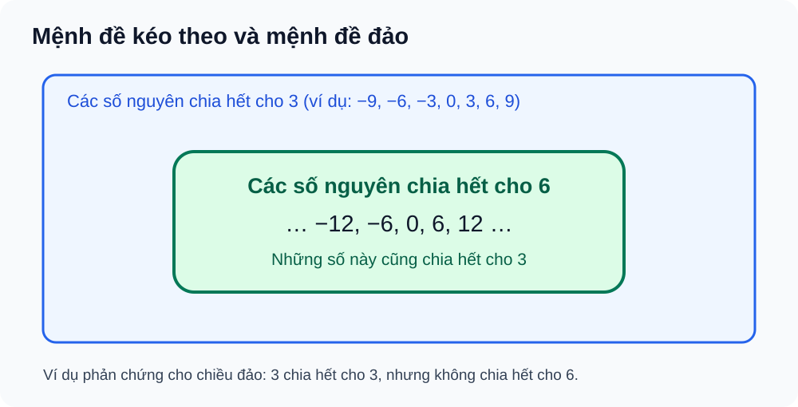

# Toán 10 · Bài 1. Mệnh đề

TOÁN 10 · CHƯƠNG I · KIẾN THỨC SGK KNTT

Học kiến thức, xem ví dụ và hình minh họa rồi tự luyện. Gợi ý/lời giải chỉ mở khi em chọn; không ghi điểm thành thạo.

=== "Khám phá kiến thức"

    ### Cùng tìm hiểu

    Khi nghe một câu nói, đôi khi em có thể kiểm tra được câu đó **đúng hay sai**, nhưng cũng có những câu không thể đem ra kiểm tra theo cách ấy. Chẳng hạn, “14 chia hết cho 7” là một khẳng định đúng; “14 là số lẻ” là một khẳng định sai. Còn “Bạn đã làm bài tập chưa?” là một **câu hỏi**, không khẳng định điều gì đúng hay sai.

    Toán học gọi những câu khẳng định có thể xác định **đúng hoặc sai** như hai câu đầu là **mệnh đề**. Một mệnh đề có thể sai mà vẫn là mệnh đề: điều quan trọng là nó có giá trị đúng hoặc sai xác định, chứ không phải ta muốn nó đúng.

    Bây giờ hãy xét “\(n+2=7\)”. Nếu chưa biết \(n\) bằng bao nhiêu thì em chưa thể nói cả câu đúng hay sai. Nhưng khi thay \(n=5\), câu trở thành \(5+2=7\), là một mệnh đề đúng; thay \(n=4\), câu trở thành \(4+2=7\), là một mệnh đề sai. Đây là một **mệnh đề chứa biến**: ta phải xác định biến hoặc phát biểu thêm điều kiện thì mới xét được giá trị đúng sai.

    Một điều thú vị khác là **chỉ một trường hợp** cũng có thể làm thay đổi kết luận. Nếu ai đó nói “Tất cả học sinh trong một đội đều biết bơi”, thì để bác bỏ câu này, em chỉ cần tìm được **một thành viên không biết bơi**. Em không cần chứng minh rằng không ai biết bơi. Đó là ý tưởng của *phủ định* và *phản ví dụ*.

    ### Ví dụ trực quan

    Một học sinh nêu: “Nếu một số nguyên chia hết cho 6 thì nó chia hết cho 3”. Đúng, vì số ấy viết được dưới dạng \(6k=3(2k)\) với \(k\in\mathbb Z\). Nhưng nếu đổi chiều thành “Nếu một số nguyên chia hết cho 3 thì nó chia hết cho 6”, câu mới lại sai: số 3 là phản ví dụ.

    Hai câu nghe gần giống nhau nhưng **không cùng ý nghĩa**. Bởi vậy, trong toán học, một câu “nếu … thì …” phải luôn được đọc đúng chiều; muốn có “khi và chỉ khi”, ta cần đúng ở **cả hai chiều**.

    ### Thuật ngữ và kiến thức, kỹ năng

    **Thuật ngữ:** mệnh đề, giá trị đúng/sai, mệnh đề chứa biến, phủ định, mệnh đề kéo theo, mệnh đề đảo, điều kiện cần và đủ, mệnh đề tương đương, lượng từ “với mọi” và “tồn tại”, phản ví dụ.

    **Sau bài học, em cần làm được:** phân biệt mệnh đề với câu hỏi và mệnh đề chứa biến; viết phủ định đúng phạm vi; xác định chiều của \(P\Rightarrow Q\) và chiều đảo; biết khi nào cần chứng minh hai chiều; đọc, viết và phủ định các phát biểu với \(\forall\), \(\exists\).

=== "Kiến thức SGK"

    ### 2.1. Mệnh đề và mệnh đề chứa biến

    **Mệnh đề** là một câu khẳng định có giá trị **đúng** hoặc **sai**, không đồng thời cả hai. “\(2+3=5\)” là mệnh đề đúng; “\(5>10\)” là mệnh đề sai; câu “Em có thích toán không?” không phải mệnh đề.

    Một phát biểu như \(P(x):x+2=7\) chứa biến \(x\). Nếu không gán \(x\) và cũng không có lượng từ quy định phạm vi, ta chưa có một mệnh đề với giá trị đúng/sai xác định. Thay \(x=5\) cho mệnh đề đúng; thay \(x=4\) cho mệnh đề sai.

    Trong một câu có biến, phải chú ý **miền đang xét**. Chẳng hạn, câu “\(n\) chia hết cho 2” thường được hiểu với \(n\in\mathbb Z\); còn bài toán dùng số thực phải nói rõ miền là \(\mathbb R\). Đổi miền có thể làm thay đổi cả ý nghĩa và giá trị của phát biểu.

    
<strong>Kiến thức cần nhớ:</strong> Sai vẫn có thể là một <em>mệnh đề</em>. Câu hỏi không phải mệnh đề; phát biểu chứa biến chưa gán giá trị cần xác định biến hoặc miền và lượng từ trước khi kết luận.

    **Em vận dụng.** Trong ba câu sau, câu nào là mệnh đề và câu nào là mệnh đề chứa biến hoặc câu hỏi? (a) “14 chia hết cho 7”. (b) “Bạn đã hoàn thành bài chưa?”. (c) “\(k+2=7\)”, với \(k\) chưa được gán giá trị.

    

    ??? question "Em đã tự làm? Mở lời giải để đối chiếu"

        (a) là mệnh đề **đúng**, vì \(14=7\times2\). (b) là câu hỏi, không phải mệnh đề. (c) là mệnh đề chứa biến; khi \(k=5\) nó đúng, khi \(k=4\) nó sai, vì vậy chưa thể đánh giá khi không biết \(k\).

    ### 2.2. Phủ định một mệnh đề

    Nếu \(P\) là một mệnh đề, phủ định của \(P\), ký hiệu \(\neg P\) hoặc \(\overline{P}\), là phát biểu **đúng khi \(P\) sai và sai khi \(P\) đúng**. Ví dụ, phủ định của “\(7\) là số chẵn” là “\(7\) không phải số chẵn”.

    
<table class="thpt-g10-knowledge-table">
    <thead><tr><th>\(P\)</th><th>\(\neg P\)</th></tr></thead>
    <tbody>
    <tr><td>Đúng</td><td>Sai</td></tr>
    <tr><td>Sai</td><td>Đúng</td></tr>
    </tbody></table>

    Nếu phủ định liên quan đến một bất đẳng thức, hãy đổi cả phần **dấu bằng**: phủ định của \(x\ge a\) là \(x<a\), phủ định của \(x>a\) là \(x\le a\). Với câu có từ “mọi”, chỉ cần **một trường hợp không thỏa** là đã bác bỏ toàn bộ câu, chứ không phải chứng minh tất cả đều không thỏa.

    Giả sử \(P\) là “Tất cả thành viên đội bóng đều biết bơi”. Câu phủ định đúng là “Có **ít nhất một** thành viên đội bóng không biết bơi”. Câu “Không ai biết bơi” có thể mạnh hơn nhiều và không tương đương với phủ định của \(P\).

    
<strong>Kiến thức cần nhớ:</strong> Phủ định phải đảo đúng/sai, nhưng vẫn giữ nguyên phạm vi đối tượng. Với “tất cả”, phủ định thường bắt đầu bằng “có ít nhất một … không …”.

    **Em vận dụng.** Phủ định chính xác câu “Tất cả các thành viên đội bóng đều biết bơi” là phát biểu nào: (A) “Không ai biết bơi”; (B) “Có ít nhất một thành viên không biết bơi”? Giải thích.

    

    ??? question "Em đã tự làm? Mở lời giải để đối chiếu"

        Chọn **(B)**. Chỉ cần một thành viên không biết bơi thì câu “tất cả đều biết bơi” sai; (A) mạnh hơn mức cần thiết và không phải phủ định tương đương.

    ### 2.3. Mệnh đề kéo theo, đảo và tương đương

    Mệnh đề **“Nếu \(P\) thì \(Q\)”**, viết \(P\Rightarrow Q\), có nghĩa là: bất cứ khi nào \(P\) đúng thì \(Q\) cũng phải đúng. Mệnh đề này **chỉ sai** trong trường hợp \(P\) đúng nhưng \(Q\) sai. Các trường hợp còn lại được xem là đúng theo quy ước giá trị chân lý.

    
<table class="thpt-g10-knowledge-table">
    <thead><tr><th>\(P\)</th><th>\(Q\)</th><th>\(P\Rightarrow Q\)</th></tr></thead>
    <tbody>
    <tr><td>Đúng</td><td>Đúng</td><td>Đúng</td></tr>
    <tr><td>Đúng</td><td>Sai</td><td><strong>Sai</strong></td></tr>
    <tr><td>Sai</td><td>Đúng</td><td>Đúng</td></tr>
    <tr><td>Sai</td><td>Sai</td><td>Đúng</td></tr>
    </tbody></table>

    Trong \(P\Rightarrow Q\), ta gọi \(P\) là **điều kiện đủ** để có \(Q\), còn \(Q\) là **điều kiện cần** để có \(P\). Hai cách gọi không có nghĩa là hai mệnh đề giống nhau.

    Câu **đảo** của \(P\Rightarrow Q\) là \(Q\Rightarrow P\). Chiều đảo phải được kiểm chứng riêng, không tự suy từ chiều thuận. Hãy quan sát hình: các số chia hết cho 6 đều chia hết cho 3; nhưng số 3 nằm ngoài nhóm số chia hết cho 6.

    <figure class="thpt-r4-plot thpt-r4-concept-figure">
    
    <figcaption>Đọc hình: tập bội của 6 nằm trong tập bội của 3. Đây là trực giác về chiều kéo theo; để chứng minh tổng quát, viết \(n=6k=3(2k)\). Muốn bác bỏ chiều đảo, lấy \(n=3\).</figcaption>
    </figure>

    Nếu cả \(P\Rightarrow Q\) **và** \(Q\Rightarrow P\) đều đúng trên cùng miền, ta viết \(P\Leftrightarrow Q\) và đọc là **“\(P\) khi và chỉ khi \(Q\)”**. Khi chứng minh tương đương, phải chứng minh **hai chiều**, hoặc lập luận bằng các phép biến đổi tương đương hợp lệ.

    
<strong>Kiến thức cần nhớ:</strong> \(P\Rightarrow Q\) không tự cho phép đổi chiều; \(P\Leftrightarrow Q\) đòi hỏi chứng minh cả hai chiều. Kiểm bằng phản ví dụ khi nghi ngờ chiều đảo.

    **Em vận dụng — chiều kéo theo.** Với \(n\in\mathbb Z\): \(P\): “\(n\) chia hết cho 8”, \(Q\): “\(n\) chia hết cho 4”. \(P\Rightarrow Q\) đúng hay sai? Mệnh đề đảo \(Q\Rightarrow P\) đúng hay sai? Hãy chỉ ra một phản ví dụ nếu có.

    

    ??? question "Em đã tự làm? Mở lời giải để đối chiếu"

        \(P\Rightarrow Q\) **đúng**, vì \(n=8t=4(2t)\). \(Q\Rightarrow P\) **sai**: \(n=4\) chia hết cho 4 nhưng không chia hết cho 8.

    **Em vận dụng — hai chiều.** Với \(n\in\mathbb Z\), “\(n\) chẵn khi và chỉ khi \(n+2\) chẵn” có đúng không? Hãy trình bày riêng hai chiều.

    

    ??? question "Em đã tự làm? Mở lời giải để đối chiếu"

        **Đúng.** Nếu \(n=2m\) thì \(n+2=2(m+1)\) chẵn. Nếu \(n+2=2k\) thì \(n=2(k-1)\) cũng chẵn. Cả hai chiều đúng trên \(\mathbb Z\).

    ### 2.4. Lượng từ “với mọi” và “tồn tại”

    Câu “Mọi số nguyên đều có bình phương không âm” nói về **tất cả** các số nguyên. Ta viết \(\forall n\in\mathbb Z,\ n^2\ge0\). Muốn chứng minh phát biểu với \(\forall\), ta cần một lập luận đúng cho **mọi phần tử trong miền**.

    Ngược lại, câu “Có một số nguyên có bình phương bằng 0” chỉ cần **một ví dụ**: \(n=0\). Ký hiệu \(\exists\) mang nghĩa “tồn tại ít nhất một”.

    Phủ định của “mọi \(x\) thuộc \(D\) đều có tính chất \(P(x)\)” là “tồn tại ít nhất một \(x\) trong \(D\) không có tính chất đó”. Tương tự, phủ định của “tồn tại \(x\) có \(P(x)\)” là “mọi \(x\) đều không có \(P(x)\)”. Viết gọn:

    \[
    \neg(\forall x\in D,\ P(x))\ \Leftrightarrow\ \exists x\in D,\ \neg P(x),
    \]

    \[
    \neg(\exists x\in D,\ P(x))\ \Leftrightarrow\ \forall x\in D,\ \neg P(x).
    \]

    Đừng đổi miền \(D\) khi phủ định. Nếu câu gốc là \(n^2>0\), phủ định đúng là \(n^2\le0\), **không phải** chỉ \(n^2<0\), bởi vì còn trường hợp bằng 0.

    
<strong>Kiến thức cần nhớ:</strong> Để bác bỏ “với mọi”, chỉ cần **một phản ví dụ**. Để chứng minh “tồn tại”, chỉ cần **một trường hợp thỏa mãn**. Khi phủ định, đổi lượng từ, phủ định điều kiện và giữ nguyên miền xét.

    **Em vận dụng.** Xét “Với mọi số nguyên \(n\), \(n^2>0\)”. Câu này đúng hay sai? Viết phủ định có lượng từ và chỉ ra một chứng cứ.

    

    ??? question "Em đã tự làm? Mở lời giải để đối chiếu"

        **Sai** vì \(n=0\) cho \(n^2=0\) không lớn hơn 0. Phủ định: “Tồn tại số nguyên \(n\) sao cho \(n^2\le0\)”, với \(n=0\) là chứng cứ.

=== "Ví dụ"

    Phần trên giúp em nắm các khái niệm. Sau đây là những bài toán cần dùng **định nghĩa, phản ví dụ hoặc chứng minh hai chiều**. Trong mỗi ví dụ, lời giải thích vì sao chọn phương pháp được đặt ngay cùng bài toán.

    ### Ví dụ 1 — Nhận diện mệnh đề và xét đúng/sai

    **Đề bài.** Xét câu “Phương trình \(x^2+1=0\) có hai nghiệm thực phân biệt”. Đây có phải mệnh đề không, và đúng hay sai?

    **Vì sao chọn cách này?** Trước tiên phân loại câu: đó là **một khẳng định rõ ràng**, nên có thể xét đúng/sai. Sau đó dùng tính chất của bình phương số thực, không cần giải bằng công thức nghiệm.

    **Lời giải.** Với mọi \(x\in\mathbb R\), \(x^2\ge0\) nên \(x^2+1\ge1>0\). Phương trình \(x^2+1=0\) **không có nghiệm thực**. Vậy đây là **một mệnh đề sai**.

    **Kiểm lại.** “Sai” không đồng nghĩa với “không phải mệnh đề”.

    ### Ví dụ 2 — Phủ định câu có “với mọi”

    **Đề bài.** Phủ định của \(P\): “Mọi số thực \(x\) đều thỏa \(x^2\ge0\)” là gì? Mệnh đề phủ định đúng hay sai?

    **Vì sao chọn cách này?** Câu gốc chứa “mọi”, nên để phủ định cần đổi thành “tồn tại” và đồng thời phủ định \(x^2\ge0\) thành \(x^2<0\).

    **Lời giải.** Mệnh đề phủ định là: “Tồn tại số thực \(x\) sao cho \(x^2<0\)”. Mệnh đề này **sai** vì bình phương của số thực luôn không âm. Do đó \(P\) là mệnh đề đúng.

    **Kiểm lại.** Phủ định của dấu \(\ge\) là \(<\), không phải \(\le\).

    ### Ví dụ 3 — Chứng minh chiều thuận và tìm phản ví dụ cho chiều đảo

    **Đề bài.** Với \(n\in\mathbb Z\), cho \(P\): “\(n\) chia hết cho 6”, \(Q\): “\(n\) chia hết cho 3”. Xét \(P\Rightarrow Q\) và \(Q\Rightarrow P\).

    **Vì sao chọn cách này?** Để chứng minh chiều thuận, dùng định nghĩa chia hết với biến nguyên. Để bác bỏ chiều đảo, chỉ cần tìm một số chia hết cho 3 nhưng không chia hết cho 6.

    **Lời giải.** Nếu \(n=6k\), \(k\in\mathbb Z\), thì \(n=3(2k)\), suy ra \(n\) chia hết cho 3: \(P\Rightarrow Q\) **đúng**. Chiều đảo **sai** vì \(n=3\) chia hết cho 3 nhưng không chia hết cho 6.

    **Kiểm lại.** Hình ở phần 2.3 giúp hình dung tập bội số, nhưng **không thay** chứng minh với \(k\in\mathbb Z\).

    ### Ví dụ 4 — Chứng minh hai chiều của một mệnh đề tương đương

    **Đề bài.** Với \(n\in\mathbb Z\), chứng minh “\(n\) chẵn khi và chỉ khi \(n^2\) chẵn”.

    **Vì sao chọn cách này?** Đây là mệnh đề **khi và chỉ khi**, nên cần đủ hai chiều. Chiều thuận dùng định nghĩa số chẵn; chiều ngược dùng phản chứng thông qua tính lẻ.

    **Lời giải.** Nếu \(n=2k\), thì \(n^2=4k^2=2(2k^2)\), nên \(n^2\) chẵn. Ngược lại, nếu \(n\) lẻ thì \(n=2k+1\), suy ra \(n^2=4k(k+1)+1\) lẻ. Vậy \(n^2\) chẵn thì \(n\) không thể lẻ, nên \(n\) chẵn.

    **Kết luận.** Cả hai chiều đều đúng; do đó \(n\) chẵn \(\Leftrightarrow n^2\) chẵn.

=== "Lỗi thường gặp"

    

    ??? tip "Nhầm mệnh đề với mệnh đề chứa biến"

        **Dấu hiệu:** Thấy \(x+2=5\) rồi kết luận ngay đúng hoặc sai dù chưa biết \(x\).

        **Vì sao sai?** Phát biểu còn phụ thuộc biến chưa được gán. Hai giá trị \(x\) khác nhau có thể cho hai kết quả khác nhau.

        **Tự sửa:** Trở lại mục 2.1. Thay \(x=3\) và \(x=4\) để so sánh, rồi xác định miền và lượng từ nếu cần. [Luyện lại câu Core](luyen-tap.md?item=THPT-G10-B01-C01).

    

    ??? tip "Nhầm chiều kéo theo hoặc phủ định sai lượng từ"

        **Dấu hiệu:** Từ \(P\Rightarrow Q\) suy ngay \(Q\Rightarrow P\); hoặc phủ định “mọi” thành “mọi … không”.

        **Vì sao sai?** Đảo chiều là một phát biểu khác cần chứng minh; phủ định “mọi” chỉ cần một trường hợp không thỏa.

        **Tự sửa:** Viết \(P\), \(Q\) bằng lời; thử tìm phản ví dụ của chiều đảo. Với lượng từ, giữ nguyên miền xét và đổi “mọi” thành “tồn tại … không”. [Luyện chiều đảo](luyen-tap.md?item=THPT-G10-B01-P03) · [Luyện lượng từ](luyen-tap.md?item=THPT-G10-B01-P05).

    **Tiếp tục học:** [Core và Luyện tập Chương I](luyen-tap.md) · [Tự kiểm tra cuối chương](tu-kiem-tra-chuong.md).

    
Nguồn kiến thức: SGK Toán 10 · Kết nối tri thức với cuộc sống · tập một · Bài 1. Lời giảng và ví dụ hỗ trợ tự học được SLM biên tập từ nguồn học liệu đã có.

Nguồn: SGK Toán 10 KNTT tập 1, Bài 1 trang 5–11; SBT Bài 1 trang 5–7. Học liệu tự luyện không dùng làm bài đánh giá độc lập.

