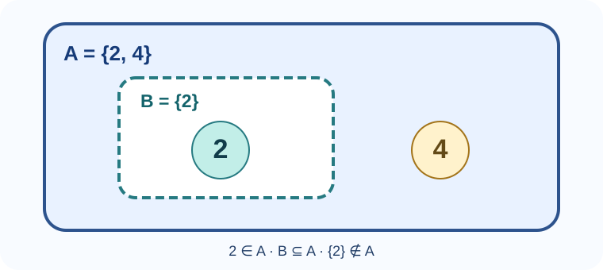
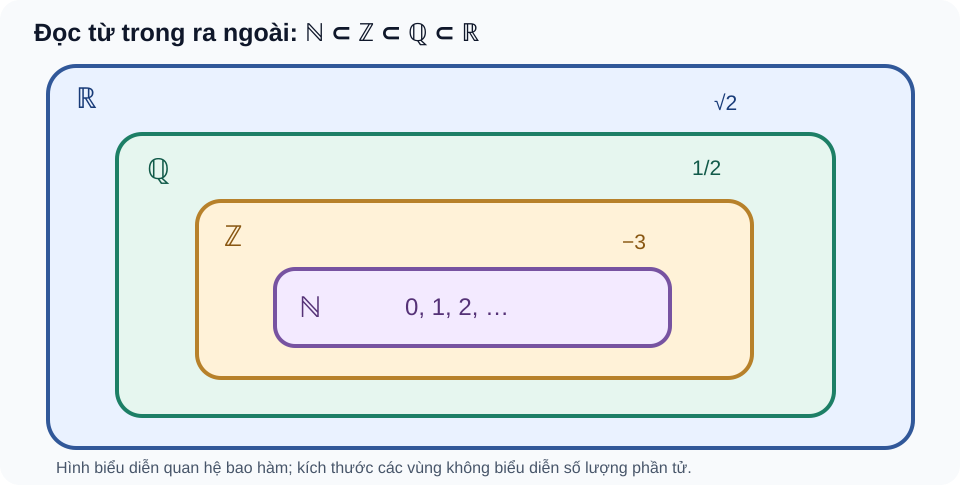
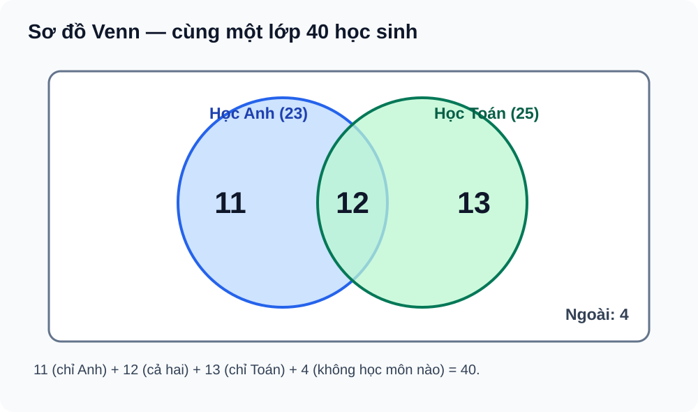

# Toán 10 · Bài 2. Tập hợp và các phép toán trên tập hợp

TOÁN 10 · CHƯƠNG I · KIẾN THỨC SGK KNTT

Học kiến thức, xem ví dụ và hình minh họa rồi tự luyện. Gợi ý/lời giải chỉ mở khi em chọn; không ghi điểm thành thạo.

=== "Khám phá kiến thức"

    ### 1.1. Tập hợp giúp ta xác định những đối tượng nào?

    Em hãy tưởng tượng trên bàn có một chiếc hộp ghi chữ \(A\), trong hộp là hai tấm thẻ mang số **2** và **4**. Nếu một bạn hỏi “Số 2 có ở trong hộp \(A\) không?”, câu trả lời rất dễ: có. Trong toán học, ta gọi \(A=\{2,4\}\) là **một tập hợp**; số 2 và số 4 là **những phần tử** của tập đó. Ta viết \(2\in A\), đọc là “2 thuộc A”.

    Bây giờ, em lấy riêng thẻ số 2 đặt vào chiếc hộp nhỏ \(B\). Hộp nhỏ ấy biểu diễn tập \(B=\{2\}\). Lúc này có hai đối tượng cần phân biệt: **số 2** là một phần tử, còn **\(\{2\}\)** là một tập hợp có đúng một phần tử. Vì mọi phần tử của \(B\) đều nằm trong \(A\), ta nói \(B\) là **tập con của \(A\)** và viết \(B\subseteq A\).

    <figure class="thpt-r4-plot thpt-r4-concept-figure">
    
    <figcaption>Quan sát: cả hai số 2, 4 đều thuộc A; số 2 đồng thời thuộc B. Vì mọi phần tử của B đều thuộc A nên B là tập con của A. Riêng tập {2} không phải phần tử của A trong ví dụ này.</figcaption>
    </figure>

    Cách nghĩ này giải thích vì sao \(2\in A\) và \(\{2\}\subseteq A\) đều đúng, nhưng \(\{2\}\in A\) lại sai **trong ví dụ đang xét**: hai phần tử của \(A\) là *các số* 2 và 4, không có phần tử nào là tập \(\{2\}\). Trong toán học, bản thân một tập cũng có thể là phần tử của một tập lớn hơn; điều quyết định là tập đó thực sự chứa **những đối tượng nào**.

    Khi học phần này, em sẽ gặp cả trường hợp không có phần tử nào: đó là **tập rỗng** \(\varnothing\). Em cũng sẽ gặp những tập được viết theo một điều kiện, chẳng hạn tập các số tự nhiên nhỏ hơn 5, thay vì phải kể tên từng số. Nhờ vậy, tập hợp trở thành một cách ghi rõ **ta đang xét những đối tượng nào**.

    Tập hợp còn giúp trả lời những câu hỏi đời thường. Ví dụ, trong một lớp học có hai câu lạc bộ Toán và Tiếng Anh, có bạn chỉ tham gia một câu lạc bộ, có bạn tham gia cả hai, cũng có bạn không tham gia câu lạc bộ nào. Muốn đếm chính xác, ta cần phân biệt **phần chung**, **tất cả những người tham gia**, và **phần chỉ thuộc một nhóm**. Đó chính là ý tưởng đằng sau các phép giao, hợp và hiệu của tập hợp.

    ### 1.2. Đọc hình và tìm phần chung

    Cho \(A=\{2,4\}\) và \(B=\{2\}\). Ta đọc được ngay: \(2\in A\), \(B\subseteq A\), \(A\ne B\). Dù \(B\) nằm trong \(A\), hai tập không bằng nhau vì \(A\) còn chứa số 4.

    Với hai câu lạc bộ, giả sử An và Bình tham gia CLB Toán, Bình và Chi tham gia CLB Tiếng Anh. **Bạn Bình** thuộc cả hai nhóm nên nằm ở *phần giao*. Ba bạn An, Bình, Chi hợp lại là *phần hợp*; khi viết danh sách, Bình chỉ được ghi **một lần**, không phải hai.

    ### 1.3. Thuật ngữ và mục tiêu bài học

    **Thuật ngữ cần biết:** tập hợp, phần tử, tập con, tập bằng nhau, tập rỗng, giao, hợp, hiệu, phần bù, tập vũ trụ, khoảng, đoạn, nửa khoảng và sơ đồ Venn.

    **Sau bài học, em cần làm được:** đọc và viết đúng ký hiệu \(\in,\notin,\subseteq\); mô tả tập bằng cách liệt kê hoặc nêu điều kiện; thực hiện giao, hợp, hiệu, phần bù; đọc đầu mút trên trục số; và dùng sơ đồ Venn để đếm mà không trùng lặp.

=== "Kiến thức SGK"

    ### 2.1. Các khái niệm cơ bản về tập hợp

    
<strong>Khái niệm — Tập hợp và phần tử:</strong> Tập hợp là một nhóm các đối tượng xác định; mỗi đối tượng trong nhóm là một phần tử của tập. Thứ tự liệt kê và việc lặp một phần tử không làm thay đổi tập hợp.

    **Hai cách mô tả tập hợp.** Có thể **liệt kê** các phần tử, ví dụ \(A=\{2,4\}\), hoặc **nêu tính chất đặc trưng**, chẳng hạn \(C=\{x\in\mathbb N\mid x<5\}\). Theo SGK \(\mathbb N=\{0,1,2,\ldots\}\), nên \(C=\{0,1,2,3,4\}\). Đọc dấu gạch đứng là “sao cho”: tập C gồm các số tự nhiên sao cho số đó nhỏ hơn 5. Luôn nêu đúng miền xét.

    **Kí hiệu phần tử.** \(x\in A\) nghĩa là \(x\) thuộc tập \(A\); \(x\notin A\) nghĩa là \(x\) không thuộc \(A\).

    
<strong>Khái niệm — Tập con:</strong> \(A\subseteq B\) khi <em>mọi</em> phần tử của \(A\) cũng thuộc \(B\). Mọi tập đều là tập con của chính nó.

    
<strong>Khái niệm — Hai tập hợp bằng nhau:</strong> \(A=B\) khi \(A\subseteq B\) và \(B\subseteq A\): hai tập chứa đúng cùng những phần tử.

    
<strong>Khái niệm — Tập rỗng:</strong> \(\varnothing\) là tập không có phần tử nào; \(\varnothing\subseteq A\) với mọi tập \(A\).

    **Phân biệt.** \(2\in A\) nói về một phần tử; \(\{2\}\subseteq A\) nói về quan hệ giữa hai tập. Một tập có thể là phần tử của tập khác, nhưng phải kiểm các đối tượng thực sự được liệt kê.

    
<strong>Kiến thức cần nhớ:</strong> “Thuộc” (\(\in\)) dùng để nói về <em>phần tử</em>; “là tập con” (\(\subseteq\)) dùng để nói về <em>quan hệ giữa hai tập</em>. Hai tập bằng nhau phải có đúng các phần tử như nhau.

    
<table class="thpt-g10-knowledge-table">
    <thead><tr><th>Em muốn diễn đạt</th><th>Ký hiệu</th><th>Ví dụ đúng với \(A=\{2,4\}\)</th></tr></thead>
    <tbody>
    <tr><td>Một <strong>phần tử</strong> nằm trong tập</td><td>\(\in\)</td><td>\(2\in A\)</td></tr>
    <tr><td>Một <strong>tập</strong> có toàn bộ phần tử thuộc tập khác</td><td>\(\subseteq\)</td><td>\(\{2\}\subseteq A\)</td></tr>
    <tr><td>Một <strong>tập</strong> cũng là phần tử của tập lớn?</td><td>Phải kiểm phần tử thực tế</td><td>\(\{2\}\notin A\) trong ví dụ này</td></tr>
    </tbody></table>

    **Vận dụng.** Với \(A=\{2,4\}\), hãy tự xét ba phát biểu: (a) \(2\in A\); (b) \(\{2\}\subseteq A\); (c) \(\{2\}\in A\). Nghĩ xem hai vế của ký hiệu đang nói về *số* hay *tập* trước khi mở đối chiếu.

    

    ??? question "Em đã suy nghĩ? Mở lời giải để đối chiếu"

        (a) **Đúng** vì 2 là phần tử của A. (b) **Đúng** vì phần tử duy nhất 2 của \(\{2\}\) nằm trong A. (c) **Sai** vì A chỉ có hai phần tử là các **số** 2 và 4, không chứa tập \(\{2\}\) như một phần tử.

    ### 2.2. Các tập hợp số

    #### 2.2.1. Mối quan hệ giữa các tập hợp số

    Em đã gặp số tự nhiên, số nguyên, phân số và số thập phân. Khi học tập hợp, ta cần biết **một số thuộc những tập số nào**, không chỉ đọc được dạng viết của số đó.

    
<strong>Khái niệm — Số tự nhiên và số nguyên:</strong> \(\mathbb N=\{0,1,2,3,\ldots\}\); \(\mathbb Z=\{\ldots,-2,-1,0,1,2,\ldots\}\) gồm các số nguyên âm, số \(0\) và các số nguyên dương.

    
<strong>Khái niệm — Số hữu tỉ:</strong> \(\mathbb Q\) gồm những số viết được dưới dạng \(\dfrac ab\), với \(a,b\in\mathbb Z\), \(b\ne0\). Số hữu tỉ có dạng thập phân hữu hạn hoặc vô hạn tuần hoàn.

    
<strong>Khái niệm — Số thực:</strong> \(\mathbb R\) gồm các số hữu tỉ và số vô tỉ. Số vô tỉ có biểu diễn thập phân vô hạn không tuần hoàn; \(\sqrt 2\) là một ví dụ.

    
<strong>Kiến thức — Quan hệ bao hàm:</strong> \(\mathbb N\subseteq\mathbb Z\subseteq\mathbb Q\subseteq\mathbb R\). Số thuộc một tập bên trong thì cũng thuộc các tập bao ngoài, nhưng không suy ngược được.

    <figure class="thpt-r4-plot thpt-r4-concept-figure">
    
    <figcaption>Đọc hình từ miền nhỏ ra miền lớn: \(\mathbb N\subseteq\mathbb Z\subseteq\mathbb Q\subseteq\mathbb R\). \(-3\in\mathbb Z\) nhưng \(-3\notin\mathbb N\), còn \(\sqrt2\in\mathbb R\) nhưng \(\sqrt2\notin\mathbb Q\). Kích thước các miền không biểu thị số lượng phần tử.</figcaption>
    </figure>

    **Cách tự kiểm.** Với \(\dfrac34\), hỏi trước: đây có phải số nguyên không? Nó có thể viết dưới dạng phân số của hai số nguyên không? Việc một số thuộc \(\mathbb R\) không có nghĩa số đó chắc chắn thuộc \(\mathbb Q\).

    #### 2.2.2. Khoảng, đoạn và nửa khoảng trên trục số

    Khi tập hợp chứa vô số số thực, liệt kê từng số là không thể. Ta dùng **khoảng**, **đoạn** hoặc **nửa khoảng** để viết ngắn gọn. Ví dụ: \([1;4]\) là tất cả các số thực \(x\) thỏa \(1\le x\le4\); còn \((1;4)\) là những số thỏa \(1<x<4\).

    - Ngoặc vuông **[ ]** tại một đầu mút nghĩa là **lấy** đầu mút đó.
    - Ngoặc tròn **( )** nghĩa là **không lấy** đầu mút.
    - \([a;b)\) chỉ lấy \(a\), không lấy \(b\); \((a;b]\) chỉ lấy \(b\).
    - Khi có \(+\infty\) hoặc \(-\infty\), luôn dùng ngoặc tròn ở phía vô cực vì vô cực **không phải một số thực** để lấy làm đầu mút.

    Để tìm giao hoặc hợp hai khoảng, em hãy hình dung cả hai trên **cùng một trục số**. Giao là phần được tô ở cả hai tập; hợp là những điểm được tô ở ít nhất một tập. Cẩn thận kiểm riêng từng đầu mút: một sai khác giữa \(<\) và \(\le\) có thể làm kết quả thay đổi.

    
<strong>Kiến thức cần nhớ:</strong> Đừng chọn ngoặc bằng cảm giác. Tại mỗi đầu mút, hãy hỏi: “Giá trị này có thỏa điều kiện của tập kết quả không?”

    **Vận dụng.** Cho \(X=(-2;4]\), \(Y=[1;6)\). Tìm \(X\cap Y\), \(X\cup Y\); kiểm xem các số 1, 4 và 6 có thuộc từng kết quả không.

    

    ??? question "Mở đối chiếu sau khi tự làm"

        \(X\cap Y=[1;4]\), gồm 1 và 4 nhưng không có 6. \(X\cup Y=(-2;6)\), gồm 1 và 4 nhưng không có 6; cũng không có \(-2\).

    ### 2.3. Các phép toán trên tập hợp

    #### 2.3.1. Giao, hợp, hiệu và phần bù

    Hãy nhớ lại hai câu lạc bộ. Nếu hỏi “ai tham gia **cả hai** câu lạc bộ?”, ta lấy **giao**. Nếu hỏi “ai tham gia **ít nhất một** câu lạc bộ?”, ta lấy **hợp**. Nếu hỏi “ai chỉ thuộc nhóm Toán mà không thuộc nhóm Tiếng Anh?”, ta lấy **hiệu** theo đúng thứ tự hai tập.

    
<strong>Khái niệm — Giao:</strong> \(A\cap B\) gồm các phần tử thuộc <em>cả hai</em> tập \(A,B\).

    
<strong>Khái niệm — Hợp:</strong> \(A\cup B\) gồm các phần tử thuộc <em>ít nhất một</em> trong hai tập.

    
<strong>Khái niệm — Hiệu:</strong> \(A\setminus B\) gồm các phần tử thuộc \(A\) nhưng không thuộc \(B\); không tự ý đảo chiều.

    **Viết bằng tính chất phần tử.** Với hai tập \(A,B\), ta có:

    \[
    A\cap B=\{x\mid x\in A\ \text{và}\ x\in B\},
    \]

    \[
    A\cup B=\{x\mid x\in A\ \text{hoặc}\ x\in B\},
    \]

    \[
    A\setminus B=\{x\mid x\in A\ \text{và}\ x\notin B\}.
    \]

    Chữ **hoặc** trong phép hợp có nghĩa là *ít nhất một trong hai*, kể cả khi \(x\) thuộc cả hai tập. Phép hiệu không đổi chỗ được tùy ý: \(A\setminus B\) và \(B\setminus A\) có thể khác nhau.

    Một câu hỏi khác là “ai **không** thuộc nhóm \(A\)?”. Phải biết đang xét trong **cả lớp**, **cả trường** hay phạm vi khác. Gọi phạm vi đó là tập vũ trụ \(U\), với \(A\subseteq U\).

    
<strong>Khái niệm — Phần bù:</strong> Khi \(A\subseteq U\), phần bù của \(A\) trong \(U\) là \(U\setminus A\), gồm các phần tử thuộc \(U\) nhưng không thuộc \(A\). Phải xác định rõ tập làm phạm vi.

    
<strong>Kiến thức cần nhớ:</strong> Giao là “và”, hợp là “hoặc”, hiệu là “thuộc tập trước nhưng không thuộc tập sau”. Phần bù là hiệu so với một tập vũ trụ đã xác định.

    **Vận dụng.** Cho \(A=\{a,b,c\}\), \(B=\{b,c,d\}\). Tự viết \(A\cap B\), \(A\cup B\) và đếm số phần tử của từng tập kết quả.

    

    ??? question "Mở đối chiếu sau khi tự làm"

        \(A\cap B=\{b,c\}\), có 2 phần tử. \(A\cup B=\{a,b,c,d\}\), có 4 phần tử. Trong phép hợp, \(b,c\) chỉ được viết mỗi phần tử một lần.

    **Vận dụng.** Với \(A=\{1,2,3,4\}\), \(B=\{2,4,6\}\), em hãy tính \(A\setminus B\) và \(B\setminus A\). Kết quả có giống nhau không?

    

    ??? question "Mở đối chiếu sau khi tự làm"

        \(A\setminus B=\{1,3\}\); \(B\setminus A=\{6\}\). Hai tập **khác nhau**. Chẳng hạn, 1 thuộc \(A\setminus B\) nhưng không thuộc \(B\setminus A\).

    **Vận dụng.** Cho \(U=\{0,1,2,3,4,5\}\) và \(A=\{1,3,5\}\). Phần bù của \(A\) trong \(U\) là tập nào? Vì sao phải ghi rõ \(U\)?

    

    ??? question "Mở đối chiếu sau khi tự làm"

        \(U\setminus A=\{0,2,4\}\). Phải ghi U vì chỉ những phần tử trong **phạm vi U** mới được xét; nếu thay U, phần bù có thể thay đổi.

    #### 2.3.2. Biểu đồ Ven và cách đếm không trùng

    
<strong>Khái niệm — Biểu đồ Ven:</strong> Biểu đồ Ven dùng các miền hình để biểu diễn tập hợp và các phép toán. Với hai tập \(A,B\) trong \(U\), ta đọc bốn vùng: chỉ \(A\), cả \(A\) và \(B\), chỉ \(B\), ngoài cả hai. Một số vùng có thể rỗng.

    **Đọc hình.** Nhìn vùng giao trước, sau đó đến hai vùng riêng và phần ngoài. Không suy từ diện tích hình vẽ ra số lượng phần tử; phải dùng số liệu đã cho.

    Với tập hữu hạn \(A\), kí hiệu \(n(A)\) là số phần tử của tập đó (tương tự với tập B). Nếu cộng \(n(A)+n(B)\), mọi phần tử thuộc giao đã bị đếm **hai lần**. Vì vậy, muốn biết số phần tử của hợp, phải trừ đi một lần số phần tử ở giao:

    \[
    n(A\cup B)=n(A)+n(B)-n(A\cap B).
    \]

    **Đọc hình bằng số liệu cụ thể.** Một lớp có 40 học sinh. Có 23 bạn học Tiếng Anh, 25 bạn học Toán, trong đó 12 bạn học cả hai. Trong hình, em tìm vùng chung ở chính giữa trước (12); vùng chỉ Anh là \(23-12=11\), vùng chỉ Toán là \(25-12=13\); vùng ngoài cả hai là \(40-(11+12+13)=4\).

    <figure class="thpt-r4-plot thpt-r4-probability-figure"><figcaption>Sơ đồ Venn cho lớp 40 học sinh: đọc giao 12 ở giữa, rồi lần lượt xác định hai phần riêng 11 và 13, cuối cùng 4 học sinh ngoài cả hai. Hình ứng với đúng bài toán 40 học sinh này, không dùng cho dữ liệu khác.</figcaption></figure>

    
<strong>Kiến thức cần nhớ:</strong> Với sơ đồ Venn có hai tập, hãy điền <em>phần giao trước</em>, rồi tính phần riêng của mỗi tập, cuối cùng lấy phần ngoài từ tổng \(U\).

    **Vận dụng.** Một lớp khác có 32 học sinh; 18 bạn tham gia CLB Âm nhạc, 15 bạn tham gia CLB Thể thao, 6 bạn tham gia cả hai. Hỏi chỉ tham gia từng CLB có bao nhiêu bạn, và không tham gia CLB nào có bao nhiêu bạn? **Không** dùng lại các số của hình 40 học sinh phía trên.

    

    ??? question "Mở đối chiếu sau khi tự làm"

        Chỉ Âm nhạc: \(18-6=12\); chỉ Thể thao: \(15-6=9\). Tham gia ít nhất một CLB: \(12+6+9=27\). Không tham gia CLB nào: \(32-27=5\). Kiểm tra \(12+6+9+5=32\).

=== "Ví dụ"

    Các hoạt động “Vận dụng” phía trên giúp em tự kiểm từng bước. Mỗi ví dụ tiếp theo có **Phân tích** (nhận diện dữ kiện và hướng giải), **Lời giải** (thực hiện) và **Kiểm lại**.

    ### 3.1. Ví dụ 1 — Giao, hợp, hiệu của hai tập hữu hạn

    **Đề bài.** Cho \(A=\{1,2,3,4\}\), \(B=\{3,4,5\}\). Tìm \(A\cap B\), \(A\cup B\), \(A\setminus B\) và \(B\setminus A\).

    **Phân tích.** Hai tập có ít phần tử và đã được liệt kê đầy đủ. Ta kiểm trực tiếp từng số, không cần lập công thức dài hay vẽ hình phức tạp.

    **Lời giải.** Số 3 và 4 thuộc cả hai tập nên \(A\cap B=\{3,4\}\). Lấy tất cả các số xuất hiện ở ít nhất một tập, mỗi số ghi một lần, được \(A\cup B=\{1,2,3,4,5\}\). Bỏ 3,4 khỏi A còn \(A\setminus B=\{1,2\}\); bỏ 3,4 khỏi B còn \(B\setminus A=\{5\}\).

    **Kiểm lại.** Hợp có 5 phần tử và \(n(A)+n(B)-n(A\cap B)=4+3-2=5\). Hai hiệu khác nhau như đã dự đoán.

    ### 3.2. Ví dụ 2 — Phân loại số theo tập hợp số

    **Đề bài.** Xét bốn số \(0\), \(-2\), \(\dfrac34\) và \(\sqrt 2\). Với mỗi số, hãy xác định tập nhỏ nhất trong bốn tập \(\mathbb N,\mathbb Z,\mathbb Q,\mathbb R\) chứa số đó.

    **Phân tích.** Bắt đầu từ tập nhỏ nhất \(\mathbb N\) rồi kiểm lần lượt điều kiện của \(\mathbb Z\), \(\mathbb Q\) và \(\mathbb R\). Đừng nhầm “thuộc \(\mathbb R\)” với “chỉ thuộc \(\mathbb R\)”.

    **Lời giải.** Số \(0\) là số tự nhiên nên tập nhỏ nhất là \(\mathbb N\). Số \(-2\) là số nguyên nhưng không phải số tự nhiên, nên tập nhỏ nhất là \(\mathbb Z\). Số \(\dfrac34\) là số hữu tỉ nhưng không phải số nguyên, nên tập nhỏ nhất là \(\mathbb Q\). Số \(\sqrt 2\) là số vô tỉ, nên tập nhỏ nhất là \(\mathbb R\).

    **Kiểm lại.** \(\mathbb N\subseteq\mathbb Z\subseteq\mathbb Q\subseteq\mathbb R\). Mỗi số còn thuộc tất cả các tập bao ngoài tập nhỏ nhất đã nêu, không phải chỉ thuộc đúng một tập.

    ### 3.3. Ví dụ 3 — Giao, hợp và hiệu của hai nửa khoảng

    **Đề bài.** Cho \(A=(-3;2]\), \(B=[0;5)\). Tìm \(A\cap B\), \(A\cup B\) và \(A\setminus B\).

    **Phân tích.** Mỗi tập là một nửa khoảng trên trục số, nên ta xác định phần **chồng lên nhau**, phần **được phủ bởi ít nhất một tập** và phần **chỉ còn lại trong A**. Quyết định lấy hay bỏ đầu mút sau khi kiểm điều kiện, không đoán qua dấu ngoặc.

    **Lời giải.** Những số nằm đồng thời trong A và B là các số thỏa \(0\le x\le2\), nên \(A\cap B=[0;2]\). Vì hai nửa khoảng có chung phần \([0;2]\), lấy tất cả phần thuộc ít nhất một trong hai tập cho \(A\cup B=(-3;5)\). Cuối cùng, từ A bỏ các số có trong B, tức bỏ đoạn \([0;2]\), ta còn \(A\setminus B=(-3;0)\).

    **Kiểm lại.** Số \(0\) thuộc B nên **không** thuộc \(A\setminus B\). Số \(2\) nằm trong giao vì cả A và B đều chứa 2. Hai đầu mút \(-3\) và \(5\) đều không nằm trong hợp.

    ### 3.4. Ví dụ 4 — Giải bài toán đếm bằng biểu đồ Ven

    **Đề bài.** Một lớp có 36 học sinh. Có 21 bạn tham gia CLB Đọc sách, 20 bạn tham gia CLB Khoa học và 8 bạn tham gia cả hai. Hỏi bao nhiêu bạn tham gia đúng một câu lạc bộ và bao nhiêu bạn không tham gia câu lạc bộ nào?

    **Phân tích.** Nếu cộng \(21+20\), tám bạn thuộc cả hai nhóm bị đếm hai lần. Ta tìm từng vùng riêng rồi lấy tổng sĩ số trừ phần tham gia ít nhất một nhóm. Đây là dữ kiện mới, không dùng kết quả của hình minh họa 40 học sinh.

    **Lời giải.** Chỉ Đọc sách: \(21-8=13\) (bạn). Chỉ Khoa học: \(20-8=12\) (bạn). Tham gia đúng một CLB: \(13+12=25\) (bạn). Tham gia ít nhất một CLB: \(13+8+12=33\) (bạn). Không tham gia CLB nào: \(36-33=3\) (bạn).

    **Kiểm lại.** Bốn vùng không chồng nhau có \(13+8+12+3=36\), đúng sĩ số lớp. Không dùng số liệu của hình minh họa 40 học sinh ở mục 2.3.2.

=== "Lỗi thường gặp"

    

    ??? tip "4.1. Nhầm phần tử với tập con hoặc kết luận hai tập bằng nhau quá sớm"

        **Dấu hiệu:** Viết \(1\subseteq A\) khi muốn nói số 1 thuộc A; hoặc mới kiểm \(A\subseteq B\) đã kết luận \(A=B\).

        **Tự sửa:** Đọc lại ý nghĩa \(\in\) và \(\subseteq\) tại 2.1. Nếu hai vế là hai tập, muốn chứng minh bằng nhau phải kiểm **cả hai chiều** tập con.

        **Luyện tiếp:** [Câu Core về tập hợp](luyen-tap.md?item=THPT-G10-B02-C01) · [Bài luyện về tập con](luyen-tap.md?item=THPT-G10-B02-P06).

    

    ??? tip "4.2. Nhầm giao với hợp, quên phần bù hoặc đếm một người hai lần"

        **Dấu hiệu:** Lấy \(23+25=48\) làm số học sinh tham gia ít nhất một môn trong lớp 40 bạn; hoặc tìm phần bù mà chưa biết tập vũ trụ.

        **Tự sửa:** Trở lại 2.3.1 và 2.3.2. Xác định nhóm chung trước, trừ giao đúng một lần, nêu rõ U trước khi tính phần bù. Kiểm tổng các vùng phải bằng số người được khảo sát.

        **Luyện tiếp:** [Core giao/hợp](luyen-tap.md?item=THPT-G10-B02-C02) · [Luyện vận dụng](luyen-tap.md?item=THPT-G10-B02-P02) · [Đếm Venn](luyen-tap.md?item=THPT-G10-B02-P05).

    

    ??? tip "4.3. Sai ngoặc tròn/vuông ở đầu mút của khoảng và đoạn"

        **Dấu hiệu:** Viết \((1;4)\) thay cho \([1;4]\), hoặc lấy \(6\) vào \((-2;6)\).

        **Tự sửa:** Trở lại 2.2.2, chuyển từng khoảng thành điều kiện \(<,\le,>,\ge\). Kiểm riêng 1, 4, 6 trên từng tập trước khi viết ký hiệu khoảng. Sau đó làm lại câu “Vận dụng” tại 2.2.2 bằng cách tự mở đối chiếu.

    **Tiếp tục tự học:** [Core và Luyện tập Chương I](luyen-tap.md) · [Tự kiểm tra cuối chương](tu-kiem-tra-chuong.md) · [Tự luận Chương I](../../thu-vien/tu-luan-chuong-i.md).

    
Đối chiếu SGK Toán 10 · Kết nối tri thức với cuộc sống · tập một · Bài 2 (trang in 12–19). Lời giảng, hình và ví dụ bổ trợ do SLM biên tập; hoạt động tự đối chiếu không ghi Mastery.

