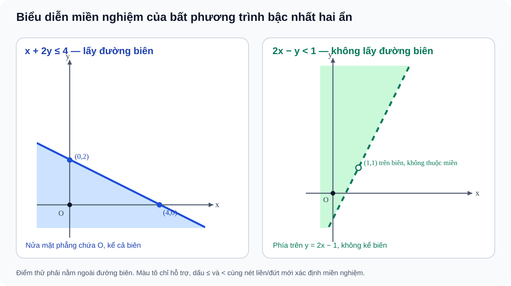

# Toán 10 · Bài 3. Bất phương trình bậc nhất hai ẩn

TOÁN 10 · CHƯƠNG II · KIẾN THỨC SGK KNTT

Lý thuyết, ví dụ và sơ đồ nửa mặt phẳng/đa giác từ học liệu đã duyệt. Em tự luyện trước khi mở đáp án, không ghi điểm thành thạo.

=== "Khám phá kiến thức"

    ### Cùng tìm hiểu

    Một xưởng có hai loại sản phẩm A và B. Mỗi sản phẩm A cần **2 giờ máy**, mỗi sản phẩm B cần **3 giờ máy**, trong khi xưởng chỉ có **12 giờ máy** để sản xuất. Nếu đặt \(x\) là số sản phẩm A và \(y\) là số sản phẩm B, thì tổng thời gian cần dùng là \(2x+3y\) giờ. Xưởng không nhất thiết phải chạy hết 12 giờ, nhưng không thể dùng quá số giờ có sẵn. Vì vậy, điều kiện thực tế được viết thành:

    \[
    2x+3y\le 12.
    \]

    Đây là một **bất phương trình bậc nhất hai ẩn**: nó ràng buộc đồng thời hai số lượng chưa biết \(x\) và \(y\). Trong tình huống sản xuất, \(x,y\) là số sản phẩm nên còn phải là **số nguyên không âm**. Khi chỉ nghiên cứu bất phương trình trên mặt phẳng tọa độ, ta thường cho \(x,y\) nhận giá trị thực. Hai việc đó không mâu thuẫn: **bất phương trình mô tả giới hạn**, còn **miền giá trị của biến** cho biết ta đang xét những phương án nào.

    Thử chọn \(x=3\), \(y=2\). Tổng thời gian là \(2\cdot3+3\cdot2=12\) giờ; phương án này vừa đủ số giờ, nên được chấp nhận. Nhưng nếu chọn \(x=4\), \(y=2\), xưởng cần 14 giờ và phương án không hợp lệ. Vì thế, nghiệm của bất phương trình là **một cặp số** \((x,y)\) thỏa điều kiện, chứ không phải chỉ một giá trị của \(x\) hay \(y\).

    Khi đánh dấu mọi cặp nghiệm trên hệ trục tọa độ, ta không nhận một vài điểm rời rạc mà được cả **một miền trên mặt phẳng**. Đường thẳng \(2x+3y=12\) là ranh giới: những điểm trên đường dùng đúng 12 giờ. Phía nào dùng không quá 12 giờ là **miền nghiệm**. Từ đó, em có thể nhìn một hình vẽ để hiểu hàng loạt phương án cùng lúc, thay vì thử từng cặp số.

    ### Ví dụ trực quan

    Giả sử bảng kế hoạch của xưởng ghi ba phương án:

    
<table class="thpt-g10-knowledge-table">
    <thead><tr><th>Sản phẩm A \(x\)</th><th>Sản phẩm B \(y\)</th><th>Thời gian cần dùng</th><th>Kết luận</th></tr></thead>
    <tbody>
    <tr><td>3</td><td>2</td><td>\(2\cdot3+3\cdot2=12\) giờ</td><td>Hợp lệ, đúng mức giới hạn</td></tr>
    <tr><td>4</td><td>2</td><td>\(2\cdot4+3\cdot2=14\) giờ</td><td>Không hợp lệ</td></tr>
    <tr><td>0</td><td>3</td><td>\(2\cdot0+3\cdot3=9\) giờ</td><td>Hợp lệ, còn dư 3 giờ</td></tr>
    </tbody></table>

    Chỉ cần **thế hai số vào một bất phương trình**, em biết phương án nào được nhận. Đây cũng là cách kiểm tra một điểm trên hình: tọa độ của điểm chính là một cặp giá trị \((x,y)\).

    ### Thuật ngữ và kiến thức, kỹ năng

    **Thuật ngữ cần biết:** bất phương trình bậc nhất hai ẩn, hệ số, cặp nghiệm, đường thẳng biên, nửa mặt phẳng, miền nghiệm, điểm thử và điều kiện thực tế.

    **Sau bài học, em cần làm được:** nhận diện đúng dạng bất phương trình; thay một cặp số để kiểm nghiệm; xác định đường biên và phân biệt có/không lấy biên; chọn đúng nửa mặt phẳng nghiệm; lập điều kiện từ dữ liệu và giải thích miền giá trị của biến.

=== "Kiến thức SGK"

    ### 2.1. Nhận diện bất phương trình bậc nhất hai ẩn

    Một bất phương trình bậc nhất hai ẩn \(x,y\) có thể viết dưới một trong bốn dạng:

    \[
    ax+by<c,\qquad ax+by\le c,\qquad ax+by>c,\qquad ax+by\ge c,
    \]

    trong đó \(a,b,c\) là các số thực và **\(a,b\) không đồng thời bằng 0**. Hệ số của riêng \(x\) hoặc \(y\) được phép bằng 0: chẳng hạn \(0x-3y>1\) vẫn là một bất phương trình bậc nhất hai ẩn. Nhưng \(xy\le6\) có tích hai biến, còn \(0x+0y\le4\) chỉ là điều kiện hằng; cả hai không thuộc dạng vừa nêu.

    
<strong>Kiến thức cần nhớ:</strong> Kiểm bậc của từng biến và điều kiện \((a,b)\ne(0,0)\). Một hệ số bằng 0 vẫn được; cả hai bằng 0 thì không còn bất phương trình bậc nhất hai ẩn.

    **Em vận dụng.** Trong ba biểu thức (a) \(2x-3y<6\); (b) \(xy\le6\); (c) \(0x+0y\le4\), biểu thức nào là bất phương trình bậc nhất hai ẩn? Giải thích.

    

    ??? question "Em đã tự làm? Mở lời giải để đối chiếu"

        **Chỉ (a)** đúng dạng vì các biến ở bậc nhất và hai hệ số \(2,-3\) không đồng thời bằng 0. (b) chứa tích \(xy\); (c) có cả hai hệ số bằng 0. Nếu nhầm, quay lại điều kiện trong khung “Kiến thức cần nhớ”.

    ### 2.2. Cặp nghiệm: thử bằng phép thế, không đoán bằng hình

    Một **cặp nghiệm** \((x_0,y_0)\) là cặp số thực làm cho bất phương trình trở thành một phát biểu **đúng** sau khi thay \(x=x_0\), \(y=y_0\). Muốn biết một điểm có thuộc miền nghiệm hay không, phải thay **cả hai** tọa độ rồi so với dấu bất phương trình.

    Xét \(x+2y\le6\):

    
<table class="thpt-g10-knowledge-table">
    <thead><tr><th>Điểm</th><th>Thay tọa độ</th><th>Có là nghiệm không?</th></tr></thead>
    <tbody>
    <tr><td>\(A(2,2)\)</td><td>\(2+2\cdot2=6\le6\)</td><td>Có, nằm đúng trên biên</td></tr>
    <tr><td>\(B(3,2)\)</td><td>\(3+2\cdot2=7&gt;6\)</td><td>Không</td></tr>
    <tr><td>\(C(0,0)\)</td><td>\(0+2\cdot0=0\le6\)</td><td>Có, nằm trong miền</td></tr>
    </tbody></table>

    Điểm \(A\) được nhận **vì có dấu bằng** trong \(\le\). Nếu đề bài đổi thành \(x+2y<6\), chính điểm \(A\) sẽ không còn là nghiệm. Như vậy, thay một dấu có thể làm thay đổi **ranh giới của cả miền nghiệm**.

    
<strong>Kiến thức cần nhớ:</strong> Điểm \((x_0,y_0)\) là nghiệm khi và chỉ khi phép thế đầy đủ hai tọa độ cho một bất đẳng thức đúng. Dấu \(<\) và \(\le\) khác nhau tại các điểm trên đường biên.

    **Em vận dụng.** Với \(x+2y\le6\), trong \(A(2,2)\), \(B(3,2)\), \(C(0,0)\), những điểm nào là nghiệm? Điểm nào nằm đúng trên đường biên?

    

    ??? question "Mở đáp án sau khi tự kiểm tra"

        **A và C** là nghiệm. A nằm trên biên vì \(2+2\cdot2=6\); B không là nghiệm vì \(3+2\cdot2=7>6\). C nằm trong miền vì \(0\le6\).

    ### 2.3. Đường biên: khi nào lấy, khi nào không lấy?

    Từ bất phương trình \(ax+by\le c\), hãy tạm thay dấu \(\le\) bằng dấu bằng. Ta được đường thẳng

    \[
    d:ax+by=c.
    \]

    Đường \(d\) chia mặt phẳng thành hai phía. Những điểm trên \(d\) làm biểu thức \(ax+by\) **đúng bằng \(c\)**. Vì thế, dấu \(\le\) hoặc \(\ge\) **nhận cả các điểm trên biên**; dấu \(<\) hoặc \(>\) **loại biên**. Khi vẽ, ta thường dùng **nét liền** cho đường được lấy và **nét đứt** cho đường không được lấy.

    Hình dưới đây đặt hai trường hợp cạnh nhau. Hãy nhìn **đường thẳng**, rồi nhìn **phần nửa mặt phẳng** và kiểm một điểm trên đường để thấy vì sao hai dấu khác nhau.

    <figure class="thpt-r4-plot thpt-r4-concept-figure">
    
    <figcaption>Bên trái: \(x+2y\le4\) nhận đường biên qua \((4,0)\), \((0,2)\). Bên phải: \(2x-y<1\), tương đương \(y>2x-1\), không nhận đường biên; điểm \((1,1)\) nằm trên biên nên bị loại. Hai hình minh họa <strong>hai bất phương trình khác nhau</strong>, không áp một hình cho bài khác dữ kiện.</figcaption>
    </figure>

    **Cách đọc hình:** Bên trái, điểm \(O(0,0)\) cho \(0\le4\), nên thuộc miền được tô, còn điểm \((2,1)\) cho \(2+2=4\), đúng trên nét liền và vẫn được lấy. Bên phải, \(O\) thỏa \(0<1\); \((1,1)\) cho \(2\cdot1-1=1\), bằng ngưỡng nhưng không thỏa dấu \(<1\), nên không thuộc miền.

    
<strong>Kiến thức cần nhớ:</strong> \(ax+by=c\) là đường biên. Dấu \(\le,\ge\) lấy biên (nét liền); dấu \(<,>\) loại biên (nét đứt). Muốn xác định phía nghiệm, dùng một điểm thử không nằm trên biên.

    **Em vận dụng.** Với \(3x+y<6\), đường biên là gì, vẽ nét liền hay nét đứt? Điểm \((2,0)\) có thuộc miền nghiệm không?

    

    ??? question "Em đã tự làm? Mở đối chiếu"

        Đường biên là \(3x+y=6\), phải vẽ **nét đứt**. \((2,0)\) cho \(3\cdot2+0=6\), không thỏa \(<6\); đó là điểm trên đường biên **không được lấy**.

    ### 2.4. Chọn đúng nửa mặt phẳng nghiệm

    Biết đường biên mới là một nửa công việc. Để biết phải chọn phía nào, em thực hiện theo trình tự:

    1. Vẽ đường biên \(d:ax+by=c\).
    2. Chọn một điểm thử \(M\) **không nằm trên \(d\)**. Gốc \(O(0,0)\) thường thuận tiện, nhưng **không dùng được khi \(O\) ở trên biên**, chẳng hạn \(ax+by=0\).
    3. Thay tọa độ \(M\) vào bất phương trình. Nếu đúng, chọn nửa mặt phẳng chứa \(M\); nếu sai, chọn nửa mặt phẳng còn lại.
    4. Kết luận có lấy đường biên hay không dựa vào dấu \(\le,\ge\) hay \(<,>\).

    Khi biến đổi để đưa về \(y>mx+n\), hãy nhớ quy tắc từ bất phương trình một ẩn: **nhân hoặc chia cho số âm phải đảo dấu**. Chẳng hạn, \(2x-y<1\) tương đương \(-y<1-2x\), nên \(y>2x-1\). Phía nghiệm nằm **trên** đường biên — đúng với hình bên phải ở mục 2.3.

    **Em vận dụng.** Biến đổi \(3x-y<3\) về điều kiện theo \(y\). Biên có được lấy không? Gốc \(O(0,0)\) có thuộc miền nghiệm không?

    

    ??? question "Mở lời giải sau khi tự làm"

        \(3x-y<3\iff -y<3-3x\iff y>3x-3\). **Không lấy biên** vì dấu nghiêm ngặt. Tại \(O\): \(0<3\) đúng, nên \(O\) là nghiệm.

    ### 2.5. Từ điều kiện đời sống đến bất phương trình

    Trong tình huống thực tế, mỗi hệ số thường mang một **đơn vị có nghĩa**: giờ máy/sản phẩm, phút/công việc hoặc chi phí/kg. Khi lập bất phương trình, em phải đặt biến, nêu đơn vị và đọc đúng các từ “không quá”, “ít nhất”, “nhỏ hơn”, “lớn hơn”.

    
<table class="thpt-g10-knowledge-table">
    <thead><tr><th>Cụm từ trong đề</th><th>Quan hệ toán học</th></tr></thead>
    <tbody>
    <tr><td>Không quá \(T\), tối đa \(T\)</td><td>\(\le T\)</td></tr>
    <tr><td>Ít nhất \(T\), không dưới \(T\)</td><td>\(\ge T\)</td></tr>
    <tr><td>Ít hơn \(T\)</td><td>\(&lt;T\)</td></tr>
    <tr><td>Nhiều hơn \(T\)</td><td>\(&gt;T\)</td></tr>
    </tbody></table>

    Khi \(x,y\) biểu diễn **số sản phẩm nguyên chiếc**, ta cần \(x,y\in\mathbb Z_{\ge0}\). Khi là **khối lượng** hay thời gian liên tục, các biến có thể là số thực không âm. Không tự ý ép biến về số nguyên nếu đề bài nói tới đại lượng liên tục.

    Nếu bài toán có **phân thức**, chẳng hạn giá trung bình \(\frac{140x+180y}{x+y}\), phải giữ điều kiện **mẫu số dương** \(x+y>0\) trước khi nhân chéo. Bỏ điều kiện này có thể làm xuất hiện “phương án” \(x=y=0\) khiến giá trung bình không xác định.

    **Em vận dụng.** Công việc A cần 4 phút/sản phẩm, B cần 6 phút/sản phẩm, tổng thời gian không quá 120 phút. Viết điều kiện cho số sản phẩm \(x,y\) rồi kiểm \((10,10)\).

    

    ??? question "Mở đáp án sau khi tự làm"

        Điều kiện là \(4x+6y\le120\), \(x,y\in\mathbb Z_{\ge0}\) nếu đếm sản phẩm rời rạc. Thay \(x=y=10\) được \(4\cdot10+6\cdot10=100\le120\), nên phương án hợp lệ.

=== "Ví dụ"

    Các câu “Em vận dụng” vừa giúp kiểm tra từng khái niệm. Bây giờ em xem những bài toán **trọn vẹn**, chú ý cách chọn phương pháp trước khi làm phép tính.

    ### Ví dụ 1 — Biểu diễn miền nghiệm có lấy biên (chọn lọc NotebookLM v1)

    **Đề bài.** Biểu diễn miền nghiệm của \(x+2y\le4\).

    **Vì sao chọn cách giải này?** Bất phương trình bậc nhất hai ẩn có đường biên là một đường thẳng; dùng một điểm thử ngoài biên để biết phía cần chọn, rồi kiểm dấu bằng.

    **Lời giải.** Vẽ \(d:x+2y=4\), đi qua \(A(4,0)\) và \(B(0,2)\). Chọn \(O(0,0)\), vì \(0<4\) nên O không nằm trên biên và \(0+2\cdot0=0\le4\) đúng. Miền nghiệm là nửa mặt phẳng bờ \(d\) **chứa O**, **bao gồm cả đường biên**. Trên hình bên trái ở mục 2.3, em thấy đường liền và phần được tô ở phía O.

    **Kiểm lại.** Điểm \((2,1)\) cho \(2+2\cdot1=4\), là nghiệm nằm trên biên. Nếu em loại điểm này, em đã nhầm \(\le\) với \(<\).

    ### Ví dụ 2 — Biểu diễn miền nghiệm không lấy biên

    **Đề bài.** Biểu diễn miền nghiệm của \(2x-y<1\).

    **Vì sao chọn cách giải này?** Khi giải theo \(y\), ta dễ nhìn được “phía trên” hay “phía dưới” đường thẳng. Nhưng phải đặc biệt chú ý **đổi chiều** sau khi chia cho \(-1\).

    **Lời giải.** \(2x-y<1\iff y>2x-1\). Đường biên \(y=2x-1\) có **nét đứt**. Điểm \(O\) cho \(0>-1\), nên thuộc nửa mặt phẳng **phía trên** đường. Vì \(>\) là dấu nghiêm ngặt, đường biên không được lấy.

    **Kiểm lại.** \((1,1)\) thỏa \(1=2\cdot1-1\) nên nằm trên đường biên, nhưng **không phải nghiệm** của \(2x-y<1\). Hình bên phải ở mục 2.3 mô tả đúng trường hợp này.

    ### Ví dụ 3 — Mô hình giá trung bình có điều kiện mẫu

    **Đề bài.** Trộn \(x\) kg loại hàng 140 nghìn đồng/kg với \(y\) kg loại hàng 180 nghìn đồng/kg. Muốn đơn giá trung bình không vượt quá 170 nghìn đồng/kg, hãy lập điều kiện cho \(x,y\), rồi xét hai phương án \((1,3)\) và \((1,4)\).

    **Vì sao chọn cách giải này?** “Giá trung bình” phải tính bằng **tổng tiền chia tổng khối lượng**, không phải lấy trung bình cộng hai đơn giá khi khối lượng khác nhau. Trước khi nhân chéo, kiểm tổng khối lượng **dương**.

    **Lời giải.** Với \(x,y\ge0\) và \(x+y>0\), đơn giá trung bình là \(\dfrac{140x+180y}{x+y}\) (nghìn đồng/kg). Điều kiện:

    \[
    \frac{140x+180y}{x+y}\le170
    \iff140x+180y\le170x+170y
    \iff y\le3x.
    \]

    Tại \((1,3)\): giá trung bình \(\frac{140+540}{4}=170\), **được nhận**. Tại \((1,4)\): \(\frac{140+720}{5}=172\), vượt ngưỡng nên **không được nhận**.

    **Kiểm lại.** Phương án \(x=y=0\) thỏa \(y\le3x\) nhưng **không hợp lệ trong bài toán giá trung bình**, vì mẫu \(x+y=0\). Điều kiện miền biến là một phần của lời giải, không được xóa đi sau phép biến đổi.

=== "Lỗi thường gặp"

    

    ??? tip "Chọn điểm thử nằm trên đường biên hoặc quên kiểm điều kiện thực tế"

        **Dấu hiệu:** Chọn \(O(0,0)\) để xác định nửa mặt phẳng trong bài \(2x+y\ge0\), dù O nằm ngay trên đường \(2x+y=0\); hoặc bỏ điều kiện mẫu khác 0 trong bài giá trung bình.

        **Vì sao sai?** Điểm thử phải nằm ngoài đường biên để cho biết **phía nào** thỏa. Một phép biến đổi bất phương trình không thể tự loại bỏ điều kiện xác định ban đầu.

        **Tự sửa:** Với \(2x+y\ge0\), thử \((1,0)\): \(2\ge0\) đúng, rồi thử \((-1,0)\): \(-2\ge0\) sai. Với phân thức, viết điều kiện mẫu dương trước khi nhân chéo. [Luyện điểm thử](luyen-tap.md?item=THPT-G10-B03-P03) · [Luyện đối chiếu](luyen-tap.md?item=THPT-G10-B03-P01).

    

    ??? tip "Không đảo dấu khi chuyển vế hoặc nhầm nét liền với nét đứt"

        **Dấu hiệu:** Từ \(3x-y<2\) kết luận \(y<3x-2\); hoặc vẽ đường biên nét liền cho dấu \(<\).

        **Vì sao sai?** Khi nhân hoặc chia cho số âm, chiều bất đẳng thức phải đổi. Bất phương trình nghiêm ngặt loại toàn bộ các điểm trên đường biên.

        **Tự sửa:** \(3x-y<2\iff y>3x-2\). Thử một điểm phía trên đường để kiểm kết quả. [Luyện đổi dấu](luyen-tap.md?item=THPT-G10-B03-P02) · [Luyện chọn miền](luyen-tap.md?item=THPT-G10-B03-P05).

    **Tiếp tục tự học:** [Core và Luyện tập Chương II](luyen-tap.md) · [Bài 4 — Hệ bất phương trình bậc nhất hai ẩn](bai-4.md) · [Tự kiểm tra cuối chương](tu-kiem-tra-chuong.md).

    
Nguồn kiến thức: SGK Toán 10, Kết nối tri thức với cuộc sống, tập một, Bài 3. Phần lời giảng và ví dụ hỗ trợ tự học do SLM biên tập; hình hai nửa mặt phẳng của SLM được đối chiếu với từng bất phương trình tương ứng.

Nguồn: SGK Toán 10 KNTT tập 1 Bài 3 trang 22–25; SBT Bài 3 trang 16–18. Luyện tập tự đối chiếu không phải Tự kiểm tra độc lập.

