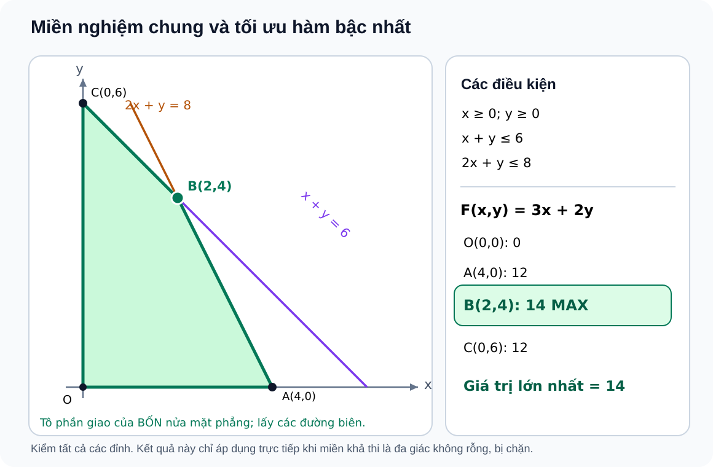

# Toán 10 · Bài 4. Hệ bất phương trình bậc nhất hai ẩn

TOÁN 10 · CHƯƠNG II · KIẾN THỨC SGK KNTT

Học cách kiểm nghiệm hệ, tìm phần giao các nửa mặt phẳng và lựa chọn phương án phù hợp với nhiều giới hạn. Em tự làm câu Vận dụng rồi mới mở Đối chiếu.

=== "Khám phá kiến thức"

    ### 1.1. Cùng tìm hiểu

    Hãy tưởng tượng một xưởng nhỏ làm hai loại sản phẩm A và B. Gọi \(x\) là số sản phẩm A, \(y\) là số sản phẩm B. Mỗi sản phẩm A dùng **2 giờ máy**, còn mỗi sản phẩm B dùng **1 giờ máy**. Xưởng có không quá **8 giờ máy** trong ngày và chỉ đóng gói được tối đa **6 sản phẩm**. Muốn lập một kế hoạch khả thi, em phải đáp ứng đồng thời hai giới hạn đó.

    Điều kiện thời gian được viết \(2x+y\le8\); điều kiện đóng gói là \(x+y\le6\). Ngoài ra, số sản phẩm không thể âm, nên \(x\ge0,\ y\ge0\). Bốn điều kiện hợp lại thành một **hệ bất phương trình bậc nhất hai ẩn**:

    \[
    \begin{cases}
    x\ge0,\\
    y\ge0,\\
    x+y\le6,\\
    2x+y\le8.
    \end{cases}
    \]

    Thử \(x=2\), \(y=4\): xưởng làm 6 sản phẩm, sử dụng đúng 8 giờ, không vi phạm điều kiện nào. Nhưng \(x=4\), \(y=3\) cho 7 sản phẩm và 11 giờ máy, nên không được nhận. Một kế hoạch dù **đạt một điều kiện** vẫn có thể không hợp lệ nếu **vi phạm điều kiện khác**. Vì vậy, nghiệm của hệ phải thỏa **tất cả** các bất phương trình cùng lúc.

    Trong Bài 3, mỗi điều kiện đơn lẻ tạo ra một nửa mặt phẳng nghiệm. Sang bài này, ta giữ lại **phần chung** của tất cả các nửa mặt phẳng. Em đã gặp ý tưởng ấy ở phép **giao tập hợp**. Khi nhiều đường biên bao lấy một phần chung, hình có thể là một tam giác, một tứ giác hoặc miền khác. Đôi khi các điều kiện mâu thuẫn đến mức **không còn điểm nào chung**.

    Nếu một bài toán còn hỏi “sản xuất thế nào để lãi cao nhất?”, ta phải tìm phương án tốt nhất **trong phần miền chung đó**, chứ không thể chọn một điểm mang lại lợi nhuận lớn nhưng vi phạm nguồn lực. Học được cách nhìn miền nghiệm, em sẽ hiểu vì sao toán học giúp lựa chọn giữa nhiều kế hoạch có giới hạn.

    Khi lợi nhuận có dạng \(F=px+qy\), những đường thẳng \(F=k\) ứng với các mức lợi nhuận khác nhau **song song nhau**. Hãy hình dung dịch chuyển một đường như vậy theo hướng lợi nhuận tăng: nếu miền khả thi là một **đa giác không rỗng, đóng và bị chặn** (có điểm thỏa mãn, lấy cả biên và nằm trong một vùng hữu hạn), đường ở mức cao nhất còn chạm miền sẽ đi qua **ít nhất một đỉnh**; đôi khi cả một cạnh cùng đạt cực đại. Vì thế phải kiểm đủ các đỉnh chứ không chọn ngẫu nhiên một điểm trong miền. Nếu \(x,y\) đếm sản phẩm nguyên chiếc, ta còn phải kiểm tính nguyên của phương án tối ưu.

    ### 1.2. Ví dụ trực quan

    Với bốn điều kiện của xưởng, hãy so sánh:

    
<table class="thpt-g10-knowledge-table">
    <thead><tr><th>Phương án \((x,y)\)</th><th>\(x+y\le6\)</th><th>\(2x+y\le8\)</th><th>Kết luận</th></tr></thead>
    <tbody>
    <tr><td>\((2,4)\)</td><td>\(6\le6\)</td><td>\(8\le8\)</td><td>Đạt mọi điều kiện</td></tr>
    <tr><td>\((4,0)\)</td><td>\(4\le6\)</td><td>\(8\le8\)</td><td>Đạt mọi điều kiện</td></tr>
    <tr><td>\((4,3)\)</td><td>\(7&gt;6\)</td><td>\(11&gt;8\)</td><td>Bị loại</td></tr>
    <tr><td>\((0,6)\)</td><td>\(6\le6\)</td><td>\(6\le8\)</td><td>Đạt mọi điều kiện</td></tr>
    </tbody></table>

    Ở đây \(x,y\) được hiểu là số nguyên không âm vì đếm sản phẩm. Khi **vẽ miền nghiệm hình học**, ta có thể xét mọi cặp số thực không âm trước, rồi chỉ giữ các **điểm lưới có tọa độ nguyên** nếu quay lại bài toán sản phẩm nguyên chiếc.

    ### 1.3. Thuật ngữ, kiến thức và kỹ năng

    **Thuật ngữ:** hệ bất phương trình bậc nhất hai ẩn, nghiệm của hệ, giao các miền nghiệm, miền khả thi, đỉnh, hàm mục tiêu, cực trị, miền rỗng, nghiệm nguyên.

    **Sau bài học, em cần làm được:** kiểm một cặp số với toàn hệ; xác định và đọc phần giao của các nửa mặt phẳng; nhận diện khi hệ vô nghiệm; tìm đỉnh và xét một hàm bậc nhất trên đa giác khả thi; phân biệt miền liên tục với các phương án đếm sản phẩm nguyên chiếc.

=== "Kiến thức SGK"

    ### 2.1. Hệ bất phương trình bậc nhất hai ẩn

    #### 2.1.1. Nghiệm của hệ: phải thỏa đồng thời tất cả điều kiện

    
<strong>Khái niệm — Hệ bất phương trình bậc nhất hai ẩn:</strong> Gồm từ hai bất phương trình bậc nhất hai ẩn trở lên, cùng xét trên hai biến \(x,y\). Cặp số là nghiệm khi thỏa <em>đồng thời tất cả</em> các bất phương trình trong hệ.

    Một **hệ bất phương trình bậc nhất hai ẩn** gồm hai hoặc nhiều bất phương trình bậc nhất hai ẩn cùng chứa \(x,y\). Cặp số \((x_0,y_0)\) là nghiệm của hệ khi **thay vào từng bất phương trình đều cho kết quả đúng**.

    Đừng đọc hệ theo nghĩa “đúng một điều kiện là đủ”. Hãy đọc theo nghĩa “đúng điều kiện thứ nhất **và** thứ hai **và** tất cả điều kiện còn lại”. Nếu một bất phương trình sai, cả hệ không nhận cặp số đó.

    
<strong>Kiến thức cần nhớ:</strong> Nghiệm của hệ là giao các tập nghiệm riêng lẻ. Khi kiểm nghiệm một cặp số, phải kiểm <em>mọi dòng của hệ</em>, kể cả không âm, đơn vị và điều kiện nguyên nếu bài toán có yêu cầu.

    **Vận dụng.** Xét hệ \(x\ge1,\ y\ge0,\ x+y\le5\). Hai cặp \((2,3)\) và \((0,4)\) có là nghiệm hệ không? Vì sao?

    

    ??? question "Em đã tự làm? Mở lời giải để đối chiếu"

        \((2,3)\) **là nghiệm** vì \(2\ge1,\ 3\ge0,\ 2+3=5\le5\). \((0,4)\) **không là nghiệm** vì \(0\not\ge1\), dù hai điều kiện còn lại đúng.

    ### 2.2. Biểu diễn miền nghiệm của hệ bất phương trình bậc nhất hai ẩn trên mặt phẳng tọa độ

    #### 2.2.1. Miền nghiệm là phần giao — đọc hình từ điều kiện đến các đỉnh

    
<strong>Khái niệm — Miền nghiệm của hệ:</strong> Tập hợp các điểm trên mặt phẳng có tọa độ thỏa đồng thời tất cả các bất phương trình của hệ, tức là <em>giao</em> các miền nghiệm riêng lẻ.

    Mỗi bất phương trình bậc nhất hai ẩn xác định một nửa mặt phẳng nghiệm. Khi vẽ tất cả chúng trên **cùng một hệ trục**, ta chỉ giữ phần **nằm đồng thời trong từng miền**. Phần ấy gọi là **miền nghiệm của hệ** hay **miền khả thi**.

    Quay lại xưởng ở phần Khám phá. Bốn giới hạn \(x\ge0,\ y\ge0,\ x+y\le6,\ 2x+y\le8\) tạo nên miền tứ giác trong hình dưới. Em hãy đọc lần lượt **hai nửa mặt phẳng ứng với x không âm và y không âm**, **đường \(x+y=6\)** và **đường \(2x+y=8\)** rồi nhìn phần được tô nằm trong **cả bốn** miền. Vì tất cả dấu đều có bằng nên các cạnh cũng thuộc miền nghiệm.

    <figure class="thpt-r4-plot thpt-r4-concept-figure">
    
    <figcaption>Đọc theo từng điều kiện: phần tô là giao của <strong>bốn</strong> nửa mặt phẳng, không phải hợp. Các đỉnh là \(O(0,0)\), \(A(4,0)\), \(B(2,4)\), \(C(0,6)\). Hình này chỉ ứng với <strong>hệ bốn điều kiện được ghi ngay phía trên</strong>.</figcaption>
    </figure>

    Để tìm đỉnh \(B\), giải hai phương trình đường biên \(x+y=6\), \(2x+y=8\), thu được \(x=2,\ y=4\). Mỗi đỉnh cần được kiểm lại với **toàn bộ hệ**, không chỉ với hai đường dùng để tìm giao điểm. Bảng \(F\) ở bên phải hình minh họa **ứng dụng tối ưu** của chính tứ giác này; cách giải tổng quát sẽ học ở mục 2.3.

    Không phải hệ nào cũng tạo một đa giác đóng, bị chặn. Miền nghiệm có thể là nửa mặt phẳng, một miền kéo dài vô hạn, hoặc không có điểm nào. Vì vậy, **xem điều kiện trước, kết luận dạng miền sau**.

    
<strong>Kiến thức cần nhớ:</strong> Vẽ từng đường biên, xác định đúng phía, giữ phần giao. Tìm các đỉnh bằng giao của những đường biên liên quan và thử lại tất cả ràng buộc. Không coi hình trên là hình minh họa cho mọi hệ.

    **Vận dụng.** Hệ \(x\ge0,\ y\ge0,\ x+2y\le6\) có những đỉnh nào? Các cạnh có được lấy không? Đây là **hệ ba điều kiện khác với tứ giác trong hình**.

    

    ??? question "Em đã thử tìm đỉnh? Mở đối chiếu"

        Các đỉnh là \((0,0)\), \((6,0)\), \((0,3)\). Ba đường biên tạo thành một **tam giác**, **không phải** tứ giác ở hình trên. Cả ba cạnh đều thuộc miền vì các dấu \(\ge,\le\) đều có bằng.

    #### 2.2.2. Có khi hệ không có nghiệm nào

    Chẳng hạn, một kế hoạch vừa yêu cầu **tổng ít nhất 7 sản phẩm** vừa quy định **tổng không quá 5 sản phẩm**. Hai điều kiện \(x+y\ge7\) và \(x+y\le5\) tự mâu thuẫn: dù mỗi điều kiện riêng lẻ có vô số nghiệm, **không có phương án nào thỏa đồng thời**. Ở câu Vận dụng ngay sau đây, em sẽ phải tự tìm một mâu thuẫn với những điều kiện khác.

    Trong hình học, đó là trường hợp các miền riêng lẻ **không có phần giao chung**. Có thể kiểm bằng cách vẽ, nhưng khi đã nhìn thấy mâu thuẫn đại số, ta **không cần vẽ** để kết luận hệ vô nghiệm.

    **Vận dụng.** Xét hệ \(x\ge3,\ y\ge0,\ x+y\le2\). Hệ có nghiệm không? Giải thích bằng bất đẳng thức.

    

    ??? question "Mở lời giải sau khi suy nghĩ"

        **Không có nghiệm.** Từ \(x\ge3,\ y\ge0\) suy ra \(x+y\ge3\), trái với điều kiện \(x+y\le2\). Không thể tối ưu trên một miền nghiệm rỗng.

    ### 2.3. Ứng dụng của hệ bất phương trình bậc nhất hai ẩn

    #### 2.3.1. Tối ưu một hàm bậc nhất trên miền khả thi

    Nếu xưởng muốn lãi cao nhất, ta cần một **hàm mục tiêu** \(F(x,y)=px+qy\). Trong bài toán hình học trên một **đa giác nghiệm không rỗng, đóng và bị chặn**, giá trị lớn nhất và nhỏ nhất của hàm bậc nhất có thể được tìm bằng cách xét **các đỉnh**.

    Các đường thẳng \(F(x,y)=k\) có cùng phương. Trên một miền đa giác kín và bị chặn, dịch chuyển đường này từ mức thấp đến mức cao cho thấy ít nhất một **đỉnh** đạt mỗi cực trị. Vì vậy, lập bảng **đỉnh → kiểm điều kiện → giá trị \(F\)** và so tất cả các đỉnh. Nếu một cạnh nằm trùng đường \(F=k\) ở mức cực trị, **nhiều phương án trên cạnh** cùng tối ưu. Hình ở 2.2.1 minh họa một trường hợp, còn Ví dụ 3.1 giải một **hệ khác** để em tự chuyển phương pháp.

    Quy tắc “thử các đỉnh” **không được áp dụng máy móc** cho miền rỗng hoặc miền không bị chặn. Trên miền không bị chặn, một cực trị có thể vẫn tồn tại, nhưng phải xét riêng điều kiện và hướng biến thiên của \(F\).

    
<strong>Kiến thức cần nhớ:</strong> Muốn tối ưu, tìm miền khả thi trước. Khi miền là đa giác không rỗng, đóng, bị chặn, tính \(F\) ở **tất cả** đỉnh rồi so. Mọi đỉnh dùng để tính phải thỏa toàn hệ.

    **Vận dụng.** Tam giác nghiệm của \(x\ge0,\ y\ge0,\ 2x+y\le6\) có các đỉnh \((0,0),(3,0),(0,6)\). Tính \(F=x+2y\) ở các đỉnh và xác định \(F_{\max}\). Đây **không** phải hàm và hệ trong hình tứ giác ở mục §2.2.

    

    ??? question "Em đã tính ở cả ba đỉnh? Mở đáp án"

        \(F(0,0)=0\), \(F(3,0)=3\), \(F(0,6)=12\). Vậy \(F_{\max}=12\) tại \((0,6)\).

    #### 2.3.2. Phương án có số lượng nguyên (vận dụng thực tế)

    Khi \(x,y\) là **số sản phẩm nguyên chiếc**, ta phải bổ sung \(x,y\in\mathbb Z_{\ge0}\). Miền hình học có thể chứa vô số điểm thực, nhưng phương án sản xuất chỉ gồm các **điểm có tọa độ nguyên không âm** nằm trong miền đó.

    Nếu cực đại của miền liên tục đạt tại một điểm có tọa độ **nguyên**, điểm ấy cũng tối ưu cho bài toán đếm sản phẩm. Nhưng nếu điểm tối ưu liên tục có tọa độ phân số, chẳng hạn \((5/2,3/2)\), thì ta **không thể** sản xuất nửa sản phẩm, cũng không được tùy tiện làm tròn rồi coi là tối ưu. Phải kiểm phương án nguyên khả thi và lập luận đầy đủ. Đây là một **lưu ý vận dụng mở rộng**, không thay thế kiến thức Core biểu diễn miền nghiệm.

    **Vận dụng.** Với \(x+2y\le7,\ 2x+y\le7,\ x,y\in\mathbb Z_{\ge0}\), xét \(F=3x+2y\). Điểm \((7/3,7/3)\) có hợp lệ không? So \(F\) tại hai điểm \((2,2)\) và \((3,1)\). **Chỉ so hai điểm, chưa kết luận tối ưu toàn cục.**

    

    ??? question "Mở đối chiếu sau khi tự làm"

        \((7/3,7/3)\) thỏa hai bất phương trình nhưng **không phải phương án nguyên**. \((2,2)\) có \(2+4=6\le7,\ 4+2=6\le7\), cho \(F=10\). \((3,1)\) có \(3+2=5\le7,\ 6+1=7\le7\), cho \(F=11\). Trong **hai điểm được so**, \((3,1)\) tốt hơn; bài chưa yêu cầu chứng minh đó là tối ưu toàn cục.

=== "Ví dụ"

    Các bước trên cho em hiểu từng điều kiện. Bây giờ ta giải ba bài **trọn vẹn**, với lý do chọn phương pháp nằm ngay tại ví dụ.

    ### 3.1. Ví dụ 1 — Miền giao và cực trị trên một hệ mới

    **Đề bài.** Xét hệ \(x\ge0,\ y\ge0,\ x+y\le9,\ 3x+y\le15\). Tìm miền nghiệm và cực trị của \(F=5x+2y\). Hệ này **khác** hình minh họa ở mục 2.2.1 và khác dữ kiện câu Vận dụng.

    **Phân tích.** Tìm giao các nửa mặt phẳng; tính giao điểm đường biên, kiểm mọi đỉnh với toàn hệ rồi so giá trị \(F\). Ta giải giao điểm bằng phương trình thay vì đo hình.

    **Lời giải.** Các đường biên \(x=0,\ y=0,\ x+y=9,\ 3x+y=15\) tạo tứ giác đỉnh \(O(0,0), A(5,0), B(3,6), C(0,9)\). Từ \(x+y=9,\ 3x+y=15\) suy ra \(2x=6\), tức \(B(3,6)\). Cả bốn đỉnh đều thỏa hệ. Ta được \(F(O)=0,\ F(A)=25,\ F(B)=27,\ F(C)=18\). Vậy

    \[
    F_{\max}=27\ \text{tại }(3,6),\qquad F_{\min}=0\ \text{tại }(0,0).
    \]

    **Kiểm lại.** Với \(B(3,6)\): \(3+6=9,\ 3\cdot3+6=15\). \(A\) có hoành độ lớn hơn \(B\) nhưng \(F(A)=25<27\), nên nhìn riêng \(x\) không đủ. Nếu muốn vẽ hình cho ví dụ này, em **tự dựng bốn đường biên mới**; không lấy tọa độ từ hình 2.2.1.

    ### 3.2. Ví dụ 2 — Hệ vô nghiệm do hai điều kiện không tương thích

    **Đề bài.** Xét hệ \(x\ge0,\ y\ge0,\ x+y<2,\ 2x+2y\ge5\). Hệ có nghiệm không?

    **Phân tích.** Nhân bất phương trình \(x+y<2\) với số dương 2, rồi so hai yêu cầu cùng biểu thức \(2x+2y\). Khi nhận ra mâu thuẫn trực tiếp, không cần vẽ.

    **Lời giải.** Từ \(x+y<2\) suy ra \(2x+2y<4\), trái với \(2x+2y\ge5\). Vậy không tồn tại cặp số thỏa toàn hệ: **hệ vô nghiệm**.

    **Kiểm lại.** Mỗi bất phương trình riêng có nghiệm, nhưng không có điểm chung của toàn hệ. Lý do là mâu thuẫn đại số, không phải vì thiếu tọa độ nguyên.

    ### 3.3. Ví dụ 3 — Phương án lợi nhuận có số lượng nguyên

    **Đề bài.** Cơ sở sản xuất hai loại sản phẩm A và B, vốn cần lần lượt **12 triệu** và **8 triệu đồng**/sản phẩm. Vốn không quá **720 triệu**, khả năng bán tối đa **75 sản phẩm**. Lợi nhuận mỗi chiếc lần lượt là **2,8 triệu** và **2 triệu đồng**. Tìm số lượng nguyên không âm để lợi nhuận lớn nhất.

    **Phân tích.** Đặt \(x,y\) là số sản phẩm A, B. Lập hai giới hạn và tính chặn trên liên tục trên đa giác. Chỉ khi một điểm cực đại liên tục có tọa độ nguyên mới được suy ra tối ưu cho bài toán đếm.

    **Lời giải.** Các điều kiện là

    \[
    12x+8y\le720,\quad x+y\le75,\quad x,y\in\mathbb Z_{\ge0}.
    \]

    Chia điều kiện vốn cho 4 được \(3x+2y\le180\). Miền liên tục \(x,y\ge0,\ x+y\le75,\ 3x+2y\le180\) có đỉnh \(O(0,0)\), \(A(60,0)\), \(B(30,45)\), \(C(0,75)\). Hàm lợi nhuận \(F=2{,}8x+2y\) (triệu đồng) cho:

    
<table class="thpt-g10-knowledge-table">
    <thead><tr><th>Phương án</th><th>\(F(x,y)\) (triệu đồng)</th></tr></thead>
    <tbody>
    <tr><td>\((0,0)\)</td><td>0</td></tr>
    <tr><td>\((60,0)\)</td><td>168</td></tr>
    <tr><td>\((30,45)\)</td><td><strong>174</strong></td></tr>
    <tr><td>\((0,75)\)</td><td>150</td></tr>
    </tbody></table>

    Cực đại liên tục là **174 triệu đồng** tại \((30,45)\). Vì đây là cặp số nguyên không âm nên **30 sản phẩm A và 45 sản phẩm B** cũng tối ưu trong bài toán nguyên.

    **Kiểm lại.** Vốn \(12\cdot30+8\cdot45=720\) triệu đồng, tổng số sản phẩm \(30+45=75\), đều đúng giới hạn. Hình ở 2.2.1 có dữ kiện khác, không dùng lại đỉnh của hình để giải ví dụ này.

=== "Lỗi thường gặp"

    

    ??? tip "4.1. Nhầm hợp và giao, hoặc tìm đỉnh mà không kiểm toàn bộ hệ"

        **Dấu hiệu:** Chỉ cần một bất phương trình đúng đã nhận điểm là nghiệm; hoặc tô phần nằm trong **ít nhất một** nửa mặt phẳng thay vì phần chung.

        **Vì sao sai?** Hệ yêu cầu các điều kiện xảy ra **đồng thời**. Một điểm có thể đúng với hai điều kiện nhưng sai điều kiện thứ ba, nên không nằm trong miền nghiệm của hệ.

        **Tự sửa:** Khi xét một cặp số, lập bảng kiểm mọi dòng. Khi vẽ, đánh dấu vùng bị loại sau mỗi ràng buộc, chỉ giữ phần còn lại. Nếu các ràng buộc mâu thuẫn như ở 2.2.2, kết luận miền rỗng ngay. [Luyện kiểm nghiệm hệ](luyen-tap.md?item=THPT-G10-B04-C01) · [Luyện đọc miền giao](luyen-tap.md?item=THPT-G10-B04-P04).

    

    ??? tip "4.2. So thiếu đỉnh hoặc tự làm tròn nghiệm phân số"

        **Dấu hiệu:** Thấy một đỉnh có hoành độ lớn nhất nên cho rằng \(F\) lớn nhất tại đó; hoặc lấy đỉnh phân số làm đáp án sản phẩm nguyên.

        **Vì sao sai?** Hàm mục tiêu phụ thuộc cả \(x\) lẫn \(y\). Trên đa giác liên tục phải so **mọi đỉnh**, và bài toán sản phẩm nguyên chỉ nhận các phương án có tọa độ nguyên.

        **Tự sửa:** Lập bảng “đỉnh → điều kiện → giá trị \(F\)”. Nếu nghiệm liên tục là phân số, dùng nó làm **chặn**, sau đó xét các điểm nguyên khả thi hoặc có lập luận chứng minh tối ưu. [Luyện tối ưu nguyên](luyen-tap.md?item=THPT-G10-B04-P06) · [Luyện trường hợp nhiều điểm tối ưu](luyen-tap.md?item=THPT-G10-B04-P03).

    **Tiếp tục tự học:** [Core và Luyện tập Chương II](luyen-tap.md) · [Tự kiểm tra cuối chương](tu-kiem-tra-chuong.md).

    
Nguồn Core: SGK Toán 10 · Kết nối tri thức · tập một, Bài 4 (trang in 26–30). Lời dẫn, ví dụ và Vận dụng do SLM biên tập và tự kiểm; đối chiếu công khai không ghi Mastery hay thay thế Tự kiểm tra cuối chương. Trang SBT tham khảo chưa được xác minh đầy đủ trong lượt này.

