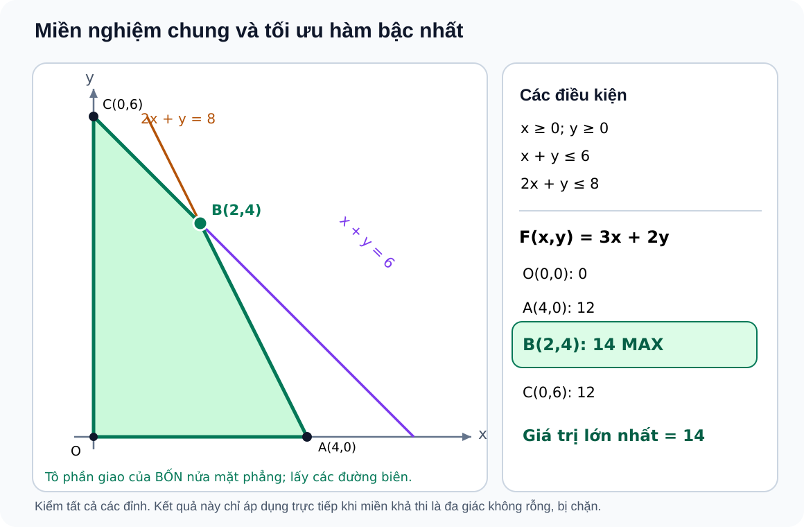

# Toán 10 · Bài 4. Hệ bất phương trình bậc nhất hai ẩn

TOÁN 10 · CHƯƠNG II · KIẾN THỨC SGK KNTT

Lý thuyết, ví dụ và sơ đồ nửa mặt phẳng/đa giác từ học liệu đã duyệt. Em tự luyện trước khi mở đáp án, không ghi điểm thành thạo.

=== "Khám phá kiến thức"

    ### Cùng tìm hiểu

    Hãy tưởng tượng một xưởng nhỏ làm hai loại sản phẩm A và B. Gọi \(x\) là số sản phẩm A, \(y\) là số sản phẩm B. Mỗi sản phẩm A dùng **2 giờ máy**, còn mỗi sản phẩm B dùng **1 giờ máy**. Xưởng có không quá **8 giờ máy** trong ngày và chỉ đóng gói được tối đa **6 sản phẩm**. Muốn lập một kế hoạch khả thi, em phải đáp ứng đồng thời hai giới hạn đó.

    Điều kiện thời gian được viết \(2x+y\le8\); điều kiện đóng gói là \(x+y\le6\). Ngoài ra, số sản phẩm không thể âm, nên \(x\ge0,\ y\ge0\). Bốn điều kiện hợp lại thành một **hệ bất phương trình bậc nhất hai ẩn**:

    \[
    \begin{cases}
    x\ge0,\\
    y\ge0,\\
    x+y\le6,\\
    2x+y\le8.
    \end{cases}
    \]

    Thử \(x=2\), \(y=4\): xưởng làm 6 sản phẩm, sử dụng đúng 8 giờ, không vi phạm điều kiện nào. Nhưng \(x=4\), \(y=3\) cho 7 sản phẩm và 11 giờ máy, nên không được nhận. Một kế hoạch dù **đạt một điều kiện** vẫn có thể không hợp lệ nếu **vi phạm điều kiện khác**. Vì vậy, nghiệm của hệ phải thỏa **tất cả** các bất phương trình cùng lúc.

    Trong Bài 3, mỗi điều kiện đơn lẻ tạo ra một nửa mặt phẳng nghiệm. Sang bài này, ta giữ lại **phần chung** của tất cả các nửa mặt phẳng. Em đã gặp ý tưởng ấy ở phép **giao tập hợp**. Khi nhiều đường biên bao lấy một phần chung, hình có thể là một tam giác, một tứ giác hoặc miền khác. Đôi khi các điều kiện mâu thuẫn đến mức **không còn điểm nào chung**.

    Nếu một bài toán còn hỏi “sản xuất thế nào để lãi cao nhất?”, ta phải tìm phương án tốt nhất **trong phần miền chung đó**, chứ không thể chọn một điểm mang lại lợi nhuận lớn nhưng vi phạm nguồn lực. Học được cách nhìn miền nghiệm, em sẽ hiểu vì sao toán học giúp lựa chọn giữa nhiều kế hoạch có giới hạn.

    ### Ví dụ trực quan

    Với bốn điều kiện của xưởng, hãy so sánh:

    
<table class="thpt-g10-knowledge-table">
    <thead><tr><th>Phương án \((x,y)\)</th><th>\(x+y\le6\)</th><th>\(2x+y\le8\)</th><th>Kết luận</th></tr></thead>
    <tbody>
    <tr><td>\((2,4)\)</td><td>\(6\le6\)</td><td>\(8\le8\)</td><td>Đạt mọi điều kiện</td></tr>
    <tr><td>\((4,0)\)</td><td>\(4\le6\)</td><td>\(8\le8\)</td><td>Đạt mọi điều kiện</td></tr>
    <tr><td>\((4,3)\)</td><td>\(7&gt;6\)</td><td>\(11&gt;8\)</td><td>Bị loại</td></tr>
    <tr><td>\((0,6)\)</td><td>\(6\le6\)</td><td>\(6\le8\)</td><td>Đạt mọi điều kiện</td></tr>
    </tbody></table>

    Ở đây \(x,y\) được hiểu là số nguyên không âm vì đếm sản phẩm. Khi **vẽ miền nghiệm hình học**, ta có thể xét mọi cặp số thực không âm trước, rồi chỉ giữ các **điểm lưới có tọa độ nguyên** nếu quay lại bài toán sản phẩm nguyên chiếc.

    ### Thuật ngữ và kiến thức, kỹ năng

    **Thuật ngữ:** hệ bất phương trình bậc nhất hai ẩn, nghiệm của hệ, giao các miền nghiệm, miền khả thi, đỉnh, hàm mục tiêu, cực trị, miền rỗng, nghiệm nguyên.

    **Sau bài học, em cần làm được:** kiểm một cặp số với toàn hệ; xác định và đọc phần giao của các nửa mặt phẳng; nhận diện khi hệ vô nghiệm; tìm đỉnh và xét một hàm bậc nhất trên đa giác khả thi; phân biệt miền liên tục với các phương án đếm sản phẩm nguyên chiếc.

=== "Kiến thức SGK"

    ### 2.1. Nghiệm của hệ: phải thỏa đồng thời tất cả điều kiện

    Một **hệ bất phương trình bậc nhất hai ẩn** gồm hai hoặc nhiều bất phương trình bậc nhất hai ẩn cùng chứa \(x,y\). Cặp số \((x_0,y_0)\) là nghiệm của hệ khi **thay vào từng bất phương trình đều cho kết quả đúng**.

    Đừng đọc hệ theo nghĩa “đúng một điều kiện là đủ”. Hãy đọc theo nghĩa “đúng điều kiện thứ nhất **và** thứ hai **và** tất cả điều kiện còn lại”. Nếu một bất phương trình sai, cả hệ không nhận cặp số đó.

    
<strong>Kiến thức cần nhớ:</strong> Nghiệm của hệ là giao các tập nghiệm riêng lẻ. Khi kiểm nghiệm một cặp số, phải kiểm <em>mọi dòng của hệ</em>, kể cả không âm, đơn vị và điều kiện nguyên nếu bài toán có yêu cầu.

    **Em vận dụng.** Xét hệ \(x\ge1,\ y\ge0,\ x+y\le5\). Hai cặp \((2,3)\) và \((0,4)\) có là nghiệm hệ không? Vì sao?

    

    ??? question "Em đã tự làm? Mở lời giải để đối chiếu"

        \((2,3)\) **là nghiệm** vì \(2\ge1,\ 3\ge0,\ 2+3=5\le5\). \((0,4)\) **không là nghiệm** vì \(0\not\ge1\), dù hai điều kiện còn lại đúng.

    ### 2.2. Miền nghiệm là phần giao — đọc hình từ điều kiện đến các đỉnh

    Mỗi bất phương trình bậc nhất hai ẩn xác định một nửa mặt phẳng nghiệm. Khi vẽ tất cả chúng trên **cùng một hệ trục**, ta chỉ giữ phần **nằm đồng thời trong từng miền**. Phần ấy gọi là **miền nghiệm của hệ** hay **miền khả thi**.

    Quay lại xưởng ở phần Khám phá. Bốn giới hạn \(x\ge0,\ y\ge0,\ x+y\le6,\ 2x+y\le8\) tạo nên miền tứ giác trong hình dưới. Em hãy đọc lần lượt **hai trục không âm**, **đường \(x+y=6\)** và **đường \(2x+y=8\)** rồi nhìn phần được tô nằm trong **cả bốn** miền. Vì tất cả dấu đều có bằng nên các cạnh cũng thuộc miền nghiệm.

    <figure class="thpt-r4-plot thpt-r4-concept-figure">
    
    <figcaption>Đọc theo từng điều kiện: phần tô là giao của <strong>bốn</strong> nửa mặt phẳng, không phải hợp. Các đỉnh là \(O(0,0)\), \(A(4,0)\), \(B(2,4)\), \(C(0,6)\). Hình này chỉ ứng với <strong>hệ bốn điều kiện được ghi ngay phía trên</strong>.</figcaption>
    </figure>

    Để tìm đỉnh \(B\), giải hai phương trình đường biên \(x+y=6\), \(2x+y=8\), thu được \(x=2,\ y=4\). Mỗi đỉnh cần được kiểm lại với **toàn bộ hệ**, không chỉ với hai đường dùng để tìm giao điểm.

    Không phải hệ nào cũng tạo một đa giác đóng, bị chặn. Miền nghiệm có thể là nửa mặt phẳng, một miền kéo dài vô hạn, hoặc không có điểm nào. Vì vậy, **xem điều kiện trước, kết luận dạng miền sau**.

    
<strong>Kiến thức cần nhớ:</strong> Vẽ từng đường biên, xác định đúng phía, giữ phần giao. Tìm các đỉnh bằng giao của những đường biên liên quan và thử lại tất cả ràng buộc. Không coi hình trên là hình minh họa cho mọi hệ.

    **Em vận dụng.** Hệ \(x\ge0,\ y\ge0,\ x+2y\le6\) có những đỉnh nào? Các cạnh có được lấy không? Đây là **hệ ba điều kiện khác với tứ giác trong hình**.

    

    ??? question "Em đã thử tìm đỉnh? Mở đối chiếu"

        Các đỉnh là \((0,0)\), \((6,0)\), \((0,3)\). Ba đường biên tạo thành một **tam giác**, **không phải** tứ giác ở hình trên. Cả ba cạnh đều thuộc miền vì các dấu \(\ge,\le\) đều có bằng.

    ### 2.3. Có khi hệ không có nghiệm nào

    Hãy tưởng tượng đề bài vừa yêu cầu “phải sản xuất **ít nhất 3 sản phẩm A**” vừa yêu cầu “tổng hai loại **không quá 2 sản phẩm**”. Nếu \(x\ge3\), \(y\ge0\) thì hiển nhiên \(x+y\ge3\), mâu thuẫn với \(x+y\le2\). Vì thế, không có phương án nào đáp ứng toàn bộ yêu cầu.

    Trong hình học, đó là trường hợp các miền riêng lẻ **không có phần giao chung**. Có thể kiểm bằng cách vẽ, nhưng khi đã nhìn thấy mâu thuẫn đại số, ta **không cần vẽ** để kết luận hệ vô nghiệm.

    **Em vận dụng.** Xét hệ \(x\ge3,\ y\ge0,\ x+y\le2\). Hệ có nghiệm không? Giải thích bằng bất đẳng thức.

    

    ??? question "Mở lời giải sau khi suy nghĩ"

        **Không có nghiệm.** Từ \(x\ge3,\ y\ge0\) suy ra \(x+y\ge3\), trái với điều kiện \(x+y\le2\). Không thể tối ưu trên một miền nghiệm rỗng.

    ### 2.4. Tối ưu một hàm bậc nhất trên miền khả thi

    Nếu xưởng muốn lãi cao nhất, ta cần một **hàm mục tiêu** \(F(x,y)=px+qy\). Trong bài toán hình học trên một **đa giác nghiệm không rỗng, đóng và bị chặn**, giá trị lớn nhất và nhỏ nhất của hàm bậc nhất có thể được tìm bằng cách xét **các đỉnh**.

    Với chính tứ giác \(OABC\) trong hình §2.2, thử hàm \(F=3x+2y\):

    
<table class="thpt-g10-knowledge-table">
    <thead><tr><th>Đỉnh</th><th>Tọa độ</th><th>\(F(x,y)=3x+2y\)</th></tr></thead>
    <tbody>
    <tr><td>\(O\)</td><td>\((0,0)\)</td><td>0</td></tr>
    <tr><td>\(A\)</td><td>\((4,0)\)</td><td>12</td></tr>
    <tr><td>\(B\)</td><td>\((2,4)\)</td><td><strong>14</strong></td></tr>
    <tr><td>\(C\)</td><td>\((0,6)\)</td><td>12</td></tr>
    </tbody></table>

    Do đó \(F_{\max}=14\) tại \(B(2,4)\), còn \(F_{\min}=0\) tại \(O(0,0)\). **Đừng so tọa độ \(x\) lớn nhất** để suy ra \(F\) lớn nhất — mục tiêu tính theo **cả \(x\) và \(y\)**. Nếu hàm mục tiêu không thay đổi dọc một cạnh, có thể có **nhiều phương án cùng tối ưu**, không nhất thiết chỉ một đỉnh.

    Quy tắc “thử các đỉnh” **không được áp dụng máy móc** cho miền rỗng hoặc miền không bị chặn. Trên miền không bị chặn, một cực trị có thể vẫn tồn tại, nhưng phải xét riêng điều kiện và hướng biến thiên của \(F\).

    
<strong>Kiến thức cần nhớ:</strong> Muốn tối ưu, tìm miền khả thi trước. Khi miền là đa giác không rỗng, đóng, bị chặn, tính \(F\) ở **tất cả** đỉnh rồi so. Mọi đỉnh dùng để tính phải thỏa toàn hệ.

    **Em vận dụng.** Tam giác nghiệm của \(x\ge0,\ y\ge0,\ 2x+y\le6\) có các đỉnh \((0,0),(3,0),(0,6)\). Tính \(F=x+2y\) ở các đỉnh và xác định \(F_{\max}\). Đây **không** phải hàm và hệ trong hình tứ giác ở mục §2.2.

    

    ??? question "Em đã tính ở cả ba đỉnh? Mở đáp án"

        \(F(0,0)=0\), \(F(3,0)=3\), \(F(0,6)=12\). Vậy \(F_{\max}=12\) tại \((0,6)\).

    ### 2.5. Bài toán thực tế có nghiệm nguyên

    Khi \(x,y\) là **số sản phẩm nguyên chiếc**, ta phải bổ sung \(x,y\in\mathbb Z_{\ge0}\). Miền hình học có thể chứa vô số điểm thực, nhưng phương án sản xuất chỉ gồm các **điểm có tọa độ nguyên không âm** nằm trong miền đó.

    Nếu tìm cực đại trên miền liên tục mà điểm đạt cực đại có tọa độ **nguyên**, điểm đó cũng tối ưu cho bài toán nguyên. Nhưng nếu điểm cực đại liên tục là \((2{,}33;\,2{,}33)\), thì ta **không thể** sản xuất \(2{,}33\) sản phẩm, cũng không được tùy tiện làm tròn hai tọa độ rồi coi là phương án tốt nhất. Hãy kiểm từng phương án nguyên khả thi hoặc dùng một phương pháp tối ưu nguyên có chứng minh đầy đủ.

    **Em vận dụng.** Với \(x+2y\le7,\ 2x+y\le7,\ x,y\in\mathbb Z_{\ge0}\), xét \(F=3x+2y\). Điểm \((7/3,7/3)\) có hợp lệ không? So \(F\) tại hai điểm \((2,2)\) và \((3,1)\). **Chỉ so hai điểm, chưa kết luận tối ưu toàn cục.**

    

    ??? question "Mở đối chiếu sau khi tự làm"

        \((7/3,7/3)\) thỏa hai bất phương trình nhưng **không phải phương án nguyên**. \((2,2)\) có \(2+4=6\le7,\ 4+2=6\le7\), cho \(F=10\). \((3,1)\) có \(3+2=5\le7,\ 6+1=7\le7\), cho \(F=11\). Trong **hai điểm được so**, \((3,1)\) tốt hơn; bài chưa yêu cầu chứng minh đó là tối ưu toàn cục.

=== "Ví dụ giải toán"

    Các bước trên cho em hiểu từng điều kiện. Bây giờ ta giải ba bài **trọn vẹn**, với lý do chọn phương pháp nằm ngay tại ví dụ.

    ### Ví dụ 1 — Miền giao tứ giác và cực trị (ứng với hình §2.2)

    **Đề bài.** Xét hệ \(x\ge0,\ y\ge0,\ x+y\le6,\ 2x+y\le8\). Tìm miền nghiệm và giá trị lớn nhất, nhỏ nhất của \(F=3x+2y\).

    **Vì sao chọn cách này?** Hệ gồm các nửa mặt phẳng tạo miền tứ giác đóng và bị chặn. Ta xác định giao các miền trước, kiểm các đỉnh và so giá trị hàm mục tiêu tại mọi đỉnh.

    **Lời giải.** Các đường \(x=0,\ y=0,\ x+y=6,\ 2x+y=8\) tạo phần giao có đỉnh \(O(0,0),A(4,0),B(2,4),C(0,6)\). Chẳng hạn, giao của \(x+y=6\) với \(2x+y=8\) cho \(B(2,4)\). Tất cả đỉnh đều thỏa hệ. Tính được \(F(O)=0,\ F(A)=12,\ F(B)=14,\ F(C)=12\). Vì thế:

    \[
    F_{\max}=14\ \text{tại }(2,4),\qquad F_{\min}=0\ \text{tại }(0,0).
    \]

    **Kiểm lại.** Tại \(B\), \(2+4=6\) và \(2\cdot2+4=8\), hai giới hạn cùng đạt mức tối đa. Đỉnh \(A\) có hoành độ lớn hơn B nhưng \(F(A)=12<14\); đây là lý do không được chỉ nhìn một tọa độ.

    ### Ví dụ 2 — Hệ không có nghiệm

    **Đề bài.** Xét hai điều kiện \(x+y\le1\) và \(x+y\ge3\). Hệ có nghiệm không?

    **Vì sao chọn cách này?** Cả hai điều kiện ràng buộc cùng biểu thức \(x+y\). Có thể nhận ra mâu thuẫn **trực tiếp**, không cần mất thời gian vẽ hai đường.

    **Lời giải.** Không có số thực nào đồng thời nhỏ hơn hoặc bằng 1 **và** lớn hơn hoặc bằng 3. Do đó giao hai miền nghiệm là **rỗng**, hệ vô nghiệm.

    **Kiểm lại.** Dù mỗi bất phương trình riêng có vô số nghiệm, giao của chúng vẫn có thể rỗng.

    ### Ví dụ 3 — Bài toán lợi nhuận có điều kiện sản phẩm nguyên

    **Đề bài.** Một cơ sở dự kiến mua \(x\) sản phẩm A giá 20 triệu đồng/chiếc và \(y\) sản phẩm B giá 10 triệu đồng/chiếc. Vốn không quá 1.200 triệu đồng, tổng số sản phẩm không quá 100. Lợi nhuận mỗi chiếc lần lượt là 3,5 và 2 triệu đồng. Tìm phương án mang lại lợi nhuận lớn nhất với \(x,y\) nguyên không âm.

    **Vì sao chọn cách này?** Ta phải chuyển **đồng thời** vốn, số lượng và tính nguyên thành các điều kiện. Đầu tiên tối ưu trên đa giác liên tục để tìm **chặn trên**; nếu phương án đạt chặn trên có tọa độ nguyên thì nó đồng thời là phương án tối ưu trong bài toán đếm.

    **Lời giải.** Các điều kiện là

    \[
    20x+10y\le1200,\quad x+y\le100,\quad x,y\in\mathbb Z_{\ge0}.
    \]

    Chia bất phương trình vốn cho 10 được \(2x+y\le120\). Miền liên tục \(x,y\ge0,\ x+y\le100,\ 2x+y\le120\) có các đỉnh \(O(0,0)\), \(A(60,0)\), \(B(20,80)\), \(C(0,100)\). Hàm lợi nhuận \(F=3{,}5x+2y\), tính bằng **triệu đồng**, cho:

    
<table class="thpt-g10-knowledge-table">
    <thead><tr><th>Phương án</th><th>\(F(x,y)\) (triệu đồng)</th></tr></thead>
    <tbody>
    <tr><td>\((0,0)\)</td><td>0</td></tr>
    <tr><td>\((60,0)\)</td><td>210</td></tr>
    <tr><td>\((20,80)\)</td><td><strong>230</strong></td></tr>
    <tr><td>\((0,100)\)</td><td>200</td></tr>
    </tbody></table>

    Vậy giá trị lớn nhất trên miền liên tục là **230 triệu đồng** tại \((20,80)\). Đây lại là một cặp số nguyên không âm, nên phương án **20 sản phẩm A và 80 sản phẩm B** đạt tối ưu cả trong bài toán nguyên.

    **Kiểm lại.** Tiền vốn \(20\cdot20+10\cdot80=1200\) triệu và tổng số sản phẩm \(20+80=100\), đều đúng giới hạn. Đừng lấy các đỉnh của **hình §2.2** vì hình ấy mô tả một hệ có số liệu khác.

=== "Lỗi thường gặp và cách tự khắc phục"

    

    ??? tip "Nhầm hợp và giao, hoặc tìm đỉnh mà không kiểm toàn bộ hệ"

        **Dấu hiệu:** Chỉ cần một bất phương trình đúng đã nhận điểm là nghiệm; hoặc tô phần nằm trong **ít nhất một** nửa mặt phẳng thay vì phần chung.

        **Vì sao sai?** Hệ yêu cầu các điều kiện xảy ra **đồng thời**. Một điểm có thể đúng với hai điều kiện nhưng sai điều kiện thứ ba, nên không nằm trong miền nghiệm của hệ.

        **Tự sửa:** Khi xét một cặp số, lập bảng kiểm mọi dòng. Khi vẽ, đánh dấu vùng bị loại sau mỗi ràng buộc, chỉ giữ phần còn lại. Nếu các ràng buộc mâu thuẫn như ở 2.3, kết luận miền rỗng ngay. [Luyện kiểm nghiệm hệ](../luyen-tap/?item=THPT-G10-B04-C01) · [Luyện đọc miền giao](../luyen-tap/?item=THPT-G10-B04-P04).

    

    ??? tip "So thiếu đỉnh hoặc tự làm tròn nghiệm phân số"

        **Dấu hiệu:** Thấy một đỉnh có hoành độ lớn nhất nên cho rằng \(F\) lớn nhất tại đó; hoặc lấy đỉnh phân số làm đáp án sản phẩm nguyên.

        **Vì sao sai?** Hàm mục tiêu phụ thuộc cả \(x\) lẫn \(y\). Trên đa giác liên tục phải so **mọi đỉnh**, và bài toán sản phẩm nguyên chỉ nhận các phương án có tọa độ nguyên.

        **Tự sửa:** Lập bảng “đỉnh → điều kiện → giá trị \(F\)”. Nếu nghiệm liên tục là phân số, dùng nó làm **chặn**, sau đó xét các điểm nguyên khả thi hoặc có lập luận chứng minh tối ưu. [Luyện tối ưu nguyên](../luyen-tap/?item=THPT-G10-B04-P06) · [Luyện trường hợp nhiều điểm tối ưu](../luyen-tap/?item=THPT-G10-B04-P03).

    **Tiếp tục tự học:** [Core và Luyện tập Chương II](../luyen-tap/) · [Tự kiểm tra cuối chương](../tu-kiem-tra-chuong/).

    
Nguồn kiến thức: SGK Toán 10, Kết nối tri thức với cuộc sống, tập một, Bài 4. Lời giảng và ví dụ do SLM biên tập từ học liệu hiện có, nguồn Gemini/NotebookLM v1 và minh họa nguồn đã kiểm điều kiện toán.

