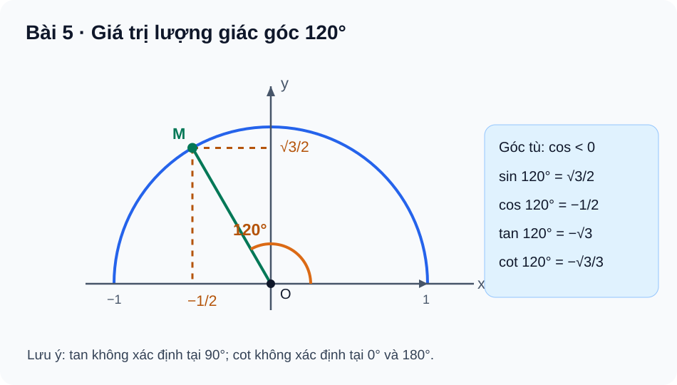

# Toán 10 · Bài 5. Giá trị lượng giác của một góc từ 0° đến 180°

TOÁN 10 · CHƯƠNG III · KIẾN THỨC SGK KNTT

Học kiến thức và ví dụ theo Bài 5, sau đó tự luyện.

=== "Khám phá kiến thức"

    ### Cùng tìm hiểu

    Ở THCS, em đã quen với \(\sin\), \(\cos\), \(\tan\) của **góc nhọn** trong tam giác vuông. Nhưng điều gì xảy ra khi góc mở rộng đến \(120^\circ\), \(150^\circ\), thậm chí \(180^\circ\)? Một cánh tay robot có thể quay vượt quá góc vuông, hay một hướng di chuyển có thể chếch hẳn sang trái. Nếu chỉ học thuộc các tỉ số trong tam giác vuông, em sẽ khó giải thích vì sao \(\cos120^\circ\) **âm** mà \(\sin120^\circ\) vẫn **dương**.

    Hãy hình dung một điểm \(M\) đi trên **nửa đường tròn đơn vị** ở phía trên trục hoành, tâm \(O\), bán kính 1. Điểm bắt đầu từ \((1,0)\), rồi tia \(OM\) quay ngược chiều kim đồng hồ tạo góc \(\alpha\) với chiều dương \(Ox\). Góc \(\alpha\) chạy từ \(0^\circ\) đến \(180^\circ\). Tọa độ ngang của \(M\) cho biết điểm lệch về **phải** hay **trái**; tọa độ đứng cho biết nó ở **cao** bao nhiêu. Hai con số ấy chính là \(\cos\alpha\) và \(\sin\alpha\).

    Đến \(90^\circ\), điểm \(M=(0,1)\): độ lệch ngang bằng 0. Đi tiếp sang góc tù, \(M\) nằm **bên trái** trục tung, nên \(\cos\alpha<0\), nhưng vẫn ở phía trên trục hoành, nên \(\sin\alpha>0\). Em không cần nhớ dấu bằng một mẹo riêng: **dấu xuất hiện ngay trên hình**.

    Nếu lấy độ cao chia độ lệch ngang, em có \(\tan\alpha=\sin\alpha/\cos\alpha\). Phép chia này **chỉ thực hiện khi mẫu khác 0**. Vì thế \(\tan90^\circ\) không xác định. Cùng cách nghĩ ấy giúp em nhớ khi nào \(\cot\alpha\) xác định.

    ### Ví dụ trực quan

    Góc \(120^\circ\) là góc bù của \(60^\circ\). Hai điểm trên nửa đường tròn ứng với \(60^\circ\) và \(120^\circ\) **đối xứng qua trục \(Oy\)**: cùng độ cao, khác bên trái/phải. Vì vậy:

    \[
    \sin120^\circ=\sin60^\circ=\frac{\sqrt3}{2},
    \qquad
    \cos120^\circ=-\cos60^\circ=-\frac12.
    \]

    Từ đây \(\tan120^\circ=(\sqrt3/2)/(-1/2)=-\sqrt3\). Dấu âm không phải điều khó nhớ: nó đến từ việc điểm \(M\) ở phía **trái** trục \(Oy\).

    ### Thuật ngữ và kiến thức, kỹ năng

    **Thuật ngữ:** nửa đường tròn đơn vị; góc từ \(0^\circ\) đến \(180^\circ\); \(\sin,\cos,\tan,\cot\); góc nhọn, góc vuông, góc tù; hai góc bù nhau; giá trị đặc biệt; điều kiện xác định.

    **Sau bài học, em cần làm được:** đọc \(\sin,\cos\) từ tọa độ điểm trên nửa đường tròn; xác định đúng dấu từng hàm lượng giác; xét mẫu trước khi tính \(\tan,\cot\); suy giá trị góc tù từ góc bù; dùng hệ thức lượng giác cơ bản để tính giá trị chưa biết và chọn đúng dấu căn.

=== "Kiến thức SGK"

    ### 2.1. Nửa đường tròn đơn vị: hiểu tọa độ trước công thức

    Xét nửa đường tròn tâm \(O\), bán kính 1 và nằm trong nửa mặt phẳng \(y\ge0\). Với \(0^\circ\le\alpha\le180^\circ\), tia \(OM\) tạo với \(Ox\) dương một góc \(\alpha\), và \(M=(x,y)\) nằm trên nửa đường tròn. Khi đó:

    \[
    \boxed{\cos\alpha=x,\qquad\sin\alpha=y.}
    \]

    Vì \(OM=1\), định lí Pitago theo hình chiếu cho \(x^2+y^2=1\), tức \(\sin^2\alpha+\cos^2\alpha=1\). Góc nhọn có \(x>0,y>0\); góc tù có \(x<0,y>0\); ở \(90^\circ\), \(x=0\). Tại \(0^\circ\), \(M=(1,0)\), còn tại \(180^\circ\), \(M=(-1,0)\).

    <figure class="thpt-r4-plot thpt-r4-concept-figure">
    
    <figcaption>Đọc hình theo thứ tự: \(O\) → tia \(OM\) tạo \(120^\circ\) → hình chiếu của \(M\) lên hai trục. Hoành độ \(-\frac12\) là \(\cos120^\circ\), tung độ \(\frac{\sqrt3}{2}\) là \(\sin120^\circ\). Hình này minh họa <strong>góc 120°</strong>, không phải mọi góc tù có cùng tọa độ.</figcaption>
    </figure>

    
<strong>Kiến thức cần nhớ:</strong> \(\cos\alpha\) là hoành độ, \(\sin\alpha\) là tung độ của \(M\). Trên đoạn \(0^\circ\le\alpha\le180^\circ\), sin không âm, cos đổi dấu khi đi qua góc \(90^\circ\). Trước khi tính, hãy xác định góc nằm ở đâu.

    **Em vận dụng.** Trên nửa đường tròn đơn vị, với \(\alpha=180^\circ\), điểm \(M\) có tọa độ gì? Từ đó tìm \(\sin180^\circ\) và \(\cos180^\circ\).

    

    ??? question "Em đã tự làm? Mở lời giải để đối chiếu"

        \(M=(-1,0)\) nên \(\sin180^\circ=0\), \(\cos180^\circ=-1\). Điểm nằm trên trục \(Ox\) âm: tung độ bằng 0, hoành độ bằng \(-1\).

    ### 2.2. Góc đặc biệt: nhớ theo đối xứng, không học hai bảng rời rạc

    Em đã biết các góc nhọn \(30^\circ,45^\circ,60^\circ\) từ tam giác vuông đặc biệt. Khi góc mở quá \(90^\circ\), dùng đối xứng qua \(Oy\) để suy giá trị. Hai góc \(\alpha\) và \(180^\circ-\alpha\) có các điểm \(M\) **cùng tung độ, trái hoành độ**, nên sin bằng nhau, cos đối nhau.

    
<table class="thpt-g10-knowledge-table">
    <thead><tr><th>Góc \(\alpha\)</th><th>\(0^\circ\)</th><th>\(30^\circ\)</th><th>\(45^\circ\)</th><th>\(60^\circ\)</th><th>\(90^\circ\)</th></tr></thead>
    <tbody>
    <tr><td>\(\sin\alpha\)</td><td>\(0\)</td><td>\(\frac12\)</td><td>\(\frac{\sqrt2}{2}\)</td><td>\(\frac{\sqrt3}{2}\)</td><td>\(1\)</td></tr>
    <tr><td>\(\cos\alpha\)</td><td>\(1\)</td><td>\(\frac{\sqrt3}{2}\)</td><td>\(\frac{\sqrt2}{2}\)</td><td>\(\frac12\)</td><td>\(0\)</td></tr>
    </tbody></table>

    
<table class="thpt-g10-knowledge-table">
    <thead><tr><th>Góc \(\alpha\)</th><th>\(120^\circ\)</th><th>\(135^\circ\)</th><th>\(150^\circ\)</th><th>\(180^\circ\)</th></tr></thead>
    <tbody>
    <tr><td>\(\sin\alpha\)</td><td>\(\frac{\sqrt3}{2}\)</td><td>\(\frac{\sqrt2}{2}\)</td><td>\(\frac12\)</td><td>\(0\)</td></tr>
    <tr><td>\(\cos\alpha\)</td><td>\(-\frac12\)</td><td>\(-\frac{\sqrt2}{2}\)</td><td>\(-\frac{\sqrt3}{2}\)</td><td>\(-1\)</td></tr>
    </tbody></table>

    Hãy quan sát, chẳng hạn \(135^\circ=180^\circ-45^\circ\). Vì đối xứng, sin giữ nguyên \(\sqrt2/2\) còn cos đổi dấu thành \(-\sqrt2/2\).

    **Em vận dụng.** Không dùng máy tính, tính \(\sin135^\circ,\cos135^\circ\). So với \(45^\circ\), giá trị nào giữ nguyên, giá trị nào đổi dấu?

    

    ??? question "Em đã tự tính? Mở đối chiếu"

        \(\sin135^\circ=\frac{\sqrt2}{2}\), \(\cos135^\circ=-\frac{\sqrt2}{2}\). Sin giữ nguyên, cos đổi dấu do hai điểm trên nửa đường tròn đối xứng qua trục \(Oy\).

    ### 2.3. Từ sin, cos đến tan, cot: phải xét mẫu số

    Nếu \(\cos\alpha\ne0\), ta định nghĩa \(\tan\alpha=\frac{\sin\alpha}{\cos\alpha}\). Nếu \(\sin\alpha\ne0\), ta định nghĩa \(\cot\alpha=\frac{\cos\alpha}{\sin\alpha}\). Đây là **hai phép chia**, nên khi mẫu bằng 0, giá trị không xác định — **không phải bằng 0**.

    
<table class="thpt-g10-knowledge-table">
    <thead><tr><th>Hàm</th><th>Công thức</th><th>Không xác định tại</th></tr></thead>
    <tbody>
    <tr><td>\(\tan\alpha\)</td><td>\(\sin\alpha/\cos\alpha\)</td><td>\(90^\circ\) trong đoạn \(0^\circ\)–\(180^\circ\)</td></tr>
    <tr><td>\(\cot\alpha\)</td><td>\(\cos\alpha/\sin\alpha\)</td><td>\(0^\circ\), \(180^\circ\) trong đoạn đang xét</td></tr>
    </tbody></table>

    Ví dụ, \(\tan0^\circ=0/1=0\) nhưng \(\cot0^\circ=1/0\) không xác định. Tại \(90^\circ\), \(\tan90^\circ\) không xác định, còn \(\cot90^\circ=0/1=0\). Với góc tù \(90^\circ<\alpha<180^\circ\), sin dương, cos âm nên cả tan và cot đều âm.

    
<strong>Kiến thức cần nhớ:</strong> \(\tan\alpha\) chỉ có nghĩa khi \(\cos\alpha\ne0\); \(\cot\alpha\) chỉ có nghĩa khi \(\sin\alpha\ne0\). “Không xác định” khác với số 0.

    **Em vận dụng.** Trong bốn giá trị \(\tan0^\circ,\cot0^\circ,\tan90^\circ,\cot90^\circ\), giá trị nào bằng 0 và giá trị nào không xác định? Giải thích bằng mẫu số.

    

    ??? question "Em đã xét mẫu số? Mở đáp án"

        \(\tan0^\circ=0\), \(\cot90^\circ=0\). \(\cot0^\circ\) và \(\tan90^\circ\) **không xác định** vì mẫu số bằng 0.

    ### 2.4. Hai góc bù nhau và giới hạn của công thức

    Với hai góc bù nhau \(\alpha\) và \(180^\circ-\alpha\), các điểm trên nửa đường tròn đối xứng qua \(Oy\). Do đó:

    \[
    \sin(180^\circ-\alpha)=\sin\alpha,\qquad
    \cos(180^\circ-\alpha)=-\cos\alpha.
    \]

    Từ hai hệ thức trên suy ra

    \[
    \tan(180^\circ-\alpha)=-\tan\alpha,\qquad
    \cot(180^\circ-\alpha)=-\cot\alpha,
    \]

    **chỉ tại những góc mà hai tỉ số tương ứng đều xác định**. Đây là công thức dành cho **hai góc bù nhau**, không phải công thức cộng góc tùy ý.

    **Em vận dụng.** Hai góc \(40^\circ\) và \(140^\circ\) có quan hệ nào giữa sin, cos, tan và cot? Có phải dùng máy tính tìm số thập phân không?

    

    ??? question "Mở đáp án sau khi tự suy luận"

        \(\sin140^\circ=\sin40^\circ\), \(\cos140^\circ=-\cos40^\circ\), \(\tan140^\circ=-\tan40^\circ\), \(\cot140^\circ=-\cot40^\circ\). Cả tan và cot đều xác định ở 40° và 140°, không cần tính số thập phân.

    ### 2.5. Hệ thức cơ bản: chọn dấu theo góc

    Do \(M\) nằm trên đường tròn đơn vị, ta có \(x^2+y^2=1\), nên

    \[
    \boxed{\sin^2\alpha+\cos^2\alpha=1.}
    \]

    Nếu \(\cos\alpha\ne0\), ta chia cả hai vế của **hệ thức \(\sin^2\alpha+\cos^2\alpha=1\) ở trên** cho \(\cos^2\alpha\). Khi đó, ta nhận được \(1+\tan^2\alpha=\frac1{\cos^2\alpha}\), vì \(\frac{\sin^2\alpha}{\cos^2\alpha}=\tan^2\alpha\) và \(\frac{\cos^2\alpha}{\cos^2\alpha}=1\).

    Tương tự, nếu \(\sin\alpha\ne0\), ta chia **cả hai vế của hệ thức ban đầu** cho \(\sin^2\alpha\) và thu được \(1+\cot^2\alpha=\frac1{\sin^2\alpha}\). Khi cả sin và cos đều khác 0, từ định nghĩa của tan và cot, ta còn có \(\tan\alpha\cdot\cot\alpha=1\).

    Hệ thức đầu tiên cho ta **bình phương** của giá trị chưa biết, nhưng dấu của căn phải dựa vào **góc nhọn hay góc tù**. Ví dụ \(\sin\alpha=\frac35\), \(\alpha\) là góc tù, thì \(\cos^2\alpha=1-\frac9{25}=\frac{16}{25}\), do đó \(\cos\alpha=-\frac45\), chứ không phải \(+\frac45\).

    **Em vận dụng.** Góc tù \(\alpha\) có \(\cos\alpha=-\frac5{13}\). Tìm \(\sin\alpha\), \(\tan\alpha\) và giải thích cách chọn dấu.

    

    ??? question "Em đã chọn dấu? Mở lời giải"

        \(\sin^2\alpha=1-\frac{25}{169}=\frac{144}{169}\). Vì \(\alpha\) tù, \(\sin\alpha>0\), nên \(\sin\alpha=\frac{12}{13}\). Do đó \(\tan\alpha=(12/13)/(-5/13)=-\frac{12}{5}\).

=== "Ví dụ"

    ### Ví dụ 1 — Giá trị lượng giác góc 120° (đọc từ hình)

    **Đề bài.** Tính \(\sin120^\circ,\cos120^\circ,\tan120^\circ,\cot120^\circ\) không dùng máy tính.

    **Vì sao chọn cách này?** \(120^\circ=180^\circ-60^\circ\) là góc bù một góc nhọn đặc biệt. Dùng **đối xứng qua trục \(Oy\)** nhanh và kiểm dấu được bằng hình trong §2.1.

    **Lời giải.** \(\sin120^\circ=\sin60^\circ=\frac{\sqrt3}{2}\), \(\cos120^\circ=-\cos60^\circ=-\frac12\). Vì sin và cos đều khác 0, \(\tan120^\circ=\frac{\sqrt3/2}{-1/2}=-\sqrt3\), \(\cot120^\circ=\frac{-1/2}{\sqrt3/2}=-\frac{\sqrt3}{3}\).

    **Kiểm lại.** Cả tan và cot là số âm, đúng với hướng góc tù. Hình §2.1 ghi chính các giá trị này.

    ### Ví dụ 2 — Biết sin và biết góc tù (chọn lọc NotebookLM v1)

    **Đề bài.** Cho \(\sin\alpha=\frac35\), \(90^\circ<\alpha<180^\circ\). Tính \(\cos\alpha\) và \(\tan\alpha\).

    **Vì sao chọn cách này?** Khi biết sin và cần tìm cos, dùng hệ thức \(\sin^2+\cos^2=1\). Nhưng phương trình cho **hai khả năng dấu**, nên phải dùng khoảng của góc.

    **Lời giải.** \(\cos^2\alpha=1-\frac9{25}=\frac{16}{25}\). Góc \(\alpha\) tù có cos âm, suy ra \(\cos\alpha=-\frac45\). Vì cos khác 0, \(\tan\alpha=\frac{3/5}{-4/5}=-\frac34\).

    **Kiểm lại.** \((3/5)^2+(-4/5)^2=1\), sin dương và cos âm, đúng miền góc đã cho.

    ### Ví dụ 3 — Nhận ra góc bù trong một biểu thức

    **Đề bài.** Tính chính xác \(T=\sin150^\circ+\cos150^\circ\).

    **Vì sao chọn cách này?** \(150^\circ=180^\circ-30^\circ\). Đổi về góc nhọn đặc biệt để tránh số thập phân và tránh sai dấu cos.

    **Lời giải.** \(\sin150^\circ=\sin30^\circ=\frac12\), \(\cos150^\circ=-\cos30^\circ=-\frac{\sqrt3}{2}\). Vì vậy \(T=\frac{1-\sqrt3}{2}\).

    **Kiểm lại.** \(T<0\) vì \(\sqrt3>1\); điều này phù hợp với cos âm có độ lớn lớn hơn sin ở góc 150°.

=== "Lỗi thường gặp"

    

    ??? tip "Nhớ góc nhọn nhưng bỏ dấu âm của cos góc tù"

        **Dấu hiệu:** Viết \(\cos120^\circ=+\frac12\) hoặc \(\cos150^\circ=\cos30^\circ\).

        **Vì sao sai?** Tọa độ ngang của điểm góc tù nằm bên trái \(Oy\), nên cos âm. Hai góc bù nhau có sin bằng nhau nhưng cos đối nhau.

        **Tự sửa:** Quay lại hình §2.1: chỉ điểm \(M\) và hình chiếu xuống trục hoành. Dùng \(180^\circ-\alpha\) và tự tính lại. [Luyện lại tại Core/Luyện tập](luyen-tap.md).

    

    ??? tip "Quên điều kiện mẫu của tan/cot hoặc chọn căn dương máy móc"

        **Dấu hiệu:** Cho \(\tan90^\circ=0\), \(\cot0^\circ\) “bằng vô hạn”, hoặc lấy \(\cos\alpha>0\) dù góc tù.

        **Vì sao sai?** Tan và cot là phép chia có mẫu; mẫu bằng 0 khiến phép chia **không xác định**. Hệ thức sin²+cos²=1 chỉ cho bình phương, còn dấu cần xét theo khoảng góc.

        **Tự sửa:** Viết mẫu trước, kiểm khác 0, nhìn lại vị trí góc. Với góc tù có sin \(3/5\), tự tính lại cos âm \(-4/5\). [Ôn tại Core/Luyện tập](luyen-tap.md).

    **Học tiếp:** [Core và Luyện tập Chương III](luyen-tap.md) · [Bài 6 — Hệ thức lượng trong tam giác](bai-6.md) · [Tự kiểm tra cuối chương](tu-kiem-tra-chuong.md).

    
Kiến thức đối chiếu theo SGK Toán 10 · Kết nối tri thức · tập 1 · Bài 5, học liệu SLM hiện hành; giải thích nguồn NotebookLM v1 được biên tập chọn lọc. Minh họa góc 120° do SLM xây dựng.

