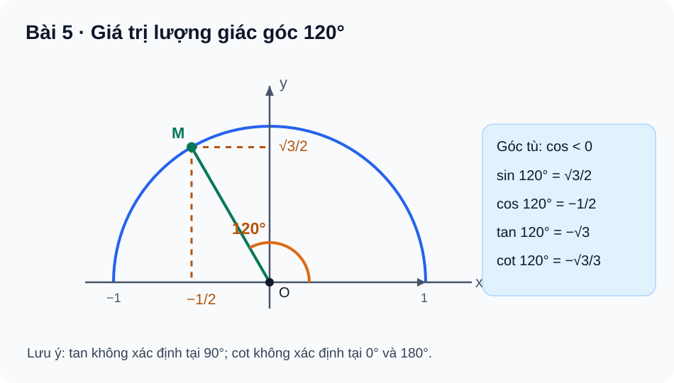

# Toán 10 · Bài 5. Giá trị lượng giác của một góc từ 0° đến 180°

TOÁN 10 · CHƯƠNG III · KIẾN THỨC SGK KNTT

Hiểu bản chất qua nửa đường tròn, học cách dùng DEG và tự thử trước khi mở Đối chiếu.

=== "Khám phá kiến thức"

    ### 1.1. Vì sao cần mở rộng lượng giác ra ngoài góc nhọn?

    Ở lớp 9, em đã học sin, cos, tan bằng tỉ số cạnh của **tam giác vuông**, với góc nhọn. Nhưng cánh tay robot, hướng quay hoặc cabin đu quay có thể tạo **góc tù** với phương ngang. Vì thế ta cần một cách hiểu mới dùng được cả từ \(0^\circ\) đến \(180^\circ\).

    Hãy hình dung điểm \(M\) đi trên **nửa đường tròn đơn vị** tâm \(O\), bán kính 1, phía trên trục hoành. Tia \(OM\) tạo góc \(\alpha\) với trục \(Ox\) dương. Nếu \(M=(x,y)\), hoành độ cho biết điểm lệch sang **phải/trái**, tung độ cho biết nó ở **cao** bao nhiêu. Ta lấy \(\cos\alpha=x,\ \sin\alpha=y\). Khi quay qua \(90^\circ\), điểm sang trái nên cos **âm**, còn sin vẫn **không âm**. Dấu đến từ hình, không phải một mẹo học thuộc.

    ### 1.2. Hình thành hệ thức và phân biệt góc phụ, góc bù

    Bán kính \(OM=1\) và định lí Pitago cho \(x^2+y^2=1\). Thay tọa độ bằng sin, cos, em nhận được \(\sin^2\alpha+\cos^2\alpha=1\) **trước khi ghi nhớ công thức**. Khi cần lấy căn, hãy nhìn vị trí của góc để chọn dấu phù hợp.

    Hãy nhớ lại **hai góc phụ nhau** ở lớp 9: tổng \(90^\circ\), chẳng hạn \(30^\circ\) và \(60^\circ\), sin và cos đổi vai trò. Bài học này còn xét **hai góc bù nhau**: tổng \(180^\circ\). Các điểm tương ứng đối xứng qua \(Oy\), nên sin giữ nguyên, cos đổi dấu. Hai mối quan hệ này **không dùng lẫn cho nhau**.

    ### 1.3. Tại sao tan/cot có lúc không xác định?

    \(\tan\alpha=\sin\alpha/\cos\alpha\) là tỉ số giữa tung độ và hoành độ có dấu trên nửa đường tròn đơn vị; \(\cot\alpha=\cos\alpha/\sin\alpha\) làm ngược lại. Đây là **phép chia**, nên nếu mẫu bằng 0 thì biểu thức không xác định, **không phải bằng 0**. Ví dụ tại \(45^\circ\), cả hai tỉ số bằng 1; ở các vị trí tia nằm đúng trên trục, cần xét mẫu số trước khi tính.

    ### 1.4. Dùng máy tính đúng cách và đọc ứng dụng

    Góc bất kỳ không phải lúc nào có sin/cos ở dạng căn đơn giản. Máy tính có thể cho giá trị gần đúng: hãy kiểm tra chế độ **DEG / Độ**, không phải RAD, trước khi bấm \(\sin(23^\circ)\). Ở DEG, kết quả gần \(0{,}3907\). Sau khi bấm, kiểm dấu và khoảng giá trị có hợp lý trên nửa đường tròn không.

    Khi cần **tìm góc** từ sin, phím hàm ngược thường chỉ hiển thị một góc chính. Chẳng hạn \(\sin^{-1}(0{,}6)\approx36{,}87^\circ\), nhưng góc bù \(143{,}13^\circ\) cũng có sin bằng \(0{,}6\). Muốn giải đúng, phải kiểm **cả miền góc** thay vì chép một số trên máy. Từ góc quay và bán kính, ta cũng suy được độ cao một cabin đu quay qua tọa độ chiếu, không cần đo trực tiếp.

    **Sau bài học, em cần:** đọc sin/cos từ hình; xác định dấu, tan/cot và điều kiện; suy giá trị góc bù và ôn góc phụ; dùng máy tính DEG để tính giá trị và tìm đủ góc; giải thích một bài toán độ cao thực tế.

=== "Kiến thức SGK"

    ### 2.1. Giá trị lượng giác của một góc

    #### 2.1.1. Nửa đường tròn đơn vị: định nghĩa và dấu

    Xét nửa đường tròn tâm \(O\), bán kính 1, ở phía trên trục hoành. Khi \(0^\circ\le\alpha\le180^\circ\), tia \(OM\) tạo với \(Ox\) dương góc \(\alpha\); điểm \(M=(x,y)\) nằm trên nửa đường tròn.

    
<strong>Khái niệm — sin và cos của một góc:</strong> \(\cos\alpha=x\) là hoành độ điểm \(M\), \(\sin\alpha=y\) là tung độ điểm \(M\). Đây là cách mở rộng từ tỉ số lượng giác trong tam giác vuông cho toàn bộ đoạn \(0^\circ\)–\(180^\circ\).

    Với góc nhọn, \(x>0,y>0\); với góc tù, \(x<0,y>0\). Điểm ở \(0^\circ\) và \(180^\circ\) nằm trên trục hoành, ở hai **phía đối nhau** của tâm. Hãy tính tọa độ đầu mút bằng bán kính bằng 1, rồi mới mở đáp án.

    **Vận dụng.** Trên nửa đường tròn đơn vị, với \(\alpha=180^\circ\), điểm \(M\) có tọa độ gì? Từ đó tìm \(\sin180^\circ\) và \(\cos180^\circ\).

    

    ??? question "Em đã tự làm? Mở lời giải để đối chiếu"

        \(M=(-1,0)\) nên \(\sin180^\circ=0\), \(\cos180^\circ=-1\). Điểm nằm trên trục \(Ox\) âm: tung độ bằng 0, hoành độ bằng \(-1\).

    <figure class="thpt-r4-plot thpt-r4-concept-figure">
    
    <figcaption>Đọc hình theo thứ tự: \(O\) → tia \(OM\) tạo \(120^\circ\) → hình chiếu của \(M\) lên hai trục. Hoành độ \(-\frac12\) là \(\cos120^\circ\), tung độ \(\frac{\sqrt3}{2}\) là \(\sin120^\circ\). Hình này minh họa <strong>góc 120°</strong>, không phải mọi góc tù có cùng tọa độ.</figcaption>
    </figure>

    
<strong>Ghi nhớ từ hình:</strong> \(\sin\alpha\) không âm, \(\cos\alpha\) đổi dấu khi đi qua \(90^\circ\). Tọa độ trong hình ứng với riêng \(120^\circ\), không phải mọi góc tù có cùng tọa độ.

    #### 2.1.2. Góc đặc biệt: tính theo mốc và đối xứng

    Với góc nhọn, ta dùng bảng từ tam giác vuông; \(90^\circ\) đọc từ trục tung:

    
<table class="thpt-g10-knowledge-table">
    <thead><tr><th>Góc</th><th>\(30^\circ\)</th><th>\(45^\circ\)</th><th>\(60^\circ\)</th><th>\(90^\circ\)</th></tr></thead>
    <tbody><tr><td>\(\sin\)</td><td>\(\frac12\)</td><td>\(\frac{\sqrt2}{2}\)</td><td>\(\frac{\sqrt3}{2}\)</td><td>1</td></tr>
    <tr><td>\(\cos\)</td><td>\(\frac{\sqrt3}{2}\)</td><td>\(\frac{\sqrt2}{2}\)</td><td>\(\frac12\)</td><td>0</td></tr></tbody></table>

    Góc bù của một góc nhọn có điểm đối xứng qua \(Oy\): tung độ giữ nguyên, hoành độ đổi dấu. **Tự thử với \(135^\circ\)** trước khi tra bảng các góc tù ở dưới.

    **Vận dụng.** Không dùng máy tính, tính \(\sin135^\circ,\cos135^\circ\). So với \(45^\circ\), giá trị nào giữ nguyên, giá trị nào đổi dấu?

    

    ??? question "Em đã tự tính? Mở đối chiếu"

        \(\sin135^\circ=\frac{\sqrt2}{2}\), \(\cos135^\circ=-\frac{\sqrt2}{2}\). Sin giữ nguyên, cos đổi dấu do hai điểm trên nửa đường tròn đối xứng qua trục \(Oy\).

    
<table class="thpt-g10-knowledge-table">
    <thead><tr><th>Góc</th><th>\(0^\circ\)</th><th>\(120^\circ\)</th><th>\(135^\circ\)</th><th>\(150^\circ\)</th><th>\(180^\circ\)</th></tr></thead>
    <tbody><tr><td>\(\sin\)</td><td>0</td><td>\(\frac{\sqrt3}{2}\)</td><td>\(\frac{\sqrt2}{2}\)</td><td>\(\frac12\)</td><td>0</td></tr>
    <tr><td>\(\cos\)</td><td>1</td><td>\(-\frac12\)</td><td>\(-\frac{\sqrt2}{2}\)</td><td>\(-\frac{\sqrt3}{2}\)</td><td>-1</td></tr></tbody></table>

    Bảng góc tù là **tham khảo sau Tự thử**; giải thích bằng đối xứng giúp em nhớ tốt hơn việc học riêng một danh sách. Góc tù có sin dương và cos âm.

    #### 2.1.3. Tan, cot: kiểm mẫu số trước

    Từ hai tọa độ của \(M\), ta định nghĩa:

    
<strong>Khái niệm — tan và cot:</strong> \(\tan\alpha=\frac{\sin\alpha}{\cos\alpha}\) khi \(\cos\alpha\ne0\); \(\cot\alpha=\frac{\cos\alpha}{\sin\alpha}\) khi \(\sin\alpha\ne0\). Giá trị với mẫu số bằng 0 là <strong>không xác định</strong>.

    Ở các góc nằm đúng trên một trục tọa độ, một trong hai giá trị sin/cos có thể bằng 0. Hãy tự liệt kê tan và cot ở hai góc trục cơ bản trước khi tra bảng điều kiện.

    **Vận dụng.** Trong bốn giá trị \(\tan0^\circ,\cot0^\circ,\tan90^\circ,\cot90^\circ\), giá trị nào bằng 0 và giá trị nào không xác định? Giải thích bằng mẫu số.

    

    ??? question "Em đã xét mẫu số? Mở đáp án"

        \(\tan0^\circ=0\), \(\cot90^\circ=0\). \(\cot0^\circ\) và \(\tan90^\circ\) **không xác định** vì mẫu số bằng 0.

    
<table class="thpt-g10-knowledge-table">
    <thead><tr><th>Hàm</th><th>Không xác định trong đoạn đang xét</th><th>Cách xét</th></tr></thead>
    <tbody><tr><td>\(\tan\alpha\)</td><td>\(90^\circ\)</td><td>Mẫu \(\cos\alpha=0\)</td></tr>
    <tr><td>\(\cot\alpha\)</td><td>\(0^\circ,180^\circ\)</td><td>Mẫu \(\sin\alpha=0\)</td></tr></tbody></table>

    #### 2.1.4. Máy tính cầm tay: chọn DEG, tính giá trị và tìm góc

    **Bước 1 — chọn chế độ độ:** Mở cài đặt góc của máy và chọn **DEG / Degree / Độ** (kiểm ký hiệu D hoặc DEG). Không dùng RAD nếu đề ghi góc độ. Tổ hợp phím khác nhau theo từng dòng máy; kiểm hướng dẫn máy đang dùng, không sao chép một chuỗi phím áp dụng cho mọi model.

    **Bước 2 — tính giá trị:** Trong DEG, tính \(\sin23^\circ\approx0{,}390731\). Với \(\cos123^\circ\approx-0{,}544639\), dấu âm phù hợp vì \(123^\circ\) tù. Nếu hiển thị sai dấu hoặc số có độ lớn bất thường, kiểm lại đơn vị và cách nhập.

    **Bước 3 — tìm góc:** Dùng \(\sin^{-1}(0{,}6)\) (thường qua SHIFT/2nd và phím sin) nhận \(36{,}8699^\circ\). Trong khoảng \(0^\circ\le\alpha\le180^\circ\), còn \(180^\circ-36{,}8699^\circ\approx143{,}1301^\circ\) có cùng sin. Máy cho một **góc chính**, học sinh phải kiểm miền để tìm đủ nghiệm. Tương tự, \(\cos^{-1}(-0{,}6)\approx126{,}8699^\circ\) là nghiệm duy nhất trong đoạn này; với \(\tan^{-1}\), phải kiểm dấu và khả năng cộng \(180^\circ\) để đưa góc vào khoảng cần xét. Các phím hàm ngược dùng để tìm góc, không phải lấy nghịch đảo của giá trị sin, cos hay tan. Riêng khi tan bằng 0, cả góc 0° và 180° đều là nghiệm trong đoạn đang xét.

    **Tự kiểm giá trị:** bấm lại sin/cos của góc tìm được, đối chiếu với số ban đầu; làm tròn ở bước cuối. Với góc có độ–phút–giây, dùng chế độ DMS hoặc đổi về độ thập phân. Không suy ra “không còn góc khác” chỉ vì máy in một kết quả.

    
<strong>Quy tắc sử dụng công cụ:</strong> DEG trước khi bấm; kiểm dấu và giá trị; khi dùng hàm ngược, kiểm <em>toàn bộ miền góc</em> bằng tính chất hình học, không lấy đáp án chính của máy làm tập nghiệm.

    ### 2.2. Mối quan hệ giữa các giá trị lượng giác của hai góc bù nhau

    #### 2.2.1. Từ đối xứng đến công thức góc bù

    Hai góc \(\alpha\) và \(180^\circ-\alpha\) có tổng \(180^\circ\), gọi là **bù nhau**. Trên nửa đường tròn, điểm \((x,y)\) và \((-x,y)\) đối xứng qua \(Oy\): giữ tung độ, đổi dấu hoành độ. Vì vậy:

    \[
    \boxed{\sin(180^\circ-\alpha)=\sin\alpha,\qquad\cos(180^\circ-\alpha)=-\cos\alpha.}
    \]

    Khi các mẫu số khác 0, ta còn có \(\tan(180^\circ-\alpha)=-\tan\alpha\) và \(\cot(180^\circ-\alpha)=-\cot\alpha\). Không dùng công thức tan ở \(90^\circ\) hoặc cot ở \(0^\circ,180^\circ\), vì những giá trị này **không xác định**.

    **Vận dụng.** Hai góc \(40^\circ\) và \(140^\circ\) có quan hệ nào giữa sin, cos, tan và cot? Có phải dùng máy tính tìm số thập phân không?

    

    ??? question "Mở đáp án sau khi tự suy luận"

        \(\sin140^\circ=\sin40^\circ\), \(\cos140^\circ=-\cos40^\circ\), \(\tan140^\circ=-\tan40^\circ\), \(\cot140^\circ=-\cot40^\circ\). Cả tan và cot đều xác định ở 40° và 140°, không cần tính số thập phân.

    #### 2.2.2. Hệ thức cơ bản và dấu khi tính giá trị chưa biết

    Bởi \(OM=1\), định lí Pitago cho \(x^2+y^2=1\); thay \(x=\cos\alpha\) và \(y=\sin\alpha\), được

    \[
    \boxed{\sin^2\alpha+\cos^2\alpha=1.}
    \]

    Nếu \(\cos\alpha\ne0\), chia cho \(\cos^2\alpha\) suy ra \(1+\tan^2\alpha=\frac1{\cos^2\alpha}\). Nếu \(\sin\alpha\ne0\), chia cho \(\sin^2\alpha\) suy ra \(1+\cot^2\alpha=\frac1{\sin^2\alpha}\). Khi cả sin và cos khác 0, \(\tan\alpha\cdot\cot\alpha=1\). Dấu căn phải phù hợp với vị trí góc; với **góc tù** chọn sin dương và cos âm.

    **Vận dụng.** Góc tù \(\alpha\) có \(\cos\alpha=-\frac5{13}\). Tìm \(\sin\alpha\), \(\tan\alpha\) và giải thích cách chọn dấu.

    

    ??? question "Em đã chọn dấu? Mở lời giải"

        \(\sin^2\alpha=1-\frac{25}{169}=\frac{144}{169}\). Vì \(\alpha\) tù, \(\sin\alpha>0\), nên \(\sin\alpha=\frac{12}{13}\). Do đó \(\tan\alpha=(12/13)/(-5/13)=-\frac{12}{5}\).

    
<strong>Ghi nhớ:</strong> Công thức bình phương cho độ lớn chứ không tự cho dấu; cần đọc góc để chọn đúng căn. Mọi công thức có mẫu đều kèm điều kiện mẫu khác 0.

    #### 2.2.3. Phân biệt góc phụ và mô hình độ cao thực tế

    **Góc phụ nhau** có tổng \(90^\circ\). Với \(0^\circ\le\alpha\le90^\circ\), \(\sin(90^\circ-\alpha)=\cos\alpha\) và \(\cos(90^\circ-\alpha)=\sin\alpha\). Đây là kiến thức lớp 9 hỗ trợ bài này, không thay thế quy tắc **góc bù** (tổng \(180^\circ\)) vừa học.

    Nếu một cabin đu quay xuất phát từ vị trí **thấp nhất** của vòng tròn bán kính \(R\), tâm cao \(H_0\), sau khi quay góc \(\theta\) (trong nửa vòng đầu) thì độ cao là \(H=H_0-R\cos\theta\). Lý do là độ lệch theo phương đứng so với tâm là \(-R\cos\theta\), còn góc quay được đo từ **vị trí thấp nhất**, nên không được thay tùy ý bằng \(H_0+R\sin\theta\) khi chưa đổi gốc góc.

    **Vận dụng.** Dùng máy ở DEG: (a) tính \(\cos127^\circ\), làm tròn đến bốn chữ số thập phân; (b) tìm **tất cả** góc \(\alpha\in[0^\circ,180^\circ]\) thỏa \(\sin\alpha=0{,}4\), làm tròn đến \(0{,}1^\circ\). Vì sao \(\sin^{-1}\) chỉ hiển thị một góc?

    

    ??? question "Em đã thử DEG và kiểm đủ góc? Mở Đối chiếu"

        (a) \(\cos127^\circ\approx-0{,}6018\); dấu âm đúng vì góc tù. (b) \(\sin^{-1}(0{,}4)\approx23{,}5782^\circ\), nên \(\alpha\approx23{,}6^\circ\) hoặc \(180^\circ-23{,}5782^\circ\approx156{,}4^\circ\). Cả hai góc trong đoạn và có sin bằng \(0{,}4\). Máy chỉ hiện **góc chính**, còn góc bù phải xét bằng đối xứng. Nếu kết quả khác, kiểm lại DEG/RAD và quy tắc làm tròn.

=== "Ví dụ"

    ### 3.1. Ví dụ 1 — Kết hợp góc phụ và góc bù

    **Đề bài.** Với \(\alpha=35^\circ\), đơn giản \(T=\sin(180^\circ-\alpha)+\cos(90^\circ-\alpha)\), rồi tính gần đúng trong DEG.

    **Phân tích.** Hạng thứ nhất dùng công thức **góc bù** nên giữ sin; hạng thứ hai dùng công thức **góc phụ** nên đổi cos thành sin. Chỉ dùng máy sau khi đã rút gọn để tránh tính hai lần.

    **Lời giải.** \(T=\sin\alpha+\sin\alpha=2\sin35^\circ\). Trong DEG, \(\sin35^\circ\approx0{,}573576\), do đó \(T\approx1{,}1472\).

    **Kiểm lại.** Hai số hạng đều dương và bằng nhau, đúng với hai quan hệ. Nếu nhập góc 35 vào RAD, đáp án không còn phù hợp.

    ### 3.2. Ví dụ 2 — Biết cos góc tù, tìm sin và tan

    **Đề bài.** Cho \(90^\circ<\alpha<180^\circ\) và \(\cos\alpha=-\frac8{17}\). Tìm \(\sin\alpha,\tan\alpha\).

    **Phân tích.** Hệ thức \(\sin^2+\cos^2=1\) cho bình phương sin, nhưng phải **chọn dấu theo góc tù**. Sau đó tan là sin chia cos.

    **Lời giải.** \(\sin^2\alpha=1-\frac{64}{289}=\frac{225}{289}\). Vì góc tù có sin dương, \(\sin\alpha=\frac{15}{17}\). Suy ra \(\tan\alpha=\frac{15/17}{-8/17}=-\frac{15}{8}\).

    **Kiểm lại.** \(15^2+8^2=17^2\); sin dương, cos âm, tan âm như hình nửa đường tròn. Dữ kiện khác các câu Tự thử và Core.

    ### 3.3. Ví dụ 3 — Máy tính cho một góc, bài toán có hai góc

    **Đề bài.** Tìm tất cả góc \(\alpha\in[0^\circ,180^\circ]\) có \(\sin\alpha=0{,}65\), làm tròn đến \(0{,}1^\circ\).

    **Phân tích.** Đặt máy DEG, dùng \(\sin^{-1}\) để tìm góc nhọn chính, rồi dùng **góc bù** để tìm góc có cùng tung độ. Vì \(0<0{,}65<1\), có hai góc khác nhau trong đoạn này.

    **Lời giải.** \(\alpha_1=\sin^{-1}(0{,}65)\approx40{,}5416^\circ\). Góc thứ hai \(\alpha_2=180^\circ-\alpha_1\approx139{,}4584^\circ\). Kết quả là \(\alpha\approx40{,}5^\circ\) hoặc \(139{,}5^\circ\).

    **Kiểm lại.** Bấm sin của từng góc đều gần \(0{,}65\); một góc nhọn, một góc tù. Không chép góc hiển thị duy nhất khi đề yêu cầu tất cả góc.

    ### 3.4. Ví dụ 4 — Đu quay: đúng mốc đo góc mới đúng độ cao

    **Đề bài.** Một đu quay bán kính 40 m có tâm cách mặt đất 55 m, quay đều một vòng trong 24 phút. Cabin xuất phát từ **vị trí thấp nhất**. Sau 3 phút, cabin ở độ cao bao nhiêu?

    **Phân tích.** Sau 3 phút cabin đi được \(3/24\) vòng, tức \(\theta=45^\circ\) tính từ vị trí thấp nhất. Thành phần thẳng đứng là \(-R\cos\theta\), do đó \(H=H_0-R\cos\theta\); không lấy sin nếu chưa đổi mốc góc.

    **Lời giải.** \(H=55-40\cos45^\circ=55-20\sqrt2\approx26{,}72\) m.

    **Kiểm lại.** Lúc đầu \(\theta=0^\circ\), cabin cao \(55-40=15\) m; sau 3 phút cabin đã cao hơn 15 m nhưng chưa lên đến tâm ở 55 m. Kết quả phù hợp.

=== "Lỗi thường gặp"

    

    ??? tip "4.1. Nhớ góc nhọn nhưng bỏ dấu âm của cos góc tù"

        **Dấu hiệu:** Viết \(\cos120^\circ=+\frac12\) hoặc \(\cos150^\circ=\cos30^\circ\).

        **Vì sao sai?** Tọa độ ngang của điểm góc tù nằm bên trái \(Oy\), nên cos âm. Hai góc bù nhau có sin bằng nhau nhưng cos đối nhau.

        **Tự sửa:** Quay lại hình mục 2.1.1: chỉ điểm \(M\) và hình chiếu xuống trục hoành. Dùng \(180^\circ-\alpha\) và tự tính lại. [Luyện lại tại Core/Luyện tập](luyen-tap.md).

    

    ??? tip "4.2. Quên điều kiện mẫu của tan/cot hoặc chọn căn dương máy móc"

        **Dấu hiệu:** Cho \(\tan90^\circ=0\), \(\cot0^\circ\) “bằng vô hạn”, hoặc lấy \(\cos\alpha>0\) dù góc tù.

        **Vì sao sai?** Tan và cot là phép chia có mẫu; mẫu bằng 0 khiến phép chia **không xác định**. Hệ thức sin²+cos²=1 chỉ cho bình phương, còn dấu cần xét theo khoảng góc.

        **Tự sửa:** Viết mẫu trước, kiểm khác 0, nhìn lại vị trí góc. Với góc tù có sin \(3/5\), tự tính lại cos âm \(-4/5\). [Ôn tại Core/Luyện tập](luyen-tap.md).

    

    ??? tip "4.3. Máy ở RAD hoặc bỏ sót góc bù khi dùng sin⁻¹"

        **Dấu hiệu:** Tính \(\sin23^\circ\) ra số khác hẳn \(0{,}3907\); hoặc giải \(\sin\alpha=0{,}4\) trong \(0^\circ\)–\(180^\circ\) mà chỉ tìm thấy một góc.

        **Vì sao sai?** Trong RAD, máy hiểu số góc theo radian. Phím \(\sin^{-1}\) thường hiển thị **góc chính**, còn hai góc bù có cùng sin trên nửa đường tròn đơn vị.

        **Tự sửa:** Kiểm kí hiệu DEG/D trên màn hình, nhập lại góc độ, rồi đối chiếu dấu. Sau khi tìm được một góc chính \(a\), thử thêm \(180^\circ-a\) khi phù hợp; bấm sin ngược lại với cả hai, kiểm miền góc và làm tròn. Luyện lại câu thực hành máy tính ở mục 2.2.3.

    **Học tiếp:** [Core và Luyện tập Chương III](luyen-tap.md) · [Bài 6 — Hệ thức lượng trong tam giác](bai-6.md) · [Tự kiểm tra cuối chương](tu-kiem-tra-chuong.md).

    
Nguồn kiến thức chính: SGK Toán 10, Kết nối tri thức với cuộc sống, tập 1, Bài 5 (trang in 33–37). Lời dẫn, ví dụ, minh họa đu quay và hoạt động thực hành máy tính do SLM biên tập; câu Tự thử mở đối chiếu theo yêu cầu người học, không ghi Mastery hay thay thế Tự kiểm tra cuối chương.

