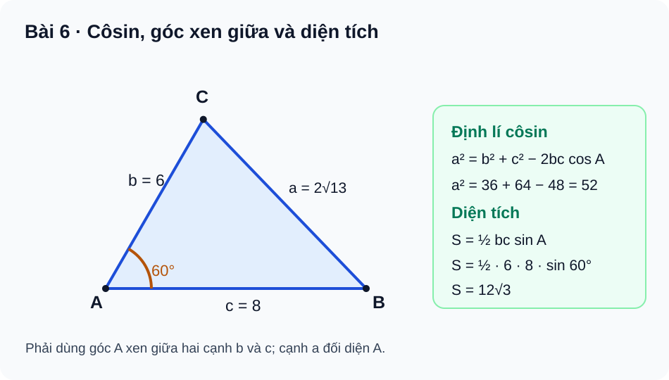
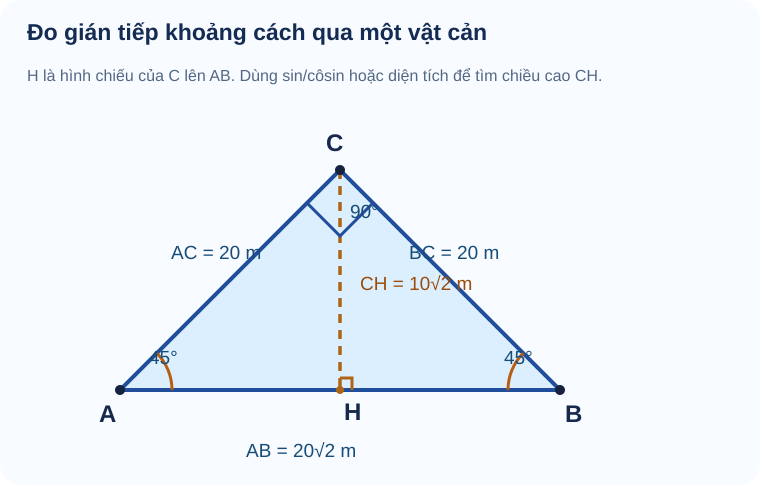

# Toán 10 · Bài 6. Hệ thức lượng trong tam giác

TOÁN 10 · CHƯƠNG III · KIẾN THỨC SGK KNTT

Từ đo đạc thực tế, tự hình thành định lí côsin, định lí sin và công thức diện tích. Hãy tự giải Vận dụng trước khi mở Đối chiếu.

=== "Khám phá kiến thức"

    ### 1.1. Vì sao cần học hệ thức lượng trong tam giác?

    Em đứng ở bờ hồ, nhìn một điểm \(C\) trên đảo mà không thể kéo thước đo thẳng từ bờ đến đó. Em chọn thêm vị trí \(B\) cùng bờ với \(A\), đo đoạn \(AB\) và hai góc ngắm từ \(A,B\) tới \(C\). Từ **một đoạn mốc đo được** và **hai góc ngắm**, em có thể tính khoảng cách tới \(C\) mà không phải bơi qua hồ. Tam giác \(ABC\) biến việc đo trực tiếp khó thành phép tính có chứng cứ.

    Kiến thức tiền đề là định lí Pitago trong tam giác vuông, tỉ số sin/cos ở lớp 9 và lượng giác các góc \(0^\circ\) đến \(180^\circ\) của Bài 5. Nhưng tam giác ngoài thực tế thường không vuông. Bài 6 giúp em tìm cạnh hoặc góc khi chỉ có một số dữ kiện, rồi tìm diện tích và kiểm phương án đo đạc. Trong toàn bài, \(a=BC,\ b=CA,\ c=AB\) lần lượt đối diện \(A,B,C\); đừng ghép cạnh với một góc ngẫu nhiên.

    ### 1.2. Vì sao định lí côsin phải có “phần điều chỉnh” Pitago?

    Xét tam giác \(ABC\) có \(b=CA\), \(c=AB\); hai cạnh này cùng kề góc \(A\). Tưởng tượng giữ nguyên độ dài \(b,c\) rồi thay đổi góc xen giữa chúng là \(A\). Cạnh thứ ba \(a\) (nối hai đầu mút còn lại) **thay đổi**: góc kẹp mở rộng thì đầu mút tách xa hơn. Nếu \(A=90^\circ\), Pitago cho \(a^2=b^2+c^2\). Với góc nhọn, hai cạnh cùng nghiêng về phía nhau nên \(a^2\) nhỏ hơn tổng ấy; với góc tù, \(a^2\) lớn hơn. Thành phần chiếu của cạnh \(b\) lên hướng \(c\) là \(b\cos A\). Khi tính bình phương khoảng cách hai đầu mút, ta phải trừ \(2bc\cos A\): đó là **lý do hình học** xuất hiện côsin.

    Trong ba tam giác có hai cạnh kề góc \(A\) cùng dài \(b=c=5\), hãy so sánh các trường hợp sau (khác dữ kiện câu Tự thử):

    
<table class="thpt-g10-knowledge-table">
    <thead><tr><th>Góc xen giữa</th><th>Dấu \(\cos A\)</th><th>Giá trị \(a^2\)</th><th>Ý nghĩa</th></tr></thead>
    <tbody><tr><td>\(60^\circ\)</td><td>Dương</td><td>\(25\)</td><td>\(a=5\)</td></tr>
    <tr><td>\(90^\circ\)</td><td>Bằng 0</td><td>\(50\)</td><td>Trở về Pitago</td></tr>
    <tr><td>\(150^\circ\)</td><td>Âm</td><td>\(50+25\sqrt3\)</td><td>Cạnh đối diện dài hơn</td></tr></tbody></table>

    Góc không phải lúc nào cũng \(60^\circ\) hay \(90^\circ\), nhưng **dấu cos** vẫn giúp em dự đoán cạnh nào dài hơn trước khi bấm máy. Đây là bước kiểm lỗi quan trọng sau khi tính.

    ### 1.3. Vì sao định lí sin giúp giải tam giác và đo đạc?

    Xét tam giác \(ABC\). Nếu biết số đo hai góc và độ dài một cạnh của tam giác, ta tìm được góc thứ ba nhờ tổng ba góc bằng \(180^\circ\). Để tìm những cạnh còn lại, cần mối liên hệ giữa *mỗi cạnh* với *góc đối diện cạnh ấy*. Xét đường tròn ngoại tiếp tam giác \(ABC\): mỗi cạnh là một dây cung và độ dài dây cung liên hệ với sin của góc nội tiếp chắn dây đó. Nhờ vậy, tỉ số cạnh chia sin góc đối diện có một giá trị chung là **đường kính ngoại tiếp** \(2R\). Em không cần dựng chiều cao của mọi tam giác để tìm hai cạnh còn lại.

    **Giải tam giác \(ABC\)** là tìm các độ dài cạnh và số đo góc chưa biết của chính tam giác đó. Trước khi chọn công thức, hãy phân loại dữ kiện: hai cạnh và góc **xen giữa** (SAS) thường bắt đầu bằng côsin; ba cạnh (SSS) cũng dùng côsin để tìm góc; hai góc và một cạnh (ASA/AAS) thường dùng sin. Với một góc **không xen giữa** và hai cạnh (SSA), có thể có hai tam giác khác nhau; một kết quả của phím \(\sin^{-1}\) không tự chứng minh tính duy nhất.

    ### 1.4. Vì sao diện tích xuất hiện sin, nửa chu vi và hai bán kính?

    Xét tam giác \(ABC\) có các cạnh \(a=BC\), \(b=CA\), \(c=AB\) và diện tích \(S\). Ở THCS, em đã học công thức tính **diện tích tam giác**: \(S=\tfrac12\times\text{độ dài đáy}\times\text{chiều cao tương ứng}\). Nếu lấy cạnh \(c=AB\) của tam giác làm đáy, độ cao từ đỉnh \(C\) xuống đường thẳng \(AB\) có độ dài \(b\sin A\), nên diện tích **liên quan đến sin của góc xen giữa**, không phải cos. Với góc tù, chân đường cao nằm trên *phần kéo dài* cạnh đáy nhưng độ cao vẫn là \(b\sin A>0\).

    Còn đường tròn nội tiếp **tam giác \(ABC\)** có bán kính \(r\) thì sao? Từ tâm đường tròn nội tiếp, hạ ba đoạn vuông góc đến ba cạnh \(BC,CA,AB\); mỗi đoạn dài \(r\). Chia tam giác \(ABC\) thành ba tam giác nhỏ có đáy lần lượt dài \(a,b,c\) và cùng chiều cao \(r\), rồi **cộng diện tích**: \(S=\frac12(a+b+c)r=pr\), trong đó \(p=(a+b+c)/2\) là **nửa chu vi tam giác \(ABC\)**, không phải chu vi. Với đường tròn ngoại tiếp tam giác \(ABC\) có bán kính \(R\), ta dùng hệ thức khác: định lí sin liên kết \(a\) và \(\sin A\) qua \(2R\); thay vào công thức diện tích cho \(S=abc/(4R)\). Hai công thức thuộc hai đường tròn khác nhau, nên không hoán đổi \(r,R\).

    ### 1.5. Nếu chỉ đo được ba cạnh thì tính diện tích thế nào?

    Xét tam giác \(ABC\) có ba cạnh dài \(a,b,c\). Dù chưa biết các góc và đường cao của tam giác, ta vẫn có thể tính **diện tích tam giác \(ABC\)** chỉ từ ba cạnh nếu chúng thực sự tạo thành một tam giác. Từ côsin, suy ra cos của một góc; hệ thức \(\sin^2 A=1-\cos^2 A\) cho sin dương, rồi thay vào \(S=\tfrac12bc\sin A\). Khi rút gọn, kết quả trở thành công thức **Heron** chứa \(p,p-a,p-b,p-c\). Ba đỉnh \(A,B,C\) phải **không thẳng hàng**; khi đó ta có một **tam giác không suy biến** (diện tích lớn hơn 0). Với ba độ dài cạnh dương, điều này tương đương mỗi cạnh nhỏ hơn tổng hai cạnh còn lại; khi đó các hiệu \(p-a,p-b,p-c\) đều dương. Vì thế phải kiểm bất đẳng thức tam giác trước, không chỉ bấm căn rồi tin một con số.

    **Sau bài học, em cần:** giải thích và chọn đúng côsin/sin; tìm cạnh/góc của tam giác bằng dữ kiện hai cạnh và góc xen giữa, ba cạnh, hoặc hai góc và một cạnh; suy diện tích từ đường cao, góc xen giữa, \(r,R\) hoặc ba cạnh; tính đo đạc có đơn vị và tự kiểm tính hợp lí của kết quả. Các công thức chi tiết và Tự thử sẽ được học ở tab Kiến thức, mỗi câu đều có Đối chiếu do em chủ động mở.

=== "Kiến thức SGK"

    ### 2.1. Định lí côsin

    #### 2.1.1. Hai cạnh và góc xen giữa: tìm cạnh thứ ba

    Xét tam giác \(ABC\) có ba đỉnh không thẳng hàng (tức **không suy biến**, như đã giải thích ở mục 1.5). Quy ước \(a=BC,\ b=CA,\ c=AB\) lần lượt đối diện các góc \(A,B,C\). Biết hai cạnh kề \(b,c\) và góc kẹp giữa chúng \(A\) (SAS), định lí Pitago chưa đủ nếu \(A\ne90^\circ\). Thành phần chiếu \(b\cos A\) của một cạnh lên phương cạnh kia tạo phần hiệu chỉnh:

    
<strong>Định lí côsin:</strong> \(a^2=b^2+c^2-2bc\cos A\), tương tự \(b^2=a^2+c^2-2ac\cos B\) và \(c^2=a^2+b^2-2ab\cos C\). Mỗi góc trong tích \(\cos\) phải <em>xen giữa đúng hai cạnh</em> đứng sau hệ số \(2\).

    Nếu \(A=90^\circ\) thì \(\cos A=0\), ta trở lại Pitago. Nếu \(A\) tù thì \(\cos A<0\), làm \(a^2>b^2+c^2\). Hãy dự đoán dấu trước khi tính, rồi áp dụng cho **dữ kiện mới** ở câu Vận dụng này.

    **Vận dụng.** Với \(b=c=5\) và \(A=120^\circ\), hãy tính \(a\). Vì sao \(a\) dài hơn từng cạnh kề?

    

    ??? question "Em đã tính? Mở lời giải để đối chiếu"

        \(a^2=5^2+5^2-2\cdot5\cdot5\cos120^\circ=50+25=75\), nên \(a=5\sqrt3\). Vì \(\cos120^\circ=-\frac12<0\), phần điều chỉnh được cộng thêm vào tổng hai bình phương, cho cạnh đối diện lớn hơn 5.

    <figure class="thpt-r4-plot thpt-r4-concept-figure">
    
    <figcaption>Đọc hình: \(b=AC=6,\ c=AB=8\) kẹp góc \(A=60^\circ\); \(a=BC\) là cạnh đối diện cần tìm. Hình có các bước kiểm tra bằng côsin và diện tích: em hãy đối chiếu đúng kí hiệu và điều kiện, không đọc nhầm thành dữ kiện các câu Tự thử.</figcaption>
    </figure>

    Hình trên là một minh họa riêng với \(b=6,c=8,A=60^\circ\). Trên hình, trước tiên hãy xác định hai cạnh **kề** góc \(A\) và cạnh **đối diện** \(a\), sau đó mới đọc các phép tính đã chú thích. Không dùng kết quả của hình để thay vào một tam giác có số liệu khác.

    #### 2.1.2. Ba cạnh đã biết: tìm góc bằng côsin

    Từ định lí côsin, chuyển vế rồi chia cho \(2bc>0\), ta tìm được

    \[
    \cos A=\frac{b^2+c^2-a^2}{2bc}.
    \]

    Tương tự cho \(B,C\) bằng cách hoán đổi tên góc và cạnh. **Trước khi bấm \(\cos^{-1}\)**, phải kiểm \(a,b,c>0\) và tổng hai cạnh bất kì **lớn hơn** cạnh còn lại. Nếu không thỏa bất đẳng thức tam giác nghiêm ngặt, không có tam giác cần giải. Khi tìm góc từ cos, hãy đặt máy ở DEG, kiểm góc nằm trong \((0^\circ,180^\circ)\), và xác nhận góc đối diện cạnh dài nhất phải lớn nhất.

    
<strong>Kiểm phương pháp:</strong> Hai cạnh và góc xen giữa (SAS) → dùng côsin tìm cạnh. Ba cạnh (SSS) → dùng côsin tìm góc. Nếu \(A\) tù, kết quả \(a\) phải dài hơn từng cạnh kề; nếu ba cạnh không lập thành tam giác, dừng trước khi tính các góc.

    ### 2.2. Định lí sin

    #### 2.2.1. Ghép cạnh với góc đối diện

    Xét tam giác \(ABC\) có đường tròn ngoại tiếp bán kính \(R\). Ba cạnh \(AB,BC,CA\) của tam giác là ba dây cung của đường tròn này. Mỗi dây cung được đo bởi sin của góc nội tiếp chắn dây ấy. Bởi vậy, mọi tỉ số **cạnh chia sin của góc đối diện** đều bằng đường kính:

    
<strong>Định lí sin:</strong> \(\dfrac{a}{\sin A}=\dfrac{b}{\sin B}=\dfrac{c}{\sin C}=2R\). Ở tam giác không suy biến, \(0^\circ<A,B,C<180^\circ\), nên các mẫu sin đều dương và khác 0.

    Trong tam giác \(ABC\), nếu biết số đo hai góc và độ dài một cạnh, trước hết tính góc còn lại bằng tổng ba góc \(180^\circ\), rồi ghép **đúng cặp**. Ví dụ, biết \(A=40^\circ,B=70^\circ,c=9\), ta có \(C=70^\circ\) và \(b=c=9\) (vì \(B=C\)), còn \(a=\dfrac{9\sin40^\circ}{\sin70^\circ}\). Đây là dữ kiện minh họa khác câu tự kiểm; em cần phân biệt điều đã cho với cặp cạnh/góc muốn tìm.

    **Vận dụng.** Cho \(A=30^\circ\), \(a=5\). Tìm bán kính ngoại tiếp \(R\). Chỉ từ hai dữ kiện này, có biết duy nhất \(B,C\) không?

    

    ??? question "Mở lời giải sau khi tự tính"

        \(\frac{a}{\sin A}=2R=\frac5{1/2}=10\), nên \(R=5\). **Không xác định duy nhất** \(B,C\), vì mới biết \(B+C=150^\circ\), vẫn có nhiều cách chọn hai góc dương có tổng này.

    #### 2.2.2. Chọn góc nào khi dữ kiện chưa đủ?

    Một cặp \(A,a\) cho \(R\) nhưng chưa đủ xác định **duy nhất** hai góc còn lại. Nếu đề chỉ cho hai cạnh và một góc **không xen giữa** (SSA), lời giải dùng \(\sin^{-1}\) có thể cho **hai góc bù nhau** phù hợp; cần kiểm tổng ba góc và cạnh đối diện, không mặc nhiên chọn góc do máy trả về. Nếu đề cho AAS/ASA, hai góc đã biết thường tránh được sự mơ hồ này.

    
<strong>Ghi nhớ:</strong> Chỉ ghép \(a\leftrightarrow A,\ b\leftrightarrow B,\ c\leftrightarrow C\). Một phép tính đúng vẫn có thể không giải đủ tam giác nếu dữ kiện chưa quyết định duy nhất hình.

    ### 2.3. Giải tam giác và ứng dụng thực tế

    #### 2.3.1. Chọn phương pháp theo dữ kiện

    **Giải tam giác** là tính các cạnh và góc chưa biết khi đã có đủ dữ kiện. Trước khi thao tác, ghi ba cặp \(a/A,\ b/B,\ c/C\) và đánh dấu những đại lượng đã cho. Với **hai cạnh và góc xen giữa (SAS)**, thường bắt đầu bằng côsin để tìm cạnh thứ ba; với **ba cạnh (SSS)**, dùng côsin để tìm góc, rồi dùng tổng góc hoặc sin; với **hai góc và một cạnh (ASA/AAS)**, tính góc thứ ba rồi dùng định lí sin. Không tự bỏ qua điều kiện góc dương, tổng \(180^\circ\) và độ dài cạnh dương.

    Nếu biết \(A=35^\circ,B=65^\circ,c=10\), ta có \(C=80^\circ\). Khi ấy \(a=\dfrac{10\sin35^\circ}{\sin80^\circ}\), \(b=\dfrac{10\sin65^\circ}{\sin80^\circ}\). Em có thể tính gần đúng bằng máy DEG, ghi đơn vị và đối chiếu cạnh đối diện góc lớn hơn phải dài hơn. Không dùng công thức Heron chỉ để tìm cạnh khi đã biết hai góc, một cạnh.

    #### 2.3.2. Đo khoảng cách không thể đo trực tiếp

    Một tuyến khảo sát dùng đoạn mốc \(AB\) đo được dọc bờ, góc ngắm tại \(A,B\) hướng tới điểm \(C\) phía bên kia. Sau khi lập sơ đồ, tính \(C=180^\circ-A-B\), rồi dùng định lí sin để tìm \(AC\) hoặc \(BC\). Nếu cần **khoảng cách vuông góc từ \(C\) đến đường thẳng \(AB\)**, gọi \(H\) là hình chiếu vuông góc của \(C\) lên \(AB\) và dùng \(CH=\dfrac{2S}{AB}\); có thể tính \(S\) từ các cạnh/góc của tam giác. Không tự nhận hình học lí tưởng phản ánh chính xác địa hình, và cần nêu đơn vị đo.

    **Em hãy tự giải tình huống độc lập trước khi nhìn hình có kết quả.**

    **Vận dụng.** Với \(AB=20\sqrt2\) m, hai góc tại \(A,B\) đều \(45^\circ\), hãy tính \(AC,BC\) và khoảng cách vuông góc \(CH\) từ \(C\) đến đường thẳng \(AB\).

    

    ??? question "Em đã tự tính khoảng cách? Mở lời giải"

        \(C=180^\circ-45^\circ-45^\circ=90^\circ\), nên tam giác vuông cân tại C. \(AC=BC=\frac{AB}{\sqrt2}=20\) m. Diện tích \(S=\frac12\cdot20\cdot20=200\) m², mặt khác \(S=\frac12 AB\cdot CH\). Vì vậy \(CH=\frac{400}{20\sqrt2}=10\sqrt2\) m.

    <figure class="thpt-r4-plot thpt-r4-concept-figure">
    
    <figcaption>Sơ đồ đo đạc do SLM dựng: \(AB=20\sqrt2\) m, \(A=B=45^\circ,\ C=90^\circ\). \(H\) là hình chiếu của \(C\) lên \(AB\), nên khoảng cách vuông góc \(CH=10\sqrt2\) m. Hình là <strong>sơ đồ hình học</strong>, không mô tả chính xác địa hình.</figcaption>
    </figure>

    **Hướng dẫn đọc hình sau Tự thử:** Điểm \(H\) là chân đường vuông góc từ \(C\) đến đường thẳng \(AB\), không phải đỉnh thứ tư của tam giác. Hình minh họa đúng riêng bộ dữ kiện trong câu vừa làm, có ghi kết quả để em tự đối chiếu. Khi gặp đoạn mốc và góc ngắm khác, phải tính lại từ dữ kiện mới.

    
<strong>Ghi nhớ đo đạc:</strong> Chọn hai điểm mốc có thể đo trực tiếp; xác định góc đo tại đúng đỉnh; giải tam giác bằng sin/cos; kiểm đơn vị và độ hợp lí trước khi báo khoảng cách thực tế.

    ### 2.4. Công thức tính diện tích tam giác

    #### 2.4.1. Bán kính nội tiếp và nửa chu vi: vì sao \(S=pr\)?

    Gọi \(I\) là tâm đường tròn nội tiếp, \(r\) là bán kính nội tiếp và \(p=\dfrac{a+b+c}{2}\) là **nửa chu vi**. Ba đường vuông góc từ \(I\) đến các cạnh đều dài \(r\). Chia tam giác \(ABC\) thành \(IAB,IBC,ICA\), tổng diện tích:

    \[
    S=\tfrac12cr+\tfrac12ar+\tfrac12br=\tfrac12(a+b+c)r=pr.
    \]

    Đây là cách hiểu \(S=pr\): **cùng chiều cao \(r\)** ứng với ba đáy là các cạnh của tam giác. Không thay \(p\) bằng chu vi đầy đủ, và không nhầm \(r\) với bán kính ngoại tiếp.

    #### 2.4.2. Hai cạnh và góc xen giữa: từ chiều cao đến sin

    Nếu lấy \(c=AB\) làm đáy, chiều cao từ \(C\) đến đường thẳng \(AB\) bằng \(b\sin A\), kể cả khi chân đường cao ở phần kéo dài của \(AB\). Vậy

    
<strong>Diện tích theo sin góc xen giữa:</strong> \(\displaystyle S=\frac12bc\sin A=\frac12ca\sin B=\frac12ab\sin C\). Cặp cạnh dùng cùng một biểu thức phải kẹp đúng góc đi kèm. Vì \(0^\circ<A,B,C<180^\circ\), các sin ở đây đều dương.

    Hai cạnh giữ nguyên nhưng thay góc kẹp bằng **góc bù** có thể cho cùng diện tích vì hai sin bằng nhau; tuy nhiên cạnh thứ ba thường **khác nhau** theo định lí côsin. Hãy tự kiểm điều đó trong câu sau:

    **Vận dụng.** Hai tam giác có cùng hai cạnh kề \(b=6,c=8\), nhưng góc xen giữa lần lượt \(A=30^\circ\) và \(A=150^\circ\). Tính diện tích của mỗi tam giác, giải thích vì sao bằng nhau.

    

    ??? question "Em đã chọn đúng góc? Mở đối chiếu"

        Mỗi tam giác có diện tích \(S=\frac12\cdot6\cdot8\cdot\sin30^\circ=12\), vì \(\sin150^\circ=\sin30^\circ=\frac12\). Hai tam giác không nhất thiết có cùng cạnh thứ ba.

    #### 2.4.3. Bán kính ngoại tiếp: vì sao \(S=\dfrac{abc}{4R}\)?

    Từ định lí sin ta có \(\sin A=\dfrac{a}{2R}\). Thay vào \(S=\frac12bc\sin A\) được

    \[
    \boxed{S=\frac{abc}{4R}.}
    \]

    Đây là công thức cho **bán kính ngoại tiếp** \(R\), khác \(S=pr\) cho bán kính **nội tiếp** \(r\). Muốn tìm \(R\) khi đã biết \(a,b,c,S\), biến đổi \(R=\frac{abc}{4S}\). Khi tính \(r\), dùng \(r=\frac S p\), không lấy nhầm tích ba cạnh.

    #### 2.4.4. Công thức Heron: tính từ ba cạnh mà không cần góc

    Nếu biết đủ ba cạnh \(a,b,c\), kiểm \(a,b,c>0\) và bất đẳng thức tam giác **nghiêm ngặt**. Khi ấy \(p=\frac{a+b+c}{2}\) và \(\sin A>0\). Từ \(\cos A=\frac{b^2+c^2-a^2}{2bc}\) kết hợp \(S=\frac12bc\sin A\), ta có

    \[
    \begin{aligned}
    16S^2&=4b^2c^2-(b^2+c^2-a^2)^2\\
    &=[2bc-(b^2+c^2-a^2)]\\
    &\quad\cdot[2bc+(b^2+c^2-a^2)]\\
    &=(a+b+c)(-a+b+c)\\
    &\quad\cdot(a-b+c)(a+b-c).
    \end{aligned}
    \]

    Mỗi thừa số ở tích cuối bằng \(2p,\ 2(p-a),\ 2(p-b),\ 2(p-c)\). Chia cho 16 và lấy căn **dương** vì diện tích dương, suy ra công thức:

    
<strong>Công thức Heron:</strong> \(\displaystyle S=\sqrt{p(p-a)(p-b)(p-c)}\), \(p=\frac{a+b+c}{2}\). Kiểm ba cạnh lập tam giác trước khi dùng; sau khi có \(S\), chọn \(r=S/p\) hoặc \(R=abc/(4S)\) theo đúng loại bán kính.

    Nếu ba cạnh không tạo tam giác, **không** cố dùng Heron để tìm một “diện tích” hình học không tồn tại. Nếu chỉ biết ba cạnh, Heron thường gọn hơn việc tìm góc bằng \(\cos^{-1}\) rồi lại tính sin. Tự thử với một tam giác vuông và một bộ ba cạnh không hợp lệ:

    **Vận dụng.** Với ba cạnh \((3,4,5)\), hãy tính \(S,r\). Bộ ba \((2,3,6)\) có dùng Heron như một tam giác được không?

    

    ??? question "Em đã kiểm điều kiện tam giác? Mở đáp án"

        Với \(3,4,5\): \(p=6\), \(S=\sqrt{6\cdot3\cdot2\cdot1}=6\), \(r=S/p=1\). Bộ ba \(2,3,6\) **không tạo tam giác** vì \(2+3\le6\), nên không dùng như một bài toán diện tích tam giác thực.

    
<strong>Bản đồ lựa chọn:</strong> Hai cạnh + góc xen giữa → diện tích theo sin; ba cạnh → Heron; biết \(r,p\) → \(S=pr\); biết \(a,b,c,R\) → \(S=abc/(4R)\). Diện tích đo bằng đơn vị **bình phương**, còn cạnh và bán kính đo bằng đơn vị dài.

=== "Ví dụ"

    ### 3.1. Ví dụ 1 — Hai cạnh và góc xen giữa, tính cả cạnh và diện tích

    **Đề bài.** Cho tam giác \(ABC\) có \(b=9,\ c=7,\ A=60^\circ\). Tính cạnh \(a\) và diện tích \(S\). Đây là bộ dữ kiện **khác hình minh họa** ở §2.1 và các câu Tự thử.

    **Phân tích.** Góc \(A\) **kẹp đúng hai cạnh \(b,c\)**, nên định lí côsin tính được cạnh đối diện \(a\). Diện tích dùng \(\frac12bc\sin A\); không cần tìm đường cao riêng. Dự đoán \(a\) ngắn hơn \(\sqrt{b^2+c^2}\) vì \(A\) nhọn.

    **Lời giải.** Theo định lí côsin,

    \[
    a^2=9^2+7^2-2\cdot9\cdot7\cos60^\circ
        =81+49-63=67,\quad a=\sqrt{67}\approx8{,}19.
    \]

    \[
    S=\tfrac12\cdot9\cdot7\sin60^\circ
      =\frac{63\sqrt3}{4}\approx27{,}28.
    \]

    **Kiểm lại.** \(2<\sqrt{67}<16\), ba cạnh tạo tam giác; diện tích dương và đo bằng đơn vị độ dài bình phương. Không dùng cạnh \(a=2\sqrt{13}\) của **hình §2.1** cho dữ kiện mới này.

    ### 3.2. Ví dụ 2 — Giải tam giác từ hai góc và một cạnh

    **Đề bài.** Cho \(A=45^\circ,\ B=75^\circ,\ a=6\). Tìm \(C,\ b,\ c\) và bán kính ngoại tiếp \(R\).

    **Phân tích.** Đây là dữ kiện hai góc và một cạnh; định lí sin kết nối \(a\) với \(\sin A\). Trước hết tìm góc \(C\), sau đó dùng cùng tỉ số cho các cạnh còn lại và \(2R\). Không dùng côsin SAS khi chưa có hai cạnh.

    **Lời giải.** \(C=180^\circ-45^\circ-75^\circ=60^\circ\). Định lí sin cho

    \[
    2R=\frac6{\sin45^\circ}=6\sqrt2
    \quad\Rightarrow\quad R=3\sqrt2,
    \]

    \[
    b=6\,\frac{\sin75^\circ}{\sin45^\circ}
     \approx8{,}20,\qquad
    c=6\,\frac{\sin60^\circ}{\sin45^\circ}=3\sqrt6.
    \]

    **Kiểm lại.** \(B=75^\circ\) lớn nhất, nên \(b\) phải dài nhất; thật vậy \(b\approx8{,}20\), \(3\sqrt6\approx7{,}35\), \(a=6\). Tổng góc bằng \(180^\circ\).

    ### 3.3. Ví dụ 3 — Heron và hai bán kính trong một tam giác khác

    **Đề bài.** Một mảnh đất hình tam giác có ba cạnh dài \(10,\ 13,\ 13\) m. Tính diện tích, bán kính đường tròn nội tiếp \(r\) và ngoại tiếp \(R\).

    **Phân tích.** Ba cạnh hợp lệ và chưa biết góc, nên dùng Heron trực tiếp. Sau khi có diện tích, \(r=S/p\) và \(R=abc/(4S)\) là **hai công thức khác nhau**.

    **Lời giải.** \(10+13>13,\ 13+13>10\), nên các cạnh tạo tam giác. \(p=\frac{10+13+13}{2}=18\) m. Theo Heron,

    \[
    S=\sqrt{18(18-10)(18-13)(18-13)}
      =\sqrt{18\cdot8\cdot5\cdot5}=60\ \text{m}^2.
    \]

    \[
    r=\frac{60}{18}=\frac{10}{3}\ \text{m},\qquad
    R=\frac{10\cdot13\cdot13}{4\cdot60}
      =\frac{169}{24}\ \text{m}.
    \]

    **Kiểm lại.** Với tam giác cân đáy 10 m và hai cạnh bên 13 m, đường cao chia đáy thành hai đoạn 5 m nên cao \(\sqrt{13^2-5^2}=12\) m. Tính lại \(S=\frac12\cdot10\cdot12=60\ \text{m}^2\) khớp Heron. Bán kính có đơn vị **m**, không phải m².

    ### 3.4. Ví dụ 4 — Đo chiều dài không tới được từ bờ hồ

    **Đề bài.** Hai vị trí \(A,B\) trên cùng bờ hồ cách nhau \(80\) m. Góc ngắm trong tam giác tới điểm \(C\) bên kia là \(A=35^\circ,\ B=75^\circ\). Tính khoảng cách \(AC\), \(BC\), làm tròn tới \(0{,}1\) m.

    **Phân tích.** Đoạn \(AB\) là cạnh \(c\), đối diện góc \(C\), còn \(AC=b\) đối diện \(B\), \(BC=a\) đối diện \(A\). Vì đã biết hai góc và cạnh mốc, dùng định lí sin; máy đặt **DEG**, làm tròn cuối cùng.

    **Lời giải.** \(C=180^\circ-35^\circ-75^\circ=70^\circ\). Theo định lí sin:

    \[
    AC=b=\frac{80\sin75^\circ}{\sin70^\circ}
       \approx82{,}2\ \text{m},\qquad
    BC=a=\frac{80\sin35^\circ}{\sin70^\circ}
       \approx48{,}8\ \text{m}.
    \]

    **Kiểm lại.** \(AC\) đối diện góc lớn nhất \(75^\circ\), nên phải lớn hơn cả \(AB=80\) m và \(BC\approx48{,}8\) m. Nếu chỉ dựa vào số trên bản vẽ mà không đo góc tại đúng vị trí, kết quả không có cơ sở; đây là mô hình tam giác lí tưởng, không phải đo địa hình thực địa.

=== "Lỗi thường gặp"

    

    ??? tip "4.1. Ghép nhầm cạnh–góc và chọn sai định lí"

        **Dấu hiệu:** Viết \(a^2=b^2+c^2-2bc\cos B\); dùng định lí sin ngay khi chỉ biết hai cạnh và góc xen giữa.

        **Vì sao sai?** Trong công thức cạnh \(a\), góc xen giữa \(b,c\) phải là \(A\), đồng thời cạnh \(a\) đối diện \(A\). Định lí sin kết nối **cạnh với góc đối diện**, không tùy ý ghép.

        **Tự sửa:** Trên hình mục 2.1.1, chỉ đúng \(a=BC,b=CA,c=AB\) và góc kẹp giữa \(b,c\). Với Ví dụ 3.1, tự tính lại \(a^2\) từ hai cạnh 9, 7 và góc \(60^\circ\), rồi đối chiếu cạnh đối diện. [Ôn định lí côsin và sin tại Core](luyen-tap.md).

    

    ??? tip "4.2. Nhầm công thức diện tích, Heron và hai bán kính"

        **Dấu hiệu:** Dùng \(S=\frac12bc\cos A\), cho \(r=abc/(4S)\) hoặc ghi diện tích bằng mét thay vì mét vuông.

        **Vì sao sai?** Diện tích theo hai cạnh cần **sin góc xen giữa**; Heron dùng **nửa chu vi**; \(r\) gắn với đường tròn nội tiếp còn \(R\) gắn với đường tròn ngoại tiếp.

        **Tự sửa:** Với ba cạnh \(10,13,13\) trong Ví dụ 3.3, tự tính lại \(p=18\), \(S=60\), \(r=10/3\), \(R=169/24\). Giải thích vì sao hai bán kính khác nhau và vì sao diện tích có đơn vị m². [Ôn tại Core/Luyện tập](luyen-tap.md).

    **Học tiếp:** [Core và Luyện tập Chương III](luyen-tap.md) · [Tự kiểm tra cuối chương](tu-kiem-tra-chuong.md) · [Chương IV — Vectơ](../chuong-iv.md).

    
Nguồn kiến thức: SGK Toán 10 · Kết nối tri thức với cuộc sống · tập 1, Bài 6 (trang in 38–43); giữ đúng thứ tự bốn mục chính. Lời dẫn và ví dụ chuyển giao do SLM biên tập và tự tính kiểm tra. Hình đo đạc là sơ đồ riêng, không phải bản đồ địa hình. Các câu Tự thử tự mở đối chiếu, không ghi Mastery hoặc thay Tự kiểm tra cuối chương.

