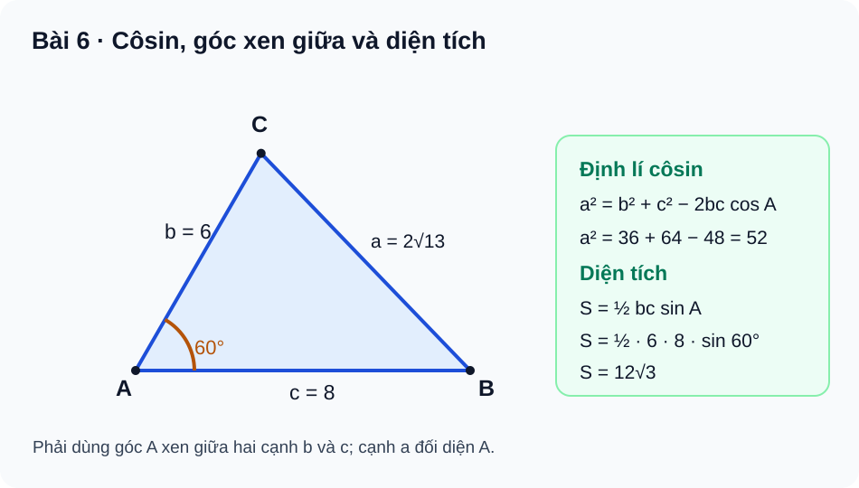
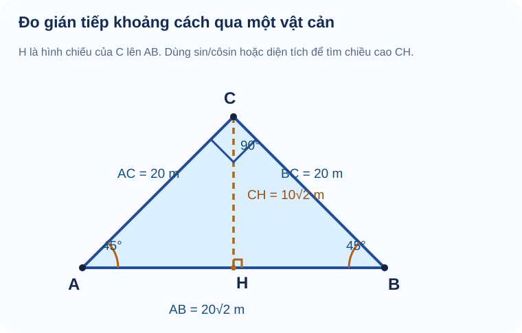

# Toán 10 · Bài 6. Hệ thức lượng trong tam giác

TOÁN 10 · CHƯƠNG III · KIẾN THỨC SGK KNTT

Học kiến thức và ví dụ theo Bài 6, sau đó tự luyện.

=== "Khám phá kiến thức"

    ### Cùng tìm hiểu

    Giả sử em đứng ở bờ sông và muốn biết khoảng cách đến một điểm \(C\) ở bên kia, nhưng không thể kéo thước đo trực tiếp từ vị trí của mình đến \(C\). Em có thể chọn thêm một vị trí \(B\) cùng bờ, đo được đoạn \(AB\), rồi đo hai **góc ngắm** từ \(A\) và \(B\) về \(C\). Lúc này ta có một **tam giác** với những dữ kiện đo được, và bài toán đo khoảng cách trở thành bài toán tìm các cạnh chưa biết của tam giác.

    Ở THCS, định lí Pitago giúp tìm cạnh trong **tam giác vuông**. Nhưng tam giác quan sát ngoài thực tế thường **không vuông**. Làm sao từ hai cạnh và góc xen giữa tìm được cạnh thứ ba? Hoặc từ hai góc và một cạnh tìm được hai cạnh còn lại? Đó là lý do ta cần **định lí côsin** và **định lí sin**.

    Hãy nghĩ đến một tam giác có hai cạnh cố định \(b,c\) kẹp một góc \(A\). Khi \(A\) mở rộng, cạnh đối diện \(a\) cũng thay đổi: góc nhỏ cho cạnh đối diện ngắn hơn; góc lớn có thể cho cạnh đối diện dài hơn. Trong tam giác vuông, Pitago nói \(a^2=b^2+c^2\). Với góc bất kỳ, phải có **phần điều chỉnh theo \(\cos A\)**. Đó là bản chất của định lí côsin.

    Nếu đã biết **hai góc và một cạnh**, hãy hình dung mỗi cạnh gắn với **góc đối diện chính nó**. Định lí sin kết nối các cặp ấy mà không cần tìm tất cả các đường cao. Cuối cùng, khi đã biết cạnh hoặc góc, các công thức diện tích giúp tính phần mặt phẳng bên trong tam giác, từ bài thuần toán đến bài đo đạc.

    ### Ví dụ trực quan

    Giữ hai cạnh \(b=c=5\) và thay góc xen giữa \(A\):

    
<table class="thpt-g10-knowledge-table">
    <thead><tr><th>Góc \(A\)</th><th>\(\cos A\)</th><th>\(a^2=b^2+c^2-2bc\cos A\)</th><th>Cạnh đối diện \(a\)</th></tr></thead>
    <tbody>
    <tr><td>\(60^\circ\)</td><td>\(\frac12\)</td><td>\(50-25=25\)</td><td>\(5\)</td></tr>
    <tr><td>\(90^\circ\)</td><td>\(0\)</td><td>\(50\)</td><td>\(5\sqrt2\)</td></tr>
    <tr><td>\(120^\circ\)</td><td>\(-\frac12\)</td><td>\(50+25=75\)</td><td>\(5\sqrt3\)</td></tr>
    </tbody></table>

    Em thấy khi góc mở rộng, cạnh đối diện dài ra. Đặc biệt, \(\cos120^\circ<0\) làm phần “trừ \(2bc\cos A\)” thực chất trở thành **cộng một số dương**. Vì thế, cạnh đối diện góc tù có thể dài hơn cả hai cạnh kề.

    ### Thuật ngữ và kiến thức, kỹ năng

    **Thuật ngữ:** cạnh đối diện, góc xen giữa, định lí côsin, định lí sin, đường tròn ngoại tiếp/nội tiếp, bán kính \(R,r\), nửa chu vi \(p\), diện tích \(S\), công thức Heron, giải tam giác.

    **Sau bài học, em cần làm được:** xác định đúng cặp cạnh–góc đối diện; chọn định lí côsin hay sin dựa vào dữ kiện; tính diện tích từ hai cạnh và góc xen giữa hoặc ba cạnh; phân biệt \(r\) với \(R\); giải một bài toán đo đạc, ghi điều kiện tam giác và đơn vị đo.

=== "Kiến thức SGK"

    ### 2.1. Định lí côsin: phần điều chỉnh của Pitago

    Xét **tam giác không suy biến** \(ABC\). Quy ước \(a=BC\) đối diện góc \(A\); \(b=CA\) đối diện \(B\); \(c=AB\) đối diện \(C\). Các cạnh phải dương và thỏa bất đẳng thức tam giác. Ta có:

    \[
    \boxed{a^2=b^2+c^2-2bc\cos A.}
    \]

    Tương tự \(b^2=a^2+c^2-2ac\cos B\) và \(c^2=a^2+b^2-2ab\cos C\). Nếu \(A=90^\circ\), \(\cos A=0\), công thức trở về \(a^2=b^2+c^2\), chính là Pitago. Khi góc \(A\) nhọn, phần điều chỉnh \(-2bc\cos A\) âm; khi góc \(A\) tù, phần điều chỉnh dương. Điều này giải thích trực giác ở Khám phá.

    Hãy xem hình đúng **bộ số \(b=6,c=8,A=60^\circ\)**. Trước khi nhìn kết quả, chỉ trên hình hai cạnh **kề góc A** và cạnh **đối diện A**. Dùng \(\cos A\) vì \(A\) nằm giữa \(b\) và \(c\); không được thay nhầm thành \(\cos B\).

    <figure class="thpt-r4-plot thpt-r4-concept-figure">
    
    <figcaption>Đọc hình: \(b=AC=6,\ c=AB=8,\ A=60^\circ\), cạnh cần tìm \(a=BC\). Do \(a^2=6^2+8^2-2\cdot6\cdot8\cos60^\circ=52\), nên \(a=2\sqrt{13}\); diện tích \(S=\frac12bc\sin A=12\sqrt3\). <strong>Hình này gắn với ví dụ \(b=6,c=8\)</strong>, không gán cho bài có cạnh khác.</figcaption>
    </figure>

    Nếu đã biết **ba cạnh**, ta có thể tìm góc bằng

    \[
    \cos A=\frac{b^2+c^2-a^2}{2bc}.
    \]

    Công thức hợp lệ vì \(b,c>0\) trong tam giác không suy biến. Phải kiểm ba độ dài tạo thành tam giác trước khi tìm góc.

    
<strong>Kiến thức cần nhớ:</strong> Biết **hai cạnh và góc xen giữa (SAS)** thì dùng côsin để tìm cạnh đối diện; biết **ba cạnh (SSS)** thì dùng côsin để tìm góc. Ghép đúng \(a\) với góc đối diện \(A\), và \(b,c\) với hai cạnh kề \(A\).

    **Em vận dụng.** Với \(b=c=5\) và \(A=120^\circ\), hãy tính \(a\). Vì sao \(a\) dài hơn từng cạnh kề?

    

    ??? question "Em đã tính? Mở lời giải để đối chiếu"

        \(a^2=5^2+5^2-2\cdot5\cdot5\cos120^\circ=50+25=75\), nên \(a=5\sqrt3\). Vì \(\cos120^\circ=-\frac12<0\), phần điều chỉnh được cộng thêm vào tổng hai bình phương, cho cạnh đối diện lớn hơn 5.

    ### 2.2. Định lí sin: ghép đúng cạnh với góc đối diện

    Trong tam giác \(ABC\), mỗi cạnh \(a,b,c\) đi cùng góc **đối diện** lần lượt \(A,B,C\). Nếu \(R>0\) là bán kính đường tròn ngoại tiếp, thì:

    \[
    \boxed{\frac{a}{\sin A}=\frac{b}{\sin B}=\frac{c}{\sin C}=2R.}
    \]

    Vì \(0^\circ<A,B,C<180^\circ\), các sin của góc trong tam giác đều dương. Khi biết hai góc và một cạnh, em tìm góc còn lại bằng \(180^\circ-A-B\), rồi dùng hai cặp cạnh–sin góc **đúng vị trí**. Chẳng hạn, biết \(A=30^\circ,B=45^\circ,a=5\) thì \(C=105^\circ\) và \(b=\frac{a\sin B}{\sin A}=5\sqrt2\).

    Lưu ý **một cặp \(A,a\) không đủ** xác định cả tam giác. Nếu chỉ biết hai cạnh và một góc không xen giữa (SSA), có trường hợp hai tam giác khác nhau cùng thỏa dữ kiện, nên không mặc nhiên xem kết quả bấm \(\arcsin\) là góc duy nhất.

    
<strong>Kiến thức cần nhớ:</strong> Ghép \(a\leftrightarrow A\), \(b\leftrightarrow B\), \(c\leftrightarrow C\). Khi biết **hai góc và một cạnh (ASA/AAS)**, định lí sin thường trực tiếp hơn côsin; phải kiểm \(A+B<180^\circ\).

    **Em vận dụng.** Cho \(A=30^\circ\), \(a=5\). Tìm bán kính ngoại tiếp \(R\). Chỉ từ hai dữ kiện này, có biết duy nhất \(B,C\) không?

    

    ??? question "Mở lời giải sau khi tự tính"

        \(\frac{a}{\sin A}=2R=\frac5{1/2}=10\), nên \(R=5\). **Không xác định duy nhất** \(B,C\), vì mới biết \(B+C=150^\circ\), vẫn có nhiều cách chọn hai góc dương có tổng này.

    ### 2.3. Diện tích theo sin của góc xen giữa

    Diện tích tam giác là \(\frac12\times\text{đáy}\times\text{chiều cao}\). Nếu lấy \(c=AB\) làm đáy thì độ cao từ \(C\) đến đường thẳng \(AB\) là \(b\sin A\) (với góc \(A\) thuộc \(0^\circ\)–\(180^\circ\), sin dương). Bởi vậy:

    \[
    \boxed{S=\frac12bc\sin A=\frac12ca\sin B=\frac12ab\sin C.}
    \]

    Cách chọn công thức giống hệt chọn góc trong định lí côsin: nếu biết **hai cạnh \(b,c\)**, phải dùng **góc xen giữa \(A\)**. Công thức vẫn cho diện tích dương khi góc xen giữa là góc tù vì sin của góc trong tam giác luôn dương.

    Với hình ở §2.1, \(b=6,c=8,A=60^\circ\), nên \(S=\frac12\cdot6\cdot8\cdot\frac{\sqrt3}{2}=12\sqrt3\). Nếu cùng hai cạnh \(b,c\) nhưng góc \(A=120^\circ\), diện tích **vẫn bằng** \(12\sqrt3\) vì \(\sin120^\circ=\sin60^\circ\); tuy nhiên **cạnh còn lại khác**. Đừng nhầm cùng diện tích với cùng tam giác.

    **Em vận dụng.** Hai tam giác có cùng hai cạnh kề \(b=6,c=8\), nhưng góc xen giữa lần lượt \(A=30^\circ\) và \(A=150^\circ\). Tính diện tích của mỗi tam giác, giải thích vì sao bằng nhau.

    

    ??? question "Em đã chọn đúng góc? Mở đối chiếu"

        Mỗi tam giác có diện tích \(S=\frac12\cdot6\cdot8\cdot\sin30^\circ=12\), vì \(\sin150^\circ=\sin30^\circ=\frac12\). Hai tam giác không nhất thiết có cùng cạnh thứ ba.

    ### 2.4. Ba cạnh đã biết: công thức Heron và hai bán kính

    Nếu **chỉ biết ba cạnh**, em có thể tính diện tích mà không cần tìm góc. Đặt \(p=\frac{a+b+c}{2}\) là **nửa chu vi**. Công thức Heron cho:

    \[
    \boxed{S=\sqrt{p(p-a)(p-b)(p-c)}.}
    \]

    Trước khi sử dụng, phải kiểm \(a,b,c>0\) và các bất đẳng thức tam giác **nghiêm ngặt**; ví dụ \(2,3,6\) không tạo tam giác vì \(2+3<6\).

    Nếu \(r\) là **bán kính nội tiếp** và \(R\) là **bán kính ngoại tiếp**, thì:

    \[
    S=pr,\qquad S=\frac{abc}{4R}.
    \]

    Hai bán kính có vai trò khác nhau: \(r\) nối với \(p\) qua \(S=pr\); \(R\) nối với tích ba cạnh qua \(S=\frac{abc}{4R}\).

    Ví dụ, tam giác có cạnh \(13,14,15\) cho \(p=21\),

    \[
    S=\sqrt{21\cdot8\cdot7\cdot6}=84,\quad
    r=\frac{84}{21}=4,\quad
    R=\frac{13\cdot14\cdot15}{4\cdot84}=\frac{65}{8}.
    \]

    
<strong>Kiến thức cần nhớ:</strong> Ba cạnh SSS → kiểm bất đẳng thức tam giác → tính \(p\) → Heron. Muốn tính \(r\), dùng \(S=pr\); muốn tính \(R\), dùng \(S=\frac{abc}{4R}\). Đơn vị diện tích là đơn vị độ dài **bình phương**.

    **Em vận dụng.** Với ba cạnh \((3,4,5)\), hãy tính \(S,r\). Bộ ba \((2,3,6)\) có dùng Heron như một tam giác được không?

    

    ??? question "Em đã kiểm điều kiện tam giác? Mở đáp án"

        Với \(3,4,5\): \(p=6\), \(S=\sqrt{6\cdot3\cdot2\cdot1}=6\), \(r=S/p=1\). Bộ ba \(2,3,6\) **không tạo tam giác** vì \(2+3\le6\), nên không dùng như một bài toán diện tích tam giác thực.

    ### 2.5. Giải tam giác và đo đạc khi không thể đo trực tiếp

    Khi giải tam giác, trước hết em cần biết **loại dữ kiện**: SAS/SSS ưu tiên côsin; ASA/AAS ưu tiên sin; có ba cạnh thì Heron tính diện tích nhanh. Nếu ứng dụng đo đạc, phải nêu rõ đoạn mốc, góc ngắm được đo **ở đỉnh nào**, đơn vị và phần cần tìm.

    Một trường hợp đơn giản nhưng giàu ý nghĩa: nhà khảo sát đo được đoạn mốc \(AB=20\sqrt2\) m ở bờ, nhìn đến điểm \(C\) phía bên kia và thấy hai góc trong tại \(A,B\) đều bằng \(45^\circ\). Vậy \(C=90^\circ\), tam giác vuông cân tại \(C\). Có thể suy được \(AC=BC=20\) m dù **không cần đo trực tiếp** đến \(C\).

    <figure class="thpt-r4-plot thpt-r4-concept-figure">
    
    <figcaption>Sơ đồ đo đạc do SLM dựng: \(AB=20\sqrt2\) m, \(A=B=45^\circ,\ C=90^\circ\). \(H\) là hình chiếu của \(C\) lên \(AB\), nên khoảng cách vuông góc \(CH=10\sqrt2\) m. Hình là <strong>sơ đồ hình học</strong>, không mô tả chính xác địa hình.</figcaption>
    </figure>

    **Em vận dụng.** Với \(AB=20\sqrt2\) m, hai góc tại \(A,B\) đều \(45^\circ\), hãy tính \(AC,BC\) và khoảng cách vuông góc \(CH\) từ \(C\) đến đường thẳng \(AB\).

    

    ??? question "Em đã tự tính khoảng cách? Mở lời giải"

        \(C=180^\circ-45^\circ-45^\circ=90^\circ\), nên tam giác vuông cân tại C. \(AC=BC=\frac{AB}{\sqrt2}=20\) m. Diện tích \(S=\frac12\cdot20\cdot20=200\) m², mặt khác \(S=\frac12 AB\cdot CH\). Vì vậy \(CH=\frac{400}{20\sqrt2}=10\sqrt2\) m.

=== "Ví dụ"

    ### Ví dụ 1 — Côsin và diện tích với hình minh họa khớp số liệu

    **Đề bài.** Tam giác \(ABC\) có \(b=6,c=8,A=60^\circ\). Tính \(a\) và diện tích \(S\).

    **Vì sao chọn phương pháp này?** Biết hai cạnh và **góc xen giữa (SAS)**, nên côsin tìm cạnh còn lại, công thức theo sin tìm ngay diện tích. Hình ở §2.1 sử dụng **đúng dữ kiện này**.

    **Lời giải.** \(a^2=6^2+8^2-2\cdot6\cdot8\cos60^\circ=36+64-48=52\), nên \(a=2\sqrt{13}\). Diện tích \(S=\frac12\cdot6\cdot8\sin60^\circ=12\sqrt3\).

    **Kiểm lại.** \(a>0\), \(6+8>2\sqrt{13}\); diện tích có đơn vị độ dài bình phương. Nếu em thay nhầm \(\cos B\) vào cạnh \(a\), dữ kiện góc không khớp.

    ### Ví dụ 2 — Tính cạnh bằng định lí sin

    **Đề bài.** Tam giác có \(A=30^\circ,\ B=45^\circ,\ a=5\). Tìm \(C,b,R\).

    **Vì sao chọn phương pháp này?** Hai góc và một cạnh (AAS) cho ngay một cặp \(a,\sin A\); dùng định lí sin nhanh hơn dựng đường cao.

    **Lời giải.** \(C=180^\circ-30^\circ-45^\circ=105^\circ\). Theo định lí sin,

    \[
    b=\frac{a\sin B}{\sin A}=\frac{5\cdot\sqrt2/2}{1/2}=5\sqrt2,
    \qquad 2R=\frac5{\sin30^\circ}=10,\quad R=5.
    \]

    **Kiểm lại.** Cả ba góc dương, tổng \(180^\circ\); \(R>0\).

    ### Ví dụ 3 — Heron, bán kính nội tiếp và ngoại tiếp

    **Đề bài.** Cho ba cạnh \(a=13,b=14,c=15\). Tính diện tích \(S\), bán kính \(r\) và \(R\).

    **Vì sao chọn phương pháp này?** Biết **cả ba cạnh** nhưng chưa biết góc, nên Heron giảm bước tìm góc. Sau khi có \(S\), hai công thức bán kính được dùng riêng.

    **Lời giải.** \(p=21\). Do \(13+14>15\), \(13+15>14\), \(14+15>13\), ba cạnh tạo tam giác không suy biến. \(S=\sqrt{21\cdot8\cdot7\cdot6}=84\). \(r=S/p=4\), \(R=abc/(4S)=65/8\).

    **Kiểm lại.** \(r<R\) trong tam giác này và cả hai cùng đơn vị **độ dài**, không phải diện tích.

    ### Ví dụ 4 — Dùng côsin từ nguồn NotebookLM v1 (khác dữ kiện hình)

    **Đề bài.** Cho \(b=8,c=5,A=60^\circ\). Tính \(a\) và \(S\).

    **Vì sao chọn phương pháp này?** Vẫn là dữ kiện SAS, nên dùng côsin cho cạnh và sin cho diện tích. **Chú ý:** đây là bài có số liệu khác hình \(b=6,c=8\) ở §2.1; không đọc kết quả từ hình ấy.

    **Lời giải.** \(a^2=8^2+5^2-2\cdot8\cdot5\cos60^\circ=64+25-40=49\), do đó \(a=7\). \(S=\frac12\cdot8\cdot5\sin60^\circ=10\sqrt3\).

    **Kiểm lại.** \(5+7>8\), \(7+8>5\), \(8+5>7\): các cạnh thỏa điều kiện. Không lấy kết quả \(2\sqrt{13}\) của ví dụ khác.

=== "Lỗi thường gặp"

    

    ??? tip "Ghép nhầm cạnh–góc và chọn sai định lí"

        **Dấu hiệu:** Viết \(a^2=b^2+c^2-2bc\cos B\); dùng định lí sin ngay khi chỉ biết hai cạnh và góc xen giữa.

        **Vì sao sai?** Trong công thức cạnh \(a\), góc xen giữa \(b,c\) phải là \(A\), đồng thời cạnh \(a\) đối diện \(A\). Định lí sin kết nối **cạnh với góc đối diện**, không tùy ý ghép.

        **Tự sửa:** Trên hình §2.1, chỉ \(a=BC,b=CA,c=AB\) rồi xác định góc A trước khi tính. Tự giải lại \(b=6,c=8,A=60^\circ\). [Ôn định lí côsin và sin tại Core](../luyen-tap/).

    

    ??? tip "Nhầm công thức diện tích, Heron và hai bán kính"

        **Dấu hiệu:** Dùng \(S=\frac12bc\cos A\), cho \(r=abc/(4S)\) hoặc ghi diện tích bằng mét thay vì mét vuông.

        **Vì sao sai?** Diện tích theo hai cạnh cần **sin góc xen giữa**; Heron dùng **nửa chu vi**; \(r\) gắn với đường tròn nội tiếp còn \(R\) gắn với đường tròn ngoại tiếp.

        **Tự sửa:** Với ba cạnh \(13,14,15\), kiểm \(p=21\), \(S=84\), \(r=4\), \(R=65/8\). Ghi đơn vị: cạnh và bán kính là m, diện tích là m² nếu đề cho mét. [Ôn tại Core/Luyện tập](../luyen-tap/).

    **Học tiếp:** [Core và Luyện tập Chương III](../luyen-tap/) · [Tự kiểm tra cuối chương](../tu-kiem-tra-chuong/) · [Chương IV — Vectơ](../../chuong-iv/).

    
Kiến thức đối chiếu theo SGK Toán 10 · Kết nối tri thức · tập 1 · Bài 6 và học liệu SLM hiện hành; chọn lọc lời dẫn từ Gemini, ví dụ SAS từ NotebookLM v1. Hình đo đạc là sơ đồ gốc do SLM dựng có ghi rõ điều kiện.

