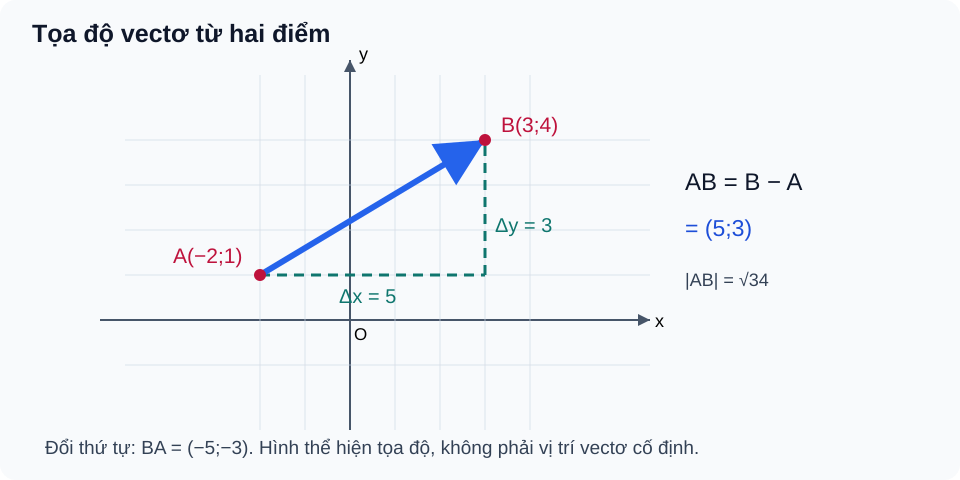

# Bài 10. Vectơ trong mặt phẳng tọa độ

TOÁN 10 · CHƯƠNG IV · KIẾN THỨC SGK KNTT

Học kiến thức và ví dụ, rồi luyện tập theo từng kĩ năng.
<nav class="thpt-r4-lesson-tabs"><a href="../">Chương IV</a><a href="../luyen-tap/">Core và Luyện tập</a><a href="../tu-kiem-tra-chuong/">Tự kiểm tra · chưa kích hoạt</a></nav>

<!-- G10_CHIV_FULL_R04_ALL_BEGIN -->

## Tự khám phá trước công thức

Hãy hiểu bản chất và tự thử trước khi mở đối chiếu. Hoạt động công khai này không tính điểm Mastery hoặc kiểm tra độc lập cuối chương.

<!-- G10_CHIV_R04_BEGIN:THPT-G10-CHIV-TRY16 OUTCOME=G10-B10-VECTOR_COORDS -->

### Vì sao lấy điểm cuối trừ điểm đầu?

**Vì sao cần học:** Trên bản đồ tọa độ, muốn biết bạn đã dịch chuyển bao xa theo Đông–Tây và Bắc–Nam từ A đến B, chỉ cần nhìn sự thay đổi tọa độ.

**Kiến thức cần nhớ trước:** Đã biết trục Ox, Oy và điểm A(xA;yA), B(xB;yB); quy ước đổi theo chiều dương của hai trục. Trạng thái tiền đề: `PREREQUISITE_CONFIRMED/RECALL_ONLY` từ phần định nghĩa tại bài này hoặc bài SGK trước; đoạn này nhắc lại đủ để không bắt học sinh chuyển trang.

**Hiểu bản chất trước công thức:** Độ dời theo trục x là 'x đến − x đi', theo trục y là 'y đến − y đi'. Hai số đó ghép thành tọa độ vectơ \(\overrightarrow{AB}\); điểm đặt có thể khác nhưng cùng cặp độ dời tạo vectơ bằng nhau.

**Đọc hình như thế nào:** Đọc `FIG-G10-B10-01`: chiếu A và B xuống hai trục, lần theo số ô ngang/dọc; chọn đầu B trừ đầu A theo cả hai trục. D5 kế thừa: `FIG-G10-B10-01`, không tạo hình mới, không thay XML/nhãn.

**Chọn phương pháp và giới hạn:** Viết 'cuối trừ đầu' thành hai bước độc lập, đừng lấy luôn tọa độ B. Đổi sang BA thì cả hai thành phần đổi dấu.

**Tự thử trước Core:** Cho A(-3;2), B(2;-1). Tìm tọa độ \(\overrightarrow{AB}\) và \(\overrightarrow{BA}\).

??? question "Em tự mở đối chiếu sau khi đã thử làm"

    **Kết quả:** \(\overrightarrow{AB}=(5;-3)\), \(\overrightarrow{BA}=(-5;3)\).

    **Vì sao:** 2−(−3)=5 và −1−2=−3. Đảo điểm đầu/cuối làm vectơ đối.

    **Đường tự sửa nếu mắc lỗi:** quay lại `HELP-G10-B10-01` (D6 R01), đọc lại mục PED3/PED5 ở trên, sau đó thử `THPT-G10-B10-C01` trong SGK Core/Practice R01. Câu Tự thử này là công khai và không ghi điểm thành thạo; không sử dụng làm kiểm tra độc lập cuối chương.

<!-- G10_CHIV_R04_END:THPT-G10-CHIV-TRY16 -->

<!-- G10_CHIV_R04_BEGIN:THPT-G10-CHIV-TRY17 OUTCOME=G10-B10-OPERATIONS -->

### Tọa độ giữ phép cộng vectơ dễ tính

**Vì sao cần học:** Từ hai lần dịch chuyển đã mô tả bằng (ngang; dọc), ta muốn ghép chúng mà không phải vẽ lại từng mũi tên.

**Kiến thức cần nhớ trước:** Biết cộng hai vectơ theo thành phần ngang/dọc B08, nhân một số B09; cặp số (x;y) biểu diễn hai thành phần theo trục. Trạng thái tiền đề: `PREREQUISITE_CONFIRMED/RECALL_ONLY` từ phần định nghĩa tại bài này hoặc bài SGK trước; đoạn này nhắc lại đủ để không bắt học sinh chuyển trang.

**Hiểu bản chất trước công thức:** Đi thêm 2 đơn vị ngang và −1 dọc rồi tiếp thêm −1 ngang và 3 dọc nghĩa là cộng các độ dời ngang với nhau, dọc với nhau. Vì vậy phép cộng/trừ và nhân số được thực hiện theo từng tọa độ.

**Đọc hình như thế nào:** Đọc hình trục `FIG-G10-B10-01`, theo dõi mỗi thành phần riêng trước khi dựng mũi tên kết quả tổng. D5 kế thừa: `FIG-G10-B10-01`, không tạo hình mới, không thay XML/nhãn.

**Chọn phương pháp và giới hạn:** Chọn đại số theo tọa độ khi đã có cặp số; không cộng chéo x với y, và đặt ngoặc đúng khi trừ một vectơ.

**Tự thử trước Core:** \(\vec u=(2;-1)\), \(\vec v=(-1;3)\). Tính \(2\vec u-\vec v\).

??? question "Em tự mở đối chiếu sau khi đã thử làm"

    **Kết quả:** \((5;-5)\).

    **Vì sao:** 2u=(4;−2); trừ v=(-1;3) nghĩa là (4−(−1);−2−3)=(5;−5).

    **Đường tự sửa nếu mắc lỗi:** quay lại `HELP-G10-B10-01` (D6 R01), đọc lại mục PED3/PED5 ở trên, sau đó thử `THPT-G10-B10-P01` trong SGK Core/Practice R01. Câu Tự thử này là công khai và không ghi điểm thành thạo; không sử dụng làm kiểm tra độc lập cuối chương.

<!-- G10_CHIV_R04_END:THPT-G10-CHIV-TRY17 -->

<!-- G10_CHIV_R04_BEGIN:THPT-G10-CHIV-TRY18 OUTCOME=G10-B10-NORM_DISTANCE -->

### Khoảng cách là độ dài mũi tên, không phải tổng hai ô

**Vì sao cần học:** Đi 3 ô sang Đông và 4 ô lên Bắc có quãng đường theo lưới 7 ô nhưng khoảng cách thẳng chỉ 5 ô.

**Kiến thức cần nhớ trước:** Đã biết tam giác vuông và Pitago; tọa độ vectơ AB=(Δx;Δy) là hai cạnh góc vuông. Trạng thái tiền đề: `PREREQUISITE_CONFIRMED/RECALL_ONLY` từ phần định nghĩa tại bài này hoặc bài SGK trước; đoạn này nhắc lại đủ để không bắt học sinh chuyển trang.

**Hiểu bản chất trước công thức:** Đường nối trực tiếp A–B là cạnh huyền: \(AB=\sqrt{(\Delta x)^2+(\Delta y)^2}\). Đó là độ dài vectơ, luôn không âm; không cộng |Δx|+|Δy| trừ khi đang hỏi đường đi theo lưới.

**Đọc hình như thế nào:** Đọc `FIG-G10-B10-01`, vẽ hình chiếu ngang/dọc từ A tới B để thấy hai chân vuông góc và cạnh huyền AB. D5 kế thừa: `FIG-G10-B10-01`, không tạo hình mới, không thay XML/nhãn.

**Chọn phương pháp và giới hạn:** Dùng Pitago khi hỏi độ dài vectơ/khoảng cách giữa hai điểm, không nhầm với quãng đường đi theo cạnh ô.

**Tự thử trước Core:** Cho A(1;2), B(4;6). Khoảng cách AB là 7 hay 5 đơn vị?

??? question "Em tự mở đối chiếu sau khi đã thử làm"

    **Kết quả:** 5 đơn vị.

    **Vì sao:** AB=(3;4), nên AB=√(3²+4²)=5. 7 là tổng chặng theo hai trục, không phải khoảng cách thẳng.

    **Đường tự sửa nếu mắc lỗi:** quay lại `HELP-G10-B10-01` (D6 R01), đọc lại mục PED3/PED5 ở trên, sau đó thử `THPT-G10-B10-C02` trong SGK Core/Practice R01. Câu Tự thử này là công khai và không ghi điểm thành thạo; không sử dụng làm kiểm tra độc lập cuối chương.

<!-- G10_CHIV_R04_END:THPT-G10-CHIV-TRY18 -->

<!-- G10_CHIV_R04_BEGIN:THPT-G10-CHIV-TRY19 OUTCOME=G10-B10-COLLINEAR_COORDS -->

### Hai cặp số có cùng hướng hình học khi nào?

**Vì sao cần học:** Trong bản đồ, (2 ô Đông,1 ô Bắc) và (6 ô Đông,3 ô Bắc) cùng đường đi nhưng khác độ dài.

**Kiến thức cần nhớ trước:** Đã biết bội vô hướng và điều kiện khác vectơ-không của B09; tọa độ vectơ biểu diễn hai thành phần. Trạng thái tiền đề: `PREREQUISITE_CONFIRMED/RECALL_ONLY` từ phần định nghĩa tại bài này hoặc bài SGK trước; đoạn này nhắc lại đủ để không bắt học sinh chuyển trang.

**Hiểu bản chất trước công thức:** Nếu \(\vec v=k\vec u\) thì cả hai tọa độ đều nhân cùng k, nên hai mũi tên song song. Nếu không có cùng một k cho cả hai thành phần thì khác phương.

**Đọc hình như thế nào:** Trên trục `FIG-G10-B10-01`, so độ dốc của đường mang hai mũi tên, không chỉ so riêng x hoặc riêng y. D5 kế thừa: `FIG-G10-B10-01`, không tạo hình mới, không thay XML/nhãn.

**Chọn phương pháp và giới hạn:** Tìm cùng hệ số k ở cả hai tọa độ; trường hợp một tọa độ bằng 0 cần đối chiếu trực tiếp, không chia cho số 0.

**Tự thử trước Core:** Với \(\vec u=(2;1)\), \(\vec v=(6;3)\), \(\vec w=(6;4)\). Vectơ nào cùng phương với u (biết cả ba đều khác 0)?

??? question "Em tự mở đối chiếu sau khi đã thử làm"

    **Kết quả:** Chỉ \(\vec v\) cùng phương với \(\vec u\), vì \(\vec v=3\vec u\); \(\vec w\) không cùng phương.

    **Vì sao:** Cặp (6,4) có tỉ số x=3 nhưng y=4, không thể tìm cùng k cho hai tọa độ.

    **Đường tự sửa nếu mắc lỗi:** quay lại `HELP-G10-B10-02` (D6 R01), đọc lại mục PED3/PED5 ở trên, sau đó thử `THPT-G10-B10-P05` trong SGK Core/Practice R01. Câu Tự thử này là công khai và không ghi điểm thành thạo; không sử dụng làm kiểm tra độc lập cuối chương.

<!-- G10_CHIV_R04_END:THPT-G10-CHIV-TRY19 -->

<!-- G10_CHIV_R04_BEGIN:THPT-G10-CHIV-TRY20 OUTCOME=G10-B10-MIDPOINT_CENTROID -->

### Tọa độ điểm cân bằng là trung bình các đỉnh

**Vì sao cần học:** Trung điểm đoạn thẳng nằm cân giữa hai đầu, trọng tâm tam giác nằm cân giữa ba đỉnh khi xét tọa độ theo mỗi trục.

**Kiến thức cần nhớ trước:** Đã biết trung điểm M của AB và trọng tâm G của tam giác; phép cộng vectơ và số trung bình cộng. Trạng thái tiền đề: `PREREQUISITE_CONFIRMED/RECALL_ONLY` từ phần định nghĩa tại bài này hoặc bài SGK trước; đoạn này nhắc lại đủ để không bắt học sinh chuyển trang.

**Hiểu bản chất trước công thức:** Vì trung điểm có vectơ MA+MB=0, tọa độ trung bình của A,B cho M. Tương tự GA+GB+GC=0 cho trọng tâm, nên tọa độ G là trung bình của ba tọa độ đỉnh.

**Đọc hình như thế nào:** Trong `FIG-G10-B10-01`, đọc vị trí các điểm và thử đối chiếu trung bình x, trung bình y, không lấy trung bình x với y. D5 kế thừa: `FIG-G10-B10-01`, không tạo hình mới, không thay XML/nhãn.

**Chọn phương pháp và giới hạn:** Dùng trung bình tọa độ theo từng trục cho M hoặc G, kiểm G nằm trong tam giác và M nằm trên AB; không nhầm chia 2 và chia 3.

**Tự thử trước Core:** Cho A(-2;4), B(4;0), C(1;5). Tính trung điểm M của AB và trọng tâm G của ABC.

??? question "Em tự mở đối chiếu sau khi đã thử làm"

    **Kết quả:** \(M=(1;2)\), \(G=(1;3)\).

    **Vì sao:** M: ((−2+4)/2;(4+0)/2)=(1;2); G: ((−2+4+1)/3;(4+0+5)/3)=(1;3).

    **Đường tự sửa nếu mắc lỗi:** quay lại `HELP-G10-B10-02` (D6 R01), đọc lại mục PED3/PED5 ở trên, sau đó thử `THPT-G10-B10-P04` trong SGK Core/Practice R01. Câu Tự thử này là công khai và không ghi điểm thành thạo; không sử dụng làm kiểm tra độc lập cuối chương.

<!-- G10_CHIV_R04_END:THPT-G10-CHIV-TRY20 -->

<!-- G10_CHIV_FULL_R04_ALL_END -->

## 1. Kiến thức SGK

### 1. Hệ tọa độ và vectơ

 Trong hệ tọa độ vuông góc $Oxy$ với hai vectơ đơn vị $\vec i=(1;0)$ và $\vec j=(0;1)$, vectơ $\vec u=(u_x;u_y)=u_x\vec i+u_y\vec j$. Nếu $A(x_A;y_A)$, $B(x_B;y_B)$, thì

\[
\overrightarrow{AB}=(x_B-x_A;\ y_B-y_A).
\]

**Lưu ý:** Tọa độ vectơ $\overrightarrow{AB}$ **không phải** tọa độ điểm $B$ trừ khi $A=O$.

### 2. Các phép toán tọa độ

 Với $\vec u=(a;b)$, $\vec v=(c;d)$, $t\in\mathbb R$:

\[
\vec u+\vec v=(a+c;b+d),\quad \vec u-\vec v=(a-c;b-d),\quad t\vec u=(ta;tb).
\]

$|\vec u|=\sqrt{a^2+b^2}$, $AB=\sqrt{(x_B-x_A)^2+(y_B-y_A)^2}$.

**Điều kiện cùng phương:** Hai vectơ **khác không** cùng phương khi $ad-bc=0$; với vectơ không cần nêu quy ước KNTT riêng.

### 3. Tọa độ trung điểm và trọng tâm

 $M$ là trung điểm $AB$ khi

\[
M\left(\frac{x_A+x_B}{2};\frac{y_A+y_B}{2}\right).
\]

Trọng tâm tam giác $ABC$ là

\[
G\left(\frac{x_A+x_B+x_C}{3};\frac{y_A+y_B+y_C}{3}\right).
\]

**Điều kiện:** Chỉ dùng công thức trọng tâm khi $ABC$ là tam giác không suy biến. Kiểm tra lại bằng $\overrightarrow{GA}+\overrightarrow{GB}+\overrightarrow{GC}=\vec0$.

### 4. Ứng dụng

 Định vị/chuyển động trong bản đồ Oxy phải xác định trục, đơn vị và phân biệt độ dài đường đi thực tế với khoảng cách thẳng giữa hai vị trí.

## 2. Ví dụ

### Ví dụ 1. Tọa độ vectơ từ hai điểm

**Đề:** Cho $A(-1;2)$, $B(3;5)$. Tìm $\overrightarrow{AB}$ và $AB$.  
**Giải:** $\overrightarrow{AB}=(3-(-1);5-2)=(4;3)$, do đó $AB=\sqrt{4^2+3^2}=5$.  
**Tự kiểm:** $\overrightarrow{BA}=(-4;-3)$, không phải $(4;3)$.

### Ví dụ 2. Tính tọa độ biểu thức vectơ

**Đề:** Cho $\vec u=(2;-1)$, $\vec v=(-3;4)$. Tính $2\vec u-\vec v$.  
**Giải:** $2\vec u=(4;-2)$, vậy $2\vec u-\vec v=(4-(-3);-2-4)=(7;-6)$.  
**Tự kiểm:** Nhân hệ số lên cả hai thành phần.

### Ví dụ 3. Tọa độ trung điểm và trọng tâm

**Đề:** Cho $A(1;3)$, $B(5;-1)$, $C(-2;4)$. Tìm trung điểm $M$ của $AB$ và trọng tâm $G$ của tam giác.  
**Giải:** $M=(3;1)$; $G=((1+5-2)/3;(3-1+4)/3)=(4/3;2)$.  
**Tự kiểm:** Trọng tâm chia cho 3, không phải 2.

## 3. Hình minh họa

<figure class="thpt-r4-plot thpt-r4-probability-figure"><figcaption>Tọa độ vectơ AB bằng tọa độ điểm cuối trừ điểm đầu.</figcaption></figure>

## 4. Tự khắc phục lỗi thường gặp

Lấy nhầm tọa độ B làm tọa độ AB
<ul><li>Điểm nghẽn: Quên lấy tọa độ cuối trừ đầu.</li><li>Bản chất cần sửa: Tọa độ AB = B−A, không phải B.</li><li>Quy trình 5 bước: 1. Gạch điểm đầu A/cuối B. 2. Trừ hoành độ, tung độ. 3. Đảo chiều để tự kiểm BA=−AB. 4. Kiểm bằng độ dài. 5. Làm B10-P02.</li><li>Liên kết item có sẵn: B10-C01, B10-P02. Không clone câu hoặc giải vào HELP_ID.</li><li>Assessment safety: hỗ trợ chỉ tại Knowledge/Practice, không hiển thị trong phiên Tự kiểm tra trước Final Submit.</li></ul>
<a href="../luyen-tap/">Quay lại luyện tập</a>

Nhầm công thức trung điểm/trọng tâm và kiểm cùng phương
<ul><li>Điểm nghẽn: Chia 2 khi có ba đỉnh hoặc bỏ điều kiện vectơ khác không.</li><li>Bản chất cần sửa: Trung điểm lấy trung bình 2 điểm, trọng tâm 3 đỉnh.</li><li>Quy trình 5 bước: 1. Đếm số điểm. 2. Viết công thức hoành/tung. 3. Kiểm tổng GA+GB+GC. 4. Xét vectơ không riêng. 5. Luyện B10-P04/P05.</li><li>Liên kết item có sẵn: B10-P03, B10-P04, B10-P05. Không clone câu hoặc giải vào HELP_ID.</li><li>Assessment safety: hỗ trợ chỉ tại Knowledge/Practice, không hiển thị trong phiên Tự kiểm tra trước Final Submit.</li></ul>
<a href="../luyen-tap/">Quay lại luyện tập</a>

## 5. Tiếp tục

[Core và Luyện tập Bài 10](luyen-tap.md) · [Bài tự luận Chương IV](../../thu-vien/tu-luan-chuong-iv-b09-b11.md)
