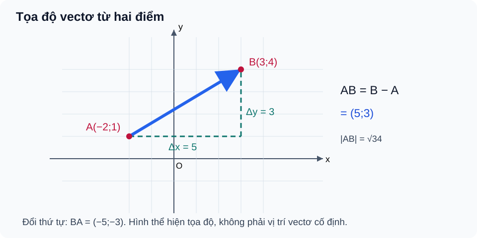
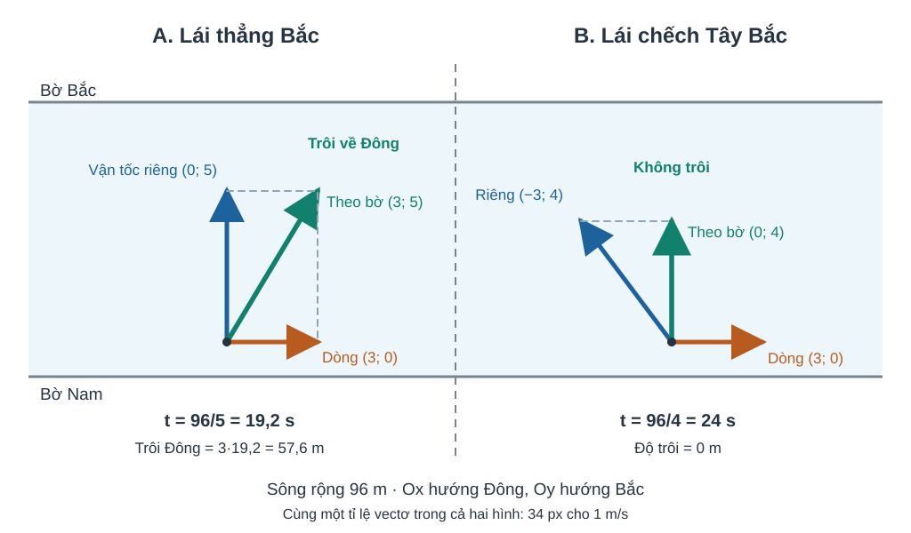

# Bài 10. Vectơ trong mặt phẳng tọa độ

TOÁN 10 · CHƯƠNG IV · KIẾN THỨC SGK KNTT

Hiểu vì sao vectơ có hai tọa độ, tự thử trước khi đối chiếu và luyện tập theo từng kĩ năng.

=== "Khám phá kiến thức"

    ### 1.1. Cùng tìm hiểu

    **Vì sao cần học?** Trên bản đồ dự báo bão, biết một vị trí rồi mới biết vị trí sau đó không chỉ cần một độ dài: ta cần biết đã dịch chuyển bao nhiêu về Đông–Tây và bao nhiêu về Bắc–Nam. Hai con số ấy mô tả **vectơ độ dời**, không phải hai tọa độ của vị trí cuối.

    Từ Bài 8 và Bài 9, em đã biết ghép vectơ và nhân vectơ với số. Trong hệ trục vuông góc \(Oxy\), lấy \(\vec i\) là một bước đơn vị theo \(Ox\), \(\vec j\) là một bước đơn vị theo \(Oy\). Mỗi vectơ \(\vec u\) đều có thể viết **duy nhất** dưới dạng \(\vec u=x\vec i+y\vec j\). Vì hai hướng trục không cùng phương nên cặp \((x;y)\) chính là cách ghi ngắn gọn hai thành phần của vectơ.

    Ví dụ ngay trong hình bên dưới: từ \(A(-2;1)\) tới \(B(3;4)\), mũi tên đi \(5\) đơn vị sang phải và \(3\) đơn vị lên trên. Vì thế \(\overrightarrow{AB}=(5;3)\); **đừng nhầm với tọa độ điểm** \(B(3;4)\). Dời cả hai điểm sang vị trí khác nhưng giữ nguyên độ dời thì tọa độ vectơ không đổi.

    ### 1.2. Ví dụ trực quan

    <figure class="thpt-r4-plot thpt-r4-probability-figure"><picture><source media="(max-width: 600px)" srcset="../../../../assets/images/thpt/THPT_G10_B10_COORDINATES_MOBILE_D5_R01.svg"></picture><figcaption>Đọc hình trước công thức: từ đuôi mũi tên ở A tới đầu mũi tên tại B, đo mức thay đổi hoành độ và tung độ. Đổi chiều sang BA thì cả hai dấu đổi ngược.</figcaption></figure>

    **Đọc hình:** hãy xác định đuôi A, đầu B, hướng dọc trục hoành và dọc trục tung. Tọa độ của vectơ là hai **độ thay đổi có dấu**, không phải độ dài theo hai trục (độ dài không âm).

    

    **Em vận dụng.** Cho A(-3;2), B(2;-1). Tìm tọa độ \(\overrightarrow{AB}\) và \(\overrightarrow{BA}\).

    ??? question "Em tự mở đối chiếu sau khi đã thử làm"

        **Kết quả:** \(\overrightarrow{AB}=(5;-3)\), \(\overrightarrow{BA}=(-5;3)\).

        **Vì sao:** 2−(−3)=5 và −1−2=−3. Đảo điểm đầu/cuối làm vectơ đối.

    
    

    ??? tip "Kiểm lỗi"

        
<strong>Lỗi thường gặp:</strong> Với \(A(-3;2)\), \(B(2;-1)\), một học sinh ghi \(\overrightarrow{AB}=(2;-1)\) vì nhìn ngay tọa độ B. Kết quả sai: đó là tọa độ <strong>điểm B</strong>, không phải độ dời từ A đến B.

        
<strong>Vì sao sai?</strong> Vectơ \(\overrightarrow{AB}=\overrightarrow{OB}-\overrightarrow{OA}\); khi A khác O, không thể bỏ đi thành phần xuất phát.

        <ol><li><strong>Đánh dấu:</strong> A là điểm đầu, B là điểm cuối.</li><li><strong>Sửa phép tính:</strong> \(\overrightarrow{AB}=(2-(-3);-1-2)=(5;-3)\).</li><li><strong>Tự kiểm:</strong> \(\overrightarrow{BA}=(-5;3)\), là vectơ đối của \(\overrightarrow{AB}\).</li></ol>

        
<strong>Ôn và luyện lại:</strong> Mở lại hình tọa độ ở tab Khám phá, tự làm một câu tìm điểm cuối từ vectơ trong <a href="../luyen-tap/">Core và Luyện tập</a>. Đừng xem lời giải trước khi thử.

    **Từ trực quan đến tính toán:** khi ghép hai mũi tên, hoành độ chỉ cộng với hoành độ, tung độ chỉ cộng với tung độ. Nếu trừ một vectơ, dấu trừ tác động lên cả hai thành phần.

    

    **Em vận dụng.** \(\vec u=(2;-1)\), \(\vec v=(-1;3)\). Tính \(2\vec u-\vec v\).

    ??? question "Em tự mở đối chiếu sau khi đã thử làm"

        **Kết quả:** \((5;-5)\).

        **Vì sao:** \(2\vec u=(4;-2)\); trừ \(\vec v=(-1;3)\) nghĩa là \((4-(-1);-2-3)=(5;-5)\).

    **Kiểm lỗi dùng chung:** [Xem hướng dẫn tự sửa](#HELP-G10-B10-01).
    **Một độ dài, không phải hai chặng:** nếu đi \(3\) ô sang Đông rồi \(4\) ô lên Bắc thì đường đi theo lưới dài \(7\) ô, nhưng khoảng cách nối đầu–cuối là cạnh huyền tam giác vuông, chỉ dài \(5\) ô. Định lí Pythagore giải thích vì sao **độ dài vectơ** cần căn của tổng bình phương hai thành phần.

    

    **Em vận dụng.** Cho A(1;2), B(4;6). Khoảng cách AB là 7 hay 5 đơn vị?

    ??? question "Em tự mở đối chiếu sau khi đã thử làm"

        **Kết quả:** 5 đơn vị.

        **Vì sao:** \(\overrightarrow{AB}=(3;4)\), nên \(AB=\sqrt{3^2+4^2}=5\). 7 là tổng chặng theo hai trục, không phải khoảng cách thẳng.

    **Kiểm lỗi dùng chung:** [Xem hướng dẫn tự sửa](#HELP-G10-B10-01).
    **Nhìn hai thành phần để xét hướng:** \((2;1)\) và \((6;3)\) có cùng một hệ số nhân \(3\) ở cả hai tọa độ. Nếu một thành phần không cùng tỉ lệ, hai vectơ khác không không cùng phương. Không bao giờ chia cho một thành phần bằng \(0\) để “tìm tỉ số”.

    

    **Em vận dụng.** Với \(\vec u=(2;1)\), \(\vec v=(6;3)\), \(\vec w=(6;4)\). Vectơ nào cùng phương với u (biết cả ba đều khác 0)?

    ??? question "Em tự mở đối chiếu sau khi đã thử làm"

        **Kết quả:** Chỉ \(\vec v\) cùng phương với \(\vec u\), vì \(\vec v=3\vec u\); \(\vec w\) không cùng phương.

        **Vì sao:** Cặp (6,4) có tỉ số x=3 nhưng y=4, không thể tìm cùng k cho hai tọa độ.

    **Kiểm lỗi dùng chung:** [Xem hướng dẫn tự sửa](#HELP-G10-B10-02).
    **Trung bình tọa độ có ý nghĩa gì?** Trung điểm cân bằng hai đầu mút; trọng tâm tam giác cân bằng ba đỉnh. Ta lấy trung bình **riêng từng trục** chứ không lấy trung bình độ dài hay lẫn các trục.

    

    **Em vận dụng.** Cho A(-2;4), B(4;0), C(1;5). Tính trung điểm M của AB và trọng tâm G của ABC.

    ??? question "Em tự mở đối chiếu sau khi đã thử làm"

        **Kết quả:** \(M=(1;2)\), \(G=(1;3)\).

        **Vì sao:** M: ((−2+4)/2;(4+0)/2)=(1;2); G: ((−2+4+1)/3;(4+0+5)/3)=(1;3).

    
    

    ??? tip "Kiểm lỗi"

        
<strong>Lỗi thường gặp 1:</strong> Với \(A(-2;4)\), \(B(4;0)\), \(C(1;5)\), học sinh nhầm trọng tâm với trung điểm \(AB\) và ghi \(G(1;2)\). Đúng phải là \(G(1;3)\) vì tọa độ trọng tâm là trung bình <strong>ba đỉnh</strong>, không chỉ hai đỉnh.

        
<strong>Lỗi thường gặp 2:</strong> Trong Vận dụng, \(\vec u=(2;1)\) và \(\vec w=(6;4)\) không cùng phương vì \(2\cdot4-1\cdot6=2\ne0\), dù hoành độ đều dương. Ngược lại, \(\vec v=(6;3)=3\vec u\) mới cùng phương với \(\vec u\).

        
<strong>Vì sao sai?</strong> Công thức trọng tâm khác trung điểm về số điểm lấy trung bình; còn cùng phương đòi hỏi <strong>một hệ số nhân chung</strong> cho cả hai thành phần. Khi gặp thành phần \(0\), không lập tỉ số có mẫu \(0\).

        
<strong>Sửa và tự kiểm:</strong> Trọng tâm chia \(3\) cho cả hoành và tung; soát lại bằng \(\overrightarrow{GA}+\overrightarrow{GB}+\overrightarrow{GC}=\vec0\). Với cùng phương, tính \(ad-bc\) hoặc kiểm trực tiếp \(\vec v=t\vec u\).

        
<strong>Ôn và luyện lại:</strong> Tự thử một bài tìm trung điểm, một bài trọng tâm và một bài kiểm cùng phương trong <a href="../luyen-tap/">Luyện tập</a>, không dùng bài đã xem lời giải để tính là kiểm tra độc lập.

    **Ứng dụng mở rộng — dòng nước:** có hai vận tốc khác nhau: vận tốc ca nô so với nước (hướng mũi lái) và vận tốc thực so với bờ (hướng di chuyển). Vectơ vận tốc thực là **tổng** vectơ vận tốc riêng và vectơ dòng nước. Chọn trục \(Ox\) về Đông, \(Oy\) về Bắc; muốn tính thời gian qua sông phải xem thành phần vận tốc hướng Bắc.

    

    **Vận dụng 6 — tự thử:** Sông rộng \(60\,\mathrm m\), dòng chảy đều \(3\,\mathrm{m/s}\) về Đông. Ca nô chạy \(5\,\mathrm{m/s}\) so với nước, lái thẳng Bắc. Ca nô trôi bao nhiêu mét về Đông khi tới bờ bên kia? Đặt hai thành phần theo trục trước khi tính.

    ??? question "Tự mở đối chiếu sau khi đã thử làm"

        **Kết quả:** Trôi \(36\,\mathrm m\) về Đông.

        **Vì sao:** vận tốc theo bờ \(\vec v_{\mathrm{bờ}}=(3;5)\,\mathrm{m/s}\). Thành phần hướng Bắc \(5\,\mathrm{m/s}\) quyết định thời gian \(t=60/5=12\,\mathrm s\); do đó độ trôi ngang \(3\cdot12=36\,\mathrm m\). Độ lớn vận tốc thực \(\sqrt{34}\,\mathrm{m/s}\) **không phải** thành phần qua sông; không lấy \(60/\sqrt{34}\).

    
    

    ??? tip "Kiểm lỗi"

        
<strong>Lỗi thường gặp:</strong> Sông rộng \(60\,\mathrm m\), ca nô lái thẳng Bắc \(5\,\mathrm{m/s}\) so với nước, dòng chảy Đông \(3\,\mathrm{m/s}\). Một lời giải tính \(t=60/\sqrt{5^2+3^2}\). <strong>Thời gian đó sai.</strong>

        
<strong>Vì sao sai?</strong> \(\sqrt{34}\,\mathrm{m/s}\) là <strong>độ lớn vận tốc theo bờ</strong>, nhưng bề rộng sông chỉ đo theo hướng Bắc. Thành phần hướng Bắc thực tế vẫn là \(5\,\mathrm{m/s}\).

        <ol><li><strong>Xác định trục và hệ quy chiếu:</strong> \(Ox\) Đông, \(Oy\) Bắc; \(\vec v_{\mathrm{bờ}}=\vec v_{\mathrm{riêng}}+\vec v_{\mathrm{dòng}}=(3;5)\,\mathrm{m/s}\).</li><li><strong>Sửa:</strong> \(t=60/5=12\,\mathrm s\), trôi Đông \(3\cdot12=36\,\mathrm m\).</li><li><strong>Thử kiểm:</strong> Nếu dòng nước tăng nhưng mũi thuyền vẫn hướng Bắc với cùng tốc độ riêng, thành phần Bắc không đổi nên thời gian qua sông không đổi (chỉ tăng độ trôi).</li></ol>

        
<strong>Ôn và luyện lại:</strong> Nhắc lại phép cộng vectơ ở Bài 8 và tọa độ theo trục ở Bài 10, rồi thử tự giải một bài ca nô với số liệu khác. Nếu muốn <strong>không trôi</strong>, phải có thành phần vận tốc theo bờ hướng Đông bằng \(0\) và thành phần Bắc <strong>dương</strong>; trường hợp tốc độ dòng không nhỏ hơn tốc độ riêng không thể vừa chống trôi vừa tới bờ đích trong mô hình này.

    ### 1.3. Thuật ngữ, kiến thức và kỹ năng

    **Từ khóa cần phân biệt:** tọa độ điểm là **vị trí**, tọa độ vectơ là **độ thay đổi có hướng**; vectơ đơn vị \(\vec i,\vec j\) xác định hai chiều trục; độ dài vectơ khác tổng quãng đường đi theo lưới; hai vectơ cùng phương cần một hệ số nhân **chung**.

    **Sau bài này:** em biểu diễn được \(\vec u=x\vec i+y\vec j\); tính \(\overrightarrow{AB}\), phép toán, độ dài/khoảng cách, kiểm cùng phương (xét vectơ-không riêng), trung điểm/trọng tâm và dùng tọa độ để diễn giải chuyển động. Nếu nhầm dấu, chuyển sang tab **Lỗi thường gặp** để tự sửa.

=== "Kiến thức SGK"

    ### 2.1. Tọa độ của vectơ

    Trong hệ trục vuông góc \(Oxy\), \(\vec i\) và \(\vec j\) là hai vectơ đơn vị theo chiều dương của hai trục. Phân tích \(\vec u\) theo hai vectơ không cùng phương ấy rồi lấy hai hệ số làm tọa độ của vectơ.

    
<strong>Định nghĩa — Tọa độ của vectơ:</strong> Với mỗi vectơ \(\vec u\), có duy nhất hai số thực \(x,y\) sao cho \(\vec u=x\vec i+y\vec j\). Cặp \((x;y)\) là <strong>tọa độ của vectơ</strong>, viết \(\vec u=(x;y)\). Khi đó \(\vec0=(0;0)\), \(\vec i=(1;0)\), \(\vec j=(0;1)\). Hai vectơ bằng nhau khi và chỉ khi các tọa độ tương ứng bằng nhau.

    **Cách đọc hình từ Bài 9:** vì \(\vec i,\vec j\) không cùng phương, cặp hệ số trên là **duy nhất**. Hai mũi tên đặt ở các vị trí khác nhau vẫn biểu diễn cùng một vectơ nếu có cùng hai độ thay đổi có dấu.

    ### 2.2. Biểu thức tọa độ của các phép toán vectơ

    Nếu \(\vec u=(a;b)\), \(\vec v=(c;d)\), \(t\in\mathbb R\), các phép toán thực hiện trên **hai thành phần tương ứng**, không cộng chéo hoành độ và tung độ.

    
<strong>Quy tắc — Phép toán tọa độ:</strong>
    
\(\displaystyle \vec u+\vec v=(a+c;b+d)\)

    
\(\displaystyle \vec u-\vec v=(a-c;b-d)\)

    
\(\displaystyle t\vec u=(ta;tb).\)

    Suy ra \(\overrightarrow{AB}=(x_B-x_A;y_B-y_A)\) với \(A(x_A;y_A)\), \(B(x_B;y_B)\). Khi đổi chiều, \(\overrightarrow{BA}=-\overrightarrow{AB}\).

    **Tại sao lại “cuối trừ đầu”?** Theo Bài 8, \(\overrightarrow{AB}=\overrightarrow{OB}-\overrightarrow{OA}\). Hai vectơ chung gốc \(O\) có tọa độ lần lượt là tọa độ \(B\) và \(A\); vì vậy hiệu của chúng cho ra hai độ dời. Không lấy luôn tọa độ \(B\) nếu \(A\ne O\).

    
<strong>Công thức cần sử dụng — Độ dài và khoảng cách:</strong> Từ định lí Pythagore, với \(\vec u=(a;b)\) và \(A(x_A;y_A),B(x_B;y_B)\):
    
\(\displaystyle |\vec u|=\sqrt{a^2+b^2}\)

    
\(\displaystyle AB=\sqrt{(x_B-x_A)^2+(y_B-y_A)^2}.\)

    Độ dài luôn không âm; kết quả bằng \(0\) đúng khi vectơ là \(\vec0\) hoặc hai điểm trùng nhau.

    
<strong>Nhận xét — Điều kiện cùng phương bằng tọa độ:</strong> Với \(\vec u=(a;b)\ne\vec0\), \(\vec v=(c;d)\) cùng phương với \(\vec u\) khi và chỉ khi có số thực \(t\) sao cho \((c;d)=(ta;tb)\). Tương đương \(ad-bc=0\). Nếu hai vectơ đều khác không thì \(t>0\) cho cùng hướng, \(t<0\) cho ngược hướng. Trường hợp vectơ-không phải xét theo quy ước SGK, không chia cho tọa độ bằng \(0\).

    **Vì sao điều kiện \(ad-bc=0\) có ích?** Khi một tọa độ bằng \(0\), lập tỉ số \(c/a\) hoặc \(d/b\) có thể vô nghĩa. Phép kiểm \(ad-bc\) chỉ dùng nhân và trừ, không có mẫu số bằng \(0\). Với \(\vec0\), việc nói “hướng mũi tên” cần tách khỏi quy ước cùng phương trong SGK.

    
<strong>Hệ quả hình học — Trung điểm và trọng tâm:</strong> Nếu \(M\) là trung điểm \(AB\), \(G\) là trọng tâm tam giác \(ABC\) (ba đỉnh không thẳng hàng), thì
    
\(\displaystyle M\left(\frac{x_A+x_B}{2};\frac{y_A+y_B}{2}\right)\)

    
\(\displaystyle G\left(\frac{x_A+x_B+x_C}{3};\frac{y_A+y_B+y_C}{3}\right).\)

    Công thức là hệ quả của các đẳng thức vectơ trung điểm và \(\overrightarrow{GA}+\overrightarrow{GB}+\overrightarrow{GC}=\vec0\), không phải hai mẹo ghi nhớ không liên quan.

    
<strong>Kiến thức cần nhớ — Bài 10:</strong> Vectơ có tọa độ là hai hệ số duy nhất theo \(\vec i,\vec j\); lấy <strong>cuối trừ đầu</strong> để tìm \(\overrightarrow{AB}\); cộng/trừ/nhân số theo từng tọa độ; dùng Pythagore để tính độ dài; kiểm cùng phương với cùng một hệ số hoặc \(ad-bc=0\); chỉ dùng trung điểm/trọng tâm khi có đủ giả thiết. Trong ứng dụng chuyển động, luôn ghi rõ trục, đơn vị và loại vận tốc.

=== "Ví dụ"

    Trước mỗi lời giải, tự chỉ ra **dữ kiện → cần tìm → chọn quy tắc nào và vì sao**. Sau đó soát điều kiện và chiều mũi tên; không lấy một lời giải đã xem làm chứng cứ tự kiểm tra độc lập.

    ### 3.1. Ví dụ 1 — Tọa độ vectơ và khoảng cách hai điểm

    **Đề:** Cho \(A(-1;2)\), \(B(3;5)\). Tìm \(\overrightarrow{AB}\), \(AB\).

    **Phân tích:** Có hai điểm đầu–cuối nên trước hết chọn quy tắc \(\overrightarrow{AB}=\overrightarrow{OB}-\overrightarrow{OA}\); sau khi có tọa độ vectơ mới dùng Pythagore để tìm khoảng cách thẳng, không cộng hai độ thay đổi.

    **Giải:** \(\overrightarrow{AB}=(3-(-1);5-2)=(4;3)\). Do đó \(AB=\sqrt{4^2+3^2}=5\).

    **Kiểm lại:** \(\overrightarrow{BA}=(-4;-3)\). Hai vectơ đối nhau nhưng có cùng độ dài \(5\). Công thức tọa độ điểm cuối trừ điểm đầu chỉ đổi thành tọa độ \(B\) khi \(A=O\).

    ### 3.2. Ví dụ 2 — Phép toán vectơ và xét cùng phương

    **Đề:** Cho \(\vec u=(2;-1)\), \(\vec v=(-3;4)\). Tính \(2\vec u-\vec v\). Vectơ kết quả có cùng phương với \(\vec u\) không?

    **Phân tích:** Dùng phép toán theo từng tọa độ; khi xét cùng phương, kiểm hai thành phần có cùng một hệ số thay vì nhìn riêng một tọa độ.

    **Giải:** \(2\vec u=(4;-2)\), nên \(2\vec u-\vec v=(4-(-3);-2-4)=(7;-6)\). Với \(\vec w=(7;-6)\), ta có \(2\cdot(-6)-(-1)\cdot7=-5\ne0\), do đó \(\vec w\) không cùng phương với \(\vec u\).

    **Kiểm lại:** Nếu bỏ ngoặc khi trừ \(-3\), em dễ ra \((1;-6)\), sai ở hoành độ. Phép kiểm định thức tránh chia cho một thành phần có thể bằng \(0\).

    ### 3.3. Ví dụ 3 — Trung điểm và trọng tâm có giả thiết

    **Đề:** Cho tam giác \(A(1;3)\), \(B(5;-1)\), \(C(-2;4)\). Tìm trung điểm \(M\) của \(AB\) và trọng tâm \(G\) của tam giác.

    **Phân tích:** Trung điểm lấy trung bình **hai** tọa độ theo từng trục; trọng tâm lấy trung bình **ba** tọa độ của ba đỉnh. Ba điểm không thẳng hàng nên có một tam giác và trọng tâm hình học xác định.

    **Giải:** \(M=((1+5)/2;(3-1)/2)=(3;1)\). \(G=((1+5-2)/3;(3-1+4)/3)=(4/3;2)\).

    **Kiểm lại:** \(M\) nằm giữa A, B; \(\overrightarrow{GA}+\overrightarrow{GB}+\overrightarrow{GC}=\vec0\) theo từng tọa độ. Không dùng mẫu \(2\) cho trọng tâm.

    ### 3.4. Ví dụ 4 — Qua sông: tổng vectơ vận tốc và điều kiện không trôi

    **Đề:** Sông rộng \(96\,\mathrm m\), nước chảy đều \(3\,\mathrm{m/s}\) về Đông. Ca nô chạy với tốc độ riêng \(5\,\mathrm{m/s}\) so với nước. So sánh việc (a) lái thẳng Bắc và (b) lái chếch Tây Bắc để cập đúng điểm đối diện. Giả sử dòng chảy và tốc độ riêng không đổi, hai bờ song song.

    **Phân tích:** Lấy \(Ox\) hướng Đông, \(Oy\) hướng Bắc. Vận tốc theo bờ là **tổng vectơ** \(\vec v_{\mathrm{bờ}}=\vec v_{\mathrm{riêng}}+\vec v_{\mathrm{dòng}}\). Thời gian vượt sông bằng \(96\) chia cho **thành phần Bắc dương** của vận tốc theo bờ. Không lấy \(96/|\vec v_{\mathrm{bờ}}|\) khi vận tốc có thành phần dọc bờ.

    **Giải:** (a) \(\vec v_{\mathrm{riêng}}=(0;5)\), \(\vec v_{\mathrm{dòng}}=(3;0)\), nên \(\vec v_{\mathrm{bờ}}=(3;5)\,\mathrm{m/s}\). Thời gian qua sông \(t=96/5=19{,}2\,\mathrm s\); độ trôi Đông \(3\cdot19{,}2=57{,}6\,\mathrm m\).

    (b) Muốn không trôi phải có \(\vec v_{\mathrm{bờ},x}=0\), tức thành phần vận tốc riêng theo trục Ox (chiều dương hướng Đông) bằng \(-3\) m/s, tức 3 m/s về phía Tây. Vì tốc độ riêng bằng \(5\), thành phần Bắc cần dương:
    
\(\displaystyle v_{\mathrm{riêng},y}=\sqrt{5^2-3^2}=4\,\mathrm{m/s}.\)

    Do đó \(\vec v_{\mathrm{riêng}}=(-3;4)\), \(\vec v_{\mathrm{bờ}}=(0;4)\,\mathrm{m/s}\); thời gian qua sông \(96/4=24\,\mathrm s\), không trôi sang Đông.

    **Kiểm lại và giới hạn:** \(3^2+4^2=5^2\) đúng tốc độ riêng; chọn \(-4\) làm thành phần Bắc sẽ đi xa bờ cần đến. Muốn vừa không trôi vừa đi tới bờ đích phải có tốc độ dòng **nhỏ hơn** tốc độ riêng. Không dùng định lí Pythagore để thay cho bước cộng vectơ vận tốc tương đối.

    <figure class="thpt-r4-plot thpt-r4-probability-figure"><picture><source media="(max-width: 600px)" srcset="../../../../assets/images/thpt/THPT_G10_B10_RIVER_VELOCITY_MOBILE_D5_R01.svg"></picture><figcaption><strong>Đọc hình theo đúng dữ kiện Ví dụ 4:</strong> Sông rộng \(96\,\mathrm m\), dòng Đông \(3\,\mathrm{m/s}\), tốc độ riêng \(5\,\mathrm{m/s}\). Mũi tên xanh cho vận tốc riêng, cam cho dòng, lục cho vận tốc theo bờ; tỉ lệ chiều dài vectơ giữ nhất quán giữa hai tình huống. Thời gian dùng <strong>thành phần Bắc</strong>, không dùng độ lớn của mũi tên chéo.</figcaption></figure>

=== "Lỗi thường gặp"

    **Học tiếp:** [Core và Luyện tập](luyen-tap.md) · [Tự kiểm tra cuối chương](tu-kiem-tra-chuong.md).

    
Nguồn toán học: SGK Toán 10 Kết nối tri thức với cuộc sống, tập 1, Bài 10 (trang in 59–65); SBT dùng để tham khảo dạng bài, không thay thế SGK. Phần ví dụ và giải thích do SLM biên soạn phục vụ tự học.

