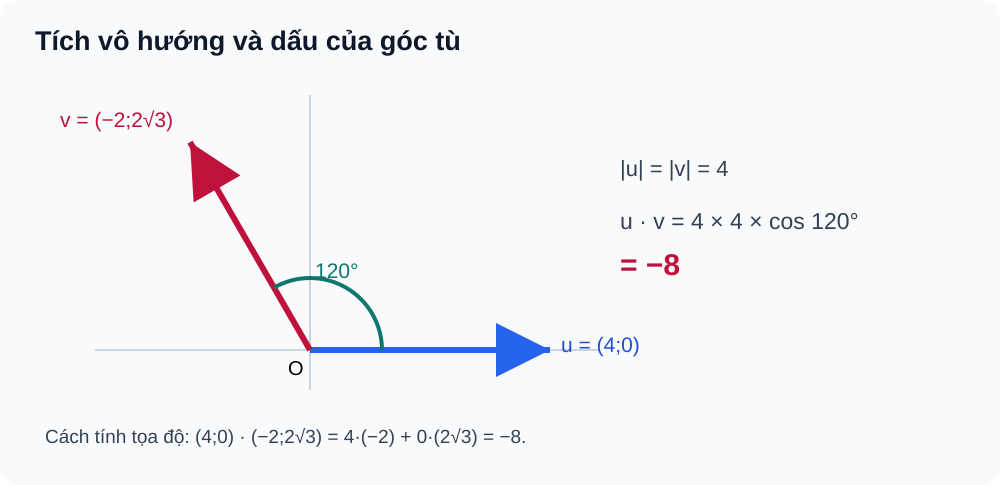
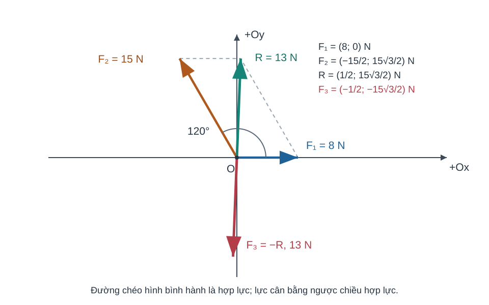

# Bài 11. Tích vô hướng của hai vectơ

TOÁN 10 · CHƯƠNG IV · KIẾN THỨC SGK KNTT

Học kiến thức và ví dụ, rồi luyện tập theo từng kĩ năng.
<nav class="thpt-r4-lesson-tabs"><a href="../">Chương IV</a><a href="../luyen-tap/">Core và Luyện tập</a><a href="../tu-kiem-tra-chuong/">Tự kiểm tra · chưa kích hoạt</a></nav>

<!-- G10_CHIV_FULL_R04_ALL_BEGIN -->

## Tự khám phá trước công thức

Hãy hiểu bản chất và tự thử trước khi mở đối chiếu. Hoạt động công khai này không tính điểm Mastery hoặc kiểm tra độc lập cuối chương.

<!-- G10_CHIV_R04_BEGIN:THPT-G10-CHIV-TRY21 OUTCOME=G10-B11-GEOMETRIC_DOT -->

### Tích vô hướng mô tả mức độ cùng hướng

**Vì sao cần học:** Một lực tác dụng dọc hướng di chuyển có ích hơn lực kéo vuông góc; lực ngược chiều chuyển động có thể gây công âm.

**Kiến thức cần nhớ trước:** Nhớ độ dài vectơ, góc giữa hai vectơ khác không thuộc 0°–180° và cos góc nhọn/vuông/tù. Trạng thái tiền đề: `PREREQUISITE_CONFIRMED/RECALL_ONLY` từ phần định nghĩa tại bài này hoặc bài SGK trước; đoạn này nhắc lại đủ để không bắt học sinh chuyển trang.

**Hiểu bản chất trước công thức:** Tích vô hướng đo tích hai độ lớn có xét thành phần cùng hướng bằng cos: \(\vec u\cdot\vec v=|\vec u||\vec v|\cos\theta\). Nếu vuông góc tích 0, nếu ngược hướng tích âm; góc chỉ định nghĩa khi cả hai khác 0.

**Đọc hình như thế nào:** Đọc `FIG-G10-B11-01`: đặt hai vectơ cùng gốc để đọc góc đúng giữa mũi tên; nhìn góc tù cho dấu cos âm, không đổi thành góc nhọn bổ sung. D5 kế thừa: `FIG-G10-B11-01`, không tạo hình mới, không thay XML/nhãn.

**Chọn phương pháp và giới hạn:** Chọn định nghĩa hình học nếu biết hai độ dài và góc giữa vectơ; nếu một vectơ bằng 0, tích là 0 theo đại số nhưng không gán góc thường.

**Tự thử trước Core:** Cho \(|\vec u|=2\), \(|\vec v|=3\), góc giữa hai vectơ là 120°. Tích vô hướng âm hay dương, bằng bao nhiêu?

??? question "Em tự mở đối chiếu sau khi đã thử làm"

    **Kết quả:** \(\vec u\cdot\vec v=2\cdot3\cdot\cos120^\circ=-3\).

    **Vì sao:** Cos120°=−1/2 nên tích âm; không thể dùng cos60° vì đây là góc giữa hai vectơ đang hướng xa nhau.

    **Đường tự sửa nếu mắc lỗi:** quay lại `HELP-G10-B11-02` (D6 R01), đọc lại mục PED3/PED5 ở trên, sau đó thử `THPT-G10-B11-P01` trong SGK Core/Practice R01. Câu Tự thử này là công khai và không ghi điểm thành thạo; không sử dụng làm kiểm tra độc lập cuối chương.

<!-- G10_CHIV_R04_END:THPT-G10-CHIV-TRY21 -->

<!-- G10_CHIV_R04_BEGIN:THPT-G10-CHIV-TRY22 OUTCOME=G10-B11-COORDINATE_DOT -->

### Tại sao tích vô hướng có thể tính bằng hai cặp số?

**Vì sao cần học:** Trong bản đồ Oxy, biết hai tọa độ vectơ có thể suy mức độ cùng hướng mà không cần đo góc.

**Kiến thức cần nhớ trước:** Đã biết vectơ đơn vị \(\vec i,\vec j\) vuông góc, \(\vec u=u_x\vec i+u_y\vec j\) và tính chất phân phối. Trạng thái tiền đề: `PREREQUISITE_CONFIRMED/RECALL_ONLY` từ phần định nghĩa tại bài này hoặc bài SGK trước; đoạn này nhắc lại đủ để không bắt học sinh chuyển trang.

**Hiểu bản chất trước công thức:** Vì \(\vec i\cdot\vec i=1\), \(\vec j\cdot\vec j=1\), \(\vec i\cdot\vec j=0\), khi nhân phân phối chỉ còn \(u_xv_x+u_yv_y\). Đây là công thức tọa độ của cùng tích vô hướng hình học.

**Đọc hình như thế nào:** Đọc `FIG-G10-B11-01` cho hướng, góc; kết hợp hình trục B10 nếu cần tách thành phần trước khi nhân. D5 kế thừa: `FIG-G10-B11-01`, không tạo hình mới, không thay XML/nhãn.

**Chọn phương pháp và giới hạn:** Khi có tọa độ, nhân các thành phần cùng trục rồi cộng; không nhân nhầm ux với vy hoặc lấy tích độ dài thay cho dấu.

**Tự thử trước Core:** Cho \(\vec u=(2;-1)\), \(\vec v=(3;4)\). Tính \(\vec u\cdot\vec v\).

??? question "Em tự mở đối chiếu sau khi đã thử làm"

    **Kết quả:** \(2\cdot3+(-1)\cdot4=2\).

    **Vì sao:** Thành phần theo Ox cho 6, theo Oy cho −4, cộng là 2. Tích vô hướng là một số, không phải vectơ.

    **Đường tự sửa nếu mắc lỗi:** quay lại `HELP-G10-B11-01` (D6 R01), đọc lại mục PED3/PED5 ở trên, sau đó thử `THPT-G10-B11-C01` trong SGK Core/Practice R01. Câu Tự thử này là công khai và không ghi điểm thành thạo; không sử dụng làm kiểm tra độc lập cuối chương.

<!-- G10_CHIV_R04_END:THPT-G10-CHIV-TRY22 -->

<!-- G10_CHIV_R04_BEGIN:THPT-G10-CHIV-TRY23 OUTCOME=G10-B11-PERPENDICULAR -->

### Vuông góc có thể kiểm bằng số

**Vì sao cần học:** Thay vì đo góc trên hình vẽ không chuẩn tỉ lệ, ta có thể dùng tích vô hướng bằng 0 để nhận biết hai vectơ vuông góc.

**Kiến thức cần nhớ trước:** Biết cos90°=0 và công thức tọa độ tích vô hướng, cùng điều kiện cả hai vectơ khác không. Trạng thái tiền đề: `PREREQUISITE_CONFIRMED/RECALL_ONLY` từ phần định nghĩa tại bài này hoặc bài SGK trước; đoạn này nhắc lại đủ để không bắt học sinh chuyển trang.

**Hiểu bản chất trước công thức:** Nếu hai vectơ khác không có tích vô hướng 0 thì cos góc giữa chúng là 0, vì tích độ dài dương; góc bằng 90°. Chiều ngược lại cũng đúng.

**Đọc hình như thế nào:** Trong `FIG-G10-B11-01`, xem góc vẽ chỉ giúp dự đoán; kết luận bằng phép tính dấu/tích mới chính xác. D5 kế thừa: `FIG-G10-B11-01`, không tạo hình mới, không thay XML/nhãn.

**Chọn phương pháp và giới hạn:** Kiểm tra hai vectơ khác không trước, sau đó tính tích vô hướng; \(\vec0\cdot\vec v=0\) nhưng không suy góc vuông với vectơ-không.

**Tự thử trước Core:** \(\vec u=(2;3)\), \(\vec v=(3;-2)\). Chúng có vuông góc không? Vì sao điều kiện khác 0 quan trọng?

??? question "Em tự mở đối chiếu sau khi đã thử làm"

    **Kết quả:** Có, vì \(\vec u\cdot\vec v=2\cdot3+3\cdot(-2)=0\), và cả hai khác \(\vec0\).

    **Vì sao:** Nếu một vectơ bằng 0 thì tích vẫn bằng 0 nhưng góc giữa hai vectơ không xác định theo định nghĩa dùng ở đây.

    **Đường tự sửa nếu mắc lỗi:** quay lại `HELP-G10-B11-01` (D6 R01), đọc lại mục PED3/PED5 ở trên, sau đó thử `THPT-G10-B11-C02` trong SGK Core/Practice R01. Câu Tự thử này là công khai và không ghi điểm thành thạo; không sử dụng làm kiểm tra độc lập cuối chương.

<!-- G10_CHIV_R04_END:THPT-G10-CHIV-TRY23 -->

<!-- G10_CHIV_R04_BEGIN:THPT-G10-CHIV-TRY24 OUTCOME=G10-B11-APPLICATION -->

### Công của lực: độ lớn không đủ

**Vì sao cần học:** Đẩy một vật 3 m cùng chiều lực khác với kéo vật theo chiều ngược hoặc vuông góc lực, dù độ lớn lực và quãng dịch chuyển giống nhau.

**Kiến thức cần nhớ trước:** Biết lực \(\vec F\) đo N, độ dời \(\vec s\) đo m, góc giữa hai vectơ khác không và tích vô hướng. Trạng thái tiền đề: `PREREQUISITE_CONFIRMED/RECALL_ONLY` từ phần định nghĩa tại bài này hoặc bài SGK trước; đoạn này nhắc lại đủ để không bắt học sinh chuyển trang.

**Hiểu bản chất trước công thức:** Chỉ thành phần lực cùng chiều độ dời tạo công có dấu: \(W=\vec F\cdot\vec s=|\vec F||\vec s|\cos\theta\); cùng chiều cho dương, ngược chiều cho âm, vuông góc cho 0.

**Đọc hình như thế nào:** Đọc `FIG-G10-B11-01` như một ví dụ về dấu góc tù; trong tình huống lực phải đặt hai vectơ cùng gốc để xác định góc chính xác. D5 kế thừa: `FIG-G10-B11-01`, không tạo hình mới, không thay XML/nhãn.

**Chọn phương pháp và giới hạn:** Xác định hướng tương đối của lực và độ dời trước, kiểm đơn vị N·m=J; không lấy giá trị tuyệt đối khi bài hỏi công có dấu.

**Tự thử trước Core:** Một lực 10 N hướng Đông, vật dịch chuyển 3 m hướng Tây. Công của lực là bao nhiêu J? Nếu dịch chuyển vuông góc lực thì sao?

??? question "Em tự mở đối chiếu sau khi đã thử làm"

    **Kết quả:** Cùng phương ngược hướng: \(W=10\cdot3\cos180^\circ=-30\) J; vuông góc: \(W=0\) J.

    **Vì sao:** Cos180°=−1, cos90°=0. Công là vô hướng có dấu, khác với độ lớn lực hay quãng đường.

    **Đường tự sửa nếu mắc lỗi:** quay lại `HELP-G10-B11-02` (D6 R01), đọc lại mục PED3/PED5 ở trên, sau đó thử `THPT-G10-B11-P05` trong SGK Core/Practice R01. Câu Tự thử này là công khai và không ghi điểm thành thạo; không sử dụng làm kiểm tra độc lập cuối chương.

<!-- G10_CHIV_R04_END:THPT-G10-CHIV-TRY24 -->

<!-- G10_CHIV_FULL_R04_ALL_END -->

## 1. Kiến thức SGK

**D1.1 Góc hai vectơ.** Với $\vec u,\vec v\ne\vec0$, góc $\theta$ giữa chúng thuộc $[0^\circ,180^\circ]$. Khi $\theta$ nhọn, cos dương; khi vuông, cos bằng 0; khi tù, cos âm. **Không định nghĩa góc thông thường giữa một vectơ-không và vectơ khác không.**

**D1.2 Tích vô hướng.** Với $\vec u,\vec v\ne\vec0$:

\[
\vec u\cdot\vec v=|\vec u|\,|\vec v|\cos\theta.
\]

Khi một vectơ bằng $\vec0$, tích vô hướng **bằng 0 theo quy ước**, không đòi xác định $\theta$. Tính chất: $\vec u\cdot\vec v=\vec v\cdot\vec u$, $(\vec u+\vec v)\cdot\vec w=\vec u\cdot\vec w+\vec v\cdot\vec w$, $(t\vec u)\cdot\vec v=t(\vec u\cdot\vec v)$; $\vec u\cdot\vec u=|\vec u|^2$. Hệ thức $|\vec u\pm\vec v|^2=|\vec u|^2+|\vec v|^2\pm2\vec u\cdot\vec v$ là hệ quả của phân phối.

**D1.3 Biểu thức tọa độ và vuông góc.** Với $\vec u=(a;b)$, $\vec v=(c;d)$, $\vec u\cdot\vec v=ac+bd$. Nếu **cả hai khác không**, $\vec u\perp\vec v\iff\vec u\cdot\vec v=0$. Khi tích khác 0, có thể tính $\cos\theta=(ac+bd)/(\sqrt{a^2+b^2}\sqrt{c^2+d^2})$; không áp dụng phép chia nếu một độ dài bằng 0.

**D1.4 Ứng dụng công của lực.** Nếu lực $\vec F$ (newton) không đổi tác dụng trên độ dời $\vec s$ (mét), công $W=\vec F\cdot\vec s=|\vec F||\vec s|\cos\theta$ (joule). Dấu của công phản ánh lực thuận/ngược độ dời; không nhầm công vô hướng với độ lớn của lực.

## 2. Ví dụ

### Ví dụ 1. Dấu tích vô hướng ở góc tù

**Đề:** Cho $|\vec u|=4$, $|\vec v|=3$ và góc giữa chúng là $120^\circ$. Tính $\vec u\cdot\vec v$.  
**Giải:** $\vec u\cdot\vec v=4\cdot3\cos120^\circ=12(-1/2)=-6$.  
**Tự kiểm:** Góc tù có cos âm.

### Ví dụ 2. Hai vectơ vuông góc trong tọa độ

**Đề:** Cho $\vec u=(2;-1)$, $\vec v=(1;2)$. Kiểm tra vuông góc.  
**Giải:** $\vec u\cdot\vec v=2\cdot1+(-1)\cdot2=0$. Hai vectơ đều khác $\vec0$, suy ra vuông góc.  
**Tự kiểm:** Phải kiểm hai vectơ khác không.

### Ví dụ 3. Tam giác vuông bằng tích vô hướng

**Đề:** Cho $A(1;1)$, $B(4;1)$, $C(1;5)$. Xác định góc A và diện tích tam giác.  
**Giải:** $\overrightarrow{AB}=(3;0)$, $\overrightarrow{AC}=(0;4)$, tích bằng 0, nên $\angle A=90^\circ$ và $S=\tfrac12\cdot3\cdot4=6$.  
**Tự kiểm:** Chọn hai vectơ cùng gốc A để xét góc A.

## 3. Hình minh họa

<figure class="thpt-r4-plot thpt-r4-probability-figure"><figcaption>Tích vô hướng khi góc giữa hai vectơ là 120 độ.</figcaption></figure>

## 4. Tự khắc phục lỗi thường gặp

Nhầm tích vô hướng với tích độ dài; bỏ điều kiện khác 0
<ul><li>Điểm nghẽn: Dùng công thức cos/điều kiện vuông góc khi một vectơ không.</li><li>Bản chất cần sửa: Dot là số; tọa độ dot = ac+bd; góc/cos chỉ định nghĩa khi hai độ dài dương.</li><li>Quy trình 5 bước: 1. Kiểm hai vectơ khác 0. 2. Tính dot. 3. Tính độ dài. 4. Chỉ chia khi mẫu &gt;0. 5. Luyện B11-P03.</li><li>Liên kết item có sẵn: B11-C02, B11-P02, B11-P03. Không clone câu hoặc giải vào HELP_ID.</li><li>Assessment safety: hỗ trợ chỉ tại Knowledge/Practice, không hiển thị trong phiên Tự kiểm tra trước Final Submit.</li></ul>
<a href="../luyen-tap/">Quay lại luyện tập</a>

Dấu cos góc tù hoặc sai công của lực
<ul><li>Điểm nghẽn: Quên cos/góc hoặc đơn vị W (J).</li><li>Bản chất cần sửa: Định nghĩa $W=\vec F\cdot\vec s$, đơn vị N·m; dấu W theo cos góc lực-độ dời.</li><li>Quy trình 5 bước: 1. Ghi rõ góc hai vectơ. 2. Đối chiếu dấu cos. 3. Tính dot. 4. Ghi đơn vị J. 5. Tự luyện B11-P05.</li><li>Liên kết item có sẵn: B11-P01, B11-P05, W11-ANCHOR. Không clone câu hoặc giải vào HELP_ID.</li><li>Assessment safety: hỗ trợ chỉ tại Knowledge/Practice, không hiển thị trong phiên Tự kiểm tra trước Final Submit.</li></ul>
<a href="../luyen-tap/">Quay lại luyện tập</a>

<!-- G10_CHIV_POST_B11_TRANSFER_ALL_BEGIN -->

<!-- G10_CHIV_TRANSFER_BEGIN:FORCE -->

### Ứng dụng: Hợp lực góc 120° và lực giữ cân bằng

**Vì sao cần học:** Một vòng móc được kéo bởi hai dây theo hai hướng; muốn giữ vòng móc đứng yên, lực thứ ba phải triệt tiêu **tổng vectơ** của hai lực, không phải triệt tiêu tổng hai con số độ lớn.

**Kiến thức tiền đề:** Quy tắc hình bình hành B08, định nghĩa lực đối của một vectơ; góc giữa hai vectơ khác 0 và tích vô hướng B11. Cần phân biệt “hai lực bằng độ lớn” với “hai lực bằng vectơ”.

**Hiểu bản chất trước công thức:** Dời hai lực cùng gốc, đường chéo hình bình hành là hợp lực `R=F₁+F₂`. Lực giữ cân bằng `F₃=−R`. Vì `|u+v|²=|u|²+|v|²+2u·v`, ta có `|R|²=|F₁|²+|F₂|²+2|F₁||F₂|cosθ`; Pythagoras chỉ là trường hợp **θ=90°**.

**Hướng dẫn đọc hình:** Vẽ O là điểm đặt, Ox trùng hướng F₁, F₂ quay ngược chiều kim đồng hồ một góc θ. R là đường chéo, F₃ có **cùng độ dài nhưng chiều đối ngược R**. Trên hình, góc θ phải là góc **giữa F₁ và F₂**, không phải giữa F₂ và F₃.

**Chọn phương pháp và giới hạn:** Dùng công thức tổng vectơ khi **biết độ lớn và góc**; dùng tọa độ nếu cần **hướng và các thành phần**. Kiểm `0≤|R|≤|F₁|+|F₂|`; không kết luận lực thứ ba cùng chiều với hợp lực.

<figure class="thpt-r4-plot thpt-r4-probability-figure" data-thpt-reviewed-d5="FIG-G10-CHIV-FORCE-TR01"><figcaption>Hợp lực R theo đường chéo, lực thứ ba F₃=−R ngược chiều và cùng độ lớn.</figcaption></figure>

**Tự thử trước Core:** Hai lực bằng nhau, mỗi lực 4 N, tạo góc 60°. Muốn vật cân bằng, lực thứ ba phải có **độ lớn và chiều** như thế nào? Hãy tự dự đoán trước khi mở kết quả.

??? question "Tự mở đáp án sau khi đã tự thử"

    `|F₁+F₂|=√(4²+4²+2·4·4·cos60°)=4√3 N`. Vì tổng ba lực bằng vectơ 0, `F₃=−(F₁+F₂)` nên lực thứ ba có độ lớn `4√3 N` và **ngược chiều hợp lực**. Nếu đáp `8 N`, xem `HELP-G10-CHIV-FORCE-TR01`.

#### Ví dụ có hướng dẫn — EX-G10-B08-FORCE-TR01

**Tình huống khác câu tự luận:** Hai dây đồng thời kéo vòng móc với lực 6 N và 6 N, tạo góc 120°. Một dây thứ ba giữ vòng đứng yên. Hãy tìm độ lớn và chiều của lực thứ ba.

1. **Chọn mô hình:** Cân bằng nghĩa là `F₁+F₂+F₃=0`, vì thế **phải tìm hợp lực** hai dây trước khi tìm F₃.
2. **Chọn định lí:** Góc 120° không vuông, nên `|F₁+F₂|²=6²+6²+2·6·6·cos120°=72−36=36`; suy ra hợp lực có độ lớn **6 N**.
3. **Giải thích chiều:** `F₃=−(F₁+F₂)`, nghĩa là **6 N ngược chiều đường chéo hợp lực**; không phải ngược riêng một trong hai dây.
4. **Kiểm:** Hợp lực bằng 6 N nằm trong `[0,12]` N, phù hợp bất đẳng thức tam giác. Nếu dùng 6+6=12 N là nhầm độ lớn với tổng vectơ.

**D2 WHY/METHOD/LIMIT:** Không cộng thẳng độ lớn khi lực không cùng phương; dữ kiện hai độ lớn + góc cho **độ lớn**, còn yêu cầu xác định **hướng** cần đọc hướng vectơ hoặc bổ sung hệ trục. Số liệu được chọn để học sinh thấy lực thứ ba cũng có thể bằng độ lớn **một** lực mà không cùng phương lực đó.

??? tip "Tự khắc phục trong năm bước"

    1. **Nhận diện:** em đã cộng `8+15`, dùng Pythagoras ở góc 120°, hay lấy F₃ cùng chiều hợp lực?

    2. **Chẩn đoán:** vẽ lại hai vectơ xuất phát O và đánh dấu góc **120°**; thử hướng F₃ xem ba mũi tên có khép thành đường gấp khúc không.

    3. **Lấp nền:** B08 quy tắc hình bình hành và vectơ đối; B11 `u·v=|u||v|cosθ`.

    4. **Tự sửa:** tính `R²` trước, kiểm `|R|≤23`, rồi đặt `F₃=−R`; kiểm tổng thành phần Ox/Oy bằng 0.

    5. **Luyện lại đúng nguồn:** B08-P06 → B11-P01 → D2 mới; nếu đã xem đáp án D4, **không** tái dùng D4 làm chứng cứ RD1.

<!-- G10_CHIV_TRANSFER_END:FORCE -->

<!-- G10_CHIV_POST_B11_TRANSFER_ALL_END -->

## 5. Tiếp tục

[Core và Luyện tập Bài 11](luyen-tap.md) · [Bài tự luận Chương IV](../../thu-vien/tu-luan-chuong-iv-b09-b11.md)
