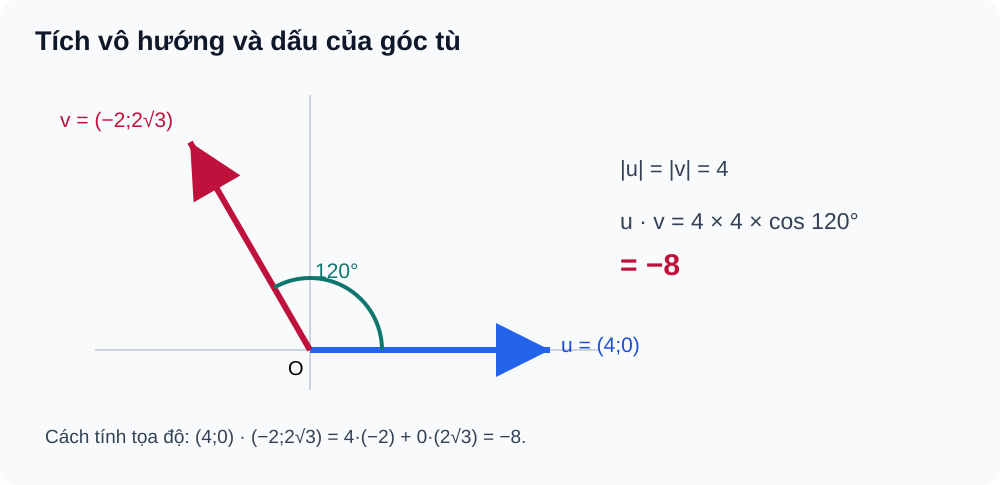
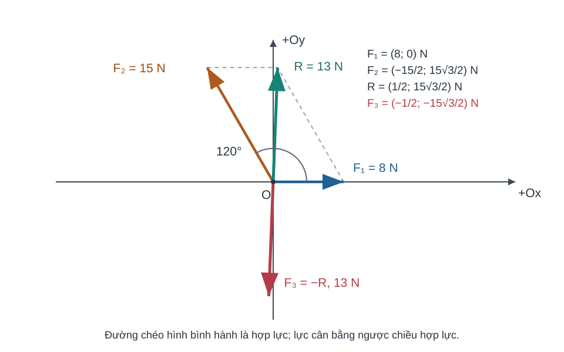

# Bài 11. Tích vô hướng của hai vectơ

TOÁN 10 · CHƯƠNG IV · KIẾN THỨC SGK KNTT

Hiểu bản chất của tích vô hướng qua góc, hình và tọa độ; vận dụng trước khi mở đối chiếu.

=== "Khám phá kiến thức"

    ### 1.1. Vì sao cần tích vô hướng?

    Hai lực có cùng độ lớn chưa chắc tác động như nhau. Khi lực kéo tạo với hướng di chuyển một góc nhọn, nó hỗ trợ chuyển động; khi góc tù, một phần lực có tác dụng cản lại. Ta cần một phép toán có thể biến thông tin **độ lớn và góc giữa hai vectơ** thành một con số có dấu. Phép toán đó là **tích vô hướng**.

    Với hai vectơ khác không, tích vô hướng bằng tích độ dài của chúng rồi nhân với \(\cos\) góc xen giữa. Từ cách định nghĩa ấy, em có thể dự đoán dấu mà chưa tính: góc nhọn cho kết quả dương, góc vuông cho 0, góc tù cho âm. Đây không phải một quy tắc dấu phải học thuộc riêng; nó xuất phát từ dấu của \(\cos\) đã học ở Bài 5.

    Khi đưa vectơ lên hệ trục, tích vô hướng còn tính được bằng tổng tích hai thành phần tương ứng. Điều này giúp kiểm vuông góc bằng phép tính thay vì chỉ quan sát hình, đồng thời là cơ sở để tính công của lực.

    ### 1.2. Khám phá và vận dụng qua hình

    

    #### Tích vô hướng mô tả mức độ cùng hướng

    **Cách đọc hình.** Quan sát góc tù giữa hai vectơ trong hình: cos âm nên tích vô hướng âm, dù độ dài hai vectơ đều dương.

    <figure class="thpt-r4-plot thpt-r4-probability-figure"><figcaption>Tích vô hướng khi góc giữa hai vectơ là 120 độ.</figcaption></figure>

    Một lực tác dụng dọc hướng di chuyển có ích hơn lực kéo vuông góc; lực ngược chiều chuyển động có thể gây công âm.

    Nhớ độ dài vectơ, góc giữa hai vectơ khác không thuộc 0°–180° và cos góc nhọn/vuông/tù. 

    Tích vô hướng đo tích hai độ lớn có xét thành phần cùng hướng bằng cos: \(\vec u\cdot\vec v=|\vec u||\vec v|\cos\theta\). Nếu vuông góc tích 0, nếu ngược hướng tích âm; góc được xác định duy nhất khi cả hai vectơ khác \(\vec0\); với vectơ-không SGK quy ước góc có thể tùy ý trong \([0^\circ,180^\circ]\) và coi \(\vec0\) vuông góc với mọi vectơ.

    Chọn định nghĩa hình học nếu biết hai độ dài và góc giữa vectơ; nếu một vectơ bằng 0, tích là 0 theo đại số nhưng không gán góc thường.

    **Em vận dụng.** Cho \(|\vec u|=2\), \(|\vec v|=3\), góc giữa hai vectơ là 120°. Tích vô hướng âm hay dương, bằng bao nhiêu?

    ??? question "Em tự mở đối chiếu sau khi đã thử làm"

        **Kết quả:** \(\vec u\cdot\vec v=2\cdot3\cdot\cos120^\circ=-3\).

        **Vì sao:** Cos120°=−1/2 nên tích âm; không thể dùng cos60° vì đây là góc giữa hai vectơ đang hướng xa nhau.

    
    

    ??? tip "Kiểm lỗi"

        **Tự nhận diện:** Em đang làm sai dấu của công lực?

        **Cách làm sai:** Lực \(10\,\mathrm N\) tạo góc \(120^\circ\) với độ dời \(3\,\mathrm m\) nhưng thay \(\cos60^\circ\), thu được công \(+15\,\mathrm J\).

        **Vì sao sai:** Góc giữa hai vectơ **đúng theo hướng mũi tên** là \(120^\circ\), nên cos âm. Tích vô hướng có dấu; lấy góc nhọn bù với góc tù hoặc lấy giá trị tuyệt đối sẽ làm mất ý nghĩa tác dụng cản chuyển động.

        **Tự sửa:** \(W=10\cdot3\cos120^\circ=-15\,\mathrm J\). Kiểm lại: góc tù ⇒ công âm; góc vuông ⇒ công bằng 0.

        **Luyện lại:** Tự đổi góc thành \(90^\circ\) rồi \(60^\circ\) và dự đoán dấu trước khi tính lại.
    

    #### Tại sao tích vô hướng có thể tính bằng hai cặp số?

    **Liên hệ với tọa độ.** Trên hai trục vuông góc, mỗi vectơ được phân tích thành hai thành phần. Tích vô hướng bằng tổng hai tích thành phần cùng trục, không phải tích chéo. Hình hợp lực sẽ được giải thích tại Ví dụ 4, với bộ số liệu riêng.

    Trong bản đồ Oxy, biết hai tọa độ vectơ có thể suy mức độ cùng hướng mà không cần đo góc.

    Đã biết vectơ đơn vị \(\vec i,\vec j\) vuông góc, \(\vec u=u_x\vec i+u_y\vec j\) và tính chất phân phối. 

    Vì \(\vec i\cdot\vec i=1\), \(\vec j\cdot\vec j=1\), \(\vec i\cdot\vec j=0\), khi nhân phân phối chỉ còn \(u_xv_x+u_yv_y\). Đây là công thức tọa độ của cùng tích vô hướng hình học.

    Khi có tọa độ, nhân các thành phần cùng trục rồi cộng; không nhân nhầm ux với vy hoặc lấy tích độ dài thay cho dấu.

    **Em vận dụng.** Cho \(\vec u=(2;-1)\), \(\vec v=(3;4)\). Tính \(\vec u\cdot\vec v\).

    ??? question "Em tự mở đối chiếu sau khi đã thử làm"

        **Kết quả:** \(2\cdot3+(-1)\cdot4=2\).

        **Vì sao:** Thành phần theo Ox cho 6, theo Oy cho −4, cộng là 2. Tích vô hướng là một số, không phải vectơ.

    **Kiểm lỗi dùng chung:** [Xem hướng dẫn tự sửa liên quan](#HELP-G10-B11-01).
    

    #### Vuông góc có thể kiểm bằng số

    Thay vì đo góc trên hình vẽ không chuẩn tỉ lệ, ta có thể dùng tích vô hướng bằng 0 để nhận biết hai vectơ vuông góc.

    Biết cos90°=0 và công thức tọa độ tích vô hướng, cùng điều kiện cả hai vectơ khác không. 

    Nếu hai vectơ khác không có tích vô hướng 0 thì cos góc giữa chúng là 0, vì tích độ dài dương; góc bằng 90°. Chiều ngược lại cũng đúng.

    Kiểm tra hai vectơ khác không trước, sau đó tính tích vô hướng; \(\vec0\cdot\vec v=0\) nhưng không suy ra một góc duy nhất bằng 90°; vectơ-không vuông góc theo quy ước SGK.

    **Em vận dụng.** \(\vec u=(2;3)\), \(\vec v=(3;-2)\). Chúng có vuông góc không? Vì sao điều kiện khác 0 quan trọng?

    ??? question "Em tự mở đối chiếu sau khi đã thử làm"

        **Kết quả:** Có, vì \(\vec u\cdot\vec v=2\cdot3+3\cdot(-2)=0\), và cả hai khác \(\vec0\).

        **Vì sao:** Nếu một vectơ bằng 0 thì tích vẫn bằng 0 nhưng góc giữa hai vectơ không xác định duy nhất; theo quy ước SGK, vectơ-không vuông góc với mọi vectơ.

    
    

    ??? tip "Kiểm lỗi"

        **Tự nhận diện:** Em đã chia cho độ dài của vectơ-không?

        **Cách làm sai:** Với \(\vec u=\vec0\), \(\vec v=(2;3)\), tính \(\cos(\vec u,\vec v)=\frac{0}{0\cdot\sqrt{13}}=0\), rồi kết luận góc duy nhất bằng \(90^\circ\).

        **Vì sao sai:** Mẫu số bằng \(0\) nên phép chia vô nghĩa. SGK chỉ quy ước góc với \(\vec0\) có thể tùy ý, đồng thời coi \(\vec0\) vuông góc với mọi vectơ; điều đó **không** tạo ra một số đo góc duy nhất.

        **Tự sửa:** Tính \(\vec u\cdot\vec v=0\); phát biểu vuông góc **theo quy ước SGK**, không tính cos từ mẫu bằng 0. Với hai vectơ khác không, mới áp dụng công thức cos để suy góc.

        **Luyện lại:** Chọn hai vectơ khác không và thử tính tích bằng 0 trong phần Luyện tập, sau đó quay lại tự giải một trường hợp có vectơ-không.
    

    #### Công của lực: độ lớn không đủ

    Đẩy một vật 3 m cùng chiều lực khác với kéo vật theo chiều ngược hoặc vuông góc lực, dù độ lớn lực và quãng dịch chuyển giống nhau.

    Biết lực \(\vec F\) đo N, độ dời \(\vec s\) đo m, góc giữa hai vectơ khác không và tích vô hướng. 

    Với lực không đổi, công có dấu được tính từ thành phần lực theo phương độ dời: \(W=\vec F\cdot\vec s=|\vec F||\vec s|\cos\theta\); cùng chiều cho dương, ngược chiều cho âm, vuông góc cho 0.

    Xác định hướng tương đối của lực và độ dời trước, kiểm đơn vị N·m=J; không lấy giá trị tuyệt đối khi bài hỏi công có dấu.

    **Em vận dụng.** Một lực 10 N hướng Đông, vật dịch chuyển 3 m hướng Tây. Công của lực là bao nhiêu J? Nếu dịch chuyển vuông góc lực thì sao?

    ??? question "Em tự mở đối chiếu sau khi đã thử làm"

        **Kết quả:** Cùng phương ngược hướng: \(W=10\cdot3\cos180^\circ=-30\) J; vuông góc: \(W=0\) J.

        **Vì sao:** Cos180°=−1, cos90°=0. Công là vô hướng có dấu, khác với độ lớn lực hay quãng đường.

    **Kiểm lỗi dùng chung:** [Xem hướng dẫn tự sửa liên quan](#HELP-G10-B11-02).
    ### 1.3. Vận dụng — hợp lực và lực giữ cân bằng

    Để giữ một vòng móc đứng yên khi hai dây đang kéo, lực thứ ba phải **đối** với hợp lực của hai lực đầu. Theo Bài 8, hợp lực là tổng **vectơ** chứ không phải tổng hai độ lớn; theo Bài 11, tích vô hướng giúp tính độ lớn hợp lực khi biết góc giữa hai lực.

    

    **Em vận dụng.** Hai lực bằng nhau, mỗi lực \(4\,\mathrm N\), tạo góc \(60^\circ\). Muốn vòng móc cân bằng, lực thứ ba phải có **độ lớn và chiều** như thế nào? Hãy dự đoán hướng trước khi tính.

    ??? question "Tự mở đối chiếu sau khi đã làm"

        **Kết quả:** Đặt \(\vec R=\vec F_1+\vec F_2\), ta có \(|\vec R|^2=4^2+4^2+2\cdot4\cdot4\cos60^\circ=48\). Vì vậy \(|\vec F_3|=4\sqrt3\,\mathrm N\), và \(\vec F_3=-\vec R\), tức lực thứ ba **ngược chiều hợp lực**.

        **Vì sao:** Góc \(60^\circ\) không phải góc vuông; dùng tổng vectơ và tính chất tích vô hướng, không cộng \(4+4\) thành độ lớn hợp lực. Nếu nhầm, tự mở khung Kiểm lỗi ngay dưới câu Vận dụng này.

    
    

    ??? tip "Kiểm lỗi"

        **Tự nhận diện:** Em lấy tổng độ lớn hai lực 4 N + 4 N thành 8 N?

        **Cách làm sai:** Vì mỗi lực có độ lớn \(4\,\mathrm N\), kết luận hợp lực luôn \(8\,\mathrm N\), rồi đặt lực cân bằng cùng chiều với hợp lực.

        **Vì sao sai:** Hai lực tạo góc \(60^\circ\), không cùng hướng. Phải **cộng vectơ**, không cộng độ lớn, và lực cân bằng phải **ngược chiều** hợp lực.

        **Tự sửa:** Vẽ hai mũi tên cùng gốc, xác định đúng góc \(60^\circ\). Áp dụng \(|\vec F_1+\vec F_2|^2=4^2+4^2+2\cdot4\cdot4\cos60^\circ=48\), suy ra hợp lực \(4\sqrt3\,\mathrm N\). Vectơ lực thứ ba là \(-(\vec F_1+\vec F_2)\).

        **Luyện lại:** Tự trở lại bài vận dụng hai lực \(4\,\mathrm N\), góc \(60^\circ\) trong tab Khám phá; hãy tự tính trước khi mở đối chiếu. Nếu đã xem đáp án thì chọn bộ số liệu khác để kiểm tra độc lập.
    ### 1.4. Thuật ngữ, kiến thức và kỹ năng

    **Thuật ngữ:** Tích vô hướng, góc giữa hai vectơ, dấu của cos góc nhọn/tù, vuông góc, tích vô hướng theo tọa độ, công của lực.

    **Sau bài học, em cần làm được:** Chọn đúng góc giữa hai vectơ; tính tích vô hướng theo hình học hoặc tọa độ; suy góc vuông từ tích bằng 0 với vectơ khác không; giải thích ý nghĩa dấu trong ứng dụng.

=== "Kiến thức SGK"

    ### 2.1. Góc giữa hai vectơ

    Trước khi tính tích vô hướng, cần biết **góc giữa hai hướng có thể đặt tại cùng một gốc**. Hãy tịnh tiến hai vectơ sao cho các mũi tên có chung điểm đầu; giữ nguyên hướng và độ dài nên giá trị góc không thay đổi.

    
<strong>Định nghĩa — Góc giữa hai vectơ (SGK trang 66):</strong> Với \(\vec u,\vec v\) đều khác \(\vec0\), lấy điểm \(A\) bất kì, dựng \(\overrightarrow{AB}=\vec u\) và \(\overrightarrow{AC}=\vec v\). Góc \(\widehat{BAC}\) được gọi là góc giữa \(\vec u,\vec v\), kí hiệu \((\vec u,\vec v)\), có số đo từ \(0^\circ\) đến \(180^\circ\).

    **Đọc góc đúng hướng:** Hai vectơ cùng hướng cho \(0^\circ\), ngược hướng cho \(180^\circ\); trong tam giác, \((\overrightarrow{AB},\overrightarrow{BC})\) không nhất thiết bằng \(\angle ABC\) vì \(\overrightarrow{AB}\) hướng ngược \(\overrightarrow{BA}\).

    **Chú ý về vectơ-không (SGK trang 66):** Góc giữa \(\vec u\) và \(\vec0\) có thể nhận một giá trị **tùy ý** từ \(0^\circ\) đến \(180^\circ\), không xác định duy nhất. Theo **quy ước SGK**, \(\vec0\) được coi là vuông góc với mọi vectơ. Không sử dụng phép chia cho \(|\vec0|=0\) để tính cos góc.

    ### 2.2. Tích vô hướng của hai vectơ

    Công của một lực không đổi phụ thuộc vào thành phần lực cùng hướng chuyển dời. Nhân hai độ lớn luôn cho số không âm nên chưa thể phản ánh tác dụng hỗ trợ hoặc cản chuyển động; hệ số \(\cos\theta\) bổ sung dấu và mức độ cùng hướng.

    
<strong>Định nghĩa — Tích vô hướng (SGK trang 67):</strong> Với \(\vec u,\vec v\) đều khác \(\vec0\), tích vô hướng là một <strong>số thực</strong>:
    
\(\displaystyle \vec u\cdot\vec v=|\vec u|\,|\vec v|\cos(\vec u,\vec v).\)

    Nếu một vectơ bằng \(\vec0\), tích vô hướng bằng \(0\) theo định nghĩa mở rộng; không cần chọn một góc duy nhất.

    **Nhìn dấu trước khi tính:** Với hai vectơ khác không, góc nhọn → tích dương; góc vuông → \(0\); góc tù → tích âm. Đặc biệt \(\vec u\cdot\vec u=|\vec u|^2\ge0\).

    
<strong>Tính chất vuông góc:</strong> Theo quy ước SGK, \(\vec u\perp\vec v\) khi và chỉ khi \(\vec u\cdot\vec v=0\), kể cả trường hợp có vectơ-không. Khi muốn suy ra <em>góc bằng \(90^\circ\) duy nhất</em> thì phải có hai vectơ khác không.

    **Vận dụng trong Vật lí:** Với lực không đổi \(\vec F\) (N) và độ dời \(\vec s\) (m), công \(W=\vec F\cdot\vec s\) có đơn vị J (N·m). Góc lực–độ dời nhọn làm công dương, tù làm công âm, vuông góc làm công bằng 0; với lực hoặc độ dời bằng 0 thì công bằng 0.

    ### 2.3. Biểu thức tọa độ và tính chất của tích vô hướng

    Trong hệ trục vuông góc \(Oxy\), hai vectơ đơn vị \(\vec i,\vec j\) thỏa \(\vec i\cdot\vec i=\vec j\cdot\vec j=1\) và \(\vec i\cdot\vec j=0\). Viết \(\vec u=a\vec i+b\vec j\), \(\vec v=c\vec i+d\vec j\) rồi phân phối: các tích chéo giữa hai trục triệt tiêu, chỉ còn hai tích cùng trục.

    
<strong>Quy tắc — Biểu thức tọa độ (SGK trang 68):</strong> Với \(\vec u=(a;b)\), \(\vec v=(c;d)\),
    
\(\displaystyle \vec u\cdot\vec v=ac+bd.\)

    Đây là cùng phép tích vô hướng hình học, không phải một phép nhân mới. Kết quả là <strong>số</strong>, không phải vectơ.

    
<strong>Tính chất (SGK trang 69):</strong> Với các vectơ \(\vec u,\vec v,\vec w\) và \(t\in\mathbb R\),
    
\(\displaystyle \vec u\cdot\vec v=\vec v\cdot\vec u,\quad \vec u\cdot(\vec v+\vec w)=\vec u\cdot\vec v+\vec u\cdot\vec w.\)

    
\(\displaystyle (t\vec u)\cdot\vec v=t(\vec u\cdot\vec v)=\vec u\cdot(t\vec v).\)

    Suy ra \(|\vec u\pm\vec v|^2=|\vec u|^2+|\vec v|^2\pm2\vec u\cdot\vec v\).

    **Vì sao có công thức tổng bình phương?** Khai triển \((\vec u+\vec v)\cdot(\vec u+\vec v)\) bằng tính phân phối; hai tích chéo bằng nhau, nên thành \(2\vec u\cdot\vec v\). Khi cần tìm độ lớn hợp lực với góc đã biết, kết hợp công thức này với định nghĩa hình học.

    
<strong>Công thức trọng tâm — Góc giữa hai vectơ khác không:</strong> Khi \(\vec u=(a;b)\ne\vec0\) và \(\vec v=(c;d)\ne\vec0\),
    
\(\displaystyle \cos(\vec u,\vec v)=\frac{ac+bd}{\sqrt{a^2+b^2}\sqrt{c^2+d^2}}.\)

    **Giới hạn:** Mẫu số phải dương; không thế \(\vec0\) vào công thức này. Muốn kiểm vuông góc thì tính \(ac+bd\) trực tiếp, không cần chia.

    
<strong>Kiến thức cần nhớ — Bài 11:</strong> Đặt hai vectơ chung gốc để đọc góc; tích vô hướng là <strong>một số có dấu</strong>; chọn định nghĩa độ dài–góc khi biết góc, chọn công thức tọa độ khi biết thành phần; kiểm vuông góc qua tích bằng 0 theo quy ước SGK; phân biệt quy ước vectơ-không với điều kiện mẫu số của công thức cos. Công của lực là ứng dụng, không phải tổng độ lớn hai lực.

=== "Ví dụ"

    Trước khi đọc lời giải, hãy xác định **dữ kiện → chọn phương pháp → kiểm điều kiện và dấu**. Một ví dụ đã mở lời giải không trở thành chứng cứ đánh giá độc lập cho Tự kiểm tra cuối chương.

    ### 3.1. Ví dụ 1 — Dấu tích vô hướng ở góc tù

    **Đề:** Cho \(|\vec u|=4\), \(|\vec v|=3\) và góc giữa chúng là \(120^\circ\). Tính \(\vec u\cdot\vec v\).

    **Phân tích:** Đề cho hai độ dài và góc, không cho tọa độ, nên dùng định nghĩa hình học. Dự đoán kết quả âm vì góc tù.

    

    
<strong>Giải:</strong> \(\vec u\cdot\vec v=4\cdot3\cos120^\circ=12\cdot(-\tfrac12)=-6\).

    

    **Kiểm lại:** Độ lớn mỗi vectơ dương, \(\cos120^\circ<0\), nên dấu âm là hợp lý; kết quả không có đơn vị nếu vectơ chỉ là đối tượng hình học.

    ### 3.2. Ví dụ 2 — Vuông góc bằng tọa độ

    **Đề:** Cho \(\vec u=(2;-1)\), \(\vec v=(1;2)\). Kiểm tra hai vectơ vuông góc.

    **Phân tích:** Biết tọa độ, tính \(ac+bd\) nhanh và chính xác hơn đo góc từ hình vẽ.

    

    
<strong>Giải:</strong> \(\vec u\cdot\vec v=2\cdot1+(-1)\cdot2=0\). Hai vectơ đều khác \(\vec0\), nên góc giữa chúng xác định và bằng \(90^\circ\).

    

    **Kiểm lại:** \(|\vec u|=|\vec v|=\sqrt5>0\), vì thế công thức cos cho \(\cos\theta=0\), phù hợp \(90^\circ\).

    ### 3.3. Ví dụ 3 — Tam giác vuông và diện tích

    **Đề:** Cho \(A(1;1)\), \(B(4;1)\), \(C(1;5)\). Xác định góc tại \(A\) và diện tích tam giác.

    **Phân tích:** Góc tại \(A\) được tạo bởi \(\overrightarrow{AB}\) và \(\overrightarrow{AC}\); phải chọn hai vectơ **chung gốc A** trước khi tính.

    

    
<strong>Giải:</strong> \(\overrightarrow{AB}=(3;0)\), \(\overrightarrow{AC}=(0;4)\). Vì \(\overrightarrow{AB}\cdot\overrightarrow{AC}=3\cdot0+0\cdot4=0\) và chúng khác \(\vec0\), nên \(\angle BAC=90^\circ\). Do đó \(S_{ABC}=\tfrac12\cdot AB\cdot AC=\tfrac12\cdot3\cdot4=6\).

    

    **Kiểm lại:** Hai cạnh dọc theo hai trục vuông góc, độ dài \(3\) và \(4\), nên kết quả có ý nghĩa hình học.

    ### 3.4. Ví dụ 4 — Hợp lực và lực thứ ba giữ cân bằng

    **Đọc hình:** Hình bên dưới minh họa **bộ lực khác** \(8\,\mathrm N\) về Đông và \(15\,\mathrm N\) lệch \(120^\circ\), cho hợp lực \(13\,\mathrm N\); đây là tình huống trong thư viện tự luận. **Ví dụ đang giải bên dưới dùng hai lực \(6\,\mathrm N\)**. Không tráo số liệu giữa hình minh họa và đề.

    <figure class="thpt-r4-plot thpt-r4-probability-figure"><figcaption>Đọc chiều mũi tên và góc giữa lực trước; hình dùng dữ kiện 8 N/15 N/120° khác đề ví dụ 6 N/6 N/120°.</figcaption></figure>

    **Đề:** Hai dây kéo vòng móc với hai lực có độ lớn \(6\,\mathrm N\) và \(6\,\mathrm N\), tạo góc \(120^\circ\). Tìm **độ lớn và chiều** lực thứ ba để vòng móc đứng yên.

    **Phân tích:** Điều kiện cân bằng là \(\vec F_1+\vec F_2+\vec F_3=\vec0\). Đặt \(\vec R=\vec F_1+\vec F_2\), khi đó \(\vec F_3=-\vec R\). Không cộng \(6+6\) vì hai lực không cùng hướng.

    

    
<strong>Giải:</strong> Từ tính chất bình phương tổng vectơ và góc giữa hai lực,

    
\(\displaystyle |\vec R|^2=6^2+6^2+2\cdot6\cdot6\cos120^\circ=72-36=36.\)

    
Vậy \(|\vec F_3|=|\vec R|=6\,\mathrm N\) và \(\vec F_3=-\vec R\), ngược chiều đường chéo hình bình hành tạo bởi \(\vec F_1,\vec F_2\); không phải ngược riêng một trong hai dây.

    

    **Kiểm lại:** \(0\le|\vec R|\le 6+6=12\,\mathrm N\), phù hợp bất đẳng thức tam giác; tổng ba vectơ bằng \(\vec0\). Biết độ lớn và góc giúp tìm độ lớn hợp lực; muốn xác định góc hướng chính xác trong trục tọa độ phải xét các thành phần.

=== "Lỗi thường gặp"

    **Học tiếp:** [Core và Luyện tập](luyen-tap.md) · [Tự kiểm tra cuối chương](tu-kiem-tra-chuong.md).

    
Nguồn học liệu: SGK Toán 10 Kết nối tri thức và thư viện SLM hiện hành. Các tình huống tự học bổ sung dùng dữ kiện minh họa riêng, không thay thế bài tập SGK/SBT.

