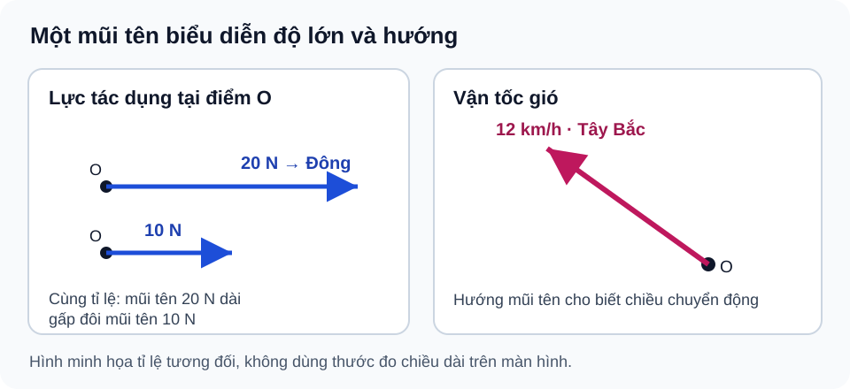
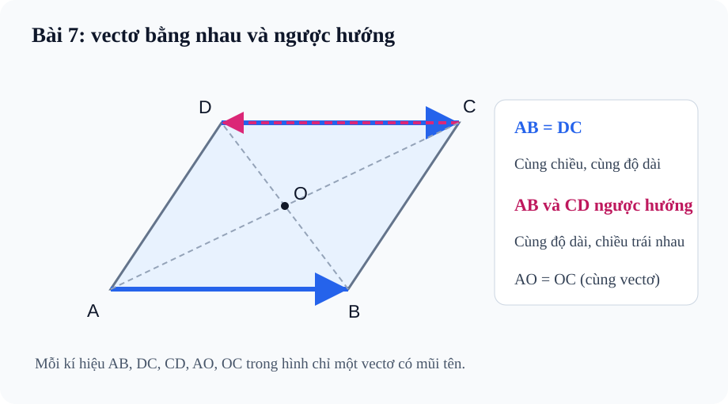

# Bài 7. Các khái niệm mở đầu về vectơ

TOÁN 10 · CHƯƠNG IV · KIẾN THỨC SGK KNTT

Học từ tình huống trực quan, nắm kiến thức và tự kiểm tra cách hiểu trước khi luyện tập.

=== "Khám phá kiến thức"

    **Khởi động.**

    Một chuyến đi có thể dài 5 km về phía Đông hoặc 5 km về phía Tây. Hai chuyến đi ấy có cùng **độ dài**, nhưng không đưa ta đến cùng vị trí. Để diễn tả sự khác nhau, toán học dùng **vectơ**: một mũi tên vừa cho biết độ lớn, vừa cho biết phương và chiều.

    Hãy tưởng tượng em đi từ A đến B, sau đó đi ngược từ B về A. Trên giấy, hai mũi tên cùng nằm trên đoạn AB, có độ dài bằng nhau nhưng hướng trái nhau. Nếu chỉ viết “AB dài bao nhiêu”, ta đánh mất thông tin chiều di chuyển. Vì vậy phải phân biệt **đoạn thẳng AB** với **vectơ \(\overrightarrow{AB}\)**, cũng như phân biệt độ dài với bản thân vectơ.

    Trong bài này, em sẽ bắt đầu từ những mũi tên quen thuộc, rồi lần lượt nhận ra khi nào chúng cùng phương, cùng hướng, bằng nhau và vì sao vectơ-không là một trường hợp đặc biệt cần quy ước.

    

    ### 1.1. Vectơ là gì và vì sao phải xác định điểm đầu–cuối?

    Đi từ A đến B rồi đi ngược từ B về A có cùng đoạn đường, nhưng hai lần di chuyển đưa ta về hai hướng trái nhau. Chỉ độ dài AB không đủ mô tả sự di chuyển.

    Hãy bắt đầu từ đoạn thẳng AB với hai đầu mút: A là điểm xuất phát, B là điểm đến. Khi đọc vectơ, điều đầu tiên cần xác định là chiều đi từ điểm nào tới điểm nào. 

    Đặt mũi tên đi từ A tới B: đó là độ dời có cả độ lớn lẫn chiều; đổi điểm đầu–cuối làm đổi vectơ, dù độ dài vẫn là AB. Bây giờ mới đặt tên đoạn thẳng có hướng là vectơ \(\overrightarrow{AB}\).

    Muốn xác định vectơ, hỏi 'đi từ đâu đến đâu?' trước khi so sánh độ dài. Không thay \(\overrightarrow{AB}\) bằng đoạn AB nếu bài yêu cầu hướng.

    **Từ mũi tên đến đại lượng thực tế.** Một lực 20 N đẩy vật sang Đông và một vận tốc gió 12 km/h hướng Tây Bắc không thể mô tả đầy đủ bằng các con số 20 hoặc 12: ta còn cần biết **hướng tác dụng/chuyển động**. Mũi tên vectơ cho phép biểu diễn cả hai thông tin đó. Với lực, cần xác định cả **điểm đặt**; với vận tốc, cần xác định hướng chuyển động.

    <figure class="thpt-r4-plot"><picture><source media="(max-width: 600px)" srcset="../../../../assets/images/thpt/THPT_G10_B07_FORCE_VELOCITY_MOBILE_D5_R04.svg"></picture><figcaption>Đọc hình từ điểm đặt/gốc mũi tên → phương và chiều → độ lớn. Hai lực dùng cùng tỉ lệ nên mũi tên 20 N dài gấp đôi 10 N; không so trực tiếp chiều dài mũi tên lực với vận tốc.</figcaption></figure>

    **Cách tự vẽ.** Nếu chọn tỉ lệ 1 cm trên giấy ứng với 10 N, lực 20 N hướng Đông được vẽ bằng mũi tên 2 cm về phía Đông từ điểm đặt; lực 10 N cùng hướng dài 1 cm. Hình trên chỉ minh họa tỉ lệ tương đối, không dùng thước đo trực tiếp trên màn hình.

    **Em vận dụng.** An đi từ A đến B; Bình đi từ B về A, với A khác B. Hai vectơ độ dời có bằng nhau không, và độ dài của chúng thế nào?

    ??? question "Em tự mở đối chiếu sau khi đã thử làm"

        **Kết quả:** Không bằng nhau: \(\overrightarrow{AB}=-\overrightarrow{BA}\); cả hai có độ dài AB.

        **Vì sao:** Khi đảo điểm đầu/cuối mũi tên quay ngược, trong khi khoảng cách giữa hai đầu không đổi. Độ dài bằng nhau chưa đủ để vectơ bằng nhau.

    
    

    ??? tip "Kiểm lỗi"

        <ol><li><strong>Tín hiệu:</strong> Em đổi nhầm điểm đầu và điểm cuối, hoặc coi độ dài bằng nhau là đủ để hai vectơ bằng nhau.</li><li><strong>Nguyên nhân:</strong> Nhầm các định nghĩa hoặc quy tắc vectơ đã học, không phải thiếu thêm công thức mới.</li><li><strong>Nguyên lí:</strong> Vẽ mũi tên từ chữ đứng trước sang chữ đứng sau; thử đảo AB thành BA.</li><li><strong>Tự sửa:</strong> Em tự vẽ một sơ đồ mũi tên nhỏ, xác định rõ điểm đầu/cuối, nói lý do rồi tự thử lại.</li><li><strong>Điểm quay lại:</strong> Trong Luyện tập, làm lại câu về vectơ ngược hướng trong hình bình hành, rồi đối chiếu câu Core về điều kiện hai vectơ bằng nhau.</li></ol>
<a href="../luyen-tap/">Quay lại luyện tập</a>

    

    ### 1.2. Độ dài vectơ khác hướng di chuyển thế nào?

    Trên bản đồ, hai người đi 4 km theo các hướng khác nhau đều có quãng di chuyển 4 km, nhưng không có cùng vectơ độ dời.

    Độ dài đoạn thẳng là một số không âm. Nhưng vectơ \(\overrightarrow{AB}\) còn cho biết chiều từ A đến B; đừng nhầm hai thông tin này. 

    Chỉ bỏ chiều của mũi tên và đo độ dài đoạn nối A-B thì được **độ dài vectơ** \(|\overrightarrow{AB}|=AB\). Phép đo này không 'nhớ' chiều và luôn không âm.

    Khi hỏi độ lớn dùng ký hiệu độ dài; khi hỏi vectơ bằng nhau phải xét hướng. Không cộng số đo đường đi theo nhiều chặng để suy luôn độ dài độ dời.

    **Em vận dụng.** Một vectơ đi 3 m sang Đông, vectơ khác đi 3 m sang Tây. Hai độ dài bằng bao nhiêu và các vectơ có bằng nhau không?

    ??? question "Em tự mở đối chiếu sau khi đã thử làm"

        **Kết quả:** Đều có độ dài 3 m, nhưng hai vectơ không bằng nhau.

        **Vì sao:** Độ lớn chỉ bằng 3 m cho cả hai; chiều Đông và Tây khác nhau. Hai vectơ ngược hướng dù giá của chúng trùng nhau hay là hai đường thẳng song song khác nhau.

    **Kiểm lỗi dùng chung:** [Xem hướng dẫn tự sửa](#HELP-G10-B07-02).
    

    ### 1.3. Vì sao cùng phương vẫn có thể ngược hướng?

    Trên đường hai chiều, hai xe có thể đi trên hai làn song song mà một xe về Đông, xe còn lại về Tây.

    Hai đường thẳng có thể song song mà các mũi tên trên chúng vẫn chỉ về hai phía trái nhau. Vì thế ta xét phương trước, rồi mới xét chiều. 

    **Phương** cho biết mũi tên nằm dọc đường nào; **hướng** cho biết chạy về phía nào trên đường ấy. Hai vectơ khác không cùng phương khi giá song song hoặc trùng; sau đó mới phân biệt cùng hay ngược hướng.

    Với hai vectơ khác không, hãy xét giá trước, rồi mới xét chiều. Riêng vectơ-không, cần dùng quy ước SGK/SBT nêu ở cuối bài, không tự gán cho nó một mũi tên có chiều.

    **Em vận dụng.** Hai vectơ khác không nằm trên hai đường thẳng song song; một mũi tên hướng Đông, một hướng Tây. Chúng cùng phương không? Có cùng hướng không?

    ??? question "Em tự mở đối chiếu sau khi đã thử làm"

        **Kết quả:** Cùng phương, nhưng ngược hướng; không cùng hướng.

        **Vì sao:** Đường thẳng song song chứng minh cùng phương; chiều Đông/Tây trái nhau làm hai vectơ ngược hướng.

    
    

    ??? tip "Kiểm lỗi"

        <ol><li><strong>Tín hiệu:</strong> Em thấy hai giá song song rồi kết luận ngay cùng hướng, hoặc quên trường hợp vectơ-không.</li><li><strong>Nguyên nhân:</strong> Nhầm các định nghĩa hoặc quy tắc vectơ đã học, không phải thiếu thêm công thức mới.</li><li><strong>Nguyên lí:</strong> So lần lượt phương, chiều, độ dài; dùng đúng quy ước KNTT về vectơ-không.</li><li><strong>Tự sửa:</strong> Em tự vẽ hai mũi tên, ghi phương–chiều–độ dài theo thứ tự và giải thích kết luận trước khi tự thử lại.</li><li><strong>Điểm quay lại:</strong> Trong Luyện tập, làm câu về hai vectơ cùng hướng nhưng khác độ dài, rồi câu về quy ước vectơ-không.</li></ol>
<a href="../luyen-tap/">Quay lại luyện tập</a>

    

    ### 1.4. Hai mũi tên ở hai vị trí khác nhau khi nào bằng nhau?

    Một xe dịch chuyển 2 km về Đông ở Hà Nội và một xe khác dịch chuyển 2 km về Đông ở nơi khác: độ dời mô tả như nhau dù điểm đặt khác.

    Ta đã phân biệt độ dài, phương và chiều. Hai mũi tên có thể cùng mô tả một vectơ dù được vẽ ở những vị trí khác nhau; điểm đặt không quyết định chúng có bằng nhau hay không. 

    Để mô tả cùng một độ dời, ta có thể tịnh tiến mũi tên mà không xoay hay co giãn: đây là trực giác để có hai vectơ bằng nhau khi **cùng hướng và cùng độ dài**.

    Chỉ kết luận bằng nhau khi cả hai điều kiện độ dài và cùng hướng đạt; không yêu cầu trùng giá và không suy chỉ từ cùng phương.

    **Em vận dụng.** Hình bình hành ABCD theo thứ tự các đỉnh. \(\overrightarrow{AB}\) và \(\overrightarrow{DC}\) có bằng nhau không? \(\overrightarrow{CD}\) thì sao?

    ??? question "Em tự mở đối chiếu sau khi đã thử làm"

        **Kết quả:** \(\overrightarrow{AB}=\overrightarrow{DC}\), còn \(\overrightarrow{AB}\ne\overrightarrow{CD}\).

        **Vì sao:** AB và DC song song, cùng hướng, cùng dài; CD ngược hướng với AB. Cùng độ dài vẫn không đủ.

    **Kiểm lỗi dùng chung:** [Xem hướng dẫn tự sửa](#HELP-G10-B07-02).
    

    ### 1.5. Vì sao quay lại điểm xuất phát tạo ra vectơ-không?

    Đi một vòng rồi quay lại đúng điểm xuất phát, độ dời cuối cùng bằng 0 dù quãng đường đã đi có thể lớn hơn 0.

    Hãy hình dung một hành trình khép kín: em quay lại đúng điểm A nên độ dời ròng bằng 0, dù quãng đường đã đi không nhất thiết bằng 0. Trường hợp này dẫn tới vectơ-không. 

    Khi A trùng B, mũi tên co lại thành một điểm: \(\overrightarrow{AA}=\vec0\), độ dài 0. **Theo quy ước SBT KNTT**, vectơ-không cùng phương và cùng hướng với mọi vectơ; đây là quy ước chứ không phải mũi tên vật lý có chiều xác định.

    Dùng \(\vec0\) để biểu diễn độ dời ròng bằng 0. Phép cộng, trừ vectơ sẽ học ở Bài 8. Không suy ra một góc xác định duy nhất khi có vectơ-không; Bài 11 sẽ giới thiệu quy ước riêng của SGK về góc và tính vuông góc.

    **Em vận dụng.** Bạn đi từ A đến B rồi trở về A. Vectơ độ dời từ điểm đầu đến điểm cuối là gì? Có bằng tổng độ dài hai chặng không?

    ??? question "Em tự mở đối chiếu sau khi đã thử làm"

        **Kết quả:** Vectơ độ dời \(\overrightarrow{AA}=\vec0\), độ dài 0; không bằng tổng quãng đường hai chặng (trừ trường hợp không hề đi).

        **Vì sao:** Độ dời chỉ quan tâm vị trí đầu/cuối; đi rồi quay lại cho vectơ-không. Quãng đường vẫn là số dương nếu có di chuyển.

    **Kiểm lỗi dùng chung:** [Xem hướng dẫn tự sửa](#HELP-G10-B07-02).
    **Tóm tắt thuật ngữ và mục tiêu tự học**

    **Thuật ngữ:** Vectơ, giá vectơ, điểm đầu/điểm cuối, độ dài, cùng phương, cùng/ngược hướng, vectơ bằng nhau, vectơ-không.

    **Sau bài học, em cần làm được:** Chỉ đúng điểm đầu–cuối; xét phương rồi chiều rồi độ dài; đọc hình bình hành; phân biệt quãng đường với độ dài độ dời.

=== "Kiến thức SGK"

    ### 2.1. Khái niệm vectơ

    #### 2.1.1. Vectơ, điểm đầu–cuối và độ dài

    
<strong>Định nghĩa — Vectơ:</strong> Vectơ là một đoạn thẳng có hướng. Vectơ \(\overrightarrow{AB}\) có **điểm đầu** \(A\), **điểm cuối** \(B\), chiều từ \(A\) tới \(B\). Khi \(A\ne B\), đường thẳng \(AB\) gọi là <strong>giá</strong> của vectơ.

    
<strong>Định nghĩa — Độ dài vectơ:</strong> Độ dài của \(\overrightarrow{AB}\) là độ dài đoạn thẳng \(AB\), kí hiệu \(|\overrightarrow{AB}|=AB\ge0\). Độ dài chỉ là một số, không biểu diễn chiều của vectơ.

    **Nhận xét:** Hai vectơ được vẽ ở hai vị trí khác nhau vẫn có thể bằng nhau; không phải chỉ khi cùng điểm đầu và điểm cuối mới xét được sự bằng nhau.

    **Phân biệt:** Mũi tên biểu diễn hướng di chuyển từ A sang B, nhưng quãng đường đã đi không luôn bằng độ dài độ dời.

    #### 2.1.2. Vectơ-không và quy ước của SBT KNTT

    
<strong>Định nghĩa — Vectơ-không:</strong> Vectơ có điểm đầu trùng điểm cuối là <strong>vectơ-không</strong>, kí hiệu \(\vec0\). Với mọi điểm \(A\), \(\overrightarrow{AA}=\vec0\) và \(|\vec0|=0\).

    **Quy ước cần phân biệt:** Theo SBT KNTT lớp 10 Bài 7, vectơ-không được xem là cùng phương và cùng hướng với mọi vectơ. Đây là **quy ước toán học**, không phải khẳng định một mũi tên độ dài 0 có chiều vật lí xác định.

    
<strong>Kiến thức cần nhớ — Mục 2.1:</strong> Một vectơ có <strong>điểm đầu, điểm cuối và chiều</strong>; \(\overrightarrow{AB}\) có độ dài \(AB\). Khi hai điểm trùng nhau ta được \(\vec0\), có độ dài bằng \(0\). Vectơ và độ dài của nó là hai đối tượng khác nhau.

    ### 2.2. Hai vectơ cùng phương, cùng hướng, bằng nhau

    #### 2.2.1. Phương và chiều phải được xét riêng

    
<strong>Định nghĩa — Hai vectơ cùng phương:</strong> Hai vectơ <strong>khác vectơ-không</strong> gọi là cùng phương nếu giá của chúng <strong>song song hoặc trùng nhau</strong>. Khi đó hai mũi tên có thể <strong>cùng hướng</strong> hoặc <strong>ngược hướng</strong>, tùy chiều trên các giá.

    **Lưu ý:** Cùng phương <strong>chưa đủ</strong> để kết luận cùng hướng; cùng hướng cũng chưa đủ để kết luận bằng nhau nếu độ dài khác nhau. Quy ước riêng về vectơ-không đã nêu tại mục 2.1.2.

    #### 2.2.2. Hai vectơ bằng nhau không cần trùng giá

    **Quan sát hình.** Đọc hình bình hành theo thứ tự: chọn cạnh AB, đối chiếu mũi tên DC và CD, rồi kiểm chiều của từng mũi tên trước khi kết luận bằng nhau. Hai cạnh đối bằng độ dài chưa đủ để hai vectơ cùng bằng nhau.

    <figure class="thpt-r4-plot thpt-r4-probability-figure"><figcaption>Hình bình hành ABCD với các vectơ cạnh đối bằng nhau.</figcaption></figure>

    
<strong>Định nghĩa — Hai vectơ bằng nhau:</strong> Hai vectơ bằng nhau khi chúng <strong>cùng hướng và có cùng độ dài</strong>. Không cần có chung điểm đầu hoặc cùng giá. Kí hiệu \(\vec u=\vec v\).

    **Áp dụng hình bên trên:** Với hình bình hành \(ABCD\), \(\overrightarrow{AB}=\overrightarrow{DC}\). Hai vectơ \(\overrightarrow{AB}\) và \(\overrightarrow{CD}\) tuy bằng độ dài nhưng <strong>ngược hướng</strong>, nên không bằng nhau.

    **Liên hệ:** Tên gọi vectơ đối cùng kí hiệu âm của vectơ được giải thích ở Bài 8.

    #### 2.2.3. Độ dời và quãng đường trong thực tế

    **Biểu diễn lực và vận tốc bằng vectơ:** (1) chọn vị trí gốc mũi tên (điểm đặt của lực hoặc vị trí đang xét); (2) vẽ mũi tên đúng phương và chiều; (3) chọn tỉ lệ và độ dài mũi tên tương ứng với độ lớn; (4) ghi rõ đơn vị, chẳng hạn N cho lực, m/s hoặc km/h cho vận tốc. Không so sánh độ dài mũi tên của các đại lượng khác đơn vị hoặc khác tỉ lệ.

    **Phân biệt với quãng đường:** Vectơ độ dời nối vị trí đầu và cuối. Quãng đường đi theo nhiều chặng có thể lớn hơn độ dài vectơ độ dời.

    
<strong>Kiến thức cần nhớ — Mục 2.2:</strong> Để so sánh hai vectơ khác không, xét <strong>phương</strong> (giá song song/trùng), <strong>chiều</strong> (cùng hay ngược hướng), rồi <strong>độ dài</strong>. <strong>Hai vectơ bằng nhau ⇔ cùng hướng và cùng độ dài.</strong> Đừng kết luận bằng nhau chỉ từ hai độ dài bằng nhau; với vectơ-không dùng quy ước riêng ở mục 2.1.

=== "Ví dụ"

    Trước khi đọc mỗi lời giải, hãy xác định **đối tượng hình học**, điều bài cho và phải kiểm điều kiện gì. Mỗi ví dụ đều đi từ phân tích cách chọn phương pháp đến lời giải và kiểm lại kết quả.

    ### 3.1. Ví dụ 1 — Hai độ dời bằng nhau dù đặt ở nơi khác

    **Đề bài.** Một người đi từ E đến F đúng 4 m về Đông; người khác đi từ G đến H đúng 4 m về Đông ở một nơi khác. So sánh \(\overrightarrow{EF}\) và \(\overrightarrow{GH}\), rồi xét \(\overrightarrow{HG}\).

    **Phân tích.** Hai vectơ không cần cùng điểm đặt. Ta phải xét đồng thời độ dài và hướng, không chỉ nhìn vị trí trên bản vẽ.

    **Lời giải.** Vì cả hai vectơ dài 4 m và cùng hướng Đông, \(\overrightarrow{EF}=\overrightarrow{GH}\). Vectơ \(\overrightarrow{HG}\) hướng Tây, nên ngược hướng với \(\overrightarrow{EF}\). Kí hiệu dấu trừ cho vectơ đối sẽ được học ở Bài 8.

    **Kiểm lại.** EF và GH có thể ở hai đường khác nhau; chúng vẫn cùng vectơ độ dời. Đổi thứ tự H,G làm đảo chiều mũi tên mà không đổi độ dài.

    ### 3.2. Ví dụ 2 — Biểu diễn và so sánh hai vectơ vận tốc

    **Đề bài.** Hai xe chạy trên hai đường thẳng song song theo trục Đông–Tây. Xe thứ nhất có vận tốc 6 m/s hướng Đông, xe thứ hai 2 m/s hướng Tây. Chọn tỉ lệ 1 cm ứng với 2 m/s. Em hãy mô tả cách vẽ các vectơ vận tốc \(\vec v_1,\vec v_2\), rồi xét phương, hướng và sự bằng nhau.

    **Phân tích.** Vận tốc không chỉ là số đo tốc độ: phải thể hiện cả hướng chuyển động. Trên cùng một hình và cùng tỉ lệ, độ dài mũi tên tỉ lệ với tốc độ. Xét phương trước, sau đó xét chiều và độ lớn.

    **Lời giải.** Từ vị trí mỗi xe, vẽ \(\vec v_1\) dài 3 cm hướng Đông và \(\vec v_2\) dài 1 cm hướng Tây. Hai vectơ cùng phương vì giá song song, nhưng ngược hướng và có độ dài khác nhau, nên \(\vec v_1\ne\vec v_2\).

    **Kiểm lại.** Mũi tên 3 cm ứng với 6 m/s, mũi tên 1 cm ứng với 2 m/s theo đúng cùng tỉ lệ. Nếu xe thứ hai đổi chiều sang Đông, hai vectơ cùng hướng nhưng vẫn không bằng nhau vì tốc độ khác nhau.

    ### 3.3. Ví dụ 3 — Hành trình khép kín có độ dời bằng 0

    **Đề bài.** Từ P, một người đi 7 m sang Đông đến Q, 24 m lên Bắc đến R, rồi đi thẳng từ R về P. Tính tổng quãng đường và độ dài vectơ độ dời từ điểm đầu đến điểm cuối.

    **Phân tích.** Quãng đường cần cộng ba cạnh đường đi; độ dời chỉ nối vị trí ban đầu và cuối cùng. Hai chặng đầu vuông góc nên có thể tính đoạn RP bằng Pitago.

    **Lời giải.** \(RP=\sqrt{7^2+24^2}=25\,\mathrm m\). Tổng quãng đường là \(7+24+25=56\,\mathrm m\). Vì kết thúc ngay P, vectơ độ dời là \(\overrightarrow{PP}=\vec0\), có độ dài \(0\,\mathrm m\).

    **Kiểm lại.** Dù người ấy thực sự đi 56 m, điểm đầu và cuối trùng nhau; không được nhầm 56 m với độ lớn của vectơ-không.

    ### 3.4. Ví dụ 4 — Đọc độ dài vectơ khi hai chặng vuông góc

    **Đề bài.** Một bạn đi từ A 9 m về Đông rồi 12 m về Bắc đến B. Tìm quãng đường đã đi và độ dài vectơ \(\overrightarrow{AB}\).

    **Phân tích.** Hai chặng vuông góc tạo tam giác vuông. Tổng quãng đường bằng tổng hai cạnh đã đi; độ dài vectơ AB là cạnh nối đầu–cuối.

    **Lời giải.** Quãng đường là \(9+12=21\,\mathrm m\). Theo Pitago, \(|\overrightarrow{AB}|=\sqrt{9^2+12^2}=15\,\mathrm m\).

    **Kiểm lại.** Độ dài độ dời 15 m nhỏ hơn quãng đường 21 m. Nếu hai chặng ngược hướng hoặc không vuông góc thì phải vẽ lại hình; không thể áp dụng phép tính này một cách máy móc.

=== "Lỗi thường gặp"

    **Kiểm lỗi:** Các lỗi thường gặp được giải thích ngay sau từng hoạt động ở tab Khám phá kiến thức. Chọn mục tương ứng để xem lại: [Kiểm lỗi 1](#HELP-G10-B07-01) · [Kiểm lỗi 2](#HELP-G10-B07-02).

    **Học tiếp:** [Core và Luyện tập](luyen-tap.md) · [Tự kiểm tra cuối chương](tu-kiem-tra-chuong.md).

    
Nguồn toán học: SGK Toán 10 Kết nối tri thức với cuộc sống và học liệu SLM hiện hành. Lời giảng biên tập nhằm hỗ trợ tự học độc lập.

