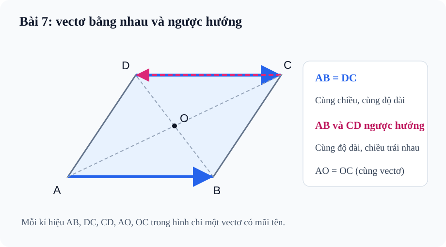

# Bài 7. Các khái niệm mở đầu về vectơ

TOÁN 10 · CHƯƠNG IV · KIẾN THỨC SGK KNTT

Học từ tình huống trực quan, nắm kiến thức và tự kiểm tra cách hiểu trước khi luyện tập.

=== "Khám phá kiến thức"

    ### Cùng tìm hiểu

    Một chuyến đi có thể dài 5 km về phía Đông hoặc 5 km về phía Tây. Hai chuyến đi ấy có cùng **độ dài**, nhưng không đưa ta đến cùng vị trí. Để diễn tả sự khác nhau, toán học dùng **vectơ**: một mũi tên vừa cho biết độ lớn, vừa cho biết phương và chiều.

    Hãy tưởng tượng em đi từ A đến B, sau đó đi ngược từ B về A. Trên giấy, hai mũi tên cùng nằm trên đoạn AB, có độ dài bằng nhau nhưng hướng trái nhau. Nếu chỉ viết “AB dài bao nhiêu”, ta đánh mất thông tin chiều di chuyển. Vì vậy phải phân biệt **đoạn thẳng AB** với **vectơ \(\overrightarrow{AB}\)**, cũng như phân biệt độ dài với bản thân vectơ.

    Trong bài này, em sẽ bắt đầu từ những mũi tên quen thuộc, rồi lần lượt nhận ra khi nào chúng cùng phương, cùng hướng, bằng nhau và vì sao vectơ-không là một trường hợp đặc biệt cần quy ước.

    ### Thuật ngữ, kiến thức và kỹ năng

    **Thuật ngữ:** Vectơ, giá vectơ, điểm đầu/điểm cuối, độ dài, cùng phương, cùng/ngược hướng, vectơ bằng nhau, vectơ-không.

    **Sau bài học, em cần làm được:** Chỉ đúng điểm đầu–cuối; xét phương rồi chiều rồi độ dài; đọc hình bình hành; phân biệt quãng đường với độ dài độ dời.

=== "Kiến thức SGK"

    

    ### Vectơ là gì và tại sao phải có chiều?

    Đi từ A đến B rồi đi ngược từ B về A có cùng đoạn đường, nhưng hai lần di chuyển đưa ta về hai hướng trái nhau. Chỉ độ dài AB không đủ mô tả sự di chuyển.

    Trước khi tiếp tục, em hãy nhớ lại đoạn thẳng AB, hai đầu mút và hướng chuyển động trên đường thẳng; ký hiệu A là nơi xuất phát, B là nơi đến. 

    Đặt mũi tên đi từ A tới B: đó là độ dời có cả độ lớn lẫn chiều; đổi điểm đầu–cuối làm đổi vectơ, dù độ dài vẫn là AB. Bây giờ mới đặt tên đoạn thẳng có hướng là vectơ \(\overrightarrow{AB}\).

    Muốn xác định vectơ, hỏi 'đi từ đâu đến đâu?' trước khi so sánh độ dài. Không thay \(\overrightarrow{AB}\) bằng đoạn AB nếu bài yêu cầu hướng.

    **Em vận dụng.** An đi từ A đến B; Bình đi từ B về A, với A khác B. Hai vectơ độ dời có bằng nhau không, và độ dài của chúng thế nào?

    ??? question "Em tự mở đối chiếu sau khi đã thử làm"

        **Kết quả:** Không bằng nhau: \(\overrightarrow{AB}=-\overrightarrow{BA}\); cả hai có độ dài AB.

        **Vì sao:** Khi đảo điểm đầu/cuối mũi tên quay ngược, trong khi khoảng cách giữa hai đầu không đổi. Độ dài bằng nhau chưa đủ để vectơ bằng nhau.

    

    ### Độ lớn không phải là hướng

    Trên bản đồ, hai người đi 4 km theo các hướng khác nhau đều có quãng di chuyển 4 km, nhưng không có cùng vectơ độ dời.

    Trước khi tiếp tục, em hãy nhớ lại độ dài đoạn thẳng là số không âm; vectơ \(\overrightarrow{AB}\) thể hiện cả chiều A→B. 

    Chỉ bỏ chiều của mũi tên và đo độ dài đoạn nối A-B thì được **độ dài vectơ** \(|\overrightarrow{AB}|=AB\). Phép đo này không 'nhớ' chiều và luôn không âm.

    Khi hỏi độ lớn dùng ký hiệu độ dài; khi hỏi vectơ bằng nhau phải xét hướng. Không cộng số đo đường đi theo nhiều chặng để suy luôn độ dài độ dời.

    **Em vận dụng.** Một vectơ đi 3 m sang Đông, vectơ khác đi 3 m sang Tây. Hai độ dài bằng bao nhiêu và các vectơ có bằng nhau không?

    ??? question "Em tự mở đối chiếu sau khi đã thử làm"

        **Kết quả:** Đều có độ dài 3 m, nhưng hai vectơ không bằng nhau.

        **Vì sao:** Độ lớn chỉ bằng 3 m cho cả hai; chiều Đông và Tây khác nhau. Nếu cùng đường thẳng thì chúng ngược hướng.

    

    ### Cùng phương khác cùng hướng

    Trên đường hai chiều, hai xe có thể đi trên hai làn song song mà một xe về Đông, xe còn lại về Tây.

    Trước khi tiếp tục, em hãy nhớ lại định nghĩa giá vectơ khác không và hai đường thẳng song song; phải phân biệt đường chạy với chiều chạy. 

    **Phương** cho biết mũi tên nằm dọc đường nào; **hướng** cho biết chạy về phía nào trên đường ấy. Hai vectơ khác không cùng phương khi giá song song hoặc trùng; sau đó mới phân biệt cùng hay ngược hướng.

    Kiểm tra hai giá trước, tiếp đến dấu chiều; với vectơ-không dùng quy ước S1 riêng, không lấy mũi tên tưởng tượng để suy.

    **Em vận dụng.** Hai vectơ khác không nằm trên hai đường thẳng song song; một mũi tên hướng Đông, một hướng Tây. Chúng cùng phương không? Có cùng hướng không?

    ??? question "Em tự mở đối chiếu sau khi đã thử làm"

        **Kết quả:** Cùng phương, nhưng ngược hướng; không cùng hướng.

        **Vì sao:** Đường thẳng song song chứng minh cùng phương; chiều Đông/Tây trái nhau làm hai vectơ ngược hướng.

    

    ### Khi nào hai mũi tên ở nơi khác nhau là một vectơ?

    Một xe dịch chuyển 2 km về Đông ở Hà Nội và một xe khác dịch chuyển 2 km về Đông ở nơi khác: độ dời mô tả như nhau dù điểm đặt khác.

    Để theo kịp lập luận, em nhớ rằng Đã phân biệt độ dài, phương, hướng; học sinh không được đồng nhất điểm xuất phát với bản thân vectơ tự do. 

    Để mô tả cùng một độ dời, ta có thể tịnh tiến mũi tên mà không xoay hay co giãn: đây là trực giác để có hai vectơ bằng nhau khi **cùng hướng và cùng độ dài**.

    Chỉ kết luận bằng nhau khi cả hai điều kiện độ dài và cùng hướng đạt; không yêu cầu trùng giá và không suy chỉ từ cùng phương.

    **Em vận dụng.** Hình bình hành ABCD theo thứ tự các đỉnh. \(\overrightarrow{AB}\) và \(\overrightarrow{DC}\) có bằng nhau không? \(\overrightarrow{CD}\) thì sao?

    ??? question "Em tự mở đối chiếu sau khi đã thử làm"

        **Kết quả:** \(\overrightarrow{AB}=\overrightarrow{DC}\), còn \(\overrightarrow{AB}\ne\overrightarrow{CD}\).

        **Vì sao:** AB và DC song song, cùng hướng, cùng dài; CD ngược hướng với AB. Cùng độ dài vẫn không đủ.

    

    ### Không di chuyển vẫn cần một vectơ

    Đi một vòng rồi quay lại đúng điểm xuất phát, độ dời cuối cùng bằng 0 dù quãng đường đã đi có thể lớn hơn 0.

    Để theo kịp lập luận, em nhớ rằng Phân biệt độ dời và quãng đường, một điểm A, đoạn AA độ dài 0; nhớ quy ước đặc biệt của SBT KNTT. 

    Khi A trùng B, mũi tên co lại thành một điểm: \(\overrightarrow{AA}=\vec0\), độ dài 0. **Theo quy ước SBT KNTT**, vectơ-không cùng phương và cùng hướng với mọi vectơ; đây là quy ước chứ không phải mũi tên vật lý có chiều xác định.

    Dùng \(\vec0\) để cộng, trừ và biểu diễn độ dời ròng bằng 0. Đừng dùng góc giữa hai vectơ khi có vectơ-không (B11 sẽ có điều kiện khác không).

    **Em vận dụng.** Bạn đi từ A đến B rồi trở về A. Vectơ độ dời từ điểm đầu đến điểm cuối là gì? Có bằng tổng độ dài hai chặng không?

    ??? question "Em tự mở đối chiếu sau khi đã thử làm"

        **Kết quả:** Vectơ độ dời \(\overrightarrow{AA}=\vec0\), độ dài 0; không bằng tổng quãng đường hai chặng (trừ trường hợp không hề đi).

        **Vì sao:** Độ dời chỉ quan tâm vị trí đầu/cuối; đi rồi quay lại cho vectơ-không. Quãng đường vẫn là số dương nếu có di chuyển.

    ### Kiến thức SGK

    ### 1. Vectơ và độ dài

    **Khái niệm:** Vectơ là đoạn thẳng có hướng. Kí hiệu $\overrightarrow{AB}$ gồm điểm đầu **A**, điểm cuối **B**; độ dài $|\overrightarrow{AB}|=AB\ge0$.

    **Nhận xét:** Hai vectơ đặt tại vị trí khác nhau có thể bằng nhau. Đường thẳng qua A,B là **giá** của vectơ khác không; vectơ có điểm đầu trùng điểm cuối là vectơ-không $\vec0$.

    **Phân biệt:** Mũi tên biểu diễn hướng di chuyển từ A sang B, nhưng quãng đường đã đi không luôn bằng độ dài độ dời.

    ### 2. Phương và hướng

     Với hai vectơ khác không, chúng **cùng phương** nếu hai giá song song hoặc trùng nhau; cùng phương có thể **cùng hướng** hoặc **ngược hướng**.

    **Lưu ý:** Cùng phương không suy ra cùng hướng; cùng hướng không suy ra cùng độ dài.

    ### 3. Bằng nhau và ngược hướng

    **Quan sát hình.** Đọc hình bình hành theo thứ tự: chọn cạnh AB, đối chiếu mũi tên DC và CD, rồi kiểm chiều của từng mũi tên trước khi kết luận bằng nhau. Hai cạnh đối bằng độ dài chưa đủ để hai vectơ cùng bằng nhau.

    <figure class="thpt-r4-plot thpt-r4-probability-figure"><figcaption>Hình bình hành ABCD với các vectơ cạnh đối bằng nhau.</figcaption></figure>

     $\vec u=\vec v$ khi cùng hướng, cùng độ dài. Trong hình bình hành ABCD: $\overrightarrow{AB}=\overrightarrow{DC}$; còn $\overrightarrow{AB}$ và $\overrightarrow{CD}$ cùng độ dài nhưng **ngược hướng**.

    **Liên hệ:** Tên gọi vectơ đối cùng kí hiệu âm của vectơ được giải thích ở Bài 8.

    ### 4. Vectơ-không theo SGK/SBT

     $\overrightarrow{AA}=\vec0$ với mọi điểm A và $|\vec0|=0$. **Theo quy ước SBT KNTT lớp 10 Bài 7**, vectơ-không được xem là cùng phương và cùng hướng với mọi vectơ.

    **Lưu ý về quy ước:** Điều này là quy ước toán học cho trường hợp đặc biệt, không mô tả một đoạn có chiều vật lí khác 0.

    ### 5. Ứng dụng

     Lực, vận tốc, độ dời có thể dùng vectơ vì đồng thời chứa độ lớn và hướng; quãng đường đi theo hai chặng có thể lớn hơn độ dài vectơ độ dời từ đầu đến cuối. Luôn ghi đơn vị thích hợp.

=== "Ví dụ giải toán"

    Trước khi xem lời giải, hãy tự hỏi **bài cho dữ kiện gì, cần tìm điều gì và vì sao quy tắc vừa học phù hợp**. Sau đó hãy giải từng bước, kiểm lại hướng, độ lớn và điều kiện của kết quả.

    ### Ví dụ 1. Bằng nhau và ngược hướng trong hình bình hành

    **Đề:** Cho hình bình hành ABCD. Hãy so sánh AB với DC, và AB với CD theo nghĩa vectơ.
    **Giải:** $\overrightarrow{AB}=\overrightarrow{DC}$ vì hai cạnh đối cùng hướng và cùng độ dài. Mặt khác, $\overrightarrow{CD}$ cùng độ dài nhưng ngược hướng $\overrightarrow{AB}$.
    **Điểm cần tự kiểm:** Sai thường gặp: xem cả AB và CD là bằng nhau chỉ vì độ dài cạnh đối bằng nhau.

    ### Ví dụ 2. Trường hợp vectơ-không

    **Đề:** Cho A bất kì và B khác A, hãy so sánh $\overrightarrow{AA}$ với $\overrightarrow{BB}$ và nêu độ dài.
    **Giải:** $\overrightarrow{AA}=\overrightarrow{BB}=\vec0$ và đều có độ dài 0. Theo quy ước SBT Bài 7, vectơ-không được xem là cùng phương và cùng hướng với mọi vectơ.
    **Điểm cần tự kiểm:** Không nên lấy sự không quan sát thấy chiều mũi tên làm lí do phủ nhận quy ước của sách.

    ### Ví dụ 3. Vectơ độ dời và quãng đường

    **Đề:** Một tàu rời A đi Đông 6 km rồi Bắc 8 km tới B. Hỏi quãng đường đi và độ dài vectơ AB.
    **Giải:** Quãng đường: $6+8=14$ km. Vì hai chặng vuông góc, $|\overrightarrow{AB}|=\sqrt{6^2+8^2}=10$ km.
    **Điểm cần tự kiểm:** Không cộng 6 + 8 để tìm độ dài độ dời, cũng không dùng 10 km làm quãng đường hai chặng.

=== "Lỗi thường gặp và cách tự khắc phục"

    

    ??? tip "Nhầm điểm đầu/cuối và chiều của vectơ"

        <ol><li><strong>Tín hiệu:</strong> Học sinh trả lời sai trong B07-C01, B07-P03.</li><li><strong>Nguyên nhân:</strong> Nhầm các định nghĩa hoặc quy tắc vectơ đã học, không phải thiếu thêm công thức mới.</li><li><strong>Nguyên lí:</strong> Vẽ mũi tên từ chữ đứng trước sang chữ đứng sau; thử đảo AB thành BA.</li><li><strong>Tự sửa:</strong> Học sinh phải tự vẽ một sơ đồ mũi tên nhỏ, xác định điểm đầu/cuối và nêu ít nhất một lí do toán học, rồi thử lại câu cũ.</li><li><strong>Điểm quay lại:</strong> Làm lại B07-P03 rồi đối chiếu B07-C02.</li></ol>
<a href="../luyen-tap/">Quay lại luyện tập</a>

    

    ??? tip "Nhầm cùng phương, cùng hướng, bằng nhau; quên quy ước vectơ-không"

        <ol><li><strong>Tín hiệu:</strong> Học sinh trả lời sai trong B07-P04, B07-P05.</li><li><strong>Nguyên nhân:</strong> Nhầm các định nghĩa hoặc quy tắc vectơ đã học, không phải thiếu thêm công thức mới.</li><li><strong>Nguyên lí:</strong> So lần lượt phương, chiều, độ dài; dùng đúng quy ước KNTT về vectơ-không.</li><li><strong>Tự sửa:</strong> Học sinh phải tự vẽ một sơ đồ mũi tên nhỏ, xác định điểm đầu/cuối và nêu ít nhất một lí do toán học, rồi thử lại câu cũ.</li><li><strong>Điểm quay lại:</strong> Làm B07-P05 rồi B07-P04.</li></ol>
<a href="../luyen-tap/">Quay lại luyện tập</a>

    **Học tiếp:** [Core và Luyện tập](../luyen-tap/) · [Tự kiểm tra cuối chương](../tu-kiem-tra-chuong/).

    
Nguồn toán học: SGK Toán 10 Kết nối tri thức với cuộc sống và học liệu SLM hiện hành. Lời giảng biên tập nhằm hỗ trợ tự học độc lập.

