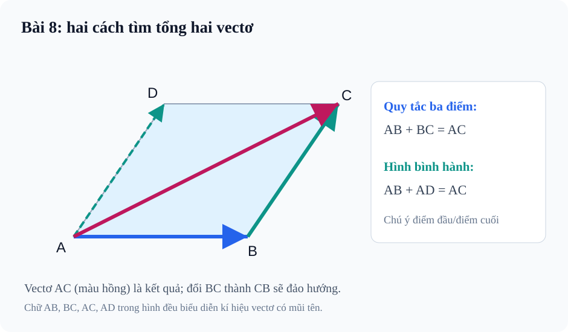

# Bài 8. Tổng và hiệu của hai vectơ

TOÁN 10 · CHƯƠNG IV · KIẾN THỨC SGK KNTT

Học từ tình huống trực quan, nắm kiến thức và tự kiểm tra cách hiểu trước khi luyện tập.

=== "Khám phá kiến thức"

### Cùng tìm hiểu

    Một người đi từ A đến B rồi tiếp tục từ B đến C. Nếu em chỉ muốn biết **độ dời từ điểm xuất phát đến điểm kết thúc**, không cần kể hai chặng riêng lẻ: mũi tên \(\overrightarrow{AC}\) chính là kết quả của hai mũi tên nối tiếp.

    Đó là ý nghĩa đầu tiên của phép cộng vectơ. Điểm cuối của mũi tên thứ nhất phải trùng điểm đầu của mũi tên thứ hai, khi ấy tổng được vẽ từ đầu chặng một đến cuối chặng hai. Nếu hai mũi tên lại cùng xuất phát từ một điểm, ta đưa chúng thành hai cạnh kề của hình bình hành để vẽ đường chéo — một cách nhìn khác của cùng phép cộng.

    Phép trừ cũng có hình học của nó: muốn lấy vectơ này trừ vectơ kia, ta **cộng với vectơ đối**. Em sẽ thấy vì sao trung điểm và trọng tâm tạo ra những tổng vectơ đặc biệt bằng vectơ-không, chứ không cần học thuộc công thức riêng rẽ.

    ### Ví dụ trực quan

    #### Cộng hai lần di chuyển nối tiếp

    Một người đi từ A đến B rồi từ B đến C. Muốn biết độ dời cuối cùng, không cần giữ mọi chặng nếu biết điểm đầu A và điểm cuối C.

    Hãy lần theo hai chặng A→B và B→C. Vì chúng nối tại B, vectơ tổng đi thẳng từ A đến C; độ dài AC không nhất thiết bằng tổng độ dài hai chặng. 

    Xếp hai mũi tên 'đuôi–đầu': mũi thứ nhất A→B rồi mũi thứ hai B→C. Hướng đi ròng A→C chính là ý nghĩa phép cộng vectơ \(\overrightarrow{AB}+\overrightarrow{BC}=\overrightarrow{AC}\).

    Nhận dạng chuỗi điểm nối trước khi áp dụng quy tắc ba điểm; không cộng độ dài trừ khi hai chặng thẳng hàng cùng chiều.

    **Em vận dụng.** Đi từ A 3 m sang Đông đến B, rồi 4 m lên Bắc đến C. Vectơ tổng đi từ đâu tới đâu? Độ dài của nó bằng 7 m không?

    ??? question "Em tự mở đối chiếu sau khi đã thử làm"

        **Kết quả:** Vectơ tổng là \(\overrightarrow{AC}\); độ dài 5 m, không phải 7 m.

        **Vì sao:** Hai chặng vuông góc nên hình học Pitago cho AC = √(3²+4²)=5; 7 m là quãng đường, không phải độ dời.

    

    #### Hai tác động cùng lúc và hợp lực

    Hai lực có chung điểm đặt nhưng khác hướng không cho hợp lực bằng cách cộng độ lớn như cộng hai số thường.

    Trong hình bình hành ABCD, hai mũi tên dọc theo AB và AD cùng xuất phát từ A. Đường chéo đi từ A đến C giúp em hình dung cách cộng chúng. 

    Dịch chuyển một lực để nối đuôi–đầu không đổi vectơ; dựng hình bình hành cho thấy đường chéo từ điểm chung A chính là kết quả \(\overrightarrow{AB}+\overrightarrow{AD}=\overrightarrow{AC}\).

    Khi hai vectơ có cùng điểm đầu, vẽ hình bình hành cho trực giác nhanh; nếu điểm đầu khác, có thể tịnh tiến một vectơ rồi dùng quy tắc tam giác.

    **Em vận dụng.** Ở A có hai lực vuông góc, độ lớn lần lượt 3 N và 4 N. Hợp lực theo đường chéo có độ lớn là 7 N hay 5 N?

    ??? question "Em tự mở đối chiếu sau khi đã thử làm"

        **Kết quả:** 5 N, theo đường chéo hình bình hành dựng từ A.

        **Vì sao:** Hai lực vuông góc là hai cạnh góc vuông dài 3,4 nên đường chéo có độ lớn √(9+16)=5. Không cộng 3+4.

    

    #### Vì sao trừ phải đổi chiều?

    Nếu biết hai vị trí đích B và C nhìn từ cùng A, muốn đi từ C sang B ta phải 'bù' chặng A→C bằng chiều ngược của nó.

    Muốn thực hiện phép trừ, hãy nhớ vectơ đối giữ độ dài nhưng đảo chiều. Sau đó nối các mũi tên theo quy tắc ba điểm A→C→B. 

    Hiệu \(\vec u-\vec v\) có nghĩa là cộng vectơ ngược \(-\vec v\); vì thế \(\overrightarrow{AB}-\overrightarrow{AC}=\overrightarrow{AB}+\overrightarrow{CA}=\overrightarrow{CB}\).

    Đổi dấu vectơ thứ hai trước rồi nối đầu–đuôi. Phép trừ vectơ nhìn chung không giao hoán, không lấy \(\overrightarrow{BC}\) cho trường hợp này.

    **Em vận dụng.** Cho ba điểm A,B,C bất kỳ. Rút gọn \(\overrightarrow{AB}-\overrightarrow{AC}\) thành vectơ có hai chữ cái.

    ??? question "Em tự mở đối chiếu sau khi đã thử làm"

        **Kết quả:** \(\overrightarrow{CB}\).

        **Vì sao:** Đổi trừ thành cộng \(\overrightarrow{CA}\): CA+AB=CB theo quy tắc ba điểm; CB và BC là hai vectơ đối.

    

    #### Trung điểm làm hai độ dời triệt tiêu

    Đứng ở giữa một đoạn đường, đi tới hai đầu theo hai hướng đối nhau và cùng độ dài; tổng hai vectơ này phải bằng 0.

    Khi M là trung điểm AB, ta có MA=MB và M nằm trên đoạn AB. Hai mũi tên M→A, M→B vì vậy cùng độ dài nhưng ngược hướng. 

    Vì \(\overrightarrow{MA}=-\overrightarrow{MB}\), tổng hai vectơ bằng \(\vec0\). Ngược lại, tổng bằng 0 ép hai độ dời ngược nhau và cùng dài nên M ở giữa A,B (với A≠B).

    Nhận diện hai vectơ cùng xuất phát trung điểm; dùng tổng bằng 0 thay vì chỉ chứng minh MA=MB mà quên thẳng hàng.

    **Em vận dụng.** Trên đường thẳng chọn A=0 m, B=8 m và M là trung điểm. Lấy \(\vec e\) là vectơ đơn vị dài 1 m hướng từ A đến B. Viết hai vectơ \(\overrightarrow{MA}\), \(\overrightarrow{MB}\) theo \(\vec e\) và tính tổng.

    ??? question "Em tự mở đối chiếu sau khi đã thử làm"

        **Kết quả:** \(\overrightarrow{MA}=-4\vec e\), \(\overrightarrow{MB}=4\vec e\), nên tổng bằng \(\vec0\). Mỗi vectơ có độ dài 4 m.

        **Vì sao:** Đặt M ở tọa độ 4 m. Hai độ dời là các bội đối nhau của vectơ đơn vị \(\vec e\), do đó tổng triệt tiêu. Không đồng nhất vectơ với một số đo độ dài.

    

    #### Ba độ dời cân bằng tại trọng tâm

    Đặt điểm G ở trọng tâm một tam giác, ba vectơ hướng từ G đến các đỉnh cân bằng nhau khi cộng theo quy tắc vectơ.

    Với tam giác ABC, M là trung điểm BC và G nằm trên trung tuyến AM, chia AM theo tỉ số AG:GM=2:1. Ta chỉ cần quan hệ hình học ấy, chưa cần dùng tọa độ. 

    Từ trung điểm: \(\overrightarrow{GB}+\overrightarrow{GC}=2\overrightarrow{GM}\). Vì G trên AM và AG=2GM nên \(\overrightarrow{GA}=-2\overrightarrow{GM}\); cộng lại được tổng ba vectơ bằng 0.

    Đặt trung điểm và trọng tâm đúng vị trí trước khi viết công thức. Không suy tổng độ dài GA+GB+GC=0 vì các độ dài đều không âm.

    **Em vận dụng.** Với M trung điểm BC và G trọng tâm ABC, biết \(\overrightarrow{GB}+\overrightarrow{GC}=2\overrightarrow{GM}\). Viết \(\overrightarrow{GA}\) theo \(\overrightarrow{GM}\) và tìm tổng ba vectơ từ G.

    ??? question "Em tự mở đối chiếu sau khi đã thử làm"

        **Kết quả:** \(\overrightarrow{GA}=-2\overrightarrow{GM}\), do đó \(\overrightarrow{GA}+\overrightarrow{GB}+\overrightarrow{GC}=\vec0\).

        **Vì sao:** AG=2GM trên cùng trung tuyến, hai vectơ G→A và G→M ngược chiều. Đây là cân bằng vectơ, không phải cộng ba khoảng cách.

### Thuật ngữ, kiến thức và kỹ năng

    **Thuật ngữ:** Tổng vectơ, quy tắc ba điểm, quy tắc hình bình hành, vectơ đối, hiệu, trung điểm, trọng tâm.

    **Sau bài học, em cần làm được:** Nối đúng điểm đầu–cuối; vẽ đường chéo hình bình hành; đổi phép trừ thành cộng vectơ đối; dùng các quan hệ trung điểm/trọng tâm.

=== "Kiến thức SGK"

    ### 2.1. Tổng của hai vectơ

Với A,B,C tùy ý: $\overrightarrow{AB}+\overrightarrow{BC}=\overrightarrow{AC}$.

    **Lưu ý:** Điểm cuối của vectơ thứ nhất B là điểm đầu của vectơ thứ hai; đảo BC thành CB có thể làm đổi kết quả.

    #### Quy tắc hình bình hành

**Quan sát hình.** Hãy đọc hai cách cộng trên hình: ở quy tắc tam giác, nối đuôi mũi tên; ở quy tắc hình bình hành, dựng hai cạnh chung gốc rồi lấy đường chéo. Không cộng độ dài như cộng vectơ.

    <figure class="thpt-r4-plot thpt-r4-probability-figure"><figcaption>Vectơ và quy tắc ba điểm, hình bình hành.</figcaption></figure>

     Với hình bình hành ABCD, $\overrightarrow{AB}+\overrightarrow{AD}=\overrightarrow{AC}$.

    **Điều kiện hình vẽ:** Hai cạnh được chọn phải cùng xuất phát từ **A**, đường chéo kết quả từ A đến C.

    **Tính chất:** Phép cộng vectơ có giao hoán, kết hợp, phần tử không.

    #### Vận dụng: hợp lực

Nếu hai lực có cùng điểm đặt, hợp lực là đường chéo hình bình hành tạo bởi hai vectơ lực. Độ lớn hợp lực không bằng tổng các độ lớn nếu hai lực không cùng hướng. Bài toán hai lực vuông góc có thể dùng định lí Pitago.

    ### 2.2. Hiệu của hai vectơ

$-\overrightarrow{AB}=\overrightarrow{BA}$ và $\vec u-\vec v=\vec u+(-\vec v)$. 

    **Hệ quả:** Quy tắc ba điểm suy ra $\overrightarrow{AB}-\overrightarrow{AC}=\overrightarrow{CB}$; phép trừ vectơ nói chung **không giao hoán**.

    **Phần tử không và vectơ đối:** $\vec a+\vec0=\vec a$, $\vec a+(-\vec a)=\vec0$.

    #### Hệ quả: trung điểm và trọng tâm

M là trung điểm AB khi và chỉ khi $\overrightarrow{MA}+\overrightarrow{MB}=\vec0$.

    **Trọng tâm:** G là trọng tâm tam giác ABC thì $\overrightarrow{GA}+\overrightarrow{GB}+\overrightarrow{GC}=\vec0$.

    **Hệ quả trung điểm:** Đối với M trung điểm BC và E bất kì: $\overrightarrow{EB}+\overrightarrow{EC}=\overrightarrow{EM}+\overrightarrow{EM}$.

    **Liên hệ:** Chú ý đây là quan hệ cộng vectơ đã có trong bài, không xây thêm phần Core riêng.

=== "Ví dụ"

    Trước khi xem lời giải, hãy tự hỏi **bài cho dữ kiện gì, cần tìm điều gì và vì sao quy tắc vừa học phù hợp**. Sau đó hãy giải từng bước, kiểm lại hướng, độ lớn và điều kiện của kết quả.

    ### Ví dụ 1. Rút gọn theo ba điểm

    **Đề:** Rút gọn $\overrightarrow{AB}+\overrightarrow{BC}+\overrightarrow{CD}$.
    **Giải:** Ghép $\overrightarrow{AB}+\overrightarrow{BC}=\overrightarrow{AC}$ rồi cộng $\overrightarrow{CD}$ được $\overrightarrow{AD}$.
    **Điểm cần tự kiểm:** Điểm giữa phải nối đúng B rồi C; phép cộng không đổi khi thêm ngoặc hợp lí.

    ### Ví dụ 2. Quy tắc hình bình hành và hiệu

    **Đề:** Trong hình bình hành ABCD, rút gọn $\overrightarrow{AB}+\overrightarrow{AD}$ và $\overrightarrow{AC}-\overrightarrow{AB}$.
    **Giải:** Tổng là $\overrightarrow{AC}$. Vì $\overrightarrow{AC}=\overrightarrow{AB}+\overrightarrow{BC}$ nên hiệu $\overrightarrow{AC}-\overrightarrow{AB}=\overrightarrow{BC}=\overrightarrow{AD}$.
    **Điểm cần tự kiểm:** Không nhầm kết quả với CA hoặc CB khi đổi hướng.

    ### Ví dụ 3. Trung điểm và trọng tâm

    **Đề:** M là trung điểm BC của tam giác ABC, G là trọng tâm. Nêu hai hệ thức đặc trưng.
    **Giải:** Vì M trung điểm BC: $\overrightarrow{MB}+\overrightarrow{MC}=\vec0$. Vì G trọng tâm tam giác ABC: $\overrightarrow{GA}+\overrightarrow{GB}+\overrightarrow{GC}=\vec0$.
    **Điểm cần tự kiểm:** Tổng ba vectơ phải đều xuất phát từ G; không thay tùy ý thành AB + BC + CA khi viện dẫn tính chất trọng tâm.

=== "Lỗi thường gặp"

    

    ??? tip "Nhầm hướng và thứ tự khi áp dụng quy tắc ba điểm/hiệu"

        <ol><li><strong>Tín hiệu:</strong> Học sinh trả lời sai trong B08-C01, B08-P02.</li><li><strong>Nguyên nhân:</strong> Nhầm các định nghĩa hoặc quy tắc vectơ đã học, không phải thiếu thêm công thức mới.</li><li><strong>Nguyên lí:</strong> Dùng đường gấp khúc đầu-cuối: AB + BC = AC; phép trừ đổi vectơ bị trừ thành vectơ đối.</li><li><strong>Tự sửa:</strong> Học sinh phải tự vẽ một sơ đồ mũi tên nhỏ, xác định điểm đầu/cuối và nêu ít nhất một lí do toán học, rồi thử lại câu cũ.</li><li><strong>Điểm quay lại:</strong> Làm B08-P02 và B08-P03.</li></ol>
<a href="../luyen-tap/">Quay lại luyện tập</a>

    

    ??? tip "Quên giao điểm trung điểm/trọng tâm, suy luận sai phép cộng và hợp lực"

        <ol><li><strong>Tín hiệu:</strong> Học sinh trả lời sai trong B08-P04, B08-P05, B08-P06.</li><li><strong>Nguyên nhân:</strong> Nhầm các định nghĩa hoặc quy tắc vectơ đã học, không phải thiếu thêm công thức mới.</li><li><strong>Nguyên lí:</strong> Phân biệt tính chất M trung điểm với G trọng tâm; cộng lực theo hình bình hành, không cộng độ lớn nếu lệch hướng.</li><li><strong>Tự sửa:</strong> Học sinh phải tự vẽ một sơ đồ mũi tên nhỏ, xác định điểm đầu/cuối và nêu ít nhất một lí do toán học, rồi thử lại câu cũ.</li><li><strong>Điểm quay lại:</strong> Làm B08-P04, B08-P05 và B08-P06.</li></ol>
<a href="../luyen-tap/">Quay lại luyện tập</a>

    **Học tiếp:** [Core và Luyện tập](luyen-tap.md) · [Tự kiểm tra cuối chương](tu-kiem-tra-chuong.md).

    
Nguồn toán học: SGK Toán 10 Kết nối tri thức với cuộc sống và học liệu SLM hiện hành. Lời giảng biên tập nhằm hỗ trợ tự học độc lập.

