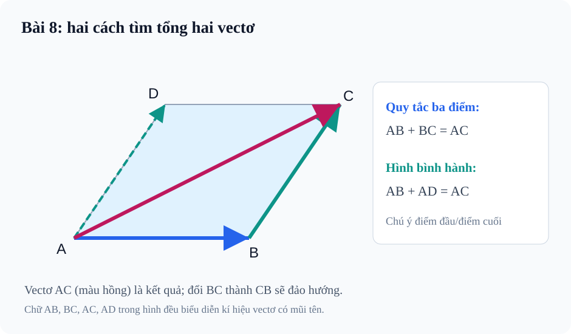

# Toán 10 · Bài 8. Tổng và hiệu của hai vectơ

TOÁN 10 · CHƯƠNG IV · KIẾN THỨC SGK KNTT

Từ đường đi và hai lực cùng điểm đặt, tự hình thành phép cộng và phép trừ vectơ, đọc mũi tên trước khi áp dụng quy tắc. Thử giải Vận dụng rồi mới mở Đối chiếu.

=== "Khám phá kiến thức"

    ### 1.1. Vì sao không thể cộng hai vectơ như cộng hai độ dài?

    **Xét ba điểm \(A,B,C\)** là các vị trí trên đường đi. Một người xuất phát từ \(A\), đến \(B\), rồi tiếp tục đến \(C\). Độ dài hai chặng đường có thể cộng được để tìm *quãng đường đã đi*. Nhưng nếu chỉ cần biết vị trí cuối so với vị trí đầu, ta dùng **độ dời**: một mũi tên có điểm đầu ở \(A\), điểm cuối ở \(C\). Vì mũi tên có cả độ dài lẫn hướng, phép cộng vectơ không chỉ là cộng những con số đo độ dài.

    Hãy nhìn hai sơ đồ dưới đây: phần **nối đuôi–đầu** cho đường gấp khúc; phần **hình bình hành** cho hai vectơ cùng điểm đầu. Trước tiên xác định điểm đầu, điểm cuối của từng mũi tên rồi mới đọc mũi tên kết quả. Hình này minh họa quy tắc, không mang số đo của câu Vận dụng bên dưới.

    <figure class="thpt-r4-plot thpt-r4-probability-figure"><figcaption>Cách đọc hình: theo đường gấp khúc, đầu mũi tên thứ nhất gặp đuôi mũi tên thứ hai; với hai vectơ chung gốc, đường chéo qua gốc là vectơ tổng. Hãy phân biệt vectơ tổng với tổng độ dài hai mũi tên.</figcaption></figure>

    

    **Vận dụng.** Đi từ A 3 m sang Đông đến B, rồi 4 m lên Bắc đến C. Vectơ tổng đi từ đâu tới đâu? Độ dài của nó bằng 7 m không?

    ??? question "Em tự mở đối chiếu sau khi đã thử làm"

        **Kết quả:** Vectơ tổng là \(\overrightarrow{AC}\); độ dài 5 m, không phải 7 m.

        **Vì sao:** Hai chặng vuông góc nên hình học Pitago cho AC = √(3²+4²)=5; 7 m là quãng đường, không phải độ dời.

    **Kiểm lỗi dùng chung:** [Xem hướng dẫn tự sửa](#HELP-G10-B08-01).
    ### 1.2. Hai vectơ cùng điểm đặt: vì sao đường chéo biểu diễn hợp lực?

    **Xét hai lực** tác dụng lên cùng một vật tại điểm \(A\), được biểu diễn bằng hai vectơ \(\vec u,\vec v\) có chung điểm đầu \(A\). Hai lực có thể khác hướng, nên ta không thể cộng riêng các độ lớn để suy độ lớn hợp lực. Dựng hình bình hành có hai cạnh liền kề biểu diễn \(\vec u,\vec v\); đường chéo xuất phát từ \(A\) biểu diễn \(\vec u+\vec v\).

    Nếu muốn dùng quy tắc nối đuôi–đầu, ta được phép **tịnh tiến vectơ** nhưng phải giữ nguyên độ dài và hướng. Hai cách dựng cho cùng vectơ tổng. Trước khi tính hợp lực, hãy kiểm góc giữa hai lực: chỉ khi chúng cùng hướng, độ lớn hợp lực mới bằng tổng hai độ lớn. Với hai lực vuông góc, hình bình hành trở thành hình chữ nhật và độ dài đường chéo dùng Pitago.

    

    **Vận dụng.** Ở A có hai lực vuông góc, độ lớn lần lượt 3 N và 4 N. Hợp lực theo đường chéo có độ lớn là 7 N hay 5 N?

    ??? question "Em tự mở đối chiếu sau khi đã thử làm"

        **Kết quả:** 5 N, theo đường chéo hình bình hành dựng từ A.

        **Vì sao:** Hai lực vuông góc là hai cạnh góc vuông dài 3,4 nên đường chéo có độ lớn √(9+16)=5. Không cộng 3+4.

    
    

    ??? tip "Kiểm lỗi"

        **Dấu hiệu:** Em cộng độ lớn hai lực lệch hướng như hai số thường; hoặc cho rằng \(MA=MB\) đã đủ để khẳng định \(M\) là trung điểm \(AB\) mà không kiểm \(M\) nằm trên đoạn \(AB\).

        **Vì sao sai?** Vectơ mang cả hướng và độ lớn. Trung điểm phải **nằm trên đoạn nối hai đầu** và cách đều hai đầu. Trọng tâm là giao điểm ba trung tuyến của tam giác, không phải một điểm tùy ý.

        **Tự sửa:** Dựng hình bình hành cho hai lực, đọc độ lớn đường chéo và góc giữa chúng; với trung điểm hãy vẽ \(A,M,B\) thẳng hàng và \(MA=MB\); với trọng tâm vẽ trung tuyến và chỉ ra tỉ số \(AG:GM=2:1\). Thử lại câu Vận dụng mục 1.4–1.5, sau đó làm <a href="../luyen-tap/">Luyện tập</a>.
    ### 1.3. Khi muốn lấy hiệu hai vectơ thì đổi chiều mũi tên nào?

    **Xét hai vectơ \(\vec u,\vec v\)** bất kì. Vectơ đối của \(\vec v\), kí hiệu \(-\vec v\), có **cùng độ dài nhưng ngược hướng** với \(\vec v\). Muốn thực hiện hiệu \(\vec u-\vec v\), hãy đổi hướng **vectơ bị trừ** thành \(-\vec v\), rồi cộng bằng quy tắc nối đuôi–đầu: \(\vec u-\vec v=\vec u+(-\vec v)\).

    Với ba điểm \(A,B,C\), nếu hai vectơ ban đầu là \(\overrightarrow{AB}\) và \(\overrightarrow{AC}\) (cùng gốc \(A\)), em cần phân biệt rõ hướng của \(\overrightarrow{BC}\) và \(\overrightarrow{CB}\). Trước khi mở Đối chiếu, hãy vẽ \(\overrightarrow{CA}\) là vectơ đối của \(\overrightarrow{AC}\) rồi tự nối mũi tên để tìm hiệu.

    

    **Vận dụng.** Cho ba điểm A,B,C bất kỳ. Rút gọn \(\overrightarrow{AB}-\overrightarrow{AC}\) thành vectơ có hai chữ cái.

    ??? question "Em tự mở đối chiếu sau khi đã thử làm"

        **Kết quả:** \(\overrightarrow{CB}\).

        **Vì sao:** Đổi trừ thành cộng \(\overrightarrow{CA}\): \(\overrightarrow{CA}+\overrightarrow{AB}=\overrightarrow{CB}\) theo quy tắc ba điểm; \(\overrightarrow{CB}\) và \(\overrightarrow{BC}\) là hai vectơ đối.

    
    

    ??? tip "Kiểm lỗi"

        **Dấu hiệu:** Em viết \(\overrightarrow{AB}+\overrightarrow{BC}=\overrightarrow{CA}\) hoặc \(\overrightarrow{AB}-\overrightarrow{AC}=\overrightarrow{BC}\).

        **Vì sao sai?** Tổng theo ba điểm phải nối đúng **điểm cuối–điểm đầu**, còn phép trừ phải đổi chiều vectơ bị trừ. Đảo kết quả \(\overrightarrow{CB}\) thành \(\overrightarrow{BC}\) đổi hướng, dù độ dài bằng nhau.

        **Tự sửa:** Vẽ riêng hai mũi tên, đánh dấu điểm đầu và cuối; với hiệu hãy viết thành tổng với vectơ đối, rồi lần theo đường gấp khúc. Thử với ba điểm bất kì mới tự chọn, sau đó quay lại câu Vận dụng mục 1.3 và <a href="../luyen-tap/">Luyện tập</a>.
    ### 1.4. Vì sao tại trung điểm, hai vectơ hướng ra hai đầu triệt tiêu nhau?

    **Cho đoạn thẳng \(AB\)** có trung điểm \(M\). Theo định nghĩa, \(M\) nằm giữa \(A,B\) và \(MA=MB\). Hai vectơ \(\overrightarrow{MA}\) và \(\overrightarrow{MB}\) cùng xuất phát từ \(M\) nhưng hướng về hai đầu đối nhau; chúng cùng độ dài và ngược hướng, nên có tổng bằng **vectơ-không** \(\vec0\).

    Chú ý \(\vec0\) là **vectơ** có độ dài 0, không phải một độ dài âm. Ngược lại, khi \(A\ne B\) và \(\overrightarrow{MA}+\overrightarrow{MB}=\vec0\), hai độ dời phải triệt tiêu nên \(M\) chính là trung điểm của đoạn \(AB\). Em hãy kiểm tra kết luận trên một đoạn cụ thể thay vì chỉ học thuộc công thức.

    

    **Vận dụng.** Trên đường thẳng chọn A=0 m, B=8 m và M là trung điểm. Lấy \(\vec e\) là vectơ đơn vị dài 1 m hướng từ A đến B. Viết hai vectơ \(\overrightarrow{MA}\), \(\overrightarrow{MB}\) theo \(\vec e\) và tính tổng.

    ??? question "Em tự mở đối chiếu sau khi đã thử làm"

        **Kết quả:** \(\overrightarrow{MA}=-4\vec e\), \(\overrightarrow{MB}=4\vec e\), nên tổng bằng \(\vec0\). Mỗi vectơ có độ dài 4 m.

        **Vì sao:** Đặt M ở tọa độ 4 m. Hai độ dời là các bội đối nhau của vectơ đơn vị \(\vec e\), do đó tổng triệt tiêu. Không đồng nhất vectơ với một số đo độ dài.

    **Kiểm lỗi dùng chung:** [Xem hướng dẫn tự sửa](#HELP-G10-B08-02).
    ### 1.5. Vì sao tại trọng tâm, ba vectơ hướng tới các đỉnh cân bằng?

    **Cho tam giác \(ABC\)** có \(M\) là trung điểm cạnh \(BC\), \(G\) là trọng tâm. Khi đó \(G\) nằm trên đường trung tuyến \(AM\) và \(AG:GM=2:1\). Từ \(G\), các vectơ hướng về ba đỉnh \(A,B,C\) có thể được cộng theo quy tắc vectơ; **không** phải cộng ba độ dài \(GA+GB+GC\) rồi cho bằng 0.

    Hai vectơ \(\overrightarrow{GB}\), \(\overrightarrow{GC}\) có tổng cùng phương với trung tuyến \(GM\), vì \(B,C\) nằm đối xứng qua \(M\) trong phép cộng có gốc \(G\). Hãy kết hợp tính chất trung điểm với tỉ số trọng tâm để tự tìm vectơ cần cân bằng tổng đó, trước khi mở lời giải.

    

    **Vận dụng.** Với M trung điểm BC và G trọng tâm ABC, biết \(\overrightarrow{GB}+\overrightarrow{GC}=2\overrightarrow{GM}\). Viết \(\overrightarrow{GA}\) theo \(\overrightarrow{GM}\) và tìm tổng ba vectơ từ G.

    ??? question "Em tự mở đối chiếu sau khi đã thử làm"

        **Kết quả:** \(\overrightarrow{GA}=-2\overrightarrow{GM}\), do đó \(\overrightarrow{GA}+\overrightarrow{GB}+\overrightarrow{GC}=\vec0\).

        **Vì sao:** AG=2GM trên cùng trung tuyến, hai vectơ G→A và G→M ngược chiều. Đây là cân bằng vectơ, không phải cộng ba khoảng cách.

    **Kiểm lỗi dùng chung:** [Xem hướng dẫn tự sửa](#HELP-G10-B08-02).
    **Sau bài này em cần:** đọc hình và xác định đầu/cuối của vectơ; dựng tổng theo nối đuôi–đầu hoặc hình bình hành; trừ bằng vectơ đối; suy quan hệ trung điểm/trọng tâm; phân biệt tổng độ dời với tổng quãng đường hay tổng độ lớn của lực.

=== "Kiến thức SGK"

    ### 2.1. Tổng của hai vectơ

    #### 2.1.1. Định nghĩa tổng: phép nối đuôi–đầu

    **Cách hình thành:** Cho hai vectơ \(\vec u,\vec v\). Chọn điểm \(A\) tùy ý, dựng \(\overrightarrow{AB}=\vec u\), rồi từ \(B\) dựng \(\overrightarrow{BC}=\vec v\). Ta có một mũi tên nối trực tiếp từ \(A\) đến \(C\).

    
<strong>Định nghĩa — Tổng hai vectơ:</strong> Vectơ \(\overrightarrow{AC}\) dựng như trên gọi là <strong>tổng</strong> của \(\vec u\) và \(\vec v\), kí hiệu \(\vec u+\vec v=\overrightarrow{AC}\). Phép lấy tổng được gọi là <strong>phép cộng vectơ</strong>. Kết quả không phụ thuộc vào vị trí chọn điểm đầu \(A\).

    
<strong>Quy tắc ba điểm:</strong> Với ba điểm \(A,B,C\) bất kì, \(\overrightarrow{AB}+\overrightarrow{BC}=\overrightarrow{AC}\). Để áp dụng, ghép <strong>điểm cuối \(B\)</strong> của vectơ thứ nhất với <strong>điểm đầu \(B\)</strong> của vectơ thứ hai; kết quả có hướng từ \(A\) tới \(C\).

    Không cần giữ nguyên vị trí mũi tên nếu muốn đặt lại chúng: **tịnh tiến** một vectơ song song với chính nó, không đổi độ dài và hướng, thì vẫn được cùng một vectơ. Nhưng tự ý đổi \(\overrightarrow{BC}\) thành \(\overrightarrow{CB}\) là **đổi hướng**, không còn cùng phép cộng ban đầu.

    #### 2.1.2. Quy tắc hình bình hành: hai vectơ cùng điểm đầu

    **Cho hình bình hành \(ABCD\).** Hai vectơ \(\overrightarrow{AB},\overrightarrow{AD}\) chung gốc \(A\). Dựng đường chéo \(AC\) xuất phát từ \(A\); nó biểu diễn tổng hai vectơ theo quy tắc hình bình hành.

    
<strong>Quy tắc hình bình hành:</strong> Nếu \(ABCD\) là hình bình hành, thì \(\overrightarrow{AB}+\overrightarrow{AD}=\overrightarrow{AC}\). Hai vectơ hạng tử <strong>chung gốc \(A\)</strong>, còn vectơ tổng theo đường chéo từ \(A\). Đây là quy tắc cộng vectơ, <strong>không</strong> phải đẳng thức độ dài \(AB+AD=AC\).

    Hãy quay lại hình ở mục 1.1 và chỉ ra hai cách dựng cho cùng kết quả. Với hai lực \(\vec F_1,\vec F_2\) tác dụng tại một điểm, hợp lực theo mô hình hình bình hành là \(\vec F_1+\vec F_2\). **Độ lớn** hợp lực còn phụ thuộc góc giữa hai lực: không tự cộng hai số N nếu hai vectơ không cùng hướng.

    #### 2.1.3. Tính chất: thứ tự cộng và vectơ-không

    
<strong>Tính chất phép cộng vectơ:</strong> Với mọi \(\vec u,\vec v,\vec w\):
    <ul><li><strong>Giao hoán:</strong> \(\vec u+\vec v=\vec v+\vec u\).</li><li><strong>Kết hợp:</strong> \((\vec u+\vec v)+\vec w=\vec u+(\vec v+\vec w)\).</li><li><strong>Vectơ-không:</strong> \(\vec u+\vec0=\vec0+\vec u=\vec u\).</li></ul>

    **Ghi nhớ cách đọc hình:** Giao hoán nghĩa là <strong>vectơ tổng</strong> không đổi, không có nghĩa hai chặng đường thực tế đã đi theo cùng thứ tự. Tổng độ dài hai chặng là quãng đường; độ dài vectơ tổng chỉ bằng số đó khi hai vectơ cùng hướng (hoặc một vectơ bằng không).

    ### 2.2. Hiệu của hai vectơ

    #### 2.2.1. Vectơ đối và phép trừ

    
<strong>Định nghĩa — Vectơ đối:</strong> Với \(\vec u\ne\vec0\), vectơ đối của \(\vec u\), kí hiệu \(-\vec u\), là vectơ có <strong>cùng độ dài, ngược hướng</strong> với \(\vec u\). Vectơ-không là vectơ đối của chính nó: \(-\vec0=\vec0\). Do đó \(\overrightarrow{BA}=-\overrightarrow{AB}\).

    
<strong>Định nghĩa — Hiệu hai vectơ:</strong> Với hai vectơ \(\vec u,\vec v\), <strong>hiệu</strong> \(\vec u-\vec v\) được xác định bởi \(\vec u-\vec v=\vec u+(-\vec v)\). Phép lấy hiệu gọi là <strong>phép trừ vectơ</strong>.

    **Lưu ý khi trừ:** Chỉ đổi hướng <strong>vectơ bị trừ</strong> \(\vec v\), rồi áp dụng quy tắc cộng; không đổi chiều cả hai vectơ.

    #### 2.2.2. Quy tắc trừ: hai vectơ chung gốc

    **Cho ba điểm \(A,B,C\).** Hai vectơ \(\overrightarrow{AB},\overrightarrow{AC}\) cùng gốc \(A\). Dùng định nghĩa hiệu và quy tắc ba điểm để xác định hướng của vectơ kết quả.

    
<strong>Quy tắc hiệu hai vectơ chung gốc:</strong> Với ba điểm \(A,B,C\) bất kì, \(\overrightarrow{AB}-\overrightarrow{AC}=\overrightarrow{CB}\). Hãy lấy vectơ nối <strong>từ điểm cuối \(C\) của vectơ bị trừ đến điểm cuối \(B\) của vectơ đứng trước</strong>.

    **Kiểm chứng bằng định nghĩa hiệu:**

    \[
    \overrightarrow{AB}-\overrightarrow{AC}
    =\overrightarrow{AB}+\overrightarrow{CA}
    =\overrightarrow{CB}.
    \]

    **Cách kiểm:** Nối \(C\to A\to B\), tức đi từ \(C\) đến \(B\), không phải \(B\to C\).

    #### 2.2.3. Vận dụng tổng/hiệu cho trung điểm và trọng tâm

    **Cho đoạn thẳng \(AB\)** có trung điểm \(M\). Hai vectơ \(\overrightarrow{MA}\) và \(\overrightarrow{MB}\) đối nhau, nên tổng bằng \(\vec0\). Ngược lại, khi \(A\ne B\), điều kiện này cũng đủ để \(M\) là trung điểm \(AB\).

    **Cho tam giác \(ABC\)** có \(M\) là trung điểm \(BC\), \(G\) là trọng tâm. Theo quy tắc ba điểm, \(\overrightarrow{GB}=\overrightarrow{GM}+\overrightarrow{MB}\) và \(\overrightarrow{GC}=\overrightarrow{GM}+\overrightarrow{MC}\). Hai vectơ \(\overrightarrow{MB},\overrightarrow{MC}\) đối nhau, do đó \(\overrightarrow{GB}+\overrightarrow{GC}=\overrightarrow{GM}+\overrightarrow{GM}\). Vì \(G\) nằm trên trung tuyến \(AM\) và \(AG=2GM\), vectơ \(\overrightarrow{GA}\) là vectơ đối của tổng vừa tìm; suy ra hệ thức trọng tâm.

    
<strong>Hệ thức trọng tâm và trung điểm (khi đúng điều kiện hình):</strong>

    \[
    \overrightarrow{MA}+\overrightarrow{MB}=\vec0,\qquad
    \overrightarrow{GA}+\overrightarrow{GB}+\overrightarrow{GC}=\vec0.
    \]

    

    **Lưu ý:** Đây là <strong>đẳng thức vectơ</strong>, không phải tổng độ dài. Kí hiệu nhân vectơ với một số, chẳng hạn \(2\overrightarrow{GM}\), sẽ học ở Bài 9; tại đây phép cộng \(\overrightarrow{GM}+\overrightarrow{GM}\) đã đủ để hiểu lập luận. Với \(E\) bất kì và \(M\) là trung điểm \(BC\), cũng có \(\overrightarrow{EB}+\overrightarrow{EC}=\overrightarrow{EM}+\overrightarrow{EM}\).

    
<strong>Kiến thức cần nhớ — Bài 8:</strong> Tổng vectơ được xác định bằng cách nối đuôi–đầu; quy tắc ba điểm và hình bình hành giúp dựng tổng. Hiệu là tổng với vectơ đối. Khi trừ hai vectơ chung gốc, kết quả hướng từ <strong>điểm cuối vectơ bị trừ</strong> đến <strong>điểm cuối vectơ đứng trước</strong>. Các đẳng thức trung điểm/trọng tâm chỉ áp dụng khi đủ điều kiện hình học.

    **Ghi nhớ khi vận dụng:** Xác định đúng các điểm, trung điểm, đường trung tuyến trước khi dùng hệ thức. Kiểm hướng rồi mới kiểm độ dài; không gán tính chất trọng tâm cho một điểm \(G\) bất kì.

=== "Ví dụ"

    ### 3.1. Ví dụ 1 — Rút gọn chuỗi vectơ bằng quy tắc ba điểm

    **Đề bài.** Cho bốn điểm phân biệt \(A,B,C,D\) bất kì. Rút gọn \(\overrightarrow{AC}+\overrightarrow{CB}+\overrightarrow{BD}\).

    **Phân tích.** Điểm cuối của \(\overrightarrow{AC}\) là \(C\), đúng bằng đầu của \(\overrightarrow{CB}\). Sau khi nối hai chặng này, ta sẽ được một vectơ kết thúc ở \(B\), có thể tiếp tục nối với \(\overrightarrow{BD}\). Không cần các điểm tạo hình bình hành.

    **Lời giải.** \(\overrightarrow{AC}+\overrightarrow{CB}=\overrightarrow{AB}\); do đó

    \[
    \overrightarrow{AC}+\overrightarrow{CB}+\overrightarrow{BD}
      =\overrightarrow{AB}+\overrightarrow{BD}=\overrightarrow{AD}.
    \]

    **Kiểm lại.** Hướng kết quả đi từ \(A\) đến \(D\), đúng điểm đầu và cuối toàn bộ chuỗi. Kết quả không phụ thuộc vị trí của \(C\) hay hình dạng đường gấp khúc.

    ### 3.2. Ví dụ 2 — Hai lực lệch nhau 60 độ

    **Đề bài.** Hai lực \(\vec F_1,\vec F_2\) cùng tác dụng tại điểm \(O\), có độ lớn lần lượt \(5\,\mathrm N\) và \(7\,\mathrm N\), hợp với nhau góc \(60^\circ\). Tính độ lớn hợp lực.

    **Phân tích.** Vì hai lực cùng điểm đặt, dựng hình bình hành để tìm vectơ tổng. Khi hai lực **không cùng hướng** và **không vuông góc**, không cộng \(5+7\) cũng không áp dụng trực tiếp Pitago; dùng định lí côsin Bài 6 cho đường chéo.

    **Lời giải.** Với \(F=|\vec F_1+\vec F_2|\), định lí côsin cho

    \[
    F^2=5^2+7^2+2\cdot5\cdot7\cos60^\circ
       =25+49+35=109.
    \]

    Vậy \(F=\sqrt{109}\approx10{,}44\,\mathrm N\).

    **Kiểm lại.** Hợp lực lớn hơn \(7\) N nhưng nhỏ hơn \(5+7=12\) N, phù hợp góc giữa hai lực \(60^\circ\). Phép cộng vectơ không làm mất hướng lực.

    ### 3.3. Ví dụ 3 — Tổng hai vectơ từ một đỉnh tới hai đỉnh còn lại

    **Đề bài.** Cho tam giác \(ABC\), gọi \(M\) là trung điểm cạnh \(BC\). Biểu diễn \(\overrightarrow{AB}+\overrightarrow{AC}\) theo \(\overrightarrow{AM}\).

    **Phân tích.** Hai vectơ xuất phát từ cùng đỉnh \(A\) nhưng chưa nối đuôi nhau. Hãy thêm điểm \(M\) vào từng vectơ để dùng quy tắc ba điểm, rồi dùng tính chất trung điểm: \(\overrightarrow{MB}\) và \(\overrightarrow{MC}\) đối nhau.

    **Lời giải.**

    \[
    \overrightarrow{AB}=\overrightarrow{AM}+\overrightarrow{MB},\qquad
    \overrightarrow{AC}=\overrightarrow{AM}+\overrightarrow{MC}.
    \]

    Vì \(M\) là trung điểm \(BC\), \(\overrightarrow{MB}+\overrightarrow{MC}=\vec0\). Do đó

    \[
    \overrightarrow{AB}+\overrightarrow{AC}=\overrightarrow{AM}+\overrightarrow{AM}.
    \]

    **Kiểm lại.** Tổng cùng hướng với trung tuyến \(AM\), và độ lớn của tổng bằng hai lần độ dài \(AM\). Viết tổng của hai vectơ \(\overrightarrow{AM}\) tránh đòi hỏi phép nhân vectơ với một số vốn sẽ được học ở Bài 9. Không suy kết luận này nếu \(M\) không là trung điểm.

    ### 3.4. Ví dụ 4 — Ba chặng đường, tổng độ dời khác tổng quãng đường

    **Đề bài.** Một người đi từ \(A\) về phía Đông \(7\) m, quay lại phía Tây \(2\) m, rồi đi về phía Bắc \(4\) m đến \(D\). Tính quãng đường đã đi và độ lớn vectơ độ dời \(\overrightarrow{AD}\).

    **Phân tích.** Hai chặng ngược hướng Đông/Tây triệt tiêu một phần về **độ dời**, nhưng quãng đường vẫn cộng tất cả ba chặng. Vectơ độ dời sau hai chặng ngang có độ dài \(5\) m hướng Đông, rồi ghép với \(4\) m hướng Bắc.

    **Lời giải.** Quãng đường là \(7+2+4=13\) m. Độ dời ròng gồm \(5\) m hướng Đông và \(4\) m hướng Bắc (vuông góc), nên

    \[
    |\overrightarrow{AD}|=\sqrt{5^2+4^2}=\sqrt{41}\approx6{,}40\ \mathrm m.
    \]

    **Kiểm lại.** Độ dời nhỏ hơn quãng đường \(13\) m, hướng Đông Bắc; kết quả có nghĩa hình học và không phụ thuộc việc ta chọn điểm trung gian để ghép vectơ.

=== "Lỗi thường gặp"

    **Học tiếp:** [Core và Luyện tập](luyen-tap.md) · [Tự kiểm tra cuối chương](tu-kiem-tra-chuong.md).

    
Nguồn kiến thức: SGK Toán 10, Kết nối tri thức với cuộc sống, tập 1, Bài 8 (trang in 51–54); giữ đúng hai mục chính “Tổng của hai vectơ” và “Hiệu của hai vectơ”. Bài toán và lời giải chuyển giao do SLM biên tập, học sinh tự mở Đối chiếu; không ghi Mastery hoặc thay thế Tự kiểm tra cuối chương.

