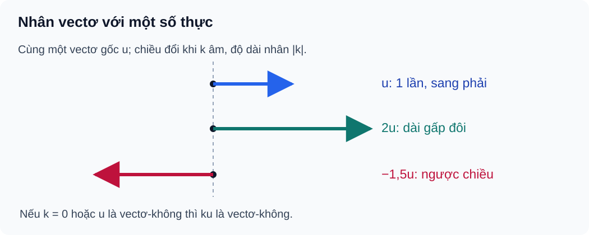
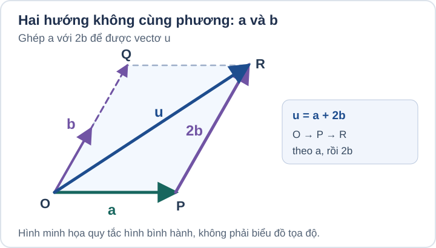

# Bài 9. Tích của một vectơ với một số

TOÁN 10 · CHƯƠNG IV · KIẾN THỨC SGK KNTT

Học kiến thức và ví dụ, rồi luyện tập theo từng kĩ năng.

=== "Khám phá kiến thức"

    ### Cùng tìm hiểu

    Nếu một vectơ biểu diễn bước đi 2 m sang Đông, thì \(3\vec u\) biểu diễn một mũi tên **cùng hướng** dài 6 m. Nhưng \(-3\vec u\) lại dài 6 m về **hướng ngược**. Như vậy, khi nhân vectơ với một số, **giá trị tuyệt đối của số** điều chỉnh độ dài còn **dấu** điều chỉnh hướng.

    Cách nghĩ ấy giải thích phép nhân \(k\vec u\) trước khi viết tính chất phân phối. Nó còn giúp em hiểu tại sao mọi bội khác không của cùng một vectơ đều nằm trên các đường cùng phương, và làm thế nào diễn đạt trung điểm, trọng tâm bằng phương trình vectơ.

    Đừng vội học thuộc các tính chất rời rạc. Mỗi lần xuất hiện hệ số âm, số 0 hoặc tổng hai vectơ, hãy thử hình dung sự phóng to, thu nhỏ, đổi chiều hoặc ghép mũi tên.

    ### Ví dụ trực quan

    **Quan sát các mũi tên trước khi tự thử:** cùng một vectơ gốc, số dương làm mũi tên dài/ngắn đi nhưng không đổi chiều; số âm đảo chiều. Đừng dự đoán độ dài bằng dấu của hệ số.

    <figure class="thpt-r4-plot thpt-r4-probability-figure"><figcaption>Đọc từ mũi tên gốc: hệ số dương giữ hướng, hệ số âm đảo hướng, trị tuyệt đối quyết định độ dài. Trường hợp \(0\) phải xét riêng.</figcaption></figure>

    

    #### Nhân vectơ với số: phóng to, thu nhỏ, đổi chiều

    Trên bản đồ, một mũi tên dịch chuyển có thể được kéo dài gấp đôi hay đảo chiều mà vẫn nằm theo cùng phương; số nhân mô tả phép biến đổi này.

    Em đã biết vectơ có độ dài không âm và vectơ khác không có hướng. Bây giờ hãy hình dung điều gì thay đổi khi nhân vectơ với một số dương, số âm hoặc số 0. 

    Nhân một vectơ \(\vec u\) với số k giữ phương khi khác không, đổi độ dài theo \(|k|\), đổi hướng nếu k âm; k=0 biến thành \(\vec0\). Đây là ý nghĩa của \(k\vec u\), không phải phép cộng hai độ dài.

    Kiểm k=0 hoặc \(\vec u=\vec0\) trước khi nói cùng/ngược hướng của một mũi tên có chiều. Không chia tỉ số khi vectơ gốc bằng 0.

    **Em vận dụng.** Với \(\vec u\ne\vec0\), vectơ \(0\vec u\) là gì? Nó có độ dài bằng bao nhiêu?

    ??? question "Em tự mở đối chiếu sau khi đã thử làm"

        **Kết quả:** \(0\vec u=\vec0\), độ dài bằng 0.

        **Vì sao:** Vì \(|0\vec u|=|0|\,|\vec u|=0\); không cố gán hướng vật lý riêng cho vectơ-không.

    **Kiểm lỗi dùng chung:** [Xem hướng dẫn tự sửa](#HELP-G10-B09-01).
    

    #### Dấu k quyết định chiều, |k| quyết định độ lớn

    Khi một robot quay trở lại theo đúng đường vừa đi nhưng gấp đôi độ dời, độ lớn tăng còn chiều đổi ngược.

    Hãy tách hai câu hỏi: độ dài thay đổi bao nhiêu lần, và chiều có đảo ngược không? Dấu của hệ số k sẽ giúp trả lời câu hỏi thứ hai. 

    Với vectơ khác không, \(k=-2\) làm mũi tên quay ngược và kéo dài gấp đôi; **độ dài** dùng \(|k|\), còn dấu chỉ ảnh hưởng **hướng**.

    Hỏi 'k có âm không' để xét hướng; hỏi '|k| bằng mấy' để xét độ dài. Không ghi 'độ dài −6 m' dù k âm.

    **Em vận dụng.** Một vectơ \(\vec u\) dài 3 m hướng Đông. Mô tả \(-2\vec u\): độ dài và hướng.

    ??? question "Em tự mở đối chiếu sau khi đã thử làm"

        **Kết quả:** \(-2\vec u\) dài 6 m và hướng Tây.

        **Vì sao:** Độ dài là 2×3=6, dấu âm khiến nó ngược hướng với \(\vec u\).

    
    

    ??? tip "Kiểm lỗi"

        
<strong>Vì sao sai?</strong> Hệ số $k$ có thể âm, nhưng độ dài vectơ luôn không âm. Vì vậy $|k\vec u|=|k|\,|\vec u|$, không phải $k|\vec u|$.

        <ol><li><strong>Tìm độ dài:</strong> thay $k$ bằng $|k|$ trước khi nhân độ dài.</li><li><strong>Xét hướng:</strong> nếu cả $k$ và $\vec u$ khác 0 thì $k>0$ giữ hướng, $k<0$ đảo hướng.</li><li><strong>Xét trường hợp đặc biệt:</strong> $k=0$ hoặc $\vec u=\vec0$ thì được vectơ-không; không gán hướng riêng cho vectơ-không.</li><li><strong>Thử kiểm:</strong> nếu $|\vec u|=4$ cm, hãy tự mô tả $-2\vec u$ rồi đối chiếu với Ví dụ 1.</li></ol>
        
<strong>Ôn lại:</strong> Nếu vẫn nhầm, quay về định nghĩa trong tab Kiến thức SGK, sau đó luyện câu về độ dài và chiều của vectơ.

<a href="../luyen-tap/">Quay lại luyện tập</a>

    

    #### Phóng to cả chuyển động tổng cộng hoặc từng chặng

    Đi hai chặng rồi phóng to toàn bộ lộ trình theo một tỉ lệ cho cùng độ dời ròng như phóng to từng chặng rồi cộng.

    Từ quy tắc cộng vectơ ở Bài 8, em có thể hình dung nhân với một số nguyên dương như việc ghép những vectơ cùng hướng, rồi mở rộng ý tưởng ấy. 

    Do phép dời tỉ lệ theo từng thành phần, \(k(\vec u+\vec v)=k\vec u+k\vec v\). Cùng một vectơ có thể biểu diễn theo nhiều chặng, không được nhân k chỉ cho chặng đầu.

    Nhận ra biểu thức có ngoặc và một hệ số chung trước khi phân phối; không dùng phép phân phối lên độ dài \(|\vec u+\vec v|\) như một tổng số học.

    **Em vận dụng.** Cho \(\vec u\) dài 2 đơn vị về Đông và \(\vec v\) dài 1 đơn vị về Bắc. Hãy mô tả \(2(\vec u+\vec v)\) và \(2\vec u+2\vec v\).

    ??? question "Em tự mở đối chiếu sau khi đã thử làm"

        **Kết quả:** Cả hai là vectơ có thành phần 4 đơn vị về Đông và 2 đơn vị về Bắc.

        **Vì sao:** Phóng đôi tổng hai chặng hoặc phóng đôi từng chặng dẫn đến cùng điểm cuối. Đây là đẳng thức vectơ, không có nghĩa độ dài bằng 4+2.

    **Kiểm lỗi dùng chung:** [Xem hướng dẫn tự sửa](#HELP-G10-B09-01).
    

    #### Một đường chuyển động, nhiều vectơ

    Các mũi tên cùng nằm trên một đường có thể dài ngắn khác nhau và ngược chiều; vẫn cùng phương.

    Muốn kiểm tra hai vectơ có cùng phương, hãy nhớ mối liên hệ giữa phương của mũi tên và phép nhân với một số. Cần xét riêng vectơ-không để không dùng phép chia cho 0. 

    Hai vectơ khác không cùng phương khi vectơ nọ là bội khác 0 của vectơ kia; hệ số âm cho ngược hướng, hệ số dương cho cùng hướng. Với \(\vec0\), phải xét theo quy ước SGK/SBT.

    Để kiểm cùng phương, tìm hệ số k sao cho \(\vec v=k\vec u\) khi \(\vec u\ne\vec0\). Không chia cho 0 hay suy bằng nhau chỉ từ cùng phương.

    **Em vận dụng.** \(\vec v=-3\vec u\) và \(\vec u\ne\vec0\). Hai vectơ có cùng phương không? Cùng hướng không? Tỉ số độ dài bằng bao nhiêu?

    ??? question "Em tự mở đối chiếu sau khi đã thử làm"

        **Kết quả:** Cùng phương, ngược hướng, \(|\vec v|/|\vec u|=3\).

        **Vì sao:** Bội âm đổi chiều, độ lớn nhân với 3. Đây là phép mô tả phương/hướng, không phải hai vectơ bằng nhau.

    **Kiểm lỗi dùng chung:** [Xem hướng dẫn tự sửa](#HELP-G10-B09-01).
    

    #### Tỉ lệ trung tuyến dẫn tới tỉ lệ vectơ

    Biết điểm M ở chính giữa AB hay G chia trung tuyến AM theo tỉ lệ 2:1 giúp tìm vị trí chỉ bằng phép nhân vectơ với số.

    Trong tam giác ABC, M là trung điểm BC còn G là trọng tâm. Ba điểm A, G, M nằm trên trung tuyến AM với AG:GM=2:1; từ đó ta đọc được hệ số của từng vectơ. 

    Vectơ cùng phương cùng chiều theo một đoạn cho phép đổi tỉ số độ dài thành hệ số có dấu: \(\overrightarrow{AG}=\frac23\overrightarrow{AM}\), trong khi \(\overrightarrow{GA}=-2\overrightarrow{GM}\).

    Đặt thứ tự điểm trên đoạn trước, rồi chọn hệ số của đúng vectơ đích. Không nhầm AG/GM=2 với AG/AM=2.

    **Em vận dụng.** Trong tam giác ABC, M là trung điểm BC, G là trọng tâm; nếu AM=9 cm thì AG bằng bao nhiêu? Viết \(\overrightarrow{AG}\) theo \(\overrightarrow{AM}\).

    ??? question "Em tự mở đối chiếu sau khi đã thử làm"

        **Kết quả:** AG=6 cm và \(\overrightarrow{AG}=\frac23\overrightarrow{AM}\).

        **Vì sao:** G nằm giữa A và M, AG:GM=2:1 nên AM gồm 3 phần, AG chiếm 2 phần. Hai vectơ A→G, A→M cùng hướng.

    
    

    ??? tip "Kiểm lỗi"

        
<strong>Vì sao sai?</strong> Trung điểm quyết định vị trí và độ dài bằng nhau, nhưng chiều của $\overrightarrow{MA}$ ngược với $\overrightarrow{AM}$. Trọng tâm $G$ chia trung tuyến $AM$ theo tỉ số $AG:GM=2:1$, nên $AG:AM=2:3$, không phải $2:1$.

        <ol><li><strong>Vẽ hình:</strong> đánh dấu $M$ là trung điểm $BC$ và $G$ nằm trên $AM$.</li><li><strong>Đọc mũi tên:</strong> xác định chính xác điểm đầu, điểm cuối trước khi đặt dấu hệ số.</li><li><strong>Dùng đúng tỉ số:</strong> $\overrightarrow{AG}=\tfrac23\overrightarrow{AM}$ và $\overrightarrow{AM}=\tfrac12(\overrightarrow{AB}+\overrightarrow{AC})$.</li><li><strong>Kiểm lại:</strong> kết quả phải là $\overrightarrow{AG}=\tfrac13(\overrightarrow{AB}+\overrightarrow{AC})$; đổi $AG$ thành $GA$ thì đổi dấu.</li></ol>
        
<strong>Ôn lại:</strong> Xem Ví dụ 2 về trung điểm và Ví dụ 3 về trọng tâm, rồi làm một câu luyện tập tương ứng.

<a href="../luyen-tap/">Quay lại luyện tập</a>

    ### Vì sao phải phân tích một vectơ?

    Khi một vị trí dịch chuyển theo **hai phương độc lập** (chẳng hạn dọc hai cạnh không song song của một hình bình hành), ta muốn xác định đã đi bao nhiêu lần theo từng hướng. Một mũi tên tổng có thể tách thành hai mũi tên thành phần theo hai phương ấy; đây là ý tưởng **phân tích một vectơ theo hai vectơ không cùng phương**. Nếu hai hướng lại cùng phương, ta không thể xác định duy nhất hai hệ số: một phần dịch chuyển có thể chuyển từ hướng này sang hướng kia mà kết quả không đổi.

    Em sẽ học cách vẽ hình bình hành, chọn điểm đầu chung, đọc chiều hệ số âm và dùng quy tắc cộng vectơ của Bài 8. Đây là kiến thức của **Bài 9**, chưa cần dùng tọa độ học ở Bài 10.

    ### Thuật ngữ, kiến thức và kỹ năng

    **Thuật ngữ:** Tích của một vectơ với một số, hệ số âm/dương, phân phối, điều kiện cùng phương, phân tích một vectơ theo hai vectơ không cùng phương, trung điểm và trọng tâm.

    **Sau bài học, em cần làm được:** Xác định \(k\vec u\), độ dài và chiều trong các trường hợp \(k=0\), \(k<0\), \(\vec u=\vec0\); biến đổi bằng tính chất phân phối, nhận biết điều kiện cùng phương; **phân tích vectơ theo hai vectơ không cùng phương** và chứng minh kết quả bằng quy tắc cộng; viết các hệ thức trung điểm/trọng tâm khi đủ điều kiện.

=== "Kiến thức SGK"

    ### 2.1. Tích của một vectơ với một số

    **Vì sao cần phép nhân này?** Ở Bài 8, em có thể cộng \(\vec u+\vec u+\vec u\). Nếu muốn tạo vectơ dài gấp ba lần, hoặc cùng độ dài nhưng đảo hướng, ta dùng một số thực \(k\) để biểu diễn phép biến đổi ấy bằng \(k\vec u\).

    **Từ quan sát đến định nghĩa:** Nếu số nhân là \(2\), vectơ dài gấp đôi; nếu là \(-2\), độ dài vẫn gấp đôi nhưng chiều đổi ngược. Với \(k=0\) phải xử lí vectơ-không riêng. Từ đó, **độ dài** được quyết định bởi \(|k|\), còn chiều của vectơ khác không phụ thuộc dấu \(k\).

    
<strong>Định nghĩa — Tích của một vectơ với một số:</strong> Với số thực \(k\) và vectơ \(\vec u\), vectơ \(k\vec u\) được xác định như sau: nếu \(k\ne0\) và \(\vec u\ne\vec0\), nó có độ dài \(|k|\,|\vec u|\), <strong>cùng hướng</strong> với \(\vec u\) khi \(k>0\) và <strong>ngược hướng</strong> khi \(k<0\). Nếu \(k=0\) hoặc \(\vec u=\vec0\), kết quả là \(\vec0\).

    **Cách kiểm định nghĩa:** Với \(|\vec u|=4\) cm, \(2\vec u\) dài 8 cm cùng hướng; \(-\tfrac12\vec u\) dài 2 cm ngược hướng. Nhưng \(0\vec u\) có độ dài 0, không có chiều vật lí để so sánh.

    ### 2.2. Các tính chất của phép nhân vectơ với một số

    Để tính nhanh một biểu thức, trước hết phải biết **đang nhân một tổng**, **đang cộng hai hệ số**, hay **đang nhân liên tiếp hai số**. Ba tình huống khác nhau có các tính chất tương ứng:

    
<strong>Tính chất của phép nhân vectơ với một số:</strong> Với mọi số thực \(k,m\) và mọi vectơ \(\vec u,\vec v\):
    <ul><li><strong>Phân phối theo tổng vectơ:</strong> \(k(\vec u+\vec v)=k\vec u+k\vec v\).</li><li><strong>Phân phối theo tổng hệ số:</strong> \((k+m)\vec u=k\vec u+m\vec u\).</li><li><strong>Nhân liên tiếp:</strong> \(k(m\vec u)=(km)\vec u\).</li><li><strong>Hệ số đơn vị và đối:</strong> \(1\vec u=\vec u\), \((-1)\vec u=-\vec u\).</li></ul>

    **Lí do chọn tính chất:** Nếu em gặp \(2(\vec u+\vec v)\), dùng phân phối theo **tổng vectơ**; nếu gặp \(2\vec u+3\vec u\), gộp **hệ số**; nếu gặp \(2(3\vec u)\), nhân **liên tiếp**. Từ phân phối cũng suy ra \(k(\vec u-\vec v)=k\vec u-k\vec v\).

    
<strong>Điều kiện hai vectơ cùng phương:</strong> Với \(\vec b\ne\vec0\), hai vectơ \(\vec a,\vec b\) cùng phương khi và chỉ khi tồn tại <strong>một số thực</strong> \(t\) sao cho \(\vec a=t\vec b\). Nếu \(\vec a\ne\vec0\), hệ số \(t\ne0\); \(t>0\) cho cùng hướng, \(t<0\) cho ngược hướng. Khi một vectơ bằng \(\vec0\), dùng quy ước về vectơ-không, không được chia cho \(0\).

    **Lỗi dễ mắc:** Cùng phương không đồng nghĩa cùng hướng; chỉ biết hai độ dài bằng nhau cũng chưa chứng minh được hai vectơ bằng nhau.

    #### Phân tích một vectơ theo hai vectơ không cùng phương

    Em đã biết hai vectơ không cùng phương tạo thành **hai hướng độc lập trong mặt phẳng**. Khi đặt chung điểm đầu, ta dựng hình bình hành để ghép các thành phần theo hai hướng, rồi dùng quy tắc cộng vectơ của Bài 8.

    <figure class="thpt-r4-plot"><picture><source media="(max-width: 600px)" srcset="../../../../assets/images/thpt/THPT_G10_B09_DECOMPOSITION_MOBILE_D5_R03.svg"></picture><figcaption>Đọc hình từ \(O\): đi theo \(\vec a\), rồi theo \(2\vec b\) (mũi tên song song với \(\vec b\)) để đến \(R\). Vectơ tổng \(\vec u=\overrightarrow{OR}=\vec a+2\vec b\). Hai hướng \(\vec a,\vec b\) không cùng phương.</figcaption></figure>

    
<strong>Phân tích duy nhất theo hai vectơ không cùng phương (Chú ý SGK):</strong> Cho hai vectơ \(\vec a,\vec b\) <strong>không cùng phương</strong> trong cùng mặt phẳng. Khi đó, <strong>mọi vectơ</strong> \(\vec u\) trong mặt phẳng đều viết được <strong>duy nhất</strong> dưới dạng \(\vec u=x\vec a+y\vec b\), với \(x,y\) là hai số thực. Cặp \((x;y)\) được xác định duy nhất bởi \(\vec u\) và hai vectơ đã chọn.

    **Vì sao cần điều kiện không cùng phương?** Nếu \(\vec b=2\vec a\), ta có \(\vec a+0\vec b=0\vec a+\tfrac12\vec b\): một vectơ mà có hai cặp hệ số khác nhau. Khi \(\vec a,\vec b\) không cùng phương, nếu \(x\vec a+y\vec b=x'\vec a+y'\vec b\) thì \((x-x')\vec a=(y'-y)\vec b\). Hai vectơ không cùng phương chỉ có thể bằng nhau như vậy khi cả hai hệ số đều \(0\); do đó \(x=x'\), \(y=y'\). Vậy cặp hệ số duy nhất.

    **Cách làm khi gặp hình:** Chọn chung một điểm đầu; đưa vectơ cần phân tích về một đường đi có hai chặng theo hai phương đã cho; dùng quy tắc ba điểm, trung điểm hay hình bình hành để xác định \(x,y\); kiểm lại bằng cách cộng \(x\vec a+y\vec b\). Hệ số âm thể hiện ngược chiều, không phải độ dài âm.

    #### Hệ quả: trung điểm và trọng tâm

    **Trung điểm:** Nếu \(I\) là trung điểm \(AB\), hai vectơ \(\overrightarrow{IA}\) và \(\overrightarrow{IB}\) đối nhau. Với điểm \(O\) tùy ý, tổng \(\overrightarrow{OA}+\overrightarrow{OB}\) bằng hai lần vectơ \(\overrightarrow{OI}\) theo công thức dưới đây.

    **Trọng tâm:** Trong tam giác \(ABC\), nếu \(M\) là trung điểm \(BC\), \(G\) là trọng tâm thì \(G\) thuộc trung tuyến \(AM\) và \(AG:GM=2:1\). Đặt các đẳng thức vectơ theo đúng điểm đầu/điểm cuối; không đổi thành đẳng thức độ dài.

    
<strong>Hệ thức trung điểm – trọng tâm (đủ giả thiết hình học):</strong>

    \[
    \begin{aligned}
    \overrightarrow{OA}+\overrightarrow{OB}&=2\overrightarrow{OI}
      &&(I\text{ là trung điểm }AB),\\
    \overrightarrow{AG}&=\tfrac23\overrightarrow{AM}
      =\tfrac13(\overrightarrow{AB}+\overrightarrow{AC})
      &&(G\text{ là trọng tâm }\triangle ABC),\\
    \overrightarrow{OA}+\overrightarrow{OB}+\overrightarrow{OC}
      &=3\overrightarrow{OG}
      &&(G\text{ là trọng tâm }\triangle ABC).
    \end{aligned}
    \]

    

    **Giới hạn áp dụng:** Những hệ thức trọng tâm không đúng cho một điểm \(G\) bất kì. Muốn suy ra \(G\) là trọng tâm phải kiểm đủ điều kiện hình học hoặc dùng hệ thức tương đương đã chứng minh.

    
<strong>Kiến thức cần nhớ — Bài 9:</strong> \(k\vec u\) có độ dài \(|k|\,|\vec u|\), dấu \(k\) quyết định hướng khi hai vectơ khác không; trường hợp \(k=0\) hoặc \(\vec u=\vec0\) cho vectơ-không. Phép nhân số có tính phân phối. Hai vectơ cùng phương có quan hệ bội số (với điều kiện không chia cho vectơ-không). Hai vectơ <strong>không cùng phương</strong> cho phép phân tích <strong>duy nhất</strong> một vectơ theo hai hướng đó. Hệ thức trung điểm/trọng tâm chỉ sử dụng khi đủ giả thiết.

    #### Vận dụng

    Với các đại lượng như độ dời và lực, vectơ biểu diễn <strong>độ lớn lẫn hướng</strong>. Khi mô hình hóa một lực thành hai thành phần theo hai phương, cần xét đúng hệ số và điều kiện không cùng phương; không cộng độ dài hai lực thay cho vectơ tổng.

=== "Ví dụ"

    Trước mỗi bài, xác định **đối tượng phải tìm**, **quy tắc được chọn** và **điều kiện đủ dùng quy tắc**. Lời giải dưới đây chia thành hướng giải, các bước và cách tự kiểm, không coi công thức là thay thế lập luận.

    ### Ví dụ 1. Độ dài và hướng khi hệ số âm

    **Đề:** Cho \(|\vec u|=5\) cm, \(\vec u\ne\vec0\), đặt \(\vec v=-3\vec u\). Tìm độ dài và hướng của \(\vec v\).

    **Hướng giải:** Tách thành hai bước: dùng \(|k|\) cho độ dài, sau đó xét dấu \(k\) cho chiều. Vì \(\vec u\ne\vec0\), có thể so sánh hướng.

    **Giải:** \(k=-3\), nên \(|\vec v|=|-3|\cdot5=15\) cm. Vì \(k<0\), \(\vec v\) ngược hướng với \(\vec u\).

    **Tự kiểm:** Độ dài phải không âm; nếu hệ số đổi thành \(3\), độ dài vẫn là 15 cm nhưng vectơ sẽ cùng hướng với \(\vec u\).

    ### Ví dụ 2. Trung điểm và vectơ đối

    **Đề:** Cho \(AB=12\) cm và \(M\) là trung điểm \(AB\). Biểu thị \(\overrightarrow{AM},\overrightarrow{MB},\overrightarrow{MA}\) qua \(\overrightarrow{AB}\).

    **Hướng giải:** Từ giả thiết trung điểm, \(AM=MB=6\) cm và \(A,M,B\) thẳng hàng theo thứ tự. Chọn \(\overrightarrow{AB}\) làm vectơ gốc rồi kiểm từng chiều.

    **Giải:** \(\overrightarrow{AM}=\tfrac12\overrightarrow{AB}\) vì cùng hướng, độ dài bằng một nửa. Tương tự, \(\overrightarrow{MB}=\tfrac12\overrightarrow{AB}\). Còn \(\overrightarrow{MA}\) ngược hướng với \(\overrightarrow{AB}\), nên \(\overrightarrow{MA}=-\tfrac12\overrightarrow{AB}\).

    **Tự kiểm:** Cả ba độ dài bằng 6 cm nhưng \(\overrightarrow{MA}\) có hệ số âm. Không nhầm \(MA\) với \(AM\).

    ### Ví dụ 3. Trọng tâm theo tổng hai vectơ

    **Đề:** Với tam giác \(ABC\), \(G\) là trọng tâm, \(M\) là trung điểm \(BC\). Biểu thị \(\overrightarrow{AG}\) theo \(\overrightarrow{AB},\overrightarrow{AC}\).

    **Hướng giải:** Từ Bài 8, dùng quy tắc trung điểm để viết \(2\overrightarrow{AM}=\overrightarrow{AB}+\overrightarrow{AC}\). Từ hình học trọng tâm, \(AG:AM=2:3\).

    **Giải:** Do \(G\) nằm trên đoạn \(AM\) và \(AG=\tfrac23 AM\), ta có \(\overrightarrow{AG}=\tfrac23\overrightarrow{AM}\). Thay công thức trung điểm:

    \[
    \overrightarrow{AG}
      =\frac23\cdot\frac12(\overrightarrow{AB}+\overrightarrow{AC})
      =\frac13(\overrightarrow{AB}+\overrightarrow{AC}).
    \]

    **Tự kiểm:** \(AG:GM=2:1\), còn \(AG:AM=2:3\). Không lấy \(\tfrac23\) của toàn tổng \(\overrightarrow{AB}+\overrightarrow{AC}\) vì tổng đó bằng \(2\overrightarrow{AM}\).

    ### Ví dụ 4. Phân tích theo hai vectơ không cùng phương

    **Đề:** Trong tam giác \(ABC\), lấy \(M,N\) lần lượt là trung điểm của \(AB\), \(AC\). Đặt \(\vec a=\overrightarrow{AB}\), \(\vec b=\overrightarrow{AC}\). Phân tích \(\overrightarrow{MN}\) theo \(\vec a,\vec b\).

    **Hướng giải:** Ta biết \(\vec a,\vec b\) không cùng phương vì \(A,B,C\) là ba đỉnh một tam giác. Đưa vectơ \(\overrightarrow{MN}\) về các vectơ có chung gốc \(A\) bằng quy tắc hiệu ở Bài 8, rồi thay quan hệ trung điểm.

    **Giải:** Theo quy tắc hiệu hai vectơ chung gốc:

    \[
    \overrightarrow{MN}
     =\overrightarrow{AN}-\overrightarrow{AM}.
    \]

    Vì \(M,N\) là trung điểm, \(\overrightarrow{AM}=\tfrac12\vec a\) và \(\overrightarrow{AN}=\tfrac12\vec b\). Vậy

    \[
    \overrightarrow{MN}=-\tfrac12\vec a+\tfrac12\vec b.
    \]

    **Vì sao là phân tích hợp lệ?** Hai hệ số là \(-\tfrac12\) và \(\tfrac12\); vectơ \(-\tfrac12\vec a\) đi ngược hướng \(\vec a\), còn \(\tfrac12\vec b\) cùng hướng \(\vec b\). Vì \(\vec a,\vec b\) không cùng phương, cặp hệ số đó là **duy nhất**.

    **Tự kiểm:** \(\overrightarrow{MN}\) cùng hướng với \(\overrightarrow{BC}=\vec b-\vec a\) và dài bằng một nửa \(BC\), đúng tính chất đường trung bình tam giác. Nếu đổi thành \(\overrightarrow{NM}\), cả hai hệ số phải đổi dấu.

=== "Lỗi thường gặp"

    ??? tip "Đảo dấu khi phân tích vectơ theo hai vectơ không cùng phương"

        
<strong>Lỗi thường gặp:</strong> Với tam giác $ABC$, $M$ và $N$ lần lượt là trung điểm của $AB$ và $AC$, đặt $\vec a=\overrightarrow{AB}$, $\vec b=\overrightarrow{AC}$. Một lời giải viết $\overrightarrow{MN}=\tfrac12\vec a-\tfrac12\vec b$. <strong>Kết quả này sai dấu.</strong>

        
<strong>Vì sao sai?</strong> $\tfrac12\vec a-\tfrac12\vec b=\overrightarrow{AM}-\overrightarrow{AN}=\overrightarrow{NM}$, không phải $\overrightarrow{MN}$. Khi dùng quy tắc hiệu hai vectơ, em đã đổi chỗ điểm đầu và điểm cuối.

        <ol><li><strong>Nhìn chiều mũi tên:</strong> $\overrightarrow{MN}$ đi từ $M$ đến $N$, không đi từ $N$ đến $M$.</li><li><strong>Viết quy tắc trước khi thay hệ số:</strong> $\overrightarrow{MN}=\overrightarrow{MA}+\overrightarrow{AN}=\overrightarrow{AN}-\overrightarrow{AM}$.</li><li><strong>Thay quan hệ trung điểm:</strong> $\overrightarrow{AM}=\tfrac12\vec a$, $\overrightarrow{AN}=\tfrac12\vec b$; do đó $\boxed{\overrightarrow{MN}=-\tfrac12\vec a+\tfrac12\vec b}$.</li></ol>
        
<strong>Tự kiểm:</strong> Nếu đổi câu hỏi thành $\overrightarrow{NM}$, cả hai hệ số phải đổi dấu. Vì $ABC$ là tam giác nên $\vec a,\vec b$ không cùng phương; cặp hệ số trong phép phân tích này là <strong>duy nhất</strong>, không thể tự chọn một cặp khác để bù dấu sai.

        
<strong>Ôn và luyện lại:</strong> Xem quy tắc ba điểm/quy tắc hiệu vectơ ở Bài 8, đọc lời giải Ví dụ 4 của Bài 9 rồi <a href="../luyen-tap/?item=THPT-G10-B09-P07">tự thử bài phân tích vectơ trong phần Luyện tập</a>. Không dùng phép chia cho vectơ để tìm hệ số.

    **Học tiếp:** [Core và Luyện tập](luyen-tap.md) · [Tự kiểm tra cuối chương](tu-kiem-tra-chuong.md).

    
Nguồn toán học: SGK Toán 10 Kết nối tri thức với cuộc sống và học liệu SLM hiện hành. Lời giảng biên tập nhằm hỗ trợ tự học độc lập.

