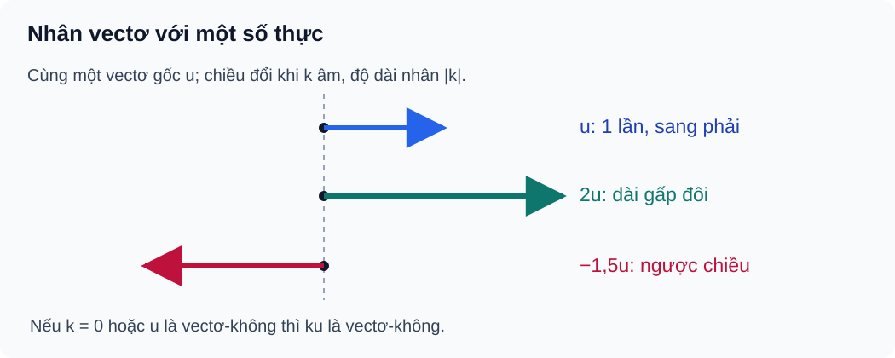

# Bài 9. Tích của một vectơ với một số

TOÁN 10 · CHƯƠNG IV · KIẾN THỨC SGK KNTT

Học kiến thức và ví dụ, rồi luyện tập theo từng kĩ năng.

=== "Khám phá kiến thức"

    ### Cùng tìm hiểu

    Nếu một vectơ biểu diễn bước đi 2 m sang Đông, thì \(3\vec u\) biểu diễn một mũi tên **cùng hướng** dài 6 m. Nhưng \(-3\vec u\) lại dài 6 m về **hướng ngược**. Như vậy, khi nhân vectơ với một số, **giá trị tuyệt đối của số** điều chỉnh độ dài còn **dấu** điều chỉnh hướng.

    Cách nghĩ ấy giải thích phép nhân \(k\vec u\) trước khi viết tính chất phân phối. Nó còn giúp em hiểu tại sao mọi bội khác không của cùng một vectơ đều nằm trên các đường cùng phương, và làm thế nào diễn đạt trung điểm, trọng tâm bằng phương trình vectơ.

    Đừng vội học thuộc các tính chất rời rạc. Mỗi lần xuất hiện hệ số âm, số 0 hoặc tổng hai vectơ, hãy thử hình dung sự phóng to, thu nhỏ, đổi chiều hoặc ghép mũi tên.

    ### Ví dụ trực quan

    

    #### Nhân vectơ với số: phóng to, thu nhỏ, đổi chiều

    Trên bản đồ, một mũi tên dịch chuyển có thể được kéo dài gấp đôi hay đảo chiều mà vẫn nằm theo cùng phương; số nhân mô tả phép biến đổi này.

    Em đã biết vectơ có độ dài không âm và vectơ khác không có hướng. Bây giờ hãy hình dung điều gì thay đổi khi nhân vectơ với một số dương, số âm hoặc số 0. 

    Nhân một vectơ \(\vec u\) với số k giữ phương khi khác không, đổi độ dài theo \(|k|\), đổi hướng nếu k âm; k=0 biến thành \(\vec0\). Đây là ý nghĩa của \(k\vec u\), không phải phép cộng hai độ dài.

    Kiểm k=0 hoặc \(\vec u=\vec0\) trước khi nói cùng/ngược hướng của một mũi tên có chiều. Không chia tỉ số khi vectơ gốc bằng 0.

    **Em vận dụng.** Với \(\vec u\ne\vec0\), vectơ \(0\vec u\) là gì? Nó có độ dài bằng bao nhiêu?

    ??? question "Em tự mở đối chiếu sau khi đã thử làm"

        **Kết quả:** \(0\vec u=\vec0\), độ dài bằng 0.

        **Vì sao:** Vì \(|0\vec u|=|0|\,|\vec u|=0\); không cố gán hướng vật lý riêng cho vectơ-không.

    

    #### Dấu k quyết định chiều, |k| quyết định độ lớn

    Khi một robot quay trở lại theo đúng đường vừa đi nhưng gấp đôi độ dời, độ lớn tăng còn chiều đổi ngược.

    Hãy tách hai câu hỏi: độ dài thay đổi bao nhiêu lần, và chiều có đảo ngược không? Dấu của hệ số k sẽ giúp trả lời câu hỏi thứ hai. 

    Với vectơ khác không, \(k=-2\) làm mũi tên quay ngược và kéo dài gấp đôi; **độ dài** dùng \(|k|\), còn dấu chỉ ảnh hưởng **hướng**.

    Hỏi 'k có âm không' để xét hướng; hỏi '|k| bằng mấy' để xét độ dài. Không ghi 'độ dài −6 m' dù k âm.

    **Em vận dụng.** Một vectơ \(\vec u\) dài 3 m hướng Đông. Mô tả \(-2\vec u\): độ dài và hướng.

    ??? question "Em tự mở đối chiếu sau khi đã thử làm"

        **Kết quả:** \(-2\vec u\) dài 6 m và hướng Tây.

        **Vì sao:** Độ dài là 2×3=6, dấu âm khiến nó ngược hướng với \(\vec u\).

    

    #### Phóng to cả chuyển động tổng cộng hoặc từng chặng

    Đi hai chặng rồi phóng to toàn bộ lộ trình theo một tỉ lệ cho cùng độ dời ròng như phóng to từng chặng rồi cộng.

    Từ quy tắc cộng vectơ ở Bài 8, em có thể hình dung nhân với một số nguyên dương như việc ghép những vectơ cùng hướng, rồi mở rộng ý tưởng ấy. 

    Do phép dời tỉ lệ theo từng thành phần, \(k(\vec u+\vec v)=k\vec u+k\vec v\). Cùng một vectơ có thể biểu diễn theo nhiều chặng, không được nhân k chỉ cho chặng đầu.

    Nhận ra biểu thức có ngoặc và một hệ số chung trước khi phân phối; không dùng phép phân phối lên độ dài \(|\vec u+\vec v|\) như một tổng số học.

    **Em vận dụng.** Cho \(\vec u\) dài 2 đơn vị về Đông và \(\vec v\) dài 1 đơn vị về Bắc. Hãy mô tả \(2(\vec u+\vec v)\) và \(2\vec u+2\vec v\).

    ??? question "Em tự mở đối chiếu sau khi đã thử làm"

        **Kết quả:** Cả hai là vectơ có thành phần 4 đơn vị về Đông và 2 đơn vị về Bắc.

        **Vì sao:** Phóng đôi tổng hai chặng hoặc phóng đôi từng chặng dẫn đến cùng điểm cuối. Đây là đẳng thức vectơ, không có nghĩa độ dài bằng 4+2.

    

    #### Một đường chuyển động, nhiều vectơ

    Các mũi tên cùng nằm trên một đường có thể dài ngắn khác nhau và ngược chiều; vẫn cùng phương.

    Muốn kiểm tra hai vectơ có cùng phương, hãy nhớ mối liên hệ giữa phương của mũi tên và phép nhân với một số. Cần xét riêng vectơ-không để không dùng phép chia cho 0. 

    Hai vectơ khác không cùng phương khi vectơ nọ là bội khác 0 của vectơ kia; hệ số âm cho ngược hướng, hệ số dương cho cùng hướng. Với \(\vec0\), phải xét theo quy ước SGK/SBT.

    Để kiểm cùng phương, tìm hệ số k sao cho \(\vec v=k\vec u\) khi \(\vec u\ne\vec0\). Không chia cho 0 hay suy bằng nhau chỉ từ cùng phương.

    **Em vận dụng.** \(\vec v=-3\vec u\) và \(\vec u\ne\vec0\). Hai vectơ có cùng phương không? Cùng hướng không? Tỉ số độ dài bằng bao nhiêu?

    ??? question "Em tự mở đối chiếu sau khi đã thử làm"

        **Kết quả:** Cùng phương, ngược hướng, \(|\vec v|/|\vec u|=3\).

        **Vì sao:** Bội âm đổi chiều, độ lớn nhân với 3. Đây là phép mô tả phương/hướng, không phải hai vectơ bằng nhau.

    

    #### Tỉ lệ trung tuyến dẫn tới tỉ lệ vectơ

    Biết điểm M ở chính giữa AB hay G chia trung tuyến AM theo tỉ lệ 2:1 giúp tìm vị trí chỉ bằng phép nhân vectơ với số.

    Trong tam giác ABC, M là trung điểm BC còn G là trọng tâm. Ba điểm A, G, M nằm trên trung tuyến AM với AG:GM=2:1; từ đó ta đọc được hệ số của từng vectơ. 

    Vectơ cùng phương cùng chiều theo một đoạn cho phép đổi tỉ số độ dài thành hệ số có dấu: \(\overrightarrow{AG}=\frac23\overrightarrow{AM}\), trong khi \(\overrightarrow{GA}=-2\overrightarrow{GM}\).

    Đặt thứ tự điểm trên đoạn trước, rồi chọn hệ số của đúng vectơ đích. Không nhầm AG/GM=2 với AG/AM=2.

    **Em vận dụng.** Trong tam giác ABC, M là trung điểm BC, G là trọng tâm; nếu AM=9 cm thì AG bằng bao nhiêu? Viết \(\overrightarrow{AG}\) theo \(\overrightarrow{AM}\).

    ??? question "Em tự mở đối chiếu sau khi đã thử làm"

        **Kết quả:** AG=6 cm và \(\overrightarrow{AG}=\frac23\overrightarrow{AM}\).

        **Vì sao:** G nằm giữa A và M, AG:GM=2:1 nên AM gồm 3 phần, AG chiếm 2 phần. Hai vectơ A→G, A→M cùng hướng.

    ### Thuật ngữ, kiến thức và kỹ năng

    **Thuật ngữ:** Tích của số với vectơ, độ dài, đổi hướng theo dấu hệ số, tính phân phối, cùng phương, trung điểm/trọng tâm.

    **Sau bài học, em cần làm được:** Tìm hướng và độ dài của \(k\vec u\); nhận biết hai vectơ cùng phương; biến đổi tổng và tích; kiểm các trường hợp \(k=0\) và \(k<0\).

=== "Kiến thức SGK"

    ### 2.1. Tích của một vectơ với một số

    **Quan sát hình.** Quan sát mũi tên gốc, các bội dương và âm: độ dài đổi theo (|k|), còn chiều quay ngược khi (k<0). Chú ý (k=0) tạo vectơ-không.

    <figure class="thpt-r4-plot thpt-r4-probability-figure"><figcaption>Nhân một vectơ với số: cùng hướng, ngược hướng và vectơ không.</figcaption></figure>

    Cho $k\in\mathbb R$ và vectơ $\vec u$. 

    **Độ dài:** Vectơ $k\vec u$ có độ dài $|k\vec u|=|k|\,|\vec u|$. 

    **Hướng:** Nếu $\vec u\ne\vec0$, với $k>0$ thì $k\vec u$ cùng hướng $\vec u$; với $k<0$ thì ngược hướng. 

    **Trường hợp đặc biệt:** Nếu $k=0$ hoặc $\vec u=\vec0$ thì $k\vec u=\vec0$. 

    **Lưu ý:** Với vectơ-không, SGK/SBT KNTT có quy ước riêng về phương/hướng; không suy ra vectơ-không có một mũi tên vật lí khác 0.

    ### 2.2. Các tính chất của phép nhân vectơ với một số

    **Các quy tắc cơ bản:**

    - $k(\vec u+\vec v)=k\vec u+k\vec v$
    - $(k+m)\vec u=k\vec u+m\vec u$
    - $k(m\vec u)=(km)\vec u$
    - $1\vec u=\vec u$
    - $(-1)\vec u=-\vec u$

    Nếu $\vec u$ và $\vec v$ **đều khác không**, chúng cùng phương khi và chỉ khi tồn tại $t\ne0$ sao cho $\vec v=t\vec u$. Trường hợp vectơ không phải kiểm riêng theo quy ước, không chia cho độ dài 0.

    #### Hệ quả: trung điểm và trọng tâm

    **Trung điểm:** Nếu $M$ là trung điểm $AB$ thì $\overrightarrow{AM}=\tfrac12\overrightarrow{AB}$; ngược lại, đẳng thức này xác định trung điểm. 

    **Trọng tâm:** Nếu $G$ là trọng tâm tam giác $ABC$, $M$ là trung điểm $BC$ thì

    \[
    \overrightarrow{AG}=\tfrac23\overrightarrow{AM}=\tfrac13(\overrightarrow{AB}+\overrightarrow{AC}),
    \quad \overrightarrow{GA}+\overrightarrow{GB}+\overrightarrow{GC}=\vec0.
    \]

    Đây là liên hệ vận dụng từ Bài 8 (cộng vectơ) sang nhân với một số, không tạo item trùng với Bài 8.

    #### Vận dụng

    Khi các vectơ biểu diễn dịch chuyển hay lực, $k$ thay đổi độ lớn và có thể đổi chiều. Không ghi độ dài âm hoặc cộng độ dài thay cho tổng vectơ khi các hướng khác nhau.

=== "Ví dụ"

    Trước khi xem lời giải, hãy tự hỏi **bài cho dữ kiện gì, cần tìm điều gì và vì sao quy tắc vừa học phù hợp**. Sau đó hãy giải từng bước, kiểm lại hướng, độ lớn và điều kiện của kết quả.

    ### Ví dụ 1. Độ dài và hướng của tích với hệ số âm

    **Đề:** Cho $|\vec u|=5$ cm, $\vec u\ne\vec0$, đặt $\vec v=-3\vec u$.  
    **Giải:** Ta có $|\vec v|=|-3|\cdot5=15$ cm và $\vec v$ ngược hướng $\vec u$ vì hệ số âm.  
    **Tự kiểm:** Không viết “độ dài = −15 cm”.

    ### Ví dụ 2. Trung điểm và vectơ đối

    **Đề:** Cho $AB=12$ cm và $M$ là trung điểm $AB$. Biểu thị $\overrightarrow{AM},\overrightarrow{MB},\overrightarrow{MA}$ qua $\overrightarrow{AB}$.  
    **Giải:** $\overrightarrow{AM}=\tfrac12\overrightarrow{AB}$, $\overrightarrow{MB}=\tfrac12\overrightarrow{AB}$, $\overrightarrow{MA}=-\tfrac12\overrightarrow{AB}$. Mỗi độ dài bằng 6 cm.  
    **Tự kiểm:** Đừng đổi nhầm MA với AM.

    ### Ví dụ 3. Trọng tâm qua tổng vectơ

    **Đề:** Gọi $G$ là trọng tâm $ABC$, $M$ là trung điểm $BC$. Hãy biểu thị $\overrightarrow{AG}$ theo $\overrightarrow{AB},\overrightarrow{AC}$.  
    **Giải:** $\overrightarrow{AG}=\tfrac23\overrightarrow{AM}$ và $2\overrightarrow{AM}=\overrightarrow{AB}+\overrightarrow{AC}$, suy ra $\overrightarrow{AG}=\tfrac13(\overrightarrow{AB}+\overrightarrow{AC})$.  
    **Tự kiểm:** AG:GM=2:1, nhưng AG:AM=2:3.

=== "Lỗi thường gặp"

    

    ??? tip "Độ dài âm khi k âm hoặc nhầm quy tắc hướng"

        <ul><li>Điểm nghẽn: Nhầm $|k\vec u|$ với $k|\vec u|$.</li><li>Bản chất cần sửa: Phân biệt hệ số (có dấu) với độ dài (không âm).</li><li>Quy trình 5 bước: 1. Viết $|k|$. 2. Tính độ dài. 3. Xét dấu k khi $\vec u\ne\vec0$. 4. Kiểm k=0 riêng. 5. Làm lại B09-C01 rồi P05.</li><li>Liên kết item có sẵn: B09-C01, B09-P01, B09-P05. Không clone câu hoặc giải vào HELP_ID.</li><li>Assessment safety: hỗ trợ chỉ tại Knowledge/Practice, không hiển thị trong phiên Tự kiểm tra trước Final Submit.</li></ul>
<a href="../luyen-tap/">Quay lại luyện tập</a>

    

    ??? tip "Nhầm tỉ số trung điểm/trọng tâm với tỉ số vectơ"

        <ul><li>Điểm nghẽn: Viết sai chiều MA/AM hoặc hệ số AG/AM.</li><li>Bản chất cần sửa: Đọc điểm đầu-cuối; lấy đúng 2/3 trung tuyến, 1/3 tổng AB+AC.</li><li>Quy trình 5 bước: 1. Vẽ ABC và M trung điểm BC. 2. Xác định chiều từng vectơ. 3. Dùng AM=(AB+AC)/2. 4. Suy AG=2AM/3. 5. Tự thử B09-P04.</li><li>Liên kết item có sẵn: B09-P03, B09-P04, W09. Không clone câu hoặc giải vào HELP_ID.</li><li>Assessment safety: hỗ trợ chỉ tại Knowledge/Practice, không hiển thị trong phiên Tự kiểm tra trước Final Submit.</li></ul>
<a href="../luyen-tap/">Quay lại luyện tập</a>

    **Học tiếp:** [Core và Luyện tập](luyen-tap.md) · [Tự kiểm tra cuối chương](tu-kiem-tra-chuong.md).

    
Nguồn toán học: SGK Toán 10 Kết nối tri thức với cuộc sống và học liệu SLM hiện hành. Lời giảng biên tập nhằm hỗ trợ tự học độc lập.

