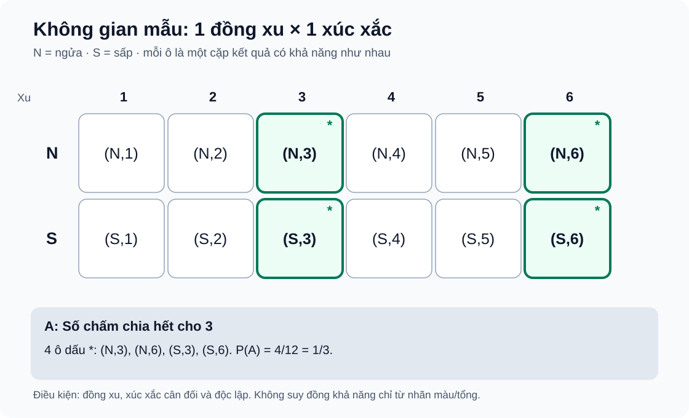

# Bài 26. Biến cố và định nghĩa cổ điển của xác suất

TOÁN 10 · CHƯƠNG IX · KIẾN THỨC SGK KNTT

Học khái niệm, kiểm các điều kiện của xác suất cổ điển và tự đối chiếu trước khi luyện tập.

=== "Khám phá kiến thức"

    ### Cùng tìm hiểu

    Tung một đồng xu và gieo một con xúc xắc. Nếu một bạn chỉ ghi “ra số 3”, bạn ấy đã **bỏ mất kết quả đồng xu**. Một kết quả hoàn chỉnh phải là một **cặp**, chẳng hạn (ngửa, 3), vì phép thử gồm cả hai thao tác. Tập hợp mọi kết quả hoàn chỉnh được gọi là **không gian mẫu** \(\Omega\).

    Bây giờ giả sử ta quan tâm biến cố “số chấm chia hết cho 3”. Biến cố ấy không phải một phép thử mới; nó là **tập con của \(\Omega\)** gồm bốn cặp có số chấm 3 hoặc 6. Khi đồng xu cân đối, xúc xắc công bằng và hai thao tác độc lập, 12 cặp kết quả sơ cấp có xác suất như nhau, nên xác suất biến cố bằng **4 chia 12**.

    Công thức cổ điển \(P(A)=n(A)/n(\Omega)\) chỉ đúng khi các kết quả sơ cấp trong \(\Omega\) **hữu hạn, không rỗng và đồng khả năng**. Nếu chỉ gộp các kết quả vào vài “nhãn” có số lượng khác nhau rồi chia đều cho số nhãn, ta đã thay đổi mô hình và có thể tính sai.

    ### Thuật ngữ, kiến thức và kỹ năng

    **Thuật ngữ:** Phép thử ngẫu nhiên, kết quả sơ cấp, không gian mẫu (Omega), biến cố (AsubseteqOmega), đồng khả năng, xác suất cổ điển, biến cố đối.

    **Sau bài học, em cần làm được:** Liệt kê kết quả hoàn chỉnh; kiểm giả thiết đồng khả năng; phân biệt biến cố với kết quả sơ cấp; tính xác suất và biến cố đối, không coi xác suất nhỏ là bất khả.

=== "Kiến thức SGK"

    ### Một kết quả sơ cấp phải ghi đủ thông tin

    Trong một trò chơi có hai thao tác, nói chỉ “ra số 2” chưa mô tả đầy đủ kết quả nếu còn phải ghi mặt đồng xu. Thiếu một thành phần làm không gian mẫu bị thiếu và các xác suất sau đó sai ngay từ đầu.

    Nhớ quy tắc nhân của B23 và khái niệm cặp có thứ tự: (ô 1, ngửa) khác (ô 1, sấp). Một kết quả sơ cấp phải tương ứng đúng một cách hoàn tất phép thử.

    Ta tạo không gian mẫu bằng cách liệt kê mọi kết quả hoàn chỉnh; mỗi kết quả chứa một lựa chọn ở từng giai đoạn. **Đếm bằng phép nhân là đếm các cặp hoàn chỉnh, không đếm các nhãn đơn lẻ.** Khi từng lựa chọn vật lí đồng đều và hai thao tác độc lập, các cặp mới đồng khả năng.

    **Hướng dẫn đọc hình/bảng:** Vẽ bảng ba hàng ứng với các ô 1,2,3 và hai cột N,S. Mỗi giao điểm là một cặp (ô,mặt xu); quét bảng theo hàng để chắc chắn mỗi cặp xuất hiện đúng một lần.

    Ưu tiên bảng hoặc cây khi có ít tầng; dùng tích số lựa chọn sau khi xác định đúng phần tử của Ω. Chỉ nói mọi cặp đồng khả năng khi đã có giả thiết ô bằng nhau, đồng xu cân đối và hai thao tác độc lập.

    **Em vận dụng.**

    Một vòng quay có **3 ô bằng nhau** mang số 1,2,3, dừng đều trên từng ô; đồng thời tung một đồng xu cân đối, độc lập với vòng quay, ghi N (ngửa) hoặc S (sấp). Kết quả được ghi dưới dạng (số ô, mặt xu). Hãy viết Ω và n(Ω).

    

    ??? question "Tự đối chiếu lời giải sau khi em đã thử"

        
<strong>Đáp án và lập luận:</strong> \(\Omega=\{(1,N),(1,S),(2,N),(2,S),(3,N),(3,S)\}\), \(n(\Omega)=6\). Vì có ba lựa chọn ô và hai mặt xu độc lập, số cặp là \(3\cdot2=6\); mỗi ô kết hợp đủ hai mặt xu.

    

    ??? tip "Khi chưa làm được: tự phát hiện lỗi và quay về kiến thức"

        
<strong>Bước 1:</strong> Nhận diện lỗi hay gặp: chỉ viết {1,2,3} hoặc {N,S} và bỏ mất một thành phần của kết quả.

        
<strong>Bước 2:</strong> Nhớ quy tắc nhân B23: kết quả hai giai đoạn là một cặp có thứ tự; phân biệt ô 1 và mặt N.

        
<strong>Bước 3:</strong> Thử trường hợp nhỏ: hai ô 1,2 và một đồng xu cho bốn cặp (1,N),(1,S),(2,N),(2,S).

        
<strong>Bước 4:</strong> Trở lại bảng 3×2; tự điền từng ô rồi mới mở lời giải của Tự thử để đối chiếu.

        
<strong>Bước 5:</strong> Luyện đúng kỹ năng mô tả Ω với câu luyện tập liên quan; giữ kết quả hoàn chỉnh trước khi đếm.

        
<strong>Nơi luyện tiếp:</strong> `THPT-G10-B26-C01` — đường học SGK B26, Core/Luyện tập đã có trong phần Luyện tập; câu mới chỉ là câu tự đối chiếu, không tính điểm thành thạo.

    ### Biến cố là một tập con của không gian mẫu

    Cùng một phép thử có thể hỏi “ra số nguyên tố”, “ra số chẵn” hay “ra số lớn hơn 5”. Mỗi câu hỏi tương ứng một nhóm kết quả, không phải một phép thử mới.

    Nhắc định nghĩa tập hợp, kí hiệu \(A\subseteq\Omega\) và số nguyên tố (số tự nhiên lớn hơn 1 chỉ có hai ước dương 1 và chính nó); đặc biệt số 1 không nguyên tố.

    Phép thử quyết định Ω trước, phát biểu biến cố chọn từ Ω **những kết quả thỏa điều kiện**, không thêm phần tử bên ngoài Ω. Khi đã liệt kê đúng A, số phần tử thuận lợi mới dùng được để tính xác suất nếu Ω đồng khả năng.

    **Hướng dẫn đọc hình/bảng:** Viết Ω trên một hàng bảy vị trí. Dùng dấu khoanh vào các vị trí thuộc A; các vị trí còn lại cho thấy A thực sự là tập con của Ω.

    Với ít kết quả, liệt kê A minh bạch hơn đếm tắt; với nhiều kết quả dùng tính chất số học nhưng vẫn phải chứng minh thuộc Ω. Chỉ chia \(n(A)/n(\Omega)\) sau khi xác nhận chọn đều.

    **Em vận dụng.**

    Rút đều ngẫu nhiên một thẻ trong **7 thẻ phân biệt** được ghi số 1,2,3,4,5,6,7. Gọi A là biến cố “rút được thẻ mang số nguyên tố”. Hãy viết Ω, A và tính P(A).

    

    ??? question "Tự đối chiếu lời giải sau khi em đã thử"

        
<strong>Đáp án và lập luận:</strong> \(\Omega=\{1,2,3,4,5,6,7\}\), \(A=\{2,3,5,7\}\) nên \(P(A)=4/7\). Số 1 không phải số nguyên tố; bảy thẻ phân biệt được rút đều nên các kết quả đồng khả năng.

    

    ??? tip "Khi chưa làm được: tự phát hiện lỗi và quay về kiến thức"

        
<strong>Bước 1:</strong> Kiểm lỗi: viết nhầm A={1,2,3,5,7} vì coi 1 là số nguyên tố, hoặc quên xác định Ω.

        
<strong>Bước 2:</strong> Ôn định nghĩa tập con và số nguyên tố; chỉ chọn những thẻ số thuộc Ω thỏa đúng điều kiện.

        
<strong>Bước 3:</strong> Thử trên các số 1 đến 4: tập số nguyên tố chỉ là {2,3}, không gồm 1.

        
<strong>Bước 4:</strong> Gạch chân từng số nguyên tố trong Ω bảy phần tử, kiểm đã đếm đúng bốn kết quả rồi tự mở đối chiếu.

        
<strong>Bước 5:</strong> Luyện tiếp đã có THPT-G10-B26-P02 để phân biệt Ω và biến cố trong phép thử nhiều bước.

        
<strong>Nơi luyện tiếp:</strong> `THPT-G10-B26-P02` — đường học SGK B26, Core/Luyện tập đã có trong phần Luyện tập; câu mới chỉ là câu tự đối chiếu, không tính điểm thành thạo.

    ### Đồng khả năng thuộc kết quả sơ cấp, không mặc định thuộc nhãn

    Nếu 10 thẻ có hai nhãn X và Y, xác suất nhãn X không vì thế bằng 1/2: số thẻ thực tế mang mỗi nhãn mới quyết định tần suất khi từng thẻ được chọn đều.

    Nhớ phân biệt đối tượng vật lí (thẻ có số riêng) và nhãn cùng loại; ô/hồ sơ có cùng nhãn vẫn là các kết quả sơ cấp khác nhau.

    Định nghĩa cổ điển \(P(A)=n(A)/n(\Omega)\) chỉ đúng với **Ω hữu hạn, không rỗng và các kết quả sơ cấp đồng khả năng**. Có thể nhiều kết quả sơ cấp cùng mang một nhãn; gom nhãn lại không bảo toàn đồng khả năng.

    **Hướng dẫn đọc hình/bảng:** Xếp 10 ô có tên riêng 1–10, tô dấu X lên đúng bốn ô, dấu Y lên sáu ô. Đếm 10 ô vật lí, không lấy mẫu số 2 là hai nhãn.

    Chọn Ω là các thẻ phân biệt được rút đều; đếm số thẻ mang X. Nếu đề chỉ nói “ngẫu nhiên” mà không cho chọn đều, phải kiểm mô hình trước khi tính.

    **Em vận dụng.**

    Có 10 thẻ **phân biệt được khi đánh số**, trong đó đúng **4 thẻ ghi X** và 6 thẻ ghi Y. Chọn đều ngẫu nhiên một thẻ. Tính P(đọc được nhãn X) và giải thích vì sao không phải 1/2.

    

    ??? question "Tự đối chiếu lời giải sau khi em đã thử"

        
<strong>Đáp án và lập luận:</strong> \(P(X)=4/10=2/5\). Mỗi thẻ vật lí là một kết quả sơ cấp đồng khả năng; bốn thẻ mang X. Hai nhãn X,Y không đồng khả năng vì xuất hiện trên số thẻ khác nhau.

    

    ??? tip "Khi chưa làm được: tự phát hiện lỗi và quay về kiến thức"

        
<strong>Bước 1:</strong> Nhận diện lỗi: lấy 1/2 vì có hai tên X, Y, trong khi mẫu phải là số thẻ đồng khả năng.

        
<strong>Bước 2:</strong> Tách “thẻ vật lí” khỏi “nhãn đọc được”; hãy đặt chỉ số riêng cho từng thẻ.

        
<strong>Bước 3:</strong> Thử ba thẻ X₁, X₂, Y₁ chọn đều: xác suất X là 2/3 chứ không phải 1/2.

        
<strong>Bước 4:</strong> Với 10 thẻ, đếm bốn X trên tổng mười; mở lời giải khi đã tự chọn Ω và n(A).

        
<strong>Bước 5:</strong> Ôn đã có THPT-G10-B26-C02 (vòng quay có nhãn màu lặp) để luyện chọn đúng kết quả sơ cấp.

        
<strong>Nơi luyện tiếp:</strong> `THPT-G10-B26-C02` — đường học SGK B26, Core/Luyện tập đã có trong phần Luyện tập; câu mới chỉ là câu tự đối chiếu, không tính điểm thành thạo.

    ### Biến cố đối đếm phần còn lại mà không bỏ sót

    Muốn tìm xác suất “không xuất hiện bội số của 3”, đếm riêng mọi kết quả không phải bội số có thể dài và dễ bỏ sót. Phần bù cho phép tính ngắn hơn.

    Nhớ quan hệ \(\bar A=\Omega\setminus A\) trong **cùng Ω**, và các xác suất đồng khả năng cộng thành 1. Không nhầm “không thuộc A” với một điều kiện khác.

    A và biến cố đối không thể xảy ra cùng lúc và phủ kín Ω, nên \(P(\bar A)=1-P(A)\). Đây không phải một mẹo trừ số không có căn cứ; chính việc phân hoạch Ω thành hai phần rời nhau làm công thức đúng.

    **Hướng dẫn đọc hình/bảng:** Đánh dấu 12 số 1–12; tô nhóm bội của 3 bằng một kí hiệu, để phần còn lại không tô. Hai phần ghép lại đủ 12 phần tử.

    Dùng phần bù khi A dễ liệt kê hơn \(\bar A\). Với nhóm số, vẫn kiểm các phần tử bội của 3, không nhân thừa vì trùng số.

    **Em vận dụng.**

    Chọn đều một số nguyên từ 1 đến 12. Tính xác suất số được chọn **không chia hết cho 3** bằng biến cố đối.

    

    ??? question "Tự đối chiếu lời giải sau khi em đã thử"

        
<strong>Đáp án và lập luận:</strong> Các bội của 3 là 3,6,9,12, có 4 trong 12 số. Do đó \(P(\text{không chia hết cho 3})=1-4/12=8/12=2/3\).

    

    ??? tip "Khi chưa làm được: tự phát hiện lỗi và quay về kiến thức"

        
<strong>Bước 1:</strong> Kiểm lỗi: biến cố đối của “chia hết cho 3” phải gồm toàn bộ các số không chia hết cho 3, không chỉ số lẻ.

        
<strong>Bước 2:</strong> Xác định Ω={1,…,12}; gọi A là nhóm bội 3, viết phần bù trong cùng Ω.

        
<strong>Bước 3:</strong> Trên Ω={1,…,6}, nhóm bội 3 là {3,6}; phần không chia hết có 4 phần tử.

        
<strong>Bước 4:</strong> Liệt kê bốn bội 3 trong 1–12, trừ khỏi tổng; chỉ sau đó mở lời giải Tự thử.

        
<strong>Bước 5:</strong> luyện câu liên quan trong phần Luyện tập để củng cố phép tính biến cố đối.

        
<strong>Nơi luyện tiếp:</strong> `THPT-G10-B26-P01` — đường học SGK B26, Core/Luyện tập đã có trong phần Luyện tập; câu mới chỉ là câu tự đối chiếu, không tính điểm thành thạo.

    ### Biết khi nào KHÔNG đủ dữ kiện để chia đều

    Từ “ngẫu nhiên” trong đời sống không bảo đảm mọi nhãn đầu ra có xác suất bằng nhau. Tự học xác suất bắt đầu từ việc kiểm dữ kiện, không phải từ việc tìm một phân số bằng mọi giá.

    Ôn ý nghĩa của xác suất dương rất nhỏ và điều kiện đồng khả năng của Ω. Phân biệt “một trong ba lựa chọn có thể xảy ra” với “ba lựa chọn có cùng xác suất”.

    Nếu chưa biết quy tắc chọn hoặc tần suất/mô hình, không thể tự gán \(1/3\) chỉ vì có ba kết quả được đặt tên. Đây là một **giới hạn áp dụng** của định nghĩa cổ điển. Một biến cố có xác suất rất nhỏ vẫn có thể xảy ra, không đồng nghĩa biến cố không thể.

    **Hướng dẫn đọc hình/bảng:** Vẽ ba nhánh A,B,C nhưng để dấu hỏi ở độ rộng/xác suất nhánh; dấu hỏi nhắc rằng chưa có chứng cứ ba nhánh đồng khả năng.

    Chỉ tính \(n(A)/n(\Omega)\) khi chọn đều từng kết quả sơ cấp đã được nêu. Nếu thiếu giả thiết, kết luận 'không đủ thông tin' và nói rõ cần thêm dữ kiện về cơ chế chọn; không bịa phân bố đều.

    **Em vận dụng.**

    (a) Một ứng dụng phát ngẫu nhiên một trong ba thông báo A, B, C theo một **thuật toán không được mô tả**. Bạn Minh nói: “Vì có ba thông báo nên P(hiện A)=1/3”. Minh đã đủ căn cứ chưa? Giải thích. (b) Trong một hộp có **200 vé phân biệt**, chỉ một vé đặc biệt; rút đều một vé. Hãy tính xác suất rút được vé đặc biệt và đánh giá lời khẳng định “Xác suất rất nhỏ nghĩa là không thể trúng”.

    

    ??? question "Tự đối chiếu lời giải sau khi em đã thử"

        
<strong>Đáp án và lập luận:</strong> **(a) Chưa đủ căn cứ.** Từ “ngẫu nhiên” không cho biết thuật toán chọn A,B,C có đồng khả năng hay không. Chỉ khi ba kết quả được chọn đều mới suy ra \(P(A)=1/3\); đề bài hiện tại không cho điều đó. **(b)** Vì 200 vé được rút đều và chỉ 1 vé trúng, \(P(\text{trúng})=1/200=0{,}005&gt;0\). Trúng rất hiếm trong một lần rút nhưng không phải biến cố không thể.

    

    ??? tip "Khi chưa làm được: tự phát hiện lỗi và quay về kiến thức"

        
<strong>Bước 1:</strong> Nhận diện lỗi: tự đồng nhất “có ba nhãn” với “mỗi nhãn có xác suất 1/3”.

        
<strong>Bước 2:</strong> Nhắc điều kiện định nghĩa cổ điển: Ω hữu hạn, khác rỗng, từng kết quả sơ cấp đồng khả năng.

        
<strong>Bước 3:</strong> Xét thuật toán khác: chọn A với xác suất 1/2, B và C mỗi cái 1/4; vẫn ngẫu nhiên nhưng không đều.

        
<strong>Bước 4:</strong> Trở lại (a) tìm giả thiết đồng khả năng còn thiếu; với (b) nêu 200 vé đồng khả năng, đúng một kết quả thuận lợi, soát \(1/200&gt;0\), rồi tự mở đối chiếu.

        
<strong>Bước 5:</strong> Ôn đã có THPT-G10-B26-P05 để luyện phát hiện giả thiết đồng khả năng còn thiếu.

        
<strong>Nơi luyện tiếp:</strong> `THPT-G10-B26-P05` — đường học SGK B26, Core/Luyện tập đã có trong phần Luyện tập; câu mới chỉ là câu tự đối chiếu, không tính điểm thành thạo.

    ### Kiến thức SGK — khái niệm và điều kiện

    ### 26.1. Phép thử ngẫu nhiên và không gian mẫu

    **Cách đọc hình.** Mỗi ô của bảng là một cặp **(mặt đồng xu, số chấm xúc xắc)**. Có 2 hàng và 6 cột nên 12 kết quả; bốn ô đánh dấu có số chấm 3 hoặc 6, suy ra xác suất 4/12.

    <figure class="thpt-r4-plot thpt-r4-probability-figure"><figcaption>Mô hình 12 kết quả đồng khả năng của phép thử đồng xu × xúc xắc.</figcaption></figure>

    Một **phép thử ngẫu nhiên** là hành động có thể biết trước các kết quả có thể xảy ra nhưng không chắc kết quả cụ thể của lần thử. Kí hiệu **Ω** là *không gian mẫu*: tập tất cả kết quả của phép thử. Khi gieo một con xúc xắc sáu mặt cân đối, Ω={1,2,3,4,5,6}. Nêu rõ một kết quả là một số chấm, không phải xác suất.

    **Chốt điều kiện:** Khi gieo đồng thời hai xúc xắc phân biệt, mỗi kết quả của phép thử là một *cặp có thứ tự* (i,j), i,j∈{1,…,6}. Có 36 cặp có khả năng như nhau; nếu chỉ liệt kê các tổng từ 2 đến 12, những tổng đó **không** đồng khả năng.

    ### 26.2. Biến cố là tập con của Ω

    Một **biến cố A** được biểu diễn bằng tập những kết quả làm A xảy ra, nên A⊆Ω. Ví dụ với Ω={1,2,3,4,5,6}, biến cố “xuất hiện số lớn hơn 4” là A={5,6}; biến cố không thể là ∅, biến cố chắc chắn là Ω. Học sinh phải phân biệt phát biểu bằng lời với tập kết quả thuận lợi và tránh đếm trùng.

    ### 26.3. Biến cố đối

    Biến cố đối của A, kí hiệu Ā, là biến cố “A không xảy ra”; xét trong **cùng một không gian mẫu Ω**: Ā=Ω\A. Hai biến cố này không thể xảy ra đồng thời và phủ hết Ω. Do đó P(Ā)=1−P(A). Tránh nhầm “không xảy ra A” với một biến cố khác được viết thiếu trường hợp.

    ### 26.4. Định nghĩa cổ điển và tính chất cơ bản

    **Chỉ khi Ω hữu hạn và mọi kết quả sơ cấp đồng khả năng**, xác suất theo định nghĩa cổ điển được tính bằng P(A)=n(A)/n(Ω), với n(Ω)>0. Vì 0≤n(A)≤n(Ω) nên 0≤P(A)≤1, P(∅)=0 và P(Ω)=1. Nếu các kết quả không đồng khả năng, không được lấy số phần tử chia cho tổng phần tử một cách máy móc. Nếu sử dụng hai kết quả không phân biệt về nhãn, phải kiểm tra chúng có cùng xác suất hay không.

    ### 26.5. Nguyên lí xác suất bé

    Biến cố có xác suất rất nhỏ **khó xảy ra trong một phép thử**, nhưng **không phải không thể xảy ra**; ngược lại, xác suất gần 1 không bảo đảm chắc chắn. Trong tình huống thực tế, cần tách điều SGK trình bày với một quy tắc dự báo số lần xuất hiện (chỉ ước lượng, không bảo đảm số lần đúng bằng n·P(A)).

=== "Ví dụ giải toán"

    Trước khi xem lời giải, hãy xác định dữ kiện, điều phải tìm và lý do chọn cách giải. Sau đó kiểm tra lại điều kiện áp dụng và kết quả, thay vì chỉ nhìn phép tính cuối cùng.

    ### Ví dụ — Tại sao mẫu phải gồm cả đồng xu lẫn xúc xắc?

    **Đề bài.** Tung một đồng xu cân đối và một xúc xắc công bằng, độc lập. Tính xác suất biến cố \(A\): “số chấm trên xúc xắc chia hết cho 3”.

    **Vì sao chọn cách này?** Mỗi kết quả sơ cấp phải mô tả **đầy đủ hai thao tác**, không chỉ giá trị của xúc xắc. Khi đó mới có căn cứ chia đều xác suất.

    **Giải.** \(\Omega=\{(N,i),(S,i)\mid i=1,2,\ldots,6\}\) có 12 kết quả đồng khả năng. \(A=\{(N,3),(S,3),(N,6),(S,6)\}\) có 4 kết quả; do đó \(P(A)=4/12=1/3\).

    **Kiểm lại:** Biến cố “không chia hết cho 3” có 8 kết quả, xác suất \(2/3\), cộng với \(1/3\) bằng 1.

    **Ví dụ 1 (EX-G10-B26-01) — Biểu diễn biến cố và công thức cổ điển.** Một vòng quay chia thành sáu ô bằng nhau mang kí hiệu A,A,B,C,C,C; giả sử mũi tên dừng đều nhau trên từng ô vật lí. Gọi các vị trí là A₁,A₂,B,C₁,C₂,C₃, tức n(Ω)=6. Biến cố “ra kí hiệu C” có 3 vị trí thuận lợi nên P(C)=3/6=1/2, trong khi P(A)=2/6=1/3. **Tại sao không dùng Ω={A,B,C} với 3 kết quả đồng khả năng?** Vì ba kí hiệu xuất hiện trên số ô khác nhau. Trình bày hai tầng “kết quả vật lí/nhãn đọc được” để chống nhầm.

    **Ví dụ 2 (EX-G10-B26-02) — Biến cố đối và xác suất rất bé.** Một phiếu được chọn đều từ 500 phiếu khác nhau, có đúng một phiếu đặc biệt. Nếu A là “trúng phiếu đặc biệt”, P(A)=1/500; P(Ā)=499/500. Xác suất nhỏ không đồng nghĩa A không thể xảy ra, và không thể kết luận sau 500 lần thử chắc chắn sẽ trúng nếu không quy định chính xác cách chọn phiếu qua từng lần.

=== "Lỗi thường gặp và cách tự khắc phục"

    

    ??? tip "Đồng nhất nhãn kết quả với kết quả sơ cấp"

        
<strong>Dấu hiệu sai:</strong> Liệt kê kết quả bằng tên màu hoặc tổng chấm nhưng giả định các tên/tổng có xác suất bằng nhau; cũng có thể quên thứ tự của hai lần tung.

        
<strong>Bản chất toán và điều kiện:</strong> Định nghĩa cổ điển P(A)=n(A)/n(Ω) chỉ áp dụng khi Ω hữu hạn, n(Ω)&gt;0 và mọi kết quả sơ cấp được chọn có khả năng như nhau. Nhãn gộp nhiều kết quả sơ cấp có thể không đồng khả năng.

        
<strong>Tự sửa theo bước:</strong> (1) Mô tả phép thử thật sự và một kết quả đầy đủ (ô vật lí, cặp có thứ tự nếu có hai bước). (2) Liệt kê/sơ đồ cây các kết quả sơ cấp. (3) Giải thích vì sao chúng đồng khả năng, không suy từ chữ “ngẫu nhiên”. (4) Xác định A⊆Ω rồi mới đếm. (5) Tự kiểm 0≤P(A)≤1.

        
<strong>Kiến thức cần ôn:</strong> B26 §26.1–26.2, 26.4; quy tắc nhân B23.

        
<strong>Luyện lại câu đã có:</strong> <a data-thpt-formative-id="THPT-G10-B26-C01" href="../luyen-tap/?item=THPT-G10-B26-C01">Luyện lại B26-C01</a> · <a data-thpt-formative-id="THPT-G10-B26-C02" href="../luyen-tap/?item=THPT-G10-B26-C02">Luyện lại B26-C02</a> · <a data-thpt-formative-id="THPT-G10-B26-P02" href="../luyen-tap/?item=THPT-G10-B26-P02">Luyện lại B26-P02</a> · <a data-thpt-formative-id="THPT-G10-B26-P05" href="../luyen-tap/?item=THPT-G10-B26-P05">Luyện lại B26-P05</a> · <a data-thpt-formative-id="THPT-G10-CHIX-W26-01" href="../../../thu-vien/tu-luan-chuong-ix/#thpt-g10-chix-w26-01">Tự luận liên quan</a>

    

    ??? tip "Nhầm “hoặc”, biến cố đối và xác suất nhỏ"

        
<strong>Dấu hiệu sai:</strong> Cộng hai số trường hợp có giao nhau mà không trừ phần giao; mô tả “A không xảy ra” bằng một tập thiếu kết quả; coi xác suất rất nhỏ là 0 hoặc số lần xuất hiện chắc chắn đúng bằng nP(A).

        
<strong>Bản chất toán và điều kiện:</strong> A và biến cố đối Ā phân hoạch Ω: Ā=Ω\A, P(A)+P(Ā)=1. Với các biến cố chồng lấn, n(A∪B)=n(A)+n(B)−n(A∩B) trong mô hình hữu hạn; P(A)&gt;0 dù nhỏ không đồng nghĩa A bất khả.

        
<strong>Tự sửa theo bước:</strong> (1) Viết rõ Ω và các tập A, B bằng kết quả sơ cấp. (2) Tô/vẽ phần giao nếu có chữ “hoặc”. (3) Viết Ā bằng câu chữ và Ω\A, kiểm A∩Ā=∅. (4) Đếm không lặp, tính xác suất khi có đồng khả năng. (5) Nếu phát biểu về xác suất bé, chỉ kết luận “khó xảy ra”, không kết luận “không thể” hay bảo đảm tần suất.

        
<strong>Kiến thức cần ôn:</strong> B26 §26.2–26.5; tập hợp và phép giao/hợp cơ bản.

        
<strong>Luyện lại câu đã có:</strong> <a data-thpt-formative-id="THPT-G10-B26-P01" href="../luyen-tap/?item=THPT-G10-B26-P01">Luyện lại B26-P01</a> · <a data-thpt-formative-id="THPT-G10-B26-P03" href="../luyen-tap/?item=THPT-G10-B26-P03">Luyện lại B26-P03</a> · <a data-thpt-formative-id="THPT-G10-B26-P04" href="../luyen-tap/?item=THPT-G10-B26-P04">Luyện lại B26-P04</a> · <a data-thpt-formative-id="THPT-G10-CHIX-W26-01" href="../../../thu-vien/tu-luan-chuong-ix/#thpt-g10-chix-w26-01">Tự luận liên quan</a>

    **Học tiếp:** [Core và Luyện tập](../luyen-tap/) · [Tự kiểm tra cuối chương](../tu-kiem-tra-chuong/).

    
Nguồn toán học: SGK Toán 10 Kết nối tri thức với cuộc sống và học liệu SLM hiện hành. Lời giảng được biên tập nhằm hỗ trợ tự học độc lập.

