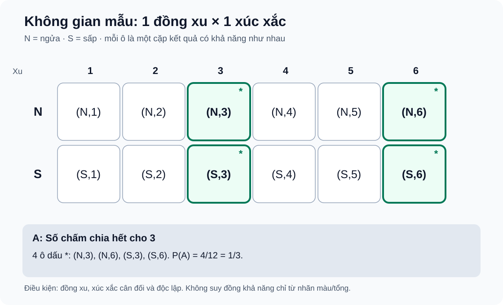
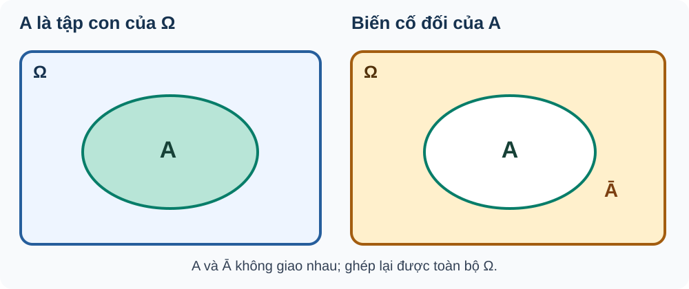

# Bài 26. Biến cố và định nghĩa cổ điển của xác suất

TOÁN 10 · CHƯƠNG IX · KIẾN THỨC SGK KNTT

Từ phép thử và biến cố đến xác suất cổ điển; hiểu nguyên lí xác suất bé và cách ước lượng trong thực tế.

=== "Khám phá kiến thức"

    **Vì sao cần học?** Trong một trò chơi chọn 6 số từ 45 số, có rất nhiều kết quả có thể xảy ra. Trước khi hỏi “cơ hội trúng thưởng là bao nhiêu?”, ta cần mô tả chính xác **một kết quả của phép thử**, rồi nhận ra những kết quả nào làm ta trúng. Bài 26 xây nền tảng ấy; Bài 27 mới thực hành đếm số bộ trúng thưởng bằng tổ hợp và sơ đồ cây.

    **Cần biết trước:** Tập hợp, phần tử, tập con, phần bù; phân biệt số nguyên tố với hợp số (số 1 không thuộc loại nào); quy tắc nhân Bài 23. Khi có nhiều thao tác, phải ghi đủ thông tin về từng thao tác trước khi đếm.

    ### 1.1. Từ phép thử đến không gian mẫu

    Gieo một đồng xu và một xúc xắc: “ra số 3” **chưa** phải kết quả hoàn chỉnh, vì còn thiếu mặt đồng xu. Nếu ghi N (ngửa), S (sấp), mỗi kết quả có dạng \((\text{mặt xu},\text{số chấm})\). Tập hợp **mọi** kết quả hoàn chỉnh gọi là *không gian mẫu* \(\Omega\). Có hai mặt xu và sáu số chấm, nên ta có 12 cặp khác nhau.

    <figure class="thpt-r4-plot thpt-r4-probability-figure"><figcaption><strong>Đọc hình:</strong> đi theo từng hàng để thấy 12 cặp (mặt xu, số chấm). Bốn ô viền xanh ứng với số chấm 3 hoặc 6. Chỉ coi 12 cặp đồng khả năng khi xu cân đối, xúc xắc công bằng và hai thao tác độc lập.</figcaption></figure>

    Một bảng hoặc cây giúp em không bỏ sót và không viết trùng kết quả. Với hai bước có lần lượt 2 và 6 cách lựa chọn trong ví dụ đồng xu–xúc xắc, dùng quy tắc nhân để đếm 12 cặp **sau khi** đã hiểu một phần tử của \(\Omega\) thực sự là gì.

    **Vận dụng.**

    Một vòng quay có **3 ô bằng nhau** mang số 1,2,3, dừng đều trên từng ô; đồng thời tung một đồng xu cân đối, độc lập với vòng quay, ghi N (ngửa) hoặc S (sấp). Kết quả được ghi dưới dạng (số ô, mặt xu). Hãy viết Ω và n(Ω).

    

    ??? question "Đối chiếu"

        
<strong>Đáp án và lập luận:</strong> \(\Omega=\{(1,N),(1,S),(2,N),(2,S),(3,N),(3,S)\}\), \(n(\Omega)=6\). Vì có ba lựa chọn ô và hai mặt xu độc lập, số cặp là \(3\cdot2=6\); mỗi ô kết hợp đủ hai mặt xu.

    

    ??? tip "Kiểm lỗi"

        
<strong>Bước 1:</strong> Nhận diện lỗi hay gặp: chỉ viết {1,2,3} hoặc {N,S} và bỏ mất một thành phần của kết quả.

        
<strong>Bước 2:</strong> Nhớ quy tắc nhân B23: kết quả hai giai đoạn là một cặp có thứ tự; phân biệt ô 1 và mặt N.

        
<strong>Bước 3:</strong> Thử trường hợp nhỏ: hai ô 1,2 và một đồng xu cho bốn cặp (1,N),(1,S),(2,N),(2,S).

        
<strong>Bước 4:</strong> Trở lại bảng 3×2; tự điền từng ô rồi mới mở phần Đối chiếu để đối chiếu.

        
<strong>Bước 5:</strong> Luyện đúng kỹ năng mô tả Ω với câu luyện tập liên quan; giữ kết quả hoàn chỉnh trước khi đếm.

        
<strong>Luyện tiếp:</strong> <a href="../luyen-tap/?item=THPT-G10-B26-C01">Mở câu luyện cùng kiến thức</a>. Nếu đã xem lời giải, hãy chọn thêm câu khác để tự làm không có gợi ý.

    ### 1.2. Một biến cố là tập con, không phải phép thử mới

    Cùng một lần rút thẻ, ta có thể hỏi thẻ có số chẵn, số nguyên tố hay lớn hơn 4. Những câu hỏi đó là các **biến cố** khác nhau của cùng phép thử. Nếu \(\Omega\) là tập tất cả số thẻ, biến cố \(A\) được biểu diễn bằng tập **những phần tử trong \(\Omega\) làm \(A\) xảy ra**: \(A\subseteq\Omega\). Không được thêm kết quả ngoài \(\Omega\), và không được coi số 1 là số nguyên tố.

    Hai trường hợp biên rất có ích: \(A=\Omega\) là biến cố chắc chắn; \(A=\varnothing\) là biến cố không thể. Các biến cố này không phải là câu nói “rất dễ” hoặc “rất khó”, mà có tập kết quả thuận lợi xác định rõ.

    **Vận dụng.**

    Rút đều ngẫu nhiên một thẻ trong **7 thẻ phân biệt** được ghi số 1,2,3,4,5,6,7. Gọi A là biến cố “rút được thẻ mang số nguyên tố”. Hãy viết Ω, A và tính P(A).

    

    ??? question "Đối chiếu"

        
<strong>Đáp án và lập luận:</strong> \(\Omega=\{1,2,3,4,5,6,7\}\), \(A=\{2,3,5,7\}\) nên \(P(A)=4/7\). Số 1 không phải số nguyên tố; bảy thẻ phân biệt được rút đều nên các kết quả đồng khả năng.

    

    ??? tip "Kiểm lỗi"

        
<strong>Bước 1:</strong> Kiểm lỗi: viết nhầm A={1,2,3,5,7} vì coi 1 là số nguyên tố, hoặc quên xác định Ω.

        
<strong>Bước 2:</strong> Ôn định nghĩa tập con và số nguyên tố; chỉ chọn những thẻ số thuộc Ω thỏa đúng điều kiện.

        
<strong>Bước 3:</strong> Thử trên các số 1 đến 4: tập số nguyên tố chỉ là {2,3}, không gồm 1.

        
<strong>Bước 4:</strong> Gạch chân từng số nguyên tố trong Ω bảy phần tử, kiểm đã đếm đúng bốn kết quả rồi tự mở Đối chiếu.

        
<strong>Bước 5:</strong> Luyện tiếp đã có THPT-G10-B26-P02 để phân biệt Ω và biến cố trong phép thử nhiều bước.

        
<strong>Luyện tiếp:</strong> <a href="../luyen-tap/?item=THPT-G10-B26-P02">Mở câu luyện cùng kiến thức</a>. Nếu đã xem lời giải, hãy chọn thêm câu khác để tự làm không có gợi ý.

    ### 1.3. Vì sao phải kiểm sự đồng khả năng?

    Khi chọn đều **từng thẻ phân biệt**, mỗi thẻ có cơ hội như nhau. Nhưng nếu một số thẻ cùng ghi X và những thẻ khác ghi Y, hai *nhãn* X, Y chưa chắc đồng khả năng. Ta chỉ áp dụng công thức cổ điển \(P(A)=\dfrac{n(A)}{n(\Omega)}\) nếu không gian mẫu **hữu hạn, không rỗng và các kết quả sơ cấp đồng khả năng**.

    Bởi vậy, khi giải, hãy nói rõ “ta chọn đều đối tượng nào?” trước khi đếm số kết quả thuận lợi. Nếu cơ chế chọn không xác định, chỉ biết có mấy nhãn thì chưa đủ để chia đều.

    **Vận dụng.**

    Có 10 thẻ **phân biệt được khi đánh số**, trong đó đúng **4 thẻ ghi X** và 6 thẻ ghi Y. Chọn đều ngẫu nhiên một thẻ. Tính P(đọc được nhãn X) và giải thích vì sao không phải 1/2.

    

    ??? question "Đối chiếu"

        
<strong>Đáp án và lập luận:</strong> \(P(X)=4/10=2/5\). Mỗi thẻ vật lí là một kết quả sơ cấp đồng khả năng; bốn thẻ mang X. Hai nhãn X,Y không đồng khả năng vì xuất hiện trên số thẻ khác nhau.

    

    ??? tip "Kiểm lỗi"

        
<strong>Bước 1:</strong> Nhận diện lỗi: lấy 1/2 vì có hai tên X, Y, trong khi mẫu phải là số thẻ đồng khả năng.

        
<strong>Bước 2:</strong> Tách “thẻ vật lí” khỏi “nhãn đọc được”; hãy đặt chỉ số riêng cho từng thẻ.

        
<strong>Bước 3:</strong> Thử ba thẻ X₁, X₂, Y₁ chọn đều: xác suất X là 2/3 chứ không phải 1/2.

        
<strong>Bước 4:</strong> Với 10 thẻ, đếm bốn X trên tổng mười; mở lời giải khi đã tự chọn Ω và n(A).

        
<strong>Bước 5:</strong> Ôn đã có THPT-G10-B26-C02 (vòng quay có nhãn màu lặp) để luyện chọn đúng kết quả sơ cấp.

        
<strong>Luyện tiếp:</strong> <a href="../luyen-tap/?item=THPT-G10-B26-C02">Mở câu luyện cùng kiến thức</a>. Nếu đã xem lời giải, hãy chọn thêm câu khác để tự làm không có gợi ý.

    ### 1.4. Biến cố đối: đếm đúng phần còn lại

    Nếu \(A\) là “lấy được số chia hết cho 3”, thì “không chia hết cho 3” là biến cố đối \(\overline A\). Hai nhóm không chung kết quả và khi ghép lại chúng phủ hết \(\Omega\). Do đó \(\overline A=\Omega\setminus A\), và trong mô hình xác suất \(P(\overline A)=1-P(A)\). Dùng biến cố đối khi việc đếm \(A\) ngắn hơn đếm tất cả kết quả ngoài \(A\).

    Hãy cẩn thận với phủ định: nếu \(A\) là “số nguyên tố”, biến cố đối là “không nguyên tố”, **bao gồm cả số 1** khi \(1\in\Omega\), chứ không chỉ gồm các hợp số.

    **Vận dụng.**

    Chọn đều một số nguyên từ 1 đến 12. Tính xác suất số được chọn **không chia hết cho 3** bằng biến cố đối.

    

    ??? question "Đối chiếu"

        
<strong>Đáp án và lập luận:</strong> Các bội của 3 là 3,6,9,12, có 4 trong 12 số. Do đó \(P(\text{không chia hết cho 3})=1-4/12=8/12=2/3\).

    

    ??? tip "Kiểm lỗi"

        
<strong>Bước 1:</strong> Kiểm lỗi: biến cố đối của “chia hết cho 3” phải gồm toàn bộ các số không chia hết cho 3, không chỉ số lẻ.

        
<strong>Bước 2:</strong> Xác định Ω={1,…,12}; gọi A là nhóm bội 3, viết phần bù trong cùng Ω.

        
<strong>Bước 3:</strong> Trên Ω={1,…,6}, nhóm bội 3 là {3,6}; phần không chia hết có 4 phần tử.

        
<strong>Bước 4:</strong> Liệt kê bốn bội 3 trong 1–12, trừ khỏi tổng; chỉ sau đó mở lời giải Vận dụng.

        
<strong>Bước 5:</strong> luyện câu liên quan trong phần Luyện tập để củng cố phép tính biến cố đối.

        
<strong>Luyện tiếp:</strong> <a href="../luyen-tap/?item=THPT-G10-B26-P01">Mở câu luyện cùng kiến thức</a>. Nếu đã xem lời giải, hãy chọn thêm câu khác để tự làm không có gợi ý.

    ### 1.5. Xác suất bé: hiểu đúng giới hạn của dự báo

    Một biến cố có xác suất rất bé thường được xem là khó xảy ra trong **một hoặc vài phép thử**. Đó là ý nghĩa thực hành của *nguyên lí xác suất bé* trong SGK, **không phải** chứng minh rằng biến cố ấy tuyệt đối không thể xảy ra. Mức “rất bé” cũng phụ thuộc hậu quả: nguy cơ nhỏ có thể vẫn quan trọng khi thiệt hại nghiêm trọng.

    Khi lặp phép thử nhiều lần trong điều kiện mô hình phù hợp, số lần biến cố xuất hiện có thể **ước lượng** bằng \(nP(A)\); không thể khẳng định lần nào hoặc đúng bao nhiêu lần biến cố sẽ xảy ra.

    **Vận dụng.**

    (a) Một ứng dụng phát ngẫu nhiên một trong ba thông báo A, B, C theo một **thuật toán không được mô tả**. Bạn Minh nói: “Vì có ba thông báo nên P(hiện A)=1/3”. Minh đã đủ căn cứ chưa? Giải thích. (b) Trong một hộp có **200 vé phân biệt**, chỉ một vé đặc biệt; rút đều một vé. Hãy tính xác suất rút được vé đặc biệt và đánh giá lời khẳng định “Xác suất rất nhỏ nghĩa là không thể trúng”.

    

    ??? question "Đối chiếu"

        
<strong>Đáp án và lập luận:</strong> **(a) Chưa đủ căn cứ.** Từ “ngẫu nhiên” không cho biết thuật toán chọn A,B,C có đồng khả năng hay không. Chỉ khi ba kết quả được chọn đều mới suy ra \(P(A)=1/3\); đề bài hiện tại không cho điều đó. **(b)** Vì 200 vé được rút đều và chỉ 1 vé trúng, \(P(\text{trúng})=1/200=0{,}005&gt;0\). Trúng rất hiếm trong một lần rút nhưng không phải biến cố không thể.

    

    ??? tip "Kiểm lỗi"

        
<strong>Bước 1:</strong> Nhận diện lỗi: tự đồng nhất “có ba nhãn” với “mỗi nhãn có xác suất 1/3”.

        
<strong>Bước 2:</strong> Nhắc điều kiện định nghĩa cổ điển: Ω hữu hạn, khác rỗng, từng kết quả sơ cấp đồng khả năng.

        
<strong>Bước 3:</strong> Xét thuật toán khác: chọn A với xác suất 1/2, B và C mỗi cái 1/4; vẫn ngẫu nhiên nhưng không đều.

        
<strong>Bước 4:</strong> Trở lại (a) tìm giả thiết đồng khả năng còn thiếu; với (b) nêu 200 vé đồng khả năng, đúng một kết quả thuận lợi, soát \(1/200&gt;0\), rồi tự mở Đối chiếu.

        
<strong>Bước 5:</strong> Ôn đã có THPT-G10-B26-P05 để luyện phát hiện giả thiết đồng khả năng còn thiếu.

        
<strong>Luyện tiếp:</strong> <a href="../luyen-tap/?item=THPT-G10-B26-P05">Mở câu luyện cùng kiến thức</a>. Nếu đã xem lời giải, hãy chọn thêm câu khác để tự làm không có gợi ý.

=== "Kiến thức SGK"

    ### 2.1. Biến cố (SGK mục 1, tr. 77–79)

    **Phép thử ngẫu nhiên:** hành động hoặc thí nghiệm chưa biết trước kết quả cụ thể. **Không gian mẫu** \(\Omega\) là tập tất cả kết quả có thể xảy ra; trong phạm vi bài này xét \(\Omega\) **hữu hạn và khác rỗng**. Một kết quả sơ cấp phải mô tả trọn phép thử: gieo hai xúc xắc phân biệt được ghi \((i,j)\) với \(i,j\in\{1,\ldots,6\}\), không chỉ ghi tổng \(i+j\).

    
<strong>Định nghĩa — Biến cố.</strong> Biến cố \(A\) là tập các kết quả thuận lợi cho \(A\), tức \(A\subseteq\Omega\). Biến cố chắc chắn là \(\Omega\); biến cố không thể là \(\varnothing\). Muốn mô tả biến cố chính xác, hãy chỉ rõ những kết quả nào làm nó xảy ra.

    
<strong>Định nghĩa — Biến cố đối.</strong> Biến cố đối \(\overline A=\Omega\setminus A\) xảy ra khi và chỉ khi \(A\) không xảy ra trong cùng phép thử. Hai tập không giao nhau và hợp lại đúng bằng không gian mẫu: \(A\cap\overline A=\varnothing,\ A\cup\overline A=\Omega\).

    <figure class="thpt-r4-plot thpt-r4-concept-figure"><figcaption><strong>Đọc hình:</strong> hình chữ nhật là toàn bộ kết quả \(\Omega\); miền elip là \(A\). Ở hình bên phải, phần còn lại sau khi bỏ elip là \(\overline A\). Không để sót các kết quả thuộc \(\Omega\) nhưng ngoài \(A\).</figcaption></figure>

    **Ví dụ ngắn về cách phủ định:** Gieo một xúc xắc: \(A=\{2,3,5\}\) là “ra số nguyên tố”, còn \(\overline A=\{1,4,6\}\) là “ra số không nguyên tố”. Số \(1\) không phải hợp số, nên nói biến cố đối của “nguyên tố” là “hợp số” sẽ thiếu một kết quả.

    ### 2.2. Định nghĩa cổ điển của xác suất (SGK mục 2, tr. 79–81)

    Để biết một biến cố có bao nhiêu cơ hội xảy ra, cần so **số kết quả thuận lợi** với **tổng số kết quả có cùng khả năng**. Chỉ khi \(\Omega\) hữu hạn, không rỗng, **mọi kết quả sơ cấp đồng khả năng**, ta mới dùng tỉ số số phần tử.

    
<strong>Định nghĩa cổ điển của xác suất.</strong> Khi không gian mẫu \(\Omega\) hữu hạn, khác rỗng và các kết quả sơ cấp <strong>đồng khả năng</strong>, xác suất của biến cố \(A\subseteq\Omega\) là \(P(A)=\dfrac{n(A)}{n(\Omega)}\), với \(n(\Omega)>0\). Cần xác định đúng \(\Omega\), tập \(A\) và giả thiết đồng khả năng trước khi tính.

    Vì \(0\le n(A)\le n(\Omega)\), tỉ số giữa số kết quả thuận lợi và tổng số kết quả phải nằm trong đoạn từ 0 đến 1.

    
<strong>Tính chất cơ bản của xác suất (Nhận xét SGK).</strong> Với mọi biến cố \(A\), \(0\le P(A)\le1\); biến cố không thể có \(P(\varnothing)=0\), còn biến cố chắc chắn có \(P(\Omega)=1\).

    Vì \(A\) và \(\overline A\) là hai phần không giao nhau và phủ hết \(\Omega\), ta suy ra hệ quả \(P(\overline A)=1-P(A)\). Công thức này sẽ được dùng sâu hơn ở Bài 27.

    **Bảng kết quả là công cụ đếm:** hai túi chứa lần lượt 4 và 3 thẻ phân biệt, mỗi túi chọn đều một thẻ, độc lập nhau. Khi đó 12 cặp kết quả đồng khả năng; muốn đếm điều kiện theo tổng hai số, có thể lập bảng \(4\times3\) thay vì gộp các giá trị tổng (vốn không đồng khả năng).

    ### 2.3. Nguyên lí xác suất bé và ý nghĩa thực tế (SGK mục 3, tr. 81–82)

    
<strong>Nguyên lí xác suất bé (SGK).</strong> Khi một biến cố có xác suất rất bé, trong một phép thử người ta thường dự kiến biến cố ấy không xảy ra.

    **Hiểu đúng nguyên lí:** đây là cách dự kiến thực hành, <strong>không phải</strong> kết luận toán học \(P(A)=0\) hay bảo đảm biến cố không thể xảy ra. Xác suất nào được xem là “bé” còn tùy trường hợp và hậu quả: rủi ro nghiêm trọng không thể bỏ qua chỉ vì hiếm gặp.

    **Ước lượng tần số:** khi phép thử được lặp nhiều lần trong điều kiện thích hợp, số lần xảy ra biến cố có xác suất \(p\) xấp xỉ \(np\) (SGK xét \(n\ge30\)). Đây là **giá trị ước lượng**, không bảo đảm đúng bằng \(np\) và không cho biết kết quả từng lần thử.

    **Vận dụng — Ước lượng số trẻ mới sinh (SGK tr. 82).** Nếu tỉ lệ sinh bé gái được giả thiết là \(0{,}488\), bé trai là \(0{,}512\), và quan sát khoảng 10 000 bé gái, thì tổng số trẻ được ước tính \(n\approx10000/0{,}488\approx20491{,}8\); số bé trai ước tính \(0{,}512n\approx10491{,}8\), tức khoảng **10 492 bé trai**. Đây là phép ước lượng số liệu thực tế, <strong>không phải định nghĩa hay quy tắc mới</strong> và không bảo đảm đúng bằng số đếm thực tế.

=== "Ví dụ"

    ### 3.1. Ví dụ — Không gian mẫu nhiều lần gieo

    **Đề bài.** Tung một đồng xu cân đối, độc lập, ba lần. Tính xác suất xuất hiện đúng **hai lần sấp**.

    **Phân tích:** Mỗi lần phải ghi N hoặc S; thứ tự các lần gieo phân biệt kết quả. Có \(2^3\) dãy, không phải bốn kết quả theo “số lần sấp” đồng khả năng.

    

<strong>Lời giải.</strong> \(\Omega=\{NNN,NNS,NSN,NSS,SNN,SNS,SSN,SSS\}\), \(n(\Omega)=8\). Biến cố \(A=\{NSS,SNS,SSN\}\) có ba dãy, nên \(P(A)=3/8\).

    **Kiểm lại:** Mỗi dãy có xác suất \(1/8\); ba dãy thuận lợi khác nhau về vị trí xuất hiện N.

    ### 3.2. Ví dụ — Phủ định đúng của một biến cố

    **Đề bài.** Rút đều một thẻ ghi số từ 1 đến 9. Gọi \(A\) là biến cố “số trên thẻ là số nguyên tố”. Mô tả \(A\), \(\overline A\) và xác suất của chúng.

    **Phân tích:** Phải dùng **toàn bộ** \(\Omega\) để viết biến cố đối; số 1 không nguyên tố cũng không hợp số.

    

<strong>Lời giải.</strong> \(\Omega=\{1,2,\ldots,9\}\); \(A=\{2,3,5,7\}\) có 4 kết quả. \(\overline A=\{1,4,6,8,9\}\) có 5 kết quả. Do rút đều, \(P(A)=4/9\), \(P(\overline A)=5/9\).

    **Kiểm lại:** \(A\cap\overline A=\varnothing\), \(A\cup\overline A=\Omega\), và \(4/9+5/9=1\).

    ### 3.3. Ví dụ — Đếm biến cố bằng bảng hai chiều

    **Đề bài.** Túi I có các thẻ 1,2,3,4; túi II có các thẻ 1,2,3. Chọn đều một thẻ từ mỗi túi, độc lập. Tính xác suất tổng hai số **ít nhất bằng 5**.

    **Phân tích:** Một kết quả là cặp \((i,j)\) theo túi. Các tổng không đồng khả năng, nhưng 12 cặp thẻ thì có.

    

<strong>Lời giải.</strong> Có \(4\cdot3=12\) cặp đồng khả năng. Tổng ít nhất 5 ứng với các cặp \((2,3),(3,2),(3,3),(4,1),(4,2),(4,3)\), gồm 6 kết quả. Vậy \(P(A)=6/12=1/2\).

    **Kiểm lại:** Đếm theo hàng: với \(i=1\) có 0 cặp, \(i=2\) có 1, \(i=3\) có 2, \(i=4\) có 3; tổng \(0+1+2+3=6\).

    ### 3.4. Ví dụ — Không chia đều theo tên nhãn

    **Đề bài.** Có 8 vé phân biệt, 3 vé ghi tên A và 5 vé ghi tên B. Lấy đều một vé. Xác suất nhận tên A là bao nhiêu?

    **Phân tích:** Một vé vật lí, không phải một loại tên, là kết quả sơ cấp đồng khả năng.

    

<strong>Lời giải.</strong> \(\Omega\) gồm 8 vé được đánh số riêng; biến cố lấy tên A có đúng 3 vé thuận lợi. Do đó \(P(A)=3/8\), không phải \(1/2\) chỉ vì có hai tên.

    **Kiểm lại:** Xác suất tên B là \(5/8\); \(3/8+5/8=1\).

    ### 3.5. Ví dụ — Xác suất bé không phải bằng 0

    **Đề bài.** Trong 1 000 thẻ khác nhau có đúng một thẻ trúng quà. Rút ngẫu nhiên đều một thẻ. Có thể khẳng định thẻ trúng “không thể xuất hiện” không?

    **Phân tích:** Phân biệt biến cố có xác suất nhỏ với biến cố không thể \(P=0\).

    

<strong>Lời giải.</strong> \(n(\Omega)=1000\), \(n(A)=1\), nên \(P(A)=1/1000=0{,}001>0\). Vì vậy không thể nói trúng thưởng là bất khả; chỉ có thể nói cơ hội trong một lần rút rất nhỏ.

    **Kiểm lại:** Nếu \(A\) không thể, tập kết quả thuận lợi phải là \(\varnothing\), trái với việc có một thẻ trúng.

    ### 3.6. Ví dụ — Ước lượng số lần xảy ra

    **Đề bài.** Một dây chuyền có xác suất sản phẩm đạt tiêu chuẩn là \(0{,}97\). Nếu điều kiện sản xuất ổn định, ước lượng số sản phẩm đạt trong 200 sản phẩm tiếp theo.

    **Phân tích:** Đây là bài toán **ước lượng**, không dùng công thức cổ điển để đếm các sản phẩm; áp dụng ý nghĩa tần số \(nP(A)\).

    

<strong>Lời giải.</strong> Số sản phẩm đạt tiêu chuẩn được ước lượng \(200\cdot0{,}97=194\). Số không đạt được ước lượng khoảng \(200-194=6\).

    **Kiểm lại:** Một lô thật có thể có 193, 194 hay 195 sản phẩm đạt; 194 **không** phải lời hứa chắc chắn.

=== "Lỗi thường gặp"

    **Chỉ các lỗi tổng quát nằm ở tab này; lỗi của từng Vận dụng đã có khung Kiểm lỗi ngay dưới câu hỏi.**

    

    ??? tip "Đồng nhất nhãn kết quả với kết quả sơ cấp"

        
<strong>Dấu hiệu sai:</strong> Liệt kê kết quả bằng tên màu hoặc tổng chấm nhưng giả định các tên/tổng có xác suất bằng nhau; cũng có thể quên thứ tự của hai lần tung.

        
<strong>Bản chất toán và điều kiện:</strong> Định nghĩa cổ điển P(A)=n(A)/n(Ω) chỉ áp dụng khi Ω hữu hạn, n(Ω)&gt;0 và mọi kết quả sơ cấp được chọn có khả năng như nhau. Nhãn gộp nhiều kết quả sơ cấp có thể không đồng khả năng.

        
<strong>Tự sửa theo bước:</strong> (1) Mô tả phép thử thật sự và một kết quả đầy đủ (ô vật lí, cặp có thứ tự nếu có hai bước). (2) Liệt kê/sơ đồ cây các kết quả sơ cấp. (3) Giải thích vì sao chúng đồng khả năng, không suy từ chữ “ngẫu nhiên”. (4) Xác định A⊆Ω rồi mới đếm. (5) Tự kiểm 0≤P(A)≤1.

        
<strong>Kiến thức cần ôn:</strong> B26 §26.1–26.2, 26.4; quy tắc nhân B23.

        
<strong>Luyện lại câu đã có:</strong> <a data-thpt-formative-id="THPT-G10-B26-C01" href="../luyen-tap/?item=THPT-G10-B26-C01">Luyện lại B26-C01</a> · <a data-thpt-formative-id="THPT-G10-B26-C02" href="../luyen-tap/?item=THPT-G10-B26-C02">Luyện lại B26-C02</a> · <a data-thpt-formative-id="THPT-G10-B26-P02" href="../luyen-tap/?item=THPT-G10-B26-P02">Luyện lại B26-P02</a> · <a data-thpt-formative-id="THPT-G10-B26-P05" href="../luyen-tap/?item=THPT-G10-B26-P05">Luyện lại B26-P05</a> · <a data-thpt-formative-id="THPT-G10-CHIX-W26-01" href="../../../thu-vien/tu-luan-chuong-ix/#thpt-g10-chix-w26-01">Tự luận liên quan</a>

    

    ??? tip "Nhầm “hoặc”, biến cố đối và xác suất nhỏ"

        
<strong>Dấu hiệu sai:</strong> Cộng hai số trường hợp có giao nhau mà không trừ phần giao; mô tả “A không xảy ra” bằng một tập thiếu kết quả; coi xác suất rất nhỏ là 0 hoặc số lần xuất hiện chắc chắn đúng bằng nP(A).

        
<strong>Bản chất toán và điều kiện:</strong> A và biến cố đối Ā phân hoạch Ω: Ā=Ω\A, P(A)+P(Ā)=1. Với các biến cố chồng lấn, n(A∪B)=n(A)+n(B)−n(A∩B) trong mô hình hữu hạn; P(A)&gt;0 dù nhỏ không đồng nghĩa A bất khả.

        
<strong>Tự sửa theo bước:</strong> (1) Viết rõ Ω và các tập A, B bằng kết quả sơ cấp. (2) Tô/vẽ phần giao nếu có chữ “hoặc”. (3) Viết Ā bằng câu chữ và Ω\A, kiểm A∩Ā=∅. (4) Đếm không lặp, tính xác suất khi có đồng khả năng. (5) Nếu phát biểu về xác suất bé, chỉ kết luận “khó xảy ra”, không kết luận “không thể” hay bảo đảm tần suất.

        
<strong>Kiến thức cần ôn:</strong> B26 §26.2–26.5; tập hợp và phép giao/hợp cơ bản.

        
<strong>Luyện lại câu đã có:</strong> <a data-thpt-formative-id="THPT-G10-B26-P01" href="../luyen-tap/?item=THPT-G10-B26-P01">Luyện lại B26-P01</a> · <a data-thpt-formative-id="THPT-G10-B26-P03" href="../luyen-tap/?item=THPT-G10-B26-P03">Luyện lại B26-P03</a> · <a data-thpt-formative-id="THPT-G10-B26-P04" href="../luyen-tap/?item=THPT-G10-B26-P04">Luyện lại B26-P04</a> · <a data-thpt-formative-id="THPT-G10-CHIX-W26-01" href="../../../thu-vien/tu-luan-chuong-ix/#thpt-g10-chix-w26-01">Tự luận liên quan</a>

    **Học tiếp:** [Core và Luyện tập](luyen-tap.md) · [Tự kiểm tra cuối chương](tu-kiem-tra-chuong.md).

    
Nguồn S1: SGK Toán 10 KNTT tập 2 tr.77–82, SBT Bài 26 phần bài tập tr.61–63. Hình minh họa và thẻ hướng dẫn giúp học sinh tự ôn tập; không phải bài đánh giá thành thạo.

