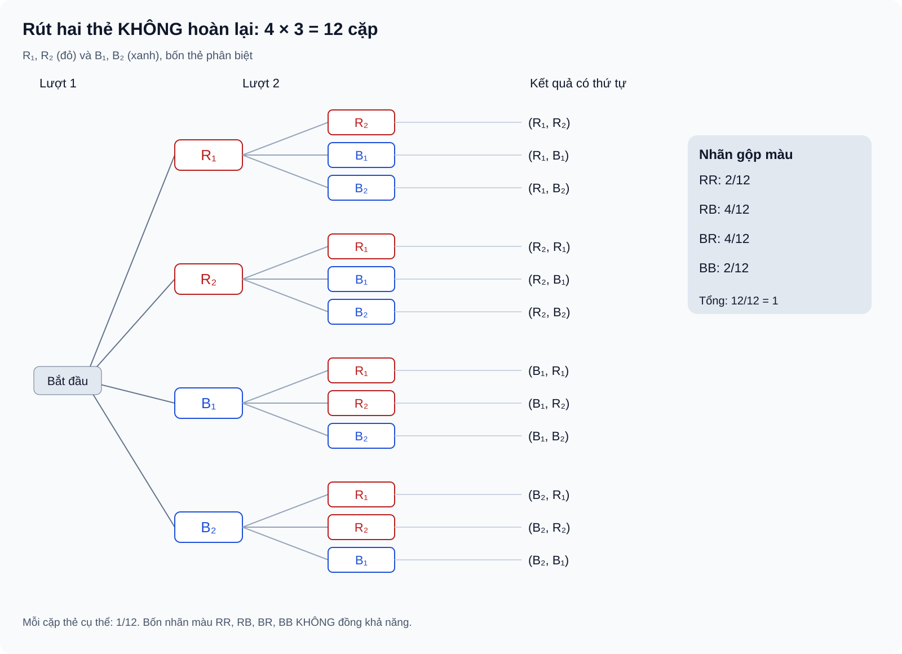

# Bài 27. Thực hành tính xác suất theo định nghĩa cổ điển

TOÁN 10 · CHƯƠNG IX · KIẾN THỨC SGK KNTT

Học khái niệm, kiểm các điều kiện của xác suất cổ điển và tự đối chiếu trước khi luyện tập.

=== "Khám phá kiến thức"

    ### Cùng tìm hiểu

    Một hộp có bốn thẻ **phân biệt**: hai thẻ đỏ \(R_1,R_2\) và hai thẻ xanh \(B_1,B_2\). Ta rút hai thẻ **liên tiếp, không hoàn lại**. Kết quả phải ghi theo **thứ tự rút**, vì rút \(R_1\) rồi \(B_1\) khác với rút \(B_1\) rồi \(R_1\).

    Lượt đầu có 4 khả năng. Sau khi lấy một thẻ ra, lượt sau chỉ còn 3, nên có \(4\cdot3=12\) cặp sơ cấp có thứ tự. Nếu rút ngẫu nhiên đều ở mỗi lượt, 12 cặp ấy đồng khả năng. Nhưng nếu em chỉ nhìn “đỏ–đỏ, đỏ–xanh, xanh–đỏ, xanh–xanh” và coi bốn nhãn này đồng khả năng, kết quả sẽ sai: mỗi nhãn đại diện cho **số cặp sơ cấp khác nhau**.

    Bài học tập trung vào cách chọn mô hình đếm đúng: sử dụng cây khi có nhiều lượt, tổ hợp khi chỉ chọn nhóm không xét thứ tự, và biến cố đối khi câu hỏi là “ít nhất một”. Mỗi phép tính phải bám sát việc **có hoàn lại hay không** và cách xác định kết quả sơ cấp.

    ### Thuật ngữ, kiến thức và kỹ năng

    **Thuật ngữ:** Không gian mẫu nhiều bước, kết quả có thứ tự, sơ đồ cây, rút có/không hoàn lại, tổ hợp, biến cố đối, ít nhất một, đồng khả năng.

    **Sau bài học, em cần làm được:** Chọn đếm có thứ tự hay không; vẽ cây đúng trạng thái sau mỗi lượt; tính xác suất biến cố và biến cố đối; kiểm giả thiết đồng khả năng trước phép chia.

=== "Kiến thức SGK"

    ### Dùng tổ hợp khi mỗi nhóm chọn không xét thứ tự

    Đếm hai thẻ rút đồng thời thành cả (1,2) và (2,1) sẽ coi cùng một nhóm là hai kết quả, làm mô hình mẫu số sai nếu tử số lại đếm theo nhóm.

    Nhớ \(\binom n2\) là số nhóm gồm hai đối tượng phân biệt chọn từ n đối tượng không xét thứ tự; nhắc tính chẵn/lẻ để nhận biết tổng lẻ.

    Chọn hai thẻ đồng thời và đều giữa các nhóm làm mỗi nhóm không thứ tự là một kết quả sơ cấp. Tổng hai số lẻ khi và chỉ khi một số lẻ, một số chẵn. Đếm nhóm thuận lợi bằng chọn một từ mỗi loại.

    **Hướng dẫn đọc hình/bảng:** Vẽ sơ đồ hai cột: nhóm lẻ {1,3,5} và nhóm chẵn {2,4}; nối mỗi số lẻ với mỗi số chẵn. Mỗi đoạn nối là một cặp không thứ tự duy nhất.

    Dùng tổ hợp ở mẫu số vì đề nói chọn nhóm không phân thứ tự; dùng phép nhân 3×2 ở tử vì mỗi cặp lẻ–chẵn xác định một nhóm khác nhau. Không áp công thức này nếu các nhóm không đồng khả năng.

    **Em vận dụng.**

    Chọn đều ngẫu nhiên **một nhóm hai thẻ** từ năm thẻ phân biệt ghi số 1,2,3,4,5; không xét thứ tự. Tính xác suất tổng hai số trên thẻ là **số lẻ**.

    

    ??? question "Tự đối chiếu lời giải sau khi em đã thử"

        
<strong>Đáp án và lập luận:</strong> Có \(\binom52=10\) nhóm đồng khả năng. Có 3 số lẻ (1,3,5) và 2 số chẵn (2,4); tổng lẻ cần đúng một số mỗi loại nên có \(3\cdot2=6\) nhóm. Xác suất \(6/10=3/5\).

    

    ??? tip "Khi chưa làm được: tự phát hiện lỗi và quay về kiến thức"

        
<strong>Bước 1:</strong> Nhận diện lỗi: đếm (1,2) và (2,1) thành hai nhóm khác nhau khi chọn đồng thời.

        
<strong>Bước 2:</strong> Ôn B24 tổ hợp và tính chẵn lẻ; tổng hai số lẻ khi có một lẻ và một chẵn.

        
<strong>Bước 3:</strong> Thử {1,2,3}: ba nhóm {1,2},{1,3},{2,3}; hai nhóm có tổng lẻ.

        
<strong>Bước 4:</strong> Liệt kê 6 nối lẻ–chẵn trên năm số và đối chiếu với tổng 10 nhóm rồi mở lời giải.

        
<strong>Bước 5:</strong> luyện câu liên quan trong phần Luyện tập để củng cố chọn đều các nhóm bằng tổ hợp.

        
<strong>Luyện tiếp:</strong> <a href="../luyen-tap/?item=THPT-G10-B27-P01">Mở câu luyện cùng kiến thức</a>. Nếu đã xem lời giải, hãy chọn thêm câu khác để tự làm không có gợi ý.

    ### Cây nhiều tầng phải tính đúng trạng thái sau mỗi lần rút

    **Cách đọc hình.** Cây biểu diễn bốn thẻ phân biệt R1,R2,B1,B2; sau lượt đầu chỉ còn ba thẻ. Có 12 cặp có thứ tự đồng khả năng. Nhánh RR có hai cặp, không bằng số nhánh RB hay BR.

    <figure class="thpt-r4-plot thpt-r4-probability-figure"><figcaption>Sơ đồ cây lựa chọn không hoàn lại; chỉ dùng quy tắc đếm lá khi các kết quả sơ cấp đồng khả năng.</figcaption></figure>

    Rút một thẻ không hoàn lại làm túi ở lượt hai thay đổi. Nếu vẽ nhánh lượt hai như lượt một, ta đếm cả trường hợp rút lại chính thẻ đã lấy.

    Ôn B23 quy tắc nhân và nhãn phân biệt. Kết quả có thứ tự gồm (thẻ lượt 1, thẻ lượt 2); khi rút đều từng thẻ còn lại, các cặp thẻ cụ thể có cùng xác suất.

    Với 5 thẻ phân biệt, lượt một có 5 chọn, lượt hai chỉ còn 4; Ω gồm \(5\cdot4=20\) cặp có thứ tự. Đúng một đỏ một xanh tách hai nhánh **đỏ rồi xanh** hoặc **xanh rồi đỏ**, rời nhau.

    **Hướng dẫn đọc hình/bảng:** Vẽ thân cây có 5 nhánh lượt một và từ mỗi nhánh chỉ 4 thẻ khác thẻ đã rút. Tô nhóm đỏ trước–xanh sau và xanh trước–đỏ sau; mỗi lá là một cặp phân biệt.

    Dùng cặp có thứ tự thay vì tổ hợp khi muốn nhìn rõ hai thứ tự. Đếm 3·2 cặp đỏ trước xanh sau và 2·3 cặp xanh trước đỏ sau; mỗi lá cùng xác suất 1/20 theo giả thiết rút đều không hoàn lại. Không áp cách đếm lá nếu các lựa chọn không đều.

    **Em vận dụng.**

    Một túi có **5 thẻ phân biệt**, gồm ba thẻ đỏ R₁,R₂,R₃ và hai thẻ xanh B₁,B₂. Rút lần lượt **hai thẻ không hoàn lại**, mỗi lượt chọn đều trong các thẻ còn lại. Tính xác suất hai thẻ được rút ra **khác màu**.

    

    ??? question "Tự đối chiếu lời giải sau khi em đã thử"

        
<strong>Đáp án và lập luận:</strong> Tổng \(n(\Omega)=5\cdot4=20\) cặp có thứ tự đồng khả năng. Khác màu gồm đỏ→xanh \(3\cdot2=6\) cặp hoặc xanh→đỏ \(2\cdot3=6\) cặp; hai trường hợp rời nhau nên \(P=12/20=3/5\).

    

    ??? tip "Khi chưa làm được: tự phát hiện lỗi và quay về kiến thức"

        
<strong>Bước 1:</strong> Chẩn đoán: rút không hoàn lại mà vẫn cho thẻ đầu xuất hiện ở nhánh thứ hai; hoặc quên thứ tự xanh→đỏ.

        
<strong>Bước 2:</strong> Nhắc quy tắc nhân và điều kiện mỗi lượt rút đều thẻ còn lại, tạo cặp có thứ tự.

        
<strong>Bước 3:</strong> Xét 2 thẻ đỏ R₁,R₂ và 1 xanh B: sáu cặp có thứ tự, bốn cặp khác màu.

        
<strong>Bước 4:</strong> Lập hai nhóm nhánh đỏ→xanh và xanh→đỏ trong bài năm thẻ rồi mở giải sau khi tính.

        
<strong>Bước 5:</strong> luyện câu liên quan trong phần Luyện tập và đọc SVG cây rút không hoàn lại để kiểm trạng thái sau rút.

        
<strong>Luyện tiếp:</strong> <a href="../luyen-tap/?item=THPT-G10-B27-C01">Mở câu luyện cùng kiến thức</a>. Nếu đã xem lời giải, hãy chọn thêm câu khác để tự làm không có gợi ý.

    ### “Ít nhất một” dễ xử lí bằng biến cố đối

    Với ba lần tung đồng xu, liệt kê tất cả chuỗi có ít nhất một lần ngửa khá dài, còn biến cố đối “không lần nào ngửa” chỉ có một chuỗi.

    Ôn ba phép thử độc lập cùng hai mặt đồng khả năng; ước lượng đúng số kết quả \(2^3=8\). Nhớ dấu 'ít nhất' bao gồm một, hai hoặc ba lần.

    Gọi A là “ít nhất một N”. Biến cố đối \(\bar A\) là “không có N” tức đúng chuỗi SSS. Vì A và \(\bar A\) phân hoạch Ω, xác suất A bằng 1 trừ xác suất duy nhất của SSS.

    **Hướng dẫn đọc hình/bảng:** Vẽ cây ba tầng, mỗi tầng hai nhánh N,S. Tô đúng lá SSS làm phần bù; bảy lá còn lại tương ứng ít nhất một N.

    Chọn phần bù vì chỉ cần đếm một lá thay vì bảy. Trước khi tính, kiểm từng chuỗi ba mặt đồng khả năng do đồng xu cân đối và các lần tung độc lập.

    **Em vận dụng.**

    Tung một đồng xu cân đối **ba lần độc lập**, ghi kết quả theo thứ tự. Tính xác suất có **ít nhất một lần xuất hiện mặt ngửa N** bằng biến cố đối.

    

    ??? question "Tự đối chiếu lời giải sau khi em đã thử"

        
<strong>Đáp án và lập luận:</strong> Ω có \(2^3=8\) chuỗi đồng khả năng. Biến cố đối của “ít nhất một N” là “cả ba lần đều S”, chỉ có SSS. Do đó \(P=1-1/8=7/8\).

    

    ??? tip "Khi chưa làm được: tự phát hiện lỗi và quay về kiến thức"

        
<strong>Bước 1:</strong> Nhận diện lỗi: hiểu 'ít nhất một N' là 'đúng một N', bỏ qua N xuất hiện hai hoặc ba lần.

        
<strong>Bước 2:</strong> Ôn từ khóa 'ít nhất' và phép lấy phần bù trong cùng không gian Ω.

        
<strong>Bước 3:</strong> Với hai lần tung, 'ít nhất một N' là {NN,NS,SN}, đối là {SS}; kiểm 3/4.

        
<strong>Bước 4:</strong> Vẽ cây ba lần tung, đánh dấu duy nhất SSS rồi tự mở đối chiếu đáp án.

        
<strong>Bước 5:</strong> luyện câu liên quan trong phần Luyện tập để áp dụng biến cố đối trong chọn nhóm nhiều đối tượng.

        
<strong>Luyện tiếp:</strong> <a href="../luyen-tap/?item=THPT-G10-B27-P02">Mở câu luyện cùng kiến thức</a>. Nếu đã xem lời giải, hãy chọn thêm câu khác để tự làm không có gợi ý.

    ### Hoàn lại hay không hoàn lại quyết định phép đếm

    Một thẻ có thể được rút lần thứ hai hay không thay đổi cả số kết quả và xác suất. Không đọc chữ “hoàn lại” làm sai mô hình trước khi tính.

    Nhớ kết quả hai lượt là cặp có thứ tự; năm thẻ phân biệt ghi 1..5 có đúng hai thẻ mang số chẵn {2,4}. Mỗi lượt chọn đều; nếu hoàn lại thì lần sau vẫn có năm lựa chọn.

    Có hoàn lại thì không gian mẫu gồm 5×5=25 cặp kết quả đồng khả năng, kể cả (2,2). Hai lần đều ra số chẵn có 2×2=4 cặp; xác suất bằng 4/25. Không hoàn lại sẽ cấm cặp lặp nên không dùng cùng mẫu số.

    **Hướng dẫn đọc hình/bảng:** Vẽ bảng 5 hàng x 5 cột; ô (i,j) là kết quả hai lượt. Vì có hoàn lại, đường chéo (i,i) vẫn tồn tại; đánh dấu bốn ô mang hai số chẵn.

    Dùng đếm cặp có thứ tự và giả thiết đồng đều; có thể kiểm bằng tích xác suất \((2/5)(2/5)\) nhờ hoàn lại, nhưng không lạm dụng tính độc lập khi rút không hoàn lại.

    **Em vận dụng.**

    Một hộp có năm thẻ phân biệt ghi số 1,2,3,4,5. Rút đều một thẻ, **ghi số rồi bỏ lại hộp**, trộn đều và rút lần hai. Tính xác suất **cả hai lần đều ra số chẵn**.

    

    ??? question "Tự đối chiếu lời giải sau khi em đã thử"

        
<strong>Đáp án và lập luận:</strong> Có 25 cặp có thứ tự đồng khả năng vì mỗi lần rút có 5 lựa chọn và có hoàn lại. Số chẵn là 2,4; hai lượt đều chẵn có 4 cặp (2,2),(2,4),(4,2),(4,4). Vậy \(P=4/25\).

    

    ??? tip "Khi chưa làm được: tự phát hiện lỗi và quay về kiến thức"

        
<strong>Bước 1:</strong> Chẩn đoán: bỏ qua 'bỏ lại hộp' và giảm số thẻ lượt hai từ 5 xuống 4.

        
<strong>Bước 2:</strong> Ôn cặp có thứ tự, quy tắc nhân và điều kiện hoàn lại.

        
<strong>Bước 3:</strong> Xét hai thẻ A,B, rút hai lần có hoàn lại: các cặp AA,AB,BA,BB đều có thể xảy ra.

        
<strong>Bước 4:</strong> Với năm thẻ, tô bốn ô trong bảng 5×5 được tạo bởi {2,4}×{2,4} rồi mở lời giải.

        
<strong>Bước 5:</strong> luyện câu liên quan trong phần Luyện tập để so sánh với rút **không** hoàn lại và tránh tráo mô hình.

        
<strong>Luyện tiếp:</strong> <a href="../luyen-tap/?item=THPT-G10-B27-P03">Mở câu luyện cùng kiến thức</a>. Nếu đã xem lời giải, hãy chọn thêm câu khác để tự làm không có gợi ý.

    ### Gộp cặp không thứ tự có thể phá giả thiết đồng khả năng

    Khi gieo hai xúc xắc phân biệt, có người gom (1,2) và (2,1) thành cùng một cặp {1,2}. Nhưng cặp {1,1} chỉ có một cách có thứ tự, nên 21 cặp không thứ tự không có xác suất như nhau.

    Nhắc hai xúc xắc phân biệt, mỗi xúc xắc có sáu mặt cân đối; Ω gồm 36 cặp có thứ tự (i,j) và mỗi cặp đồng khả năng. Một cặp đường chéo i=j chỉ có một thứ tự.

    Cùng một phép thử, ta phải chọn một mô hình kết quả sơ cấp **đồng khả năng**. Gộp hai thứ tự ở cặp khác số tạo nhóm nặng xác suất gấp đôi nhóm cùng số; vì vậy chia cho 21 sẽ sai dù 21 là số cặp không thứ tự.

    **Hướng dẫn đọc hình/bảng:** Đọc bảng 6×6 có hàng chỉ xúc xắc 1 và cột chỉ xúc xắc 2. Sáu ô đường chéo i=j biểu diễn hai mặt giống nhau; các ô (i,j) và (j,i) ở hai bên đường chéo là hai kết quả phân biệt.

    Dùng 36 cặp có thứ tự đồng khả năng. Có sáu kết quả đường chéo thuận lợi; xác suất 6/36=1/6. Nếu chọn nhóm không thứ tự, bắt buộc gán trọng số đúng 1/36 hoặc 2/36 tùy cặp, không được chia số nhóm thuần túy.

    **Em vận dụng.**

    Gieo hai xúc xắc **cân đối và phân biệt**. Một bạn cho rằng có 21 cặp không thứ tự và tính xác suất “hai xúc xắc ra cùng số” bằng \(6/21\). Cách tính đó đúng hay sai? Hãy xác định xác suất đúng.

    

    ??? question "Tự đối chiếu lời giải sau khi em đã thử"

        
<strong>Đáp án và lập luận:</strong> **Sai** vì 21 cặp không thứ tự không đồng khả năng: {1,2} có hai thứ tự (1,2),(2,1), còn {1,1} chỉ một thứ tự. Có 36 cặp có thứ tự đồng khả năng và sáu cặp (1,1),…,(6,6) thuận lợi; \(P=6/36=1/6\).

    

    ??? tip "Khi chưa làm được: tự phát hiện lỗi và quay về kiến thức"

        
<strong>Bước 1:</strong> Chẩn đoán: mặc nhiên coi 21 cặp không thứ tự là các kết quả đồng khả năng.

        
<strong>Bước 2:</strong> Nhớ định nghĩa Ω của hai xúc xắc phân biệt; (1,2) và (2,1) khác nhau, còn (1,1) chỉ một cặp.

        
<strong>Bước 3:</strong> Thử hai xúc xắc hai mặt cân đối: các cặp có thứ tự (1,1),(1,2),(2,1),(2,2), trong đó cùng số có 2/4.

        
<strong>Bước 4:</strong> Trong bảng 6×6, đếm sáu ô đường chéo trong 36 ô đồng khả năng, rồi tự mở đối chiếu.

        
<strong>Bước 5:</strong> luyện câu liên quan trong phần Luyện tập để nhận diện mô hình gộp cặp không đồng khả năng.

        
<strong>Luyện tiếp:</strong> <a href="../luyen-tap/?item=THPT-G10-B27-P05">Mở câu luyện cùng kiến thức</a>. Nếu đã xem lời giải, hãy chọn thêm câu khác để tự làm không có gợi ý.

    ### Kiến thức SGK — khái niệm và điều kiện

    ### 27.1. Dùng quy tắc đếm / tổ hợp

    Khi chọn đều k vật trong n vật **khác nhau** và không quan tâm thứ tự, số kết quả sơ cấp là C(n,k). Với biến cố A, liệt kê các trường hợp thuận lợi rồi dùng P(A)=n(A)/C(n,k), *nếu mọi nhóm k phần tử có khả năng như nhau*. Nếu quan tâm thứ tự, dùng chỉnh hợp hoặc liệt kê theo bước; không trộn mẫu có thứ tự với mẫu không thứ tự khi lấy tỉ số.

    ### 27.2. Sơ đồ cây và xác suất theo nhiều bước

    Với phép thử theo giai đoạn, sơ đồ cây giúp liệt kê mọi đường đi từ gốc đến lá, phân biệt “có hoàn lại” và “không hoàn lại”. Trong mô hình hữu hạn đồng khả năng, có thể đếm lá thuận lợi / tổng lá **chỉ khi các lá có cùng xác suất**. Nếu không đồng khả năng, cần tính xác suất cho từng nhánh theo điều kiện (chú ý điều kiện đồng khả năng của kết quả sơ cấp).

    ### 27.3. Xác suất của biến cố đối

    Để tính “ít nhất một”, hãy xét biến cố đối “không có lần nào” khi đó thuận tiện hơn; P(A)=1−P(Ā). Cẩn thận nhận diện tập bổ sung theo **đúng không gian mẫu**. Không được lấy tổng xác suất các trường hợp giao nhau nếu chưa xử lí phần giao.

    ### 27.4. Lựa chọn mô hình & tự kiểm

    Trước khi tính, học sinh tự hỏi: (1) Các kết quả sơ cấp là gì? (2) Có đồng khả năng không? (3) Có hoàn lại không? (4) Thứ tự có quan trọng không? (5) Biến cố thuận lợi là những trường hợp nào? (6) Kết quả cuối cùng có nằm trong [0,1] và có thể kiểm tra bằng cách khác không?

=== "Ví dụ"

    Trước khi xem lời giải, hãy xác định dữ kiện, điều phải tìm và lý do chọn cách giải. Sau đó kiểm tra lại điều kiện áp dụng và kết quả, thay vì chỉ nhìn phép tính cuối cùng.

    ### Ví dụ — “Ít nhất một thẻ xanh” theo biến cố đối

    **Đề bài.** Một hộp có bốn thẻ phân biệt \(R_1,R_2,B_1,B_2\), rút hai thẻ không hoàn lại, đều ngẫu nhiên ở mỗi lượt. Tính xác suất có **ít nhất một thẻ xanh**.

    **Vì sao chọn cách này?** “Ít nhất một” có nhiều trường hợp. Biến cố đối “cả hai thẻ đều đỏ” ít trường hợp hơn, nên dễ đếm không sót.

    **Giải.** Có \(4\cdot3=12\) kết quả có thứ tự đồng khả năng. Để cả hai đỏ, lượt đầu có 2 lựa chọn đỏ, lượt sau chỉ còn 1, nên có \(2\cdot1=2\) kết quả. \(P(\text{cả hai đỏ})=2/12=1/6\). Vậy \(P(\text{ít nhất một xanh})=1-1/6=5/6\).

    **Kiểm lại:** Nếu **hoàn lại** sau lượt đầu, xác suất cả hai đỏ sẽ là \((2/4)^2=1/4\), khác \(1/6\). Vì thế không thể dùng cùng phép đếm cho hai cách rút.

    **Ví dụ 1 (EX-G10-B27-01) — Chọn nhóm không phân biệt thứ tự.** Có 3 phiếu đánh số 1,2,3 và 2 phiếu đánh số 4,5. Chọn đều 2 phiếu khác nhau cùng lúc. Tổng số nhóm C(5,2)=10. Biến cố “cả hai phiếu có số không vượt 3” có C(3,2)=3 nhóm, vậy xác suất 3/10. Không nhân thêm 2! vì nhóm không xét thứ tự.

    **Ví dụ 2 (EX-G10-B27-02) — Sơ đồ cây ba phép thử.** Tung ba đồng xu cân đối độc lập, ghi kết quả từng lần (N = ngửa, S = sấp). Có 2³=8 bộ kết quả đồng khả năng: NNN, NNS, NSN, SNN, NSS, SNS, SSN, SSS. Biến cố đúng hai mặt ngửa là {NNS, NSN, SNN}, xác suất 3/8. Có thể minh họa bằng cây ba tầng; mỗi lá đúng một chuỗi.

    **Ví dụ 3 (EX-G10-B27-03) — Tính biến cố đối.** Gieo một xúc xắc cân đối hai lần độc lập. A: “Có ít nhất một lần ra mặt 6”. Ā: “Cả hai lần đều khác 6” có 5·5=25 bộ, Ω có 36 bộ, nên P(A)=1−25/36=11/36. Không cộng 1/6+1/6=1/3 vì trường hợp cả hai lần cùng ra 6 sẽ bị tính hai lần.

=== "Lỗi thường gặp"

    

    ??? tip "Đếm lá sơ đồ cây không đồng khả năng"

        
<strong>Dấu hiệu sai:</strong> Thấy sơ đồ cây có nhiều lá rồi chia số lá thuận lợi cho tổng lá mà không kiểm điều kiện chọn từng bước; hoặc quên rằng xác suất nhánh sau có thể thay đổi khi không hoàn lại.

        
<strong>Bản chất toán và điều kiện:</strong> Đếm lá theo định nghĩa cổ điển chỉ đúng khi mọi lá của Ω đã chọn là đồng khả năng. Rút không hoàn lại làm thay đổi số phần tử còn lại và các xác suất có điều kiện. Nếu mô hình không bảo đảm đồng khả năng, không dùng số lá thuần túy làm mẫu số; cần chuyển sang mô hình đủ chi tiết hoặc nêu thiếu dữ kiện.

        
<strong>Tự sửa theo bước:</strong> (1) Xác định thứ tự các bước và có hoàn lại hay không. (2) Tạo đúng một nhánh cho mỗi lựa chọn có thể xảy ra ở mỗi trạng thái. (3) Kiểm tính đồng khả năng của từng kết quả hoàn chỉnh/lá trước khi đếm. (4) Gom các lá thỏa biến cố, bảo đảm không đếm trùng. (5) Soát kết quả trong [0,1], đối chiếu bằng cách đếm cặp.

        
<strong>Kiến thức cần ôn:</strong> B23 quy tắc nhân; B26 §26.4; B27 §27.2.

        
<strong>Luyện lại câu đã có:</strong> <a data-thpt-formative-id="THPT-G10-B27-C01" href="../luyen-tap/?item=THPT-G10-B27-C01">Luyện lại B27-C01</a> · <a data-thpt-formative-id="THPT-G10-B27-C02" href="../luyen-tap/?item=THPT-G10-B27-C02">Luyện lại B27-C02</a> · <a data-thpt-formative-id="THPT-G10-B27-P03" href="../luyen-tap/?item=THPT-G10-B27-P03">Luyện lại B27-P03</a> · <a data-thpt-formative-id="THPT-G10-B27-P04" href="../luyen-tap/?item=THPT-G10-B27-P04">Luyện lại B27-P04</a> · <a data-thpt-formative-id="THPT-G10-B27-P05" href="../luyen-tap/?item=THPT-G10-B27-P05">Luyện lại B27-P05</a>

    

    ??? tip "Lẫn mẫu có thứ tự, tổ hợp và biến cố ít nhất một"

        
<strong>Dấu hiệu sai:</strong> Đếm mẫu bằng tổ hợp nhưng đếm trường hợp thuận lợi theo chuỗi có thứ tự; hoặc đếm “ít nhất một” bằng cộng các trường hợp giao nhau; cho rằng mọi cặp không thứ tự khi gieo hai xúc xắc phân biệt đều đồng khả năng.

        
<strong>Bản chất toán và điều kiện:</strong> Tử và mẫu phải đếm theo cùng loại kết quả sơ cấp và cùng giả thiết đồng khả năng. Với chọn đồng thời k đối tượng phân biệt thành một nhóm đồng khả năng, dùng C(n,k) nhất quán. “Ít nhất một” có thể chuyển sang biến cố đối “không có”, nhưng phải mô tả chính xác phần bù trong Ω.

        
<strong>Tự sửa theo bước:</strong> (1) Hỏi có xét thứ tự hay không và ghi vào định nghĩa Ω. (2) Với nhóm chọn đồng thời có khả năng như nhau, dùng tổ hợp cho cả tử và mẫu; với chuỗi nhiều bước, dùng kết quả có thứ tự nhất quán. (3) Kiểm các trường hợp thuận lợi rời nhau. (4) Thử biến cố đối để tránh đếm giao nhau. (5) Xác nhận 0≤P≤1; tự đối chiếu bằng cách khác.

        
<strong>Kiến thức cần ôn:</strong> B24 hoán vị/chỉnh hợp/tổ hợp; B26 biến cố đối; B27 §27.1, 27.3–27.4.

        
<strong>Luyện lại câu đã có:</strong> <a data-thpt-formative-id="THPT-G10-B27-P01" href="../luyen-tap/?item=THPT-G10-B27-P01">Luyện lại B27-P01</a> · <a data-thpt-formative-id="THPT-G10-B27-P02" href="../luyen-tap/?item=THPT-G10-B27-P02">Luyện lại B27-P02</a> · <a data-thpt-formative-id="THPT-G10-B27-P05" href="../luyen-tap/?item=THPT-G10-B27-P05">Luyện lại B27-P05</a> · <a data-thpt-formative-id="THPT-G10-CHIX-W27-ANCHOR-01" href="../../../thu-vien/tu-luan-chuong-ix/#thpt-g10-chix-w27-anchor-01">Tự luận liên quan</a>

    **Học tiếp:** [Core và Luyện tập](luyen-tap.md) · [Tự kiểm tra cuối chương](tu-kiem-tra-chuong.md).

    
Nguồn toán học: SGK Toán 10 Kết nối tri thức với cuộc sống và học liệu SLM hiện hành. Lời giảng được biên tập nhằm hỗ trợ tự học độc lập.

<small>Nguồn S1: SGK Toán 10 KNTT tập 2 tr.83–87, SBT Bài 27 phần bài tập tr.64–66. Hình minh họa và thẻ hướng dẫn giúp học sinh tự ôn tập; không phải bài đánh giá thành thạo.</small>
