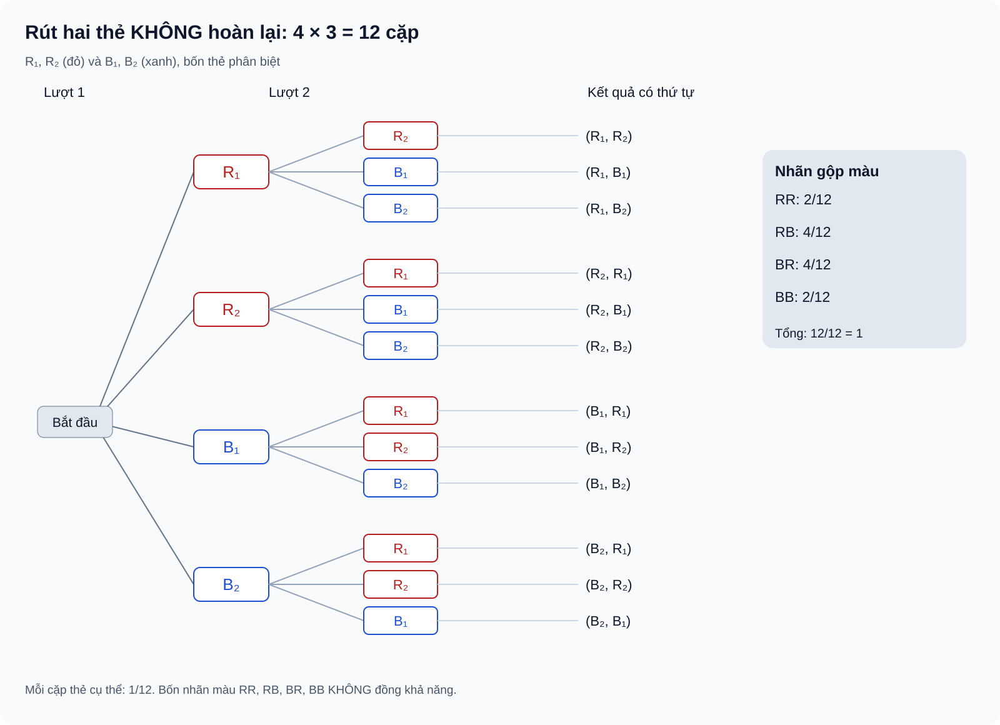

# Bài 27. Thực hành tính xác suất theo định nghĩa cổ điển

TOÁN 10 · CHƯƠNG IX

Biết chọn tổ hợp, đọc cây nhiều bước và dùng biến cố đối để tính xác suất cổ điển đúng điều kiện.

=== "Khám phá kiến thức"

    Một bộ vé số chọn **6 số khác nhau trong 45 số**. Nếu phải liệt kê mọi bộ có thể có rồi mới đếm số bộ trúng, bài toán sẽ rất dài. Bài này giúp em tìm cách đếm **không cần liệt kê**, nhận ra khi nào cần sơ đồ cây và khi nào nên đếm biến cố đối.

    Em đã biết không gian mẫu, biến cố và điều kiện **các kết quả sơ cấp đồng khả năng** ở Bài 26; đã học quy tắc cộng, nhân ở Bài 23 và tổ hợp ở Bài 24. Ba công cụ đó được dùng trong cùng một việc: mô tả đúng một kết quả, đếm đủ kết quả thuận lợi, rồi lấy tỉ số.

    ### 1.1. Chọn nhóm không xét thứ tự

    Chọn đồng thời hai thẻ trong năm thẻ ghi số 1–5, không phân biệt thứ tự: nhóm {1,2} và cách viết {2,1} chính là **một** kết quả. Vì vậy mẫu số là \(\binom52=10\), không phải \(5\cdot4=20\). Để có tổng lẻ, em cần ghép một số lẻ với một số chẵn; thử đếm các nhóm như vậy trước khi mở lời giải.

    Nếu đề bài đổi thành “rút liên tiếp và quan tâm thứ tự”, kết quả phải là **cặp có thứ tự**. Hai cách đếm đều có thể cho cùng xác suất trong mô hình phù hợp, nhưng **tử số và mẫu số phải theo cùng một loại kết quả**.

    **Vận dụng.**

    Chọn đều ngẫu nhiên **một nhóm hai thẻ** từ năm thẻ phân biệt ghi số 1,2,3,4,5; không xét thứ tự. Tính xác suất tổng hai số trên thẻ là **số lẻ**.

    

    ??? question "Đối chiếu"

        
<strong>Đáp án và lập luận:</strong> Có \(\binom52=10\) nhóm đồng khả năng. Có 3 số lẻ (1,3,5) và 2 số chẵn (2,4); tổng lẻ cần đúng một số mỗi loại nên có \(3\cdot2=6\) nhóm. Xác suất \(6/10=3/5\).

    

    ??? tip "Kiểm lỗi"

        
<strong>Lỗi cần kiểm:</strong> Đếm trùng một nhóm khi chọn không xét thứ tự.

        
<strong>Bước 1:</strong> Nhận diện lỗi: đếm (1,2) và (2,1) thành hai nhóm khác nhau khi chọn đồng thời.

        
<strong>Bước 2:</strong> Ôn B24 tổ hợp và tính chẵn lẻ; tổng của hai số là số lẻ khi một số lẻ và một số chẵn.

        
<strong>Bước 3:</strong> Thử {1,2,3}: ba nhóm {1,2},{1,3},{2,3}; hai nhóm có tổng lẻ.

        
<strong>Bước 4:</strong> Liệt kê 6 nối lẻ–chẵn trên năm số và đối chiếu với tổng 10 nhóm rồi mở lời giải.

        
<strong>Bước 5:</strong> luyện câu liên quan trong phần Luyện tập để củng cố chọn đều các nhóm bằng tổ hợp.

        
<strong>Luyện tiếp:</strong> <a href="../luyen-tap/?item=THPT-G10-B27-P01">Mở câu luyện cùng kiến thức</a>. Nếu đã xem lời giải, hãy chọn thêm câu khác để tự làm không có gợi ý.

    ### 1.2. Rút thẻ theo nhiều lượt

    Với bốn thẻ \(R_1,R_2,B_1,B_2\), rút lần lượt hai thẻ **không hoàn lại** và chọn đều từ các thẻ còn lại. Sau lượt đầu chỉ còn ba thẻ. Một kết quả hoàn chỉnh là \((\text{thẻ lượt 1},\text{thẻ lượt 2})\), có \(4\cdot3=12\) kết quả đồng khả năng.

    <figure class="thpt-r4-plot thpt-r4-probability-figure"><figcaption><strong>Đọc cây từ trái sang phải:</strong> sau mỗi thẻ đầu, tìm ba thẻ còn lại ở lượt hai. Mỗi lá là một cặp có thứ tự. Nhóm đỏ–đỏ có 2 lá; đỏ–xanh có 4 lá; xanh–đỏ có 4 lá; xanh–xanh có 2 lá. Không được coi bốn nhóm màu là bốn kết quả đồng khả năng.</figcaption></figure>

    Khi một bài có nhiều giai đoạn, hãy đọc **một đường từ gốc đến lá** trước khi đếm; nhánh không được giữ nguyên nếu phép thử thay đổi trạng thái sau mỗi bước.

    **Vận dụng.**

    Một túi có **5 thẻ phân biệt**, gồm ba thẻ đỏ R₁,R₂,R₃ và hai thẻ xanh B₁,B₂. Rút lần lượt **hai thẻ không hoàn lại**, mỗi lượt chọn đều trong các thẻ còn lại. Tính xác suất hai thẻ được rút ra **khác màu**.

    

    ??? question "Đối chiếu"

        
<strong>Đáp án và lập luận:</strong> Tổng \(n(\Omega)=5\cdot4=20\) cặp có thứ tự đồng khả năng. Khác màu gồm đỏ→xanh \(3\cdot2=6\) cặp hoặc xanh→đỏ \(2\cdot3=6\) cặp; hai trường hợp rời nhau nên \(P=12/20=3/5\).

    

    ??? tip "Kiểm lỗi"

        
<strong>Lỗi cần kiểm:</strong> Quên nhánh xanh trước, đỏ sau khi rút thẻ.

        
<strong>Bước 1:</strong> Chẩn đoán: rút không hoàn lại mà vẫn cho thẻ đầu xuất hiện ở nhánh thứ hai; hoặc quên thứ tự xanh→đỏ.

        
<strong>Bước 2:</strong> Nhắc quy tắc nhân và điều kiện mỗi lượt rút đều thẻ còn lại, tạo cặp có thứ tự.

        
<strong>Bước 3:</strong> Xét 2 thẻ đỏ R₁,R₂ và 1 xanh B: sáu cặp có thứ tự, bốn cặp khác màu.

        
<strong>Bước 4:</strong> Lập hai nhóm nhánh đỏ→xanh và xanh→đỏ trong bài năm thẻ rồi mở giải sau khi tính.

        
<strong>Bước 5:</strong> luyện câu liên quan trong phần Luyện tập và đọc SVG cây rút không hoàn lại để kiểm trạng thái sau rút.

        
<strong>Luyện tiếp:</strong> <a href="../luyen-tap/?item=THPT-G10-B27-C01">Mở câu luyện cùng kiến thức</a>. Nếu đã xem lời giải, hãy chọn thêm câu khác để tự làm không có gợi ý.

    ### 1.3. Sử dụng biến cố đối

    Tung đồng xu cân đối ba lần độc lập, ghi N (ngửa), S (sấp). Tính xác suất có “ít nhất một N” bằng cách liệt kê bảy chuỗi chứa N được, nhưng dễ bỏ sót. Biến cố đối chỉ gồm chuỗi SSS. Từ đó, em thử tính xác suất của biến cố ban đầu bằng cách lấy 1 trừ xác suất chuỗi SSS.

    Điều quan trọng không phải mẹo trừ số, mà là **hai biến cố đối không thể xảy ra đồng thời và phủ toàn bộ không gian mẫu**.

    **Vận dụng.**

    Tung một đồng xu cân đối **ba lần độc lập**, ghi kết quả theo thứ tự. Tính xác suất có **ít nhất một lần xuất hiện mặt ngửa N** bằng biến cố đối.

    

    ??? question "Đối chiếu"

        
<strong>Đáp án và lập luận:</strong> Ω có \(2^3=8\) chuỗi đồng khả năng. Biến cố đối của “ít nhất một N” là “cả ba lần đều S”, chỉ có SSS. Do đó \(P=1-1/8=7/8\).

    

    ??? tip "Kiểm lỗi"

        
<strong>Lỗi cần kiểm:</strong> Hiểu “ít nhất một” thành “đúng một”.

        
<strong>Bước 1:</strong> Nhận diện lỗi: hiểu 'ít nhất một N' là 'đúng một N', bỏ qua N xuất hiện hai hoặc ba lần.

        
<strong>Bước 2:</strong> Ôn từ khóa 'ít nhất' và phép lấy phần bù trong cùng không gian Ω.

        
<strong>Bước 3:</strong> Với hai lần tung, 'ít nhất một N' là {NN,NS,SN}, đối là {SS}; kiểm 3/4.

        
<strong>Bước 4:</strong> Vẽ cây ba lần tung, đánh dấu duy nhất SSS rồi tự mở đối chiếu đáp án.

        
<strong>Bước 5:</strong> luyện câu liên quan trong phần Luyện tập để áp dụng biến cố đối trong chọn nhóm nhiều đối tượng.

        
<strong>Luyện tiếp:</strong> <a href="../luyen-tap/?item=THPT-G10-B27-P02">Mở câu luyện cùng kiến thức</a>. Nếu đã xem lời giải, hãy chọn thêm câu khác để tự làm không có gợi ý.

    ### 1.4. Phép rút có hoàn lại và không hoàn lại

    Rút hai lượt từ năm thẻ phân biệt: có hoàn lại thì mỗi lượt đều có năm lựa chọn, được \(5\cdot5=25\) cặp, kể cả (2,2); không hoàn lại thì lượt hai còn bốn lựa chọn, chỉ có \(5\cdot4=20\) cặp.

    Do đó **không chọn công thức trước khi đọc rõ phép thử**. Sơ đồ cây và bảng hai chiều phải phản ánh đúng có hoặc không có phép hoàn lại.

    **Vận dụng.**

    Một hộp có năm thẻ phân biệt ghi số 1,2,3,4,5. Rút đều một thẻ, **ghi số rồi bỏ lại hộp**, trộn đều và rút lần hai. Tính xác suất **cả hai lần đều ra số chẵn**.

    

    ??? question "Đối chiếu"

        
<strong>Đáp án và lập luận:</strong> Có 25 cặp có thứ tự đồng khả năng vì mỗi lần rút có 5 lựa chọn và có hoàn lại. Số chẵn là 2,4; hai lượt đều chẵn có 4 cặp (2,2),(2,4),(4,2),(4,4). Vậy \(P=4/25\).

    

    ??? tip "Kiểm lỗi"

        
<strong>Lỗi cần kiểm:</strong> Rút có hoàn lại nhưng giảm số thẻ ở lượt hai.

        
<strong>Bước 1:</strong> Chẩn đoán: bỏ qua 'bỏ lại hộp' và giảm số thẻ lượt hai từ 5 xuống 4.

        
<strong>Bước 2:</strong> Ôn cặp có thứ tự, quy tắc nhân và điều kiện hoàn lại.

        
<strong>Bước 3:</strong> Xét hai thẻ A,B, rút hai lần có hoàn lại: các cặp AA,AB,BA,BB đều có thể xảy ra.

        
<strong>Bước 4:</strong> Với năm thẻ, tô bốn ô trong bảng 5×5 được tạo bởi {2,4}×{2,4} rồi mở lời giải.

        
<strong>Bước 5:</strong> luyện câu liên quan trong phần Luyện tập để so sánh với rút **không** hoàn lại và tránh tráo mô hình.

        
<strong>Luyện tiếp:</strong> <a href="../luyen-tap/?item=THPT-G10-B27-P03">Mở câu luyện cùng kiến thức</a>. Nếu đã xem lời giải, hãy chọn thêm câu khác để tự làm không có gợi ý.

    ### 1.5. Điều kiện đồng khả năng

    Gieo độc lập hai xúc xắc cân đối **phân biệt**: cặp (1,2) khác (2,1), nên 36 cặp có thứ tự đồng khả năng. Nếu gộp thành 21 cặp không thứ tự, nhóm {1,2} gồm hai kết quả gốc còn {1,1} chỉ có một. Vì vậy **21 nhóm không đồng khả năng**; không thể dùng số nhóm làm mẫu số của định nghĩa cổ điển.

    Khi tự kiểm một bài xác suất, em cần xác nhận: kết quả sơ cấp đã đủ thông tin chưa; có cùng khả năng không; số thuận lợi được đếm cùng cách với số tất cả không?

    **Vận dụng.**

    Gieo hai xúc xắc **cân đối và phân biệt**. Một bạn cho rằng có 21 cặp không thứ tự và tính xác suất “hai xúc xắc ra cùng số” bằng \(6/21\). Cách tính đó đúng hay sai? Hãy xác định xác suất đúng.

    

    ??? question "Đối chiếu"

        
<strong>Đáp án và lập luận:</strong> **Sai** vì 21 cặp không thứ tự không đồng khả năng: {1,2} có hai thứ tự (1,2),(2,1), còn {1,1} chỉ một thứ tự. Có 36 cặp có thứ tự đồng khả năng và sáu cặp (1,1),…,(6,6) thuận lợi; \(P=6/36=1/6\).

    

    ??? tip "Kiểm lỗi"

        
<strong>Lỗi cần kiểm:</strong> Cho 21 nhóm xúc xắc không thứ tự là đồng khả năng.

        
<strong>Bước 1:</strong> Chẩn đoán: mặc nhiên coi 21 cặp không thứ tự là các kết quả đồng khả năng.

        
<strong>Bước 2:</strong> Nhớ định nghĩa Ω của hai xúc xắc phân biệt; (1,2) và (2,1) khác nhau, còn (1,1) chỉ một cặp.

        
<strong>Bước 3:</strong> Thử hai xúc xắc hai mặt cân đối: các cặp có thứ tự (1,1),(1,2),(2,1),(2,2), trong đó cùng số có 2/4.

        
<strong>Bước 4:</strong> Trong bảng 6×6, đếm sáu ô đường chéo trong 36 ô đồng khả năng, rồi tự mở đối chiếu.

        
<strong>Bước 5:</strong> luyện câu liên quan trong phần Luyện tập để nhận diện mô hình gộp cặp không đồng khả năng.

        
<strong>Luyện tiếp:</strong> <a href="../luyen-tap/?item=THPT-G10-B27-P05">Mở câu luyện cùng kiến thức</a>. Nếu đã xem lời giải, hãy chọn thêm câu khác để tự làm không có gợi ý.

=== "Kiến thức SGK"

    ### 2.1. Sử dụng phương pháp tổ hợp

    Khi có rất nhiều kết quả, ta không cần liệt kê từng kết quả để đếm \(n(\Omega)\) và \(n(A)\). Từ Bài 23–24, em dùng quy tắc nhân, chỉnh hợp, tổ hợp tùy cách một kết quả được xác định.

    **Chọn nhóm không xét thứ tự.** Nếu chọn đều một nhóm \(k\) đối tượng từ \(n\) đối tượng **phân biệt**, mỗi nhóm gồm \(k\) phần tử là một kết quả sơ cấp. Tử số và mẫu số phải cùng đếm **các nhóm không xét thứ tự**.

    
<strong>Công thức tính xác suất bằng tổ hợp</strong>
\(n(\Omega)=\binom nk\) với \(0\le k\le n\); theo định nghĩa cổ điển \(P(A)=n(A)/n(\Omega)\). Do đó, khi mọi nhóm \(k\) phần tử đồng khả năng, \(P(A)=\dfrac{n(A)}{\binom nk}\).

Muốn tính \(P(A)\), hãy đếm số nhóm thuận lợi \(n(A)\) trong cùng mô hình, rồi kiểm \(n(\Omega)>0\).

    **Kết hợp các phép chọn.** Ví dụ chọn 6 học sinh trong lớp có 7 nam và 5 nữ, yêu cầu 3 nam và 3 nữ. Mỗi nhóm 3 nam có thể kết hợp với mọi nhóm 3 nữ; theo quy tắc nhân, có \(\binom73\binom53\) nhóm thuận lợi. Điều kiện phải kiểm là giáo viên chọn đều **giữa các nhóm 6 học sinh**, không phải chỉ nói “chọn ngẫu nhiên”.

    **Phân biệt các mô hình:** rút lần lượt và ghi thứ tự khác với chọn cùng lúc không ghi thứ tự. Công thức tổ hợp không phải quy tắc thay thế mọi sơ đồ cây. Khi xét một bộ 6 số từ 45 số, việc chọn theo nhóm cho \(n(\Omega)=\binom{45}{6}\); đây là mô hình chọn nhóm không xét thứ tự.

    ### 2.2. Sử dụng sơ đồ hình cây

    Sơ đồ cây mô tả phép thử gồm nhiều bước: từ mỗi nhánh lượt trước, chỉ vẽ **những kết quả còn có thể xảy ra** ở lượt sau; mỗi đường đi từ gốc đến lá ứng với một kết quả hoàn chỉnh.

    <figure class="thpt-r4-plot thpt-r4-probability-figure" data-b27-knowledge-figure="reused-discovery-tree"><figcaption><strong>Hướng dẫn đọc hình:</strong> chọn một nhánh đầu, đi tiếp theo từng nhánh của ba thẻ còn lại để đọc một kết quả hoàn chỉnh ở lá. Có 12 lá: 2 đỏ–đỏ, 4 đỏ–xanh, 4 xanh–đỏ, 2 xanh–xanh. Các lá chỉ biểu diễn các kết quả có thứ tự của phép rút không hoàn lại.</figcaption></figure>

    **Hướng dẫn đọc sơ đồ cây.** Rút không hoàn lại làm số lựa chọn ở lượt sau giảm từ bốn xuống ba. Đếm số lá thuận lợi chỉ được chia cho 12 khi 12 cặp thẻ cụ thể là các kết quả đồng khả năng.

    **Ví dụ về ba hộp:** hộp I có ba lựa chọn (đỏ, xanh, vàng), hộp II có hai lựa chọn (xanh, vàng), hộp III có hai lựa chọn (đỏ, xanh). Khi rút đều từ từng hộp và các lượt độc lập, có \(3\cdot2\cdot2=12\) kết quả (bộ ba màu) đồng khả năng. Muốn tìm “đúng một viên xanh”, chỉ đánh dấu các đường có đúng một chữ X, rồi đếm.

    **Điều kiện đồng khả năng:** việc cây có cùng số lá ở mỗi nhánh chưa đủ chứng minh các lá đồng khả năng nếu việc chọn ở từng nhánh bị thiên lệch. Chỉ được dùng tỉ số **số lá thuận lợi / tổng số lá** khi các kết quả hoàn chỉnh đồng khả năng. Nếu không biết cách chọn, không tự gán mỗi lá xác suất bằng nhau.

    ### 2.3. Xác suất của biến cố đối

    Gọi \(E\) là một biến cố của phép thử với không gian mẫu \(\Omega\). Biến cố đối \(\overline E=\Omega\setminus E\) xảy ra **khi và chỉ khi** \(E\) không xảy ra. Vì \(E\) và \(\overline E\) rời nhau và phủ \(\Omega\), nên tổng xác suất của hai biến cố bằng 1.

    
<strong>Xác suất của biến cố đối</strong> Với mọi biến cố \(E\) và biến cố đối \(\overline E\) trong cùng không gian mẫu: \(P(\overline E)=1-P(E)\), hay tương đương \(P(E)=1-P(\overline E)\).

    **Áp dụng biến cố đối.** Khi \(E\) gồm quá nhiều trường hợp nhưng “\(E\) không xảy ra” có ít trường hợp hơn, tính \(P(\overline E)\) trước để tránh đếm thiếu hoặc đếm trùng. Chẳng hạn “ít nhất một lần ra 6” có biến cố đối là “không lần nào ra 6”.

    **Giới hạn áp dụng:** phải phủ định đúng điều kiện trong cùng phép thử. “Ít nhất một” đối với “không có lần nào”; “đúng một” thì biến cố đối gồm cả không có và từ hai lần trở lên. Nếu các kết quả sơ cấp không đồng khả năng, vẫn có công thức biến cố đối, nhưng không được dùng tỉ số đếm số lá khi chưa đủ giả thiết.

    **Bài toán chọn bộ số.** Một bộ 6 số trong 45 số có \(\binom{45}{6}\) khả năng chọn đều; đúng 6 số trúng có 1 bộ thuận lợi, đúng 5 số trúng có \(\binom65\binom{39}{1}=234\) bộ. 

=== "Ví dụ"

    ### 3.1. Ví dụ — Chọn nhóm có đúng số nam và nữ

    **Đề bài.** Một tổ có 7 nam và 5 nữ. Chọn đều một nhóm 6 học sinh. Tính xác suất chọn đúng 3 nam, 3 nữ.

    **Phân tích:** Một nhóm 6 người không xét thứ tự; cần chọn 3 người từ mỗi nhóm giới tính. Dùng tổ hợp để đếm mẫu và nhóm thuận lợi.

    

<strong>Lời giải.</strong> Có \(n(\Omega)=\binom{12}{6}=924\) nhóm đều nhau. Có \(\binom73\binom53=35\cdot10=350\) nhóm gồm 3 nam và 3 nữ. Vậy \(P=\dfrac{350}{924}=\dfrac{25}{66}\).

    **Kiểm lại:** Số thuận lợi \(350\) không vượt \(924\). Không nhân \(6!\) vì nhóm không xét thứ tự.

    ### 3.2. Ví dụ — Cây lấy một viên từ mỗi hộp

    **Đề bài.** Hộp I có đúng một bi mỗi màu đỏ, xanh, vàng; hộp II có đúng một bi mỗi màu xanh, vàng; hộp III có đúng một bi mỗi màu đỏ, xanh. Chọn đều một viên từ mỗi hộp, độc lập. Tính xác suất có đúng một viên xanh.

    **Phân tích:** Có ba tầng lựa chọn; mỗi đường đi gồm một màu từ mỗi hộp, tổng số lá là 3×2×2. Đánh dấu đúng các đường có duy nhất một X.

    

<strong>Lời giải.</strong> Có \(n(\Omega)=3\cdot2\cdot2=12\) bộ màu đồng khả năng. Đúng một X gồm các bộ ĐXĐ, ĐVX, XVĐ, VXĐ, VVX (Đ: đỏ, X: xanh, V: vàng), tức 5 bộ. Do đó \(P=5/12\).

    **Kiểm lại:** Có thể kiểm theo vị trí của X: ở hộp I có 1 bộ, ở hộp II có 2 bộ, ở hộp III có 2 bộ; tổng 1+2+2=5.

    ### 3.3. Ví dụ — Ít nhất một số chẵn

    **Đề bài.** Chọn đều hai số khác nhau từ tập {1,2,…,10}, không xét thứ tự. Tính xác suất nhóm được chọn có ít nhất một số chẵn.

    **Phân tích:** Biến cố đối đơn giản: cả hai số đều lẻ. Có năm số lẻ; dùng tổ hợp đếm nhóm không có số chẵn.

    

<strong>Lời giải.</strong> Có \(n(\Omega)=\binom{10}{2}=45\). Biến cố đối có \(n(\overline E)=\binom52=10\) nhóm, nên \(P(E)=1-\dfrac{10}{45}=\dfrac79\).

    **Kiểm lại:** Đếm trực tiếp nhóm chứa số chẵn: \(\binom52\) (hai chẵn) cộng \(5\cdot5\) (một chẵn, một lẻ) bằng 35; \(35/45=7/9\).

    ### 3.4. Ví dụ — Vé số chọn sáu số trong bốn mươi lăm số

    **Đề bài.** Một trò chơi chọn đều một bộ 6 số khác nhau từ 1 đến 45; bộ trúng thưởng cố định. Tính xác suất trùng cả sáu số và xác suất trùng đúng năm số.

    **Phân tích:** Không xét thứ tự trong một bộ. Trúng đủ sáu có một bộ; trùng đúng năm cần chọn năm trong sáu số trúng và một trong 39 số khác.

    

<strong>Lời giải.</strong> Có \(n(\Omega)=\binom{45}{6}=8\,145\,060\). Trùng sáu số: \(P_6=\dfrac1{\binom{45}{6}}\). Trùng **đúng** năm số: \(n(G)=\binom65\binom{39}{1}=6\cdot39=234\), nên \(P_5=\dfrac{234}{\binom{45}{6}}\).

    **Kiểm lại:** Không lấy thêm số thứ sáu trong bộ trúng khi đếm trường hợp “đúng năm”; nếu lấy đủ sáu sẽ thành giải khác. Hai loại trúng là hai biến cố không giao nhau.

    ### 3.5. Ví dụ — Một điều kiện, hai cách rút

    **Đề bài.** Hộp có hai thẻ đỏ và hai thẻ xanh phân biệt. Rút đều hai lượt. So sánh xác suất có ít nhất một thẻ xanh khi (a) không hoàn lại và (b) có hoàn lại.

    **Phân tích:** Biến cố đối là hai lần đều đỏ. Hai phép thử có không gian mẫu khác nhau vì trạng thái hộp ở lượt hai khác nhau.

    

<strong>Lời giải.</strong> (a) Không hoàn lại: có \(4\cdot3=12\) cặp đều nhau, trong đó \(2\cdot1=2\) cặp đỏ–đỏ. \(P=1-\frac{2}{12}=\frac56\). (b) Có hoàn lại: có \(4\cdot4=16\) cặp đều nhau, trong đó \(2\cdot2=4\) cặp đỏ–đỏ. \(P=1-\frac4{16}=\frac34\).

    **Kiểm lại:** Hai kết quả không bằng nhau là hợp lí: không hoàn lại làm giảm số thẻ đỏ có thể rút ở lần sau nếu đã rút đỏ.

    ### 3.6. Ví dụ — Không gộp các kết quả khác trọng số

    **Đề bài.** Gieo độc lập hai xúc xắc cân đối phân biệt. Tính xác suất tổng số chấm bằng 5.

    **Phân tích:** Một kết quả là (số chấm xúc xắc thứ nhất, số chấm xúc xắc thứ hai). Không gộp (1,4) với (4,1), vì chúng là hai kết quả sơ cấp khác nhau.

    

<strong>Lời giải.</strong> Có \(6\cdot6=36\) cặp đồng khả năng. Tổng 5 có bốn cặp \((1,4),(2,3),(3,2),(4,1)\), vì vậy \(P=4/36=1/9\).

    **Kiểm lại:** Có thể dựng bảng 6×6: đúng bốn ô mang tổng 5. Kết quả thuộc khoảng [0,1]; chia cho 21 nhóm không thứ tự sẽ sai do trọng số khác nhau.

=== "Lỗi thường gặp"

    

    ??? tip "4.1. Chia đều số lá cây khi các nhánh không đồng khả năng"

        
<strong>Dấu hiệu sai:</strong> Thấy sơ đồ cây có nhiều lá rồi chia số lá thuận lợi cho tổng lá mà không kiểm điều kiện chọn từng bước; hoặc quên rằng xác suất nhánh sau có thể thay đổi khi không hoàn lại.

        
<strong>Bản chất toán và điều kiện:</strong> Đếm lá theo định nghĩa cổ điển chỉ đúng khi mọi lá của Ω đã chọn là đồng khả năng. Rút không hoàn lại làm thay đổi số phần tử còn lại và các xác suất có điều kiện. Nếu mô hình không bảo đảm đồng khả năng, không dùng số lá thuần túy làm mẫu số; cần chuyển sang mô hình đủ chi tiết hoặc nêu thiếu dữ kiện.

        
<strong>Tự sửa theo bước:</strong> (1) Xác định thứ tự các bước và có hoàn lại hay không. (2) Tạo đúng một nhánh cho mỗi lựa chọn có thể xảy ra ở mỗi trạng thái. (3) Kiểm tính đồng khả năng của từng kết quả hoàn chỉnh/lá trước khi đếm. (4) Gom các lá thỏa biến cố, bảo đảm không đếm trùng. (5) Soát kết quả trong [0,1], đối chiếu bằng cách đếm cặp.

        
<strong>Kiến thức cần ôn:</strong> B23 quy tắc nhân; B26 §26.4; B27 mục 2.2.

        
<strong>Luyện lại câu đã có:</strong> <a data-thpt-formative-id="THPT-G10-B27-C01" href="../luyen-tap/?item=THPT-G10-B27-C01">Luyện lại B27-C01</a> · <a data-thpt-formative-id="THPT-G10-B27-C02" href="../luyen-tap/?item=THPT-G10-B27-C02">Luyện lại B27-C02</a> · <a data-thpt-formative-id="THPT-G10-B27-P03" href="../luyen-tap/?item=THPT-G10-B27-P03">Luyện lại B27-P03</a> · <a data-thpt-formative-id="THPT-G10-B27-P04" href="../luyen-tap/?item=THPT-G10-B27-P04">Luyện lại B27-P04</a> · <a data-thpt-formative-id="THPT-G10-B27-P05" href="../luyen-tap/?item=THPT-G10-B27-P05">Luyện lại B27-P05</a>

    

    ??? tip "4.2. Đếm mẫu theo nhóm nhưng đếm thuận lợi theo thứ tự"

        
<strong>Dấu hiệu sai:</strong> Đếm mẫu bằng tổ hợp nhưng đếm trường hợp thuận lợi theo chuỗi có thứ tự; hoặc đếm “ít nhất một” bằng cộng các trường hợp giao nhau; cho rằng mọi cặp không thứ tự khi gieo hai xúc xắc phân biệt đều đồng khả năng.

        
<strong>Bản chất toán và điều kiện:</strong> Tử và mẫu phải đếm theo cùng loại kết quả sơ cấp và cùng giả thiết đồng khả năng. Với chọn đồng thời k đối tượng phân biệt thành một nhóm đồng khả năng, dùng C(n,k) nhất quán. “Ít nhất một” có thể chuyển sang biến cố đối “không có”, nhưng phải mô tả chính xác phần bù trong Ω.

        
<strong>Tự sửa theo bước:</strong> (1) Hỏi có xét thứ tự hay không và ghi vào định nghĩa Ω. (2) Với nhóm chọn đồng thời có khả năng như nhau, dùng tổ hợp cho cả tử và mẫu; với chuỗi nhiều bước, dùng kết quả có thứ tự nhất quán. (3) Kiểm các trường hợp thuận lợi rời nhau. (4) Thử biến cố đối để tránh đếm giao nhau. (5) Xác nhận 0≤P≤1; tự đối chiếu bằng cách khác.

        
<strong>Kiến thức cần ôn:</strong> B24 hoán vị/chỉnh hợp/tổ hợp; B26 biến cố đối; B27 mục 2.1 và 2.3.

        
<strong>Luyện lại câu đã có:</strong> <a data-thpt-formative-id="THPT-G10-B27-P01" href="../luyen-tap/?item=THPT-G10-B27-P01">Luyện lại B27-P01</a> · <a data-thpt-formative-id="THPT-G10-B27-P02" href="../luyen-tap/?item=THPT-G10-B27-P02">Luyện lại B27-P02</a> · <a data-thpt-formative-id="THPT-G10-B27-P05" href="../luyen-tap/?item=THPT-G10-B27-P05">Luyện lại B27-P05</a> · <a data-thpt-formative-id="THPT-G10-CHIX-W27-ANCHOR-01" href="../../../thu-vien/tu-luan-chuong-ix/#thpt-g10-chix-w27-anchor-01">Tự luận liên quan</a>

    **Học tiếp:** [Core và Luyện tập](luyen-tap.md) · [Tự kiểm tra cuối chương](tu-kiem-tra-chuong.md).

    
Nguồn S1: SGK Toán 10 Kết nối tri thức, tập 2, Bài 27 (trang in 83–87); SBT Bài 27 (trang in 64–66) dùng tham khảo dạng bài. Ví dụ và lời giảng bổ trợ do SLM biên soạn.

