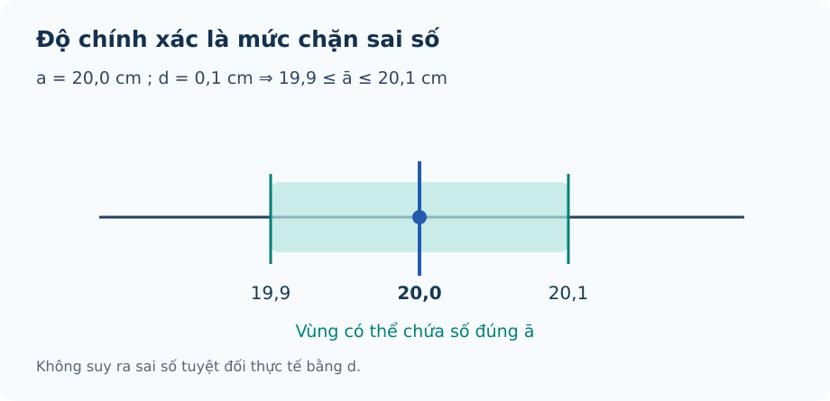

# Bài 12. Số gần đúng và sai số

TOÁN 10 · CHƯƠNG V · KIẾN THỨC SGK KNTT

Hiểu bản chất số gần đúng, tự dùng máy tính cầm tay để tính và quy tròn có kiểm soát sai số.

=== "Khám phá kiến thức"

    ### 1.1. Cùng tìm hiểu

    Một ứng dụng đo quãng đường hiển thị “9,2 km”. Con số này thuận tiện để đọc, nhưng máy đo có thể không biết khoảng cách thật đến mọi chữ số thập phân. Nếu thiết bị chỉ đảm bảo sai lệch **không quá 0,4 km**, ta không thể kết luận quãng đường đúng bằng 9,2 km — cũng không thể khẳng định lần đo này **sai đúng 0,4 km**.

    Đó là sự khác nhau giữa **số gần đúng**, **sai số thực** và **giới hạn sai số**. Số gần đúng là giá trị ta sử dụng; sai số thực là khoảng cách đến giá trị đúng mà đôi khi ta chưa biết; độ chính xác cho một **ranh giới** mà sai số không vượt quá. Khi biểu diễn bằng đoạn trên trục số, em sẽ thấy giá trị đúng có thể nằm ở bất kỳ vị trí nào trong khoảng được đảm bảo.

    Bài học cũng giúp em hiểu vì sao quy tròn phải gắn với độ chính xác. Không phải cứ viết thêm nhiều chữ số là thông tin tự nhiên chính xác hơn.

    ### 1.2. Ví dụ trực quan

    #### Vì sao cần nói số gần đúng?

    Một phần ba chiếc bánh là một lượng chính xác, nhưng máy chỉ hiển thị đến hai chữ số thập phân. Số hiện trên máy giúp sử dụng thuận tiện nhưng không còn biểu diễn chính xác toàn bộ lượng đó.

    Nhắc lại phân số \(1/3\) và phép viết thập phân vô hạn \(0{,}333\ldots\). Phân biệt con số biểu diễn trên thiết bị với giá trị toán học ban đầu. 

    Khi giới hạn độ dài biểu diễn, ta phải chọn một số hữu hạn chữ số để **thay cho** giá trị đúng: kí hiệu trong bài dùng \(a\) là số gần đúng và \(\bar a\) là số đúng. Dấu \(\approx\) nói hai số gần nhau, không phải luôn bằng nhau.

    **Em vận dụng.** Cho số đúng \(\bar a=1/3\), dùng số gần đúng \(a=0{,}33\). Em viết quan hệ bằng kí hiệu nào, và vì sao không viết dấu bằng?

    

    ??? question "Đối chiếu"

        

        
<strong>Đối chiếu kết quả:</strong> \(a=0{,}33\) là số gần đúng; \(\bar a=1/3\) là số đúng; viết \(0{,}33\approx1/3\), không viết bằng.

        
<strong>Giải thích vì sao:</strong> \(0{,}33=33/100\ne1/3\). Việc cắt độ chính xác biểu diễn tạo ra số gần đúng dù cách tính là hợp lệ.

        
<strong>Nếu chưa làm được:</strong> Đọc lại giải thích số đúng và số gần đúng trong §1.2, rồi <a href="../luyen-tap/?item=THPT-G10-B12-P04">thử câu cùng kiến thức trong Core/Luyện tập</a>.

        

    #### Độ chính xác không phải sai số thực

    <figure class="thpt-r4-plot thpt-r4-probability-figure" data-thpt-fig-id="FIG-G10-B12-01" style="width:min(100%, 780px); max-width:none; overflow-x:auto; box-sizing:border-box;"><figcaption>Khoảng có thể chứa số đúng · hình minh họa.</figcaption></figure>

    **Cách đọc hình.** Tìm số gần đúng ở giữa khoảng, rồi nhìn hai biên cách nó một khoảng d. Giá trị đúng có thể nằm bất cứ đâu trong đoạn, không nhất thiết ở biên hoặc trùng tâm.

    Một thước báo 'sai lệch không quá 0,3 cm' không có nghĩa mọi lần đo đều lệch đúng 0,3 cm.

    Nhắc lại khoảng đóng \([a-d;a+d]\), trị tuyệt đối là khoảng cách không âm và số đúng \(\bar a\) có thể chưa biết. 

    Đặt số đo gần đúng tại \(a\); số đúng nằm đâu đó quanh a. **Sai số thực** là khoảng cách tới giá trị đúng, chỉ tính được khi biết \(\bar a\); **độ chính xác d** là giới hạn cho khoảng cách này. Nhận thức 'không quá' đến trước ký hiệu \(\Delta_a=|a-\bar a|\le d\).

    Khi thiếu \(\bar a\), chỉ lập khoảng và viết bất đẳng thức \(\Delta_a\le d\). Không được tự thay bằng dấu bằng.

    **Em vận dụng.** Máy báo \(a=8{,}4\,\mathrm{cm}\), độ chính xác \(d=0{,}3\,\mathrm{cm}\). Số đúng \(\bar a\) thuộc khoảng nào? Có chắc \(\Delta_a=0{,}3\,\mathrm{cm}\) không?

    

    ??? question "Đối chiếu"

        

        
<strong>Đối chiếu kết quả:</strong> \(\bar a\in[8{,}1;8{,}7]\,\mathrm{cm}\). Chỉ chắc \(\Delta_a\le0{,}3\,\mathrm{cm}\), không chắc bằng.

        
<strong>Giải thích vì sao:</strong> Lấy 8,4 trừ/cộng 0,3. Sai số có thể 0 nếu giá trị đúng đúng bằng 8,4; độ chính xác chỉ giới hạn trên.

        
<strong>Nếu chưa làm được:</strong> Xem hình khoảng giá trị đúng tại §1.2 và công thức §2.2, rồi <a href="../luyen-tap/?item=THPT-G10-B12-C02">thử câu cùng kiến thức trong Core/Luyện tập</a>.

        

    
    

    ??? tip "Kiểm lỗi"

        <ol><li><strong>Nhận diện lỗi:</strong> Coi độ chính xác \(d\) là sai số tuyệt đối thực tế \(\Delta_a\), dù không biết số đúng.</li><li><strong>Dấu hiệu / tự chẩn đoán:</strong> Em đã viết \(\Delta_a=d\) chỉ vì đề cho độ chính xác \(d\)? Đề đã cho số đúng \(\bar a\), hay mới chỉ cho số gần đúng \(a\) và cận sai số \(d\)?</li><li><strong>Kiến thức gốc:</strong> \(a\) là số gần đúng, \(\bar a\) là số đúng; \(\Delta_a=|a-\bar a|\). Nếu chỉ biết \(\Delta_a\le d\) thì không thể kết luận \(\Delta_a=d\); ta chỉ biết \(a-d\le\bar a\le a+d\).</li><li><strong>Tự sửa:</strong> Với số gần đúng \(a\) và độ chính xác \(d\), hãy lập đúng khoảng \([a-d;a+d]\) chứa **số đúng** \(\bar a\), rồi phát biểu rõ “sai số tuyệt đối **không quá** \(d\)”, không ghi bằng \(d\) khi chưa biết sai số thực. Ví dụ liên hệ câu Core C02: \(a=12{,}3\,\mathrm{cm}\), \(d=0{,}2\,\mathrm{cm}\) thì \(\bar a\in[12{,}1;12{,}5]\,\mathrm{cm}\), chứ chưa biết \(\Delta_a=0{,}2\).</li></ol>
<a href="../luyen-tap/?item=THPT-G10-B12-C02">Luyện lại bằng câu hỏi đã có</a>

    #### Sai số lớn hay nhỏ còn phụ thuộc cỡ đại lượng

    Sai 3 m khi đo 150 m thường nhẹ hơn sai 3 m khi đo một đoạn 10 m. Cần so sánh sai số với quy mô con số đang dùng.

    Đã biết độ chính xác d, sai số tuyệt đối \(\Delta_a\), số gần đúng a và phép đổi tỉ số sang phần trăm. Kiểm a khác 0. 

    Để đánh giá mức sai số so với cỡ số gần đúng, ta lấy độ lệch tuyệt đối **chia cho \(|a|\)** theo KNTT. Nếu chỉ biết \(\Delta_a\le d\), chỉ có cận trên tỉ lệ chứ chưa biết tỉ lệ thực. Điều này giải thích cả mẫu số lẫn dấu bất đẳng thức.

    **Em vận dụng.** Đo quãng đường \(a=150\,\mathrm m\), sai số tuyệt đối không vượt quá \(d=3\,\mathrm m\). Hãy tính cận trên của sai số tương đối và phân biệt dấu \(=\) với \(\le\).

    

    ??? question "Đối chiếu"

        

        
<strong>Đối chiếu kết quả:</strong> \(\delta_a\le3/150=0{,}02=2\%\), không thể kết luận \(\delta_a=2\%\).

        
<strong>Giải thích vì sao:</strong> Ta đang so giới hạn sai số 3 m với số gần đúng 150 m. Sai số thực có thể nhỏ hơn 3 m; cần giữ dấu \(\le\).

        
<strong>Nếu chưa làm được:</strong> Đọc lại điều kiện mẫu số và cận sai số tương đối trong §2.2, rồi <a href="../luyen-tap/?item=THPT-G10-B12-P06">thử câu cùng kiến thức trong Core/Luyện tập</a>.

        

    
    

    ??? tip "Kiểm lỗi"

        <ol><li><strong>Nhận diện lỗi:</strong> Dùng số đúng (chưa biết) thay cho số gần đúng khi tính sai số tương đối, hoặc nhầm cận sai số với sai số thực.</li><li><strong>Dấu hiệu / tự chẩn đoán:</strong> Em lấy \(\frac{\Delta_a}{|\bar{a}|}\) thay cho \(\frac{\Delta_a}{|a|}\)? Khi chỉ biết độ chính xác \(d\), em đã nhầm \(\Delta_a=d\) chưa?</li><li><strong>Kiến thức gốc:</strong> Với số gần đúng \(a\ne0\), \(\delta_a=\frac{\Delta_a}{|a|}\). Nếu chỉ biết \(\Delta_a\le d\) thì chỉ suy \(\delta_a\le\frac{d}{|a|}\); không khẳng định \(\delta_a=\frac{d}{|a|}\) khi chưa biết sai số thực.</li><li><strong>Tự sửa:</strong> Xác định lại \(a,\bar{a},\Delta_a,d\); tính cận phần trăm đúng theo \(a\) và nói rõ dấu \(\le\).</li></ol>
<a href="../luyen-tap/?item=THPT-G10-B12-P06">Luyện lại bằng câu hỏi đã có</a>

    #### Cắt bớt chữ số nhưng phải biết mức chênh

    Khi ghi giá tiền hay chiều dài, ta thường không cần mọi chữ số; quy tròn giúp trình bày gọn nhưng có thể làm đổi giá trị.

    Biết hàng phần mười, phần trăm (0,01) và quy tắc chữ số ngay bên phải hàng giữ lại. 

    Làm tròn đến một hàng là chọn giá trị gần số ban đầu nhất theo bội của đơn vị hàng đó; chênh lệch là cái giá của sự giản lược. Nếu số ban đầu **được biết chính xác** và làm tròn gần nhất tới bước h, sai số quy tròn không vượt quá h/2; điều đó không biến thành độ chính xác của một phép đo khác.

    **Em vận dụng.** Làm tròn số đúng \(7{,}346\) tới hàng phần trăm. Tìm số quy tròn và sai số tuyệt đối của phép làm tròn.

    

    ??? question "Đối chiếu"

        

        
<strong>Đối chiếu kết quả:</strong> Số quy tròn là \(7{,}35\); sai số là \(|7{,}35-7{,}346|=0{,}004\).

        
<strong>Giải thích vì sao:</strong> Giữ hai chữ số thập phân, chữ số kế tiếp 6 làm tăng hàng phần trăm. Sai số 0,004 nhỏ hơn 0,005 (nửa đơn vị hàng phần trăm).

        
<strong>Nếu chưa làm được:</strong> Ôn quy tắc hàng quy tròn tại §2.3, rồi <a href="../luyen-tap/?item=THPT-G10-B12-P02">thử câu cùng kiến thức trong Core/Luyện tập</a>.

        

    ### 1.3. Thực hành máy tính cầm tay — tự nhập, đọc và kiểm

    **Tại sao phải tự bấm máy?** Một biểu thức như \(\sqrt5\) là giá trị chính xác; màn hình chỉ ghi hữu hạn chữ số. Nhập đúng biểu thức, đọc đủ chữ số và quy tròn theo độ chính xác yêu cầu là **ba kĩ năng khác nhau**, không thể học chỉ bằng cách nhìn một kết quả chép sẵn.

    **Quy trình cho máy tính có phím căn/lũy thừa (tên phím tùy model):**

    1. **Xác định biểu thức:** Khoanh rõ số nằm trong dấu căn, số mũ và dấu ngoặc. Xóa biểu thức cũ trước khi nhập.
    2. **Nhập đúng:** Với \(\sqrt5\), chọn chức năng căn bậc hai, nhập 5 trong dấu căn và nhấn phím tính. Nếu máy cho dạng căn/phân số, chọn chức năng chuyển sang thập phân (có máy dùng S⇔D, có máy dùng menu FORMAT). Không mặc định mọi máy có một tên phím.
    3. **Đọc trước, quy tròn sau:** \(\sqrt5\approx2{,}2360679\ldots\). Làm tròn đến hàng phần nghìn được \(2{,}236\), vì chữ số tiếp theo là 0. Không thay căn bằng \(2{,}2\) trước khi tính một biểu thức dài.
    4. **Đánh giá mức sai số:** Làm tròn gần nhất đến bước \(0{,}001\) từ kết quả đủ chính xác cho sai số không quá \(0{,}0005\). Với chính ví dụ này có thể kiểm \(2{,}2355^2<5<2{,}2365^2\). Số chữ số hiển thị **không** tự chứng minh độ chính xác của một phép đo khác.

    **Nếu không có phím căn bậc ba:** tính \(\sqrt[3]{11}\) qua chức năng \(11^{(1/3)}\) với ngoặc quanh \(1/3\). Không gõ phép chia \(11/3\). Với từng model, hãy đọc kí hiệu phím thực tế hoặc tài liệu kèm máy; không đoán thao tác.

    **Em vận dụng — phải thao tác trên máy trước khi mở đối chiếu.** Tính \(\sqrt[3]{11}\) và ghi số gần đúng đến hàng phần nghìn sao cho sai số không vượt quá \(0{,}0005\). Hãy mô tả cách nhập và vì sao không dùng \(11/3\).

    

    ??? question "Đối chiếu sau khi đã tự thao tác"

        **Kết quả:** \(\sqrt[3]{11}\approx2{,}223980090\ldots\), làm tròn được \(2{,}224\). Sai số khoảng \(0{,}00001991<0{,}0005\); có thể chứng minh bằng \(2{,}2235^3<11<2{,}2245^3\).

        **Vì sao:** Căn bậc ba là lũy thừa mũ \(1/3\), không phải phép chia cho 3. Chỉ có thể ghi đã thực hành máy khi đã thật sự nhập, đọc và quy tròn.

        **Nếu nhầm:** Tự mở khung Kiểm lỗi ngay bên dưới, rồi chọn bộ số mới trong Luyện tập; không dùng kết quả vừa xem làm chứng cứ độc lập.

    
    

    ??? tip "Kiểm lỗi"

        **Cách làm sai:** Muốn tính \(\sqrt[3]{11}\) nhưng nhập \(11/3\), hoặc làm tròn \(\sqrt[3]{11}\) quá sớm thành \(2{,}2\) rồi tự nhận kết quả chính xác đến hàng phần nghìn.

        **Vì sao sai:** Chia 11 cho 3 khác với căn bậc ba của 11; làm tròn quá sớm sẽ làm mất chữ số cần dùng. Số chữ số hiển thị trên máy không tự nói gì về sai số của một phép đo khác.

        **Tự sửa:** Dùng chức năng căn bậc ba hoặc nhập \(11^{(1/3)}\) có ngoặc. Đổi sang thập phân, đọc đủ chữ số, sau đó mới làm tròn. Khi yêu cầu cận \(0{,}0005\), có thể kiểm \(2{,}2235^3<11<2{,}2245^3\) để chứng minh gần đúng \(2{,}224\).

        **Luyện lại:** Làm câu P07 ở Core/Luyện tập trên máy thật trước khi mở đáp án. Nếu đã xem đáp án, chọn \(\sqrt[3]{13}\) làm bộ số luyện độc lập.
    ### 1.4. Thuật ngữ, kiến thức và kỹ năng

    **Thuật ngữ:** Số đúng, số gần đúng, sai số tuyệt đối, độ chính xác, sai số tương đối, quy tròn và chữ số đáng tin cậy.

    **Sau bài học, em cần làm được:** Viết đúng dấu gần bằng; phân biệt sai số thực với độ chính xác; xác định khoảng chứa giá trị đúng; tính sai số tương đối khi đủ điều kiện; quy tròn phù hợp độ chính xác; sử dụng máy tính cầm tay để tính và ghi số gần đúng.

=== "Kiến thức SGK"

    ### 2.1. Số gần đúng

    
<strong>Khái niệm — Số gần đúng:</strong> Theo kí hiệu SGK/SBT KNTT, <strong>\(a\) là số gần đúng</strong>, còn <strong>\(\bar a\) là số đúng</strong> (có thể chưa biết). Số gần đúng \(a\) thay cho số đúng \(\bar a\); viết \(a\approx\bar a\). Không phải mọi chữ số thập phân được hiển thị đều là chữ số đáng tin cậy; độ chính xác phụ thuộc phép đo/quy trình. Làm tròn một giá trị theo hàng yêu cầu để có số quy tròn. Quy tròn tới hàng phần mười, phần trăm, hàng chục… phải xác định rõ hàng làm tròn.

    **Máy tính cầm tay giúp tìm số gần đúng, không tự chứng minh độ chính xác.** Với biểu thức chứa căn hoặc \(\pi\), em nhập đúng biểu thức, quan sát kết quả thập phân, rồi làm tròn theo yêu cầu. Ví dụ máy cho \(\sqrt2\approx1{,}41421356\ldots\); lấy \(a=1{,}414\) với độ chính xác \(d=0{,}0005\) là hợp lệ vì \(1{,}4135^2<2<1{,}4145^2\), nên \(|\sqrt2-1{,}414|<0{,}0005\). Chỉ đọc nhiều chữ số trên màn hình không có nghĩa mọi chữ số đều đáng tin cậy.

    ### 2.2. Sai số tuyệt đối và sai số tương đối

    
<strong>Định nghĩa — Sai số tuyệt đối và độ chính xác:</strong> Sai số tuyệt đối của số gần đúng \(a\) là \(\Delta_a=|a-\bar a|\). Nếu <strong>chưa biết</strong> số đúng \(\bar a\), nhưng \(\Delta_a\le d\), thì \(d\) là <strong>độ chính xác/giới hạn trên</strong>; không được suy \(\Delta_a=d\). Số đúng nằm trong \(a-d\le\bar a\le a+d\). Sai số tuyệt đối cùng đơn vị với đại lượng.

    #### b. Sai số tương đối

    
<strong>Định nghĩa — Sai số tương đối:</strong> Với số gần đúng <strong>\(a\ne0\)</strong> và số đúng \(\bar a\) đã biết, \(\delta_a=\Delta_a/|a|\) (thường viết theo %): <strong>mẫu số là số gần đúng \(a\) theo KNTT</strong>, không phải số đúng. Khi chỉ có \(a\ne0\) và \(\Delta_a\le d\), chỉ suy ra <strong>cận trên</strong> \(\delta_a\le d/|a|\), không được viết đẳng thức \(\delta_a=d/|a|\) nếu chưa biết sai số thực. Không chia cho 0, không nhầm tỷ lệ với %.

    ### 2.3. Quy tròn số gần đúng

    
<strong>Quy tắc — Quy tròn và sai số:</strong> Khi làm tròn một số đúng tới đơn vị của hàng \(h>0\), sai số làm tròn thông thường không quá \(h/2\) nếu áp dụng quy tắc làm tròn gần nhất. Không tự khẳng định mọi phép đo tới hàng đó có cùng sai số tối đa: còn phụ thuộc độ chính xác đo ban đầu. Khi một số gần đúng \(a\) được cho với độ chính xác \(d\) nhưng không nêu hàng quy tròn, cần kiểm đúng quy tắc SGK/SBT về <strong>hàng thấp nhất có một đơn vị lớn hơn d</strong> trước khi chọn hàng. Ví dụ, nếu \(d=0{,}003\), đơn vị hàng phần nghìn là \(0{,}001\) chưa lớn hơn \(d\), còn đơn vị hàng phần trăm là \(0{,}01>d\); do đó quy tròn đến hàng phần trăm.

=== "Ví dụ"

    Trước khi xem lời giải, hãy xác định số đúng có biết không, đề cho **sai số thực** hay chỉ cho **cận trên \(d\)**, rồi chọn công thức. Nhìn lại dấu bằng và dấu bất đẳng thức sau khi tính.

    ### 3.1. Ví dụ 1 — Sai số thực khi đã biết số đúng

    #### &nbsp; {style="display:none"}

    **Đề:** Cho số đúng \(\bar a=12{,}347\), số gần đúng \(a=12{,}35\). Tìm sai số tuyệt đối và sai số tương đối.

    **Phân tích:** Biết \(\bar a\) nên tính được \(\Delta_a\). Với sai số tương đối theo KNTT, phải chia cho **\(|a|\)**, không phải số đúng.

    

    
<strong>Giải:</strong> \(\Delta_a=|12{,}35-12{,}347|=0{,}003\). Do \(a\ne0\), \(\delta_a=0{,}003/12{,}35\approx0{,}000243=0{,}0243\%\).

    

    **Kiểm lại:** Nếu chỉ có \(\Delta_a\le0{,}003\), phải dùng \(\delta_a\le0{,}003/12{,}35\), không khẳng định bằng.

    ### 3.2. Ví dụ 2 — Độ chính xác chỉ cho một khoảng

    #### &nbsp; {style="display:none"}

    **Đề:** Chiều dài gần đúng \(a=8{,}6\,\mathrm{cm}\), độ chính xác \(d=0{,}2\,\mathrm{cm}\). Tìm khoảng số đúng có thể nằm và đánh giá sai số.

    **Phân tích:** Số đúng chưa biết, nên phải giải \(|\bar a-a|\le d\), thay vì tự lấy \(d\) làm sai số thực.

    

    
<strong>Giải:</strong> \(\bar a\in[8{,}6-0{,}2;8{,}6+0{,}2]=[8{,}4;8{,}8]\,\mathrm{cm}\). Chỉ biết \(0\le\Delta_a\le0{,}2\,\mathrm{cm}\).

    

    **Kiểm lại:** Nếu \(\bar a=8{,}6\) thì sai số 0; nếu \(\bar a=8{,}4\) thì sai số 0,2. Bộ số khác hình \(20{,}0\pm0{,}1\) ở tab Khám phá.

    ### 3.3. Ví dụ 3 — Quy tròn và kiểm sai số

    #### &nbsp; {style="display:none"}

    **Đề:** Quy tròn số đúng \(3{,}14159\) tới hàng phần trăm và tính sai số thực.

    **Phân tích:** Cần xét chữ số hàng phần nghìn để quyết định giữ hay tăng chữ số hàng phần trăm. Có số ban đầu chính xác nên tính chênh được.

    

    
<strong>Giải:</strong> Số quy tròn là \(3{,}14\). Sai số tuyệt đối \(|3{,}14159-3{,}14|=0{,}00159\).

    

    **Kiểm lại:** \(0{,}00159\le0{,}005\), bằng một nửa bước quy tròn \(0{,}01\). Không áp dụng giới hạn này tùy tiện cho phép đo khác.

    ### 3.4. Ví dụ 4 — Bấm máy tính đúng biểu thức rồi quy tròn

    #### &nbsp; {style="display:none"}

    **Đề:** Dùng máy tính tìm giá trị gần đúng của \(2^9\sqrt3\) với ba chữ số thập phân, cùng kiểu bài trong SGK trang in 74.

    **Phân tích:** Giữ dấu căn và lũy thừa nguyên vẹn trong máy, không lấy \(\sqrt3=1{,}7\) trước khi nhân. Nhận kết quả đủ chữ số rồi mới quy tròn.

    

    
<strong>Giải:</strong> Xóa phép tính cũ; nhập \(2^9\times\sqrt3\), bảo đảm căn chỉ phủ số 3, nhấn tính. Đổi dạng thập phân nếu máy đang hiện kết quả chính xác. Ta đọc được \(886{,}810013475\ldots\) và làm tròn đến ba chữ số thập phân là \(886{,}810\).

    

    **Kiểm lại:** Số \(886{,}810\) chỉ là số gần đúng của \(2^9\sqrt3\). Khi máy tính đủ độ chính xác và quy tròn gần nhất đến bước \(0{,}001\), chênh do quy tròn không quá \(0{,}0005\).

=== "Lỗi thường gặp"

    **Kiểm lỗi:** Các lỗi thường gặp được giải thích ngay sau từng hoạt động ở tab Khám phá kiến thức. Chọn mục tương ứng để xem lại: [Kiểm lỗi 1](#HELP-G10-B12-01) · [Kiểm lỗi 2](#HELP-G10-B12-02) · [Kiểm lỗi 3](#HELP-G10-B12-CALC-01).

    **Học tiếp:** [Core và Luyện tập](luyen-tap.md) · [Tự kiểm tra cuối chương](tu-kiem-tra-chuong.md).

    
Nguồn toán học: SGK Toán 10 Kết nối tri thức với cuộc sống và học liệu SLM hiện hành. Lời giảng được biên tập nhằm hỗ trợ tự học độc lập.

