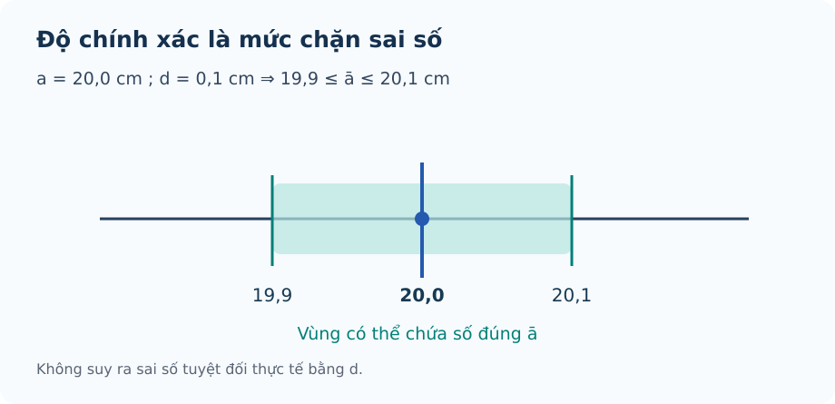

# Bài 12. Số gần đúng và sai số

TOÁN 10 · CHƯƠNG V · KIẾN THỨC SGK KNTT

Số gần đúng, sai số tuyệt đối/tương đối và quy tròn; sử dụng hình và hỗ trợ D6 R02 đã được NotebookLM duyệt.

=== "Khám phá kiến thức"

    ### Cùng tìm hiểu

    Một ứng dụng đo quãng đường hiển thị “8,4 km”. Con số này thuận tiện để đọc, nhưng máy đo có thể không biết khoảng cách thật đến mọi chữ số thập phân. Nếu thiết bị chỉ đảm bảo sai lệch **không quá 0,3 km**, ta không thể kết luận quãng đường đúng bằng 8,4 km — cũng không thể khẳng định lần đo này **sai đúng 0,3 km**.

    Đó là sự khác nhau giữa **số gần đúng**, **sai số thực** và **giới hạn sai số**. Số gần đúng là giá trị ta sử dụng; sai số thực là khoảng cách đến giá trị đúng mà đôi khi ta chưa biết; độ chính xác cho một **ranh giới** mà sai số không vượt quá. Khi biểu diễn bằng đoạn trên trục số, em sẽ thấy giá trị đúng có thể nằm ở bất kỳ vị trí nào trong khoảng được đảm bảo.

    Bài học cũng giúp em hiểu vì sao quy tròn phải gắn với độ chính xác. Không phải cứ viết thêm nhiều chữ số là thông tin tự nhiên chính xác hơn.

    ### Thuật ngữ, kiến thức và kỹ năng

    **Thuật ngữ:** Số đúng, số gần đúng, sai số tuyệt đối, độ chính xác, sai số tương đối, quy tròn và chữ số đáng tin cậy.

    **Sau bài học, em cần làm được:** Viết đúng dấu gần bằng; phân biệt sai số thực với độ chính xác; xác định khoảng chứa giá trị đúng; tính sai số tương đối khi đủ điều kiện; quy tròn phù hợp độ chính xác.

=== "Kiến thức SGK"

    ### Vì sao cần nói số gần đúng?

    Một phần ba chiếc bánh là một lượng chính xác, nhưng máy chỉ hiển thị đến hai chữ số thập phân. Số hiện trên máy giúp sử dụng thuận tiện nhưng không còn biểu diễn chính xác toàn bộ lượng đó.

    Nhắc lại phân số \(1/3\) và phép viết thập phân vô hạn \(0{,}333\ldots\). Phân biệt con số biểu diễn trên thiết bị với giá trị toán học ban đầu. 

    Khi giới hạn độ dài biểu diễn, ta phải chọn một số hữu hạn chữ số để **thay cho** giá trị đúng: kí hiệu trong bài dùng \(a\) là số gần đúng và \(\bar a\) là số đúng. Dấu \(\approx\) nói hai số gần nhau, không phải luôn bằng nhau.

    

    ??? question "Em đã tự thử? Mở lời giải để đối chiếu"

        

        
<strong>Đối chiếu kết quả:</strong> \(a=0{,}33\) là số gần đúng; \(\bar a=1/3\) là số đúng; viết \(0{,}33\approx1/3\), không viết bằng.

        
<strong>Giải thích vì sao:</strong> \(0{,}33=33/100\ne1/3\). Việc cắt độ chính xác biểu diễn tạo ra số gần đúng dù cách tính là hợp lệ.

        
<strong>Nếu chưa làm được:</strong> Xem lại mục Tự khắc phục lỗi thường gặp ở cuối bài, đọc lại phần Hiểu bản chất trước công thức và Vì sao làm theo cách này?, sau đó <a href="../luyen-tap/?item=THPT-G10-B12-P04">thử câu cùng kiến thức trong Core/Luyện tập</a>.

        

    ### Độ chính xác không phải sai số thực

    Một thước báo 'sai lệch không quá 0,3 cm' không có nghĩa mọi lần đo đều lệch đúng 0,3 cm.

    Nhắc lại khoảng đóng \([a-d;a+d]\), trị tuyệt đối là khoảng cách không âm và số đúng \(\bar a\) có thể chưa biết. 

    Đặt số đo gần đúng tại \(a\); số đúng nằm đâu đó quanh a. **Sai số thực** là khoảng cách tới giá trị đúng, chỉ tính được khi biết \(\bar a\); **độ chính xác d** là giới hạn cho khoảng cách này. Nhận thức 'không quá' đến trước ký hiệu \(\Delta_a=|a-\bar a|\le d\).

    Khi thiếu \(\bar a\), chỉ lập khoảng và viết bất đẳng thức \(\Delta_a\le d\). Không được tự thay bằng dấu bằng.

    **Em vận dụng.** Máy báo \(a=8{,}4\,\mathrm{cm}\), độ chính xác \(d=0{,}3\,\mathrm{cm}\). Số đúng \(\bar a\) thuộc khoảng nào? Có chắc \(\Delta_a=0{,}3\,\mathrm{cm}\) không?

    

    ??? question "Em đã tự thử? Mở lời giải để đối chiếu"

        

        
<strong>Đối chiếu kết quả:</strong> \(\bar a\in[8{,}1;8{,}7]\,\mathrm{cm}\). Chỉ chắc \(\Delta_a\le0{,}3\,\mathrm{cm}\), không chắc bằng.

        
<strong>Giải thích vì sao:</strong> Lấy 8,4 trừ/cộng 0,3. Sai số có thể 0 nếu giá trị đúng đúng bằng 8,4; độ chính xác chỉ giới hạn trên.

        
<strong>Nếu chưa làm được:</strong> Xem lại mục Tự khắc phục lỗi thường gặp ở cuối bài, đọc lại phần Hiểu bản chất trước công thức và Vì sao làm theo cách này?, sau đó <a href="../luyen-tap/?item=THPT-G10-B12-C02">thử câu cùng kiến thức trong Core/Luyện tập</a>.

        

    ### Sai số lớn hay nhỏ còn phụ thuộc cỡ đại lượng

    Sai 3 m khi đo 150 m thường nhẹ hơn sai 3 m khi đo một đoạn 10 m. Cần so sánh sai số với quy mô con số đang dùng.

    Đã biết độ chính xác d, sai số tuyệt đối \(\Delta_a\), số gần đúng a và phép đổi tỉ số sang phần trăm. Kiểm a khác 0. 

    Để đánh giá mức sai số so với cỡ số gần đúng, ta lấy độ lệch tuyệt đối **chia cho \(|a|\)** theo KNTT. Nếu chỉ biết \(\Delta_a\le d\), chỉ có cận trên tỉ lệ chứ chưa biết tỉ lệ thực. Điều này giải thích cả mẫu số lẫn dấu bất đẳng thức.

    

    ??? question "Em đã tự thử? Mở lời giải để đối chiếu"

        

        
<strong>Đối chiếu kết quả:</strong> \(\delta_a\le3/150=0{,}02=2\%\), không thể kết luận \(\delta_a=2\%\).

        
<strong>Giải thích vì sao:</strong> Ta đang so giới hạn sai số 3 m với số gần đúng 150 m. Sai số thực có thể nhỏ hơn 3 m; cần giữ dấu \(\le\).

        
<strong>Nếu chưa làm được:</strong> Xem lại mục Tự khắc phục lỗi thường gặp ở cuối bài, đọc lại phần Hiểu bản chất trước công thức và Vì sao làm theo cách này?, sau đó <a href="../luyen-tap/?item=THPT-G10-B12-P06">thử câu cùng kiến thức trong Core/Luyện tập</a>.

        

    ### Cắt bớt chữ số nhưng phải biết mức chênh

    Khi ghi giá tiền hay chiều dài, ta thường không cần mọi chữ số; quy tròn giúp trình bày gọn nhưng có thể làm đổi giá trị.

    Biết hàng phần mười, phần trăm (0,01) và quy tắc chữ số ngay bên phải hàng giữ lại. 

    Làm tròn đến một hàng là chọn giá trị gần số ban đầu nhất theo bội của đơn vị hàng đó; chênh lệch là cái giá của sự giản lược. Nếu số ban đầu **được biết chính xác** và làm tròn gần nhất tới bước h, sai số quy tròn không vượt quá h/2; điều đó không biến thành độ chính xác của một phép đo khác.

    

    ??? question "Em đã tự thử? Mở lời giải để đối chiếu"

        

        
<strong>Đối chiếu kết quả:</strong> Số quy tròn là \(7{,}35\); sai số là \(|7{,}35-7{,}346|=0{,}004\).

        
<strong>Giải thích vì sao:</strong> Giữ hai chữ số thập phân, chữ số kế tiếp 6 làm tăng hàng phần trăm. Sai số 0,004 nhỏ hơn 0,005 (nửa đơn vị hàng phần trăm).

        
<strong>Nếu chưa làm được:</strong> Xem lại mục Tự khắc phục lỗi thường gặp ở cuối bài, đọc lại phần Hiểu bản chất trước công thức và Vì sao làm theo cách này?, sau đó <a href="../luyen-tap/?item=THPT-G10-B12-P02">thử câu cùng kiến thức trong Core/Luyện tập</a>.

        

        ### Kiến thức SGK

    ### Đúng/gần đúng và số quy tròn
    Theo kí hiệu SGK/SBT KNTT, **\(a\) là số gần đúng**, còn **\(\bar a\) là số đúng** (có thể chưa biết). Số gần đúng \(a\) thay cho số đúng \(\bar a\); viết \(a\approx\bar a\). Không phải mọi chữ số thập phân được hiển thị đều là chữ số đáng tin cậy; độ chính xác phụ thuộc phép đo/quy trình. Làm tròn một giá trị theo hàng yêu cầu để có số quy tròn. Quy tròn tới hàng phần mười, phần trăm, hàng chục… phải xác định rõ hàng làm tròn.

    ### Sai số tuyệt đối, độ chính xác

    **Cách đọc hình.** Tìm số gần đúng ở giữa khoảng, rồi nhìn hai biên cách nó một khoảng d. Giá trị đúng có thể nằm bất cứ đâu trong đoạn, không nhất thiết ở biên hoặc trùng tâm.

    <figure class="thpt-r4-plot thpt-r4-probability-figure" data-thpt-fig-id="FIG-G10-B12-01"><figcaption>Khoảng có thể chứa số đúng · hình minh họa.</figcaption></figure>

    Sai số tuyệt đối của số gần đúng \(a\) là \(\Delta_a=|a-\bar a|\). Nếu **chưa biết** số đúng \(\bar a\), nhưng \(\Delta_a\le d\), thì \(d\) là **độ chính xác/giới hạn trên**; không được suy \(\Delta_a=d\). Số đúng nằm trong \(a-d\le\bar a\le a+d\). Sai số tuyệt đối cùng đơn vị với đại lượng.

    ### Sai số tương đối
    Với số gần đúng **\(a\ne0\)** và số đúng \(\bar a\) đã biết, \(\delta_a=\Delta_a/|a|\) (thường viết theo %): **mẫu số là số gần đúng \(a\) theo KNTT**, không phải số đúng. Khi chỉ có \(a\ne0\) và \(\Delta_a\le d\), chỉ suy ra **cận trên** \(\delta_a\le d/|a|\), không được viết đẳng thức \(\delta_a=d/|a|\) nếu chưa biết sai số thực. Không chia cho 0, không nhầm tỷ lệ với %.

    ### Giới hạn độ chính xác và quy tròn
    Khi làm tròn một số đúng tới đơn vị của hàng \(h>0\), sai số làm tròn thông thường không quá \(h/2\) nếu áp dụng quy tắc làm tròn gần nhất. Không tự khẳng định mọi phép đo tới hàng đó có cùng sai số tối đa: còn phụ thuộc độ chính xác đo ban đầu. Khi một số gần đúng \(a\) được cho với độ chính xác \(d\) nhưng không nêu hàng quy tròn, cần kiểm đúng quy tắc SGK/SBT về **hàng thấp nhất có một đơn vị lớn hơn d** trước khi chọn hàng.

=== "Ví dụ"

    Trước khi xem lời giải, hãy xác định dữ kiện, điều phải tìm và lý do chọn cách giải. Sau đó kiểm tra lại điều kiện áp dụng và kết quả, thay vì chỉ nhìn phép tính cuối cùng.

    ### Ví dụ 1. Phân biệt sai số thực và độ chính xác
    Biết số đúng \(\bar a=12{,}347\), số gần đúng \(a=12{,}35\). \(\Delta_a=0{,}003\), \(\delta_a=0{,}003/12{,}35\approx0{,}0243\%\). Phải dùng **12,35 ở mẫu số** theo SGK KNTT. Nếu chỉ biết \(\Delta_a\le0{,}003\) thì chỉ có cận \(\delta_a\le0{,}003/12{,}35\).

    ### Ví dụ 2. Giới hạn sai số
    Ghi chiều dài gần đúng \(a=20{,}0\,\mathrm{cm}\) với độ chính xác \(d=0{,}1\,\mathrm{cm}\). Số đúng \(\bar a\in[19{,}9;20{,}1]\,\mathrm{cm}\). Không xác định được chính xác \(\Delta\) nếu không biết giá trị đúng.

    ### Ví dụ 3. Quy tròn
    Làm tròn \(3{,}14159\) tới hàng phần trăm được \(3{,}14\). Sai số tuyệt đối của phép làm tròn \(0{,}00159\le0{,}005\). Nói rõ hàng phần trăm là 2 chữ số thập phân.

=== "Lỗi thường gặp"

    

    ??? tip "Nhầm độ chính xác d với sai số tuyệt đối thực tế"

        <ol><li><strong>Nhận diện lỗi:</strong> Coi độ chính xác \(d\) là sai số tuyệt đối thực tế \(\Delta_a\), dù không biết số đúng.</li><li><strong>Dấu hiệu / tự chẩn đoán:</strong> Em đã viết \(\Delta_a=d\) chỉ vì đề cho độ chính xác \(d\)? Đề đã cho số đúng \(\bar a\), hay mới chỉ cho số gần đúng \(a\) và cận sai số \(d\)?</li><li><strong>Kiến thức gốc:</strong> \(a\) là số gần đúng, \(\bar a\) là số đúng; \(\Delta_a=|a-\bar a|\). Nếu chỉ biết \(\Delta_a\le d\) thì không thể kết luận \(\Delta_a=d\); ta chỉ biết \(a-d\le\bar a\le a+d\).</li><li><strong>Tự sửa:</strong> Với số gần đúng \(a\) và độ chính xác \(d\), hãy lập đúng khoảng \([a-d;a+d]\) chứa **số đúng** \(\bar a\), rồi phát biểu rõ “sai số tuyệt đối **không quá** \(d\)”, không ghi bằng \(d\) khi chưa biết sai số thực. Ví dụ liên hệ câu Core C02: \(a=12{,}3\,\mathrm{cm}\), \(d=0{,}2\,\mathrm{cm}\) thì \(\bar a\in[12{,}1;12{,}5]\,\mathrm{cm}\), chứ chưa biết \(\Delta_a=0{,}2\).</li><li><strong>Luyện lại bằng ID sẵn có:</strong> THPT-G10-B12-C02 (không sao chép câu, không đổi đáp án hay lời giải).</li></ol>
<a href="../luyen-tap/?item=THPT-G10-B12-C02">Luyện lại bằng câu hỏi đã có</a>

    

    ??? tip "Sai mẫu số và nhầm cận sai số tương đối"

        <ol><li><strong>Nhận diện lỗi:</strong> Dùng số đúng (chưa biết) thay cho số gần đúng khi tính sai số tương đối, hoặc nhầm cận sai số với sai số thực.</li><li><strong>Dấu hiệu / tự chẩn đoán:</strong> Em lấy \(\frac{\Delta_a}{|\bar{a}|}\) thay cho \(\frac{\Delta_a}{|a|}\)? Khi chỉ biết độ chính xác \(d\), em đã nhầm \(\Delta_a=d\) chưa?</li><li><strong>Kiến thức gốc:</strong> Với số gần đúng \(a\ne0\), \(\delta_a=\frac{\Delta_a}{|a|}\). Nếu chỉ biết \(\Delta_a\le d\) thì chỉ suy \(\delta_a\le\frac{d}{|a|}\); không khẳng định \(\delta_a=\frac{d}{|a|}\) khi chưa biết sai số thực.</li><li><strong>Tự sửa:</strong> Xác định lại \(a,\bar{a},\Delta_a,d\); tính cận phần trăm đúng theo \(a\) và nói rõ dấu \(\le\).</li><li><strong>Luyện lại bằng ID sẵn có:</strong> THPT-G10-B12-P06.</li></ol>
<a href="../luyen-tap/?item=THPT-G10-B12-P06">Luyện lại bằng câu hỏi đã có</a>

    **Học tiếp:** [Core và Luyện tập](luyen-tap.md) · [Tự kiểm tra cuối chương](tu-kiem-tra-chuong.md).

    
Nguồn toán học: SGK Toán 10 Kết nối tri thức với cuộc sống và học liệu SLM hiện hành. Lời giảng được biên tập nhằm hỗ trợ tự học độc lập.

