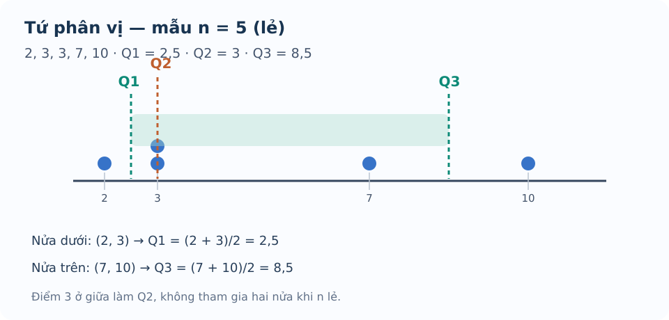

# Bài 13. Các số đặc trưng đo xu thế trung tâm

TOÁN 10 · CHƯƠNG V · KIẾN THỨC SGK KNTT

Hiểu cách chọn số trung bình, trung vị, tứ phân vị hay mốt để đại diện dữ liệu; tự tính, đọc hình và giải thích lựa chọn.

=== "Khám phá kiến thức"

    ### 1.1. Vì sao một bộ dữ liệu cần nhiều số đại diện?

    Hai lớp có cùng điểm trung bình nhưng bức tranh kết quả học tập có thể rất khác nhau. Một lớp có phần lớn điểm số quanh 7, lớp kia lại gồm những điểm rất thấp và rất cao. Nếu chỉ báo một số trung bình, ta chưa thể hiểu đầy đủ nhóm dữ liệu.

    Muốn có một giá trị đại diện, ta cần đặt câu hỏi: **muốn mô tả mức chung, giá trị đứng giữa hay giá trị xuất hiện nhiều nhất?** Số trung bình tổng hợp các số nhưng dễ bị tác động bởi số quá lớn hay quá nhỏ. Trung vị nhìn vị trí ở giữa sau khi sắp xếp, mốt nhìn giá trị lặp nhiều; tứ phân vị chỉ ra các điểm phân chia mẫu dữ liệu.

    Mỗi chỉ số phải đi cùng **cách sắp xếp dữ liệu và quy ước xác định**. Khi số quan sát là lẻ hoặc chẵn, cách tìm trung vị và tứ phân vị có những bước cần kiểm đúng; không đoán từ vị trí trên hình.

    ### 1.2. Khám phá cách xác định số đại diện

    #### 1.2.1. Chia đều tổng để hiểu số trung bình

    Một lớp có điểm số thay đổi từng người. Muốn tính mức điểm bình quân của cả lớp, cần chia tổng điểm cho số người chứ không chọn đại một bạn.

    Đã biết tổng các số, phép chia và bảng tần số: một giá trị xuất hiện m lần phải được tính m lần. 

    Giả sử dàn đều tổng số điểm cho mọi người sao cho tổng không đổi; lượng mỗi người nhận chính là **trung bình**. Với bảng tần số, nhóm các phần tử giống nhau thành giá trị nhân số lần xuất hiện, không làm mất người nào.

    **Em vận dụng.** Mẫu số liệu \(2,4,4,10\) gồm bốn quan sát. Tính số trung bình cộng, không bỏ giá trị lớn nhất.

    

    ??? question "Đối chiếu"

        

        
<strong>Đối chiếu kết quả:</strong> \(\bar x=(2+4+4+10)/4=5\).

        
<strong>Giải thích vì sao:</strong> Có bốn quan sát, tổng 20. Chia đều tổng cho bốn lần ghi cho 5; không bỏ giá trị 10 chỉ vì cao.

        
<strong>Nếu chưa làm được:</strong> Đọc §1.2.1 và §2.1 về phép chia đều, đếm đủ bốn quan sát, rồi <a href="../luyen-tap/?item=THPT-G10-B13-C01">thử câu cùng kiến thức trong Core/Luyện tập</a>.

        

    **Kiểm lỗi dùng chung:** [Xem hướng dẫn tự sửa phù hợp](#HELP-G10-B13-02).
    #### 1.2.2. Xếp dữ liệu theo thứ tự để tìm trung vị

    Để biết người đứng ở vị trí giữa trong hàng người có chiều cao khác nhau, phải xếp thứ tự, không cần cộng tất cả chiều cao.

    Đã biết sắp xếp dãy không giảm, dãy có n chẵn hoặc n lẻ, giá trị chính giữa. 

    Trung vị nhìn vào **vị trí** sau sắp xếp chứ không dàn đều tổng. Với n chẵn có hai vị trí giữa, trung vị là trung bình hai giá trị đó; với n lẻ lấy một giá trị ở giữa.

    **Em vận dụng.** Mẫu chưa sắp xếp \(9,2,12,5\). Hãy sắp xếp rồi tìm trung vị \(Q_2\).

    

    ??? question "Đối chiếu"

        

        
<strong>Đối chiếu kết quả:</strong> Sắp thành \(2,5,9,12\). Trung vị \(Q_2=(5+9)/2=7\).

        
<strong>Giải thích vì sao:</strong> Với bốn giá trị, hai phần tử ở giữa là 5 và 9 sau sắp xếp. Không lấy 2 và 9 theo thứ tự ghi ban đầu.

        
<strong>Nếu chưa làm được:</strong> Đọc §1.2.2 và §2.1 để sắp dãy và tìm hai vị trí giữa, rồi <a href="../luyen-tap/?item=THPT-G10-B13-C02">thử câu cùng kiến thức trong Core/Luyện tập</a>.

        

    **Kiểm lỗi dùng chung:** [Xem hướng dẫn tự sửa phù hợp](#HELP-G10-B13-01).
    #### 1.2.3. Tứ phân vị cho biết các vị trí trong mẫu

    Hai lớp có cùng trung vị vẫn có thể khác nhau ở phần thấp và phần cao. Ta cần mốc để nhìn nửa dưới và nửa trên của mẫu.

    Nhắc lại trung vị \(Q_2\), sắp dữ liệu không giảm và cách tìm trung vị một nửa mẫu. 

    Tìm điểm giữa toàn mẫu trước, sau đó chia mẫu thành hai nửa để tìm điểm giữa mỗi nửa: được \(Q_1,Q_3\). **Theo quy ước SGK KNTT, nếu \(n\) lẻ thì chỉ bỏ một quan sát ở vị trí chính giữa khi chia nửa — các quan sát khác có cùng giá trị vẫn được giữ**; không đưa nó vào cả hai nửa hay dùng mặc định quy tắc percentile của phần mềm.

    **Đọc hình ngay khi học tứ phân vị:** Dữ liệu tăng dần \(2,3,3,7,10\) có hai quan sát mang giá trị 3. Vị trí thứ ba là \(Q_2=3\); khi tìm \(Q_1,Q_3\), chỉ bỏ **quan sát ở vị trí thứ ba**, vẫn giữ quan sát 3 ở vị trí thứ hai. Nửa trái \(2,3\) cho \(Q_1=2{,}5\), nửa phải \(7,10\) cho \(Q_3=8{,}5\). Các mốc mô tả **vị trí trong dãy**, không phải chia khoảng giá trị thành bốn đoạn bằng nhau.

    <figure class="thpt-r4-plot thpt-r4-probability-figure" data-thpt-fig-id="FIG-G10-B13-01" style="width:min(100%, 780px); max-width:none; overflow-x:auto; box-sizing:border-box;"><figcaption>Mẫu đã sắp và cách lấy tứ phân vị khi có năm giá trị.</figcaption></figure>

    Với n lẻ, chỉ loại một quan sát ở vị trí giữa; với n chẵn, chia thành hai nửa bằng nhau. Sau đó lấy trung vị từng nửa; tránh dùng phương pháp máy khác quy ước KNTT.

    **Em vận dụng.** Cho mẫu đã sắp \(1,2,3,4,5,6,7\). Tìm \(Q_1,Q_2,Q_3\) theo quy ước KNTT.

    

    ??? question "Đối chiếu"

        

        
<strong>Đối chiếu kết quả:</strong> \(Q_2=4\), nửa dưới \(1,2,3\) cho \(Q_1=2\), nửa trên \(5,6,7\) cho \(Q_3=6\).

        
<strong>Giải thích vì sao:</strong> Có bảy phần tử, bỏ chính 4 khi tìm Q1/Q3. Không lấy trung bình các vị trí 3 và 4 hay đưa 4 vào hai nửa.

        
<strong>Nếu chưa làm được:</strong> Đọc cách đọc hình §1.2.3 và quy tắc chia nửa §2.2, rồi <a href="../luyen-tap/?item=THPT-G10-B13-P02">thử câu cùng kiến thức trong Core/Luyện tập</a>.

        

    
    

    ??? tip "Kiểm lỗi"

        **Nhận diện:** Em lấy trung vị từ dãy chưa sắp, hoặc mẫu có \(n\) lẻ thì bỏ *mọi* số bằng \(Q_2\), thay vì bỏ đúng một **quan sát ở vị trí giữa**.

        **Vì sao sai:** Trung vị và tứ phân vị phụ thuộc **vị trí sau sắp xếp**. Hai số bằng nhau vẫn là hai quan sát và phải được đếm. Đọc lại **Khám phá §1.2.3** (hình tứ phân vị với hai số 3) và **Kiến thức SGK §2.2** (quy tắc chia nửa).

        **Tự sửa:** Viết dãy theo thứ tự không giảm và đánh số vị trí. Nếu \(n\) lẻ, gạch đúng **một vị trí trung tâm**; tìm trung vị hai nửa và kiểm \(Q_1\le Q_2\le Q_3\). Không bỏ các quan sát khác chỉ vì chúng trùng giá trị.

        **Luyện lại:** [Tìm tứ phân vị từ dữ liệu khác](luyen-tap.md?item=THPT-G10-B13-P05) trước khi mở đáp án.
    #### 1.2.4. Giá trị nào xuất hiện phổ biến nhất?

    Trong cửa hàng bán áo, chủ cửa hàng quan tâm cỡ áo bán nhiều nhất chứ không phải số trung bình của mã cỡ.

    Đã biết số lần xuất hiện của từng giá trị (tần số). Có thể có nhiều giá trị cùng số lần cao nhất. 

    Mốt là giá trị (hoặc các giá trị) có tần số cao nhất. Khi nhiều giá trị cùng đứng đầu, mẫu có nhiều mốt; theo quy ước minh họa SGK KNTT, nếu mỗi giá trị chỉ xuất hiện một lần thì coi là không có mốt.

    **Em vận dụng.** Trong mẫu \(2,2,3,3,5\), giá trị nào là mốt? Có thể có hơn một mốt không?

    

    ??? question "Đối chiếu"

        

        
<strong>Đối chiếu kết quả:</strong> Có hai mốt là 2 và 3, mỗi số xuất hiện hai lần.

        
<strong>Giải thích vì sao:</strong> Cùng tần số cao nhất 2 nên cả hai đều là mốt; 3 lớn hơn 2 không làm nó 'mốt hơn'.

        
<strong>Nếu chưa làm được:</strong> Đọc §1.2.4 và định nghĩa mốt ở §2.3, kiểm tần số lớn nhất, rồi <a href="../luyen-tap/?item=THPT-G10-B13-P03">thử câu cùng kiến thức trong Core/Luyện tập</a>.

        

    
    

    ??? tip "Kiểm lỗi"

        **Nhận diện:** Em lấy bình quân của các giá trị khác nhau mà quên số lần xuất hiện, hoặc chọn số lớn nhất làm mốt mà chưa kiểm tần số.

        **Vì sao sai:** Số trung bình phải dùng **từng quan sát**, còn mốt phụ thuộc vào **số lần xuất hiện**, không phải giá trị lớn/nhỏ. Xem **Khám phá §1.2.1 và §1.2.4**, rồi các định nghĩa tại **Kiến thức SGK §2.1 và §2.3**.

        **Tự sửa:** Lập hàng \(x_i\cdot m_i\) để tính tổng; mẫu số là \(\sum m_i\), không phải số giá trị khác nhau. Khoanh tần số lớn nhất khi xác định mốt. Với mẫu có số rất lớn, xem thêm trung vị ở §1.2.5 trước khi kết luận về người điển hình.

        **Luyện lại:** [Tính số trung bình bằng bảng tần số](luyen-tap.md?item=THPT-G10-B13-P01) và [so sánh hai nhóm có trung vị bằng nhau](luyen-tap.md?item=THPT-G10-B13-P06).
    #### 1.2.5. Chọn số đại diện cho đúng tình huống

    Một khoản thu rất lớn xuất hiện trong mẫu có thể làm số bình quân cao dù phần lớn quan sát còn thấp. Khi muốn tả người 'điển hình', không nên chỉ nhìn một con số.

    Biết tính số trung bình, trung vị sau sắp xếp; hiểu một giá trị lớn bất thường có thể ảnh hưởng tổng. 

    Trung bình dùng mọi giá trị nên nhạy với cực trị; trung vị là điểm giữa theo vị trí nên thường ổn định hơn khi chỉ một giá trị thay đổi rất mạnh. Cả hai đều là số mô tả nhưng cần chọn tùy câu hỏi.

    **Em vận dụng.** Mẫu \(4,5,6,7,28\). Tính trung bình và trung vị; chỉ ra đại lượng nào ít bị số 28 chi phối hơn.

    

    ??? question "Đối chiếu"

        

        
<strong>Đối chiếu kết quả:</strong> Trung bình \((4+5+6+7+28)/5=50/5=10\); trung vị 6; trung vị ít bị 28 chi phối hơn.

        
<strong>Giải thích vì sao:</strong> Vị trí giữa không đổi nếu 28 còn lớn nhất, còn tổng và trung bình tăng khi cực trị tăng.

        
<strong>Nếu chưa làm được:</strong> So sánh ý nghĩa trung bình/trung vị ở §1.2.5 và §2.1, rồi <a href="../luyen-tap/?item=THPT-G10-B13-P06">thử câu cùng kiến thức trong Core/Luyện tập</a>.

        

    **Kiểm lỗi dùng chung:** [Xem hướng dẫn tự sửa phù hợp](#HELP-G10-B13-02).
    ### 1.3. Tổng kết cách chọn số đặc trưng

    **Thuật ngữ:** Số trung bình cộng, trung vị, tứ phân vị (Q_1,Q_2,Q_3), mốt, bảng tần số, giá trị đại diện.

    **Sau bài học, em cần làm được:** Sắp xếp dữ liệu; tìm trung bình/trung vị/mốt; áp dụng đúng quy ước tứ phân vị KNTT; giải thích khi nào trung vị phù hợp hơn trung bình.

=== "Kiến thức SGK"

    ### 2.1. Số trung bình và trung vị

    Hai số này có mục đích khác nhau: **số trung bình** thể hiện mức chia đều của tổng, còn **trung vị** thể hiện vị trí giữa. Hãy nhìn dữ liệu là danh sách hay bảng tần số trước khi tính.

    
<strong>Định nghĩa — Số trung bình cộng:</strong> Với \(n\ge1\) quan sát số \(x_1,\ldots,x_n\), \(\bar x=\dfrac{x_1+\cdots+x_n}{n}\). Nếu giá trị \(a_i\) xuất hiện \(m_i\) lần, \(n=\sum_{i=1}^{k}m_i\), thì \(\bar x=\dfrac{\sum_{i=1}^{k}m_i a_i}{\sum_{i=1}^{k}m_i}\). Từng quan sát đều được tính, kể cả những giá trị bị lặp.

    
<strong>Định nghĩa — Trung vị:</strong> Sắp mẫu thành \(x_{(1)}\le\cdots\le x_{(n)}\). Nếu \(n=2k+1\) lẻ thì \(Q_2=x_{(k+1)}\); nếu \(n=2k\) chẵn thì \(Q_2=\dfrac{x_{(k)}+x_{(k+1)}}2\). Đây là mốc ở giữa theo <em>vị trí</em>, không cần trùng với một giá trị có sẵn khi \(n\) chẵn.

    ### 2.2. Tứ phân vị

    Với mẫu có **ít nhất hai quan sát** (\(n\ge2\)), trung vị toàn mẫu là \(Q_2\). Tiếp tục tìm trung vị của nửa dưới và nửa trên (đều không rỗng) để có hai mốc bổ sung. Với \(n=1\), quy tắc chia nửa đang học **không xác định \(Q_1,Q_3\)** vì hai nửa rỗng. Xem lại hình có **hai số 3** ở tab Khám phá §1.2.3 trước khi làm theo công thức.

    
<strong>Định nghĩa — Ba tứ phân vị:</strong> \(Q_1\) là trung vị của nửa dưới; \(Q_2\) là trung vị toàn mẫu; \(Q_3\) là trung vị của nửa trên, sau khi đã sắp xếp. Luôn phải có \(Q_1\le Q_2\le Q_3\).

    
<strong>Quy tắc — Tìm tứ phân vị theo SGK KNTT:</strong> (1) Sắp mọi quan sát không giảm, giữ đủ các giá trị lặp; (2) tìm \(Q_2\); (3) nếu \(n\) lẻ, bỏ <strong>đúng một quan sát ở vị trí chính giữa</strong>, chia hai phần còn lại; nếu \(n\) chẵn, chia luôn thành hai nửa bằng nhau; (4) tính trung vị mỗi nửa để được \(Q_1,Q_3\). Không tự thay bằng một quy ước percentile khác của phần mềm.

    **Cách tự kiểm:** Với dãy lẻ, kiểm số quan sát còn lại sau khi bỏ vị trí giữa là \(n-1\), mỗi nửa có \((n-1)/2\) phần tử. Đừng xóa mọi giá trị trùng với \(Q_2\): các số bằng nhau có thể chiếm những vị trí khác nhau.

    ### 2.3. Mốt

    
<strong>Định nghĩa — Mốt:</strong> Mốt là giá trị nổi bật về tần số xuất hiện. Nếu hai hay nhiều giá trị cùng có tần số lớn nhất và cao hơn những giá trị còn lại, mẫu có nhiều mốt. Theo quy ước trong bài SGK KNTT, khi mọi giá trị phân biệt đều xuất hiện với <strong>cùng tần số</strong>, không chọn một giá trị nào làm mốt; mọi giá trị chỉ xuất hiện một lần là trường hợp đặc biệt.

    **Chọn đại lượng:** Số trung bình thích hợp để tính mức bình quân của toàn bộ quan sát; trung vị phù hợp khi cần nói vị trí ở giữa và có giá trị rất lớn/nhỏ; mốt cho biết giá trị phổ biến, chẳng hạn cỡ giày; tứ phân vị chỉ các mốc phân chia mẫu. Một số đặc trưng không thay thế mọi thông tin về phân bố dữ liệu.

=== "Ví dụ"

    Các bộ dữ liệu dưới đây **khác mẫu trên hình** ở tab Khám phá. Trước mỗi phép tính, hãy nhận diện dữ liệu chưa sắp hay dạng bảng tần số, xác định mẫu chẵn/lẻ và giải thích vì sao chọn phép tính.

    ### 3.1. Ví dụ 1 — Mẫu lẻ: tính đầy đủ bốn số đặc trưng

    #### &nbsp; {style="display:none"}

    **Đề:** Số lần đọc sách của bảy bạn trong một tuần là \(6,12,4,9,6,5,7\). Tính số trung bình, trung vị, ba tứ phân vị và mốt.

    **Phân tích:** Đây là bảy quan sát; tính trung bình phải dùng tổng, còn trung vị và tứ phân vị phải dùng dãy đã sắp. Chỉ bỏ **một** quan sát ở vị trí giữa khi chia nửa, không bỏ mọi giá trị bằng trung vị.

    

    
<strong>Bước 1 — Sắp và đếm:</strong> Dãy tăng là \(4,5,6,6,7,9,12\). Có \(n=7\) và tổng \(4+5+6+6+7+9+12=49\).

    
<strong>Bước 2 — Mức bình quân và điểm giữa:</strong> \(\bar x=49/7=7\). Vị trí thứ tư có giá trị 6 nên \(Q_2=6\).

    
<strong>Bước 3 — Chia nửa:</strong> Bỏ quan sát thứ tư. Nửa dưới \(4,5,6\) có trung vị 5 nên \(Q_1=5\); nửa trên \(7,9,12\) có trung vị 9 nên \(Q_3=9\). Số 6 ở <em>vị trí thứ ba</em> vẫn được tính.

    
<strong>Bước 4 — Giá trị phổ biến:</strong> Số 6 xuất hiện hai lần, các số khác một lần, nên mốt là 6.

    

    **Kiểm lại:** \(Q_1=5\le Q_2=6\le Q_3=9\). Số 12 làm trung bình lớn hơn trung vị; hai chỉ số khác nhau không có nghĩa là tính sai.

    ### 3.2. Ví dụ 2 — Mẫu chẵn: hai vị trí giữa

    #### &nbsp; {style="display:none"}

    **Đề:** Mẫu \(11,3,14,7,5,9\) có sáu số. Tính \(\bar x,Q_1,Q_2,Q_3\), và cho biết mẫu có mốt không.

    **Phân tích:** Vì số quan sát chẵn, có hai vị trí giữa. Chia toàn bộ dãy thành hai nửa **không loại** bất cứ quan sát nào.

    

    
<strong>Bước 1:</strong> Sắp dãy \(3,5,7,9,11,14\), tổng \(49\), nên \(\bar x=49/6\approx8{,}17\).

    
<strong>Bước 2:</strong> Hai giá trị giữa là 7 và 9, vậy \(Q_2=(7+9)/2=8\).

    
<strong>Bước 3:</strong> Nửa dưới \(3,5,7\) cho \(Q_1=5\), nửa trên \(9,11,14\) cho \(Q_3=11\).

    
<strong>Bước 4:</strong> Mọi giá trị đều xuất hiện đúng một lần. Theo quy ước trong bài học này, mẫu không có mốt.

    

    **Kiểm lại:** \(5\le8\le11\); trung vị bằng 8 **không nhất thiết** phải trùng một giá trị quan sát trong mẫu chẵn.

    ### 3.3. Ví dụ 3 — Tính từ bảng tần số

    #### &nbsp; {style="display:none"}

    **Đề:** Một nhóm bạn ghi số lần đến thư viện trong tuần. Tính các số đặc trưng từ bảng sau:

    | Số lần \(x_i\) | 3 | 4 | 8 | 10 |
    |:--|--:|--:|--:|--:|
    | Số bạn \(m_i\) | 1 | 2 | 3 | 2 |

    **Phân tích:** Có bốn **giá trị phân biệt**, nhưng có tám **quan sát**. Khi tính bình quân phải nhân giá trị với tần số; khi tìm trung vị/tứ phân vị cần mở thành dãy đã sắp hoặc xác định vị trí qua tần số tích lũy.

    

    
<strong>Bước 1 — Bình quân:</strong> \(n=1+2+3+2=8\). Tổng \(3\cdot1+4\cdot2+8\cdot3+10\cdot2=55\), vậy \(\bar x=55/8=6{,}875\).

    
<strong>Bước 2 — Xếp dữ liệu:</strong> \(3,4,4,8,8,8,10,10\). Hai giá trị ở vị trí thứ tư và thứ năm đều là 8, nên \(Q_2=8\).

    
<strong>Bước 3 — Tứ phân vị:</strong> Nửa dưới \(3,4,4,8\) có \(Q_1=(4+4)/2=4\); nửa trên \(8,8,10,10\) có \(Q_3=(8+10)/2=9\).

    
<strong>Bước 4 — Mốt:</strong> Giá trị 8 có tần số 3 lớn nhất, nên mốt bằng 8.

    

    **Kiểm lại:** \(4\le8\le9\). Phép tính \((3+4+8+10)/4\) **không đúng** cho mẫu này vì bỏ qua tần số.

    ### 3.4. Ví dụ 4 — Chọn trung vị khi có giá trị bất thường

    #### &nbsp; {style="display:none"}

    **Đề:** Thời gian chờ (phút) của năm người là \(5,6,6,7,100\). Có nên nói “mỗi người thường chờ khoảng 25 phút” không?

    **Phân tích:** Muốn mô tả người **điển hình**, phải xem một thời gian chờ rất lớn có làm lệch mức bình quân hay không. Không được tự ý xóa quan sát 100 khỏi phép tính.

    

    
<strong>Bước 1:</strong> \(\bar x=(5+6+6+7+100)/5=124/5=24{,}8\) phút. Dãy đã sắp, trung vị là số thứ ba \(Q_2=6\) phút.

    
<strong>Bước 2:</strong> Bốn trong năm người chỉ chờ từ 5 đến 7 phút; một người chờ 100 phút làm tăng tổng và bình quân nhưng không đổi vị trí giữa.

    
<strong>Kết luận:</strong> Nếu hỏi thời gian chờ điển hình, chọn **trung vị 6 phút**, đồng thời ghi nhận tình huống 100 phút bất thường. Trung bình 24,8 phút vẫn hữu ích nếu cần tính tổng thời gian của cả nhóm.

    

    **Kiểm lại:** Thay 100 bằng 200 thì trung bình tăng thêm \(100/5=20\) phút, trung vị vẫn bằng 6. **Không có một số đặc trưng luôn tốt nhất:** phải chọn theo câu hỏi.

=== "Lỗi thường gặp"

    **Kiểm lỗi:** Các lỗi thường gặp được giải thích ngay sau từng hoạt động ở tab Khám phá kiến thức. Chọn mục tương ứng để xem lại: [Kiểm lỗi 1](#HELP-G10-B13-01) · [Kiểm lỗi 2](#HELP-G10-B13-02).

    **Tiếp tục:** [Core và Luyện tập](luyen-tap.md) · [Tự kiểm tra cuối chương](tu-kiem-tra-chuong.md). Khi tự kiểm tra, em cần làm bài và chọn Final Submit trước khi xem lời giải; kết quả tự đối chiếu không ghi điểm thành thạo.

    
Nguồn tham chiếu: SGK Toán 10 Kết nối tri thức tập 1, Bài 13 (trang in 78–83), và học liệu nguồn đã khóa. Nội dung được biên tập lại để hỗ trợ tự học độc lập.

