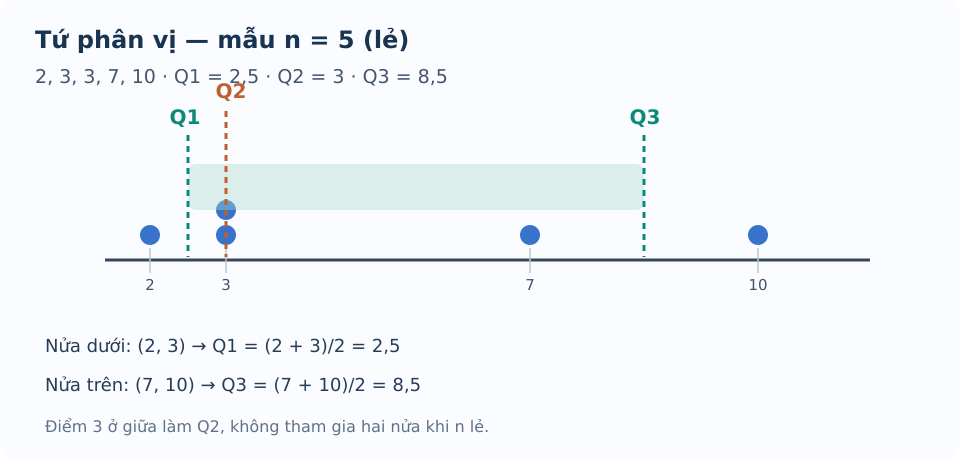

# Bài 13. Các số đặc trưng đo xu thế trung tâm

TOÁN 10 · CHƯƠNG V · KIẾN THỨC SGK KNTT

Học định nghĩa, điều kiện, ví dụ và hình minh họa; tự luyện trước khi mở gợi ý và lời giải.

=== "Khám phá kiến thức"

    ### Cùng tìm hiểu

    Hai lớp có cùng điểm trung bình nhưng bức tranh kết quả học tập có thể rất khác nhau. Một lớp có phần lớn điểm số quanh 7, lớp kia lại gồm những điểm rất thấp và rất cao. Nếu chỉ báo một số trung bình, ta chưa thể hiểu đầy đủ nhóm dữ liệu.

    Muốn có một giá trị đại diện, ta cần đặt câu hỏi: **muốn mô tả mức chung, giá trị đứng giữa hay giá trị xuất hiện nhiều nhất?** Số trung bình tổng hợp các số nhưng dễ bị tác động bởi số quá lớn hay quá nhỏ. Trung vị nhìn vị trí ở giữa sau khi sắp xếp, mốt nhìn giá trị lặp nhiều; tứ phân vị chỉ ra các điểm phân chia mẫu dữ liệu.

    Mỗi chỉ số phải đi cùng **cách sắp xếp dữ liệu và quy ước xác định**. Khi số quan sát là lẻ hoặc chẵn, cách tìm trung vị và tứ phân vị có những bước cần kiểm đúng; không đoán từ vị trí trên hình.

    ### Ví dụ trực quan

    #### Tìm một giá trị đại diện cho toàn nhóm

    Một lớp có điểm số thay đổi từng người. Muốn tính mức điểm bình quân của cả lớp, cần chia tổng điểm cho số người chứ không chọn đại một bạn.

    Đã biết tổng các số, phép chia và bảng tần số: một giá trị xuất hiện m lần phải được tính m lần. 

    Giả sử dàn đều tổng số điểm cho mọi người sao cho tổng không đổi; lượng mỗi người nhận chính là **trung bình**. Với bảng tần số, nhóm các phần tử giống nhau thành giá trị nhân số lần xuất hiện, không làm mất người nào.

    **Em tự thử.** Mẫu số liệu \(2,4,4,10\) gồm bốn quan sát. Tính số trung bình cộng, không bỏ giá trị lớn nhất.

    

    ??? question "Em đã tự thử? Mở lời giải để đối chiếu"

        

        
<strong>Đối chiếu kết quả:</strong> \(\bar x=(2+4+4+10)/4=5\).

        
<strong>Giải thích vì sao:</strong> Có bốn quan sát, tổng 20. Chia đều tổng cho bốn lần ghi cho 5; không bỏ giá trị 10 chỉ vì cao.

        
<strong>Nếu chưa làm được:</strong> Xem lại mục Tự khắc phục lỗi thường gặp ở cuối bài, đọc lại phần Hiểu bản chất trước công thức và Vì sao làm theo cách này?, sau đó <a href="../luyen-tap/?item=THPT-G10-B13-C01">thử câu cùng kiến thức trong Core/Luyện tập</a>.

        

    #### Điểm giữa không bị một giá trị rất lớn kéo đi

    Để biết người đứng ở vị trí giữa trong hàng người có chiều cao khác nhau, phải xếp thứ tự, không cần cộng tất cả chiều cao.

    Đã biết sắp xếp dãy không giảm, dãy có n chẵn hoặc n lẻ, giá trị chính giữa. 

    Trung vị nhìn vào **vị trí** sau sắp xếp chứ không dàn đều tổng. Với n chẵn có hai vị trí giữa, trung vị là trung bình hai giá trị đó; với n lẻ lấy một giá trị ở giữa.

    **Em tự thử.** Mẫu chưa sắp xếp \(9,2,12,5\). Hãy sắp xếp rồi tìm trung vị \(Q_2\).

    

    ??? question "Em đã tự thử? Mở lời giải để đối chiếu"

        

        
<strong>Đối chiếu kết quả:</strong> Sắp thành \(2,5,9,12\). Trung vị \(Q_2=(5+9)/2=7\).

        
<strong>Giải thích vì sao:</strong> Với bốn giá trị, hai phần tử ở giữa là 5 và 9 sau sắp xếp. Không lấy 2 và 9 theo thứ tự ghi ban đầu.

        
<strong>Nếu chưa làm được:</strong> Xem lại mục Tự khắc phục lỗi thường gặp ở cuối bài, đọc lại phần Hiểu bản chất trước công thức và Vì sao làm theo cách này?, sau đó <a href="../luyen-tap/?item=THPT-G10-B13-C02">thử câu cùng kiến thức trong Core/Luyện tập</a>.

        

    #### Chia mẫu dữ liệu thành bốn phần

    Hai lớp có cùng trung vị vẫn có thể khác nhau ở phần thấp và phần cao. Ta cần mốc để nhìn nửa dưới và nửa trên của mẫu.

    Nhắc lại trung vị \(Q_2\), sắp dữ liệu không giảm và cách tìm trung vị một nửa mẫu. 

    Tìm điểm giữa toàn mẫu trước, sau đó chia mẫu thành hai nửa để tìm điểm giữa mỗi nửa: được \(Q_1,Q_3\). **Theo SGK KNTT, nếu n lẻ thì bỏ chính phần tử Q2 khi chia hai nửa**; không đưa nó vào cả hai nửa hay dùng mặc định quy tắc percentile của phần mềm.

    Với n lẻ, loại một phần tử giữa; với n chẵn, chia thành hai nửa bằng nhau. Sau đó lấy trung vị từng nửa; tránh dùng phương pháp máy khác quy ước KNTT.

    **Em vận dụng.** Cho mẫu đã sắp \(1,2,3,4,5,6,7\). Tìm \(Q_1,Q_2,Q_3\) theo quy ước KNTT.

    

    ??? question "Em đã tự thử? Mở lời giải để đối chiếu"

        

        
<strong>Đối chiếu kết quả:</strong> \(Q_2=4\), nửa dưới \(1,2,3\) cho \(Q_1=2\), nửa trên \(5,6,7\) cho \(Q_3=6\).

        
<strong>Giải thích vì sao:</strong> Có bảy phần tử, bỏ chính 4 khi tìm Q1/Q3. Không lấy trung bình các vị trí 3 và 4 hay đưa 4 vào hai nửa.

        
<strong>Nếu chưa làm được:</strong> Xem lại mục Tự khắc phục lỗi thường gặp ở cuối bài, đọc lại phần Hiểu bản chất trước công thức và Vì sao làm theo cách này?, sau đó <a href="../luyen-tap/?item=THPT-G10-B13-P02">thử câu cùng kiến thức trong Core/Luyện tập</a>.

        

    #### Giá trị lặp lại nhiều nhất mới là mốt

    Trong cửa hàng bán áo, chủ cửa hàng quan tâm cỡ áo bán nhiều nhất chứ không phải số trung bình của mã cỡ.

    Đã biết số lần xuất hiện của từng giá trị (tần số). Có thể có nhiều giá trị cùng số lần cao nhất. 

    Mốt là giá trị (hoặc các giá trị) có tần số cao nhất. Khi nhiều giá trị cùng đứng đầu, mẫu có nhiều mốt; theo quy ước minh họa SGK KNTT, nếu mỗi giá trị chỉ xuất hiện một lần thì coi là không có mốt.

    **Em tự thử.** Trong mẫu \(2,2,3,3,5\), giá trị nào là mốt? Có thể có hơn một mốt không?

    

    ??? question "Em đã tự thử? Mở lời giải để đối chiếu"

        

        
<strong>Đối chiếu kết quả:</strong> Có hai mốt là 2 và 3, mỗi số xuất hiện hai lần.

        
<strong>Giải thích vì sao:</strong> Cùng tần số cao nhất 2 nên cả hai đều là mốt; 3 lớn hơn 2 không làm nó 'mốt hơn'.

        
<strong>Nếu chưa làm được:</strong> Xem lại mục Tự khắc phục lỗi thường gặp ở cuối bài, đọc lại phần Hiểu bản chất trước công thức và Vì sao làm theo cách này?, sau đó <a href="../luyen-tap/?item=THPT-G10-B13-P03">thử câu cùng kiến thức trong Core/Luyện tập</a>.

        

    #### Vì sao đôi khi trung vị nói đúng hơn trung bình?

    Một khoản thu rất lớn xuất hiện trong mẫu có thể làm số bình quân cao dù phần lớn quan sát còn thấp. Khi muốn tả người 'điển hình', không nên chỉ nhìn một con số.

    Biết tính số trung bình, trung vị sau sắp xếp; hiểu một giá trị lớn bất thường có thể ảnh hưởng tổng. 

    Trung bình dùng mọi giá trị nên nhạy với cực trị; trung vị là điểm giữa theo vị trí nên thường ổn định hơn khi chỉ một giá trị thay đổi rất mạnh. Cả hai đều là số mô tả nhưng cần chọn tùy câu hỏi.

    **Em tự thử.** Mẫu \(4,5,6,7,28\). Tính trung bình và trung vị; chỉ ra đại lượng nào ít bị số 28 chi phối hơn.

    

    ??? question "Em đã tự thử? Mở lời giải để đối chiếu"

        

        
<strong>Đối chiếu kết quả:</strong> Trung bình \((4+5+6+7+28)/5=50/5=10\); trung vị 6; trung vị ít bị 28 chi phối hơn.

        
<strong>Giải thích vì sao:</strong> Vị trí giữa không đổi nếu 28 còn lớn nhất, còn tổng và trung bình tăng khi cực trị tăng.

        
<strong>Nếu chưa làm được:</strong> Xem lại mục Tự khắc phục lỗi thường gặp ở cuối bài, đọc lại phần Hiểu bản chất trước công thức và Vì sao làm theo cách này?, sau đó <a href="../luyen-tap/?item=THPT-G10-B13-P06">thử câu cùng kiến thức trong Core/Luyện tập</a>.

        

    ### Thuật ngữ, kiến thức và kỹ năng

    **Thuật ngữ:** Số trung bình cộng, trung vị, tứ phân vị (Q_1,Q_2,Q_3), mốt, bảng tần số, giá trị đại diện.

    **Sau bài học, em cần làm được:** Sắp xếp dữ liệu; tìm trung bình/trung vị/mốt; áp dụng đúng quy ước tứ phân vị KNTT; giải thích khi nào trung vị phù hợp hơn trung bình.

=== "Kiến thức SGK"

    ### 2.1. Số trung bình và trung vị
    Mẫu \(x_1,\ldots,x_n\) có \(n>0\), số trung bình \(\bar x=(\sum_i x_i)/n\). Nếu \(x_i\) có tần số \(m_i\), \(\bar x=\sum_i m_ix_i/\sum_i m_i\). Phải sắp mẫu không giảm trước khi tìm trung vị \(Q_2\): với \(n\) lẻ lấy giá trị chính giữa; \(n\) chẵn lấy trung bình hai giá trị giữa.

    ### 2.2. Tứ phân vị

    <figure class="thpt-r4-plot thpt-r4-probability-figure"><figcaption>Mẫu đã sắp và cách lấy tứ phân vị khi có năm giá trị.</figcaption></figure>

    **Cách đọc hình.** Sắp xếp dữ liệu từ bé đến lớn trước khi nhìn Q1, Q2, Q3. Các mốc chia nhóm quan sát đã sắp xếp, không chia khoảng giá trị thành những đoạn bằng nhau.

    Với mẫu tăng dần: \(Q_2\) là trung vị; \(Q_1\) là trung vị **nửa dưới** và \(Q_3\) là trung vị **nửa trên**. Khi \(n\) lẻ, **loại chính \(Q_2\)** khỏi cả hai nửa; khi \(n\) chẵn, chia dãy thành hai nửa bằng nhau. Mỗi trường hợp cần ghi thao tác, không dùng máy tính có quy ước percentile khác làm bằng chứng thay SGK.

    ### 2.3. Mốt
    Mốt là giá trị xuất hiện nhiều lần nhất (tần số cao nhất); có thể có nhiều giá trị đồng mốt. Theo ví dụ SGK khi tất cả giá trị có tần số 1, mẫu được coi **không có mốt**. Số trung bình có thể bị kéo về phía giá trị rất lớn/nhỏ, trong khi trung vị ít nhạy hơn, nên việc chọn số đặc trưng phải theo tình huống.

    **Không có mốt:** theo nhận xét của SGK (trang 82), khi mọi giá trị phân biệt trong mẫu có cùng tần số thì mẫu không có mốt, kể cả khi tần số chung lớn hơn 1; không chỉ riêng trường hợp mỗi giá trị xuất hiện một lần.

=== "Ví dụ"

    Trước khi xem lời giải, hãy xác định dữ kiện, điều phải tìm và lý do chọn cách giải. Sau đó kiểm tra lại điều kiện áp dụng và kết quả, thay vì chỉ nhìn phép tính cuối cùng.

    ### Ví dụ 1. Mẫu có số quan sát lẻ
    Mẫu đã sắp \(2,3,3,7,10\): \(\bar x=25/5=5\), \(Q_2=3\), mốt 3; nửa trái \(2,3\) cho \(Q_1=2{,}5\), nửa phải \(7,10\) cho \(Q_3=8{,}5\). Số trung bình cao hơn trung vị vì số 10.

    ### Ví dụ 2. Mẫu có số quan sát chẵn
    Mẫu \(2,4,6,10,12,20\): \(Q_2=(6+10)/2=8\); \(Q_1=4\), \(Q_3=12\); \(\bar x=54/6=9\). Cần xếp số trước khi chia nửa.

    ### Ví dụ 3. Bảng tần số
    Giá trị 5 có tần số 2, 7 có tần số 3, 9 có tần số 1. \(n=6\), \(\bar x=(10+21+9)/6=20/3\), \(Q_2=7\), mốt 7, \(Q_1=5\), \(Q_3=7\). Không dùng \((5+7+9)/3\).

=== "Lỗi thường gặp"

    

    ??? tip "Quên sắp mẫu và loại Q2 ở n lẻ"

        <ol><li><strong>Nhận diện lỗi:</strong> Quên sắp mẫu và loại Q2 ở n lẻ.</li><li><strong>Dấu hiệu / tự chẩn đoán:</strong> Tính Q1/Q3 từ dãy chưa sắp hoặc đưa Q2 vào hai nửa. n chẵn hay lẻ? Em đã xếp tăng dần chưa?</li><li><strong>Kiến thức gốc:</strong> SGK KNTT: tìm Q2; n lẻ bỏ Q2 trước khi chia nửa.</li><li><strong>Tự sửa:</strong> Khoanh riêng nửa dưới, nửa trên rồi tính trung vị mỗi nửa.</li><li><strong>Luyện lại bằng ID sẵn có:</strong> THPT-G10-B13-P05.</li></ol>
<a href="../luyen-tap/?item=THPT-G10-B13-P05">Luyện lại bằng câu hỏi đã có</a>

    

    ??? tip "Không nhân giá trị với tần số / nhầm mốt"

        <ol><li><strong>Nhận diện lỗi:</strong> Không nhân giá trị với tần số / nhầm mốt.</li><li><strong>Dấu hiệu / tự chẩn đoán:</strong> Lấy trung bình các giá trị phân biệt mà không tính tần số. Tổng số quan sát là tổng m_i hay số giá trị khác nhau?</li><li><strong>Kiến thức gốc:</strong> Trung bình bảng tần số = tổng x_i*m_i chia tổng m_i; mốt là x_i có tần số cao nhất.</li><li><strong>Tự sửa:</strong> Lập lại bảng cột giá trị × tần số, so đáp án.</li><li><strong>Luyện lại bằng ID sẵn có:</strong> THPT-G10-B13-P01.</li></ol>
<a href="../luyen-tap/?item=THPT-G10-B13-P01">Luyện lại bằng câu hỏi đã có</a>

    **Học tiếp:** [Core và Luyện tập](luyen-tap.md) · [Tự kiểm tra cuối chương](tu-kiem-tra-chuong.md).

    
Nguồn toán học: SGK Toán 10 Kết nối tri thức với cuộc sống và học liệu SLM hiện hành. Lời giảng được biên tập nhằm hỗ trợ tự học độc lập.

