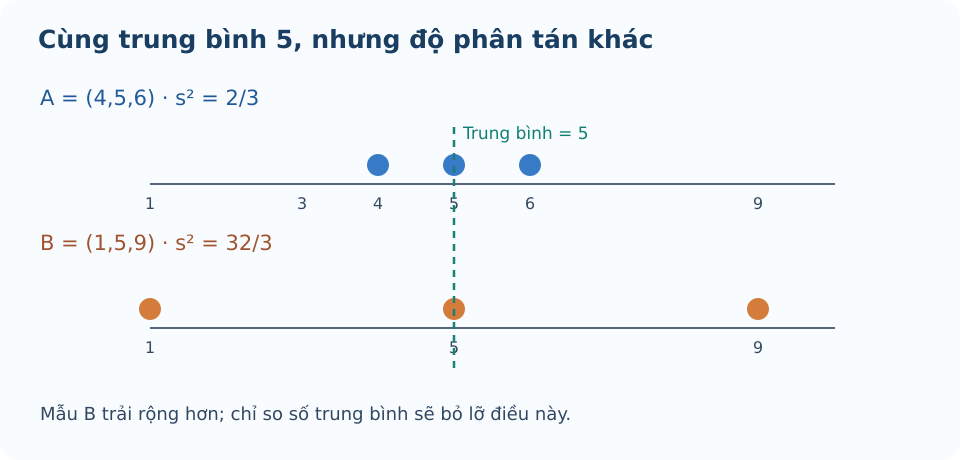

# Bài 14. Các số đặc trưng đo độ phân tán

TOÁN 10 · CHƯƠNG V · KIẾN THỨC SGK KNTT

Học định nghĩa, điều kiện, ví dụ và hình minh họa; tự luyện trước khi mở gợi ý và lời giải.
<nav class="thpt-r4-lesson-tabs"><a href="../">Chương V</a><a href="../luyen-tap/">Core và Luyện tập</a><a href="../tu-kiem-tra-chuong/">Tự kiểm tra · chưa kích hoạt</a></nav>

## Trước khi học — hiểu ý nghĩa trước khi nhớ công thức

Em hãy đọc tình huống, nhớ lại kiến thức cũ và tự trả lời các câu **Tự thử**. Chỉ mở đối chiếu sau khi tự làm. Sau đó học **Kiến thức SGK**, **Ví dụ**, rồi chuyển sang **Core/Luyện tập**. Hoạt động này không chấm điểm hay ghi mức độ thành thạo.

### Hai cách nhìn độ trải rộng của dữ liệu

**Vì sao cần học?** Hai lớp có thể có trung bình gần nhau nhưng lớp có bạn quá cao hay quá thấp làm khoảng từ min đến max rộng hơn.

**Em đã biết gì?** Đã biết min, max và \(Q_1,Q_3\) theo quy ước KNTT; phải sắp dữ liệu trước khi xác định tứ phân vị. 

**Hiểu bản chất trước công thức** Khoảng biến thiên nhìn hai biên xa nhất; khoảng tứ phân vị nhìn hai mốc ôm phần giữa của mẫu, vì thế ít bị riêng một cực trị chi phối hơn. Từ ý nghĩa 'độ rộng' mới đặt \(R=x_{\max}-x_{\min}\), \(\Delta_Q=Q_3-Q_1\).

**Cách đọc hình và hình dung** Đọc hình minh họa bên dưới: tìm đầu trái/phải toàn bộ dữ liệu và đoạn từ Q1 tới Q3; không xem hai đoạn dài như cùng một khoảng đo. 

**Vì sao làm theo cách này?** Chọn R khi cần độ rộng toàn bộ, IQR khi quan tâm nửa giữa và mức ảnh hưởng của ngoại lệ; chúng không thay thế cho nhau.

**Tự thử trước Core** Với mẫu đã sắp \(2,3,4,6,8,9,10\), tìm khoảng biến thiên R và khoảng tứ phân vị \(\Delta_Q\) theo KNTT.

Em đã tự thử? Mở lời giải để đối chiếu

**Đối chiếu kết quả:** \(R=10-2=8\); \(Q_2=6\), \(Q_1=3\), \(Q_3=9\) nên \(\Delta_Q=9-3=6\).

**Giải thích vì sao:** Với n=7 bỏ số giữa 6, nửa dưới 2,3,4 cho Q1=3 và nửa trên 8,9,10 cho Q3=9. R dùng min/max, IQR dùng Q1/Q3.

**Nếu chưa làm được:** Xem lại mục Tự khắc phục lỗi thường gặp ở cuối bài, đọc lại phần Hiểu bản chất trước công thức và Vì sao làm theo cách này?, sau đó [thử câu cùng kiến thức trong Core/Luyện tập](luyen-tap.md?item=THPT-G10-B14-P01).

### Độ lệch có thể bù dấu, nên phải bình phương

**Vì sao cần học?** Các giá trị thấp hơn và cao hơn trung bình có độ lệch âm/dương bù nhau; cộng chênh lệch có dấu cho 0 dù dữ liệu rất phân tán.

**Em đã biết gì?** Đã học trung bình, bình phương số và chia cho số quan sát n. Ở đây mô tả chính mẫu số liệu đang cho, không ước lượng tổng thể từ một mẫu ngẫu nhiên. 

**Hiểu bản chất trước công thức** Muốn đo 'xa trung bình bao nhiêu', hãy bình phương các khoảng lệch để không bị bù dấu rồi lấy trung bình các bình phương. **Theo SGK KNTT ở mục này chia cho n**, không tự dùng mẫu số n−1; kết quả là phương sai và có đơn vị bình phương.

**Cách đọc hình và hình dung** Đọc hình minh họa bên dưới, kẻ đường mức trung bình và so các khoảng lên/xuống; hình chỉ giải thích các khoảng, phép bình phương là bước tính. 

**Vì sao làm theo cách này?** Chọn phương sai khi cần thước đo toàn bộ độ phân tán và có thể tính các bình phương; đừng lấy trung bình của hiệu có dấu hay chia n−1 trái phạm vi SGK.

**Tự thử trước Core** Với mẫu \(2,4,6\), tìm trung bình và phương sai mô tả theo SGK (chia cho n).

Em đã tự thử? Mở lời giải để đối chiếu

**Đối chiếu kết quả:** \(\bar x=4\); \(s^2=[(2-4)^2+(4-4)^2+(6-4)^2]/3=8/3\).

**Giải thích vì sao:** Hai độ lệch −2 và +2 có tổng 0 nhưng bình phương đều 4; tổng bình phương 8 chia 3 phần tử.

**Nếu chưa làm được:** Xem lại mục Tự khắc phục lỗi thường gặp ở cuối bài, đọc lại phần Hiểu bản chất trước công thức và Vì sao làm theo cách này?, sau đó [thử câu cùng kiến thức trong Core/Luyện tập](luyen-tap.md?item=THPT-G10-B14-C02).

### Vì sao độ lệch chuẩn dễ đọc hơn phương sai?

**Vì sao cần học?** Nếu đo chiều dài bằng cm thì phương sai mang đơn vị cm², khó so trực tiếp với chiều dài vài cm; cần số đo trở lại cùng đơn vị.

**Em đã biết gì?** Biết phương sai không âm, căn bậc hai số không âm, trung bình mẫu và đơn vị cm. 

**Hiểu bản chất trước công thức** Lấy căn bậc hai phương sai giúp đưa mức phân tán về **cùng đơn vị với dữ liệu gốc**. Độ lệch chuẩn không cho biết từng quan sát lệch đúng bằng s, mà tóm tắt mức lệch điển hình.

**Cách đọc hình và hình dung** Trên hình minh họa bên dưới so mức phân tán của các điểm với đường trung bình rồi liên hệ con số phương sai/độ lệch chuẩn; không dùng diện tích hình như một phép đo. 

**Vì sao làm theo cách này?** Đầu tiên tính đúng phương sai chia n, sau đó mới lấy căn; kiểm đơn vị s² là cm², s là cm nếu dữ liệu tính cm.

**Tự thử trước Core** Bốn chiều dài (cm) là \(2,2,6,6\). Tìm phương sai và độ lệch chuẩn, kèm đơn vị.

Em đã tự thử? Mở lời giải để đối chiếu

**Đối chiếu kết quả:** Trung bình 4 cm; \(s^2=[4+4+4+4]/4=4\,\mathrm{cm}^2\), \(s=2\,\mathrm{cm}\).

**Giải thích vì sao:** Mỗi độ lệch với 4 là ±2 cm, bình phương 4 cm²; căn 4 cm² cho 2 cm.

**Nếu chưa làm được:** Xem lại mục Tự khắc phục lỗi thường gặp ở cuối bài, đọc lại phần Hiểu bản chất trước công thức và Vì sao làm theo cách này?, sau đó [thử câu cùng kiến thức trong Core/Luyện tập](luyen-tap.md?item=THPT-G10-B14-P05).

### Một giá trị xa trung tâm cần được nhận diện bằng quy tắc

**Vì sao cần học?** Một ngày ghi doanh số quá lớn có thể là thật hoặc nhập sai. Trước khi kết luận, ta cần tiêu chí định lượng để đánh dấu giá trị khác xa số còn lại.

**Em đã biết gì?** Biết tứ phân vị theo KNTT, IQR=Q3−Q1 và cách kiểm bất đẳng thức nghiêm ngặt. Không đồng nhất giá trị bất thường với dữ liệu chắc chắn sai. 

**Hiểu bản chất trước công thức** Đặt hai hàng rào quanh phần giữa: dưới \(Q_1-1{,}5\Delta_Q\) và trên \(Q_3+1{,}5\Delta_Q\). Giá trị **nhỏ hơn** rào dưới hoặc **lớn hơn** rào trên được gắn cờ bất thường; bằng rào không bị gắn theo dấu chặt.

**Cách đọc hình và hình dung** Trong hình minh họa bên dưới, đánh dấu Q1,Q3 rồi kéo xa thêm 1,5 lần chiều rộng IQR; xem một điểm nằm ngoài hay trên hàng rào. 

**Vì sao làm theo cách này?** Chỉ kết luận sau khi sắp dữ liệu, tính Q1/Q3 đúng quy ước và so **<** hoặc **>**; không tự loại bỏ dữ liệu khi chỉ phát hiện bất thường.

**Tự thử trước Core** Mẫu đã sắp \(1,2,3,4,5,6,20\). Tính \(Q_1,Q_3,\Delta_Q\), hai hàng rào và xác định giá trị bất thường theo quy tắc 1,5 IQR.

Em đã tự thử? Mở lời giải để đối chiếu

**Đối chiếu kết quả:** \(Q_2=4\), \(Q_1=2\), \(Q_3=6\), \(\Delta_Q=4\); hàng rào dưới −4, hàng rào trên 12. Chỉ giá trị 20 là bất thường.

**Giải thích vì sao:** Với n=7, bỏ số giữa 4. Hai hàng rào =2−1,5·4=−4 và 6+1,5·4=12; 20>12, các giá trị 1..6 trong khoảng.

**Nếu chưa làm được:** Xem lại mục Tự khắc phục lỗi thường gặp ở cuối bài, đọc lại phần Hiểu bản chất trước công thức và Vì sao làm theo cách này?, sau đó [thử câu cùng kiến thức trong Core/Luyện tập](luyen-tap.md?item=THPT-G10-B14-P03).

### Cùng trung bình không có nghĩa phân tán giống nhau

**Vì sao cần học?** Hai nhóm đều đạt trung bình 4 điểm, nhưng một nhóm tập trung quanh 4, nhóm khác có điểm rất thấp và rất cao. Chỉ trung bình không đủ mô tả chất lượng phân bố.

**Em đã biết gì?** Đã biết trung bình và cách đo độ lệch bằng phương sai chia n, mỗi nhóm có cùng số quan sát trong ví dụ. 

**Hiểu bản chất trước công thức** So hai nhóm cùng trung bình bằng mức lệch của từng quan sát: nhóm có bình phương lệch lớn hơn sẽ có phương sai lớn hơn; điều đó cho biết **độ phân tán**, không tự kết luận nhóm nào tốt hơn về mọi mặt.

**Cách đọc hình và hình dung** Đọc hình minh họa bên dưới: đặt hai cụm điểm quanh cùng mốc trung bình, nhìn cụm nào trải dài hơn; công thức xác nhận ý nghĩa hình. 

**Vì sao làm theo cách này?** Với hai nhóm cùng trung bình, dùng phương sai/độ lệch chuẩn để so độ trải; không chọn chỉ vì trung bình bằng nhau, cũng không suy độ lệch chuẩn cao là kết quả học tập kém về mọi mặt.

**Tự thử trước Core** Nhóm A có \(2,4,6\), nhóm B có \(0,4,8\). Trung bình của hai nhóm và phương sai mô tả từng nhóm bằng bao nhiêu? Nhóm nào phân tán hơn?

Em đã tự thử? Mở lời giải để đối chiếu

**Đối chiếu kết quả:** Cả hai trung bình 4; \(s_A^2=8/3\), \(s_B^2=32/3\), nên B phân tán hơn.

**Giải thích vì sao:** A lệch −2,0,2; B lệch −4,0,4. Bình phương độ lệch nhóm B gấp bốn lần nên phương sai B lớn hơn.

**Nếu chưa làm được:** Xem lại mục Tự khắc phục lỗi thường gặp ở cuối bài, đọc lại phần Hiểu bản chất trước công thức và Vì sao làm theo cách này?, sau đó [thử câu cùng kiến thức trong Core/Luyện tập](luyen-tap.md?item=THPT-G10-B14-P04).

## 1. Kiến thức SGK

### Khoảng biến thiên và khoảng tứ phân vị
Khoảng biến thiên \(R=x_{\max}-x_{\min}\ge0\). Khoảng tứ phân vị \(\Delta_Q=Q_3-Q_1\ge0\), được xác định từ **cách lấy tứ phân vị của SGK**. R rất nhạy với giá trị quá lớn/quá nhỏ, \(\Delta_Q\) nhìn vào phần 50% số liệu giữa.

### Phương sai / độ lệch chuẩn theo dãy đang mô tả
\(s^2=\frac1n\sum_{i=1}^{n}(x_i-\bar x)^2\), **chia cho n** như SGK chứ không tự thay bằng \(n-1\). \(s=\sqrt{s^2}\). Nếu dữ liệu gốc tính bằng kg thì phương sai tính kg² và độ lệch chuẩn tính kg. Với bảng tần số, tính \(\sum m_i(x_i-\bar x)^2/n\).

### Giá trị bất thường
Theo quy tắc của SGK, giá trị \(x<Q_1-1{,}5\Delta_Q\) hoặc \(x>Q_3+1{,}5\Delta_Q\) được coi là giá trị bất thường. Dấu ở đây **nghiêm ngặt** (<, >); bằng ngưỡng không bị liệt kê. Không tự động loại những giá trị đó khỏi dữ liệu khi tính toán nếu đề bài không yêu cầu.

## 2. Ví dụ

### Ví dụ 1. R, IQR, phương sai
Mẫu \(2,4,6,8\): \(\bar x=5\), \(R=6\), \(Q_1=3,Q_3=7,\Delta_Q=4\); \(s^2=(9+1+1+9)/4=5\), \(s=\sqrt5\approx2{,}236\).

### Ví dụ 2. cùng trung bình, khác độ phân tán
\(A=(4,5,6)\), \(B=(1,5,9)\) đều có \(\bar x=5\), nhưng \(s_A^2=2/3\), \(s_B^2=32/3\); B biến động hơn, không thể dùng duy nhất trung bình.

### Ví dụ 3. nhận diện giá trị bất thường
Mẫu \(1,2,2,3,3,4,4,20\): \(Q_1=2\), \(Q_3=4\), \(\Delta_Q=2\), ngưỡng trên \(4+1{,}5(2)=7\), nên 20 là giá trị bất thường. Không gọi tất cả giá trị lớn hơn trung bình là ngoại lệ.

## 3. Hình minh họa

<figure class="thpt-r4-plot thpt-r4-probability-figure"><figcaption>Hai mẫu có cùng trung bình nhưng mức phân tán khác nhau.</figcaption></figure>

## 4. Tự khắc phục lỗi thường gặp

Sai mẫu số phương sai và đơn vị
<ol><li><strong>Nhận diện lỗi:</strong> Sai mẫu số phương sai và đơn vị.</li><li><strong>Dấu hiệu / tự chẩn đoán:</strong> Dùng n−1 và viết s có đơn vị bình phương. Đang mô tả dãy số liệu SGK hay ước lượng suy luận mẫu?</li><li><strong>Kiến thức gốc:</strong> SGK dùng s²=Σ(x−x̄)²/n; s căn của s², cùng đơn vị dữ liệu.</li><li><strong>Tự sửa:</strong> Tính lại các bình phương rồi chia n và ghi đơn vị.</li><li><strong>Luyện lại bằng ID sẵn có:</strong> THPT-G10-B14-P05.</li></ol>
<a href="../luyen-tap/?item=THPT-G10-B14-P05">Luyện lại bằng câu hỏi đã có</a>

Nhầm hàng rào ngoại lệ và phân tán
<ol><li><strong>Nhận diện lỗi:</strong> Nhầm hàng rào ngoại lệ và phân tán.</li><li><strong>Dấu hiệu / tự chẩn đoán:</strong> So giá trị với trung bình hoặc đánh dấu giá trị bằng ngưỡng là ngoại lệ. Em đã lấy Q1, Q3 đúng quy tắc chưa?</li><li><strong>Kiến thức gốc:</strong> Bất thường khi x&lt;Q1−1,5 IQR hoặc x&gt;Q3+1,5 IQR; dùng dấu nghiêm ngặt.</li><li><strong>Tự sửa:</strong> Tính Q1/Q3, viết ngưỡng và kiểm từng giá trị.</li><li><strong>Luyện lại bằng ID sẵn có:</strong> THPT-G10-B14-P03.</li></ol>
<a href="../luyen-tap/?item=THPT-G10-B14-P03">Luyện lại bằng câu hỏi đã có</a>

## 5. Tiếp tục

[Core và Luyện tập Bài 14](luyen-tap.md) · [Bài tự luận Chương V](../../thu-vien/tu-luan-chuong-v-b13-b14.md)
