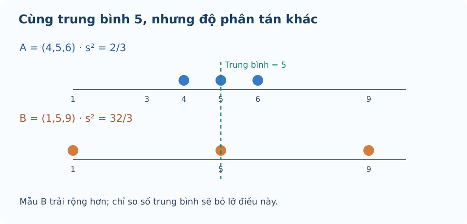
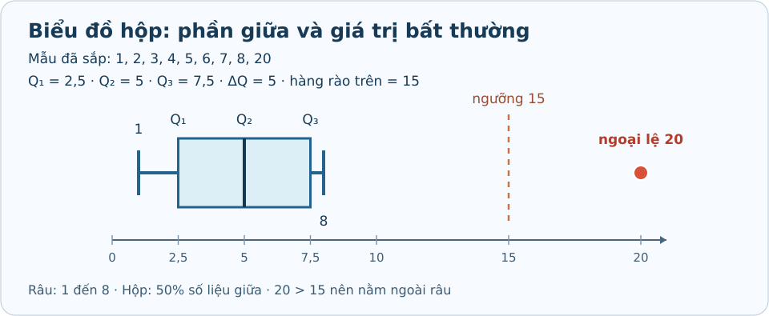

# Bài 14. Các số đặc trưng đo độ phân tán

TOÁN 10 · CHƯƠNG V · KIẾN THỨC SGK KNTT

Học định nghĩa, điều kiện, ví dụ và hình minh họa; tự luyện trước khi mở gợi ý và lời giải.

=== "Khám phá kiến thức"

    ### 1.1. Cùng tìm hiểu

    Cả hai đội đều có điểm trung bình 7, nhưng đội A lần nào cũng quanh 7, còn đội B có lúc đạt 3, lúc đạt 10. Nếu muốn đánh giá **độ ổn định**, số trung bình không giúp phân biệt. Ta cần những số cho biết **dữ liệu trải rộng đến đâu**.

    Khoảng biến thiên nhìn từ giá trị nhỏ nhất đến lớn nhất. Khoảng tứ phân vị nhìn phần dữ liệu ở giữa, ít bị tác động bởi các điểm cực đoan. Phương sai và độ lệch chuẩn đo mức xa trung bình của các quan sát. Vì các độ lệch có thể dương hoặc âm và triệt tiêu nhau, phương sai dùng **bình phương**; sau đó lấy căn để độ lệch chuẩn trở về cùng đơn vị với dữ liệu.

    Khi gặp một giá trị bất thường, đừng loại nó theo cảm giác. Hãy so với quy tắc định lượng và đọc trong bối cảnh thực tế.

    ### 1.2. Ví dụ trực quan

    #### 1.2.1. Hai cách nhìn độ trải rộng của dữ liệu

    Hai lớp có thể có trung bình gần nhau nhưng lớp có bạn quá cao hay quá thấp làm khoảng từ min đến max rộng hơn.

    Đã biết min, max và \(Q_1,Q_3\) theo quy ước KNTT; phải sắp dữ liệu trước khi xác định tứ phân vị. 

    Khoảng biến thiên nhìn hai biên xa nhất; khoảng tứ phân vị (IQR, viết tắt của Interquartile Range) nhìn hai mốc ôm phần giữa của mẫu, vì thế ít bị riêng một cực trị chi phối hơn. Từ ý nghĩa 'độ rộng' mới đặt \(R=x_{\max}-x_{\min}\), \(\Delta_Q=Q_3-Q_1\).

    Chọn R khi cần độ rộng toàn bộ, IQR khi quan tâm nửa giữa và mức ảnh hưởng của ngoại lệ; chúng không thay thế cho nhau.

    **Em vận dụng.** Với mẫu đã sắp \(2,3,4,6,8,9,10\), tìm khoảng biến thiên R và khoảng tứ phân vị \(\Delta_Q\) theo KNTT.

    

    ??? question "Đối chiếu"

        

        
<strong>Đối chiếu kết quả:</strong> \(R=10-2=8\); \(Q_2=6\), \(Q_1=3\), \(Q_3=9\) nên \(\Delta_Q=9-3=6\).

        
<strong>Giải thích vì sao:</strong> Với n=7 bỏ số giữa 6, nửa dưới 2,3,4 cho Q1=3 và nửa trên 8,9,10 cho Q3=9. R dùng min/max, IQR dùng Q1/Q3.

        
<strong>Nếu chưa làm được:</strong> Xem lại Khám phá §1.2.1 và Kiến thức SGK §2.1, tự tính lại từ dữ kiện của câu hỏi, rồi <a href="../luyen-tap/?item=THPT-G10-B14-P01">thử câu cùng kiến thức trong Core/Luyện tập</a>.

        

    #### 1.2.2. Độ lệch có thể bù dấu, nên phải bình phương

    Các giá trị thấp hơn và cao hơn trung bình có độ lệch âm/dương bù nhau; cộng chênh lệch có dấu cho 0 dù dữ liệu rất phân tán.

    Đã học trung bình, bình phương số và chia cho số quan sát n. Ở đây mô tả chính mẫu số liệu đang cho, không ước lượng tổng thể từ một mẫu ngẫu nhiên. 

    Muốn đo 'xa trung bình bao nhiêu', hãy bình phương các khoảng lệch để không bị bù dấu rồi lấy trung bình các bình phương. **Theo SGK KNTT ở mục này chia cho n**, không tự dùng mẫu số n−1; kết quả là phương sai và có đơn vị bình phương.

    **Em vận dụng.** Với mẫu \(2,4,6\), tính số trung bình và phương sai \(s^2\) theo mẫu số \(n=3\).

    

    ??? question "Đối chiếu"

        

        
<strong>Đối chiếu kết quả:</strong> \(\bar x=4\); \(s^2=[(2-4)^2+(4-4)^2+(6-4)^2]/3=8/3\).

        
<strong>Giải thích vì sao:</strong> Hai độ lệch −2 và +2 có tổng 0 nhưng bình phương đều 4; tổng bình phương 8 chia 3 phần tử.

        
<strong>Nếu chưa làm được:</strong> Xem lại Khám phá §1.2.2 và Kiến thức SGK §2.2, tự tính lại từ dữ kiện của câu hỏi, rồi <a href="../luyen-tap/?item=THPT-G10-B14-C02">thử câu cùng kiến thức trong Core/Luyện tập</a>.

        

    **Kiểm lỗi dùng chung:** [Xem hướng dẫn tự sửa phù hợp](#HELP-G10-B14-01).
    #### 1.2.3. Vì sao độ lệch chuẩn dễ đọc hơn phương sai?

    Nếu đo chiều dài bằng cm thì phương sai mang đơn vị cm², khó so trực tiếp với chiều dài vài cm; cần số đo trở lại cùng đơn vị.

    Biết phương sai không âm, căn bậc hai số không âm, trung bình mẫu và đơn vị cm. 

    Lấy căn bậc hai phương sai giúp đưa mức phân tán về **cùng đơn vị với dữ liệu gốc**. Độ lệch chuẩn không cho biết từng quan sát lệch đúng bằng s, mà tóm tắt mức lệch điển hình.

    **Em vận dụng.** Bốn độ dài đo được (đơn vị cm) là \(2,2,6,6\). Tính số trung bình, phương sai và độ lệch chuẩn, ghi đúng đơn vị.

    

    ??? question "Đối chiếu"

        

        
<strong>Đối chiếu kết quả:</strong> Trung bình 4 cm; \(s^2=[4+4+4+4]/4=4\,\mathrm{cm}^2\), \(s=2\,\mathrm{cm}\).

        
<strong>Giải thích vì sao:</strong> Mỗi độ lệch với 4 là ±2 cm, bình phương 4 cm²; căn 4 cm² cho 2 cm.

        
<strong>Nếu chưa làm được:</strong> Xem lại Khám phá §1.2.3 và Kiến thức SGK §2.2, tự tính lại từ dữ kiện của câu hỏi, rồi <a href="../luyen-tap/?item=THPT-G10-B14-P05">thử câu cùng kiến thức trong Core/Luyện tập</a>.

        

    
    

    ??? tip "Kiểm lỗi"

        <ol><li><strong>Nhận diện lỗi:</strong> Sai mẫu số phương sai và đơn vị.</li><li><strong>Dấu hiệu / tự chẩn đoán:</strong> Dùng n−1 và viết s có đơn vị bình phương. Đang mô tả dãy số liệu SGK hay ước lượng suy luận mẫu?</li><li><strong>Kiến thức gốc:</strong> SGK dùng s²=Σ(x−x̄)²/n; s căn của s², cùng đơn vị dữ liệu.</li><li><strong>Tự sửa:</strong> Tính lại các bình phương rồi chia n và ghi đơn vị.</li></ol>
<a href="../luyen-tap/?item=THPT-G10-B14-P05">Luyện lại bằng câu hỏi đã có</a>

    #### 1.2.4. Một giá trị xa trung tâm cần được nhận diện bằng quy tắc

    Một ngày ghi doanh số quá lớn có thể là thật hoặc nhập sai. Trước khi kết luận, ta cần tiêu chí định lượng để đánh dấu giá trị khác xa số còn lại.

    Biết tứ phân vị theo KNTT, IQR=Q3−Q1 và cách kiểm bất đẳng thức nghiêm ngặt. Không đồng nhất giá trị bất thường với dữ liệu chắc chắn sai. 

    Đặt hai hàng rào quanh phần giữa: dưới \(Q_1-1{,}5\Delta_Q\) và trên \(Q_3+1{,}5\Delta_Q\). Giá trị **nhỏ hơn** rào dưới hoặc **lớn hơn** rào trên được gắn cờ bất thường; bằng rào không bị gắn theo dấu chặt.

    **Em vận dụng.** Xét mẫu đã sắp \(1,2,3,4,5,6,20\). Tìm \(Q_1,Q_2,Q_3\), hai hàng rào và giá trị bất thường.

    

    ??? question "Đối chiếu"

        

        
<strong>Đối chiếu kết quả:</strong> \(Q_2=4\), \(Q_1=2\), \(Q_3=6\), \(\Delta_Q=4\); hàng rào dưới −4, hàng rào trên 12. Chỉ giá trị 20 là bất thường.

        
<strong>Giải thích vì sao:</strong> Với n=7, bỏ số giữa 4. Hai hàng rào =2−1,5·4=−4 và 6+1,5·4=12; 20&gt;12, các giá trị 1..6 trong khoảng.

        
<strong>Nếu chưa làm được:</strong> Xem lại Khám phá §1.2.4 và Kiến thức SGK §2.3, tự tính lại từ dữ kiện của câu hỏi, rồi <a href="../luyen-tap/?item=THPT-G10-B14-P03">thử câu cùng kiến thức trong Core/Luyện tập</a>.

        

    
    

    ??? tip "Kiểm lỗi"

        <ol><li><strong>Nhận diện lỗi:</strong> Nhầm hàng rào ngoại lệ và phân tán.</li><li><strong>Dấu hiệu / tự chẩn đoán:</strong> So giá trị với trung bình hoặc đánh dấu giá trị bằng ngưỡng là ngoại lệ. Em đã lấy Q1, Q3 đúng quy tắc chưa?</li><li><strong>Kiến thức gốc:</strong> Bất thường khi x&lt;Q1−1,5 IQR hoặc x&gt;Q3+1,5 IQR; dùng dấu nghiêm ngặt.</li><li><strong>Tự sửa:</strong> Tính Q1/Q3, viết ngưỡng và kiểm từng giá trị.</li></ol>
<a href="../luyen-tap/?item=THPT-G10-B14-P03">Luyện lại bằng câu hỏi đã có</a>

    #### 1.2.5. Cùng trung bình không có nghĩa phân tán giống nhau

    Hai nhóm đều đạt trung bình 4 điểm, nhưng một nhóm tập trung quanh 4, nhóm khác có điểm rất thấp và rất cao. Chỉ trung bình không đủ mô tả chất lượng phân bố.

    Đã biết trung bình và cách đo độ lệch bằng phương sai chia n, mỗi nhóm có cùng số quan sát trong ví dụ. 

    So hai nhóm cùng trung bình bằng mức lệch của từng quan sát: nhóm có bình phương lệch lớn hơn sẽ có phương sai lớn hơn; điều đó cho biết **độ phân tán**, không tự kết luận nhóm nào tốt hơn về mọi mặt.

    Với hai nhóm cùng trung bình, dùng phương sai/độ lệch chuẩn để so độ trải; không chọn chỉ vì trung bình bằng nhau, cũng không suy độ lệch chuẩn cao là kết quả học tập kém về mọi mặt.

    **Em vận dụng.** Nhóm A có \(2,4,6\), nhóm B có \(0,4,8\). Trung bình của hai nhóm và phương sai mô tả từng nhóm bằng bao nhiêu? Nhóm nào phân tán hơn?

    

    ??? question "Đối chiếu"

        

        
<strong>Đối chiếu kết quả:</strong> Cả hai trung bình 4; \(s_A^2=8/3\), \(s_B^2=32/3\), nên B phân tán hơn.

        
<strong>Giải thích vì sao:</strong> A lệch −2,0,2; B lệch −4,0,4. Bình phương độ lệch nhóm B gấp bốn lần nên phương sai B lớn hơn.

        
<strong>Nếu chưa làm được:</strong> Xem lại Khám phá §1.2.5 và Kiến thức SGK §2.2, tự tính lại từ dữ kiện của câu hỏi, rồi <a href="../luyen-tap/?item=THPT-G10-B14-P04">thử câu cùng kiến thức trong Core/Luyện tập</a>.

        

    **Kiểm lỗi dùng chung:** [Xem hướng dẫn tự sửa phù hợp](#HELP-G10-B14-01).
    ### 1.3. Thuật ngữ, kiến thức và kỹ năng

    **Thuật ngữ:** Khoảng biến thiên, khoảng tứ phân vị, phương sai, độ lệch chuẩn, giá trị bất thường, biểu đồ hộp, đơn vị đo.

    **Sau bài học, em cần làm được:** So sánh độ phân tán của hai mẫu; tính trung bình và bình phương độ lệch; tìm IQR; xét ngoại lệ theo quy tắc; diễn giải đại lượng, đọc biểu đồ hộp và đơn vị.

=== "Kiến thức SGK"

    ### 2.1. Khoảng biến thiên và khoảng tứ phân vị

    <figure class="thpt-r4-plot thpt-r4-probability-figure"><figcaption>Hai mẫu có cùng trung bình nhưng mức phân tán khác nhau.</figcaption></figure>

    **Cách đọc hình.** Quan sát hai tập dữ liệu có thể cùng trung bình nhưng độ trải rộng và vùng giữa khác nhau. Nhìn trục và các mốc tứ phân vị trước khi đánh giá mức phân tán.

    
<strong>Định nghĩa — Khoảng biến thiên và khoảng tứ phân vị:</strong> Với dãy số liệu có giá trị nhỏ nhất và lớn nhất, khoảng biến thiên \(R=x_{\max}-x_{\min}\ge0\). Khi các tứ phân vị \(Q_1,Q_3\) đã được xác định theo quy tắc SGK KNTT, khoảng tứ phân vị \(\Delta_Q=Q_3-Q_1\ge0\). Khoảng biến thiên nhìn toàn bộ từ min đến max; khoảng tứ phân vị đo độ trải của phần dữ liệu ở giữa.

    **Lưu ý:** \(R\) rất nhạy với giá trị cực đoan; \(\Delta_Q\) ít bị chi phối bởi một giá trị cực đoan. Trước khi dùng \(\Delta_Q\), phải sắp dữ liệu và lấy \(Q_1,Q_3\) đúng quy ước đã học ở Bài 13, với ít nhất hai quan sát theo phép chia nửa đang dùng.

    ### 2.2. Phương sai và độ lệch chuẩn
    
<strong>Định nghĩa — Phương sai:</strong> Với \(n\ge1\) quan sát \(x_1,\ldots,x_n\), trung bình \(\bar x\), phương sai mô tả dãy số liệu là \(s^2=\dfrac1n\sum_{i=1}^{n}(x_i-\bar x)^2\). Lấy độ lệch của từng số so với trung bình, bình phương để không triệt tiêu dấu, cộng rồi <strong>chia cho \(n\)</strong>. Với bảng tần số \(m_i\), tính \(s^2=\dfrac{\sum_i m_i(x_i-\bar x)^2}{\sum_i m_i}\).

    
<strong>Định nghĩa — Độ lệch chuẩn:</strong> Độ lệch chuẩn \(s=\sqrt{s^2}\ge0\) là căn bậc hai không âm của phương sai. Nếu dữ liệu tính bằng kg, phương sai có đơn vị \(\mathrm{kg}^2\), còn độ lệch chuẩn có đơn vị \(\mathrm{kg}\), cùng đơn vị với dữ liệu.

    **Chú ý đúng SGK (trang 86):** ngoài phương sai \(s^2\) vừa định nghĩa với mẫu số \(n\), sách còn *giới thiệu* đại lượng \(\hat{s}^{\,2}=\frac{\sum_{i=1}^{n}(x_i-\bar x)^2}{n-1}\) khi \(n>1\). Đây là hai đại lượng khác nhau. Nếu đề yêu cầu \(s^2\) theo định nghĩa chính ở bài này, phải chia cho \(n\); không được tự đổi sang \(n-1\). Mẫu số \(n-1\) không áp dụng khi \(n=1\).

    ### 2.3. Phát hiện số liệu bất thường hoặc không chính xác bằng biểu đồ hộp
    
<strong>Quy tắc — Nhận diện giá trị bất thường:</strong> Khi đã xác định \(Q_1,Q_3\) và \(\Delta_Q=Q_3-Q_1\), xét hai hàng rào \(Q_1-1{,}5\Delta_Q\) và \(Q_3+1{,}5\Delta_Q\). Một giá trị được gắn cờ bất thường nếu \(x<Q_1-1{,}5\Delta_Q\) hoặc \(x>Q_3+1{,}5\Delta_Q\). Hai dấu bất đẳng thức là <strong>nghiêm ngặt</strong>; bằng rào không thuộc điều kiện này.

    **Lưu ý:** Gắn cờ bất thường không có nghĩa dữ liệu chắc chắn bị nhập sai. Phải kiểm bối cảnh thực tế; không tự ý loại giá trị đó trước khi tính toán nếu đề không yêu cầu.

    **Biểu đồ hộp dùng các tứ phân vị để đọc mức phân tán và phát hiện giá trị bất thường.** Từ mẫu đã sắp \(1,2,3,4,5,6,7,8,20\), ta có \(Q_2=5\), \(Q_1=(2+3)/2=2{,}5\), \(Q_3=(7+8)/2=7{,}5\), do đó \(\Delta_Q=5\). Hai hàng rào là \(Q_1-1{,}5\Delta_Q=-5\) và \(Q_3+1{,}5\Delta_Q=15\). Giá trị \(20>15\) là bất thường; các giá trị từ 1 đến 8 không vượt rào.

    <figure class="thpt-r4-plot thpt-r4-probability-figure"><figcaption>Biểu đồ hộp minh họa: vạch giữa là trung vị; hộp là 50% số liệu giữa; điểm 20 nằm ngoài râu.</figcaption></figure>

    **Cách đọc hình.** Trước tiên đọc trục và ba mốc \(Q_1,Q_2,Q_3\). Hộp nối \(Q_1\) tới \(Q_3\), vạch trong hộp là trung vị. Trong minh họa này hai râu dừng ở các giá trị quan sát không bất thường nhỏ/lớn nhất (1 và 8); đường đứt chỉ hàng rào trên 15; điểm 20 được đánh dấu riêng. **Hàng rào không nhất thiết trùng đầu râu**. Giá trị bị gắn cờ cần được kiểm tra bối cảnh, không tự kết luận chắc chắn dữ liệu sai.

=== "Ví dụ"

    Trước mỗi ví dụ, hãy đọc **Đề**, tự chọn cách làm rồi mới xem **Phân tích** và **Giải**. Kết quả toán giữ nguyên từ bộ ví dụ đã duyệt; các bước được triển khai để người học hiểu vì sao tính như vậy.

    ### 3.1. Ví dụ 1 — Khoảng biến thiên, khoảng tứ phân vị và phương sai

    #### &nbsp; {style="display:none"}

    **Đề:** Cho mẫu số liệu \(2,4,6,8\). Tính số trung bình, khoảng biến thiên \(R\), khoảng tứ phân vị \(\Delta_Q\), phương sai \(s^2\) và độ lệch chuẩn \(s\) theo định nghĩa SGK.

    **Phân tích:** Muốn tính \(R\) cần min và max; muốn có \(\Delta_Q\) phải sắp mẫu và lấy trung vị của mỗi nửa. Phương sai dùng bình phương độ lệch so với trung bình và chia cho đúng \(n=4\), không tự đổi sang \(n-1\).

    

    
<strong>Bước 1 — Trung bình và khoảng biến thiên:</strong> Dãy đã tăng, có \(n=4\), \(\bar x=(2+4+6+8)/4=5\), \(R=8-2=6\).

    
<strong>Bước 2 — Khoảng tứ phân vị:</strong> Hai nửa là \(2,4\) và \(6,8\). Suy ra \(Q_1=(2+4)/2=3\), \(Q_3=(6+8)/2=7\), nên \(\Delta_Q=7-3=4\).

    
<strong>Bước 3 — Phương sai:</strong> Các độ lệch so với 5 là \(-3,-1,1,3\). Do đó \(s^2=[(-3)^2+(-1)^2+1^2+3^2]/4=(9+1+1+9)/4=5\).

    
<strong>Bước 4 — Độ lệch chuẩn:</strong> \(s=\sqrt{s^2}=\sqrt5\approx2{,}236\).

    

    **Kiểm lại:** \(2\le Q_1=3\le Q_3=7\le8\), \(R=6\ge\Delta_Q=4\ge0\), \(s^2=5\ge0\). Không lẫn \(s^2\) với \(s\).

    ### 3.2. Ví dụ 2 — Cùng trung bình nhưng khác độ phân tán

    #### &nbsp; {style="display:none"}

    **Đề:** Hai nhóm có số liệu \(A=(4,5,6)\) và \(B=(1,5,9)\). So sánh số trung bình và phương sai mô tả của hai nhóm. Nhóm nào phân tán hơn?

    **Phân tích:** Vì mỗi nhóm có ba quan sát, ta tính riêng trung bình rồi so mức độ xa trung bình bằng các **bình phương độ lệch**, không kết luận chỉ từ trung bình.

    

    
<strong>Bước 1 — So trung bình:</strong> \(\bar x_A=(4+5+6)/3=5\), \(\bar x_B=(1+5+9)/3=5\). Hai nhóm có cùng trung bình.

    
<strong>Bước 2 — Nhóm A:</strong> Các độ lệch là \(-1,0,1\), nên \(s_A^2=(1+0+1)/3=2/3\).

    
<strong>Bước 3 — Nhóm B:</strong> Các độ lệch là \(-4,0,4\), nên \(s_B^2=(16+0+16)/3=32/3\).

    
<strong>Kết luận:</strong> \(s_B^2>s_A^2\), nên dữ liệu nhóm B phân tán hơn dù có cùng trung bình.

    

    **Kiểm lại:** Phương sai của B gấp \( (32/3)/(2/3)=16\) lần phương sai của A. Điều này mô tả độ trải, **không tự cho biết nhóm nào tốt hơn**.

    ### 3.3. Ví dụ 3 — Nhận diện giá trị bất thường

    #### &nbsp; {style="display:none"}

    **Đề:** Cho mẫu đã sắp \(1,2,2,3,3,4,4,20\). Tìm các tứ phân vị, hai hàng rào theo quy tắc \(1{,}5\Delta_Q\) và xác định giá trị bất thường.

    **Phân tích:** Trước khi xét ngoại lệ, phải tính \(Q_1,Q_3\) từ các vị trí của dãy đã sắp. Chỉ so giá trị với **hai hàng rào**; không dùng trung bình làm ngưỡng ngoại lệ.

    

    
<strong>Bước 1 — Tứ phân vị:</strong> Mẫu có \(n=8\); trung vị \(Q_2=(3+3)/2=3\). Nửa dưới \(1,2,2,3\) cho \(Q_1=(2+2)/2=2\); nửa trên \(3,4,4,20\) cho \(Q_3=(4+4)/2=4\).

    
<strong>Bước 2 — Khoảng tứ phân vị:</strong> \(\Delta_Q=Q_3-Q_1=4-2=2\).

    
<strong>Bước 3 — Hàng rào:</strong> Hàng rào dưới là \(2-1{,}5\cdot2=-1\); trên là \(4+1{,}5\cdot2=7\).

    
<strong>Bước 4 — Đối chiếu:</strong> \(20>7\), nên 20 được gắn cờ bất thường. Các số còn lại từ 1 đến 4 đều nằm giữa hai rào.

    

    **Kiểm lại:** Điều kiện là \(x<-1\) hoặc \(x>7\), không phải \(x\ge7\). Giá trị bất thường **chưa chắc là số nhập sai**; muốn loại khỏi bộ dữ liệu phải có căn cứ.

=== "Lỗi thường gặp"

    **Kiểm lỗi:** Các lỗi thường gặp được giải thích ngay sau từng hoạt động ở tab Khám phá kiến thức. Chọn mục tương ứng để xem lại: [Kiểm lỗi 1](#HELP-G10-B14-01) · [Kiểm lỗi 2](#HELP-G10-B14-02).

    **Học tiếp:** [Core và Luyện tập](luyen-tap.md) · [Tự kiểm tra cuối chương](tu-kiem-tra-chuong.md).

    
Nguồn toán học: SGK Toán 10 Kết nối tri thức với cuộc sống và học liệu SLM hiện hành. Lời giảng được biên tập nhằm hỗ trợ tự học độc lập.

