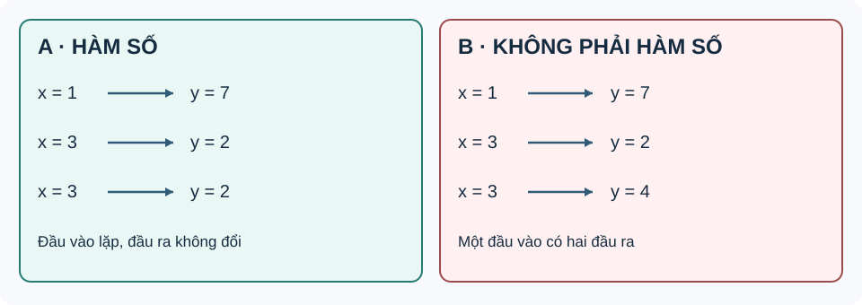

# Bài 15. Hàm số

TOÁN 10 · CHƯƠNG VI · BÀI 15

Hàm số: khái niệm, tập xác định, tập giá trị, đồ thị và cách nhận biết tính đồng biến, nghịch biến.

=== "Khám phá kiến thức"

    ### Cùng tìm hiểu

    Một máy nhận mã sản phẩm và trả ra giá bán tương ứng. Nếu cùng một mã, trong cùng điều kiện, mà máy lại cho hai giá khác nhau thì quy tắc ấy không xác định một kết quả rõ ràng. **Hàm số** cũng yêu cầu mỗi đầu vào thuộc miền được phép phải có **đúng một đầu ra**.

    Muốn đọc hàm số, hãy phân biệt ba điều: những giá trị \(x\) **được phép nhập**, quy tắc tìm \(y\), và các điểm \((x,y)\) trên **đồ thị**. Một điểm vẽ được trong mặt phẳng chưa chắc thuộc đồ thị; tọa độ của nó phải thỏa đồng thời tập xác định và quy tắc.

    Khi muốn biết hàm tăng hay giảm, hãy quan sát đồ thị **trong cùng một khoảng** từ trái sang phải. Không so hai điểm ở hai nhánh khác nhau rồi kết luận cả hàm đồng biến.

    ### Thuật ngữ, kiến thức và kỹ năng

    **Thuật ngữ:** Hàm số, tập xác định, tập giá trị, biến độc lập/phụ thuộc, đồ thị, đồng biến, nghịch biến và hàm từng đoạn.

    **Sau bài học, em cần làm được:** Kiểm điều kiện đầu vào; xác nhận điểm thuộc đồ thị; đọc bảng/đồ thị, khoảng tăng/giảm và ranh giới hàm từng đoạn.

=== "Kiến thức SGK"

    ### Một đầu vào phải có một kết quả

    Trong một ứng dụng dự báo nhiệt độ, cùng một thời điểm không thể đồng thời được gán hai nhiệt độ khác nhau trong *cùng một mô hình xác định*. Vì vậy ta cần nhận ra khi nào mối liên hệ có thể gọi là hàm số.

    Nhớ khái niệm cặp có thứ tự \((x;y)\), đọc bảng giá trị, phân biệt “một giá trị \(x\) xuất hiện hai dòng” với “một giá trị \(x\) có hai đầu ra **khác nhau**”. Em có thể học các kiến thức tiền đề ngay trong bài.

    Một quy tắc là hàm số trên tập \(D\) nếu mỗi đầu vào \(x\in D\) có **đúng một** giá trị đầu ra \(y\). Hai dòng trùng hệt \((x;y)\) không phá điều kiện; nhưng \((x;y_1)\) và \((x;y_2)\) với \(y_1\ne y_2\) thì phá. Sau trực giác ấy mới dùng kí hiệu \(y=f(x)\).

    **Vì sao chọn phương pháp này?** Kiểm **theo từng đầu vào**, không yêu cầu mỗi đầu ra phải ứng với một đầu vào duy nhất. Nếu bảng có hai đầu ra khác nhau cho một đầu vào, mối liên hệ đó không phải một hàm số theo x.

    **Em vận dụng.** Bảng A gồm \((1;7),(3;2),(3;2)\); bảng B gồm \((1;7),(3;2),(3;4)\). Bảng nào biểu diễn hàm số \(y\) theo \(x\), vì sao?

    

    ??? question "Em đã tự thử? Mở đáp án để đối chiếu"

        

<strong>Đáp án:</strong> A là hàm số trên \(D=\{1,3\}\); B không là hàm số \(y\) theo \(x\).

<strong>Vì sao:</strong> Trong A, \(x=3\) lặp hai lần nhưng luôn cho \(y=2\). Trong B, cùng \(x=3\) cho cả \(y=2\) và \(y=4\), vi phạm tính đơn trị.

Đây là câu tự luyện công khai, không chấm điểm thành thạo. Nếu chưa đúng, mở hướng dẫn tự sửa phía dưới.

    ### Khái niệm hàm số

    **Cách đọc hình.** Đọc các mũi tên từ tập giá trị đầu vào sang tập đầu ra: mỗi đầu vào có đúng một đầu ra, dù nhiều đầu vào có thể cùng chung giá trị.

    <figure class="thpt-r4-plot thpt-r4-probability-figure"><figcaption>Đọc từng đầu vào: lặp đúng cùng một giá trị khác với hai đầu ra mâu thuẫn.</figcaption></figure>

    Cho tập hợp \(D\) gồm các giá trị của \(x\). Nếu **mỗi** \(x\in D\) xác định **duy nhất một** số thực \(y\), ta nói \(y\) là một *hàm số* của \(x\) trên \(D\). Kí hiệu \(y=f(x)\).

    - \(D\): **tập xác định** của hàm số.
    - \(f(x)\): **giá trị của hàm số** tại \(x\).
    - \(T=\{f(x)\mid x\in D\}\): **tập giá trị** của hàm số.
    - Một giá trị \(x\) không thể đồng thời ứng với hai giá trị \(y\) khác nhau nếu đó là đồ thị của một hàm số.
    - **Bảng có đầu vào lặp:** nếu hai hàng cùng \(x\) và cùng \(y\), quan hệ vẫn có thể là hàm số; chỉ khi cùng \(x\) ứng với **hai \(y\) khác nhau** mới vi phạm tính đơn trị. Chẳng hạn \((1;3),(2;4),(2;4)\) mô tả một hàm số trên \(\{1;2\}\), nhưng thay cặp cuối bằng \((2;5)\) thì không.

    ### Tập xác định và tập giá trị không giống nhau

    Máy tính không thể lấy căn bậc hai của số âm trong tập số thực; muốn nhập \(x\) hợp lệ, ta phải biết miền **đầu vào**. Nhưng các kết quả **đầu ra** mà máy cho được có thể là tập khác.

    Nhớ điều kiện \(\sqrt t\) có nghĩa trong số thực khi \(t\ge0\), và \(\sqrt t\ge0\); biết xét bất phương trình bậc nhất. Em có thể học các kiến thức tiền đề ngay trong bài.

    Tập xác định \(D\) là những \(x\) **được phép thay vào** biểu thức; tập giá trị \(T\) gồm mọi \(y\) thực sự **đạt được** sau khi thay \(x\in D\). Ví dụ căn thức vừa giới hạn đầu vào, vừa làm mọi đầu ra không âm; không lấy \(D=T\) chỉ vì có cùng kí hiệu tập.

    **Vì sao chọn phương pháp này?** Tìm điều kiện xác định trước; để tìm T phải hỏi các giá trị f(x) có thể nhận, chứ không chép lại D. Không lấy căn của giá trị âm trong \(\mathbb R\).

    **Em vận dụng.** Với \(f(x)=\sqrt{x-2}\), hãy tìm tập xác định \(D\) và tập giá trị \(T\).

    

    ??? question "Em đã tự thử? Mở đáp án để đối chiếu"

        

<strong>Đáp án:</strong> \(D=[2;+\infty)\), còn \(T=[0;+\infty)\).

<strong>Vì sao:</strong> \(x-2\ge0\Rightarrow x\ge2\). Căn luôn không âm, bằng 0 khi x=2; với mọi y≥0, lấy x=y²+2 được f(x)=y.

Đây là câu tự luyện công khai, không chấm điểm thành thạo. Nếu chưa đúng, mở hướng dẫn tự sửa phía dưới.

    **Ví dụ 1.** Với \(f(x)=\sqrt{x-1}\), căn thức xác định khi \(x-1\ge0\), tức \(D=[1;+\infty)\). Đồng thời \(f(x)\ge0\) và mọi giá trị không âm đều nhận được; do đó \(T=[0;+\infty)\).

    **Ví dụ 2.** Với \(g(x)=\frac{x+1}{x-2}\), mẫu số phải khác \(0\), nên \(D=\mathbb{R}\setminus\{2\}\). Viết \(g(x)=1+\frac{3}{x-2}\), suy ra giá trị \(1\) không đạt được, còn mọi giá trị khác \(1\) đều đạt được; vậy \(T=\mathbb{R}\setminus\{1\}\).

    ### Điểm thuộc đồ thị phải thỏa đúng quy tắc

    Một điểm vẽ trên hệ trục có hai tọa độ; để biết nó có thuộc đồ thị của hàm số hay không, ta phải kiểm xem tung độ đúng bằng đầu ra ứng với hoành độ.

    Ôn kí hiệu điểm \((x;y)\), trục Ox biểu diễn x, Oy biểu diễn y và thay số vào biểu thức f(x). Em có thể học các kiến thức tiền đề ngay trong bài.

    Đồ thị của \(y=f(x)\) là tập tất cả điểm \((x,f(x))\) với \(x\in D\). Việc điểm nằm “gần” nét đồ thị trên hình in không đủ chứng minh: cần thử \(y=f(x)\) với đúng hoành độ của điểm.

    

    ??? question "Em đã tự thử? Mở đáp án để đối chiếu"

        

<strong>Đáp án:</strong> Chỉ \(A(-2;3)\) thuộc đồ thị; B không thuộc.

<strong>Vì sao:</strong> \(f(-2)=(-2)^2-1=3\) khớp tung độ A; \(f(2)=3\ne5\) nên B không thuộc đồ thị.

Đây là câu tự luyện công khai, không chấm điểm thành thạo. Nếu chưa đúng, mở hướng dẫn tự sửa phía dưới.

    ### Đồ thị của hàm số

    Đồ thị của hàm số \(y=f(x)\) trên \(D\) là tập hợp các điểm \(M(x;f(x))\) với \(x\in D\). Hàm số có thể được cho bằng **công thức, bảng giá trị, đồ thị** hoặc mô tả một sự phụ thuộc duy nhất.

    **Cách kiểm tra một điểm:** \(A(x_0;y_0)\) thuộc đồ thị khi và chỉ khi \(x_0\in D\) và \(y_0=f(x_0)\).

    **Ví dụ 3.** Với \(y=2x+1\), điểm \(A(2;5)\) thuộc đồ thị vì \(2\cdot2+1=5\); điểm \(B(2;4)\) không thuộc đồ thị. Khi vẽ đồ thị, trục hoành biểu diễn \(x\), trục tung biểu diễn \(y\).

    !!! tip "Chú ý khi đọc hình"
        Khi một đường thẳng đứng \(x=x_0\) cắt hình vẽ tại nhiều hơn một điểm, hình vẽ đó **không thể** là đồ thị của hàm số \(y=f(x)\) trên miền chứa \(x_0\).

    ### Đọc hàm số qua bảng và đồ thị

    Hàm số không nhất thiết phải được cho bằng một công thức duy nhất. Theo mạch kiến thức SGK Toán 10 KNTT Tập 2 (trang in 5–7), ta còn gặp **bảng số liệu**, **đồ thị đo đạc** và **mô hình tính tiền theo từng khoảng**.

    **Ví dụ bổ sung A — Bảng giá trị.** Một trạm quan sát ghi nhiệt độ tại ba thời điểm:

    
<table class="thpt-g10-knowledge-table">
    <thead><tr><th>Thời điểm \(t\) (giờ)</th><th>6</th><th>12</th><th>18</th></tr></thead>
    <tbody>
    <tr><td>Nhiệt độ \(T(t)\) (\(^\circ\mathrm C\))</td><td>19</td><td>25</td><td>21</td></tr>
    </tbody></table>

    Trong dữ liệu chỉ gồm ba thời điểm đó, tập xác định là \(D=\{6;12;18\}\); tập giá trị là \(\{19;21;25\}\). Ta đọc được \(T(12)=25\) nhưng **không thể tự suy ra** \(T(9)\) nếu chưa có mô hình hoặc số liệu bổ sung. Nếu hai thời điểm có cùng nhiệt độ thì giá trị đó chỉ liệt kê **một lần** trong tập giá trị.

    ### Hàm từng đoạn cần đọc đúng ranh giới và đơn vị

    Một dịch vụ gửi hàng thu phí cơ bản cho 2 km đầu và thu thêm theo mỗi km tiếp theo; cùng đầu vào vẫn phải được tính đúng một mức phí, kể cả ngay ranh giới 2 km.

    Nhớ cách so \(x\le2\) với \(x>2\), đơn vị kilomet và nghìn đồng, và giá trị hàm số tại điểm x. Em có thể học các kiến thức tiền đề ngay trong bài.

    Hàm từng đoạn dùng **những công thức khác nhau trên những miền không chồng mâu thuẫn**. Giá trị tại x=2 phải theo nhánh chứa dấu bằng; nếu chọn nhầm, chi phí tại ranh giới và dự đoán tiếp theo đều sai.

    **Vì sao chọn phương pháp này?** Chọn nhánh trước, sau đó thay x. Kiểm điều kiện x≥0 và đơn vị; mô hình giả định không phải biểu giá thực tế.

    **Em vận dụng.** Một dịch vụ tính \(C(x)=12\) (nghìn đồng) nếu \(0\le x\le3\), và \(C(x)=12+4(x-3)\) nếu \(x>3\). Tính \(C(3)\) và \(C(5)\) (nghìn đồng).

    

    ??? question "Em đã tự thử? Mở đáp án để đối chiếu"

        

<strong>Đáp án:</strong> \(C(3)=12\); \(C(5)=12+4(5-3)=20\) (nghìn đồng).

<strong>Vì sao:</strong> x=3 dùng nhánh thứ nhất vì có dấu bằng. x=5 dùng nhánh thứ hai, quãng đường vượt 3 km là 2 km.

Đây là câu tự luyện công khai, không chấm điểm thành thạo. Nếu chưa đúng, mở hướng dẫn tự sửa phía dưới.

    **Ví dụ bổ sung B — Hàm số cho theo từng khoảng.** Một dịch vụ giao hàng giả định tính phí \(C(x)\), đơn vị *nghìn đồng*, theo quãng đường \(x\) (km):

    \[
    C(x)=
    \begin{cases}
    8x,&0\le x\le2,\\
    16+6(x-2),&x>2.
    \end{cases}
    \]

    - \(C(1)=8\) (nghìn đồng); \(C(2)=16\); \(C(3)=22\).
    - Hai công thức tương ứng với **hai khoảng khác nhau**, nhưng mọi quãng đường \(x\ge0\) đều có **duy nhất một** mức phí.
    - Tập xác định thực tế \(D=[0;+\infty)\). Tại \(x=2\), dùng nhánh \(0\le x\le2\); nhánh còn lại chỉ dùng khi \(x>2\).
    - Muốn vẽ đồ thị, vẽ đoạn thẳng \(y=8x\) trên \([0;2]\) và tia thẳng \(y=6x+4\) trên \((2;+\infty)\). Hai phần gặp nhau tại \((2;16)\).

    *Lưu ý:* Mô hình tính phí này là **ví dụ do dự án tự biên soạn**, không sao chép biểu giá trong SGK và không đại diện cho giá giao hàng thực tế. Đây là một ví dụ về cách biểu diễn phụ thuộc bằng công thức trên từng miền.

    ### Đồng biến phải xét trên đúng khoảng

    Nếu quãng đường theo thời gian chỉ tăng, ta gọi đại lượng đồng biến; nhưng có những đại lượng trước tăng sau giảm. Vậy không thể gắn nhãn tăng/giảm cho cả hàm chỉ bằng nhìn hai điểm bất kì.

    Biết so sánh hai số \(x_1<x_2\), bất đẳng thức và ý nghĩa đầu vào/đầu ra. Em có thể học các kiến thức tiền đề ngay trong bài.

    Trên một khoảng \(K\), đồng biến nghĩa là \(x_1<x_2\) trong K kéo theo \(f(x_1)<f(x_2)\). Nếu \(f(x_1)>f(x_2)\) thì nghịch biến. Khái niệm phụ thuộc vào **khoảng đang xét**, không phải tính chất tuyệt đối của mọi hàm trên \(\mathbb R\).

    **Vì sao chọn phương pháp này?** Chỉ so hai đầu vào cùng thuộc K. Không suy đơn điệu trên toàn miền nếu một khoảng tăng và một khoảng giảm; không cần đạo hàm ở trình độ bài này.

    **Em vận dụng.** Với \(f(x)=3x+2\) trên \([-1;2]\), nếu \(x_1<x_2\) thì \(f(x_1)\) so với \(f(x_2)\) thế nào? Hàm đồng hay nghịch biến trên khoảng này?

    

    ??? question "Em đã tự thử? Mở đáp án để đối chiếu"

        

<strong>Đáp án:</strong> \(f(x_2)-f(x_1)=3(x_2-x_1)&gt;0\); đồng biến trên \([-1;2]\).

<strong>Vì sao:</strong> Hệ số 3 dương nên khi x tăng thì giá trị f(x) tăng. Lập luận áp dụng mọi cặp x1&lt;x2 trong khoảng, không chỉ một bảng nhỏ.

Đây là câu tự luyện công khai, không chấm điểm thành thạo. Nếu chưa đúng, mở hướng dẫn tự sửa phía dưới.

    ### Sự đồng biến, nghịch biến của hàm số

    Cho hàm số \(y=f(x)\) xác định trên khoảng \(K\). Với mọi \(x_1,x_2\in K\) thỏa \(x_1<x_2\):

    
<table class="thpt-g10-knowledge-table">
    <thead><tr><th>Tính chất</th><th>Điều kiện</th><th>Nhìn từ trái qua phải trên đồ thị</th></tr></thead>
    <tbody>
    <tr><td><strong>Đồng biến</strong> trên \(K\)</td><td>\(f(x_1)&lt;f(x_2)\)</td><td>Đường đi lên</td></tr>
    <tr><td><strong>Nghịch biến</strong> trên \(K\)</td><td>\(f(x_1)&gt;f(x_2)\)</td><td>Đường đi xuống</td></tr>
    </tbody></table>

    Nếu hàm số không có cùng một chiều biến thiên trên toàn miền, cần **chia thành từng khoảng**; không kết luận chỉ từ hai giá trị đầu/cuối.

    **Ví dụ 4.** Hàm số \(f(x)=x^2\) nghịch biến trên \((-\infty;0)\) và đồng biến trên \((0;+\infty)\). Điều này **không có nghĩa** \(f\) đồng biến hoặc nghịch biến trên toàn \(\mathbb{R}\).

    **Ví dụ 5 (mô hình).** Độ dài đường đi của xe chuyển động đều \(s(t)=12t\) (km) với \(t\ge0\) (giờ) tăng khi thời gian tăng, nên \(s\) đồng biến trên \([0;+\infty)\).

=== "Ví dụ"

    Trước khi xem lời giải, hãy xác định dữ kiện, điều phải tìm và lý do chọn cách giải. Sau đó kiểm tra lại điều kiện áp dụng và kết quả, thay vì chỉ nhìn phép tính cuối cùng.

    ### Ví dụ — Tập xác định quyết định điểm nào được phép thuộc đồ thị

    **Đề bài.** Xét \(f(x)=\frac1{x-2}\). Tìm tập xác định và xét \(M(3,1)\), \(N(2,0)\).

    **Vì sao chọn cách này?** Phân thức có mẫu số nên phải kiểm điều kiện trước khi thay tọa độ.

    **Giải.** \(x-2\ne0\), do đó \(D=\mathbb R\setminus\{2\}\). \(f(3)=1\), nên \(M\) thuộc đồ thị. \(N\) không thuộc vì hoành độ 2 ngoài tập xác định. **Tự kiểm:** Sự tồn tại của một điểm trong mặt phẳng không có nghĩa điểm đó thuộc mọi đồ thị.

    1. Tìm tập xác định của \(h(x)=\sqrt{5-2x}\).
    2. Với \(p(x)=x^2-4\), hãy kiểm tra điểm \(A(3;5)\) có thuộc đồ thị hay không.
    3. Hàm \(q(x)=-3x+7\) đồng biến hay nghịch biến trên \(\mathbb{R}\)? Giải thích theo định nghĩa.

    ??? question "Đáp án và lập luận (chỉ mở sau khi tự làm)"

        <ol><li>\(5-2x\ge0\iff x\le\frac52\). Vậy \(D=(-\infty;\frac52]\).</li>
        <li>\(p(3)=9-4=5\), do đó \(A(3;5)\) thuộc đồ thị.</li>
        <li>Nếu \(x_1&lt;x_2\) thì \(q(x_1)-q(x_2)=-3(x_1-x_2)&gt;0\); hàm nghịch biến trên \(\mathbb{R}\).</li></ol>

=== "Lỗi thường gặp"

    

    ??? tip "Gợi ý khắc phục khi chưa làm được — 5 bước"

        <ol><li><strong>Nhận diện lỗi:</strong> Nhầm “một x xuất hiện hai lần” với “một x có hai kết quả khác nhau”.</li>
        <li><strong>Tự chẩn đoán:</strong> Em có đang mắc đúng lỗi này trong lời giải bài vừa thử không? Hãy khoanh bước đầu tiên chuyển từ dữ kiện sang kết luận mà em chưa chứng minh được.</li>
        <li><strong>Kiến thức gốc:</strong> Một quy tắc là hàm số trên tập \(D\) nếu mỗi đầu vào \(x\in D\) có <strong>đúng một</strong> giá trị đầu ra \(y\). Hai dòng trùng hệt \((x;y)\) không phá điều kiện; nhưng \((x;y_1)\) và \((x;y_2)\) với \(y_1\ne y_2\) thì phá. Sau trực giác ấy mới dùng kí hiệu \(y=f(x)\).</li>
        <li><strong>Tự sửa:</strong> Tách các dòng theo từng x phân biệt, liệt kê mọi y gắn với x đó và thử tính đơn trị. Chỉ mở lại đáp án ở trên sau khi đã thử giải một lần không xem gợi ý.</li>
        <li><strong>Luyện lại (không nhân bản câu):</strong> Em có thể <a href="../luyen-tap/?item=THPT-G10-B15-C01">luyện lại một câu có sẵn trong Core/Luyện tập</a>, sau đó tự giải thích bằng lời của mình.</li></ol>

    

    ??? tip "Gợi ý khắc phục khi chưa làm được — 5 bước"

        <ol><li><strong>Nhận diện lỗi:</strong> Đồng nhất tập x được nhập với tập y nhận được; quên điều kiện dưới dấu căn.</li>
        <li><strong>Tự chẩn đoán:</strong> Em có đang mắc đúng lỗi này trong lời giải bài vừa thử không? Hãy khoanh bước đầu tiên chuyển từ dữ kiện sang kết luận mà em chưa chứng minh được.</li>
        <li><strong>Kiến thức gốc:</strong> Tập xác định \(D\) là những \(x\) <strong>được phép thay vào</strong> biểu thức; tập giá trị \(T\) gồm mọi \(y\) thực sự <strong>đạt được</strong> sau khi thay \(x\in D\). Ví dụ căn thức vừa giới hạn đầu vào, vừa làm mọi đầu ra không âm; không lấy \(D=T\) chỉ vì có cùng kí hiệu tập.</li>
        <li><strong>Tự sửa:</strong> Viết riêng hai câu “x nào hợp lệ?” và “giá trị căn có thể bằng bao nhiêu?” rồi thử tìm x tương ứng với một y bất kỳ. Chỉ mở lại đáp án ở trên sau khi đã thử giải một lần không xem gợi ý.</li>
        <li><strong>Luyện lại (không nhân bản câu):</strong> Em có thể <a href="../luyen-tap/?item=THPT-G10-B15-C02">luyện lại một câu có sẵn trong Core/Luyện tập</a>, sau đó tự giải thích bằng lời của mình.</li></ol>

    

    ??? tip "Gợi ý khắc phục khi chưa làm được — 5 bước"

        <ol><li><strong>Nhận diện lỗi:</strong> Đọc nhầm hoành độ với tung độ, hoặc suy thuộc đồ thị chỉ bằng quan sát hình.</li>
        <li><strong>Tự chẩn đoán:</strong> Em có đang mắc đúng lỗi này trong lời giải bài vừa thử không? Hãy khoanh bước đầu tiên chuyển từ dữ kiện sang kết luận mà em chưa chứng minh được.</li>
        <li><strong>Kiến thức gốc:</strong> Đồ thị của \(y=f(x)\) là tập tất cả điểm \((x,f(x))\) với \(x\in D\). Việc điểm nằm “gần” nét đồ thị trên hình in không đủ chứng minh: cần thử \(y=f(x)\) với đúng hoành độ của điểm.</li>
        <li><strong>Tự sửa:</strong> Thay x của từng điểm vào f, viết cặp ((x;f(x))) rồi so đúng hai tọa độ. Chỉ mở lại đáp án ở trên sau khi đã thử giải một lần không xem gợi ý.</li>
        <li><strong>Luyện lại (không nhân bản câu):</strong> Quay lại phần kiến thức liên quan ngay trong bài và thử giải thích phương pháp trước khi xem lại kết quả.</li></ol>

    

    ??? tip "Gợi ý khắc phục khi chưa làm được — 5 bước"

        <ol><li><strong>Nhận diện lỗi:</strong> Áp nhánh x&gt;3 cho ngay x=3 hoặc cộng phí theo x thay vì phần vượt x−3.</li>
        <li><strong>Tự chẩn đoán:</strong> Em có đang mắc đúng lỗi này trong lời giải bài vừa thử không? Hãy khoanh bước đầu tiên chuyển từ dữ kiện sang kết luận mà em chưa chứng minh được.</li>
        <li><strong>Kiến thức gốc:</strong> Hàm từng đoạn dùng <strong>những công thức khác nhau trên những miền không chồng mâu thuẫn</strong>. Giá trị tại x=2 phải theo nhánh chứa dấu bằng; nếu chọn nhầm, chi phí tại ranh giới và dự đoán tiếp theo đều sai.</li>
        <li><strong>Tự sửa:</strong> Đánh dấu miền của từng nhánh trên trục số, xét dấu bằng riêng, ghi đơn vị mỗi kết quả. Chỉ mở lại đáp án ở trên sau khi đã thử giải một lần không xem gợi ý.</li>
        <li><strong>Luyện lại (không nhân bản câu):</strong> Em có thể <a href="../luyen-tap/?item=THPT-G10-B15-P02">luyện lại một câu có sẵn trong Core/Luyện tập</a>, sau đó tự giải thích bằng lời của mình.</li></ol>

    

    ??? tip "Gợi ý khắc phục khi chưa làm được — 5 bước"

        <ol><li><strong>Nhận diện lỗi:</strong> Đoán tăng/giảm từ một cặp điểm rồi mở rộng ra mọi x, hoặc đảo chiều khi trừ hai giá trị.</li>
        <li><strong>Tự chẩn đoán:</strong> Em có đang mắc đúng lỗi này trong lời giải bài vừa thử không? Hãy khoanh bước đầu tiên chuyển từ dữ kiện sang kết luận mà em chưa chứng minh được.</li>
        <li><strong>Kiến thức gốc:</strong> Trên một khoảng \(K\), đồng biến nghĩa là \(x_1&lt;x_2\) trong K kéo theo \(f(x_1)&lt;f(x_2)\). Nếu \(f(x_1)&gt;f(x_2)\) thì nghịch biến. Khái niệm phụ thuộc vào <strong>khoảng đang xét</strong>, không phải tính chất tuyệt đối của mọi hàm trên \(\mathbb R\).</li>
        <li><strong>Tự sửa:</strong> Viết f(x2)−f(x1), thay chính giả thiết x2−x1&gt;0 và kết luận theo cả khoảng. Chỉ mở lại đáp án ở trên sau khi đã thử giải một lần không xem gợi ý.</li>
        <li><strong>Luyện lại (không nhân bản câu):</strong> Em có thể <a href="../luyen-tap/?item=THPT-G10-B15-P03">luyện lại một câu có sẵn trong Core/Luyện tập</a>, sau đó tự giải thích bằng lời của mình.</li></ol>

    **Học tiếp:** [Core và Luyện tập](../luyen-tap/) · [Tự kiểm tra cuối chương](../tu-kiem-tra-chuong/).

    
Nguồn toán học: SGK Toán 10 Kết nối tri thức với cuộc sống và học liệu SLM hiện hành. Lời giảng được biên tập nhằm hỗ trợ tự học độc lập.

