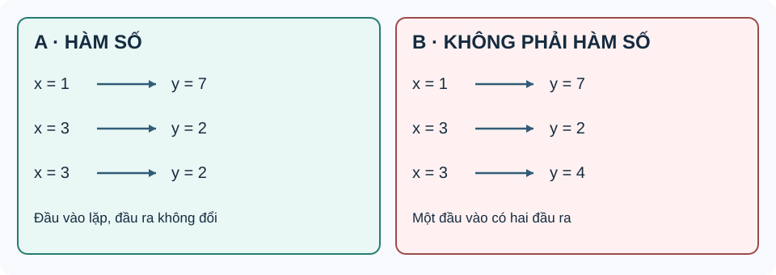

# Bài 15. Hàm số

TOÁN 10 · CHƯƠNG VI · BÀI 15

Hàm số: khái niệm, tập xác định, tập giá trị, đồ thị và cách nhận biết tính đồng biến, nghịch biến.

=== "Khám phá kiến thức"

    ### 1.1. Vì sao cần học hàm số?

    Một máy nhận mã sản phẩm và trả ra giá bán tương ứng. Nếu cùng một mã, trong cùng điều kiện, mà máy lại cho hai giá khác nhau thì quy tắc ấy không xác định một kết quả rõ ràng. **Hàm số** cũng yêu cầu mỗi đầu vào thuộc miền được phép phải có **đúng một đầu ra**.

    Muốn đọc hàm số, hãy phân biệt ba điều: những giá trị \(x\) **được phép nhập**, quy tắc tìm \(y\), và các điểm \((x,y)\) trên **đồ thị**. Một điểm vẽ được trong mặt phẳng chưa chắc thuộc đồ thị; tọa độ của nó phải thỏa đồng thời tập xác định và quy tắc.

    Khi muốn biết hàm tăng hay giảm, hãy quan sát đồ thị **trong cùng một khoảng** từ trái sang phải. Không so hai điểm ở hai nhánh khác nhau rồi kết luận cả hàm đồng biến.

    ### 1.2. Tự khám phá năm tình huống

    #### 1.2.1. Một đầu vào phải có một kết quả

    Trong một ứng dụng dự báo nhiệt độ, cùng một thời điểm không thể đồng thời được gán hai nhiệt độ khác nhau trong *cùng một mô hình xác định*. Vì vậy ta cần nhận ra khi nào mối liên hệ có thể gọi là hàm số.

    Khi đọc bảng giá trị, hãy nhớ ý nghĩa của cặp có thứ tự \((x;y)\) và phân biệt “một giá trị \(x\) xuất hiện hai dòng” với “một giá trị \(x\) có hai đầu ra **khác nhau**”. Nhờ phân biệt cặp có thứ tự và giá trị đầu vào, em có thể kiểm điều kiện hàm số theo từng \(x\), thay vì chỉ đếm số dòng của bảng.

    Một quy tắc là hàm số trên tập \(D\) nếu mỗi đầu vào \(x\in D\) có **đúng một** giá trị đầu ra \(y\). Hai dòng trùng hệt \((x;y)\) không phá điều kiện; nhưng \((x;y_1)\) và \((x;y_2)\) với \(y_1\ne y_2\) thì phá. Sau trực giác ấy mới dùng kí hiệu \(y=f(x)\).

    **Em vận dụng.** Bảng A gồm \((1;7),(3;2),(3;2)\); bảng B gồm \((1;7),(3;2),(3;4)\). Bảng nào biểu diễn hàm số \(y\) theo \(x\), vì sao?

    

    ??? question "Đối chiếu"

        

<strong>Đáp án:</strong> A là hàm số trên \(D=\{1,3\}\); B không là hàm số \(y\) theo \(x\).

<strong>Vì sao:</strong> Trong A, \(x=3\) lặp hai lần nhưng luôn cho \(y=2\). Trong B, cùng \(x=3\) cho cả \(y=2\) và \(y=4\), vi phạm tính đơn trị.

Đây là câu tự luyện công khai, không chấm điểm thành thạo. Nếu chưa đúng, mở hướng dẫn tự sửa phía dưới.

    

    ??? tip "Kiểm lỗi"

        1. **Dấu hiệu sai:** Thấy bảng A có hai dòng \((3;2)\), vội kết luận “không là hàm số vì \(x=3\) xuất hiện hai lần”.
        2. **Vì sao sai?** Điều kiện của hàm số là **mỗi \(x\) có đúng một giá trị \(y\)**, chứ không phải mỗi \(x\) chỉ được ghi một dòng. Trong A, \(x=3\) luôn cho \(y=2\), nên không mâu thuẫn. Trong bảng B, \(x=3\) cho cả \(2\) lẫn \(4\), mới vi phạm.
        3. **Tự kiểm:** Khoanh mọi dòng có cùng \(x\). Nếu chúng có **hai \(y\) khác nhau**, bảng không biểu diễn \(y=f(x)\); nếu các \(y\) trùng nhau, vẫn thỏa điều kiện đơn trị.
        4. **Sửa lại:** Nêu bằng lời vì sao bảng A là hàm số trên \(D=\{1;3\}\) nhưng bảng B không phải.
        5. **Tập tiếp:** [Core/Luyện tập C01](luyen-tap.md?item=THPT-G10-B15-C01). Giải thích trước khi mở đối chiếu; không nhân bản câu đã xem làm bài kiểm tra độc lập.
    #### 1.2.2. Tập xác định và tập giá trị không giống nhau

    Máy tính không thể lấy căn bậc hai của số âm trong tập số thực; muốn nhập \(x\) hợp lệ, ta phải biết miền **đầu vào**. Nhưng các kết quả **đầu ra** mà máy cho được có thể là tập khác.

    Với căn bậc hai trong tập số thực, biểu thức \(\sqrt t\) chỉ có nghĩa khi \(t\ge0\), và khi ấy \(\sqrt t\ge0\). Em cũng sẽ dùng kiến thức giải bất phương trình bậc nhất. Điều kiện dưới dấu căn giúp tìm \(D\), nhưng muốn tìm \(T\) còn phải xem đầu ra có thể nhận những giá trị nào.

    Tập xác định \(D\) là những \(x\) **được phép thay vào** biểu thức; tập giá trị \(T\) gồm mọi \(y\) thực sự **đạt được** sau khi thay \(x\in D\). Ví dụ căn thức vừa giới hạn đầu vào, vừa làm mọi đầu ra không âm; không lấy \(D=T\) chỉ vì có cùng kí hiệu tập.

    Chẳng hạn, với \(f(x)=\sqrt{x-1}\), căn thức xác định khi \(x-1\ge0\), tức \(D=[1;+\infty)\). Đồng thời \(f(x)\ge0\) và mọi giá trị không âm đều nhận được; do đó \(T=[0;+\infty)\).

    Với \(g(x)=\frac{x+1}{x-2}\), mẫu số phải khác \(0\), nên \(D=\mathbb{R}\setminus\{2\}\). Viết \(g(x)=1+\frac{3}{x-2}\), suy ra giá trị \(1\) không đạt được, còn mọi giá trị khác \(1\) đều đạt được; vậy \(T=\mathbb{R}\setminus\{1\}\).

    **Em vận dụng.** Với \(f(x)=\sqrt{x-2}\), hãy tìm tập xác định \(D\) và tập giá trị \(T\).

    

    ??? question "Đối chiếu"

        

<strong>Đáp án:</strong> \(D=[2;+\infty)\), còn \(T=[0;+\infty)\).

<strong>Vì sao:</strong> \(x-2\ge0\Rightarrow x\ge2\). Căn luôn không âm, bằng 0 khi x=2; với mọi y≥0, lấy x=y²+2 được f(x)=y.

Đây là câu tự luyện công khai, không chấm điểm thành thạo. Nếu chưa đúng, mở hướng dẫn tự sửa phía dưới.

    

    ??? tip "Kiểm lỗi"

        1. **Dấu hiệu sai:** Với \(f(x)=\sqrt{x-2}\), viết \(D=T=[2;+\infty)\).
        2. **Vì sao sai?** Điều kiện \(x-2\ge0\) chỉ giới hạn **đầu vào** \(x\ge2\). Đầu ra \(\sqrt{x-2}\) bắt đầu từ \(0\), không phải \(2\).
        3. **Tự kiểm:** Hỏi riêng “nhập được \(x\) nào?” và “nhận được \(y\) nào?”. Thử \(x=2\) thì \(f(2)=0\); số \(0\) thuộc \(T\), nhưng không thuộc \(D\).
        4. **Sửa lại:** \(D=[2;+\infty)\), \(T=[0;+\infty)\). Để chắc mọi \(y\ge0\) đều đạt được, chọn \(x=y^2+2\).
        5. **Tập tiếp:** [Core/Luyện tập C02](luyen-tap.md?item=THPT-G10-B15-C02), sau đó phân biệt miền đầu vào và đầu ra bằng một ví dụ mới.
    #### 1.2.3. Điểm thuộc đồ thị phải thỏa đúng quy tắc

    Một điểm vẽ trên hệ trục có hai tọa độ; để biết nó có thuộc đồ thị của hàm số hay không, ta phải kiểm xem tung độ đúng bằng đầu ra ứng với hoành độ.

    Ôn kí hiệu điểm \((x;y)\), trục Ox biểu diễn x, Oy biểu diễn y và thay số vào biểu thức f(x). Vì thế, khi xét một điểm, em dùng hoành độ để tính \(f(x)\), rồi mới so với tung độ đã cho.

    Đồ thị của \(y=f(x)\) là tập tất cả điểm \((x,f(x))\) với \(x\in D\). Việc điểm nằm “gần” nét đồ thị trên hình in không đủ chứng minh: cần thử \(y=f(x)\) với đúng hoành độ của điểm.

    **Em vận dụng.** Với \(f(x)=x^2-1\) trên \(\mathbb R\), xét hai điểm \(A(-2;3)\) và \(B(2;5)\). Điểm nào thuộc đồ thị? Hãy chứng minh bằng cách tính giá trị hàm số.

    

    ??? question "Đối chiếu"

        

<strong>Đáp án:</strong> Chỉ \(A(-2;3)\) thuộc đồ thị; B không thuộc.

<strong>Vì sao:</strong> \(f(-2)=(-2)^2-1=3\) khớp tung độ A; \(f(2)=3\ne5\) nên B không thuộc đồ thị.

Đây là câu tự luyện công khai, không chấm điểm thành thạo. Nếu chưa đúng, mở hướng dẫn tự sửa phía dưới.

    

    ??? tip "Kiểm lỗi"

        1. **Dấu hiệu sai:** Nhìn điểm \(B(2;5)\) nằm gần đường cong \(y=x^2-1\), rồi kết luận \(B\) thuộc đồ thị.
        2. **Vì sao sai?** Hoành độ \(x=2\) cho tung độ đúng bằng \(f(2)=2^2-1=3\), **không phải \(5\)**. Khoảng cách trên hình không chứng minh được quan hệ \(y=f(x)\).
        3. **Tự kiểm:** Trước khi thay số phải xác định hoành độ nằm trong \(D\). Sau đó tính \(f(x_0)\) và so **chính xác** với tung độ \(y_0\).
        4. **Sửa lại:** \(A(-2;3)\) thuộc đồ thị vì \(f(-2)=3\). \(B(2;5)\) không thuộc vì \(f(2)=3\ne5\). Với phân thức \(1/(x-2)\), \(x=2\) còn bị loại từ đầu.
        5. **Tập tiếp:** Trở lại §2.2 và ví dụ 3.1, tự xét một điểm thỏa và một điểm không thỏa, không xem lời giải trước.
    #### 1.2.4. Hàm từng đoạn cần đọc đúng ranh giới và đơn vị

    Một dịch vụ gửi hàng thu phí cơ bản cho 2 km đầu và thu thêm theo mỗi km tiếp theo; cùng đầu vào vẫn phải được tính đúng một mức phí, kể cả ngay ranh giới 2 km.

    Khi tính phí theo quãng đường, hãy chú ý mốc \(x\le2\) và \(x>2\), đơn vị kilomet, nghìn đồng và giá trị hàm số tại quãng đường đang xét. Tại đúng ranh giới, dấu bằng quyết định công thức được chọn; chỉ sau đó mới tính phí và kiểm đơn vị.

    Hàm từng đoạn dùng **những công thức khác nhau trên những miền không chồng mâu thuẫn**. Giá trị tại x=2 phải theo nhánh chứa dấu bằng; chọn nhầm là sai quy tắc và có thể cho kết quả sai. Đôi khi hai công thức tình cờ cho cùng một giá trị tại biên; điều đó không làm cách chọn nhánh sai trở thành đúng.

    Chẳng hạn, một dịch vụ giao hàng giả định tính phí \(C(x)\), đơn vị *nghìn đồng*, theo quãng đường \(x\) (km):

    \[
    C(x)=
    \begin{cases}
    8x,&0\le x\le2,\\
    16+6(x-2),&x>2.
    \end{cases}
    \]

    Với công thức này, \(C(1)=8\) (nghìn đồng), \(C(2)=16\) và \(C(3)=22\). Hai công thức dùng trên **hai khoảng khác nhau**, nhưng mỗi quãng đường \(x\ge0\) vẫn có **duy nhất một** mức phí. Tập xác định thực tế là \(D=[0;+\infty)\); tại \(x=2\) phải dùng nhánh \(0\le x\le2\), còn nhánh kia chỉ dùng khi \(x>2\). Để vẽ đồ thị, ta vẽ đoạn thẳng \(y=8x\) trên \([0;2]\) và tia thẳng \(y=6x+4\) trên \((2;+\infty)\); hai phần gặp nhau tại \((2;16)\).

    Mô hình tính phí này là **ví dụ do dự án tự biên soạn**, không sao chép biểu giá trong SGK và không đại diện cho giá giao hàng thực tế. Đây là một ví dụ về cách biểu diễn phụ thuộc bằng công thức trên từng miền.

    **Em vận dụng.** Một dịch vụ tính \(C(x)=12\) (nghìn đồng) nếu \(0\le x\le3\), và \(C(x)=12+4(x-3)\) nếu \(x>3\). Tính \(C(3)\) và \(C(5)\) (nghìn đồng).

    

    ??? question "Đối chiếu"

        

<strong>Đáp án:</strong> \(C(3)=12\); \(C(5)=12+4(5-3)=20\) (nghìn đồng).

<strong>Vì sao:</strong> x=3 dùng nhánh thứ nhất vì có dấu bằng. x=5 dùng nhánh thứ hai, quãng đường vượt 3 km là 2 km.

Đây là câu tự luyện công khai, không chấm điểm thành thạo. Nếu chưa đúng, mở hướng dẫn tự sửa phía dưới.

    

    ??? tip "Kiểm lỗi"

        1. **Dấu hiệu sai:** Với mô hình \(C(x)=12\) khi \(0\le x\le3\), \(C(x)=12+4(x-3)\) khi \(x>3\), áp nhánh \(x>3\) cho \(x=3\), hoặc tính \(C(5)=12+4\cdot5=32\).
        2. **Vì sao sai?** Số \(3\) thuộc nhánh **có dấu bằng**. Phần phí tăng thêm chỉ tính cho **\(x-3\)** km vượt ngưỡng. Đặc biệt, dùng nhầm nhánh tại \(x=3\) tình cờ cũng cho \(12\): **đúng số không chứng minh đúng phương pháp**.
        3. **Tự kiểm:** Đánh dấu từng miền lên trục số, thử riêng \(x=3\) và một \(x>3\); kiểm đơn vị \(x\) là km, \(C(x)\) là nghìn đồng.
        4. **Sửa lại:** \(C(3)=12\) (nhánh thứ nhất), \(C(5)=12+4(5-3)=20\) nghìn đồng (nhánh thứ hai).
        5. **Tập tiếp:** [Core/Luyện tập P02](luyen-tap.md?item=THPT-G10-B15-P02). Nói rõ nhánh nào được chọn **trước** khi tính.
    #### 1.2.5. Đồng biến phải xét trên đúng khoảng

    Nếu quãng đường theo thời gian chỉ tăng, ta gọi đại lượng đồng biến; nhưng có những đại lượng trước tăng sau giảm. Vậy không thể gắn nhãn tăng/giảm cho cả hàm chỉ bằng nhìn hai điểm bất kì.

    Biết so sánh hai số \(x_1<x_2\), bất đẳng thức và ý nghĩa đầu vào/đầu ra. Để kết luận trên cả khoảng, ta cần một lập luận cho mọi cặp \(x_1<x_2\) trong khoảng, không chỉ dựa vào hai điểm trên hình.

    Trên một khoảng \(K\), đồng biến nghĩa là \(x_1<x_2\) trong K kéo theo \(f(x_1)<f(x_2)\). Nếu \(f(x_1)>f(x_2)\) thì nghịch biến. Khái niệm phụ thuộc vào **khoảng đang xét**, không phải tính chất tuyệt đối của mọi hàm trên \(\mathbb R\).

    **Em vận dụng.** Với \(f(x)=3x+2\) trên \([-1;2]\), nếu \(x_1<x_2\) thì \(f(x_1)\) so với \(f(x_2)\) thế nào? Hàm đồng hay nghịch biến trên khoảng này?

    

    ??? question "Đối chiếu"

        

<strong>Đáp án:</strong> \(f(x_2)-f(x_1)=3(x_2-x_1)&gt;0\); đồng biến trên \([-1;2]\).

<strong>Vì sao:</strong> Hệ số 3 dương nên khi x tăng thì giá trị f(x) tăng. Lập luận áp dụng mọi cặp x1&lt;x2 trong khoảng, không chỉ một bảng nhỏ.

Đây là câu tự luyện công khai, không chấm điểm thành thạo. Nếu chưa đúng, mở hướng dẫn tự sửa phía dưới.

    

    ??? tip "Kiểm lỗi"

        1. **Dấu hiệu sai:** Thấy \(f(0)<f(1)\) rồi kết luận ngay “hàm đồng biến trên mọi \(x\)” mà không nêu khoảng đang xét hoặc chưa kiểm các cặp khác.
        2. **Vì sao sai?** Định nghĩa trên khoảng \(K\) đòi hỏi **mọi** cặp \(x_1<x_2\) trong \(K\). Ví dụ \(g(x)=x^2\) giảm trước \(0\) và tăng sau \(0\); một cặp có giá trị tăng không đủ suy ra đơn điệu trên \(\mathbb R\).
        3. **Tự kiểm:** Viết rõ \(K\), chọn \(x_1<x_2\) **bất kì** cùng thuộc \(K\), xét dấu \(f(x_2)-f(x_1)\). Không đảo dấu khi trừ hai giá trị.
        4. **Sửa lại:** Với \(f(x)=3x+2\) trên \([-1;2]\), \(f(x_2)-f(x_1)=3(x_2-x_1)>0\) cho mọi \(x_1<x_2\), nên đồng biến trên khoảng đang xét.
        5. **Tập tiếp:** [Core/Luyện tập P03](luyen-tap.md?item=THPT-G10-B15-P03). Tự giải thích dấu hiệu số học trước khi mở đáp án.
    ### 1.3. Kiến thức tiền đề và mục tiêu

    **Em cần nhớ trước khi học:** Cặp có thứ tự \((x;y)\), trục hoành/trục tung, so sánh hai số, bất phương trình bậc nhất, điều kiện căn bậc hai không âm và mẫu số khác 0.

    **Thuật ngữ:** Hàm số, tập xác định, tập giá trị, biến độc lập/phụ thuộc, đồ thị, đồng biến, nghịch biến và hàm từng đoạn.

    **Sau bài học, em cần làm được:** Kiểm điều kiện đầu vào; xác nhận điểm thuộc đồ thị; đọc bảng/đồ thị, khoảng tăng/giảm và ranh giới hàm từng đoạn.

=== "Kiến thức SGK"

    Trong phần Khám phá, em đã thấy rằng một đầu vào hợp lệ chỉ được cho một đầu ra. Bây giờ ta phát biểu chính xác điều kiện đó, rồi dùng nó để đọc miền xác định, đồ thị và sự biến thiên. **Hãy đọc định nghĩa trước, sau đó xem ví dụ và cách kiểm tra.**

    ### 2.1. Khái niệm hàm số

    <figure class="thpt-r4-plot thpt-r4-probability-figure thpt-r4-concept-figure"><figcaption>Đọc từng đầu vào: lặp đúng cùng một giá trị khác với hai đầu ra mâu thuẫn.</figcaption></figure>

    **Cách đọc hình.** Lần theo mũi tên xuất phát từ từng giá trị đầu vào: mỗi đầu vào phải có **đúng một** đầu ra. Nhiều đầu vào có thể cùng dẫn đến một đầu ra; điều đó không làm mất tính chất hàm số.

    
<strong>Định nghĩa — Hàm số:</strong> Cho tập hợp \(D\) gồm các giá trị của \(x\). Nếu với <strong>mỗi</strong> \(x\in D\) xác định <strong>duy nhất một</strong> số thực \(y\), ta nói \(y\) là một hàm số của \(x\) trên \(D\), kí hiệu \(y=f(x)\). \(x\) là biến độc lập và \(y\) là biến phụ thuộc.

    
<strong>Khái niệm — Tập xác định và tập giá trị:</strong> \(D\) là tập các giá trị đầu vào \(x\) mà hàm số được xác định; \(f(x)\) là giá trị đầu ra tại \(x\in D\). <strong>Tập giá trị</strong> \(T=\{f(x)\mid x\in D\}\) gồm các giá trị đầu ra thật sự đạt được. Không được đồng nhất \(D\) với \(T\) chỉ vì chúng đều là tập số.

    Một bảng vẫn có thể biểu diễn hàm số khi cùng một dòng \((x;y)\) được ghi lặp lại. Chẳng hạn \((1;3),(2;4),(2;4)\) mô tả hàm số trên \(D=\{1;2\}\). Trái lại, đổi dòng cuối thành \((2;5)\) thì cùng đầu vào \(x=2\) cho hai đầu ra khác nhau, nên **không** phải hàm số của \(x\).

    Khi hàm số được cho bởi công thức, cần xác định \(D\) trước khi tính \(f(x)\). Ví dụ \(f(x)=\sqrt{x-1}\) có \(D=[1;+\infty)\) vì \(x-1\ge0\). Mọi giá trị hàm số đều không âm và với mỗi \(y\ge0\), chọn \(x=y^2+1\) sẽ được \(f(x)=y\). Do đó \(T=[0;+\infty)\). Việc chứng minh \(T\) đòi hỏi xét **giá trị đầu ra đạt được**, không chỉ xét biểu thức dưới căn.

    ### 2.2. Đồ thị của hàm số

    
<strong>Định nghĩa — Đồ thị của hàm số:</strong> Đồ thị của \(y=f(x)\) trên tập xác định \(D\) là tập hợp <strong>tất cả</strong> điểm \(M(x;f(x))\) với \(x\in D\). Hoành độ biểu diễn đầu vào, còn tung độ là giá trị hàm số tương ứng.

    
<strong>Quy tắc — Kiểm tra điểm thuộc đồ thị:</strong> Điểm \(A(x_0;y_0)\) thuộc đồ thị của \(y=f(x)\) <strong>khi và chỉ khi</strong> (1) \(x_0\in D\) và (2) \(y_0=f(x_0)\). Phải kiểm cả điều kiện đầu vào và giá trị đầu ra; hình vẽ chỉ giúp quan sát, không thay thế hai phép kiểm này.

    **Ví dụ đọc tọa độ.** Với \(y=2x+1\) xác định trên \(\mathbb R\), \(A(2;5)\) thuộc đồ thị vì \(2\cdot2+1=5\), còn \(B(2;4)\) không thuộc vì \(4\ne5\).

    **Cách kiểm tra trên đồ thị:** Nếu đường thẳng đứng \(x=x_0\) cắt một đường biểu diễn ở hai điểm có tung độ khác nhau, đường đó không phải đồ thị của một hàm số \(y=f(x)\) tại \(x_0\). Đây là cách kiểm tra chung, không phải lời hướng dẫn đọc hình minh họa phía trên.

    #### 2.2.1. Đọc hàm số qua bảng và đồ thị

    Hàm số không nhất thiết phải được cho bằng một công thức. Bảng giá trị và đồ thị cũng thể hiện quan hệ đầu vào – đầu ra. **Khi chỉ có số liệu đo ở một số thời điểm, không được tự suy ra các thời điểm chưa đo.**

    **Ví dụ bổ sung — Bảng giá trị.** Một trạm quan sát ghi nhiệt độ tại ba thời điểm:

    
<table class="thpt-g10-knowledge-table">
    <thead><tr><th>Thời điểm \(t\) (giờ)</th><th>6</th><th>12</th><th>18</th></tr></thead>
    <tbody><tr><td>Nhiệt độ \(T(t)\) (\(^\circ\mathrm C\))</td><td>19</td><td>25</td><td>21</td></tr></tbody>
    </table>

    Với **dữ liệu chỉ gồm ba thời điểm đã cho**, \(D=\{6;12;18\}\) và \(T=\{19;21;25\}\). Ta biết \(T(12)=25\), nhưng **chưa xác định được \(T(9)\)** nếu không có thêm số liệu hay mô hình dự đoán. Mỗi giá trị nhiệt độ chỉ liệt kê một lần trong tập giá trị, kể cả khi xuất hiện ở nhiều thời điểm.

    ### 2.3. Sự đồng biến, nghịch biến của hàm số

    Trên đồ thị, em có thể nhận xét đường đi lên hay đi xuống khi đọc từ trái sang phải. Để kết luận **trên cả một khoảng**, không thể chỉ thử một cặp điểm: cần phát biểu quan hệ đúng với **mọi cặp** đầu vào khác nhau trong khoảng đó.

    
<strong>Định nghĩa — Đồng biến, nghịch biến:</strong> Cho hàm số \(y=f(x)\) xác định trên một khoảng \(K\). Với <strong>mọi</strong> \(x_1,x_2\in K\), \(x_1&lt;x_2\): hàm số <strong>đồng biến</strong> trên \(K\) nếu \(f(x_1)&lt;f(x_2)\); <strong>nghịch biến</strong> trên \(K\) nếu \(f(x_1)&gt;f(x_2)\). Tính chất phải được xét trên đúng khoảng \(K\), không suy rộng tùy ý ra toàn tập xác định.

    
<table class="thpt-g10-knowledge-table">
    <thead><tr><th>Tính chất</th><th>Điều kiện với mọi \(x_1&lt;x_2\) trong \(K\)</th><th>Đọc từ trái qua phải</th></tr></thead>
    <tbody><tr><td><strong>Đồng biến</strong></td><td>\(f(x_1)&lt;f(x_2)\)</td><td>Đồ thị đi lên</td></tr>
    <tr><td><strong>Nghịch biến</strong></td><td>\(f(x_1)&gt;f(x_2)\)</td><td>Đồ thị đi xuống</td></tr></tbody>
    </table>

    **Ví dụ đối chiếu.** Với \(f(x)=x^2\), hàm số nghịch biến trên \((-\infty;0)\) và đồng biến trên \((0;+\infty)\), **không** đồng biến hay nghịch biến trên toàn \(\mathbb R\). Với mô hình quãng đường \(s(t)=12t\) (km), \(t\ge0\) (giờ), nếu \(t_1&lt;t_2\) thì \(s(t_2)-s(t_1)=12(t_2-t_1)>0\); vì vậy mô hình đồng biến trên miền thời gian \(t\ge0\).

=== "Ví dụ"

    Hãy đọc đề và **tự xác định điều kiện trước khi xem lời giải**. Mỗi ví dụ dưới đây minh họa một kiểu suy luận khác nhau: xét miền hợp lệ, tìm các giá trị đạt được, chọn nhánh đúng và chứng minh tính đơn điệu trên một khoảng.

    ### 3.1. Ví dụ 1 — Kiểm tập xác định trước khi xét điểm trên đồ thị

    **Đề:** Xét \(f(x)=\dfrac1{x-2}\). Tìm tập xác định; xét hai điểm \(M(3;1)\) và \(N(2;0)\) có thuộc đồ thị hay không.

    **Phân tích:** Quy tắc là một phân thức, nên trước khi thay bất kì tọa độ nào phải loại giá trị làm mẫu bằng \(0\). Điểm thuộc đồ thị cần thỏa **cả** \(x\in D\) và \(y=f(x)\).

    **Lời giải.**

    **Bước 1 — Xác định miền hợp lệ:** \(x-2\ne0\iff x\ne2\). Vì vậy \(D=\mathbb R\setminus\{2\}\).

    **Bước 2 — Kiểm điểm M:** \(3\in D\), \(f(3)=1/(3-2)=1\), đúng bằng tung độ, nên \(M(3;1)\) thuộc đồ thị.

    **Bước 3 — Kiểm điểm N:** \(2\notin D\). Do đó \(N(2;0)\) không thuộc đồ thị; không được tính \(f(2)\) vì mẫu bằng \(0\).

    **Kiểm lại:** Hoành độ hợp lệ là điều kiện bắt buộc trước khi so tung độ. Không được xem một điểm “đã vẽ trên hệ trục” là tự động nằm trên đồ thị.

    ### 3.2. Ví dụ 2 — Phân biệt miền đầu vào và tập đầu ra

    **Đề:** Cho \(g(x)=\sqrt{x+3}\) trên tập số thực. Xác định tập xác định \(D\) và tập giá trị \(T\).

    **Phân tích:** Điều kiện của căn bậc hai xác định \(D\). Để tìm \(T\), ngoài việc biết \(g(x)\ge0\), còn phải chứng minh **mọi** giá trị không âm đều có thể đạt được.

    **Lời giải.**

    **Bước 1 — Tập xác định:** \(x+3\ge0\iff x\ge-3\), nên \(D=[-3;+\infty)\).

    **Bước 2 — Chặn tập giá trị:** Vì căn bậc hai không âm, \(g(x)\ge0\). Giá trị nhỏ nhất \(0\) đạt tại \(x=-3\).

    **Bước 3 — Chứng minh mọi đầu ra:** Với \(y\ge0\) bất kì, chọn \(x=y^2-3\ge-3\); khi đó \(g(x)=\sqrt{y^2}=y\). Vậy \(T=[0;+\infty)\).

    **Kiểm lại:** \(D\) bắt đầu từ \(-3\), còn \(T\) bắt đầu từ \(0\). Không chép \(D\) sang \(T\); cần xét những \(y\) **thực sự nhận được**.

    ### 3.3. Ví dụ 3 — Chọn nhánh và tính đúng phần vượt ngưỡng

    **Đề:** Một mô hình phí vận chuyển giả định (đơn vị nghìn đồng) cho quãng đường \(x\ge0\) km như sau: \(P(x)=10\) nếu \(0\le x\le2\); \(P(x)=10+5(x-2)\) nếu \(x>2\). Tính \(P(2)\) và \(P(4)\).

    **Phân tích:** Tại điểm biên \(x=2\) phải chọn nhánh chứa dấu bằng. Trên \(2\) km, phần tăng thêm tính theo số km **vượt quá 2**, không phải toàn quãng đường.

    **Lời giải.**

    **Bước 1 — Tại ranh giới:** \(2\in[0;2]\), nên dùng nhánh thứ nhất: \(P(2)=10\) nghìn đồng.

    **Bước 2 — Vượt ranh giới:** \(4>2\), nên \(P(4)=10+5(4-2)=20\) nghìn đồng.

    **Bước 3 — Đối chiếu mô hình:** Phần tăng thêm là \(2\) km, nhân với \(5\) nghìn đồng/km được \(10\) nghìn đồng; cộng mức cơ bản \(10\) bằng \(20\).

    **Kiểm lại:** Hai miền không chồng nhau và bao phủ \(x\ge0\), nên mỗi quãng đường nhận đúng một mức phí. Đây chỉ là **mô hình giả định**, không phải biểu giá thực tế hay dữ liệu SGK.

    ### 3.4. Ví dụ 4 — Chứng minh nghịch biến bằng hai đầu vào bất kì

    **Đề:** Xét \(h(x)=5-2x\) trên \(\mathbb R\). Hãy chứng minh hàm số nghịch biến trên \(\mathbb R\).

    **Phân tích:** Hai giá trị thử riêng lẻ không thể chứng minh tính đơn điệu trên **mọi** \(x\). Cần chọn \(x_1<x_2\) bất kì rồi xét dấu \(h(x_2)-h(x_1)\).

    **Lời giải.**

    **Bước 1 — Lấy hai số bất kì:** Cho \(x_1,x_2\in\mathbb R\), \(x_1&lt;x_2\), suy ra \(x_2-x_1>0\).

    **Bước 2 — So giá trị hàm số:** \(h(x_2)-h(x_1)=[5-2x_2]-[5-2x_1]=-2(x_2-x_1)&lt;0\).

    **Bước 3 — Kết luận:** \(h(x_2)&lt;h(x_1)\) với mọi \(x_1&lt;x_2\). Theo định nghĩa, \(h\) nghịch biến trên \(\mathbb R\).

    **Kiểm lại:** Cách chứng minh dùng mọi cặp đầu vào, không cần đạo hàm. Nếu thay \(-2\) bằng hệ số dương, dấu của hiệu sẽ đảo chiều và hàm đồng biến.

    **Tự luyện thêm.** Ba câu dưới đây là bài em tự làm sau khi xem ví dụ; chỉ mở lời giải khi đã thử xong.

    1. Tìm tập xác định của \(h(x)=\sqrt{5-2x}\).
    2. Với \(p(x)=x^2-4\), hãy kiểm tra điểm \(A(3;5)\) có thuộc đồ thị hay không.
    3. Hàm \(q(x)=-3x+7\) đồng biến hay nghịch biến trên \(\mathbb{R}\)? Giải thích theo định nghĩa.

    ??? question "Xem lời giải ba câu tự luyện"

        <ol><li>\(5-2x\ge0\iff x\le\frac52\). Vậy \(D=(-\infty;\frac52]\).</li>
        <li>\(p(3)=9-4=5\), do đó \(A(3;5)\) thuộc đồ thị.</li>
        <li>Nếu \(x_1&lt;x_2\) thì \(q(x_1)-q(x_2)=-3(x_1-x_2)&gt;0\); hàm nghịch biến trên \(\mathbb{R}\).</li></ol>

=== "Lỗi thường gặp"

    **Học tiếp:** [Core và Luyện tập](luyen-tap.md) · [Tự kiểm tra cuối chương](tu-kiem-tra-chuong.md).

    
Nguồn toán học: SGK Toán 10 Kết nối tri thức với cuộc sống và học liệu SLM hiện hành. Lời giảng được biên tập nhằm hỗ trợ tự học độc lập.

