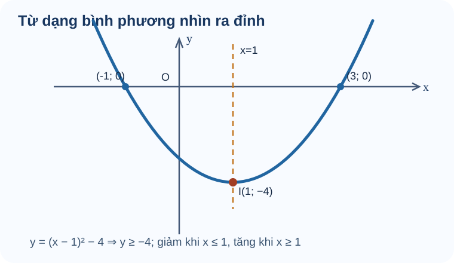

# Bài 16. Hàm số bậc hai

TOÁN 10 · CHƯƠNG VI · BÀI 16

Khám phá hàm số bậc hai qua đồ thị parabol, đỉnh, trục đối xứng, bảng biến thiên và các bài toán thực tế.

=== "Khám phá kiến thức"

    ### Cùng tìm hiểu

    Quỹ đạo một quả bóng có thể đi lên, đạt độ cao lớn nhất rồi đi xuống. Đồ thị dạng **parabol** giúp mô tả quan hệ như thế. Trước khi nhớ công thức đỉnh, em thử nhìn \(y=(x-1)^2-4\). Bình phương không âm nên \(y\ge-4\), và dấu bằng xảy ra tại \(x=1\). Vậy chính biểu thức đã chỉ ra **đỉnh \(I(1,-4)\)**, trục đối xứng \(x=1\) và giá trị nhỏ nhất \(-4\).

    Nếu hệ số của bình phương đổi thành âm, parabol mở xuống và đỉnh cho giá trị lớn nhất. Khi áp dụng vào độ cao hoặc thời gian, luôn kiểm điều kiện thực tế: đỉnh có nằm trong khoảng đang xét hay không. Như vậy, toán học không chỉ cho một con số mà còn cho biết **con số đó có phù hợp tình huống không**.

    ### Thuật ngữ, kiến thức và kỹ năng

    **Thuật ngữ:** Hàm số bậc hai (a
    e0), parabol, đỉnh, trục đối xứng, khoảng tăng/giảm, cực trị và tập giá trị.

    **Sau bài học, em cần làm được:** Tìm đỉnh/trục và khoảng biến thiên; kiểm đồ thị bằng điểm phù hợp; tìm nghiệm và ứng dụng cực trị có điều kiện.

=== "Kiến thức SGK"

    **Cách đọc hình.** Quan sát nhãn, hướng và vị trí trên hình; đối chiếu từng chi tiết với khái niệm đang học.

    <figure class="thpt-r4-plot thpt-r4-concept-figure"><figcaption>Hình do SLM vẽ cho \(y=(x-1)^2-4\). Đỉnh \(I(1,-4)\) và trục \(x=1\) giúp đọc các khoảng tăng, giảm. Không dùng bộ tọa độ này cho mọi parabol.</figcaption></figure>

    ### Bậc hai cần hệ số bậc hai thực sự khác 0

    Quỹ đạo phóng vật có thể uốn cong thành hình parabol, khác đường thẳng. Không phải cứ biểu thức viết có \(x^2\) thì chắc chắn là hàm bậc hai nếu hệ số x² bằng 0.

    Đã biết hàm số, biểu thức đại số và bậc của đa thức sau rút gọn; biết \(x^2\) là bình phương x. Em có thể học các kiến thức tiền đề ngay trong bài.

    Một hàm bậc hai có phần thay đổi theo \(x^2\) **không mất đi**: \(y=ax^2+bx+c\) với \(a\ne0\). Nếu \(a=0\), quy tắc chỉ còn bậc nhất hoặc hằng, và các kết luận về parabol không còn đúng.

    **Vì sao chọn phương pháp này?** Rút gọn biểu thức và kiểm hệ số của x² trước khi dùng công thức đỉnh, trục hoặc biệt thức; không chia cho 2a nếu a=0.

    **Em vận dụng.** Trong \(f(x)=0x^2+2x+1\) và \(g(x)=-x^2+2x+1\), hàm nào là hàm số bậc hai?

    

    ??? question "Em đã tự thử? Mở đáp án để đối chiếu"

        

<strong>Đáp án:</strong> Chỉ \(g(x)\) là bậc hai (a=−1); \(f(x)=2x+1\) là bậc nhất.

<strong>Vì sao:</strong> Hệ số x² của f bằng 0 nên hạng tử bậc hai biến mất; của g bằng −1 khác 0.

Đây là câu tự luyện công khai, không chấm điểm thành thạo. Nếu chưa đúng, mở hướng dẫn tự sửa phía dưới.

    ### Khái niệm

    Một **hàm số bậc hai** có dạng

    \[
    y=ax^2+bx+c,\qquad a,b,c\in\mathbb{R},\ a\ne 0.
    \]

    Tập xác định là \(\mathbb{R}\). Điều kiện \(a\ne 0\) là bắt buộc; nếu \(a=0\) thì biểu thức không còn là hàm bậc hai.

    ### Đỉnh là điểm đổi chiều tăng/giảm của parabol

    Khi mô hình độ cao có dạng parabol, ta cần biết thời điểm lên cao nhất chứ không muốn thử vô hạn giá trị. Đỉnh chứa vị trí cực trị và trục đối xứng.

    Nhớ bình phương số thực luôn không âm, từ đó \((x-h)^2\ge0\), và hệ số trước bình phương quyết định mở lên/hướng xuống. Em có thể học các kiến thức tiền đề ngay trong bài.

    Viết \(y=a(x-h)^2+k\): vì bình phương nhỏ nhất bằng 0 tại x=h, đỉnh chính là \(I(h;k)\). Dấu a quyết định cực tiểu hay cực đại; đường thẳng x=h đi qua đỉnh và là trục đối xứng.

    **Vì sao chọn phương pháp này?** Ưu tiên hoàn thành bình phương khi cần đỉnh và trục; nếu a=0 thì không phải parabol, nếu a<0 đỉnh là cao nhất chứ không phải thấp nhất.

    **Em vận dụng.** Cho \(f(x)=(x-2)^2-3\). Đỉnh I, trục đối xứng và hướng mở của parabol là gì?

    

    ??? question "Em đã tự thử? Mở đáp án để đối chiếu"

        

<strong>Đáp án:</strong> Đỉnh \(I(2;-3)\), trục \(x=2\), parabol mở lên.

<strong>Vì sao:</strong> Vì hệ số của bình phương là 1&gt;0 và \((x-2)^2\ge0\), giá trị nhỏ nhất −3 nhận tại x=2.

Đây là câu tự luyện công khai, không chấm điểm thành thạo. Nếu chưa đúng, mở hướng dẫn tự sửa phía dưới.

    ### Đồ thị và tính chất

    **Cách đọc hình.** Quan sát đỉnh (1,-4), trục x=1, các giao điểm (-1,0), (3,0); kiểm tính đối xứng của hai nghiệm và chiều mở lên.

    <figure class="thpt-r4-plot" data-thpt-quadratic-plot>
    <svg viewBox="0 0 640 360" role="img" aria-label="Đồ thị y bằng x bình phương trừ 4x cộng 3, đỉnh I(2;−1), trục nét đứt x=2, cắt Ox ở (1;0) và (3;0), cắt Oy ở (0;3)">
    <title>Parabol y = x² − 4x + 3</title>
    <text x="20" y="28">y = x² − 4x + 3 · Đỉnh I(2;−1), nghiệm 1 và 3</text>
    </svg>
    <figcaption>Đồ thị được dựng từ chính hàm số của ví dụ, không phải ảnh trang trí hoặc hình chép từ SGK.</figcaption>
    </figure>

    Đồ thị là một **parabol**. Ta viết dưới dạng đỉnh:

    \[
    y=a(x-h)^2+k,\qquad h=-\frac{b}{2a},\quad k=f(h)=-\frac{\Delta}{4a},\qquad \Delta=b^2-4ac.
    \]

    - Đỉnh \(I(h;k)\), trục đối xứng \(x=h\).

    ### Khoảng tăng/giảm và tập giá trị đến từ hình mở lên/xuống

    Độ cao theo thời gian của một vật có thể tăng tới đỉnh rồi giảm; không thể kết luận hàm này đồng biến trên cả trục số. Biết chiều parabol cho ta suy quy luật biến thiên.

    Biết đỉnh \(I(h;k)\), dấu a và định nghĩa đồng/nghịch biến B15; đọc trục x theo chiều trái sang phải. Em có thể học các kiến thức tiền đề ngay trong bài.

    Nếu a<0, parabol mở xuống nên tăng tới h rồi giảm sau h, giá trị không vượt k. Nếu a>0 thì ngược lại, luôn không nhỏ hơn k. Vì \((x-h)^2\ge0\), đây là chứng minh đại số cho tập giá trị chứ không chỉ nhìn tranh.

    **Vì sao chọn phương pháp này?** Không đảo chiều tăng/giảm khi a âm; đầu mút h có thể nêu bằng dấu ngoặc nhất quán, và khi mô hình thực tế có miền hẹp thì phải xét đúng miền đó.

    **Em vận dụng.** Với \(f(x)=-2(x+1)^2+8\) trên \(\mathbb R\), tìm giá trị lớn nhất, tập giá trị, khoảng đồng biến/nghịch biến.

    

    ??? question "Em đã tự thử? Mở đáp án để đối chiếu"

        

<strong>Đáp án:</strong> GTLN 8 tại x=−1, \(T=(-\infty;8]\); đồng biến trên \((-\infty;-1)\), nghịch biến trên \((-1;+\infty)\).

<strong>Vì sao:</strong> Vì −2(x+1)²≤0. Trục x=−1 là ranh giới đổi chiều, parabol mở xuống; mọi y≤8 đều đạt được.

Đây là câu tự luyện công khai, không chấm điểm thành thạo. Nếu chưa đúng, mở hướng dẫn tự sửa phía dưới.

    - Với \(a>0\): parabol mở lên, hàm giảm trên \(( -\infty;h )\), tăng trên \((h;+\infty)\), đạt **GTNN** \(k\) tại \(x=h\).
    - Với \(a<0\): parabol mở xuống, hàm tăng trên \(( -\infty;h )\), giảm trên \((h;+\infty)\), đạt **GTLN** \(k\) tại \(x=h\).

    **Bảng biến thiên và tập giá trị tổng quát** (đặt \(h=-\frac{b}{2a}\), \(k=-\frac{\Delta}{4a}\)):

    
<table class="thpt-g10-knowledge-table">
    <thead><tr><th>Điều kiện</th><th>Nghịch biến</th><th>Đồng biến</th><th>Cực trị tại \(x=h\)</th><th>Tập giá trị \(T\)</th></tr></thead>
    <tbody>
    <tr><td>\(a&gt;0\)</td><td>\((-\infty;h)\)</td><td>\((h;+\infty)\)</td><td>GTNN \(k\)</td><td>\(\left[-\frac{\Delta}{4a};+\infty\right)\)</td></tr>
    <tr><td>\(a&lt;0\)</td><td>\((h;+\infty)\)</td><td>\((-\infty;h)\)</td><td>GTLN \(k\)</td><td>\(\left(-\infty;-\frac{\Delta}{4a}\right]\)</td></tr>
    </tbody></table>

    ### Vẽ parabol cần các điểm nhất quán, không phỏng đoán

    Hai parabol có cùng hướng mở nhưng đặt lệch vị trí sẽ mô tả các bài toán rất khác nhau. Muốn vẽ đúng, phải có điểm đỉnh, trục và các điểm kiểm chứng.

    Đã biết hệ trục tọa độ, nghiệm của tam thức đơn giản, cách thay x để tính y và tính đối xứng qua đường thẳng đứng. Em có thể học các kiến thức tiền đề ngay trong bài.

    Đồ thị \(y=a(x-h)^2+k\) đối xứng quanh x=h. Vẽ theo thứ tự: (1) đỉnh, (2) trục, (3) giao trục và điểm đối xứng cần thiết, (4) nối đường cong theo dấu a. Không thể nối các điểm bất kỳ thành parabol chuẩn.

    

    ??? question "Em đã tự thử? Mở đáp án để đối chiếu"

        

<strong>Đáp án:</strong> Đỉnh \(I(1;-4)\), trục \(x=1\); giao Ox tại \((-1;0)\) và \((3;0)\); giao Oy \((0;-3)\). Mở lên.

<strong>Vì sao:</strong> Cho y=0: \((x-1)^2=4\Rightarrow x=1\pm2=-1,3\). Thay x=0 được y=1−4=−3. Hai giao Ox đối xứng quanh x=1.

Đây là câu tự luyện công khai, không chấm điểm thành thạo. Nếu chưa đúng, mở hướng dẫn tự sửa phía dưới.

    ### Bốn bước vẽ đồ thị parabol

    1. **Xác định đỉnh** \(I\left(-\frac{b}{2a};-\frac{\Delta}{4a}\right)\).
    2. **Vẽ trục đối xứng** \(x=-\frac{b}{2a}\) và nhận biết chiều mở qua dấu \(a\).
    3. **Xác định các điểm đặc trưng**: giao với \(Oy\) là \((0;c)\); giải \(ax^2+bx+c=0\) để tìm giao với \(Ox\) **nếu có**; có thể lấy thêm một cặp điểm đối xứng qua trục, nhất là khi không có đủ giao điểm.
    4. **Vẽ parabol** đi qua các điểm đã xác định, có đỉnh và trục đối xứng đúng; hai nhánh đối xứng qua trục.

    *Lưu ý:* Nếu \(\Delta<0\), parabol không cắt \(Ox\); nếu \(\Delta=0\), parabol tiếp xúc \(Ox\) tại đỉnh. Không được tự giả định luôn có hai giao điểm.

=== "Ví dụ"

    Trước khi xem lời giải, hãy xác định dữ kiện, điều phải tìm và lý do chọn cách giải. Sau đó kiểm tra lại điều kiện áp dụng và kết quả, thay vì chỉ nhìn phép tính cuối cùng.

    ### Ví dụ — Tìm đỉnh trước khi vẽ

    **Đề bài.** Xét \(f(x)=(x-1)^2-4\). Tìm đỉnh, trục đối xứng, nghiệm và tập giá trị.

    **Vì sao chọn cách này?** Dạng bình phương cho luôn \(f(x)\ge-4\).

    **Giải.** Đỉnh \(I(1,-4)\), trục đối xứng \(x=1\), tập giá trị \([-4,+\infty)\). Giải \((x-1)^2=4\) được \(x=-1\) hoặc \(x=3\). **Kiểm lại:** hai nghiệm đối xứng qua \(x=1\) và đồ thị không xuống dưới \(-4\).

    Xét \(f(x)=x^2-4x+3=(x-2)^2-1\). Do đó:

    - Đỉnh \(I(2;-1)\), trục \(x=2\).
    - Hệ số \(a=1>0\), nên hàm có giá trị nhỏ nhất \(-1\).
    - Khi \(y=0\), ta được \((x-1)(x-3)=0\), vì vậy đồ thị cắt \(Ox\) tại \((1;0)\), \((3;0)\).
    - Khi \(x=0\), ta có \(y=3\), nên đồ thị cắt \(Oy\) tại \((0;3)\).
    - Hàm số nghịch biến trên \((-\infty;2)\), đồng biến trên \((2;+\infty)\) và có tập giá trị \(T=[-1;+\infty)\).

    Áp dụng **bốn bước vẽ**: xác định \(I(2;-1)\) → kẻ trục \(x=2\) → chấm \((1;0)\), \((3;0)\), \((0;3)\) cùng điểm đối xứng \((4;3)\) → nối thành parabol mở lên.

    **Thẻ Core SGK** củng cố hiểu khái niệm sau bài. Cùng một item ID có thể xuất hiện trong Practice cơ bản của chuyên đề dưới vai trò khác, không sao chép đáp án/hồ sơ; Core có gợi ý và không tạo tab lý thuyết thứ hai.

    

    <button type="button" class="thpt-r4-practice-open" data-thpt-open-quiz="b16-core" aria-label="Mở cửa sổ Core Bài 16 · Tọa độ đỉnh">🧩 Luyện Core · Tọa độ đỉnh (THPT-CORE-QF01)</button>
    

    **Tiếp tục rèn luyện:** [Luyện tập và Vận dụng Chương VI](luyen-tap.md) · [Tự kiểm tra cuối Chương VI](tu-kiem-tra-chuong.md).

    ### Cực trị trong mô hình thực tế phải gắn điều kiện

    Một vật bay lên rồi rơi xuống theo mô hình độ cao parabol; giá trị cực đại toán học chỉ có ý nghĩa khi thời điểm đó nằm trong giai đoạn vật còn bay.

    Biết t là thời gian không âm, tính bình phương hoàn chỉnh và đọc đơn vị m, s. Em có thể học các kiến thức tiền đề ngay trong bài.

    Mô hình \(h(t)\) là hàm bậc hai theo t với miền thực tế t≥0 và h≥0 trong giai đoạn bay. Đỉnh cho độ cao tối đa nếu thời điểm đỉnh thuộc miền đó. Không được áp cực trị trên toàn \(\mathbb R\) rồi kết luận cho t âm.

    

    ??? question "Em đã tự thử? Mở đáp án để đối chiếu"

        

<strong>Đáp án:</strong> \(h(t)=-5(t-2)^2+20\), đạt lớn nhất \(20\,\mathrm{m}\) tại \(t=2\,\mathrm{s}\).

<strong>Vì sao:</strong> Vì \(-(t-2)^2\le0\) và 2∈[0;4]. Hai đầu t=0,4 có h=0; đây là mô hình giả định với thời gian không âm.

Đây là câu tự luyện công khai, không chấm điểm thành thạo. Nếu chưa đúng, mở hướng dẫn tự sửa phía dưới.

    

    ??? tip "Gợi ý khắc phục khi chưa làm được — 5 bước"

        <ol><li><strong>Nhận diện lỗi:</strong> Chỉ lấy −b/(2a) mà không kiểm miền thời gian hoặc quên đơn vị.</li>
        <li><strong>Tự chẩn đoán:</strong> Em có đang mắc đúng lỗi này trong lời giải bài vừa thử không? Hãy khoanh bước đầu tiên chuyển từ dữ kiện sang kết luận mà em chưa chứng minh được.</li>
        <li><strong>Kiến thức gốc:</strong> Mô hình \(h(t)\) là hàm bậc hai theo t với miền thực tế t≥0 và h≥0 trong giai đoạn bay. Đỉnh cho độ cao tối đa nếu thời điểm đỉnh thuộc miền đó. Không được áp cực trị trên toàn \(\mathbb R\) rồi kết luận cho t âm.</li>
        <li><strong>Tự sửa:</strong> Viết 0≤t≤4 ngay dưới bài, kiểm t đỉnh có thuộc miền, rồi báo cả giá trị và đơn vị. Chỉ mở lại đáp án ở trên sau khi đã thử giải một lần không xem gợi ý.</li>
        <li><strong>Luyện lại (không nhân bản câu):</strong> Quay lại phần kiến thức liên quan ngay trong bài và thử giải thích phương pháp trước khi xem lại kết quả.</li></ol>

    Hàm số bậc hai có thể biểu diễn diện tích hình chữ nhật khi chu vi được giữ cố định. [Xem bài tự luận mỏ neo mẫu](../../thu-vien/tu-luan.md).

    ### Mở rộng mô hình thực tế từ phần cuối Bài 16

    **Ví dụ bổ sung A — Chuyển động theo phương thẳng đứng.** Bỏ qua sức cản không khí, một vật được ném lên từ mặt đất với vận tốc đầu \(19{,}6\;\text{m/s}\); lấy \(g=9{,}8\;\text{m/s}^2\). Độ cao \(h\) (m) theo thời gian \(t\) (giây) là

    \[
    h(t)=19{,}6t-4{,}9t^2=-4{,}9(t-2)^2+19{,}6.
    \]

    Vì \(t\ge0\) và chỉ xét đến lúc vật trở lại mặt đất, ta có \(0\le t\le4\). Parabol mở xuống; **độ cao lớn nhất** là \(19{,}6\) m tại \(t=2\) giây. Giải \(h(t)=0\) được \(t=0\) (lúc ném) hoặc \(t=4\) (lúc chạm đất).

    *Điều cần nắm:* Các biến phải có **đơn vị và miền ý nghĩa vật lý**; không dùng toàn bộ \(\mathbb R\) làm miền thời gian của chuyển động thực tế.

    **Ví dụ bổ sung B — Doanh thu và giá bán.** Một mô hình giả định số sản phẩm bán được theo giá \(x\) (nghìn đồng/sản phẩm) là \(n(x)=600-10x\), với \(0\le x\le60\). Doanh thu tính bằng nghìn đồng:

    \[
    R(x)=x\,n(x)=600x-10x^2=-10(x-30)^2+9000.
    \]

    Do đó doanh thu lớn nhất theo mô hình là \(9000\) nghìn đồng, tức **9 triệu đồng**, khi giá bán \(x=30\) nghìn đồng/sản phẩm và lượng bán dự kiến \(n(30)=300\) sản phẩm.

    *Điều cần nắm:* Số lượng và đơn giá phải đúng đơn vị; miền \(0\le x\le60\) bảo đảm giá không âm và nhu cầu dự đoán không âm. Đây là một mô hình tuyến tính hóa giả định, không phải dự báo kinh tế thực tế.

    Hai ví dụ củng cố cách tìm giá trị lớn nhất, nhỏ nhất từ dạng đỉnh của parabol. Khi vận dụng mô hình thực tế, cần kiểm tra **điều kiện và đơn vị** của các đại lượng.

=== "Lỗi thường gặp"

    

    ??? tip "Gợi ý khắc phục khi chưa làm được — 5 bước"

        <ol><li><strong>Nhận diện lỗi:</strong> Chỉ nhìn chữ x² trong cách viết mà quên xét hệ số a=0.</li>
        <li><strong>Tự chẩn đoán:</strong> Em có đang mắc đúng lỗi này trong lời giải bài vừa thử không? Hãy khoanh bước đầu tiên chuyển từ dữ kiện sang kết luận mà em chưa chứng minh được.</li>
        <li><strong>Kiến thức gốc:</strong> Một hàm bậc hai có phần thay đổi theo \(x^2\) <strong>không mất đi</strong>: \(y=ax^2+bx+c\) với \(a\ne0\). Nếu \(a=0\), quy tắc chỉ còn bậc nhất hoặc hằng, và các kết luận về parabol không còn đúng.</li>
        <li><strong>Tự sửa:</strong> Thu gọn rồi khoanh hệ số đứng trước x²; nếu bằng 0 không dùng công thức parabol. Chỉ mở lại đáp án ở trên sau khi đã thử giải một lần không xem gợi ý.</li>
        <li><strong>Luyện lại (không nhân bản câu):</strong> Quay lại phần kiến thức liên quan ngay trong bài và thử giải thích phương pháp trước khi xem lại kết quả.</li></ol>

    

    ??? tip "Gợi ý khắc phục khi chưa làm được — 5 bước"

        <ol><li><strong>Nhận diện lỗi:</strong> Đổi nhầm dấu h thành −2, hoặc cho trục đối xứng là y=2.</li>
        <li><strong>Tự chẩn đoán:</strong> Em có đang mắc đúng lỗi này trong lời giải bài vừa thử không? Hãy khoanh bước đầu tiên chuyển từ dữ kiện sang kết luận mà em chưa chứng minh được.</li>
        <li><strong>Kiến thức gốc:</strong> Viết \(y=a(x-h)^2+k\): vì bình phương nhỏ nhất bằng 0 tại x=h, đỉnh chính là \(I(h;k)\). Dấu a quyết định cực tiểu hay cực đại; đường thẳng x=h đi qua đỉnh và là trục đối xứng.</li>
        <li><strong>Tự sửa:</strong> Tìm x làm biểu thức bình phương bằng 0 rồi đọc h và k; kiểm dấu a để xác định hướng mở. Chỉ mở lại đáp án ở trên sau khi đã thử giải một lần không xem gợi ý.</li>
        <li><strong>Luyện lại (không nhân bản câu):</strong> Em có thể <a href="../luyen-tap/?item=THPT-CORE-QF01">luyện lại một câu có sẵn trong Core/Luyện tập</a>, sau đó tự giải thích bằng lời của mình.</li></ol>

    

    ??? tip "Gợi ý khắc phục khi chưa làm được — 5 bước"

        <ol><li><strong>Nhận diện lỗi:</strong> Đọc nhầm đỉnh là GTNN khi a âm, hoặc nhận khoảng tăng và giảm theo chiều từ phải qua trái.</li>
        <li><strong>Tự chẩn đoán:</strong> Em có đang mắc đúng lỗi này trong lời giải bài vừa thử không? Hãy khoanh bước đầu tiên chuyển từ dữ kiện sang kết luận mà em chưa chứng minh được.</li>
        <li><strong>Kiến thức gốc:</strong> Nếu a&lt;0, parabol mở xuống nên tăng tới h rồi giảm sau h, giá trị không vượt k. Nếu a&gt;0 thì ngược lại, luôn không nhỏ hơn k. Vì \((x-h)^2\ge0\), đây là chứng minh đại số cho tập giá trị chứ không chỉ nhìn tranh.</li>
        <li><strong>Tự sửa:</strong> Khoanh a&lt;0, vẽ mũi tên mở xuống, đọc nhánh trái lên đỉnh và nhánh phải xuống. Chỉ mở lại đáp án ở trên sau khi đã thử giải một lần không xem gợi ý.</li>
        <li><strong>Luyện lại (không nhân bản câu):</strong> Quay lại phần kiến thức liên quan ngay trong bài và thử giải thích phương pháp trước khi xem lại kết quả.</li></ol>

    

    ??? tip "Gợi ý khắc phục khi chưa làm được — 5 bước"

        <ol><li><strong>Nhận diện lỗi:</strong> Vẽ đường trục nằm ngang hoặc đánh dấu một giao trục sai nhưng vẫn nối hình đẹp.</li>
        <li><strong>Tự chẩn đoán:</strong> Em có đang mắc đúng lỗi này trong lời giải bài vừa thử không? Hãy khoanh bước đầu tiên chuyển từ dữ kiện sang kết luận mà em chưa chứng minh được.</li>
        <li><strong>Kiến thức gốc:</strong> Đồ thị \(y=a(x-h)^2+k\) đối xứng quanh x=h. Vẽ theo thứ tự: (1) đỉnh, (2) trục, (3) giao trục và điểm đối xứng cần thiết, (4) nối đường cong theo dấu a. Không thể nối các điểm bất kỳ thành parabol chuẩn.</li>
        <li><strong>Tự sửa:</strong> Tính đỉnh trước, kiểm từng giao điểm bằng thay tọa độ và phản chiếu qua trục x=h. Chỉ mở lại đáp án ở trên sau khi đã thử giải một lần không xem gợi ý.</li>
        <li><strong>Luyện lại (không nhân bản câu):</strong> Em có thể <a href="../luyen-tap/?item=THPT-G10-CHVI-APP-A2">luyện lại một câu có sẵn trong Core/Luyện tập</a>, sau đó tự giải thích bằng lời của mình.</li></ol>

    **Học tiếp:** [Core và Luyện tập](../luyen-tap/) · [Tự kiểm tra cuối chương](../tu-kiem-tra-chuong/).

    
Nguồn toán học: SGK Toán 10 Kết nối tri thức với cuộc sống và học liệu SLM hiện hành. Lời giảng được biên tập nhằm hỗ trợ tự học độc lập.

