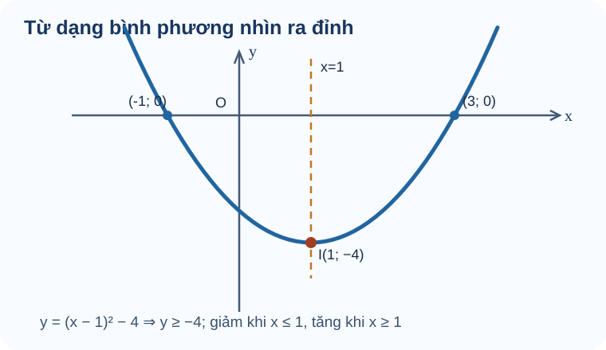

# Bài 16. Hàm số bậc hai

TOÁN 10 · CHƯƠNG VI · BÀI 16

Khám phá hàm số bậc hai qua đồ thị parabol, đỉnh, trục đối xứng, bảng biến thiên và các bài toán thực tế.

=== "Khám phá kiến thức"

    ### Cùng tìm hiểu

    Quỹ đạo một quả bóng có thể đi lên, đạt độ cao lớn nhất rồi đi xuống. Đồ thị dạng **parabol** giúp mô tả quan hệ như thế. Trước khi nhớ công thức đỉnh, em thử nhìn \(y=(x-1)^2-4\). Bình phương không âm nên \(y\ge-4\), và dấu bằng xảy ra tại \(x=1\). Vậy chính biểu thức đã chỉ ra **đỉnh \(I(1,-4)\)**, trục đối xứng \(x=1\) và giá trị nhỏ nhất \(-4\).

    Nếu hệ số của bình phương đổi thành âm, parabol mở xuống và đỉnh cho giá trị lớn nhất. Khi áp dụng vào độ cao hoặc thời gian, luôn kiểm điều kiện thực tế: đỉnh có nằm trong khoảng đang xét hay không. Như vậy, toán học không chỉ cho một con số mà còn cho biết **con số đó có phù hợp tình huống không**.

    ### Ví dụ trực quan

    <figure class="thpt-r4-plot thpt-r4-concept-figure"><figcaption>Hình do SLM vẽ cho \(y=(x-1)^2-4\). Đỉnh \(I(1,-4)\) và trục \(x=1\) giúp đọc các khoảng tăng, giảm. Không dùng bộ tọa độ này cho mọi parabol.</figcaption></figure>

    **Cách đọc hình.** Đường nét đứt \(x=1\) đi qua đỉnh \(I(1;-4)\), nơi parabol đạt giá trị nhỏ nhất. Đọc từ trái sang phải: đồ thị đi xuống trước \(x=1\), rồi đi lên sau \(x=1\). Hai giao điểm với trục \(Ox\) là \((-1;0)\) và \((3;0)\).

    Quỹ đạo phóng vật có thể uốn cong thành hình parabol, khác đường thẳng. Không phải cứ biểu thức viết có \(x^2\) thì chắc chắn là hàm bậc hai nếu hệ số x² bằng 0.

    Đã biết hàm số, biểu thức đại số và bậc của đa thức sau rút gọn; biết \(x^2\) là bình phương x.

    Một hàm bậc hai có phần thay đổi theo \(x^2\) **không mất đi**: \(y=ax^2+bx+c\) với \(a\ne0\). Nếu \(a=0\), quy tắc chỉ còn bậc nhất hoặc hằng, và các kết luận về parabol không còn đúng. Rút gọn biểu thức và kiểm hệ số của x² trước khi dùng công thức đỉnh, trục hoặc biệt thức; không chia cho 2a nếu a=0.

    **Vận dụng.** Trong \(f(x)=0x^2+2x+1\) và \(g(x)=-x^2+2x+1\), hàm nào là hàm số bậc hai?

    

    ??? question "Đối chiếu"

        

<strong>Đáp án:</strong> Chỉ \(g(x)\) là bậc hai (a=−1); \(f(x)=2x+1\) là bậc nhất.

<strong>Vì sao:</strong> Hệ số x² của f bằng 0 nên hạng tử bậc hai biến mất; của g bằng −1 khác 0.

Đây là câu tự luyện công khai, không chấm điểm thành thạo. Nếu chưa đúng, mở hướng dẫn tự sửa phía dưới.

    

    ??? tip "Kiểm lỗi"

        <ol><li><strong>Nhận diện lỗi:</strong> Chỉ nhìn chữ x² trong cách viết mà quên xét hệ số a=0.</li>
        <li><strong>Tự chẩn đoán:</strong> Em đã gọi \(f(x)=0x^2+2x+1\) là hàm bậc hai chỉ vì nhìn thấy \(x^2\)? Hãy thu gọn rồi khoanh hệ số của \(x^2\) ở cả hai biểu thức.</li>
        <li><strong>Kiến thức gốc:</strong> Một hàm bậc hai có phần thay đổi theo \(x^2\) <strong>không mất đi</strong>: \(y=ax^2+bx+c\) với \(a\ne0\). Nếu \(a=0\), quy tắc chỉ còn bậc nhất hoặc hằng, và các kết luận về parabol không còn đúng.</li>
        <li><strong>Tự sửa:</strong> Thu gọn rồi khoanh hệ số đứng trước x²; nếu bằng 0 không dùng công thức parabol. Chỉ mở lại đáp án ở trên sau khi đã thử giải một lần không xem gợi ý.</li>
        <li><strong>Luyện lại:</strong> Quay lại Vận dụng phân loại hai hàm \(f,g\); lần lượt viết hệ số \(a\) sau rút gọn và kiểm \(a\ne0\) trước khi mở Đối chiếu.</li></ol>
    Khi mô hình độ cao có dạng parabol, ta cần biết thời điểm lên cao nhất chứ không muốn thử vô hạn giá trị. Đỉnh chứa vị trí cực trị và trục đối xứng.

    Vì bình phương số thực luôn không âm nên \((x-h)^2\ge0\). Dấu của hệ số trước bình phương sẽ quyết định parabol mở lên hay mở xuống.

    Viết \(y=a(x-h)^2+k\): vì bình phương nhỏ nhất bằng 0 tại x=h, đỉnh chính là \(I(h;k)\). Dấu a quyết định cực tiểu hay cực đại; đường thẳng x=h đi qua đỉnh và là trục đối xứng. Ưu tiên hoàn thành bình phương khi cần đỉnh và trục; nếu a=0 thì không phải parabol, nếu a<0 đỉnh là cao nhất chứ không phải thấp nhất.

    **Vận dụng.** Cho \(f(x)=(x-2)^2-3\). Đỉnh I, trục đối xứng và hướng mở của parabol là gì?

    

    ??? question "Đối chiếu"

        

<strong>Đáp án:</strong> Đỉnh \(I(2;-3)\), trục \(x=2\), parabol mở lên.

<strong>Vì sao:</strong> Vì hệ số của bình phương là 1&gt;0 và \((x-2)^2\ge0\), giá trị nhỏ nhất −3 nhận tại x=2.

Đây là câu tự luyện công khai, không chấm điểm thành thạo. Nếu chưa đúng, mở hướng dẫn tự sửa phía dưới.

    

    ??? tip "Kiểm lỗi"

        <ol><li><strong>Nhận diện lỗi:</strong> Đổi nhầm dấu h thành −2, hoặc cho trục đối xứng là y=2.</li>
        <li><strong>Tự chẩn đoán:</strong> Em có đọc nhầm \((x-2)^2-3\) thành đỉnh \(I(-2;-3)\), hoặc vẽ trục ngang \(y=2\)? Hãy xác định \(x\) làm bình phương bằng \(0\) trước khi đọc đỉnh.</li>
        <li><strong>Kiến thức gốc:</strong> Viết \(y=a(x-h)^2+k\): vì bình phương nhỏ nhất bằng 0 tại x=h, đỉnh chính là \(I(h;k)\). Dấu a quyết định cực tiểu hay cực đại; đường thẳng x=h đi qua đỉnh và là trục đối xứng.</li>
        <li><strong>Tự sửa:</strong> Tìm x làm biểu thức bình phương bằng 0 rồi đọc h và k; kiểm dấu a để xác định hướng mở. Chỉ mở lại đáp án ở trên sau khi đã thử giải một lần không xem gợi ý.</li>
        <li><strong>Luyện lại:</strong> Em có thể <a href="../luyen-tap/?item=THPT-CORE-QF01">luyện lại một câu có sẵn trong Core/Luyện tập</a>, sau đó tự giải thích bằng lời của mình.</li></ol>
    Độ cao theo thời gian của một vật có thể tăng tới đỉnh rồi giảm; không thể kết luận hàm này đồng biến trên cả trục số. Biết chiều parabol cho ta suy quy luật biến thiên.

    Biết đỉnh \(I(h;k)\), dấu a và định nghĩa đồng/nghịch biến B15; đọc trục x theo chiều trái sang phải.

    Nếu a<0, parabol mở xuống nên tăng tới h rồi giảm sau h, giá trị không vượt k. Nếu a>0 thì ngược lại, luôn không nhỏ hơn k. Vì \((x-h)^2\ge0\), đây là chứng minh đại số cho tập giá trị chứ không chỉ nhìn tranh. Không đảo chiều tăng/giảm khi a âm; đầu mút h có thể nêu bằng dấu ngoặc nhất quán, và khi mô hình thực tế có miền hẹp thì phải xét đúng miền đó.

    - Với \(a>0\): parabol mở lên, hàm giảm trên \(( -\infty;h )\), tăng trên \((h;+\infty)\), đạt **GTNN** \(k\) tại \(x=h\).
    - Với \(a<0\): parabol mở xuống, hàm tăng trên \(( -\infty;h )\), giảm trên \((h;+\infty)\), đạt **GTLN** \(k\) tại \(x=h\).

    **Bảng biến thiên và tập giá trị tổng quát** (đặt \(\Delta=b^2-4ac\), \(h=-\frac{b}{2a}\), \(k=-\frac{\Delta}{4a}\)): 

    
<table class="thpt-g10-knowledge-table">
    <thead><tr><th>Điều kiện</th><th>Nghịch biến</th><th>Đồng biến</th><th>Cực trị tại \(x=h\)</th><th>Tập giá trị \(T\)</th></tr></thead>
    <tbody>
    <tr><td>\(a&gt;0\)</td><td>\((-\infty;h)\)</td><td>\((h;+\infty)\)</td><td>GTNN \(k\)</td><td>\(\left[-\frac{\Delta}{4a};+\infty\right)\)</td></tr>
    <tr><td>\(a&lt;0\)</td><td>\((h;+\infty)\)</td><td>\((-\infty;h)\)</td><td>GTLN \(k\)</td><td>\(\left(-\infty;-\frac{\Delta}{4a}\right]\)</td></tr>
    </tbody></table>

    **Vận dụng.** Với \(f(x)=-2(x+1)^2+8\) trên \(\mathbb R\), tìm giá trị lớn nhất, tập giá trị, khoảng đồng biến/nghịch biến.

    

    ??? question "Đối chiếu"

        

<strong>Đáp án:</strong> GTLN 8 tại x=−1, \(T=(-\infty;8]\); đồng biến trên \((-\infty;-1)\), nghịch biến trên \((-1;+\infty)\).

<strong>Vì sao:</strong> Vì −2(x+1)²≤0. Trục x=−1 là ranh giới đổi chiều, parabol mở xuống; mọi y≤8 đều đạt được.

Đây là câu tự luyện công khai, không chấm điểm thành thạo. Nếu chưa đúng, mở hướng dẫn tự sửa phía dưới.

    

    ??? tip "Kiểm lỗi"

        <ol><li><strong>Nhận diện lỗi:</strong> Đọc nhầm đỉnh là GTNN khi a âm, hoặc nhận khoảng tăng và giảm theo chiều từ phải qua trái.</li>
        <li><strong>Tự chẩn đoán:</strong> Em đã đọc parabol \(a<0\) như một cực tiểu hay đổi chiều đồng/nghịch biến? Hãy đọc trục hoành từ trái sang phải qua \(x=-1\), rồi so giá trị hai bên đỉnh.</li>
        <li><strong>Kiến thức gốc:</strong> Nếu a&lt;0, parabol mở xuống nên tăng tới h rồi giảm sau h, giá trị không vượt k. Nếu a&gt;0 thì ngược lại, luôn không nhỏ hơn k. Vì \((x-h)^2\ge0\), đây là chứng minh đại số cho tập giá trị chứ không chỉ nhìn tranh.</li>
        <li><strong>Tự sửa:</strong> Khoanh a&lt;0, vẽ mũi tên mở xuống, đọc nhánh trái lên đỉnh và nhánh phải xuống. Chỉ mở lại đáp án ở trên sau khi đã thử giải một lần không xem gợi ý.</li>
        <li><strong>Luyện lại:</strong> Quay lại Vận dụng \(f(x)=-2(x+1)^2+8\); kiểm dấu \(a\), giá trị tại đỉnh và hai khoảng biến thiên, sau đó tự mở Đối chiếu.</li></ol>
    Hai parabol có cùng hướng mở nhưng đặt lệch vị trí sẽ mô tả các bài toán rất khác nhau. Muốn vẽ đúng, phải có điểm đỉnh, trục và các điểm kiểm chứng.

    Đã biết hệ trục tọa độ, nghiệm của tam thức đơn giản, cách thay x để tính y và tính đối xứng qua đường thẳng đứng.

    Đồ thị \(y=a(x-h)^2+k\) đối xứng quanh x=h. Vẽ theo thứ tự: (1) đỉnh, (2) trục, (3) giao trục và điểm đối xứng cần thiết, (4) nối đường cong theo dấu a. Không thể nối các điểm bất kỳ thành parabol chuẩn.

    Để kiểm tra các điểm trước khi vẽ, em có thể lập bảng giá trị. Với hàm số \(f(x)=x^2-4x+3=(x-2)^2-1\), trước hết xác định trục đối xứng \(x=2\). Chọn các giá trị \(x\) nằm đối xứng hai bên số 2, rồi thay từng giá trị vào công thức:

    
<table class="thpt-g10-knowledge-table">
    <thead><tr><th>\(x\)</th><th>0</th><th>1</th><th>2</th><th>3</th><th>4</th></tr></thead>
    <tbody><tr><td>\(f(x)\)</td><td>3</td><td>0</td><td>−1</td><td>0</td><td>3</td></tr></tbody>
    </table>

    Trong bảng, các cặp \(x=0,4\) cùng cho \(y=3\); \(x=1,3\) cùng cho \(y=0\). Điểm chính giữa \((2;-1)\) là đỉnh thấp nhất. Vì thế các điểm trên hình phải đối xứng qua đường \(x=2\), chứ không chỉ đặt cho giống một đường cong.

    Bảng chỉ cung cấp các điểm kiểm chứng; đồ thị hàm bậc hai là **đường cong parabol** đi qua chúng, có trục đối xứng và chiều mở xác định. Nếu một cặp giá trị đối xứng cho hai tung độ khác nhau, hãy tính lại trước khi vẽ.

    **Vận dụng.** Cho \(f(x)=(x-1)^2-4\). Hãy nêu đỉnh, trục đối xứng, hướng mở và các giao điểm với hai trục tọa độ rồi tự phác đồ thị.

    

    ??? question "Đối chiếu"

        

<strong>Đáp án:</strong> Đỉnh \(I(1;-4)\), trục \(x=1\); giao Ox tại \((-1;0)\) và \((3;0)\); giao Oy \((0;-3)\). Mở lên.

<strong>Vì sao:</strong> Cho y=0: \((x-1)^2=4\Rightarrow x=1\pm2=-1,3\). Thay x=0 được y=1−4=−3. Hai giao Ox đối xứng quanh x=1.

Đây là câu tự luyện công khai, không chấm điểm thành thạo. Nếu chưa đúng, mở hướng dẫn tự sửa phía dưới.

    

    ??? tip "Kiểm lỗi"

        <ol><li><strong>Nhận diện lỗi:</strong> Vẽ đường trục nằm ngang hoặc đánh dấu một giao trục sai nhưng vẫn nối hình đẹp.</li>
        <li><strong>Tự chẩn đoán:</strong> Em đã phác đồ thị \((x-1)^2-4\) nhưng đánh dấu sai một nghiệm hoặc hai giao điểm không đối xứng qua \(x=1\)? Thử thay từng hoành độ vào công thức để kiểm \(y=0\).</li>
        <li><strong>Kiến thức gốc:</strong> Đồ thị \(y=a(x-h)^2+k\) đối xứng quanh x=h. Vẽ theo thứ tự: (1) đỉnh, (2) trục, (3) giao trục và điểm đối xứng cần thiết, (4) nối đường cong theo dấu a. Không thể nối các điểm bất kỳ thành parabol chuẩn.</li>
        <li><strong>Tự sửa:</strong> Tính đỉnh trước, kiểm từng giao điểm bằng thay tọa độ và phản chiếu qua trục x=h. Chỉ mở lại đáp án ở trên sau khi đã thử giải một lần không xem gợi ý.</li>
        <li><strong>Luyện lại:</strong> Em có thể <a href="../luyen-tap/?item=THPT-G10-CHVI-APP-A2">luyện lại một câu có sẵn trong Core/Luyện tập</a>, sau đó tự giải thích bằng lời của mình.</li></ol>
    Một vật bay lên rồi rơi xuống theo mô hình độ cao parabol; giá trị cực đại toán học chỉ có ý nghĩa khi thời điểm đó nằm trong giai đoạn vật còn bay.

    Biết t là thời gian không âm, tính bình phương hoàn chỉnh và đọc đơn vị m, s.

    Mô hình \(h(t)\) là hàm bậc hai theo t với miền thực tế t≥0 và h≥0 trong giai đoạn bay. Đỉnh cho độ cao tối đa nếu thời điểm đỉnh thuộc miền đó. Không được áp cực trị trên toàn \(\mathbb R\) rồi kết luận cho t âm.

    **Vận dụng.** Một mô hình độ cao giả định \(h(t)=-5(t-2)^2+20\) (m) trong khoảng \(0\le t\le4\) (giây). Độ cao lớn nhất và thời điểm đạt được là bao nhiêu? Kiểm tra \(h(0)\) và \(h(4)\).

    

    ??? question "Đối chiếu"

        

<strong>Đáp án:</strong> \(h(t)=-5(t-2)^2+20\), đạt lớn nhất \(20\,\mathrm{m}\) tại \(t=2\,\mathrm{s}\).

<strong>Vì sao:</strong> Vì \(-(t-2)^2\le0\) và 2∈[0;4]. Hai đầu t=0,4 có h=0; đây là mô hình giả định với thời gian không âm.

Đây là câu tự luyện công khai, không chấm điểm thành thạo. Nếu chưa đúng, mở hướng dẫn tự sửa phía dưới.

    

    ??? tip "Kiểm lỗi"

        <ol><li><strong>Nhận diện lỗi:</strong> Chỉ lấy −b/(2a) mà không kiểm miền thời gian hoặc quên đơn vị.</li>
        <li><strong>Tự chẩn đoán:</strong> Em đã dùng giá trị ở đỉnh mà chưa kiểm \(t=2\) có thuộc \([0;4]\), hoặc kết luận cho cả thời gian âm? Hãy đánh dấu miền \(0\le t\le4\) ngay trên đề trước khi tính.</li>
        <li><strong>Kiến thức gốc:</strong> Mô hình \(h(t)\) là hàm bậc hai theo t với miền thực tế t≥0 và h≥0 trong giai đoạn bay. Đỉnh cho độ cao tối đa nếu thời điểm đỉnh thuộc miền đó. Không được áp cực trị trên toàn \(\mathbb R\) rồi kết luận cho t âm.</li>
        <li><strong>Tự sửa:</strong> Viết 0≤t≤4 ngay dưới bài, kiểm t đỉnh có thuộc miền, rồi báo cả giá trị và đơn vị. Chỉ mở lại đáp án ở trên sau khi đã thử giải một lần không xem gợi ý.</li>
        <li><strong>Luyện lại:</strong> Quay lại Vận dụng mô hình \(h(t)\) trong Khám phá; ghi miền thời gian, kiểm thời điểm của đỉnh và \(h(0),h(4)\), rồi mới mở Đối chiếu.</li></ol>
    Hàm số bậc hai có thể biểu diễn diện tích hình chữ nhật khi chu vi được giữ cố định. [Xem bài tự luận mỏ neo mẫu](../../thu-vien/tu-luan.md).

    ### Thuật ngữ, kiến thức và kỹ năng

    **Thuật ngữ:** Hàm số bậc hai \(a\ne0\), parabol, đỉnh, trục đối xứng, khoảng tăng/giảm, cực trị và tập giá trị.

    **Sau bài học, em cần làm được:** Tìm đỉnh/trục và khoảng biến thiên; kiểm đồ thị bằng điểm phù hợp; tìm nghiệm và ứng dụng cực trị có điều kiện.

=== "Kiến thức SGK"

    ### 2.1. Khái niệm hàm số bậc hai

    Một **hàm số bậc hai** có dạng

    \[
    y=ax^2+bx+c,\qquad a,b,c\in\mathbb{R},\ a\ne 0.
    \]

    
<strong>Định nghĩa — Hàm số bậc hai:</strong> \(y=ax^2+bx+c\), với \(a,b,c\in\mathbb R\) và <strong>\(a\ne0\)</strong>. Tập xác định là \(\mathbb{R}\). Nếu \(a=0\), hạng tử bình phương mất đi; không dùng quy tắc của parabol cho hàm bậc nhất hoặc hằng.

    ### 2.2. Đồ thị của hàm số bậc hai

    <figure class="thpt-r4-plot thpt-r4-concept-figure" data-thpt-quadratic-plot>
    <svg xmlns="http://www.w3.org/2000/svg" viewBox="0 0 760 440" width="760" height="440" style="display:block;width:100%;max-width:100%;height:auto" role="img" aria-labelledby="b16-plot-title b16-plot-description" data-plot-a="1" data-plot-b="-4" data-plot-c="3" data-r4-plotted="1">
    <title id="b16-plot-title">Đồ thị hàm số y = x² − 4x + 3</title>
    <desc id="b16-plot-description">Parabol mở lên, đỉnh I(2;−1), trục đối xứng x=2. Đồ thị cắt Ox tại (1;0) và (3;0), cắt Oy tại (0;3). Hai nghiệm đối xứng qua x=2.</desc>
    <rect x="1" y="1" width="758" height="438" rx="18" fill="#f8fbff" stroke="#d1dff1"/>
    <text x="30" y="36" font-family="Arial,sans-serif" font-size="31" font-weight="700" fill="#19365d">y = x² − 4x + 3 = (x−2)² − 1</text>
    <g font-family="Arial,sans-serif">
    <line x1="232" y1="70" x2="232" y2="386" stroke="#dce5f1" stroke-width="1"/>
    <line x1="344" y1="70" x2="344" y2="386" stroke="#dce5f1" stroke-width="1"/>
    <line x1="456" y1="70" x2="456" y2="386" stroke="#dce5f1" stroke-width="1"/>
    <line x1="568" y1="70" x2="568" y2="386" stroke="#dce5f1" stroke-width="1"/>
    <line x1="78" y1="263" x2="684" y2="263" stroke="#dce5f1" stroke-width="1"/>
    <line x1="78" y1="211" x2="684" y2="211" stroke="#dce5f1" stroke-width="1"/>
    <line x1="78" y1="159" x2="684" y2="159" stroke="#dce5f1" stroke-width="1"/>
    <line x1="78" y1="107" x2="684" y2="107" stroke="#dce5f1" stroke-width="1"/>
    <line x1="65" y1="315" x2="698" y2="315" stroke="#344c70" stroke-width="2.5"/>
    <path d="M687 308 L701 315 L687 322" fill="none" stroke="#344c70" stroke-width="2.5"/>
    <line x1="120" y1="400" x2="120" y2="58" stroke="#344c70" stroke-width="2.5"/>
    <path d="M113 70 L120 56 L127 70" fill="none" stroke="#344c70" stroke-width="2.5"/>
    <text x="707" y="323" font-size="30" fill="#344c70">x</text>
    <text x="108" y="57" font-size="30" fill="#344c70">y</text>
    <text x="102" y="341" font-size="29" fill="#536681">0</text>
    <text x="232" y="341" font-size="29" fill="#536681" text-anchor="middle">1</text>
    <text x="344" y="341" font-size="29" fill="#536681" text-anchor="middle">2</text>
    <text x="456" y="341" font-size="29" fill="#536681" text-anchor="middle">3</text>
    <text x="568" y="341" font-size="29" fill="#536681" text-anchor="middle">4</text>
    <text x="97" y="165" text-anchor="end" font-size="29" fill="#536681">3</text>
    <line x1="344" y1="90" x2="344" y2="369" data-thpt-symmetry-axis="x=2" stroke="#0b8e85" stroke-width="2.5" stroke-dasharray="9 7"/>
    <text x="358" y="91" font-size="30" font-weight="700" fill="#0b706a">x = 2</text>
    <path d="M86.4 91.9 L92.0 103.8 L97.6 115.3 L103.2 126.6 L108.8 137.7 L114.4 148.5 L120.0 159.0 L125.6 169.3 L131.2 179.3 L136.8 189.0 L142.4 198.5 L148.0 207.8 L153.6 216.7 L159.2 225.4 L164.8 233.9 L170.4 242.1 L176.0 250.0 L181.6 257.7 L187.2 265.1 L192.8 272.2 L198.4 279.1 L204.0 285.8 L209.6 292.1 L215.2 298.2 L220.8 304.1 L226.4 309.7 L232.0 315.0 L237.6 320.1 L243.2 324.9 L248.8 329.4 L254.4 333.7 L260.0 337.8 L265.6 341.5 L271.2 345.0 L276.8 348.3 L282.4 351.3 L288.0 354.0 L293.6 356.5 L299.2 358.7 L304.8 360.6 L310.4 362.3 L316.0 363.8 L321.6 364.9 L327.2 365.8 L332.8 366.5 L338.4 366.9 L344.0 367.0 L349.6 366.9 L355.2 366.5 L360.8 365.8 L366.4 364.9 L372.0 363.8 L377.6 362.3 L383.2 360.6 L388.8 358.7 L394.4 356.5 L400.0 354.0 L405.6 351.3 L411.2 348.3 L416.8 345.0 L422.4 341.5 L428.0 337.7 L433.6 333.7 L439.2 329.4 L444.8 324.9 L450.4 320.1 L456.0 315.0 L461.6 309.7 L467.2 304.1 L472.8 298.2 L478.4 292.1 L484.0 285.7 L489.6 279.1 L495.2 272.2 L500.8 265.1 L506.4 257.7 L512.0 250.0 L517.6 242.1 L523.2 233.9 L528.8 225.4 L534.4 216.7 L540.0 207.8 L545.6 198.5 L551.2 189.0 L556.8 179.3 L562.4 169.3 L568.0 159.0 L573.6 148.5 L579.2 137.7 L584.8 126.6 L590.4 115.3 L596.0 103.8 L601.6 91.9 L607.2 79.8 L612.8 67.5 L618.4 54.9 L624.0 42.0" fill="none" stroke="#2853bb" stroke-width="5" stroke-linecap="round" stroke-linejoin="round"/>
    <circle cx="344" cy="367" r="6" fill="#d2413a" stroke="#ffffff" stroke-width="2"/>
    <circle cx="232" cy="315" r="6" fill="#2853bb" stroke="#ffffff" stroke-width="2"/>
    <circle cx="456" cy="315" r="6" fill="#2853bb" stroke="#ffffff" stroke-width="2"/>
    <circle cx="120" cy="159" r="6" fill="#2853bb" stroke="#ffffff" stroke-width="2"/>
    <text x="361" y="390" font-size="30" font-weight="700" fill="#a22928">I(2; −1)</text>
    <text x="213" y="292" font-size="30" fill="#243e82" text-anchor="end">(1; 0)</text>
    <text x="473" y="301" font-size="30" fill="#243e82">(3; 0)</text>
    <text x="140" y="151" font-size="30" fill="#243e82">(0; 3)</text>
    </g>
    </svg>
    <figcaption>Parabol của hàm số \(y=x^2-4x+3\): đỉnh \(I(2;-1)\), trục đối xứng \(x=2\), giao \(Ox\) tại \((1;0)\), \((3;0)\), giao \(Oy\) tại \((0;3)\). Hình minh họa cách đọc tọa độ, không thay thế phép kiểm bằng công thức.</figcaption>
    </figure>

    **Cách đọc hình.** Đây là parabol \(y=x^2-4x+3=(x-2)^2-1\), khác với parabol \(y=(x-1)^2-4\) ở phần Khám phá. Quan sát đỉnh \(I(2;-1)\), trục \(x=2\), giao điểm với \(Ox\) là \((1;0)\), \((3;0)\), giao điểm với \(Oy\) là \((0;3)\). Hai nghiệm \(1\) và \(3\) đối xứng qua trục \(x=2\); parabol mở lên.

    Đồ thị là một **parabol**. Ta viết dưới dạng đỉnh:

    \[
    y=a(x-h)^2+k,\qquad h=-\frac{b}{2a},\quad k=f(h)=-\frac{\Delta}{4a},\qquad \Delta=b^2-4ac.
    \]

    
<strong>Khái niệm — Đỉnh và trục đối xứng:</strong> Với \(a\ne0\), đỉnh \(I(h;k)\), trục đối xứng \(x=h\), trong đó \(h=-\frac{b}{2a}\) và \(k=f(h)\). Hai điểm có hoành độ cách đều \(h\) sẽ có cùng tung độ.

    
<strong>Quy tắc — Dấu \(a\) quyết định sự biến thiên:</strong> Nếu \(a>0\), parabol mở lên, hàm <strong>nghịch biến trên \((-\infty;h)\)</strong>, <strong>đồng biến trên \((h;+\infty)\)</strong>, có GTNN \(k\) và tập giá trị \([k;+\infty)\). Nếu \(a<0\), parabol mở xuống, hàm <strong>đồng biến trên \((-\infty;h)\)</strong>, <strong>nghịch biến trên \((h;+\infty)\)</strong>, có GTLN \(k\) và tập giá trị \((-\infty;k]\). Các kết luận trên \(\mathbb R\); với miền thực tế chỉ xét phần thuộc miền cho phép.

    #### Bốn bước vẽ đồ thị parabol

    1. **Xác định đỉnh** \(I\left(-\frac{b}{2a};-\frac{\Delta}{4a}\right)\).
    2. **Vẽ trục đối xứng** \(x=-\frac{b}{2a}\) và nhận biết chiều mở qua dấu \(a\).
    3. **Xác định các điểm đặc trưng**: giao với \(Oy\) là \((0;c)\); giải \(ax^2+bx+c=0\) để tìm giao với \(Ox\) **nếu có**; có thể lấy thêm một cặp điểm đối xứng qua trục, nhất là khi không có đủ giao điểm.
    4. **Vẽ parabol** đi qua các điểm đã xác định, có đỉnh và trục đối xứng đúng; hai nhánh đối xứng qua trục.

    *Lưu ý:* Nếu \(\Delta<0\), parabol không cắt \(Ox\); nếu \(\Delta=0\), parabol tiếp xúc \(Ox\) tại đỉnh. Không được tự giả định luôn có hai giao điểm.

=== "Ví dụ"

    ### 3.1. Ví dụ 1 — Đọc đỉnh từ dạng bình phương

    **Đề bài.** Xét \(f(x)=(x-1)^2-4\). Tìm đỉnh, trục đối xứng, nghiệm và tập giá trị.

    **Phân tích:** Dạng \((x-h)^2+k\) giúp nhận ngay vị trí đỉnh mà không cần dùng biệt thức. Sau đó muốn tìm giao với \(Ox\), ta giải \(f(x)=0\); muốn kết luận tập giá trị, phải dùng tính không âm của bình phương.

    **Lời giải.**

    **Bước 1 — Nhận đỉnh và trục:** Vì \(f(x)=(x-1)^2-4\), đỉnh là \(I(1;-4)\), trục đối xứng \(x=1\), parabol mở lên.

    **Bước 2 — Tìm tập giá trị:** Với mọi \(x\in\mathbb R\), \((x-1)^2\ge0\), nên \(f(x)\ge-4\). Dấu bằng xảy ra khi \(x=1\). Do đó giá trị nhỏ nhất là \(-4\), tập giá trị \(T=[-4;+\infty)\).

    **Bước 3 — Tìm các giao điểm với \(Ox\):** Giải \((x-1)^2-4=0\iff(x-1)^2=4\), được \(x=-1\) hoặc \(x=3\). Hai điểm là \((-1;0)\), \((3;0)\).

    **Kiểm lại:** Trung điểm hai nghiệm có hoành độ \(\frac{-1+3}{2}=1\), đúng bằng trục đối xứng. Thử \(f(1)=-4\), \(f(-1)=f(3)=0\), phù hợp đồ thị.

    ### 3.2. Ví dụ 2 — Vẽ đúng parabol từ biểu thức

    **Đề bài.** Xét \(f(x)=x^2-4x+3=(x-2)^2-1\). Hãy xác định đỉnh, các giao điểm với hai trục, sự biến thiên và các bước vẽ đồ thị.

    **Phân tích:** Biểu thức đã ở dạng đỉnh nên tìm \(I\) và trục trước. Các điểm cắt trục phải được tính chính xác từ công thức; dùng cặp điểm đối xứng để tự kiểm, không vẽ theo cảm giác.

    **Lời giải.**

    **Bước 1 — Đỉnh, hướng mở và tập giá trị:** \(f(x)=(x-2)^2-1\) nên \(I(2;-1)\), trục \(x=2\), \(a=1>0\), parabol mở lên, GTNN \(-1\) tại \(x=2\), \(T=[-1;+\infty)\).

    **Bước 2 — Giao với hai trục:** Với \(y=0\), \((x-1)(x-3)=0\), được \((1;0)\) và \((3;0)\) trên \(Ox\). Với \(x=0\), \(y=3\), được \((0;3)\) trên \(Oy\).

    **Bước 3 — Xét chiều biến thiên:** Vì \(a>0\), hàm số nghịch biến trên \((-\infty;2)\), đồng biến trên \((2;+\infty)\).

    **Bước 4 — Phác đồ thị:** Đánh dấu \(I(2;-1)\), kẻ trục \(x=2\), đặt ba giao điểm rồi chấm thêm \((4;3)\) là ảnh đối xứng của \((0;3)\). Nối các điểm bằng đường cong parabol mở lên, không nối bằng các đoạn thẳng.

    **Kiểm lại:** \(f(0)=f(4)=3\), \(f(1)=f(3)=0\) và \(f(2)=-1\), đúng tính đối xứng và bảng số liệu ở phần Khám phá.

    **Tự củng cố:** Sau khi học khái niệm và xem ví dụ, em có thể mở bài luyện ngắn bên dưới để thử tìm tọa độ đỉnh. Hãy tự làm trước khi dùng gợi ý.

    

    <button type="button" class="thpt-r4-practice-open" data-thpt-open-quiz="b16-core" aria-label="Mở cửa sổ Core Bài 16 · Tọa độ đỉnh">🧩 Luyện Core · Tọa độ đỉnh (THPT-CORE-QF01)</button>
    

    **Tiếp tục rèn luyện:** [Luyện tập và Vận dụng Chương VI](luyen-tap.md) · [Tự kiểm tra cuối Chương VI](tu-kiem-tra-chuong.md).

    ### Mở rộng mô hình thực tế từ phần cuối Bài 16

    **Ví dụ bổ sung A — Chuyển động theo phương thẳng đứng.** Bỏ qua sức cản không khí, một vật được ném lên từ mặt đất với vận tốc đầu \(19{,}6\;\text{m/s}\); lấy \(g=9{,}8\;\text{m/s}^2\). Độ cao \(h\) (m) theo thời gian \(t\) (giây) là

    \[
    h(t)=19{,}6t-4{,}9t^2=-4{,}9(t-2)^2+19{,}6.
    \]

    Vì \(t\ge0\) và chỉ xét đến lúc vật trở lại mặt đất, ta có \(0\le t\le4\). Parabol mở xuống; **độ cao lớn nhất** là \(19{,}6\) m tại \(t=2\) giây. Giải \(h(t)=0\) được \(t=0\) (lúc ném) hoặc \(t=4\) (lúc chạm đất).

    *Điều cần nắm:* Các biến phải có **đơn vị và miền ý nghĩa vật lý**; không dùng toàn bộ \(\mathbb R\) làm miền thời gian của chuyển động thực tế.

    **Ví dụ bổ sung B — Doanh thu và giá bán.** Một mô hình giả định số sản phẩm bán được theo giá \(x\) (nghìn đồng/sản phẩm) là \(n(x)=600-10x\), với \(0\le x\le60\). Doanh thu tính bằng nghìn đồng:

    \[
    R(x)=x\,n(x)=600x-10x^2=-10(x-30)^2+9000.
    \]

    Do đó doanh thu lớn nhất theo mô hình là \(9000\) nghìn đồng, tức **9 triệu đồng**, khi giá bán \(x=30\) nghìn đồng/sản phẩm và lượng bán dự kiến \(n(30)=300\) sản phẩm.

    *Điều cần nắm:* Số lượng và đơn giá phải đúng đơn vị; miền \(0\le x\le60\) bảo đảm giá không âm và nhu cầu dự đoán không âm. Đây là một mô hình tuyến tính hóa giả định, không phải dự báo kinh tế thực tế.

    Hai ví dụ củng cố cách tìm giá trị lớn nhất, nhỏ nhất từ dạng đỉnh của parabol. Khi vận dụng mô hình thực tế, cần kiểm tra **điều kiện và đơn vị** của các đại lượng.

    ### Ví dụ mở rộng — Khi biết đỉnh và một điểm, làm sao tìm lại công thức?

    Đôi khi bài toán cho **hình dạng hoặc các điểm của parabol**, chứ chưa cho công thức hàm số. Khi đó ta cần tìm ngược hệ số của hàm bậc hai. Nếu đề đã biết đỉnh \(I(h;k)\), **vì sao nên chọn dạng** \(y=a(x-h)^2+k\)? Vì hai tọa độ đỉnh đã được đưa trực tiếp vào công thức, chỉ còn một ẩn \(a\), thay vì phải tìm cả ba hệ số \(a,b,c\).

    **Đề bài.** Một parabol có đỉnh \(I(1;2)\) và đi qua \(A(0;0)\). Tìm hàm số bậc hai có đồ thị là parabol đó.

    **Lời giải.**

    **Bước 1 — dùng dữ kiện đỉnh.** Viết \(y=a(x-1)^2+2\), với \(a\ne0\).

    **Bước 2 — dùng điểm thuộc đồ thị.** Vì \(A(0;0)\) nằm trên parabol, thay \(x=0,y=0\) được \(0=a(0-1)^2+2\), suy ra \(a=-2\).

    **Bước 3 — kết luận và tự kiểm.** Vậy \(y=-2(x-1)^2+2=-2x^2+4x\). Thay lại \(x=0\) được \(y=0\), đúng với điểm \(A\). Thêm nữa, \(f(2)=0=f(0)\), nên hai điểm \((0;0)\) và \((2;0)\) đối xứng nhau qua trục \(x=1\); hệ số âm cho biết parabol mở xuống và đỉnh là điểm cao nhất.

    **Giới hạn cần nhớ:** Chỉ biết đỉnh \(I(1;2)\) thì vẫn có vô số parabol \(y=a(x-1)^2+2\) với \(a\ne0\). Ta cần thêm một điểm **có hoành độ khác 1** để xác định \(a\), rồi phải kiểm \(a\ne0\). Nếu điểm bổ sung có hoành độ khác 1 nhưng tung độ vẫn bằng 2, phép tính cho \(a=0\) nên **không có hàm bậc hai** thỏa đề. Nếu điểm bổ sung cũng có hoành độ \(x=1\), nó không xác định được độ mở; nếu tung độ của nó khác 2 thì dữ kiện còn mâu thuẫn. Đây là cách tự kiểm xem đề bài có đủ thông tin hay không.

=== "Lỗi thường gặp"

    **Kiểm lỗi:** Các lỗi thường gặp được giải thích ngay sau từng hoạt động ở tab Khám phá kiến thức. Chọn mục tương ứng để xem lại: [Kiểm lỗi 1](#help-g10-chvi-try06) · [Kiểm lỗi 2](#help-g10-chvi-try07) · [Kiểm lỗi 3](#help-g10-chvi-try09) · [Kiểm lỗi 4](#help-g10-chvi-try08) · [Kiểm lỗi 5](#help-g10-chvi-try10).

    **Học tiếp:** [Core và Luyện tập](luyen-tap.md) · [Tự kiểm tra cuối chương](tu-kiem-tra-chuong.md).

    
Nguồn toán học: SGK Toán 10 Kết nối tri thức với cuộc sống và học liệu SLM hiện hành. Lời giảng được biên tập nhằm hỗ trợ tự học độc lập.

