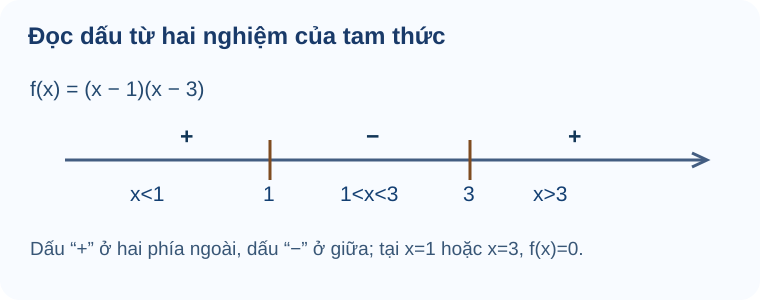

# Bài 17. Dấu của tam thức bậc hai

TOÁN 10 · CHƯƠNG VI · BÀI 17

Tìm hiểu dấu của tam thức bậc hai, bảng xét dấu và cách giải bất phương trình bằng định lí về dấu.

=== "Khám phá kiến thức"

    ### Cùng tìm hiểu

    Đồ thị parabol có thể cắt trục hoành tại hai điểm, tiếp xúc tại một điểm hoặc không gặp trục hoành. Mỗi trường hợp làm cho dấu của tam thức bậc hai thay đổi theo một cách khác nhau. Vì vậy, trước khi học bảng dấu, em hãy nhìn mối liên hệ giữa **nghiệm của phương trình \(f(x)=0\)** và **phần đồ thị nằm trên hay dưới trục \(Ox\)**.

    Với \(f(x)=(x-1)(x-3)\), hai nghiệm là \(1\) và \(3\). Khi \(x<1\), cả hai thừa số âm nên tích dương; khi \(1<x<3\), tích âm; khi \(x>3\), cả hai thừa số dương nên tích dương. Em vừa tự lập được bảng dấu mà chưa phải ghi nhớ câu “cùng dấu với a ở ngoài”.

    Khi giải bất phương trình, mục tiêu là tìm **các khoảng giá trị của \(x\)** làm biểu thức dương, âm hoặc bằng 0, chứ không phải chỉ tìm nghiệm phương trình. Dấu \(>\) hay \(\ge\) quyết định có lấy các mốc nghiệm hay không.

    ### Thuật ngữ, kiến thức và kỹ năng

    **Thuật ngữ:** Tam thức bậc hai (a
    e0), biệt thức (Delta), nghiệm đơn, nghiệm kép, bảng xét dấu, bất phương trình bậc hai.

    **Sau bài học, em cần làm được:** Kiểm (a
    e0), tìm nghiệm và xét dấu theo từng miền; phân biệt tiếp xúc với cắt trục; giải bất phương trình và lọc điều kiện thực tế.

=== "Kiến thức SGK"

    ### Dấu của tam thức là vị trí đồ thị so với Ox

    Một biểu thức \(ax^2+bx+c\) có thể dương ở nơi này, âm ở nơi khác. Thay từng x vô hạn lần là bất khả thi; ta dùng hình parabol và số nghiệm để suy dấu cả khoảng.

    Đã biết parabol của B16, hệ số a khác 0, biệt thức \(\Delta=b^2-4ac\) và đồ thị trên/dưới trục hoành. Em có thể học các kiến thức tiền đề ngay trong bài.

    Tam thức bậc hai là \(f(x)=ax^2+bx+c\) với a≠0. Dấu của f(x) tại x chính là vị trí đồ thị so với trục Ox; nghiệm f(x)=0 là chỗ giao/tiếp xúc Ox. Số nghiệm được quyết định bởi \(\Delta\), còn hướng mở theo a.

    **Vì sao chọn phương pháp này?** Kiểm a≠0 trước khi gọi biểu thức là tam thức bậc hai; không lấy mỗi dấu c hoặc mỗi dấu Δ để suy dấu tất cả x.

    **Em vận dụng.** Với \(f(x)=x^2+2x+5\), tính \(\Delta\), xác định số nghiệm thực và dấu f(x) trên \(\mathbb R\).

    

    ??? question "Em đã tự thử? Mở đáp án để đối chiếu"

        

<strong>Đáp án:</strong> \(\Delta=2^2-4\cdot1\cdot5=-16&lt;0\). Không có nghiệm thực, và \(f(x)&gt;0\) với mọi x.

<strong>Vì sao:</strong> a=1&gt;0 nên parabol mở lên; không cắt Ox khi Δ&lt;0. Đồng thời \(f(x)=(x+1)^2+4&gt;0\) kiểm chứng trực tiếp.

Đây là câu tự luyện công khai, không chấm điểm thành thạo. Nếu chưa đúng, mở hướng dẫn tự sửa phía dưới.

    

    ??? tip "Gợi ý khắc phục khi chưa làm được — 5 bước"

        <ol><li><strong>Nhận diện lỗi:</strong> Chỉ thấy Δ âm mà kết luận f âm; quên xét dấu a.</li>
        <li><strong>Tự chẩn đoán:</strong> Em có đang mắc đúng lỗi này trong lời giải bài vừa thử không? Hãy khoanh bước đầu tiên chuyển từ dữ kiện sang kết luận mà em chưa chứng minh được.</li>
        <li><strong>Kiến thức gốc:</strong> Tam thức bậc hai là \(f(x)=ax^2+bx+c\) với a≠0. Dấu của f(x) tại x chính là vị trí đồ thị so với trục Ox; nghiệm f(x)=0 là chỗ giao/tiếp xúc Ox. Số nghiệm được quyết định bởi \(\Delta\), còn hướng mở theo a.</li>
        <li><strong>Tự sửa:</strong> Viết hai ô: a dương/âm và Δ âm/bằng 0/dương, rồi mới kết luận theo hình và công thức. Chỉ mở lại đáp án ở trên sau khi đã thử giải một lần không xem gợi ý.</li>
        <li><strong>Luyện lại (không nhân bản câu):</strong> Em có thể <a href="../luyen-tap/?item=THPT-G10-B17-C01">luyện lại một câu Core/Luyện tập cùng kiến thức</a>, rồi tự giải thích bằng lời của mình.</li></ol>

    ### Tam thức bậc hai

    Tam thức bậc hai theo biến \(x\) là biểu thức

    \[
    f(x)=ax^2+bx+c,\quad a\ne0.
    \]

    Đặt \(\Delta=b^2-4ac\). Để xét dấu tam thức, cần biết dấu của hệ số \(a\) và số nghiệm thực của \(f(x)=0\). Đồ thị \(y=f(x)\) là một parabol: phía **trên trục hoành** biểu diễn \(f(x)>0\), phía **dưới** biểu diễn \(f(x)<0\).

    ### Nghiệm kép là tiếp xúc, không phải đổi dấu

    Một parabol có thể chỉ vừa chạm trục Ox rồi quay lại, thay vì cắt qua. Tại điểm chạm, giá trị bằng 0 nhưng dấu ở hai bên không đổi.

    Biết biểu thức bình phương không âm và dấu a; hiểu nghiệm kép khi \(\Delta=0\). Em có thể học các kiến thức tiền đề ngay trong bài.

    Với \(\Delta=0\), tam thức viết được dưới dạng \(a(x-x_0)^2\). Nó bằng 0 tại x0, có dấu của a ở mọi điểm khác; vì bình phương không âm nên không có sự đổi dấu khi đi qua nghiệm kép.

    **Vì sao chọn phương pháp này?** Phân biệt \(f(x)\le0\) với \(f(x)<0\) ở điểm nghiệm; dấu bằng là một phần của bất phương trình.

    **Em vận dụng.** Với \(f(x)=-3(x-2)^2\), tìm tập nghiệm của \(f(x)<0\) và của \(f(x)\le0\).

    

    ??? question "Em đã tự thử? Mở đáp án để đối chiếu"

        

<strong>Đáp án:</strong> \(f(x)&lt;0\) khi \(x\ne2\); \(f(x)\le0\) với mọi \(x\in\mathbb R\).

<strong>Vì sao:</strong> Do −3 nhân bình phương luôn ≤0, chỉ bằng 0 khi x=2; khi x≠2 tích âm.

Đây là câu tự luyện công khai, không chấm điểm thành thạo. Nếu chưa đúng, mở hướng dẫn tự sửa phía dưới.

    

    ??? tip "Gợi ý khắc phục khi chưa làm được — 5 bước"

        <ol><li><strong>Nhận diện lỗi:</strong> Nhầm nghiệm kép làm thay dấu hai phía, hoặc quên loại x0 ở dấu &lt;.</li>
        <li><strong>Tự chẩn đoán:</strong> Em có đang mắc đúng lỗi này trong lời giải bài vừa thử không? Hãy khoanh bước đầu tiên chuyển từ dữ kiện sang kết luận mà em chưa chứng minh được.</li>
        <li><strong>Kiến thức gốc:</strong> Với \(\Delta=0\), tam thức viết được dưới dạng \(a(x-x_0)^2\). Nó bằng 0 tại x0, có dấu của a ở mọi điểm khác; vì bình phương không âm nên không có sự đổi dấu khi đi qua nghiệm kép.</li>
        <li><strong>Tự sửa:</strong> Tô đậm điểm x0=2, thay x0 vào f được 0, xét số âm nhân bình phương ở hai phía. Chỉ mở lại đáp án ở trên sau khi đã thử giải một lần không xem gợi ý.</li>
        <li><strong>Luyện lại (không nhân bản câu):</strong> Em có thể <a href="../luyen-tap/?item=THPT-G10-B17-C02">luyện lại một câu Core/Luyện tập cùng kiến thức</a>, rồi tự giải thích bằng lời của mình.</li></ol>

    ### Định lí về dấu của tam thức bậc hai

    
<table class="thpt-g10-knowledge-table">
    <thead><tr><th>Biệt thức</th><th>Nghiệm thực của \(f(x)=0\)</th><th>Dấu \(f(x)\)</th></tr></thead>
    <tbody>
    <tr><td>\(\Delta&lt;0\)</td><td>Không có</td><td>Luôn <strong>cùng dấu</strong> với \(a\) trên \(\mathbb R\)</td></tr>
    <tr><td>\(\Delta=0\)</td><td>Nghiệm kép \(x_0=-b/(2a)\)</td><td>Bằng \(0\) tại \(x_0\); <strong>cùng dấu</strong> với \(a\) ở mọi nơi khác</td></tr>
    <tr><td>\(\Delta&gt;0\)</td><td>Hai nghiệm \(x_1&lt;x_2\)</td><td><strong>Cùng dấu</strong> \(a\) khi \(x&lt;x_1\) hoặc \(x&gt;x_2\); <strong>trái dấu</strong> \(a\) khi \(x_1&lt;x&lt;x_2\); bằng \(0\) tại \(x_1,x_2\)</td></tr>
    </tbody></table>

    **Mẹo nhớ có kiểm chứng:** Khi có hai nghiệm, *ngoài cùng dấu \(a\); trong trái dấu \(a\)*. Mẹo này **không thay thế** xét riêng các trường hợp \(\Delta=0\) và \(\Delta<0\).

    **Ví dụ 1.** Xét \(f(x)=-x^2+4x-3=-(x-1)(x-3)\). Ta có \(a=-1\), hai nghiệm \(1<3\). Vì vậy \(f(x)<0\) trên \((-\infty;1)\cup(3;+\infty)\), \(f(x)>0\) trên \((1;3)\) và \(f(x)=0\) tại \(x=1,3\).

    **Ví dụ 2.** \(g(x)=x^2-2x+1=(x-1)^2\ge0\) với mọi \(x\). Dấu bằng chỉ xảy ra tại \(x=1\) (\(\Delta=0\)). Không được nói \(g(x)>0\) với mọi \(x\).

    ### Bảng xét dấu — mẫu cần biết

    **Cách đọc hình.** Đọc hai nghiệm 1 và 3 từ trái sang phải. Dấu của (x−1)(x−3) là dương ở ngoài, âm ở giữa; tại nghiệm bằng 0. Nét này minh họa trường hợp a>0 và hai nghiệm phân biệt.

    <figure class="thpt-r4-plot thpt-r4-concept-figure"><figcaption>Với \(f(x)=(x-1)(x-3)\), hai nghiệm \(1\) và \(3\) chia trục số thành ba miền. Dấu \(+, -, +\) đúng cho tam thức có hai nghiệm này và hệ số bậc hai dương.</figcaption></figure>

    Trên bảng xét dấu, mỗi nghiệm của tam thức là điểm phân chia khoảng; tại nghiệm thì giá trị bằng \(0\). Với \(\Delta>0\) và \(x_1<x_2\), dấu được xác định như sau:

    
<table class="thpt-g10-knowledge-table">
    <thead><tr><th>Vị trí</th><th>\((-\infty;x_1)\)</th><th>\(x_1\)</th><th>\((x_1;x_2)\)</th><th>\(x_2\)</th><th>\((x_2;+\infty)\)</th></tr></thead>
    <tbody>
    <tr><td>Nếu \(a&gt;0\)</td><td>\(+\)</td><td>\(0\)</td><td>\(-\)</td><td>\(0\)</td><td>\(+\)</td></tr>
    <tr><td>Nếu \(a&lt;0\)</td><td>\(-\)</td><td>\(0\)</td><td>\(+\)</td><td>\(0\)</td><td>\(-\)</td></tr>
    </tbody></table>

    Khi \(\Delta=0\), không xuất hiện khoảng đổi dấu qua nghiệm kép; khi \(\Delta<0\), tam thức không có nghiệm và giữ nguyên dấu của \(a\). Cần xét đúng biểu thức **tam thức bậc hai**, không tự áp dụng bảng này cho phân thức nếu chưa xét cả dấu mẫu số.

    **Ví dụ 2b (tự soạn — nghiệm kép).** \(f(x)=-2(x+1)^2\le0\) với mọi \(x\in\mathbb R\), bằng \(0\) duy nhất tại \(x=-1\). Do đó \(f(x)<0\) có tập nghiệm \(\mathbb R\setminus\{-1\}\), còn \(f(x)\le0\) có tập nghiệm \(\mathbb R\).

    **Ví dụ 2c (tự soạn — không có nghiệm).** \(g(x)=-2x^2+4x-5=-2(x-1)^2-3<0\) với mọi \(x\). Đây là ví dụ \(\Delta<0\), \(a<0\); nó cũng cho thấy định lí dấu phù hợp với dạng bình phương hoàn chỉnh.

    ### Giải bất phương trình là tìm khoảng, không chỉ tìm nghiệm phương trình

    Điều kiện diện tích hay lợi nhuận thường yêu cầu không ít hơn một mức, nên đáp án là cả một khoảng giá trị x chứ không phải chỉ các nghiệm biên.

    Đã biết phân tích thành nhân tử, nghiệm 2 và 3 của \((x-2)(x-3)=0\), dấu tích và khoảng trên trục số. Em có thể học các kiến thức tiền đề ngay trong bài.

    Nghiệm của \(f(x)=0\) chia trục số thành những khoảng có dấu cố định. Để giải \(f(x)\le0\), ta chọn những khoảng mà f âm và **lấy cả các nghiệm bằng 0**; với dấu < thì bỏ các đầu mút.

    **Vì sao chọn phương pháp này?** Tìm nghiệm trước, lập dấu qua hệ số a và thứ tự nghiệm; không lấy phần ngoài nếu a>0 và yêu cầu ≤0.

    **Em vận dụng.** Giải bất phương trình \(x^2-5x+6\le0\).

    

    ??? question "Em đã tự thử? Mở đáp án để đối chiếu"

        

<strong>Đáp án:</strong> \(x^2-5x+6=(x-2)(x-3)\le0\Rightarrow x\in[2;3]\).

<strong>Vì sao:</strong> Parabol mở lên nên biểu thức ≤0 ở giữa hai nghiệm 2,3; dấu bằng buộc lấy cả 2 và 3.

Đây là câu tự luyện công khai, không chấm điểm thành thạo. Nếu chưa đúng, mở hướng dẫn tự sửa phía dưới.

    

    ??? tip "Gợi ý khắc phục khi chưa làm được — 5 bước"

        <ol><li><strong>Nhận diện lỗi:</strong> Chỉ ghi {2,3} thay vì cả [2,3], hoặc bỏ đầu mút dù dấu ≤.</li>
        <li><strong>Tự chẩn đoán:</strong> Em có đang mắc đúng lỗi này trong lời giải bài vừa thử không? Hãy khoanh bước đầu tiên chuyển từ dữ kiện sang kết luận mà em chưa chứng minh được.</li>
        <li><strong>Kiến thức gốc:</strong> Nghiệm của \(f(x)=0\) chia trục số thành những khoảng có dấu cố định. Để giải \(f(x)\le0\), ta chọn những khoảng mà f âm và <strong>lấy cả các nghiệm bằng 0</strong>; với dấu &lt; thì bỏ các đầu mút.</li>
        <li><strong>Tự sửa:</strong> Đặt dấu +−+ qua hai mốc x=2,3, lấy vùng âm cùng hai vị trí bằng 0. Chỉ mở lại đáp án ở trên sau khi đã thử giải một lần không xem gợi ý.</li>
        <li><strong>Luyện lại (không nhân bản câu):</strong> Em có thể <a href="../luyen-tap/?item=THPT-G10-B17-P01">luyện lại một câu Core/Luyện tập cùng kiến thức</a>, rồi tự giải thích bằng lời của mình.</li></ol>

    ### Bất phương trình bậc hai

    Giải bất phương trình \(ax^2+bx+c\ >,\ge,<,\le\ 0\) bằng quy trình:

    1. Xác định \(a\) và \(\Delta\), tìm các nghiệm thực của tam thức (nếu có).
    2. Lập các khoảng và xét dấu theo định lí.
    3. Chọn các khoảng đúng theo kí hiệu bất phương trình; **chỉ lấy các nghiệm của tam thức** nếu có dấu bằng (\(\ge,\le\)).
    4. Kiểm tra điều kiện của biến nếu bài có tình huống thực tế.

    **Ví dụ 3.** Giải \(-x^2+4x-3\ge0\). Từ Ví dụ 1, tam thức dương trên \((1;3)\), bằng 0 tại \(1,3\); vậy nghiệm là \(\boxed{[1;3]}\).

    ### Ứng dụng rào vườn phải lọc miền hình học

    Có đủ dây rào chưa đảm bảo mọi chiều rộng đều tạo được vườn hình chữ nhật; chiều dài còn lại phải dương và diện tích cần đạt mức đặt ra.

    Biết diện tích S=chiều rộng×chiều dài, ba cạnh rào có hai chiều rộng x và một chiều dài L; nghiệm bất phương trình bậc hai. Em có thể học các kiến thức tiền đề ngay trong bài.

    Với 20 m dây rào ba cạnh sát tường, đặt x là chiều rộng, chiều dài còn lại \(20-2x>0\) đòi \(0<x<10\). Diện tích \(S(x)=x(20-2x)\). Bất phương trình S≥48 cho khoảng x, nhưng phải **giao với miền hình học** trước khi kết luận.

    **Vì sao chọn phương pháp này?** Đặt điều kiện từ hình trước, lập S(x), giải bất phương trình và giao nghiệm với \(0<x<10\); ghi đơn vị m, m².

    **Em vận dụng.** Có 20 m lưới rào ba cạnh hình chữ nhật sát tường. Gọi x (m) là chiều rộng vuông góc tường. Muốn diện tích ít nhất \(48\,\mathrm{m}^2\), x được chọn trong khoảng nào?

    

    ??? question "Em đã tự thử? Mở đáp án để đối chiếu"

        

<strong>Đáp án:</strong> \(S=x(20-2x)\ge48\Leftrightarrow -2(x-4)(x-6)\ge0\Leftrightarrow x\in[4;6]\) (m), đã thuộc \(0&lt;x&lt;10\).

<strong>Vì sao:</strong> Hai cạnh rộng x sử dụng 2x m lưới, cạnh còn lại 20−2x; dấu ≥ lấy hai đầu x=4,6 đều cho 48 m².

Đây là câu tự luyện công khai, không chấm điểm thành thạo. Nếu chưa đúng, mở hướng dẫn tự sửa phía dưới.

    

    ??? tip "Gợi ý khắc phục khi chưa làm được — 5 bước"

        <ol><li><strong>Nhận diện lỗi:</strong> Bỏ điều kiện x&gt;0, 20−2x&gt;0, hoặc dùng cả bốn cạnh rào.</li>
        <li><strong>Tự chẩn đoán:</strong> Em có đang mắc đúng lỗi này trong lời giải bài vừa thử không? Hãy khoanh bước đầu tiên chuyển từ dữ kiện sang kết luận mà em chưa chứng minh được.</li>
        <li><strong>Kiến thức gốc:</strong> Với 20 m dây rào ba cạnh sát tường, đặt x là chiều rộng, chiều dài còn lại \(20-2x&gt;0\) đòi \(0&lt;x&lt;10\). Diện tích \(S(x)=x(20-2x)\). Bất phương trình S≥48 cho khoảng x, nhưng phải <strong>giao với miền hình học</strong> trước khi kết luận.</li>
        <li><strong>Tự sửa:</strong> Vẽ ba đoạn lưới, viết 2x+L=20 rồi S=xL; cuối cùng kiểm từng nghiệm biên hợp hình. Chỉ mở lại đáp án ở trên sau khi đã thử giải một lần không xem gợi ý.</li>
        <li><strong>Luyện lại (không nhân bản câu):</strong> Em có thể <a href="../luyen-tap/?item=THPT-G10-B17-P04">luyện lại một câu Core/Luyện tập cùng kiến thức</a>, rồi tự giải thích bằng lời của mình.</li></ol>

    **Ví dụ 4 (thực tế do dự án tự soạn).** Dùng \(18\) m lưới rào ba cạnh một hình chữ nhật sát bức tường. Gọi \(x\) (m) là chiều rộng vuông góc tường, \(0<x<9\); chiều còn lại là \(18-2x\). Diện tích \(S(x)=x(18-2x)\). Muốn \(S(x)\ge36\), ta giải

    \[
    -2x^2+18x-36\ge0
    \iff x^2-9x+18\le0
    \iff (x-3)(x-6)\le0.
    \]

    Suy ra \(\boxed{3\le x\le6}\) (m); các nghiệm thỏa \(0<x<9\).

    ### Bất phương trình tham số đúng với mọi số thực — hệ số a cố định

    Để một thiết kế đảm bảo điều kiện dương với **mọi** x, ta không thể kiểm vài giá trị mẫu mà phải loại hết khả năng biểu thức bằng 0 hoặc âm.

    Ôn \(\Delta=b^2-4ac\), định lí dấu với \(a>0\), \(\Delta<0\) thì tam thức dương mọi x. **Theo S1 đã đính chính**: hệ số bậc hai a cố định khác 0 là phạm vi Core; bài toán a phụ thuộc tham số có thể bằng 0 không tự coi bắt buộc. Em có thể học các kiến thức tiền đề ngay trong bài.

    Xét \(f_m(x)=x^2+2mx+4\). Do hệ số trước x² luôn \(1>0\), để \(f_m(x)>0\) với mọi \(x\in\mathbb R\) cần và đủ parabol mở lên **không chạm, không cắt** Ox: \(\Delta<0\). Nếu dấu yêu cầu là ≥0 thì \(\Delta\le0\) cũng được; phân biệt dấu là bản chất.

    **Vì sao chọn phương pháp này?** Trước tiên xác nhận a không phụ thuộc m và a>0; sau đó giải bất phương trình \(\Delta(m)<0\). Không ép học sinh giải trường hợp a(m)=0 vốn không thuộc outcome Core đang xét.

    **Em vận dụng.** Tìm mọi \(m\in\mathbb R\) để \(x^2+2mx+4>0\) với mọi \(x\in\mathbb R\).

    

    ??? question "Em đã tự thử? Mở đáp án để đối chiếu"

        

<strong>Đáp án:</strong> Vì a=1&gt;0, yêu cầu tương đương \(\Delta=(2m)^2-4\cdot1\cdot4=4m^2-16&lt;0\), nên \(-2&lt;m&lt;2\).

<strong>Vì sao:</strong> Điều kiện tương đương m²&lt;4. Nếu m=±2 thì Δ=0, tam thức chạm Ox và bằng 0 tại một x nên không thỏa dấu nghiêm ngặt &gt;0.

Đây là câu tự luyện công khai, không chấm điểm thành thạo. Nếu chưa đúng, mở hướng dẫn tự sửa phía dưới.

    

    ??? tip "Gợi ý khắc phục khi chưa làm được — 5 bước"

        <ol><li><strong>Nhận diện lỗi:</strong> Nhầm Δ≤0 với Δ&lt;0 trong điều kiện “&gt;0 mọi x”, hoặc tự mở rộng sang a(m)=0.</li>
        <li><strong>Tự chẩn đoán:</strong> Em có đang mắc đúng lỗi này trong lời giải bài vừa thử không? Hãy khoanh bước đầu tiên chuyển từ dữ kiện sang kết luận mà em chưa chứng minh được.</li>
        <li><strong>Kiến thức gốc:</strong> Xét \(f_m(x)=x^2+2mx+4\). Do hệ số trước x² luôn \(1&gt;0\), để \(f_m(x)&gt;0\) với mọi \(x\in\mathbb R\) cần và đủ parabol mở lên <strong>không chạm, không cắt</strong> Ox: \(\Delta&lt;0\). Nếu dấu yêu cầu là ≥0 thì \(\Delta\le0\) cũng được; phân biệt dấu là bản chất.</li>
        <li><strong>Tự sửa:</strong> Thử m=2 để thấy nghiệm kép làm f bằng 0; khóa a=1 cố định, giải riêng Δ&lt;0. Chỉ mở lại đáp án ở trên sau khi đã thử giải một lần không xem gợi ý.</li>
        <li><strong>Luyện lại (không nhân bản câu):</strong> Em có thể <a href="../luyen-tap/?item=THPT-G10-B17-P03">luyện lại một câu Core/Luyện tập cùng kiến thức</a>, rồi tự giải thích bằng lời của mình.</li></ol>

    ### Bất phương trình có tham số: khi nào đúng với mọi số thực?

    Đối với một tam thức \(f(x)=ax^2+bx+c\) có \(a>0\), điều kiện để \(f(x)>0\) với **mọi** \(x\in\mathbb R\) là \(\Delta<0\). Nếu chỉ yêu cầu \(f(x)\ge0\) với mọi \(x\), điều kiện là \(\Delta\le0\). Khi \(a<0\), các mệnh đề tương tự áp dụng cho dấu \(<0\) hoặc \(\le0\).

    **Ví dụ 5 (tự soạn).** Tìm \(m\) để

    \[
    x^2-2(m+1)x+m^2+3>0
    \]

    đúng với mọi \(x\in\mathbb R\). Vì \(a=1>0\), ta cần

    \[
    \Delta=[-2(m+1)]^2-4(m^2+3)=8(m-1)<0.
    \]

    Suy ra \(\boxed{m<1}\). Nếu \(m=1\), tam thức có nghiệm kép và bằng \(0\) tại một điểm nên **không** thỏa dấu \(>\).

    ??? question "Lưu ý về phạm vi Core và mở rộng của bài toán tham số"

        
Tìm tham số để tam thức bậc hai luôn dương/không âm (hoặc luôn âm/không dương) trên ℝ <strong>khi hệ số bậc hai a cố định khác 0</strong> thuộc phạm vi vận dụng kiến thức Core của Bài 17 (SGK trang 24, bài 6.17; SBT trang 17 Ví dụ 3 và trang 18 bài 6.24). Cần xét dấu của a và Δ (hoặc Δ′) phù hợp. Nếu a phụ thuộc tham số và có thể bằng 0, phải xét thêm trường hợp biểu thức không còn là tam thức bậc hai; nội dung này được đặt ở phần nâng cao, không yêu cầu như một outcome Core bắt buộc.

    [Chuyển đến Luyện tập và Vận dụng Chương VI](luyen-tap.md) để làm bài củng cố. Bạn có thể mở gợi ý và lời giải sau khi tự làm.

=== "Ví dụ"

    Trước khi xem lời giải, hãy xác định dữ kiện, điều phải tìm và lý do chọn cách giải. Sau đó kiểm tra lại điều kiện áp dụng và kết quả, thay vì chỉ nhìn phép tính cuối cùng.

    ### Ví dụ — Từ bảng dấu đến tập nghiệm

    **Đề bài.** Giải \((x-1)(x-3)\le0\).

    **Vì sao chọn cách này?** Biểu thức đã phân tích thành tích nên xét dấu từng thừa số theo hai nghiệm 1 và 3 trực tiếp hơn khai triển.

    **Lời giải.** Với \(x<1\), hai thừa số âm nên tích dương. Với \(1<x<3\), tích âm. Với \(x>3\), tích dương. Tại \(x=1,3\) tích bằng 0. Vì đề yêu cầu \(\le0\), tập nghiệm là \([1,3]\).

    **Kiểm lại:** Thử \(x=2\) được \((2-1)(2-3)=1\cdot(-1)=-1\le0\), nên 2 thuộc tập nghiệm. Thử \(x=0\) được \((-1)(-3)=3>0\), nên 0 không thuộc tập nghiệm. Hai phép thử phù hợp với bảng dấu.

    1. Xét dấu \(h(x)=2x^2+3x+5\) trên \(\mathbb R\).
    2. Giải \(x^2-5x+6<0\).
    3. Giải \(-(x-2)^2\le0\).

    ??? question "Đáp án và giải thích (chỉ mở sau khi tự làm)"

        <ol>
        <li>\(\Delta=9-40=-31<0\), \(a=2>0\) nên \(h(x)>0\) với mọi \(x\in\mathbb R\).</li>
        <li>\((x-2)(x-3)<0\iff 2<x<3\).</li>
        <li>\(-(x-2)^2\le0\) với mọi số thực \(x\), nên tập nghiệm là \(\mathbb R\); dấu bằng tại \(x=2\).</li>
        </ol>

=== "Lỗi thường gặp"

    - Quên xét dấu \(a\) khi điền dấu vào các khoảng nghiệm.
    - Bỏ quên nghiệm kép hoặc thêm nghiệm ở bất phương trình dấu \(<\) / \(>\).
    - Không kết hợp tập nghiệm bất phương trình với **miền xác định** từ bài toán thực tế.

    **Học tiếp:** [Core và Luyện tập](luyen-tap.md) · [Tự kiểm tra cuối chương](tu-kiem-tra-chuong.md).

    
Nguồn toán học: SGK Toán 10 Kết nối tri thức với cuộc sống và học liệu SLM hiện hành. Lời giảng được biên tập nhằm hỗ trợ tự học độc lập.

