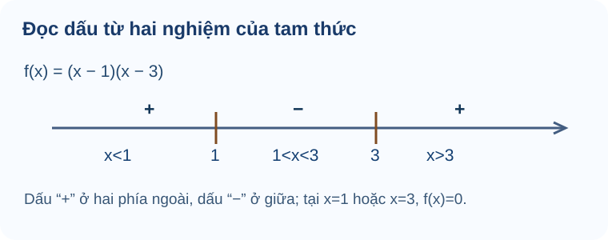

# Bài 17. Dấu của tam thức bậc hai

TOÁN 10 · CHƯƠNG VI · BÀI 17

Từ đồ thị parabol đến định lí dấu, bảng xét dấu và bất phương trình bậc hai — học cách giải thích vì sao một khoảng nghiệm được chọn.

=== "Khám phá kiến thức"

    ### Cùng tìm hiểu

    Ở Bài 16, em đã biết đồ thị hàm số bậc hai là một parabol. Tùy theo hệ số và số nghiệm, parabol có thể nằm hoàn toàn phía trên hoặc phía dưới trục hoành, chỉ chạm trục, hoặc cắt trục ở hai điểm. Vị trí ấy cho biết giá trị hàm số dương hay âm. Với đồ thị \(y=f(x)\), câu hỏi **\(f(x)>0\) khi nào?** cũng là câu hỏi: phần nào của đồ thị ở trên trục \(Ox\)? Điểm nằm trên trục \(Ox\) ứng với \(f(x)=0\). Ta sẽ học cách đọc dấu từ đồ thị, sau đó suy ra quy tắc xét dấu cả khi không vẽ được parabol.

    Với \(f(x)=(x-1)(x-3)\), hai nghiệm là \(1\) và \(3\). Khi \(x<1\), cả hai thừa số âm nên tích dương; khi \(1<x<3\), tích âm; khi \(x>3\), cả hai thừa số dương nên tích dương. Như vậy, chỉ bằng cách xem dấu của từng thừa số, em đã hiểu tại sao tam thức dương ở hai phía ngoài và âm ở khoảng giữa. Quy tắc xét dấu ở phần sau được rút ra từ chính nhận xét này.

    Thử xét \(x=2\) ở khoảng giữa: \((2-1)(2-3)=-1<0\). Hai mốc 1 và 3 làm tích bằng 0. Kết quả này cho thấy phương trình \(f(x)=0\) chỉ cho **ranh giới**, còn bất phương trình yêu cầu **toàn bộ các khoảng phù hợp**. Dấu \(>\) hay \(\ge\) quyết định loại hay giữ các mốc ấy.

    ### Ví dụ trực quan

    **Từ đồ thị đến dấu.**

    Một tam thức \(ax^2+bx+c\) có thể đổi dấu theo giá trị của x. Ta không thể thử lần lượt mọi số thực, nên cần một cách nhận biết dấu trên từng khoảng. Đồ thị parabol và các nghiệm của tam thức sẽ giúp ta làm điều đó.

    Để hiểu phần này, em chỉ cần nhớ đồ thị parabol đã học ở Bài 16, ý nghĩa hệ số a khác 0 và biệt thức \(\Delta=b^2-4ac\) và đồ thị trên/dưới trục hoành.

    Tam thức bậc hai là \(f(x)=ax^2+bx+c\) với a≠0. Dấu của f(x) tại x chính là vị trí đồ thị so với trục Ox; nghiệm f(x)=0 là chỗ giao/tiếp xúc Ox. Số nghiệm được quyết định bởi \(\Delta\), còn hướng mở theo a.

    Bước đầu tiên là kiểm \(a\ne0\). Ta xét **cả dấu \(a\) lẫn \(\Delta\)**: chỉ riêng dấu \(c\) hoặc chỉ riêng số nghiệm chưa đủ để kết luận dấu trên toàn trục số.

    **Vận dụng.** Với \(f(x)=x^2+2x+5\), tính \(\Delta\), xác định số nghiệm thực và dấu f(x) trên \(\mathbb R\).

    

    ??? question "Đối chiếu"

        

<strong>Đáp án:</strong> \(\Delta=2^2-4\cdot1\cdot5=-16&lt;0\). Không có nghiệm thực, và \(f(x)&gt;0\) với mọi x.

<strong>Vì sao:</strong> a=1&gt;0 nên parabol mở lên; không cắt Ox khi Δ&lt;0. Đồng thời \(f(x)=(x+1)^2+4&gt;0\) kiểm chứng trực tiếp.

Đây là câu tự luyện công khai, không chấm điểm thành thạo. Nếu chưa đúng, mở hướng dẫn tự sửa phía dưới.

    

    ??? tip "Kiểm lỗi"

        <ol><li><strong>Nhận diện lỗi:</strong> Chỉ thấy Δ âm mà kết luận f âm; quên xét dấu a.</li>
        <li><strong>Tự chẩn đoán:</strong> Em đã ghi Δ&lt;0 rồi tự kết luận tam thức âm mà chưa nhìn a? So sánh \(x^2+1\) với \(-x^2-1\): cả hai đều có \(\Delta=-4\), nhưng dấu của \(a\) trái nhau.</li>
        <li><strong>Kiến thức gốc:</strong> Tam thức bậc hai là \(f(x)=ax^2+bx+c\) với a≠0. Dấu của f(x) tại x chính là vị trí đồ thị so với trục Ox; nghiệm f(x)=0 là chỗ giao/tiếp xúc Ox. Số nghiệm được quyết định bởi \(\Delta\), còn hướng mở theo a.</li>
        <li><strong>Tự sửa:</strong> Viết hai ô: a dương/âm và Δ âm/bằng 0/dương, rồi mới kết luận theo hình và công thức. Chỉ mở lại đáp án ở trên sau khi đã thử giải một lần không xem gợi ý.</li>
        <li><strong>Luyện lại:</strong> Em có thể <a href="../luyen-tap/?item=THPT-G10-B17-C01">luyện lại một câu Core/Luyện tập cùng kiến thức</a>, rồi tự giải thích bằng lời của mình.</li></ol>
    **Khi parabol chỉ chạm trục hoành.**

    Không phải parabol nào cũng cắt trục hoành tại hai điểm. Có trường hợp nó chỉ chạm trục rồi quay về phía cũ. Khi ấy giá trị hàm số bằng 0 ngay tại điểm chạm, còn ở hai phía của điểm đó, dấu không đổi.

    Để giải thích hiện tượng này, hãy nhớ bình phương của một số luôn không âm và để ý dấu hệ số a. Khi \(\Delta=0\), tam thức có dạng bình phương nhân với \(a\).

    Với \(\Delta=0\), tam thức viết được dưới dạng \(a(x-x_0)^2\). Nó bằng 0 tại x0, có dấu của a ở mọi điểm khác; vì bình phương không âm nên không có sự đổi dấu khi đi qua nghiệm kép.

    Nếu đề yêu cầu nghiêm ngặt \(<0\), phải bỏ điểm chạm vì tại đó biểu thức bằng 0. Với \(\le0\), điểm chạm được giữ: một ký hiệu nhỏ thay đổi tập nghiệm. Cụ thể, đối với tam thức \(f(x)=-3(x-2)^2\), điều kiện \(f(x)<0\) đúng ở mọi nơi trừ \(x=2\).

    **Vận dụng.** Với \(f(x)=-3(x-2)^2\), tìm tập nghiệm của \(f(x)<0\) và của \(f(x)\le0\).

    

    ??? question "Đối chiếu"

        

<strong>Đáp án:</strong> \(f(x)&lt;0\) khi \(x\ne2\); \(f(x)\le0\) với mọi \(x\in\mathbb R\).

<strong>Vì sao:</strong> Do −3 nhân bình phương luôn ≤0, chỉ bằng 0 khi x=2; khi x≠2 tích âm.

Đây là câu tự luyện công khai, không chấm điểm thành thạo. Nếu chưa đúng, mở hướng dẫn tự sửa phía dưới.

    

    ??? tip "Kiểm lỗi"

        <ol><li><strong>Nhận diện lỗi:</strong> Nhầm nghiệm kép làm thay dấu hai phía, hoặc quên loại x0 ở dấu &lt;.</li>
        <li><strong>Tự chẩn đoán:</strong> Em có đổi dấu sau x=2 dù hai phía của bình phương đều dương? Hãy thay x=1 và x=3 vào −3(x−2)².</li>
        <li><strong>Kiến thức gốc:</strong> Với \(\Delta=0\), tam thức viết được dưới dạng \(a(x-x_0)^2\). Nó bằng 0 tại x0, có dấu của a ở mọi điểm khác; vì bình phương không âm nên không có sự đổi dấu khi đi qua nghiệm kép.</li>
        <li><strong>Tự sửa:</strong> Tô đậm điểm x0=2, thay x0 vào f được 0, xét số âm nhân bình phương ở hai phía. Chỉ mở lại đáp án ở trên sau khi đã thử giải một lần không xem gợi ý.</li>
        <li><strong>Luyện lại:</strong> Em có thể <a href="../luyen-tap/?item=THPT-G10-B17-C02">luyện lại một câu Core/Luyện tập cùng kiến thức</a>, rồi tự giải thích bằng lời của mình.</li></ol>
    **Từ bảng dấu đến tập nghiệm.**

    Trong nhiều bài toán, yêu cầu không phải tìm lúc biểu thức bằng 0 mà là tìm mọi giá trị làm nó không vượt quá hoặc đạt ít nhất một mức nào đó. Khi ấy đáp án thường là một khoảng, không chỉ là các nghiệm tại ranh giới.

    Ta bắt đầu từ cách phân tích thành nhân tử và hai nghiệm 2, 3 của \((x-2)(x-3)=0\), dấu tích và khoảng trên trục số.

    Nghiệm của \(f(x)=0\) chia trục số thành những khoảng có dấu cố định. Để giải \(f(x)\le0\), ta chọn những khoảng mà f âm và **lấy cả các nghiệm bằng 0**; với dấu < thì bỏ các đầu mút.

    Với \(a>0\) và hai nghiệm phân biệt, parabol nằm dưới \(Ox\) **giữa hai nghiệm**. Vì thế, yêu cầu \(\le0\) chọn đoạn giữa và hai đầu mút, không chọn hai khoảng ngoài.

    **Vận dụng.** Giải bất phương trình \(x^2-5x+6\le0\).

    

    ??? question "Đối chiếu"

        

<strong>Đáp án:</strong> \(x^2-5x+6=(x-2)(x-3)\le0\Rightarrow x\in[2;3]\).

<strong>Vì sao:</strong> Parabol mở lên nên biểu thức ≤0 ở giữa hai nghiệm 2,3; dấu bằng buộc lấy cả 2 và 3.

Đây là câu tự luyện công khai, không chấm điểm thành thạo. Nếu chưa đúng, mở hướng dẫn tự sửa phía dưới.

    

    ??? tip "Kiểm lỗi"

        <ol><li><strong>Nhận diện lỗi:</strong> Chỉ ghi {2,3} thay vì cả [2,3], hoặc bỏ đầu mút dù dấu ≤.</li>
        <li><strong>Tự chẩn đoán:</strong> Em chỉ ghi x=2, x=3 hay bỏ hai điểm này trong bài có dấu ≤? Hãy thử x=2, x=2,5 và x=3.</li>
        <li><strong>Kiến thức gốc:</strong> Nghiệm của \(f(x)=0\) chia trục số thành những khoảng có dấu cố định. Để giải \(f(x)\le0\), ta chọn những khoảng mà f âm và <strong>lấy cả các nghiệm bằng 0</strong>; với dấu &lt; thì bỏ các đầu mút.</li>
        <li><strong>Tự sửa:</strong> Đặt dấu +−+ qua hai mốc x=2,3, lấy vùng âm cùng hai vị trí bằng 0. Chỉ mở lại đáp án ở trên sau khi đã thử giải một lần không xem gợi ý.</li>
        <li><strong>Luyện lại:</strong> Em có thể <a href="../luyen-tap/?item=THPT-G10-B17-P01">luyện lại một câu Core/Luyện tập cùng kiến thức</a>, rồi tự giải thích bằng lời của mình.</li></ol>
    **Khi điều kiện thực tế còn quyết định đáp án.**

    Các khoảng nghiệm tìm được trong đại số chưa chắc đều có ý nghĩa ngoài thực tế. Chẳng hạn, khi dùng dây rào làm vườn hình chữ nhật, chiều rộng và chiều dài đều phải dương. Ta cần đồng thời đáp ứng yêu cầu diện tích.

    Muốn lập bài toán, em nhớ công thức diện tích S = chiều rộng × chiều dài. Vì chỉ rào ba cạnh sát tường, số mét dây rào được dùng cho hai cạnh rộng x và một cạnh dài L, chứ không phải cả bốn cạnh.

    Với 20 m dây rào ba cạnh sát tường, đặt x là chiều rộng, chiều dài còn lại \(20-2x>0\) đòi \(0<x<10\). Diện tích \(S(x)=x(20-2x)\). Bất phương trình S≥48 cho khoảng x, nhưng phải **giao với miền hình học** trước khi kết luận.

    Trước khi giải, viết điều kiện \(0<x<10\) từ hai độ dài phải dương; sau khi giải \(S(x)\ge48\), lấy giao với miền đó. Nhờ vậy, các giá trị toán học không phù hợp hình chữ nhật sẽ bị loại.

    **Vận dụng.** Có 20 m lưới rào ba cạnh hình chữ nhật sát tường. Gọi x (m) là chiều rộng vuông góc tường. Muốn diện tích ít nhất \(48\,\mathrm{m}^2\), x được chọn trong khoảng nào?

    

    ??? question "Đối chiếu"

        

<strong>Đáp án:</strong> \(S=x(20-2x)\ge48\Leftrightarrow -2(x-4)(x-6)\ge0\Leftrightarrow x\in[4;6]\) (m), đã thuộc \(0&lt;x&lt;10\).

<strong>Vì sao:</strong> Hai cạnh rộng x sử dụng 2x m lưới, cạnh còn lại 20−2x; dấu ≥ lấy hai đầu x=4,6 đều cho 48 m².

Đây là câu tự luyện công khai, không chấm điểm thành thạo. Nếu chưa đúng, mở hướng dẫn tự sửa phía dưới.

    

    ??? tip "Kiểm lỗi"

        <ol><li><strong>Nhận diện lỗi:</strong> Bỏ điều kiện x&gt;0, 20−2x&gt;0, hoặc dùng cả bốn cạnh rào.</li>
        <li><strong>Tự chẩn đoán:</strong> Em có nhận x≤0 hoặc x≥10 là chiều rộng hợp lệ? Hãy đọc lại 2x+L=20, yêu cầu cả x và L đều dương.</li>
        <li><strong>Kiến thức gốc:</strong> Với 20 m dây rào ba cạnh sát tường, đặt x là chiều rộng, chiều dài còn lại \(20-2x&gt;0\) đòi \(0&lt;x&lt;10\). Diện tích \(S(x)=x(20-2x)\). Bất phương trình S≥48 cho khoảng x, nhưng phải <strong>giao với miền hình học</strong> trước khi kết luận.</li>
        <li><strong>Tự sửa:</strong> Vẽ ba đoạn lưới, viết 2x+L=20 rồi S=xL; cuối cùng kiểm từng nghiệm biên hợp hình. Chỉ mở lại đáp án ở trên sau khi đã thử giải một lần không xem gợi ý.</li>
        <li><strong>Luyện lại:</strong> Em có thể <a href="../luyen-tap/?item=THPT-G10-B17-P04">luyện lại một câu Core/Luyện tập cùng kiến thức</a>, rồi tự giải thích bằng lời của mình.</li></ol>
    **Khi một bất phương trình phải đúng với mọi số thực.**

    Có bài yêu cầu tam thức dương với **mọi** giá trị x, không chỉ với vài giá trị em thử. Vì thế ta cần một điều kiện bảo đảm parabol luôn nằm phía trên trục hoành, kể cả ở điểm thấp nhất của nó.

    Trước khi làm, em nhắc lại \(\Delta=b^2-4ac\) và định lí dấu: với \(a>0\), \(\Delta<0\) thì tam thức dương mọi x. **Lưu ý về phạm vi bài học:** Trong các bài toán tam thức bậc hai cơ bản, hệ số a cố định và khác 0; nếu a phụ thuộc tham số và có thể bằng 0 thì đó là trường hợp cần xem xét riêng, không áp dụng ngay bảng dấu của tam thức bậc hai.

    Xét \(f_m(x)=x^2+2mx+4\). Do hệ số trước x² luôn \(1>0\), để \(f_m(x)>0\) với mọi \(x\in\mathbb R\) cần và đủ parabol mở lên **không chạm, không cắt** Ox: \(\Delta<0\). Nếu dấu yêu cầu là ≥0 thì \(\Delta\le0\) cũng được; phân biệt dấu là bản chất.

    Ở đây \(a=1>0\) **không phụ thuộc tham số**. Do đó, điều kiện \(f_m(x)>0\) với mọi \(x\) tương đương \(\Delta(m)<0\); nếu hệ số trước \(x^2\) có thể bằng 0 thì phải xét riêng trước khi dùng định lí.

    **Vận dụng.** Tìm mọi \(m\in\mathbb R\) để \(x^2+2mx+4>0\) với mọi \(x\in\mathbb R\).

    

    ??? question "Đối chiếu"

        

<strong>Đáp án:</strong> Vì a=1&gt;0, yêu cầu tương đương \(\Delta=(2m)^2-4\cdot1\cdot4=4m^2-16&lt;0\), nên \(-2&lt;m&lt;2\).

<strong>Vì sao:</strong> Điều kiện tương đương m²&lt;4. Nếu m=±2 thì Δ=0, tam thức chạm Ox và bằng 0 tại một x nên không thỏa dấu nghiêm ngặt &gt;0.

Đây là câu tự luyện công khai, không chấm điểm thành thạo. Nếu chưa đúng, mở hướng dẫn tự sửa phía dưới.

    

    ??? tip "Kiểm lỗi"

        <ol><li><strong>Nhận diện lỗi:</strong> Nhầm Δ≤0 với Δ&lt;0 trong điều kiện “&gt;0 mọi x”, hoặc tự mở rộng sang a(m)=0.</li>
        <li><strong>Tự chẩn đoán:</strong> Em có chọn m=2 trong lời giải f_m(x)&gt;0 mọi x? Hãy thay m=2, tìm x sao cho f_m(x)=0 để thấy biên bị loại.</li>
        <li><strong>Kiến thức gốc:</strong> Xét \(f_m(x)=x^2+2mx+4\). Do hệ số trước x² luôn \(1&gt;0\), để \(f_m(x)&gt;0\) với mọi \(x\in\mathbb R\) cần và đủ parabol mở lên <strong>không chạm, không cắt</strong> Ox: \(\Delta&lt;0\). Nếu dấu yêu cầu là ≥0 thì \(\Delta\le0\) cũng được; phân biệt dấu là bản chất.</li>
        <li><strong>Tự sửa:</strong> Thử m=2 để thấy nghiệm kép làm f bằng 0; khóa a=1 cố định, giải riêng Δ&lt;0. Chỉ mở lại đáp án ở trên sau khi đã thử giải một lần không xem gợi ý.</li>
        <li><strong>Luyện lại:</strong> Em có thể <a href="../luyen-tap/?item=THPT-G10-B17-P03">luyện lại một câu Core/Luyện tập cùng kiến thức</a>, rồi tự giải thích bằng lời của mình.</li></ol>
    ### Thuật ngữ, kiến thức và kỹ năng

    **Thuật ngữ:** Tam thức bậc hai với \(a\ne0\), biệt thức \(\Delta\), nghiệm phân biệt, nghiệm kép, bảng xét dấu, bất phương trình bậc hai.

    **Sau bài học, em cần làm được:** Kiểm tra \(a\ne0\), tìm nghiệm và xét dấu theo từng khoảng; phân biệt parabol cắt trục và tiếp xúc trục \(Ox\); giải bất phương trình và đối chiếu điều kiện thực tế.

=== "Kiến thức SGK"

    ### 2.1. Dấu của tam thức bậc hai

    Tam thức bậc hai theo biến \(x\) là biểu thức

    \[
    f(x)=ax^2+bx+c,\quad a\ne0.
    \]

    
<strong>Khái niệm — Tam thức bậc hai:</strong> Một biểu thức dạng \(ax^2+bx+c\) được gọi là tam thức bậc hai khi hệ số của \(x^2\) khác 0, tức \(a\ne0\). Điều kiện này giúp phân biệt tam thức bậc hai với biểu thức bậc nhất hoặc hằng số.

    Đặt \(\Delta=b^2-4ac\). Để xét dấu tam thức, cần biết dấu của hệ số \(a\) và số nghiệm thực của \(f(x)=0\). Đồ thị \(y=f(x)\) là một parabol: phía **trên trục hoành** biểu diễn \(f(x)>0\), phía **dưới** biểu diễn \(f(x)<0\).

    #### Định lí về dấu của tam thức bậc hai

    Khi \(\Delta>0\) có hai nghiệm \(x_1<x_2\), ta viết được \(f(x)=a(x-x_1)(x-x_2)\). **Ở ngoài** hai nghiệm, hai thừa số cùng dấu; **ở giữa**, chúng trái dấu. Vì thế, ngoài hai nghiệm tam thức cùng dấu với \(a\), giữa hai nghiệm trái dấu với \(a\). Trường hợp nghiệm kép thì \((x-x_0)^2\) không đổi dấu qua \(x_0\).

    Với \(\Delta<0\), dạng hoàn thành bình phương

    \[
    f(x)=a\left[\left(x+\frac{b}{2a}\right)^2-\frac{\Delta}{4a^2}\right]
    \]

    có biểu thức trong ngoặc vuông dương với mọi \(x\) vì \(-\Delta>0\). Điều này giải thích vì sao dấu \(f(x)\) luôn là dấu của \(a\), thay vì chỉ học mẹo.

    **Kiến thức cần nhớ.** Trước khi lập bảng dấu: kiểm \(a\ne0\), tính \(\Delta\), sắp hai nghiệm (nếu có) và đặt dấu \(0\) đúng tại nghiệm.

    
<table class="thpt-g10-knowledge-table">
    <thead><tr><th>Biệt thức</th><th>Nghiệm thực của \(f(x)=0\)</th><th>Dấu \(f(x)\)</th></tr></thead>
    <tbody>
    <tr><td>\(\Delta&lt;0\)</td><td>Không có</td><td>Luôn <strong>cùng dấu</strong> với \(a\) trên \(\mathbb R\)</td></tr>
    <tr><td>\(\Delta=0\)</td><td>Nghiệm kép \(x_0=-b/(2a)\)</td><td>Bằng \(0\) tại \(x_0\); <strong>cùng dấu</strong> với \(a\) ở mọi nơi khác</td></tr>
    <tr><td>\(\Delta&gt;0\)</td><td>Hai nghiệm \(x_1&lt;x_2\)</td><td><strong>Cùng dấu</strong> \(a\) khi \(x&lt;x_1\) hoặc \(x&gt;x_2\); <strong>trái dấu</strong> \(a\) khi \(x_1&lt;x&lt;x_2\); bằng \(0\) tại \(x_1,x_2\)</td></tr>
    </tbody></table>

    
<strong>Định lí — Dấu của tam thức bậc hai:</strong> Nếu \(\Delta<0\), tam thức luôn cùng dấu với \(a\). Nếu \(\Delta=0\), tam thức bằng 0 tại nghiệm kép và cùng dấu với \(a\) ở các điểm khác. Nếu \(\Delta>0\), tam thức bằng 0 tại hai nghiệm; ngoài hai nghiệm cùng dấu với \(a\), giữa hai nghiệm trái dấu với \(a\).

    **Mẹo nhớ sau khi hiểu:** Với hai nghiệm phân biệt, *ngoài cùng dấu \(a\); trong trái dấu \(a\)*. Khi \(\Delta=0\) hoặc \(\Delta<0\) không được vẽ nhầm ba khoảng như trường hợp hai nghiệm.

    **Ví dụ 1.** Xét \(f(x)=-x^2+4x-3=-(x-1)(x-3)\). Ta có \(a=-1\), hai nghiệm \(1<3\). Vì vậy \(f(x)<0\) trên \((-\infty;1)\cup(3;+\infty)\), \(f(x)>0\) trên \((1;3)\) và \(f(x)=0\) tại \(x=1,3\).

    **Ví dụ 2.** \(g(x)=x^2-2x+1=(x-1)^2\ge0\) với mọi \(x\). Dấu bằng chỉ xảy ra tại \(x=1\) (\(\Delta=0\)). Không được nói \(g(x)>0\) với mọi \(x\).

    #### Bảng xét dấu

    <figure class="thpt-r4-plot thpt-r4-concept-figure"><figcaption>Với \(f(x)=(x-1)(x-3)\), hai nghiệm \(1\) và \(3\) chia trục số thành ba miền. Dấu \(+, -, +\) đúng cho tam thức có hai nghiệm này và hệ số bậc hai dương.</figcaption></figure>

    **Cách đọc hình.** Đi theo trục số từ trái sang phải: trước mốc \(1\) là dấu \(+\), giữa \(1\) và \(3\) là dấu \(-\), sau mốc \(3\) lại là dấu \(+\). Ngay tại \(1\) và \(3\), giá trị bằng \(0\), không phải dương hay âm. Đây là **một trường hợp** \(a>0,\ \Delta>0\); nếu \(a<0\) phải đảo hai dấu \(+\) và \(-\).

    Trên bảng xét dấu, mỗi nghiệm của tam thức là điểm phân chia khoảng; tại nghiệm thì giá trị bằng \(0\). Với \(\Delta>0\) và \(x_1<x_2\), dấu được xác định như sau:

    
<table class="thpt-g10-knowledge-table">
    <thead><tr><th>Vị trí</th><th>\((-\infty;x_1)\)</th><th>\(x_1\)</th><th>\((x_1;x_2)\)</th><th>\(x_2\)</th><th>\((x_2;+\infty)\)</th></tr></thead>
    <tbody>
    <tr><td>Nếu \(a&gt;0\)</td><td>\(+\)</td><td>\(0\)</td><td>\(-\)</td><td>\(0\)</td><td>\(+\)</td></tr>
    <tr><td>Nếu \(a&lt;0\)</td><td>\(-\)</td><td>\(0\)</td><td>\(+\)</td><td>\(0\)</td><td>\(-\)</td></tr>
    </tbody></table>

    Khi \(\Delta=0\), không xuất hiện khoảng đổi dấu qua nghiệm kép; khi \(\Delta<0\), tam thức không có nghiệm và giữ nguyên dấu của \(a\). Cần xét đúng biểu thức **tam thức bậc hai**, không tự áp dụng bảng này cho phân thức nếu chưa xét cả dấu mẫu số.

    **Ví dụ 2b — Nghiệm kép.** \(f(x)=-2(x+1)^2\le0\) với mọi \(x\in\mathbb R\), bằng \(0\) duy nhất tại \(x=-1\). Do đó \(f(x)<0\) có tập nghiệm \(\mathbb R\setminus\{-1\}\), còn \(f(x)\le0\) có tập nghiệm \(\mathbb R\).

    **Ví dụ 2c — Không có nghiệm thực.** \(g(x)=-2x^2+4x-5=-2(x-1)^2-3<0\) với mọi \(x\). Đây là ví dụ \(\Delta<0\), \(a<0\); nó cũng cho thấy định lí dấu phù hợp với dạng bình phương hoàn chỉnh.

    ### 2.2. Bất phương trình bậc hai

    Giải bất phương trình \(ax^2+bx+c\ >,\ge,<,\le\ 0\) bằng quy trình. Riêng khi tìm nghiệm \(f(x)\le0\), phải gom cả các điểm mà \(f(x)=0\) vào các khoảng âm (nếu có):

    1. Xác định \(a\) và \(\Delta\), tìm các nghiệm thực của tam thức (nếu có).
    2. Lập các khoảng và xét dấu theo định lí.
    3. Chọn khoảng có dấu đúng theo yêu cầu. Với \(\ge\) hoặc \(\le\), lấy thêm các nghiệm bằng \(0\); với \(>\) hoặc \(<\), loại các mốc nghiệm. Hai dấu không nghiêm ngặt \(\ge,\le\) đều cho phép lấy nghiệm bằng 0.
    4. Kiểm tra điều kiện của biến nếu bài có tình huống thực tế.

    **Ví dụ 3.** Giải \(-x^2+4x-3\ge0\). Từ Ví dụ 1, tam thức dương trên \((1;3)\), bằng 0 tại \(1,3\); vậy nghiệm là \(\boxed{[1;3]}\).

=== "Ví dụ"

    ### Ví dụ — Từ bảng dấu đến tập nghiệm

    **Đề bài.** Giải \((x-1)(x-3)\le0\).

    **Phân tích:** Biểu thức đã phân tích thành tích nên xét dấu từng thừa số theo hai nghiệm 1 và 3 trực tiếp hơn khai triển.

    **Lời giải.** Với \(x<1\), hai thừa số âm nên tích dương. Với \(1<x<3\), tích âm. Với \(x>3\), tích dương. Tại \(x=1,3\) tích bằng 0. Vì đề yêu cầu \(\le0\), tập nghiệm là \([1,3]\).

    **Kiểm lại:** Thử \(x=2\) được \((2-1)(2-3)=1\cdot(-1)=-1\le0\), nên 2 thuộc tập nghiệm. Thử \(x=0\) được \((-1)(-3)=3>0\), nên 0 không thuộc tập nghiệm. Hai phép thử phù hợp với bảng dấu.

    **Vận dụng.** Em tự giải ba câu dưới đây bằng quy tắc xét dấu, sau đó mới mở phần Đối chiếu.

    1. Xét dấu \(h(x)=2x^2+3x+5\) trên \(\mathbb R\).
    2. Giải \(x^2-5x+6<0\).
    3. Giải \(-(x-2)^2\le0\).

    ??? question "Đối chiếu ba câu Vận dụng"

        <ol>
        <li>\(\Delta=9-40=-31<0\), \(a=2>0\) nên \(h(x)>0\) với mọi \(x\in\mathbb R\).</li>
        <li>\((x-2)(x-3)<0\iff 2<x<3\).</li>
        <li>\(-(x-2)^2\le0\) với mọi số thực \(x\), nên tập nghiệm là \(\mathbb R\); dấu bằng tại \(x=2\).</li>
        </ol>

    ### Ví dụ — Rào vườn 18 m

    **Đề bài.** Dùng \(18\) m lưới rào ba cạnh một hình chữ nhật sát bức tường. Gọi \(x\) (m) là chiều rộng vuông góc tường, \(0<x<9\); chiều còn lại là \(18-2x\). Diện tích \(S(x)=x(18-2x)\). Hãy tìm các giá trị của \(x\) để diện tích \(S(x)\ge36\) m².

    **Phân tích:** Ba cạnh dùng lưới nên cạnh dọc tường là \(18-2x\), khác với bài rào bốn cạnh. Cần giữ \(0<x<9\) trước khi giải, rồi giao nghiệm đại số với miền chiều dài dương.

    **Lời giải.** Từ điều kiện về diện tích, ta giải

    \[
    -2x^2+18x-36\ge0
    \iff x^2-9x+18\le0
    \iff (x-3)(x-6)\le0.
    \]

    Suy ra \(\boxed{3\le x\le6}\) (m); cả hai đầu mút đều nằm trong \(0<x<9\). Ở hai biên ta được \(S(3)=S(6)=36\,\mathrm{m}^2\); chọn \(x=4\) thì \(S(4)=40\,\mathrm{m}^2\). Phép thế này kiểm lại cả hai dấu bằng và một giá trị ở giữa.

    ### Ví dụ mở rộng — Khi bất phương trình đi cùng thời gian thực tế

    Với bài toán chuyển động, nghiệm đại số chưa phải câu trả lời cuối cùng: **thời gian không âm**, và mô hình độ cao chỉ áp dụng trong khoảng vật đang bay. Đây là lý do ta phải xác định miền thời gian trước khi chọn tập nghiệm.

    **Đề bài.** Một quả bóng được ném lên từ độ cao \(5\) m. Trong thời gian bay, độ cao (m) sau \(t\) giây được mô tả bởi \(h(t)=-5t^2+20t+5\). Hỏi quả bóng ở độ cao **ít nhất \(20\) m** trong khoảng thời gian nào?

    **Phân tích:** Thời gian là đại lượng không âm và chỉ xét khi bóng còn bay. Ta sẽ xác định khoảng thời gian mô hình có ý nghĩa trước, rồi giải bất phương trình thể hiện cụm từ *ít nhất 20 m*.

    **Lời giải.**

    **Bước 1 — điều kiện mô hình.** \(t\ge0\) và quả bóng còn ở trên mặt đất, tức \(h(t)\ge0\). Giải \(h(t)=0\) được \(t=2\pm\sqrt5\), nên thời gian bay theo mô hình là \(0\le t\le2+\sqrt5\) (giây).

    **Bước 2 — chuyển câu hỏi thành bất phương trình.** Cụm từ *ít nhất 20 m* nghĩa là \(h(t)\ge20\), không phải \(h(t)=20\). Ta có

    \[
    -5t^2+20t+5\ge20
    \iff -5(t-1)(t-3)\ge0
    \iff (t-1)(t-3)\le0.
    \]

    **Bước 3 — xét dấu và giao miền.** Tích không dương trên \([1;3]\). Khoảng này nằm trọn trong miền bay \(0\le t\le2+\sqrt5\), nên đáp án là **từ giây thứ 1 đến hết giây thứ 3**.

    **Tự kiểm:** \(h(1)=h(3)=20\) m, \(h(2)=25\) m, còn \(h(0)=5\) m. Nhờ đó em kiểm được dấu \(\ge\) phải lấy hai đầu mút và không được chọn mọi thời điểm ngoài khoảng bay.

    **Ghi nhớ cách áp dụng:** Khi đại lượng cần đạt một ngưỡng (*ít nhất*, *không vượt quá*, *lớn hơn*…), hãy lập bất phương trình, giải theo dấu tam thức rồi **giao với miền có ý nghĩa** của đại lượng. Không dùng những nghiệm chỉ đúng về đại số nhưng vô nghĩa về vật lí.

    ### Ví dụ mở rộng — Bất phương trình có tham số: khi nào đúng với mọi số thực?

    Đối với một tam thức \(f(x)=ax^2+bx+c\) có \(a>0\), điều kiện để \(f(x)>0\) với **mọi** \(x\in\mathbb R\) là \(\Delta<0\). Nếu chỉ yêu cầu \(f(x)\ge0\) với mọi \(x\), điều kiện là \(\Delta\le0\). Khi \(a<0\), các mệnh đề tương tự áp dụng cho dấu \(<0\) hoặc \(\le0\).

    **Đề bài.** Tìm \(m\) để

    \[
    x^2-2(m+1)x+m^2+3>0
    \]

    đúng với mọi \(x\in\mathbb R\).

    **Phân tích:** Hệ số \(a=1\) không đổi theo \(m\); yêu cầu \(>0\) với *mọi* \(x\) buộc parabol không được cắt **hoặc chạm** trục hoành. Vì thế điều kiện đúng là \(\Delta<0\), không phải \(\Delta\le0\).

    **Lời giải.** Vì \(a=1>0\), ta cần

    \[
    \Delta=[-2(m+1)]^2-4(m^2+3)=8(m-1)<0.
    \]

    Suy ra \(\boxed{m<1}\). Nếu \(m=1\), tam thức có nghiệm kép và bằng \(0\) tại một điểm nên **không** thỏa dấu \(>\).

    **Tự mở rộng.** Nếu hệ số bậc hai cũng phụ thuộc tham số, hãy thử nghĩ điều gì xảy ra khi hệ số đó bằng 0.

    ??? question "Nếu hệ số bậc hai cũng phụ thuộc tham số thì sao?"

        
Quy tắc xét dấu tam thức bậc hai chỉ dùng khi <strong>hệ số của x² khác 0</strong>. Nếu hệ số này phụ thuộc tham số m, trước tiên hãy xét riêng các giá trị m khiến nó bằng 0. Khi ấy biểu thức trở thành bậc nhất hoặc hằng số, cần xử lý riêng; với các giá trị m còn lại, mới áp dụng dấu của hệ số bậc hai và biệt thức Δ. Đây là cách kiểm tra điều kiện áp dụng phương pháp.

    [Chuyển đến Luyện tập và Vận dụng Chương VI](luyen-tap.md) để làm bài củng cố. Em có thể mở gợi ý và lời giải sau khi đã tự thử.

=== "Lỗi thường gặp"

    **Kiểm lỗi:** Các lỗi thường gặp được giải thích ngay sau từng hoạt động ở tab Khám phá kiến thức. Chọn mục tương ứng để xem lại: [Kiểm lỗi 1](#help-g10-chvi-try11) · [Kiểm lỗi 2](#help-g10-chvi-try12) · [Kiểm lỗi 3](#help-g10-chvi-try13) · [Kiểm lỗi 4](#help-g10-chvi-try15) · [Kiểm lỗi 5](#help-g10-chvi-try14).

    **Học tiếp:** [Core và Luyện tập](luyen-tap.md) · [Tự kiểm tra cuối chương](tu-kiem-tra-chuong.md).

    
Nguồn toán học: SGK Toán 10 Kết nối tri thức với cuộc sống và học liệu SLM hiện hành. Lời giảng được biên tập nhằm hỗ trợ tự học độc lập.

