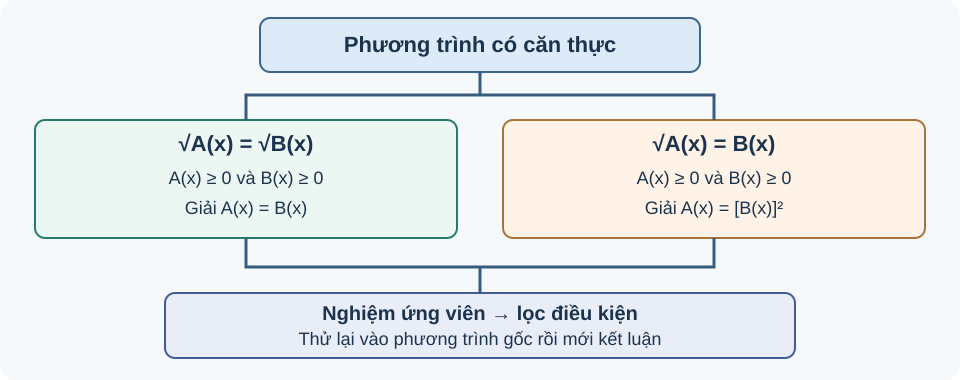

# Bài 18. Phương trình quy về phương trình bậc hai

TOÁN 10 · CHƯƠNG VI · BÀI 18

Học cách giải phương trình chứa căn, xét điều kiện xác định và loại nghiệm không thỏa phương trình ban đầu.

<nav class="thpt-r4-lesson-tabs" aria-label="Điều hướng Chương VI"><a href="../">Chương VI</a><a href="../bai-17/">Bài 17</a>Bài 18 · Phương trình chứa căn</nav>

## 1. Vì sao phải kiểm tra nghiệm?

Bình phương hai vế phương trình là phép biến đổi **không luôn tương đương** nếu không kiểm soát dấu. Ví dụ từ \(x=1\) suy ra \(x^2=1\), nhưng chiều ngược lại không đúng vì \(x=-1\) cũng thỏa \(x^2=1\).

Để giải phương trình chứa căn, phải đặt điều kiện, biến đổi và **thử lại nghiệm trong phương trình ban đầu**.

<!-- G10_CHVI_R04_BEGIN:B18_OUT_01 -->
### Hai căn bằng nhau phải có nghĩa trước khi bình phương

<figure class="thpt-r4-plot thpt-r4-probability-figure"><figcaption>Đọc từ điều kiện đến nghiệm ứng viên, rồi luôn kiểm lại trong phương trình gốc.</figcaption></figure>

**Vì sao cần học?** Phép bình phương giúp bỏ căn nhưng căn bậc hai trong số thực chỉ xác định khi biểu thức dưới căn không âm; không thể coi nghiệm đại số là nghiệm thật nếu căn vô nghĩa.

**Em đã biết gì?** Nhớ \(\sqrt u\) chỉ xác định khi u≥0 và luôn không âm; biết giải phương trình bậc nhất. Em có thể học các kiến thức tiền đề ngay trong bài.

**Hiểu bản chất trước công thức** Với \(\sqrt{A(x)}=\sqrt{B(x)}\), đầu tiên yêu cầu \(A(x)\ge0\) và \(B(x)\ge0\). Sau đó hai căn không âm bằng nhau **khi và chỉ khi** \(A(x)=B(x)\) trong miền; đây là phép đổi tương đương *sau khi* đặt điều kiện.

**Cách đọc hình và hình dung** Đọc đường dẫn giải B18 như luồng hai nhánh: kiểm hai miền căn → giải A=B → thử lại. Cả hai biểu thức dưới căn có thể khác nhau ở đầu vào không hợp lệ. 

**Vì sao chọn phương pháp này?** Đặt điều kiện cho **cả hai** căn rồi mới giải phương trình; không được giữ nghiệm ngoài miền.

**Tự thử trước Core** Giải \(\sqrt{x+1}=\sqrt{2x-2}\) trong \(\mathbb R\).

Em đã tự thử? Mở đáp án để đối chiếu

<strong>Đáp án:</strong> Điều kiện \(x+1\ge0,\,2x-2\ge0\Rightarrow x\ge1\). Bình phương: \(x+1=2x-2\Rightarrow x=3\). Thử: hai vế đều bằng 2. Nghiệm duy nhất x=3.

<strong>Vì sao:</strong> x=3 hợp miền x≥1, biểu thức dưới căn đều bằng 4; không có nghiệm nào khác vì phương trình tuyến tính A=B chỉ cho x=3.

Đây là câu tự luyện công khai, không chấm điểm thành thạo. Nếu chưa đúng, mở hướng dẫn tự sửa phía dưới.

Gợi ý khắc phục khi chưa làm được — 5 bước
<ol><li><strong>Nhận diện lỗi:</strong> Chỉ đặt điều kiện một căn hoặc giải A=B rồi không kiểm miền.</li>
<li><strong>Tự chẩn đoán:</strong> Em có đang mắc đúng lỗi này trong lời giải bài vừa thử không? Hãy khoanh bước đầu tiên chuyển từ dữ kiện sang kết luận mà em chưa chứng minh được.</li>
<li><strong>Kiến thức gốc:</strong> Với \(\sqrt{A(x)}=\sqrt{B(x)}\), đầu tiên yêu cầu \(A(x)\ge0\) và \(B(x)\ge0\). Sau đó hai căn không âm bằng nhau <strong>khi và chỉ khi</strong> \(A(x)=B(x)\) trong miền; đây là phép đổi tương đương *sau khi* đặt điều kiện.</li>
<li><strong>Tự sửa:</strong> Khoanh cả A(x),B(x), lập hai dấu ≥0, giao miền rồi mới biến đổi và thử. Chỉ mở lại đáp án ở trên sau khi đã thử giải một lần không xem gợi ý.</li>
<li><strong>Luyện lại (không nhân bản câu):</strong> Em có thể <a href="../luyen-tap/?item=THPT-G10-B18-C02">luyện lại một câu Core/Luyện tập cùng kiến thức</a>, rồi tự giải thích bằng lời của mình.</li></ol>

<!-- G10_CHVI_R04_END:B18_OUT_01 -->

## 2. Phương trình dạng \(\sqrt{A(x)}=\sqrt{B(x)}\)

Phương trình tương đương với hệ điều kiện

\[
A(x)=B(x),\qquad A(x)\ge0,\quad B(x)\ge0.
\]

**Quy trình:** giải \(A(x)=B(x)\), giữ lại các nghiệm làm hai biểu thức dưới căn không âm, rồi kiểm tra trong phương trình ban đầu.

**Ví dụ 1.**

\[
\sqrt{x^2-3x+4}=\sqrt{x+2}.
\]

Bình phương được \(x^2-3x+4=x+2\), suy ra \(x^2-4x+2=0\). Hai nghiệm ứng viên \(x=2\pm\sqrt2\). Vì cả hai đều lớn hơn \(-2\), biểu thức \(x+2\ge0\); thay trở lại cho thấy hai vế căn bằng nhau. Vậy \(\boxed{x=2-\sqrt2\text{ hoặc }x=2+\sqrt2}\).

<!-- G10_CHVI_R04_BEGIN:B18_OUT_02 -->
### Một căn bằng biểu thức thường: vế phải phải không âm

**Vì sao cần học?** Một căn thức thực không bao giờ âm. Do đó nếu nó bằng một biểu thức \(B(x)\), bản thân \(B(x)\) phải không âm, điều thường bị mất khi bình phương.

**Em đã biết gì?** Biết \(\sqrt u\ge0\), giải phương trình bậc hai nhân tử và thử nghiệm. Em có thể học các kiến thức tiền đề ngay trong bài.

**Hiểu bản chất trước công thức** Với \(\sqrt{A(x)}=B(x)\), phải có \(B(x)\ge0\) (và \(A(x)\ge0\)); sau đó bình phương \(A(x)=B(x)^2\), giải và kiểm. Bình phương tự nó không bảo đảm mọi nghiệm ứng viên có dấu đúng.

**Cách đọc hình và hình dung** Theo sơ đồ quy trình B18, vòng kiểm \("B(x)\ge0"\) đứng **trước** phép bình phương, vòng thử lại đứng **sau** nghiệm đại số. Không coi một đẳng thức bình phương là bằng nhau về dấu. 

**Vì sao chọn phương pháp này?** Dùng phương trình bình phương làm bước tìm **ứng viên**, không làm kết luận cuối; luôn lọc điều kiện và thử lại trên phương trình gốc.

**Tự thử trước Core** Giải \(\sqrt{x+5}=x-1\).

Em đã tự thử? Mở đáp án để đối chiếu

<strong>Đáp án:</strong> Phải có \(x-1\ge0\Rightarrow x\ge1\). Bình phương: \(x+5=(x-1)^2\Leftrightarrow x^2-3x-4=0\Rightarrow x=4\) hoặc \(x=-1\). Chỉ x=4 hợp lệ, thử \(\sqrt9=3=4-1\).

<strong>Vì sao:</strong> x=-1 bị loại vì vế phải −2 âm. Nghiệm duy nhất x=4 dù phương trình bình phương có hai nghiệm.

Đây là câu tự luyện công khai, không chấm điểm thành thạo. Nếu chưa đúng, mở hướng dẫn tự sửa phía dưới.

Gợi ý khắc phục khi chưa làm được — 5 bước
<ol><li><strong>Nhận diện lỗi:</strong> Giữ nghiệm x=−1 chỉ vì nghiệm phương trình sau bình phương.</li>
<li><strong>Tự chẩn đoán:</strong> Em có đang mắc đúng lỗi này trong lời giải bài vừa thử không? Hãy khoanh bước đầu tiên chuyển từ dữ kiện sang kết luận mà em chưa chứng minh được.</li>
<li><strong>Kiến thức gốc:</strong> Với \(\sqrt{A(x)}=B(x)\), phải có \(B(x)\ge0\) (và \(A(x)\ge0\)); sau đó bình phương \(A(x)=B(x)^2\), giải và kiểm. Bình phương tự nó không bảo đảm mọi nghiệm ứng viên có dấu đúng.</li>
<li><strong>Tự sửa:</strong> Kiểm vế phải x−1≥0 trước khi xét nghiệm; thử tất cả ứng viên vào hai vế phương trình gốc. Chỉ mở lại đáp án ở trên sau khi đã thử giải một lần không xem gợi ý.</li>
<li><strong>Luyện lại (không nhân bản câu):</strong> Em có thể <a href="../luyen-tap/?item=THPT-G10-B18-P01">luyện lại một câu Core/Luyện tập cùng kiến thức</a>, rồi tự giải thích bằng lời của mình.</li></ol>

<!-- G10_CHVI_R04_END:B18_OUT_02 -->

## 3. Phương trình dạng \(\sqrt{A(x)}=B(x)\)

Vì vế trái không âm, phương trình tương đương với

\[
\begin{cases}
A(x)=B(x)^2,\\
B(x)\ge0.
\end{cases}
\]

Khi hai điều kiện này thỏa, \(A(x)=B(x)^2\ge0\) cũng bảo đảm căn có nghĩa.

**Quy trình 4 bước:** (1) đặt điều kiện \(B(x)\ge0\) và miền xác định nếu cần; (2) bình phương đưa về phương trình bậc hai (hoặc bậc nhất); (3) giải tìm nghiệm ứng viên; (4) **loại nghiệm không thỏa điều kiện và thử lại**.

**Ví dụ 2.**

\[
\sqrt{2x+3}=x-1.
\]

Điều kiện \(x\ge1\). Bình phương: \(2x+3=(x-1)^2\), hay \(x^2-4x-2=0\). Nghiệm ứng viên \(x=2\pm\sqrt6\). Vì \(2-\sqrt6<1\), loại nghiệm này; \(2+\sqrt6\ge1\) thỏa phương trình gốc. Vậy \(\boxed{x=2+\sqrt6}\).

<!-- G10_CHVI_R04_BEGIN:B18_OUT_03 -->
### Nghiệm ngoại lai xuất hiện từ phép không tương đương

**Vì sao cần học?** Biến đổi đại số đôi khi cho một nghiệm thỏa phương trình mới nhưng không thỏa phương trình ban đầu. Học sinh cần tự đối chứng thay vì tin vào bước bình phương.

**Em đã biết gì?** Nhớ \(\sqrt{u^2}=|u|\), phép bình phương và dấu căn không âm; phân biệt ứng viên với nghiệm hợp lệ. Em có thể học các kiến thức tiền đề ngay trong bài.

**Hiểu bản chất trước công thức** Nếu \(A=B^2\) thì chỉ có \(|B|=\sqrt A\), chưa chắc \(\sqrt A=B\). Lý do có nghiệm ngoại lai là phép bình phương làm mất thông tin dấu. Một nghiệm cuối phải thỏa miền và phương trình gốc.

**Cách đọc hình và hình dung** Trong đường suy luận B18, dùng màu/nhãn “ứng viên” sau bước bình phương, chỉ chuyển sang “nghiệm” khi kiểm đúng dấu và giá trị hai vế. 

**Vì sao chọn phương pháp này?** Đừng chỉ kiểm phương trình bình phương; thay trực tiếp vào phương trình có căn ban đầu mới chứng minh hợp lệ.

**Tự thử trước Core** Giải \(\sqrt{2x+3}=x\) và chỉ ra nghiệm ngoại lai do bình phương.

Em đã tự thử? Mở đáp án để đối chiếu

<strong>Đáp án:</strong> Điều kiện \(x\ge0\). Bình phương \(2x+3=x^2\Leftrightarrow(x-3)(x+1)=0\), ứng viên x=3,−1. Thử: x=3 cho \(\sqrt9=3\), x=−1 làm vế phải âm (và \(\sqrt1=1\ne-1\)). Nghiệm duy nhất x=3; x=−1 ngoại lai.

<strong>Vì sao:</strong> Bình phương tạo x=−1 dù hai vế gốc trái dấu. Chỉ x=3 thỏa toàn bộ.

Đây là câu tự luyện công khai, không chấm điểm thành thạo. Nếu chưa đúng, mở hướng dẫn tự sửa phía dưới.

Gợi ý khắc phục khi chưa làm được — 5 bước
<ol><li><strong>Nhận diện lỗi:</strong> Cho cả hai nghiệm từ phương trình bình phương mà không thử lại.</li>
<li><strong>Tự chẩn đoán:</strong> Em có đang mắc đúng lỗi này trong lời giải bài vừa thử không? Hãy khoanh bước đầu tiên chuyển từ dữ kiện sang kết luận mà em chưa chứng minh được.</li>
<li><strong>Kiến thức gốc:</strong> Nếu \(A=B^2\) thì chỉ có \(|B|=\sqrt A\), chưa chắc \(\sqrt A=B\). Lý do có nghiệm ngoại lai là phép bình phương làm mất thông tin dấu. Một nghiệm cuối phải thỏa miền và phương trình gốc.</li>
<li><strong>Tự sửa:</strong> Tạo bảng hai cột ứng viên/kiểm gốc: từng x tính căn thật và vế phải có dấu đúng hay không. Chỉ mở lại đáp án ở trên sau khi đã thử giải một lần không xem gợi ý.</li>
<li><strong>Luyện lại (không nhân bản câu):</strong> Em có thể <a href="../luyen-tap/?item=THPT-G10-B18-P01">luyện lại một câu Core/Luyện tập cùng kiến thức</a>, rồi tự giải thích bằng lời của mình.</li></ol>

<!-- G10_CHVI_R04_END:B18_OUT_03 -->

### Ví dụ 3 — Hai căn thức và nghiệm ngoại lai (tự soạn)

Xét

\[
\sqrt{x^2+7x+11}=\sqrt{x+3}.
\]

Bình phương hai vế và rút gọn:

\[
x^2+7x+11=x+3 \iff x^2+6x+8=0
\iff(x+2)(x+4)=0.
\]

Hai nghiệm ứng viên là \(x=-2\), \(x=-4\). Tuy nhiên, \(x=-4\) làm \(x+3=-1<0\), **không thuộc miền xác định**; còn \(x=-2\) cho cả hai vế bằng \(1\). Vì vậy \(\boxed{S=\{-2\}}\).

*Bài học:* Không phải cứ bình phương rồi giải phương trình đại số là thu được các nghiệm của phương trình chứa căn.

<!-- G10_CHVI_R04_BEGIN:B18_OUT_04 -->
### Độ dài hình học buộc nghiệm dương

**Vì sao cần học?** Bài toán đo chiều dài thang dựa vào định lí Pitago có thể dẫn tới phương trình chứa căn. Nghiệm âm từ bình phương tuy đúng đại số nhưng không là độ dài thực tế.

**Em đã biết gì?** Biết tam giác vuông, Pitago \(c^2=a^2+b^2\), độ dài phải dương và căn không âm. Em có thể học các kiến thức tiền đề ngay trong bài.

**Hiểu bản chất trước công thức** Khi một cạnh góc vuông là h>0 và cạnh kia 5 m, cạnh huyền là \(\sqrt{h^2+25}\), phải phù hợp chiều dài thang cho trước. Giải căn rồi lọc h>0 không chỉ vì toán căn mà vì **ý nghĩa vật lý** của ẩn.

**Cách đọc hình và hình dung** Vẽ tam giác vuông: cạnh đứng h, cạnh đáy 5 m, cạnh huyền 13 m; đọc cạnh huyền đối diện góc vuông trước khi viết phương trình. 

**Vì sao chọn phương pháp này?** Chọn ẩn có đơn vị và miền h>0, lập \(\sqrt{h^2+25}=13\), giải và thử lại. Không chấp nhận h âm dù bình phương cho hai số đối nhau.

**Tự thử trước Core** Một thang dài 13 m dựa tường, chân thang cách tường 5 m. Đặt h>0 là độ cao đầu thang trên tường. Lập phương trình chứa căn và tính h.

Em đã tự thử? Mở đáp án để đối chiếu

<strong>Đáp án:</strong> \(\sqrt{h^2+5^2}=13\Rightarrow h^2=169-25=144\). Vì h&gt;0 nên h=12 m; thử \(\sqrt{12^2+5^2}=13\).

<strong>Vì sao:</strong> Nghiệm h=−12 bị loại do không biểu diễn độ dài. Tam giác 5–12–13 kiểm chính xác và đơn vị là mét.

Đây là câu tự luyện công khai, không chấm điểm thành thạo. Nếu chưa đúng, mở hướng dẫn tự sửa phía dưới.

Gợi ý khắc phục khi chưa làm được — 5 bước
<ol><li><strong>Nhận diện lỗi:</strong> Bỏ điều kiện h&gt;0, nhầm cạnh huyền thành h hoặc nhận nghiệm −12 m.</li>
<li><strong>Tự chẩn đoán:</strong> Em có đang mắc đúng lỗi này trong lời giải bài vừa thử không? Hãy khoanh bước đầu tiên chuyển từ dữ kiện sang kết luận mà em chưa chứng minh được.</li>
<li><strong>Kiến thức gốc:</strong> Khi một cạnh góc vuông là h&gt;0 và cạnh kia 5 m, cạnh huyền là \(\sqrt{h^2+25}\), phải phù hợp chiều dài thang cho trước. Giải căn rồi lọc h&gt;0 không chỉ vì toán căn mà vì <strong>ý nghĩa vật lý</strong> của ẩn.</li>
<li><strong>Tự sửa:</strong> Vẽ hình và đánh dấu cạnh huyền 5, viết h&gt;0, thử Pitago với nghiệm tìm được. Chỉ mở lại đáp án ở trên sau khi đã thử giải một lần không xem gợi ý.</li>
<li><strong>Luyện lại (không nhân bản câu):</strong> Em có thể <a href="../luyen-tap/?item=THPT-G10-B18-P04">luyện lại một câu Core/Luyện tập cùng kiến thức</a>, rồi tự giải thích bằng lời của mình.</li></ol>

<!-- G10_CHVI_R04_END:B18_OUT_04 -->

### Ví dụ 4 — Ứng dụng độ dài trong hình học (tự soạn)

Một tam giác vuông có hai cạnh góc vuông dài \(x\) m và \(4\) m, với \(x>0\). Tìm \(x\) nếu cạnh huyền dài \(2x-1\) m.

Theo định lí Pythagore:

\[
\sqrt{x^2+16}=2x-1.
\]

Điều kiện cần là \(2x-1\ge0\), tức \(x\ge\frac12\). Bình phương được

\[
x^2+16=(2x-1)^2
\iff 3x^2-4x-15=0
\iff(3x+5)(x-3)=0.
\]

Hai nghiệm ứng viên là \(x=3\) và \(x=-\frac53\). Chỉ \(x=3\) đạt điều kiện. Thử lại: \(\sqrt{3^2+4^2}=5=2\cdot3-1\). Vậy cạnh góc vuông cần tìm dài \(\boxed{3\text{ m}}\).

**Liên hệ SGK/SBT:** Những tình huống hình học ở trên giúp luyện cách đặt điều kiện cho căn thức và thử lại nghiệm ứng viên trong phương trình ban đầu.

## 4. Những sai lầm thường gặp

- **Nhận hết nghiệm sau khi bình phương:** nghiệm ngoại lai có thể được sinh ra.
- **Quên dấu của vế không chứa căn:** trong \(\sqrt{A(x)}=B(x)\) phải có \(B(x)\ge0\).
- **Quên điều kiện của biến và việc thử lại:** nghiệm đại số có thể làm căn vô nghĩa.
- **Rút gọn căn bậc hai sai:** với \(u\in\mathbb R\), ta có \(\sqrt{u^2}=|u|\), **không tự thay bằng \(u\)** khi chưa biết dấu của \(u\). Quy tắc này đặc biệt quan trọng nếu biểu thức dưới căn chứa bình phương của một đa thức.

[Chuyển đến Luyện tập và Vận dụng Chương VI](luyen-tap.md) để làm bài củng cố. Bạn có thể mở gợi ý và lời giải sau khi tự làm.

## 5. Tự luyện

1. Giải \(\sqrt{x+2}=x\).
2. Giải \(\sqrt{x+5}=\sqrt{2x+1}\).
3. Cho \(\sqrt{x^2+2x+5}=x+1\). Phương trình có nghiệm thực hay không? Giải thích.

Đáp án và kiểm tra nghiệm (chỉ mở sau khi tự làm)

<ol>
<li>\(x\ge0\). Bình phương \(x+2=x^2\iff (x-2)(x+1)=0\); chỉ \(x=2\) đạt điều kiện.</li>
<li>\(x+5=2x+1\iff x=4\). Thay vào hai căn cho cùng \(\sqrt9=3\), vậy \(x=4\).</li>
<li>\(x+1\ge0\). Bình phương được \(x^2+2x+5=(x+1)^2=x^2+2x+1\), mâu thuẫn \(5=1\). Do đó vô nghiệm.</li>
</ol>

