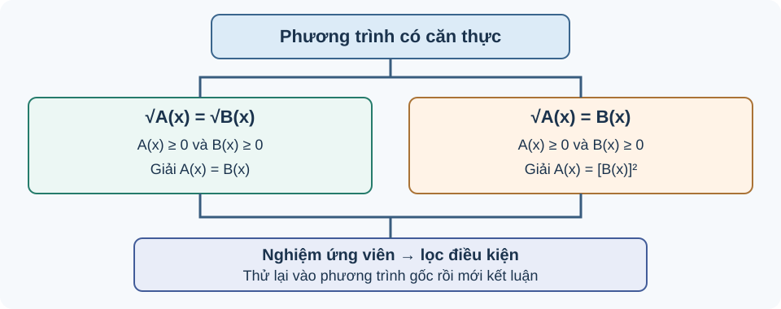

# Bài 18. Phương trình quy về phương trình bậc hai

TOÁN 10 · CHƯƠNG VI · BÀI 18

Vì sao bình phương có thể làm xuất hiện nghiệm sai? Khám phá hai dạng phương trình căn, điều kiện và cách thử nghiệm gốc.

=== "Khám phá kiến thức"

    ### Cùng tìm hiểu

    Ở những bài trước, em thường biến đổi phương trình để tìm nghiệm. Nhưng với phương trình chứa căn, có một điều cần cẩn thận: **bình phương hai vế có thể làm xuất hiện giá trị không phải nghiệm của bài toán ban đầu**. Vì sao một phép tính tưởng như đúng lại dẫn đến kết quả sai?

    Xét \(\sqrt{x+1}=x-1\). Vế trái là căn bậc hai nên không thể âm. Nếu biến đổi mà quên điều này, em có thể thu được một giá trị làm vế phải âm: phương trình mới thỏa, nhưng phương trình ban đầu thì không. Vì thế trước khi bình phương, ta phải xác định **khi nào căn có nghĩa và vế không chứa căn không âm**.

    Ta sẽ học hai dạng phương trình thường gặp, trước tiên qua các ví dụ dễ quan sát, sau đó mới tổng hợp thành quy tắc. Với mỗi dạng, em sẽ thực hiện theo thứ tự: **xét điều kiện → bình phương và giải → thử lại trong phương trình gốc**. Nghiệm của phương trình sau bình phương chỉ là *ứng viên*; bước thử lại mới cho biết giá trị nào thật sự đúng.

    ### Ví dụ trực quan

    #### Vì sao phải kiểm tra nghiệm?

    Bình phương hai vế phương trình là phép biến đổi **không luôn tương đương** nếu không kiểm soát dấu. Ví dụ từ \(x=1\) suy ra \(x^2=1\), nhưng chiều ngược lại không đúng vì \(x=-1\) cũng thỏa \(x^2=1\). Hai số đối nhau có cùng bình phương: phép bình phương đã làm mất thông tin về dấu.

    Ví dụ ngắn này giải thích vì sao sau khi bình phương, ta phải kiểm tra chiều ngược lại. Khi làm bài có căn, em giữ nguyên thói quen ấy: viết điều kiện trước, rồi thử nghiệm ở phương trình gốc.

    #### Hai căn bằng nhau phải có nghĩa trước khi bình phương

    Trước hết hãy xét phương trình có căn ở **cả hai vế**. Việc bình phương có thể đưa bài toán về phương trình không còn căn, nhưng chỉ làm như vậy khi cả hai biểu thức dưới căn đã xác định. Nếu bỏ qua điều kiện này, ta có thể nhận một nghiệm khiến căn không tồn tại trong số thực.

    Em hãy nhớ: \(\sqrt u\) chỉ có nghĩa trong số thực khi u≥0 và kết quả luôn không âm. Sau khi ghi điều kiện, bài toán thường trở thành phương trình bậc nhất hoặc bậc hai mà em đã học; lúc ấy mới thực hiện các phép biến đổi đại số.

    Với \(\sqrt{A(x)}=\sqrt{B(x)}\), đầu tiên yêu cầu \(A(x)\ge0\) và \(B(x)\ge0\). Sau đó hai căn không âm bằng nhau **khi và chỉ khi** \(A(x)=B(x)\) trong miền; đây là phép đổi tương đương *sau khi* đặt điều kiện.

    **Phân tích:** Ta phải ghi điều kiện cho **cả hai** căn, không chỉ một căn. Khi đã biết hai căn tồn tại, mới so sánh biểu thức dưới căn rồi giải. Cuối cùng, thử lại để chắc chắn nghiệm thuộc miền xác định.

    **Vận dụng.** Giải \(\sqrt{x+1}=\sqrt{2x-2}\) trong \(\mathbb R\). Trước khi tính, hãy ghi hai điều kiện dưới căn rồi mới tìm nghiệm.

    

    ??? question "Đối chiếu"

        

<strong>Đáp án:</strong> Điều kiện \(x+1\ge0,\,2x-2\ge0\Rightarrow x\ge1\). Bình phương: \(x+1=2x-2\Rightarrow x=3\). Thử: hai vế đều bằng 2. Nghiệm duy nhất x=3.

<strong>Vì sao:</strong> x=3 hợp miền x≥1, biểu thức dưới căn đều bằng 4; không có nghiệm nào khác vì phương trình tuyến tính A=B chỉ cho x=3.

Đây là câu tự luyện công khai, không chấm điểm thành thạo. Nếu chưa đúng, mở hướng dẫn tự sửa phía dưới.

    

    ??? tip "Kiểm lỗi"

        <ol><li><strong>Nhận diện lỗi:</strong> Chỉ đặt điều kiện một căn hoặc giải A=B rồi không kiểm miền.</li>
        <li><strong>Tự chẩn đoán:</strong> Trong câu Vận dụng \(\sqrt{x+1}=\sqrt{2x-2}\), mỗi căn có điều kiện riêng. Em đã viết đủ cả hai điều kiện trước khi rút về phương trình không căn chưa? Hãy xác định giao miền.</li>
        <li><strong>Kiến thức gốc:</strong> Với \(\sqrt{A(x)}=\sqrt{B(x)}\), đầu tiên yêu cầu \(A(x)\ge0\) và \(B(x)\ge0\). Sau đó hai căn không âm bằng nhau <strong>khi và chỉ khi</strong> \(A(x)=B(x)\) trong miền; đây là phép đổi tương đương *sau khi* đặt điều kiện.</li>
        <li><strong>Tự sửa:</strong> Khoanh cả A(x),B(x), lập hai dấu ≥0, giao miền rồi mới biến đổi và thử.</li>
        <li><strong>Luyện lại:</strong> Em có thể <a href="../luyen-tap/?item=THPT-G10-B18-C02">luyện lại một câu Core/Luyện tập cùng kiến thức</a>, rồi tự giải thích bằng lời của mình.</li></ol>
    #### Một căn bằng biểu thức thường: vế phải phải không âm

    <figure class="thpt-r4-plot thpt-r4-probability-figure"><figcaption>Đọc từ điều kiện đến nghiệm ứng viên, rồi luôn kiểm lại trong phương trình gốc.</figcaption></figure>

    **Cách đọc hình.** Bắt đầu ở điều kiện của căn/vế phải; tiếp theo là phép bình phương, giải phương trình rồi thử lại trong phương trình gốc. Mũi tên quay về bước kiểm tra nhắc rằng nghiệm của phương trình sau bình phương chưa chắc là nghiệm ban đầu.

    Dạng thứ hai khác ở một điểm quan trọng: chỉ **một vế có căn**, còn vế kia là biểu thức \(B(x)\). Vì căn bậc hai luôn không âm, \(B(x)\) cũng phải không âm. Đây là điều kiện mà phép bình phương dễ che khuất.

    Hãy dựa vào tính chất \(\sqrt u\ge0\): viết điều kiện dấu của vế phải trước khi đưa phương trình về dạng đại số. Sau khi phân tích thành nhân tử hay giải phương trình bậc hai, cần quay lại xét từng ứng viên.

    Với \(\sqrt{A(x)}=B(x)\), phải có \(B(x)\ge0\) (và \(A(x)\ge0\)); sau đó bình phương \(A(x)=B(x)^2\), giải và kiểm. Bình phương tự nó không bảo đảm mọi nghiệm ứng viên có dấu đúng.

    **Vận dụng.** Giải \(\sqrt{x+5}=x-1\). Hãy xét riêng dấu vế phải trước, sau đó giải phương trình bình phương và chỉ giữ nghiệm thỏa phương trình gốc.

    

    ??? question "Đối chiếu"

        

<strong>Đáp án:</strong> Phải có \(x-1\ge0\Rightarrow x\ge1\). Bình phương: \(x+5=(x-1)^2\Leftrightarrow x^2-3x-4=0\Rightarrow x=4\) hoặc \(x=-1\). Chỉ x=4 hợp lệ, thử \(\sqrt9=3=4-1\).

<strong>Vì sao:</strong> x=-1 bị loại vì vế phải −2 âm. Nghiệm duy nhất x=4 dù phương trình bình phương có hai nghiệm.

Đây là câu tự luyện công khai, không chấm điểm thành thạo. Nếu chưa đúng, mở hướng dẫn tự sửa phía dưới.

    

    ??? tip "Kiểm lỗi"

        <ol><li><strong>Nhận diện lỗi:</strong> Giữ nghiệm x=−1 chỉ vì nghiệm phương trình sau bình phương.</li>
        <li><strong>Tự chẩn đoán:</strong> Xét câu Vận dụng \(\sqrt{x+5}=x-1\). Sau khi bình phương, x=−1 xuất hiện. Hãy tính x−1 tại giá trị ấy rồi so với một căn bậc hai luôn không âm: em thấy điều gì sai?</li>
        <li><strong>Kiến thức gốc:</strong> Với \(\sqrt{A(x)}=B(x)\), phải có \(B(x)\ge0\) (và \(A(x)\ge0\)); sau đó bình phương \(A(x)=B(x)^2\), giải và kiểm. Bình phương tự nó không bảo đảm mọi nghiệm ứng viên có dấu đúng.</li>
        <li><strong>Tự sửa:</strong> Kiểm vế phải x−1≥0 trước khi xét nghiệm; thử tất cả ứng viên vào hai vế phương trình gốc.</li>
        <li><strong>Luyện lại:</strong> Em có thể <a href="../luyen-tap/?item=THPT-G10-B18-P01">luyện lại một câu Core/Luyện tập cùng kiến thức</a>, rồi tự giải thích bằng lời của mình.</li></ol>
    #### Nghiệm ngoại lai xuất hiện từ phép không tương đương

    Vậy nếu phương trình sau bình phương cho hai kết quả, có phải cả hai đều đúng? Không nhất thiết. Một kết quả có thể làm hai vế ban đầu khác dấu, dù khi bình phương chúng bằng nhau. Giá trị ấy gọi là **nghiệm ngoại lai**; ta phải kiểm tra từng ứng viên trong phương trình gốc.

    Đặc biệt, \(\sqrt{u^2}=|u|\): sau khi bình phương, một nghiệm tìm được mới chỉ là ứng viên; phải xét điều kiện để xác định nghiệm hợp lệ. Hãy luôn kiểm dấu vế không chứa căn; đây là phần không thể phục hồi chỉ bằng phép bình phương.

    Nếu \(A=B^2\) thì chỉ có \(|B|=\sqrt A\), chưa chắc \(\sqrt A=B\). Lý do có nghiệm ngoại lai là phép bình phương làm mất thông tin dấu. Một nghiệm cuối phải thỏa miền và phương trình gốc.

    **Vận dụng.** Giải \(\sqrt{2x+3}=x\). Vì vế phải là \(x\), hãy kiểm dấu của nó trước khi bình phương; giải thích vì sao một nghiệm ứng viên phải bị loại.

    

    ??? question "Đối chiếu"

        

<strong>Đáp án:</strong> Điều kiện \(x\ge0\). Bình phương \(2x+3=x^2\Leftrightarrow(x-3)(x+1)=0\), ứng viên x=3,−1. Thử: x=3 cho \(\sqrt9=3\), x=−1 làm vế phải âm (và \(\sqrt1=1\ne-1\)). Nghiệm duy nhất x=3; x=−1 ngoại lai.

<strong>Vì sao:</strong> Bình phương tạo x=−1 dù hai vế gốc trái dấu. Chỉ x=3 thỏa toàn bộ.

Đây là câu tự luyện công khai, không chấm điểm thành thạo. Nếu chưa đúng, mở hướng dẫn tự sửa phía dưới.

    

    ??? tip "Kiểm lỗi"

        <ol><li><strong>Nhận diện lỗi:</strong> Cho cả hai nghiệm từ phương trình bình phương mà không thử lại.</li>
        <li><strong>Tự chẩn đoán:</strong> Với câu Vận dụng \(\sqrt{2x+3}=x\), phương trình sau bình phương cho x=3 và x=−1. Hãy thay x=−1 vào hai vế gốc: căn bậc hai có thể bằng một số âm không?</li>
        <li><strong>Kiến thức gốc:</strong> Nếu \(A=B^2\) thì chỉ có \(|B|=\sqrt A\), chưa chắc \(\sqrt A=B\). Lý do có nghiệm ngoại lai là phép bình phương làm mất thông tin dấu. Một nghiệm cuối phải thỏa miền và phương trình gốc.</li>
        <li><strong>Tự sửa:</strong> Tạo bảng hai cột ứng viên/kiểm gốc: từng x tính căn thật và vế phải có dấu đúng hay không.</li>
        <li><strong>Luyện lại:</strong> Em có thể <a href="../luyen-tap/?item=THPT-G10-B18-P01">luyện lại một câu Core/Luyện tập cùng kiến thức</a>, rồi tự giải thích bằng lời của mình.</li></ol>
    #### Độ dài hình học buộc nghiệm dương

    Không chỉ phương trình căn mới có điều kiện: trong bài toán thực tế, chính **ý nghĩa của đại lượng** còn giới hạn nghiệm. Hãy tưởng tượng một chiếc thang tựa vào tường. Độ cao, khoảng cách chân thang và chiều dài thang đều là các độ dài, nên không thể nhận giá trị âm.

    Biết tam giác vuông, Pitago \(c^2=a^2+b^2\), độ dài phải dương và căn không âm. Để lập mô hình, hãy vẽ đúng tam giác vuông và xác định cạnh huyền trước khi dùng Pitago.

    Khi một cạnh góc vuông là h>0 và cạnh kia 5 m, cạnh huyền là \(\sqrt{h^2+25}\), phải phù hợp chiều dài thang cho trước. Giải căn rồi lọc h>0 không chỉ vì toán căn mà vì **ý nghĩa vật lý** của ẩn.

    **Phân tích:** Gọi độ cao là h và ghi miền h>0 trước. Dùng Pitago để lập \(\sqrt{h^2+25}=13\). Sau khi giải, chỉ chấp nhận độ cao dương và kiểm nghiệm bằng chính độ dài chiếc thang.

    **Vận dụng.** Một thang dài 13 m dựa tường, chân thang cách tường 5 m. Đặt h>0 là độ cao đầu thang trên tường. Lập phương trình chứa căn và tính h. Hãy ghi đúng cạnh huyền, đơn vị và điều kiện trước khi xem lời giải.

    

    ??? question "Đối chiếu"

        

<strong>Đáp án:</strong> \(\sqrt{h^2+5^2}=13\Rightarrow h^2=169-25=144\). Vì h&gt;0 nên h=12 m; thử \(\sqrt{12^2+5^2}=13\).

<strong>Vì sao:</strong> Nghiệm h=−12 bị loại do không biểu diễn độ dài. Tam giác 5–12–13 kiểm chính xác và đơn vị là mét.

Đây là câu tự luyện công khai, không chấm điểm thành thạo. Nếu chưa đúng, mở hướng dẫn tự sửa phía dưới.

    

    ??? tip "Kiểm lỗi"

        <ol><li><strong>Nhận diện lỗi:</strong> Bỏ điều kiện h&gt;0, nhầm cạnh huyền thành h hoặc nhận nghiệm −12 m.</li>
        <li><strong>Tự chẩn đoán:</strong> Tình huống đã học: chiếc thang dài 13 m tựa tường, chân thang cách tường 5 m; h là độ cao đầu thang trên tường (m). Em có đặt h>0 và đánh dấu **cạnh huyền 13 m** chưa? Nếu giải ra h=−12, tại sao không được nhận là độ cao?</li>
        <li><strong>Kiến thức gốc:</strong> Khi một cạnh góc vuông là h&gt;0 và cạnh kia 5 m, cạnh huyền là \(\sqrt{h^2+25}\), phải phù hợp chiều dài thang cho trước. Giải căn rồi lọc h&gt;0 không chỉ vì toán căn mà vì <strong>ý nghĩa vật lý</strong> của ẩn.</li>
        <li><strong>Tự sửa:</strong> Vẽ hình và đánh dấu <strong>cạnh huyền 13 m</strong> và <strong>cạnh góc vuông 5 m</strong>, viết h&gt;0, rồi thử lại định lí Pitago với nghiệm tìm được.</li>
        <li><strong>Luyện lại:</strong> Em có thể <a href="../luyen-tap/?item=THPT-G10-B18-P04">luyện lại một câu Core/Luyện tập cùng kiến thức</a>, rồi tự giải thích bằng lời của mình.</li></ol>
    ### Thuật ngữ, kiến thức và kỹ năng

    **Thuật ngữ:** Phương trình chứa căn, miền xác định, bình phương hai vế, biến đổi tương đương, nghiệm ngoại lai, thử lại nghiệm.

    **Sau bài học, em cần làm được:** Ghi điều kiện trước khi bình phương; giải phương trình bậc hai thu được; kiểm từng nghiệm trong phương trình gốc và loại nghiệm ngoại lai có lý do.

=== "Kiến thức SGK"

    ### 2.1. Phương trình dạng \(\sqrt{A(x)}=\sqrt{B(x)}\)

    
<strong>Khái niệm — Phương trình chứa căn:</strong> Đây là phương trình trong đó ẩn xuất hiện dưới dấu căn. Khi giải trong tập số thực, phải tìm các giá trị làm những biểu thức dưới căn không âm trước khi biến đổi. Bài này xét hai dạng thông dụng.

    Với hai vế đều là căn bậc hai, phương trình tương đương với hệ điều kiện

    \[
    A(x)=B(x),\qquad A(x)\ge0,\quad B(x)\ge0.
    \]

    
<strong>Quy tắc — Hai căn bằng nhau:</strong> Cần điều kiện của <em>cả hai căn</em>; trong miền ấy, hai căn bằng nhau khi các biểu thức dưới căn bằng nhau. Giải phương trình không căn xong phải giữ đúng miền đã xác định.

    **Phân tích:** Khi cả hai căn đã có nghĩa, hai căn bậc hai đều không âm; chúng bằng nhau khi giá trị dưới căn bằng nhau. Vì vậy giải \(A(x)=B(x)\), giữ lại các nghiệm làm hai biểu thức dưới căn không âm, rồi kiểm tra trong phương trình ban đầu.

    **Ví dụ 1.**

    \[
    \sqrt{x^2-3x+4}=\sqrt{x+2}.
    \]

    Bình phương được \(x^2-3x+4=x+2\), suy ra \(x^2-4x+2=0\). Hai nghiệm ứng viên \(x=2\pm\sqrt2\). Vì cả hai đều lớn hơn \(-2\), biểu thức \(x+2\ge0\); thay trở lại cho thấy hai vế căn bằng nhau. Vậy \(\boxed{x=2-\sqrt2\text{ hoặc }x=2+\sqrt2}\).

    ### 2.2. Phương trình dạng \(\sqrt{A(x)}=B(x)\)

    Vì vế trái không âm, phương trình tương đương với

    \[
    \begin{cases}
    A(x)=B(x)^2,\\
    B(x)\ge0.
    \end{cases}
    \]

    
<strong>Quy tắc — Một căn bằng biểu thức:</strong> Vế không chứa căn phải không âm. Chỉ sau khi giữ điều kiện ấy mới bình phương để giải; mọi kết quả từ phương trình đã bình phương đều cần kiểm với phương trình ban đầu.

    Khi hai điều kiện này thỏa, \(A(x)=B(x)^2\ge0\) cũng bảo đảm căn có nghĩa. Chiều ngược lại vì thế đúng **khi vẫn giữ điều kiện dấu**; không thể chỉ bình phương rồi bỏ điều kiện.

    **Quy trình 4 bước:** (1) đặt điều kiện \(B(x)\ge0\) và miền xác định nếu cần; (2) bình phương đưa về phương trình bậc hai (hoặc bậc nhất); (3) giải tìm nghiệm ứng viên; (4) **loại nghiệm không thỏa điều kiện và thử lại**. Nếu có nhiều nghiệm ứng viên, phải kiểm từng nghiệm, không lựa chọn theo cảm giác.

    **Ví dụ 2.**

    \[
    \sqrt{2x+3}=x-1.
    \]

    Điều kiện \(x\ge1\). Bình phương: \(2x+3=(x-1)^2\), hay \(x^2-4x-2=0\). Nghiệm ứng viên \(x=2\pm\sqrt6\). Vì \(2-\sqrt6<1\), loại nghiệm này; \(2+\sqrt6\ge1\) thỏa phương trình gốc. Vậy \(\boxed{x=2+\sqrt6}\).

=== "Ví dụ"

    ### Ví dụ — Vì sao phải kiểm nghiệm sau khi bình phương?

    **Đề bài.** Giải \(\sqrt{x+1}=x-1\).

    **Phân tích:** Căn thức không âm, nên trước hết cần \(x+1\ge0\) và **\(x-1\ge0\)**; khi đó mới bình phương hai vế an toàn.

    **Lời giải.** Điều kiện gộp \(x\ge1\). Bình phương: \(x+1=(x-1)^2=x^2-2x+1\), hay \(x^2-3x=0\), suy ra \(x=0\) hoặc \(x=3\). \(x=0\) không đạt điều kiện và không thỏa gốc. Với \(x=3\), \(\sqrt4=2=3-1\), nên nghiệm duy nhất là \(x=3\).

   

    **Tự kiểm:** Nếu chỉ ghi hai nghiệm \(\{0,3\}\), em đã giải phương trình sau bình phương chứ chưa giải xong phương trình ban đầu.

    **Vận dụng.** Ba câu sau củng cố cách xét điều kiện và loại nghiệm ngoại lai.

    1. Giải \(\sqrt{x+2}=x\).
    2. Giải \(\sqrt{x+5}=\sqrt{2x+1}\).
    3. Cho \(\sqrt{x^2+2x+5}=x+1\). Phương trình có nghiệm thực hay không? Giải thích.

    ??? question "Đối chiếu ba câu Vận dụng"

        <ol>
        <li>\(x\ge0\). Bình phương \(x+2=x^2\iff (x-2)(x+1)=0\); chỉ \(x=2\) đạt điều kiện.</li>
        <li>\(x+5=2x+1\iff x=4\). Thay vào hai căn cho cùng \(\sqrt9=3\), vậy \(x=4\).</li>
        <li>\(x+1\ge0\). Bình phương được \(x^2+2x+5=(x+1)^2=x^2+2x+1\), mâu thuẫn \(5=1\). Do đó vô nghiệm.</li>
        </ol>

    ### Ví dụ mở rộng — Hai căn thức và nghiệm ngoại lai

    **Đề bài.** Giải phương trình

    \[
    \sqrt{x^2+7x+11}=\sqrt{x+3}.
    \]

    **Phân tích:** Phải xét miền xác định của cả hai căn. Khi bình phương, ta tìm các nghiệm ứng viên rồi kiểm lại từng căn; giá trị nằm ngoài miền sẽ bị loại.

    **Lời giải.** Điều kiện: \(x\ge-3\) và \(x^2+7x+11\ge0\). Bình phương hai vế (trong miền xác định) và rút gọn:

    \[
    x^2+7x+11=x+3 \iff x^2+6x+8=0
    \iff(x+2)(x+4)=0.
    \]

    Hai nghiệm ứng viên là \(x=-2\), \(x=-4\). Tuy nhiên, \(x=-4\) làm \(x+3=-1<0\), **không thuộc miền xác định**; còn \(x=-2\) cho cả hai vế bằng \(1\). Vì vậy \(\boxed{S=\{-2\}}\).

    **Điều cần nhớ.** Không phải cứ bình phương rồi giải phương trình đại số là thu được các nghiệm của phương trình chứa căn.

    ### Ví dụ mở rộng — Ứng dụng độ dài trong hình học

    **Đề bài.** Một tam giác vuông có hai cạnh góc vuông dài \(x\) m và \(4\) m, với \(x>0\). Tìm \(x\) nếu cạnh huyền dài \(2x-1\) m.

    **Phân tích:** Vì cạnh huyền phải lớn hơn mỗi cạnh góc vuông, trước hết cần điều kiện độ dài và điều kiện vế phải không âm. Sau đó dùng Pitago để lập phương trình căn, rồi kiểm nghiệm lại bằng độ dài.

    **Lời giải.** Theo định lí Pythagore:

    \[
    \sqrt{x^2+16}=2x-1.
    \]

    Điều kiện cần là \(2x-1\ge0\), tức \(x\ge\frac12\). Bình phương được

    \[
    x^2+16=(2x-1)^2
    \iff 3x^2-4x-15=0
    \iff(3x+5)(x-3)=0.
    \]

    Hai nghiệm ứng viên là \(x=3\) và \(x=-\frac53\). Chỉ \(x=3\) đạt điều kiện. Thử lại: \(\sqrt{3^2+4^2}=5=2\cdot3-1\). Vậy cạnh góc vuông cần tìm dài \(\boxed{3\text{ m}}\).

    **Điều cần nhớ.** Những bài hình học như thế này giúp em luyện cách đặt điều kiện cho căn thức và thử lại nghiệm ứng viên trong phương trình ban đầu.

    ### Ví dụ mở rộng — Vận dụng: hai hành trình gặp nhau cùng thời điểm

    **Bối cảnh.** Khi hai người đi theo hai lộ trình khác nhau, khoảng cách chưa đủ để quyết định điểm gặp. Ta cần đổi từng khoảng cách thành **thời gian = quãng đường / vận tốc**. Đây cũng là lúc phương trình chứa căn xuất hiện tự nhiên: đường đi xiên là cạnh huyền của tam giác vuông.

    **Đề bài.** Hai người xuất phát cùng lúc và cần gặp nhau tại điểm \(M\) trên đoạn đường thẳng \(BC\) dài \(8\) km. Người thứ nhất xuất phát tại \(A\), cách \(B\) một đoạn vuông góc \(AB=3\) km, đi thẳng từ \(A\) tới \(M\) với vận tốc \(5\) km/h. Người thứ hai xuất phát tại \(C\), đi dọc đoạn \(CM\) với vận tốc \(4\) km/h. Hỏi phải chọn \(M\) cách \(B\) bao nhiêu kilômét để hai người đến cùng lúc?

    **Phân tích:** Hai người xuất phát cùng lúc và muốn đến M cùng thời điểm, nên thời gian đi của họ phải bằng nhau. Để lập hai thời gian, ta tìm quãng đường từng người đi, trong đó đoạn AM được tính bằng Pitago. Điều kiện M nằm trên BC phải được giữ đến cuối.

    **Lời giải.**

    **Bước 1 — hình dung và đặt điều kiện.** Đặt \(x=BM\) (km), \(0\le x\le8\), vì \(M\) nằm trên đoạn \(BC\). Tam giác \(ABM\) vuông tại \(B\), nên \(AM=\sqrt{x^2+3^2}=\sqrt{x^2+9}\), còn \(CM=8-x\).

    
<table class="thpt-g10-knowledge-table">
    <thead><tr><th>Lộ trình</th><th>Quãng đường</th><th>Vận tốc</th><th>Thời gian</th></tr></thead>
    <tbody>
    <tr><td>\(A\to M\)</td><td>\(\sqrt{x^2+9}\) km</td><td>\(5\) km/h</td><td>\(\dfrac{\sqrt{x^2+9}}5\) giờ</td></tr>
    <tr><td>\(C\to M\)</td><td>\(8-x\) km</td><td>\(4\) km/h</td><td>\(\dfrac{8-x}4\) giờ</td></tr>
    </tbody></table>

    **Bước 2 — giải thích phương trình.** Vì cả hai cùng xuất phát và phải đến cùng lúc, ta **cho hai thời gian bằng nhau**:

    \[
    \frac{\sqrt{x^2+9}}5=\frac{8-x}4
    \iff4\sqrt{x^2+9}=5(8-x).
    \]

    Trong miền \(0\le x\le8\), hai vế đều không âm, nên có thể bình phương:

    \[
    16(x^2+9)=25(8-x)^2
    \iff9x^2-400x+1456=0
    \iff(x-4)(9x-364)=0.
    \]

    **Bước 3 — xét từng ứng viên.** Phương trình sau bình phương cho \(x=4\) hoặc \(x=\dfrac{364}{9}\). Giá trị \(\dfrac{364}{9}>8\) nằm ngoài đoạn \(BC\), khiến \(CM=8-x<0\), nên **không phải điểm gặp hợp lệ**.

    **Bước 4 — thử lại điều kiện gặp nhau.** Với \(x=4\), đường xiên \(AM=\sqrt{4^2+3^2}=5\) km; người thứ nhất đi \(5/5=1\) giờ. Người thứ hai đi \(CM=8-4=4\) km, cũng hết \(4/4=1\) giờ. Vậy **điểm gặp cách B đúng \(4\) km**.

    **Tự kiểm khi gặp bài tương tự:** Hãy kiểm lần lượt đoạn đường có tồn tại hay không, vế chứa căn có nghĩa hay không, thời gian có không âm hay không, rồi thay nghiệm vào **hai thời gian ban đầu**. Một nghiệm đúng sau bình phương chưa đủ để khẳng định hai người gặp nhau.
    

=== "Lỗi thường gặp"

    Một nghiệm tìm được sau khi bình phương chưa chắc là nghiệm của phương trình ban đầu. Khi kiểm lời giải, em hãy chú ý cả **điều kiện của căn** và **dấu của vế không chứa căn**. Với \(\sqrt{A(x)}=B(x)\), phải có \(B(x)\ge0\).

    Một điểm dễ nhầm khác là phép khai căn: với \(u\in\mathbb R\), ta có \(\sqrt{u^2}=|u|\); không được tự thay bằng \(u\) khi chưa biết dấu của \(u\).

    Bốn tình huống khắc phục dưới đây liên hệ trực tiếp với các câu **Vận dụng** trong bài. Mỗi tình huống đều nhắc lại dữ kiện cần thiết, chỉ rõ bước sai và hướng tự sửa; em không cần phải nhớ lại đề từ tab trước.

    **Học tiếp:** [Core và Luyện tập](luyen-tap.md) · [Tự kiểm tra cuối chương](tu-kiem-tra-chuong.md).

    
Nguồn toán học: SGK Toán 10 Kết nối tri thức với cuộc sống và học liệu SLM hiện hành. Lời giảng được biên tập nhằm hỗ trợ tự học độc lập.

